# jimainotebook_7DizKqDjDUY — 關鍵畫面索引

- 來源逐字稿：[jimainotebook_7DizKqDjDUY_FIN.srt](jimainotebook_7DizKqDjDUY_FIN.srt)
- 影片：https://www.youtube.com/watch?v=7DizKqDjDUY
- 截圖數：54

## 00:00:08

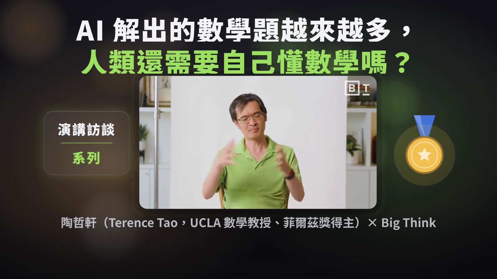

**逐字稿片段：** 大家好,我是Jim,這裡是AI Notebook,這一集是演講訪談系列,主角是陶哲軒,很多人說他是現在全世界最厲害的數學家之一。 我們要問的是, AI解說的數學題越來越多,

**話題推測：** 影片開場與主題介紹：陶哲軒與AI數學。

---

## 00:00:18

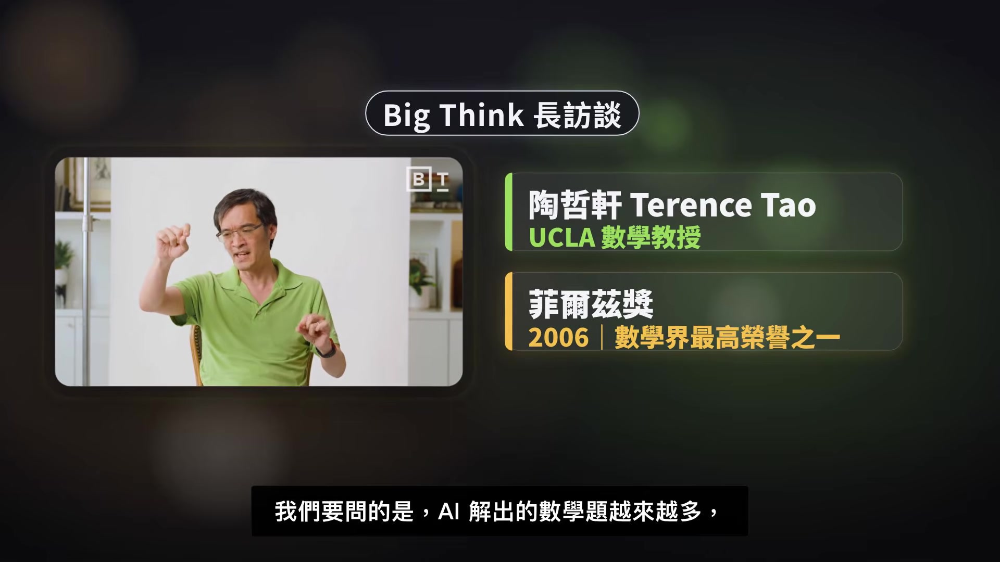

**逐字稿片段：** 人類還需要自己的數學嗎?今年9月,

**話題推測：** 提出核心問題：人類還需要自己的數學嗎？

---

## 00:00:21

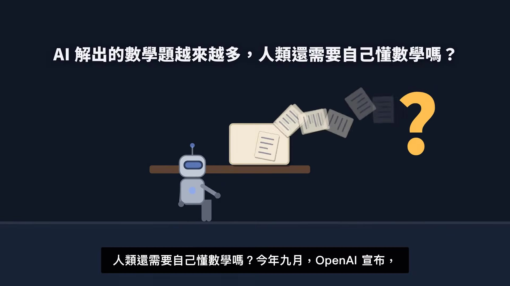

**逐字稿片段：** OpenAI宣佈, 他的模型證明瞭一道懸賞100萬美元的數學難題。 三天後,

**話題推測：** OpenAI宣布AI證明百萬美元數學難題。

---

## 00:00:26

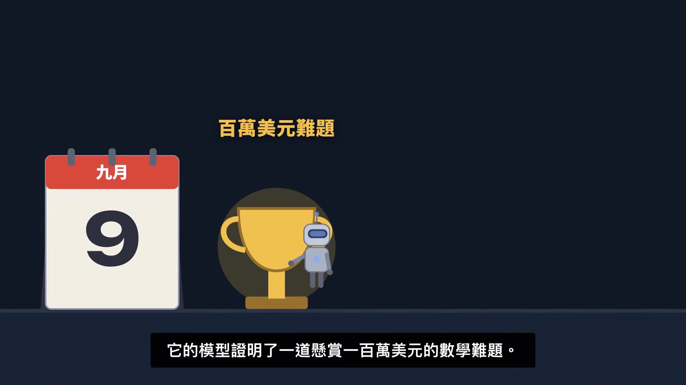

**逐字稿片段：** 陶哲軒和另外24位菲爾茲獎得主發了一封聯合聲明, 說AI公司和數學界的目標嚴重錯位, AI越來越會給題,

**話題推測：** 陶哲軒等24位菲爾茲獎得主發聯合聲明。

---

## 00:00:34

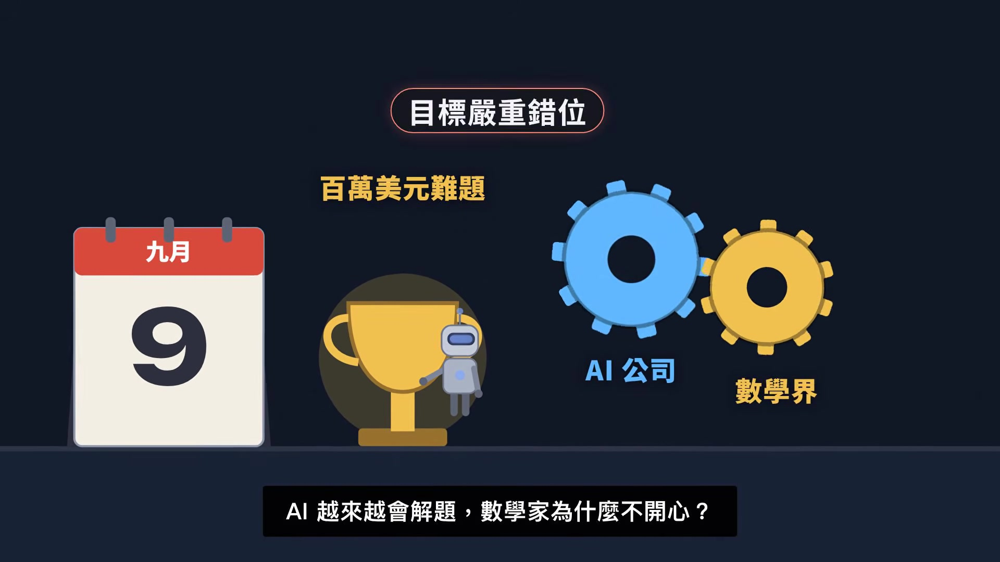

**逐字稿片段：** 數學家為什麼開心?我們分三步看。 先看數學家到底在做什麼 再看AI現在到底多會解題 最後看答案越來越多以後 問題出在哪裡

**話題推測：** 影片結構預告，分三步解析。

---

## 00:00:43

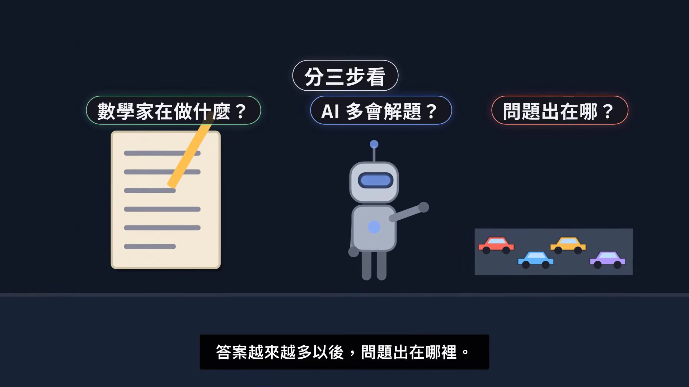

**逐字稿片段：** 先介紹他 陶哲軒在澳洲出生 10歲就去參加國際數學奧林匹亞 13歲拿到金牌 是這個比賽史上最年輕的金牌得主

**話題推測：** 介紹陶哲軒的背景與早期數學成就。

---

## 00:00:51

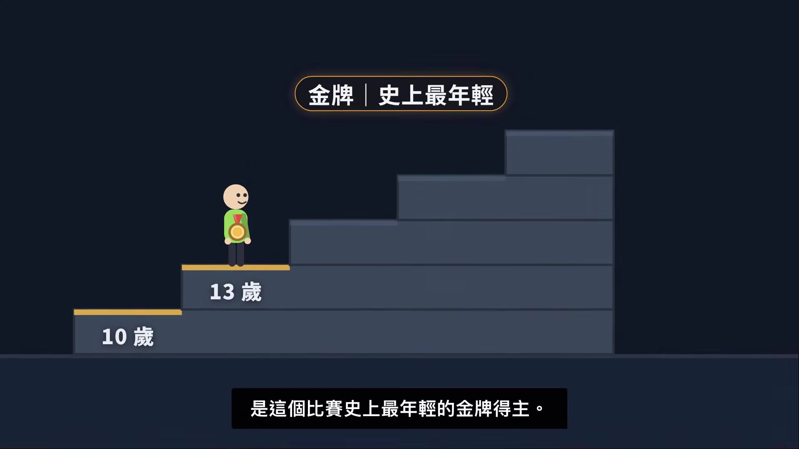

**逐字稿片段：** 他21歲在普林斯頓拿到博士 24歲成為加州大學洛杉磯分校的正教授 31歲他拿到菲爾茲獎 這個獎常被叫做數學界的諾貝爾獎 4年頒一次 只頒給40歲以下的數學家

**話題推測：** 陶哲軒學術生涯的重要里程碑（博士、教授）。

---

## 00:01:02

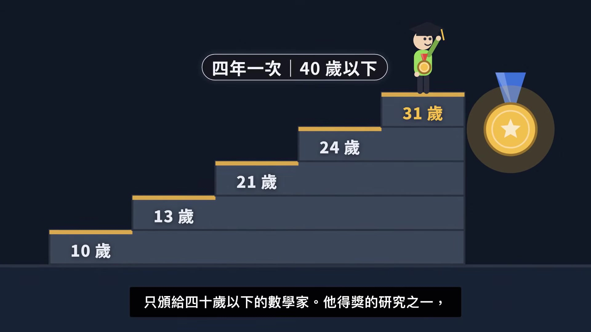

**逐字稿片段：** 他得獎的研究之一 是跟Ben Green一起證明 知數里面 可以找到任意場 間隔一樣的一串數字

**話題推測：** 陶哲軒與Ben Green合作證明質數定理的畫面或圖表。

---

## 00:01:09

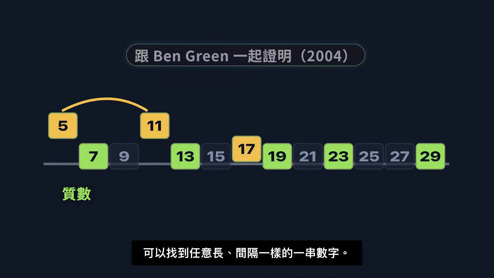

**逐字稿片段：** 這段訪談來自Big Think 8月底上架 長度一個半小時 前一個小時 他在講他的新書 數學的六個基本概念 後面半小時 講AI 我們先從前面接一個問題

**話題推測：** 說明訪談來源Big Think及其內容劃分。

---

## 00:01:20

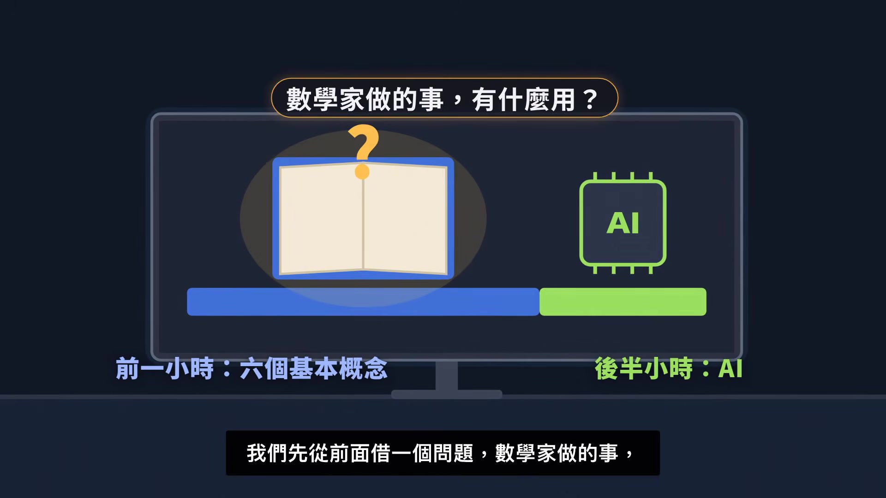

**逐字稿片段：** 數學家做的事到底有什麼用 他舉了一個例子

**話題推測：** 新問題探討：數學家做的事有什麼用？

---

## 00:01:23

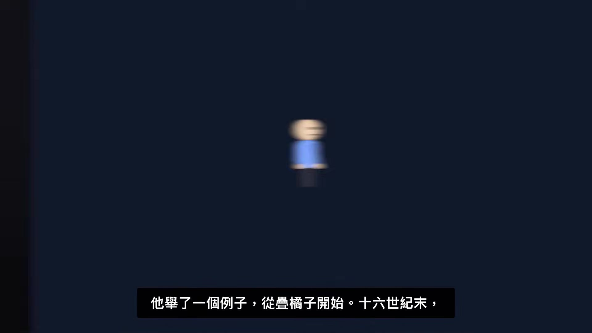

**逐字稿片段：** 從疊菊子開始 16世紀末 有個英國航海家想知道 船艙裡的圓形炮彈 怎麼堆最省空間 這個問題後來傳到 天文學家科普勒手上 科博勒猜最好的堆法 就是現在水果攤疊橘子的那種 一層排成三角形格子 下一層戳開放上去 大約可以裝滿74%的空間 這個猜測叫科博勒猜想 他等了快390年

**話題推測：** 引入「疊橘子」問題作為數學應用案例。

---

## 00:01:43

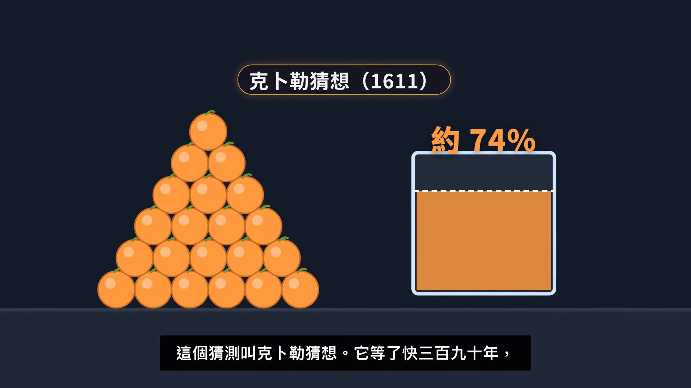

**逐字稿片段：** 1998年 數學家Thomas House 採用電腦證明他 可是神搞人說 電腦算的部分 他們沒辦法全部檢查 一直到2014年 證明被翻成一種 專門檢查證明的電腦語言 大家才100%確定 有趣的是後面

**話題推測：** 克卜勒猜想的證明歷程與年代標示。

---

## 00:01:57

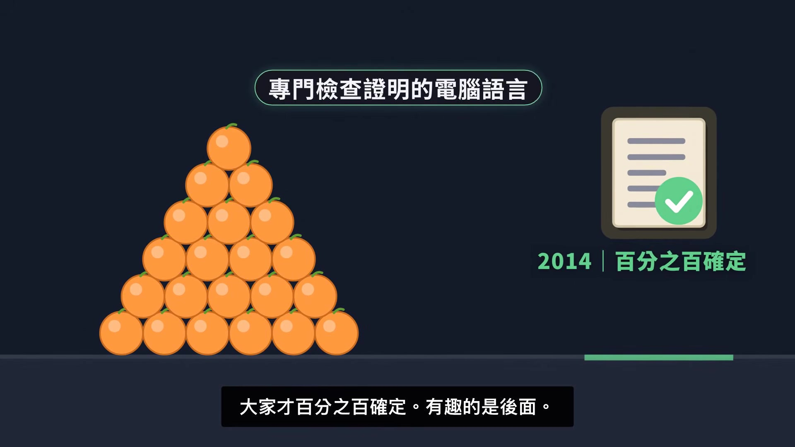

**逐字稿片段：** 數學家 接著問四維五維 甚至幾千維的空間要怎麼疊 聽起來沒有用 變成一長串零和一 要讓每個人的訊號 不會被認錯 就是在很高維度的空間裡 讓訊號彼此離得夠遠

**話題推測：** 討論高維空間的疊球問題概念。

---

## 00:02:08

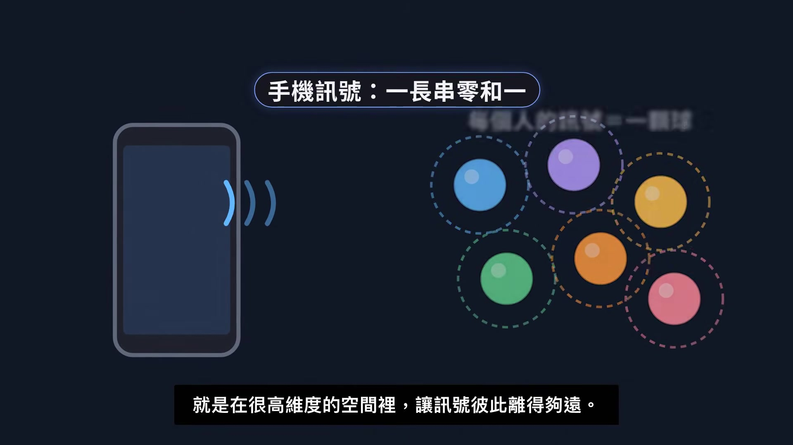

**逐字稿片段：** 陶澤軒說 整個無線通訊產業 就是建立在高維度的 疊局子上 疊局子的故事 從好奇到有用 花了好幾百年 陶澤軒說

**話題推測：** 高維疊球問題應用於無線通訊產業的示意圖。

---

## 00:02:16

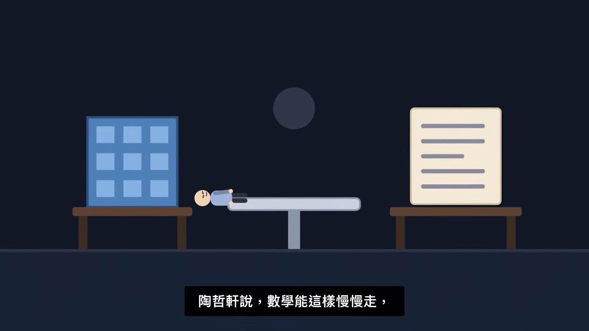

**逐字稿片段：** 數學能這樣慢慢走 是因為數學有一個特權 失敗很便宜 開公司做錯決定 公司會倒 外科醫生切錯地方 病人會受傷 可是解數學題假設錯了 換一個再來就好 所以他做研究的方法是先試 失敗再試 走不通的路排除的夠多 剩下那條就自己孵出來 他說等你真的解出來 已經熟到覺得理所當然 不會有那種靈光一閃的感覺 很多人想像天才數學家 坐著坐著突然想到答案 陶哲軒自己的經驗不是這樣

**話題推測：** 闡述數學「失敗很便宜」的特點。

---

## 00:02:43

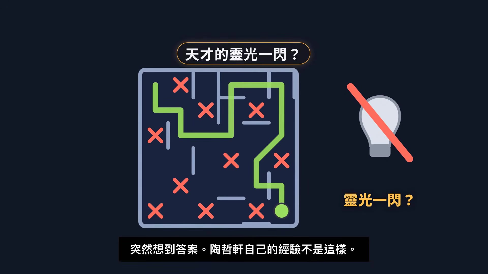

**逐字稿片段：** 聽他怎麼說 他舉自己的例子

**話題推測：** 播放陶哲軒關於數學研究方法的訪談片段。

---

## 00:03:06

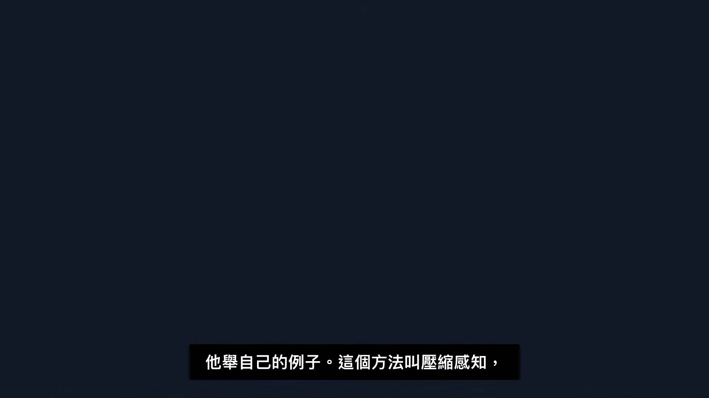

**逐字稿片段：** 這個方法叫壓縮感知 英文是Compressed Sensing 他要解決的問題是 用很少的資料 還原出一張清楚的影像 故事從醫院開始

**話題推測：** 介紹「壓縮感知」(Compressed Sensing)方法。

---

## 00:03:14

**逐字稿片段：** 以前造核磁共振 要在機器裡躺好幾分鐘 機器才收得到夠多資料 如果只躺半分鐘 用當時的標準算法 影像糊到沒辦法看病 小孩子躺不住 有時候還得打鎮靜劑

**話題推測：** 核磁共振成像資料不足的醫療問題圖示。

---

## 00:03:23

**逐字稿片段：** 朋友數學家Emmanuel Candice 跟一位工程師試了另一種算法 結果資料很少 影像卻幾乎跟原本一樣清楚 他們解釋不了 拿去給陶哲軒看 陶哲軒的第一個反應是 不可能

**話題推測：** Emmanuel Candice等發現新算法解決影像模糊問題。

---

## 00:03:35

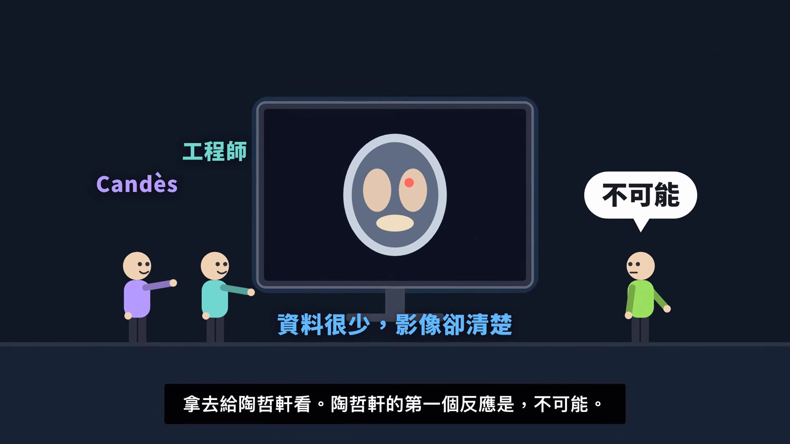

**逐字稿片段：** 聽他怎麼說 他回家想寫一個證明 說資料不夠這件事做不到 寫到一半有一部怎麼樣都不成立 他繼續往下想

**話題推測：** 播放陶哲軒對壓縮感知突破的反應訪談片段。

---

## 00:04:01

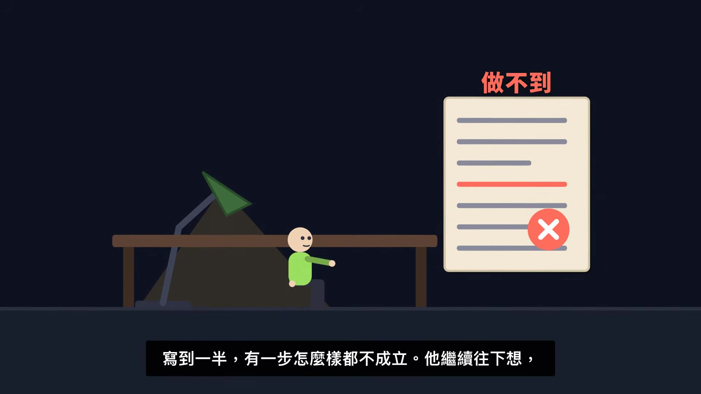

**逐字稿片段：** 發現反過來才對 只要測量的方式符合某個條件 資料再少也能還原 隔天他回去跟他們解釋為什麼 後來大家發現地震學家天文學家 早就各自有類似的技巧 只是都說不出為什麼有效 數學把原因講清楚以後 它變成一個通用的方法 現在跟最小兵方法寫在同一本教科書裡

**話題推測：** 陶哲軒解釋壓縮感知為何有效及通用性。

---

## 00:04:19

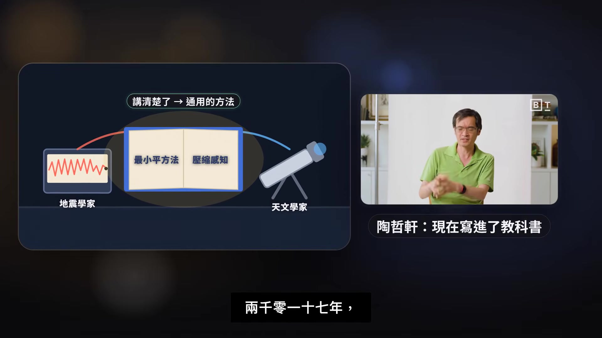

**逐字稿片段：** 2017年 美國食品藥物管理局 通過第一批用這套方法的核磁共振 廠商說 原本要4分鐘的心臟掃描 可以縮到16秒

**話題推測：** 2017年FDA通過壓縮感知核磁共振應用，顯示掃描時間縮短。

---

## 00:04:27

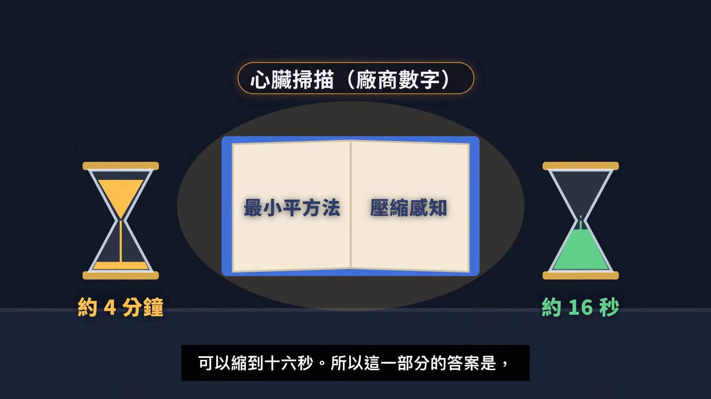

**逐字稿片段：** 所以這一部分的答案是 數學家做的事 不只是拿到答案 是在一次次失敗裡 搞懂答案為什麼 對 再把它講到別人也懂 最後寫進教科書 疊局子變成手機訊號 失敗的證明 變成更快的核磁共振 都是這樣來的 記住這條路 等一下AI會在這條路上 走得很快

**話題推測：** 總結數學家工作：理解原因並推廣知識。

---

## 00:04:46

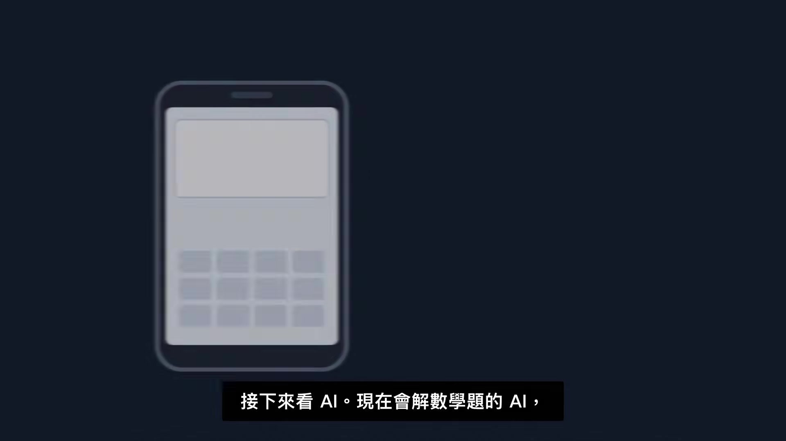

**逐字稿片段：** 現在會解數學題的AI 多半是大型語言模型

**話題推測：** 新主題：AI如何解數學題，以大型語言模型為例。

---

## 00:04:49

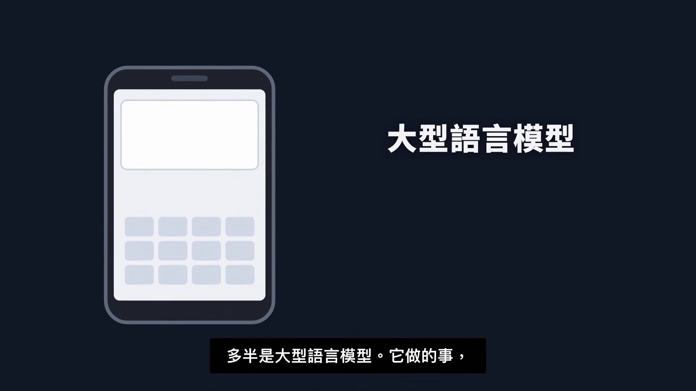

**逐字稿片段：** 他做的是 說穿了是猜下一個字 你說玫瑰是紅的 紫羅蘭是 他會猜藍的 手機打字時跳出來的建議 就是很小的版本 把幾兆筆資料餵給他 再花幾百萬美元的電腦運算 他猜出來的句子就不再是亂碼 像一個人在講話 再叫他一步一步來 每一步都檢查 他就能寫出數學證明 很多時候寫的是垃圾 可是試夠多次檢查夠嚴 成功率就不是零 陶哲軒說 這是一種很奇怪的解題方法 跟我們想象中 那種一步一步推理的思考很不一樣 他用了一個比喻

**話題推測：** 解釋大型語言模型（LLM）的工作原理：猜測下一個字。

---

## 00:05:17

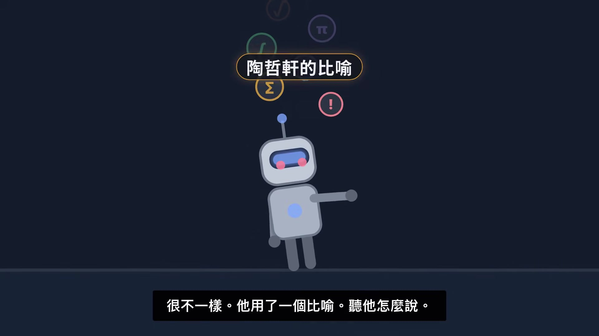

**逐字稿片段：** 他讓他們說 一個懂很多 有點喝醉 一直丟點子的朋友 這個比喻 我們最後還會用到

**話題推測：** 引用陶哲軒對AI解題方式的比喻訪談片段。

---

## 00:05:42

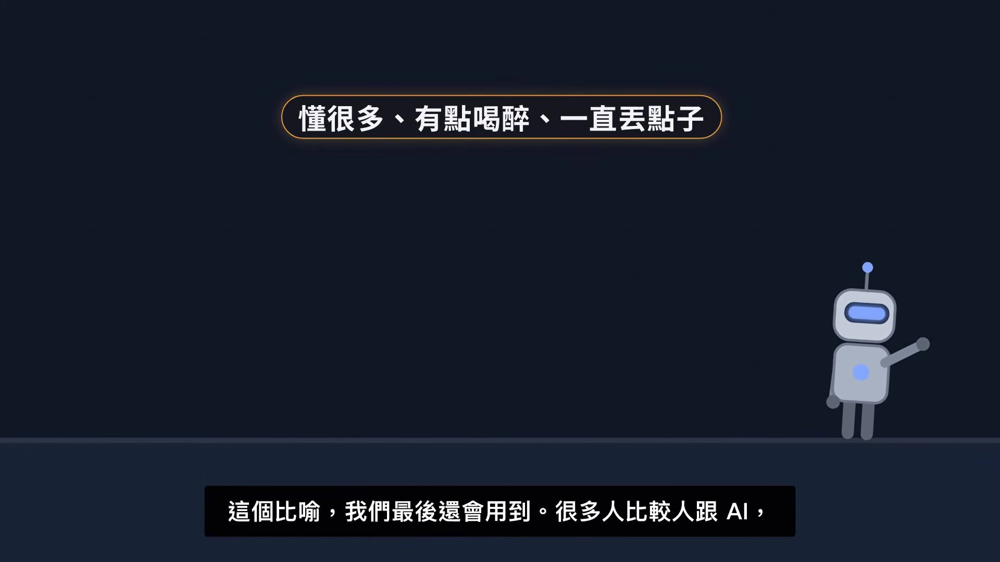

**逐字稿片段：** 很多人比較人跟AI 會畫成一條線 簡單題難題 很難的題 看誰走得比較遠 曹澤宣說這樣想太單一 人類數學家的長處是深度 一輩子挑一兩個很難 那不是不可能的問題 慢慢挖 AI碰到真正的難題 現在還是很差 幾乎是亂猜 AI的長處是廣度 很多問題其實不難 只是沒人有空看 或者關鍵的方法 藏在一篇1970年代的人文論文裡 AI可以把各種方法 一個一個試上去

**話題推測：** 比較人類與AI在數學上的長處（深度與廣度）的圖表。

---

## 00:06:07

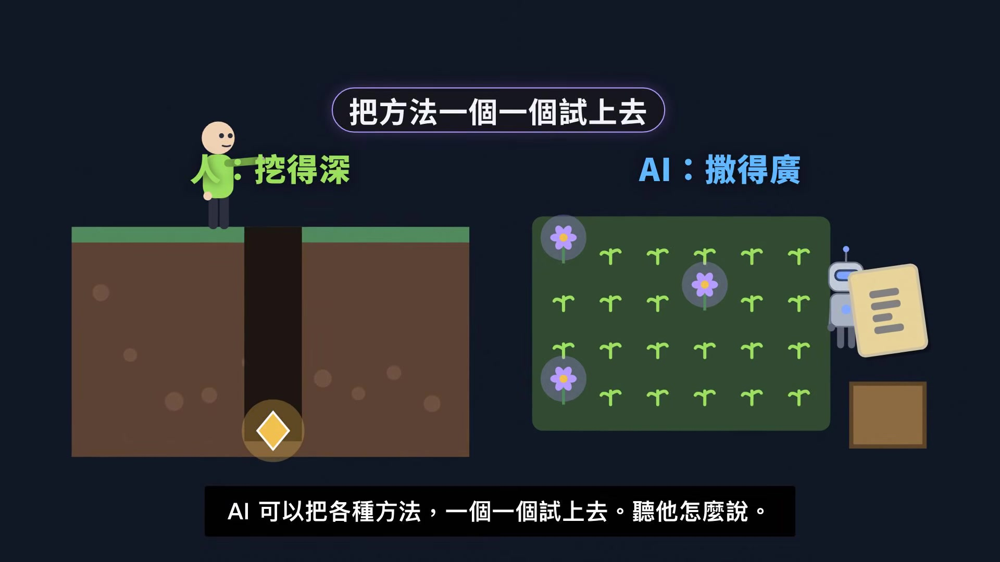

**逐字稿片段：** 聽他怎麼說 一千題解五十題 未必是你最想解的那五十題 可是陶哲軒說 這已經很了不起了

**話題推測：** 播放陶哲軒解釋AI如何找到非常規解法的訪談片段。

---

## 00:06:30

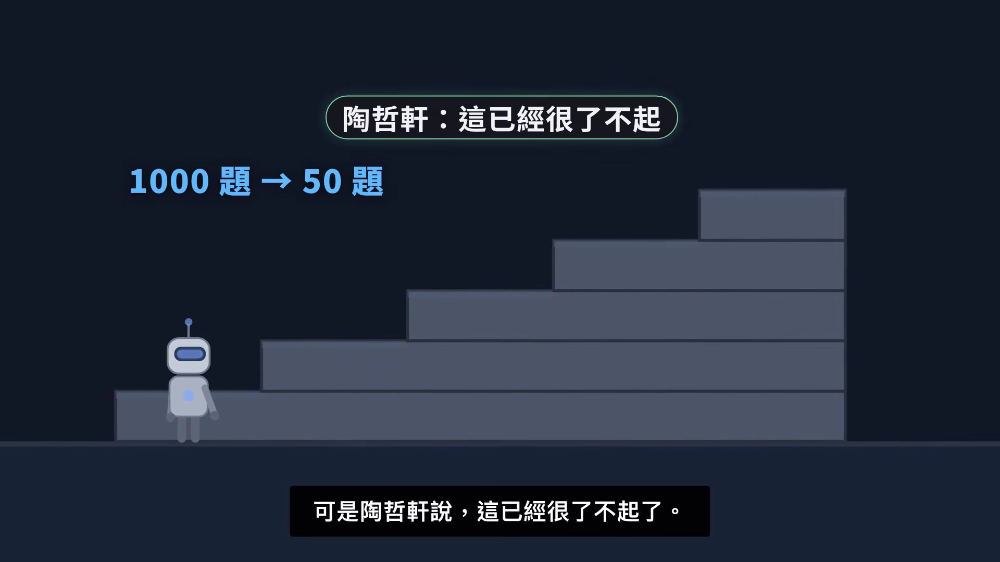

**逐字稿片段：** 他整理過這幾年的進展 大約四年前 AI指揮國中數學 後來是高中奧林匹亞競賽 研究者資格考 再來開始解一些冷門的小問題 很多是數學家愛迪許留下來 卻沒人認真看過的題目

**話題推測：** 回顧AI近年來在數學解題上的進展時間線。

---

## 00:06:41

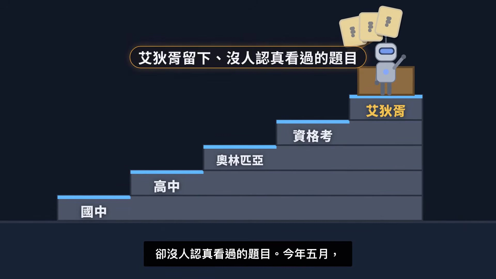

**逐字稿片段：** 今年五月 OpenAI來模型做到一件大事 愛迪虛在1946年問過 平面上放很多點 最多能有幾對點 去提剛好是1 大家一直以為 排成方格子那種排法 差不多就是最好的 AI找到了更好的排法 推翻了這個猜想 外部的數學家也檢查過 陶澤軒說 已經有人用AI的技巧 解開附近幾個問題

**話題推測：** OpenAI模型在埃爾德什問題上的突破及其解法圖示。

---

## 00:07:01

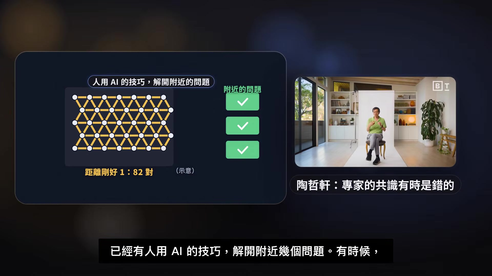

**逐字稿片段：** 有的時候 AI就像一雙沒有神經的眼睛 專家都往同一個方向走 他剛好從另一邊找到路 可是他也提醒

**話題推測：** AI像「沒有神經的眼睛」，從不同角度找路的比喻畫面。

---

## 00:07:07

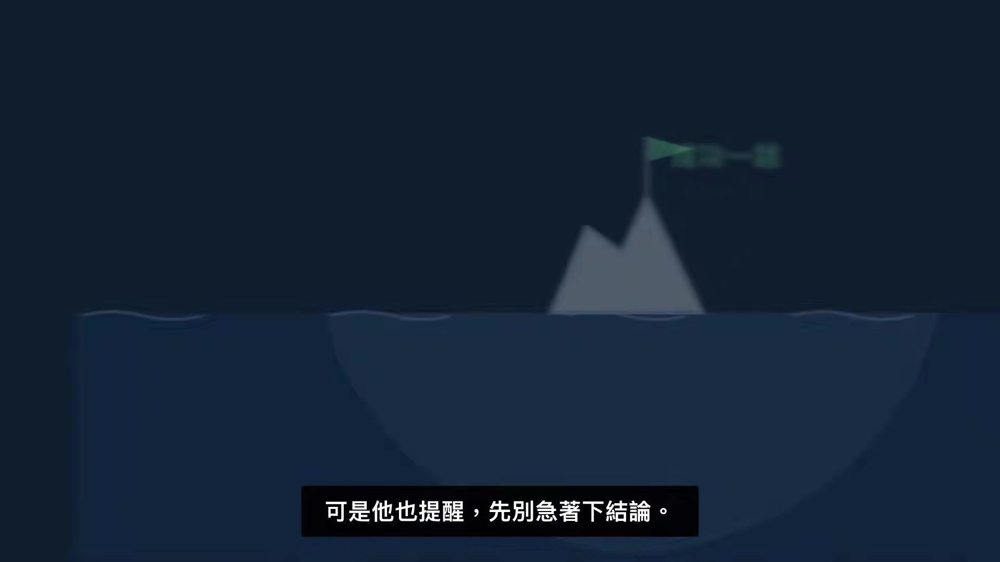

**逐字稿片段：** 先別急著下結論 這些成果多半是私人公司做的 他們沒有公開花了多少錢 也沒說試了幾題才成功一題 是10題裡成功一題 還是100題裡成功一題 我不知道 比較公平的測試

**話題推測：** 提醒AI研究成果背後缺乏公開成本與成功率數據。

---

## 00:07:18

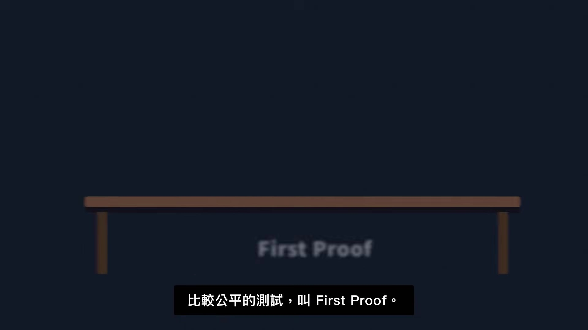

**逐字稿片段：** 叫First Proof 一群數學家出10道研究等級的題目 答案先保密再讓AI來做

**話題推測：** 介紹「First Proof」公平測試AI解題能力的標準。

---

## 00:07:23

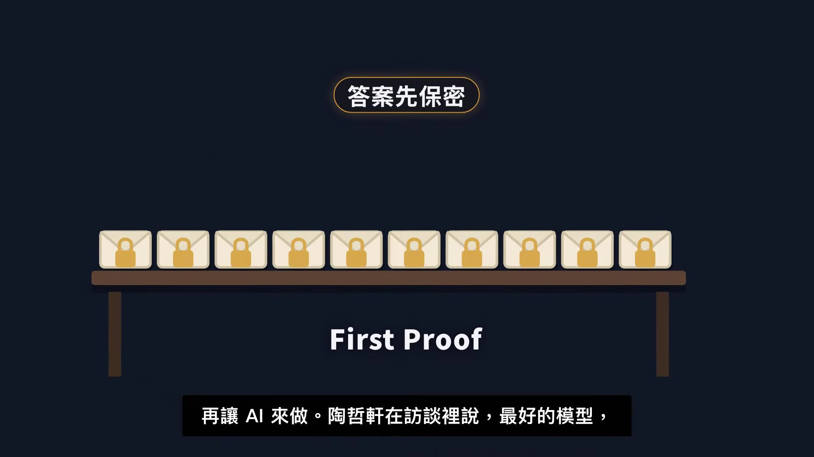

**逐字稿片段：** 陶喆軒在訪談裡說 最好的模型 10題大約做出5、6題 今年6月那一輪 評審在哈佛開了兩天會 一題一題看 表現最好的系統 大約6到7題基本正確 可是也教出一大堆品質很差的答案 有些錯的答案 一題就花了將近1000美元

**話題推測：** 揭示First Proof測試中AI的表現與成本數據。

---

## 00:07:37

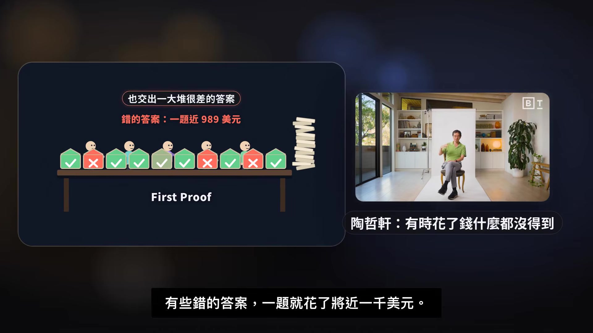

**逐字稿片段：** 所以這部分的答案是 AI已經能解真正的數學題 而且解得很廣 可是挖得深的 還是人 他到底成功多少次 花了多少錢 我們也還看不清楚 那AI解的越來越多

**話題推測：** 總結AI解題的廣度與人的深度對比。

---

## 00:07:47

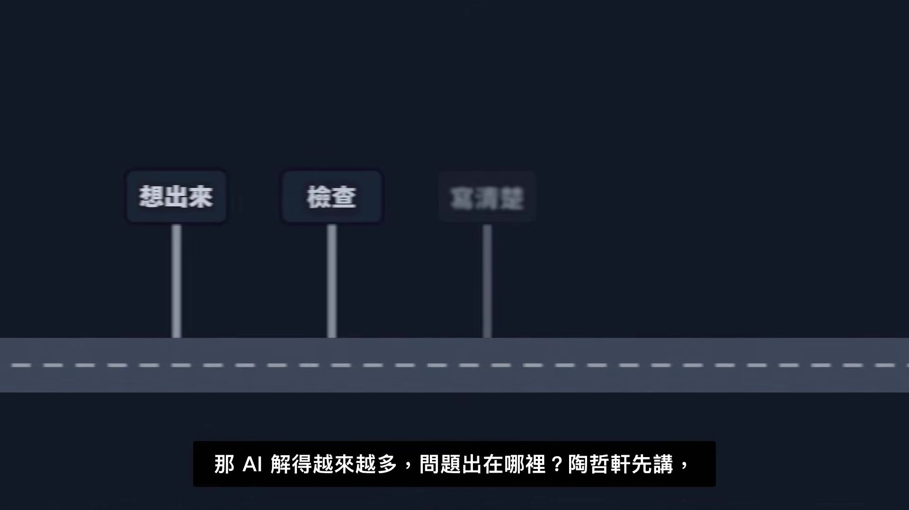

**逐字稿片段：** 問題出在哪裡 曹哲軒先講 一個證明的一生 第一步 有人想出證明 這一步以前很難 接著要檢查他 對不對 以前也很花時間 現在可以交給 Lin這種專門檢查證明的電腦語言 我們之前有一集專門講過 再來 要把證明寫清楚 讓別人看得懂 然後是同行審查 大家覺得他重要 論文才會刊出 最後 他被整理進教科書 交給下一代學生 AI讓前兩步突然變得飛快 後面三步幾乎沒變

**話題推測：** 新主題：AI解題越來越多帶來的問題。

---

## 00:08:10

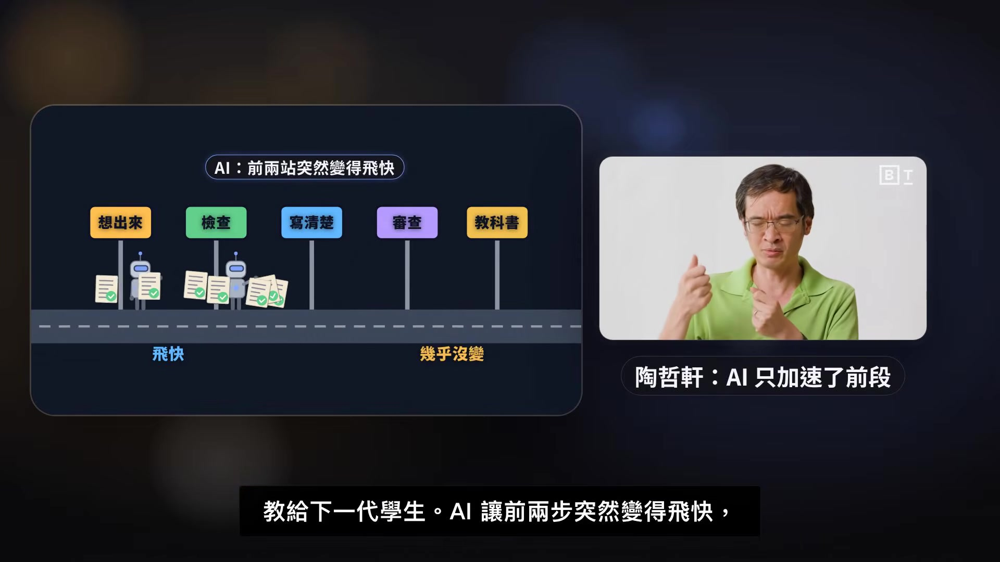

**逐字稿片段：** 他在另一場演講打了個比方 就像馬路本來是給人和馬走的 突然來了一大堆汽車 全部塞在一起 他幫這個現象取了一個名字

**話題推測：** AI加速證明生成，導致「證明消化不良」的比喻畫面。

---

## 00:08:19

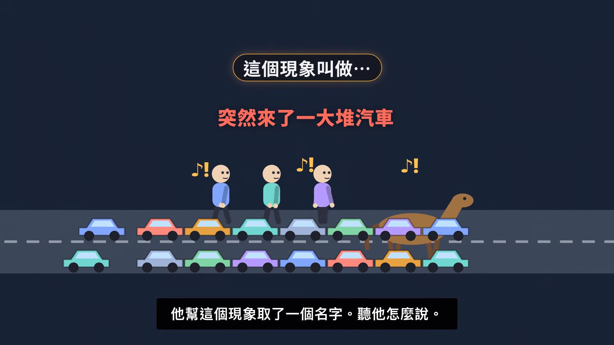

**逐字稿片段：** 聽他怎麼說

**話題推測：** 播放陶哲軒為此現象命名的訪談片段。

---

## 00:08:39

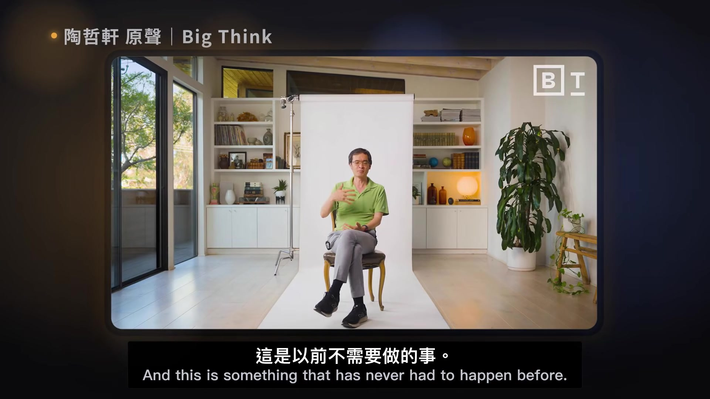

**逐字稿片段：** 這個名字叫證明消化不良 意思是證明做出來了 也檢查過是對的 可是沒有人消化 沒人看懂 沒人寫成好讀的論文 也沒有東西可以教學生 AI寫的證明還有一個特點 他常常花很多篇幅 講很簡單的地方 最難最有意思的那一部 反而幾句就帶過 因為對他來說 每一部都一樣花力氣 他分不出哪裡是重點 人類寫證明 會在自己想最久的地方 停下來講清楚 以前一個大難題被解開 是很稀有的事 所有專家會放下 手邊的工作去讀 現在連陶哲軒自己都招架不住

**話題推測：** 「證明消化不良」的命名與涵義解釋。

---

## 00:09:10

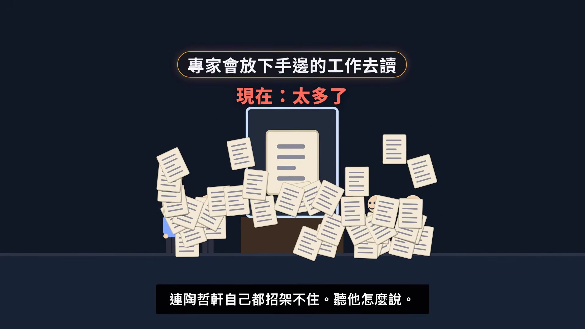

**逐字稿片段：** 聽他怎麼說 連世界頂尖的數學家都說 他已經跟不上了 他說食物太多總比不夠好 可是吃不完 這是一個問題

**話題推測：** 播放陶哲軒，連頂尖數學家都難以消化過多證明的訪談片段。

---

## 00:09:33

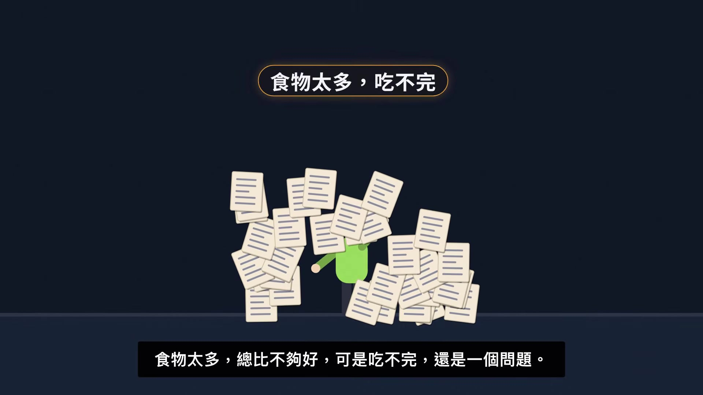

**逐字稿片段：** 那為什麼非要人自己看懂不可

**話題推測：** 新問題：為何非要人自己看懂數學證明不可？

---

## 00:09:34

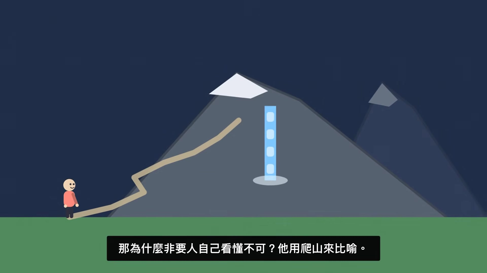

**逐字稿片段：** 他用爬山來比喻 做研究 像跟朋友去找一座 如果聽說很美的瀑布 你得自己畫地圖 會迷路 可是迷路的時候 可能發現別的好東西 或者遠遠看到一座更壯觀的瀑布 留給以後的人去找 一路上學到的 常常比瀑布本身更有價值

**話題推測：** 以「爬山」比喻數學研究過程的價值。

---

## 00:09:49

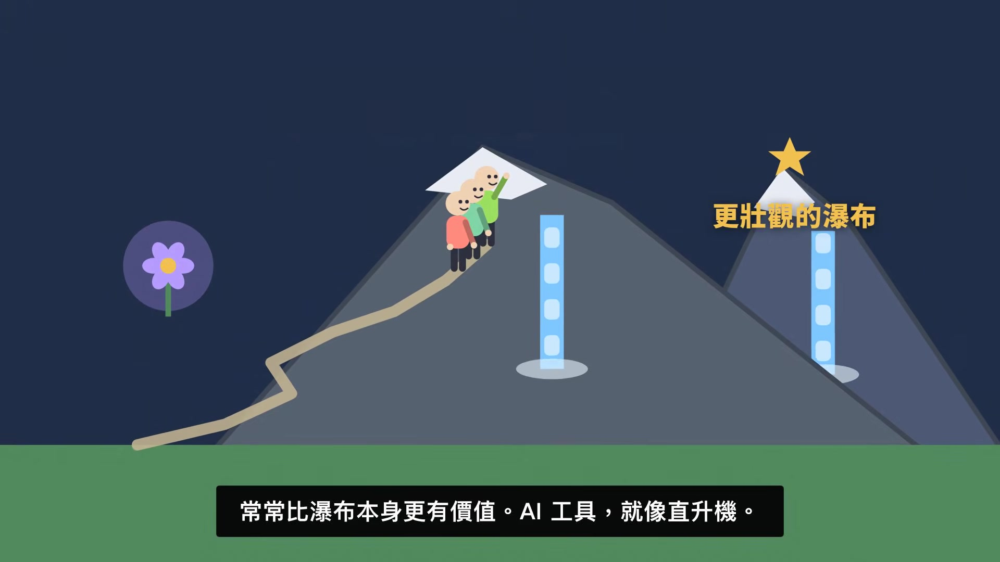

**逐字稿片段：** AI工具就像直升機 聽他怎麼說 只剩機省了時間 可是你沒學會路怎麼走

**話題推測：** 將AI工具比喻為「直升機」，指出其學習過程的缺失。

---

## 00:10:14

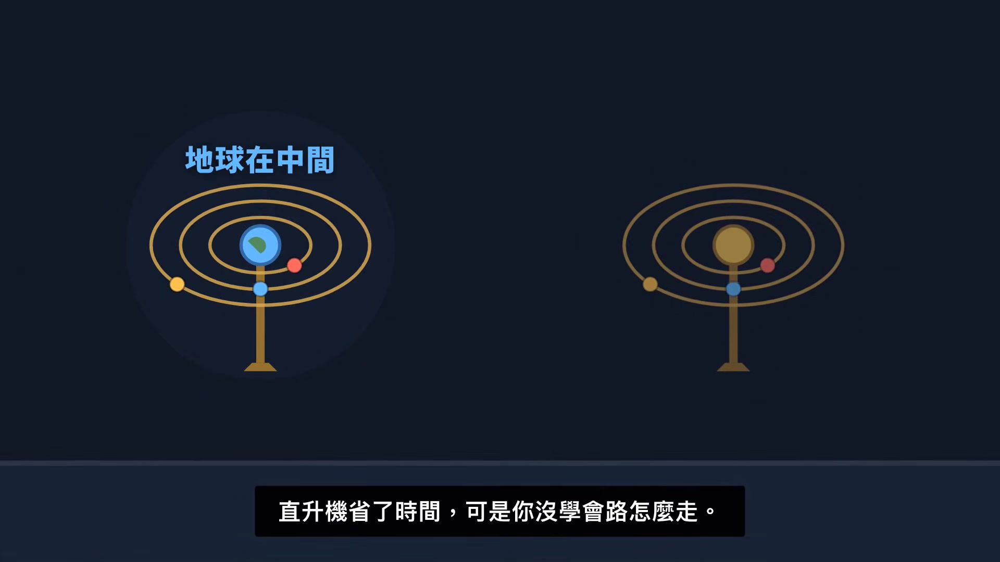

**逐字稿片段：** 陶喆軒還舉了一個歷史的例子 說明只看結果會出什麼問題 哥巴尼提出太陽在中間的模型時 他預測行星的位置 其實沒有當時地球在中間的舊模型準 舊模型改良了一千多年 調得非常細 一直到柯普勒發現 軌道不是圓形是橢圓 太陽在中間的模型才變得比較準 如果那時候用AI來調模型 只看誰預測得準 會發生什麼事

**話題推測：** 引述歷史案例：哥白尼模型與只看結果的盲點。

---

## 00:10:35

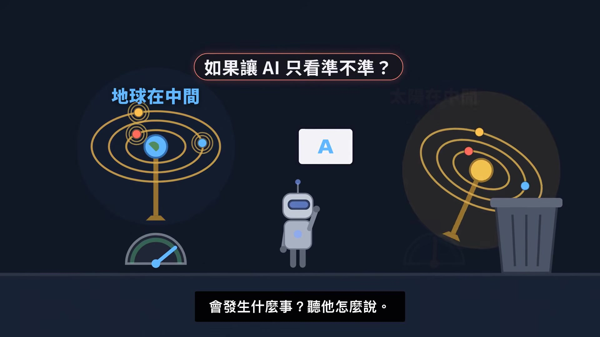

**逐字稿片段：** 聽他怎麼說 對的想法 一開始分數未必最高 陶澤軒說 危險在於 我們會把AI對準錯的目標 9月在加州理工學院的 一場演講 他講得更直接 只要是能打分數的東西 最佳化過頭 就會變得沒有用

**話題推測：** 播放陶哲軒探討AI若只優化結果的潛在問題訪談片段。

---

## 00:11:04

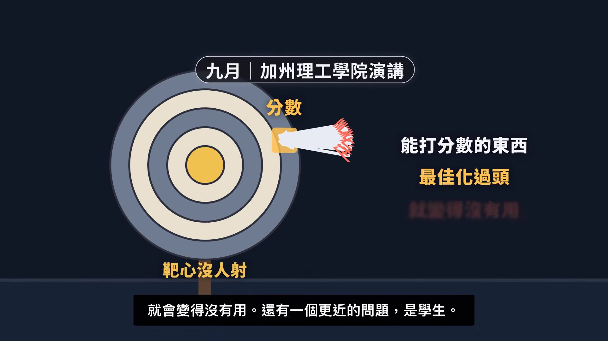

**逐字稿片段：** 還有一個更近的問題是學生 研究生剛入行 指導教授會給他們一些 不太難的題目 當作入門的練習 做出來發第一篇論文 慢慢學會做研究 偏偏這種題目 正是AI現在最會做的

**話題推測：** 探討AI對數學研究生入門練習的影響。

---

## 00:11:16

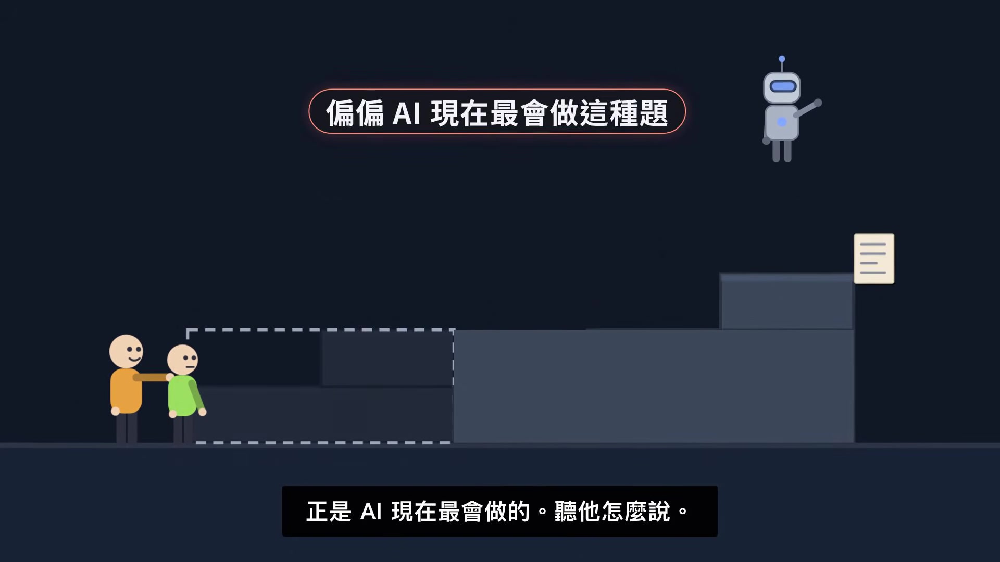

**逐字稿片段：** 聽他怎麼說 Humans and AI to build upon that

**話題推測：** 播放陶哲軒關於AI影響學生學習的訪談片段。

---

## 00:11:42

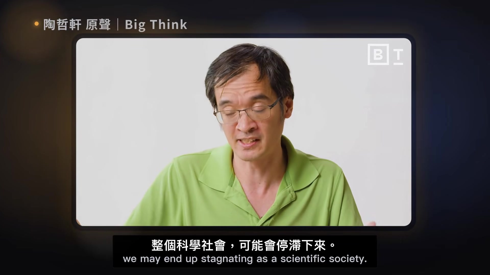

**逐字稿片段：** 這就是9月那封聲明的背景

**話題推測：** 回溯9月數學家聯合聲明的背景。

---

## 00:11:44

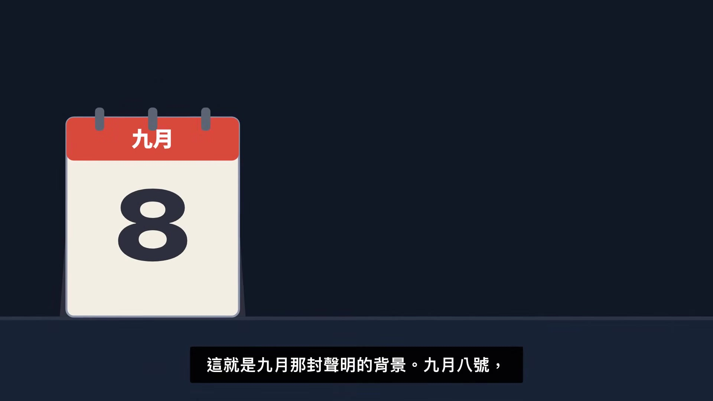

**逐字稿片段：** 9月8號OpenAI宣佈 它的模型證明瞭 描述水流的Navier-Stokes方程式 在某些情況下會算出無限大的流速 這是一道懸賞100萬美元的 千禧年難題證明 也用另檢查過 不過到現在 它還沒有經過同行審查 另一組數學家也說 相關的結果是他們先做出來的

**話題推測：** OpenAI證明Navier-Stokes方程式及其百萬美元獎金的細節。

---

## 00:12:01

**逐字稿片段：** 三天後 陶喆軒和另外24位菲爾之獎得主發表聲明 他們不反對AI 生命裡也說AI有機會讓數學研究更好 他們反對的是 把有名的難題當成AI公司的比賽成績 趕著宣佈 卻沒有好好寫清楚 沒有交代用了誰的成果 也沒有人把它消化成下一代能學的東西 同一天的演講 陶澤軒說 Navia Stokes這種問題 我們不急著下禮拜就要 我們可以慢一點

**話題推測：** 陶哲軒等數學家聯合聲明反對AI競賽化傾向的詳細內容。

---

## 00:12:25

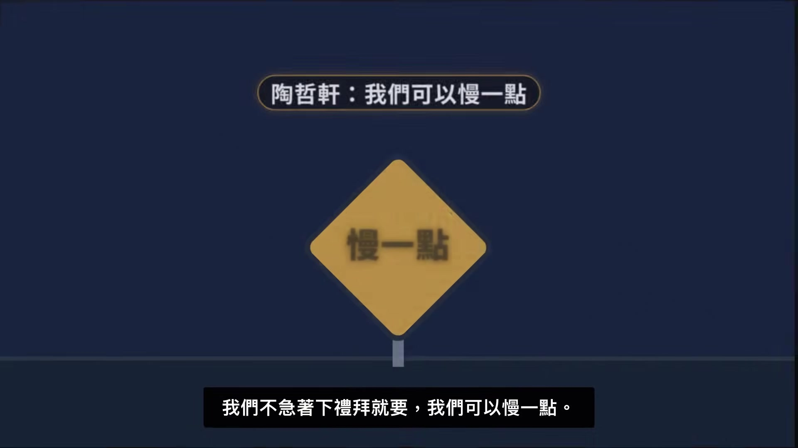

**逐字稿片段：** 所以這部分的暗示 問題不在AI解的太少 是解的太快 快到人來不及消化 那我們一般人呢 訪談的最後 陶澤軒講到了所有人

**話題推測：** 總結：AI解題太快，導致人類來不及消化。

---

## 00:12:33

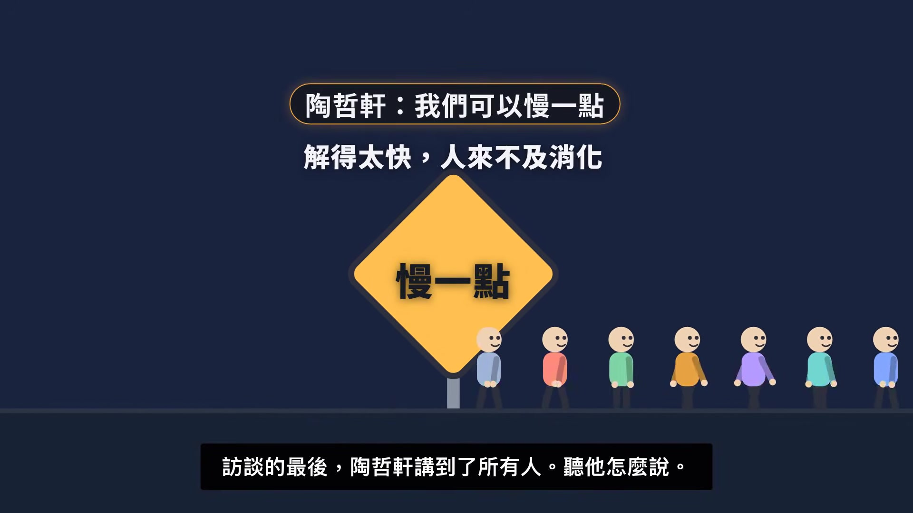

**逐字稿片段：** 聽他怎麼說

**話題推測：** 播放陶哲軒闡述AI對所有人學習的啟示訪談片段。

---

## 00:12:50

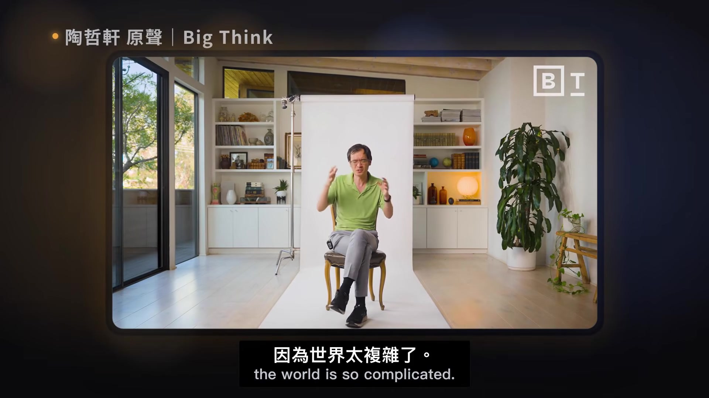

**逐字稿片段：** 我們回到開場那個問題 AI解出的數學題越來越多 人類還需要自己等數學嗎 陶澤軒的答案是需要 AI像那個懂很多 又有點喝醉的朋友 可以丟出很多答案 可是看懂答案 把它講清楚交給下一個人 還是要靠人 他自己也用AI 用來找文獻 檢查 寫程式 教稿 只是不讓他取代整趟爬山

**話題推測：** 重提開場問題：人類還需要自己的數學嗎？

---

## 00:13:09

**逐字稿片段：** 整理一下數學的價值 有一大半在過程 AI很廣 人很深 答案來得太快 會消化不良 而我們一般人學數學 不是為了算得比AI快 是為了讓這個世界看起來沒那麼可怕 最後問你一個問題 如果AI可以直接給你答案 你還會想自己算一遍嗎 留言告訴我 喜歡的話 訂閱AI Notebook 開啟通知 我們下次見

**話題推測：** 最終總結：數學的價值在過程，人需理解消化。

---
