# jimainotebook_7mFVNy8BeZY — 關鍵畫面索引

- 來源逐字稿：[jimainotebook_7mFVNy8BeZY_FIN.srt](jimainotebook_7mFVNy8BeZY_FIN.srt)
- 影片：https://www.youtube.com/watch?v=7mFVNy8BeZY
- 截圖數：66

## 00:00:10

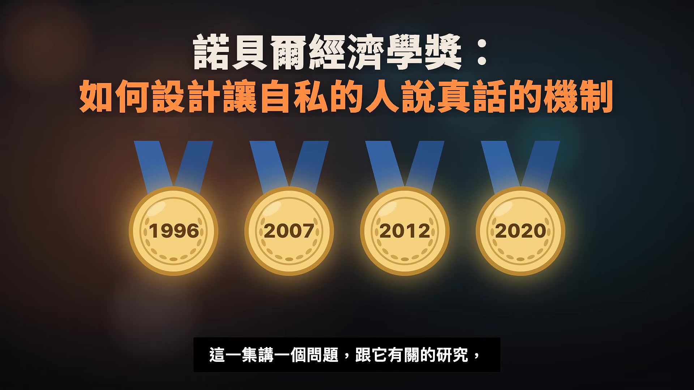

**逐字稿片段：** 這集講一個問題跟它有關的研究,前後拿了四屆諾貝爾經濟學獎。 怎麼定規則,才能讓只顧自己的人主動說真話?

**話題推測：** 介紹本集主題：諾貝爾經濟學獎相關研究。

---

## 00:00:18

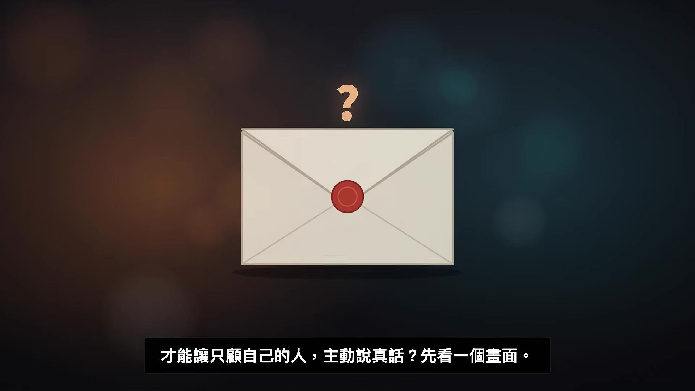

**逐字稿片段：** 先看一個畫面。1990年,紐西蘭政府拍賣無線電頻譜的使用權。

**話題推測：** 引入第一個案例：1990年紐西蘭政府無線電頻譜拍賣。

---

## 00:00:23

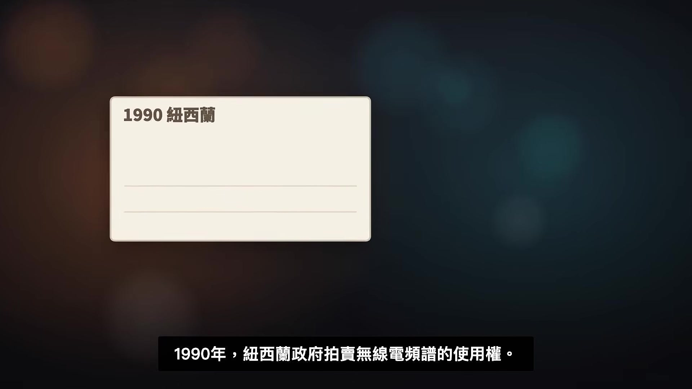

**逐字稿片段：** 有一家公司寫下的出價是10萬紐西蘭幣。 最後他真正付的錢是6塊紐西蘭幣。 這不是打錯字,規則本來就是這樣寫的。

**話題推測：** 顯示競標公司寫下的出價金額：10萬紐西蘭幣。

---

## 00:00:32

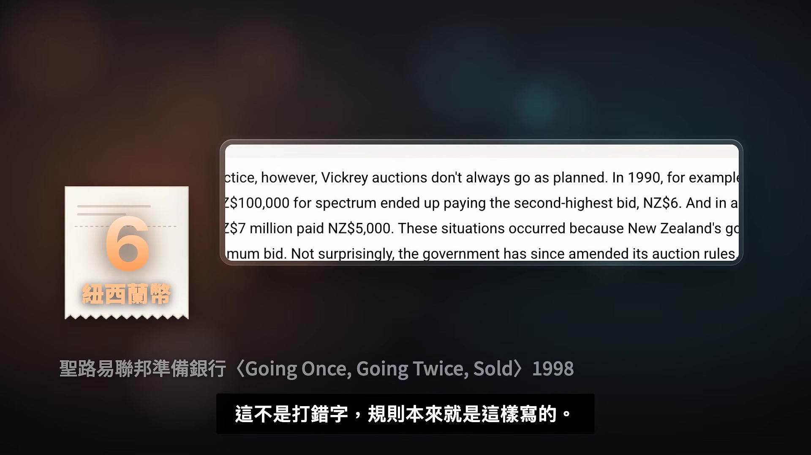

**逐字稿片段：** 再看另一個畫面。Google賣搜尋廣告用的也是拍賣。 他當年的廣告文案寫著 這套拍賣用了諾貝爾獎得主的經濟理論 讓廣告主不再有負太多的感覺 同一個想法 一邊讓政府只收到6塊錢 一邊變成每天幾十億場的廣告拍賣

**話題推測：** 引入第二個案例：Google搜尋廣告拍賣。

---

## 00:00:47

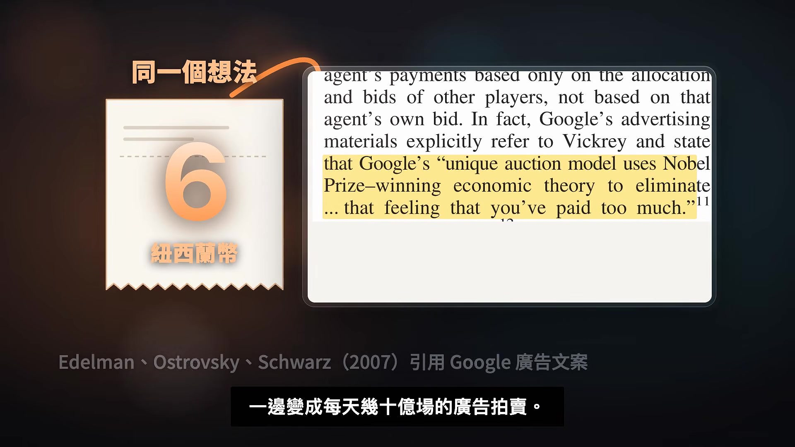

**逐字稿片段：** 我們分三步走 先看這個問題從哪裡來 再看經濟學家找到的答案 最後把答案放進真實世界 看它在哪裡成功 在哪裡出事

**話題推測：** 呈現影片的內容大綱或三步走計畫。

---

## 00:00:55

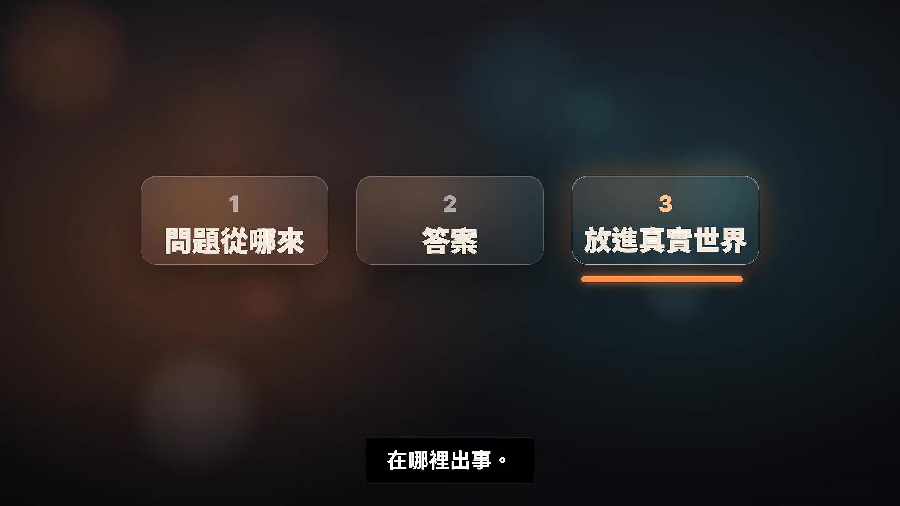

**逐字稿片段：** 如果你看過我們賽局理論的上集 應該還記得宿舍的例子 每個人都做了對自己最好的選擇 房間還是沒人收拾

**話題推測：** 提及賽局理論上集內容，可能呈現相關圖表或標題。

---

## 00:01:03

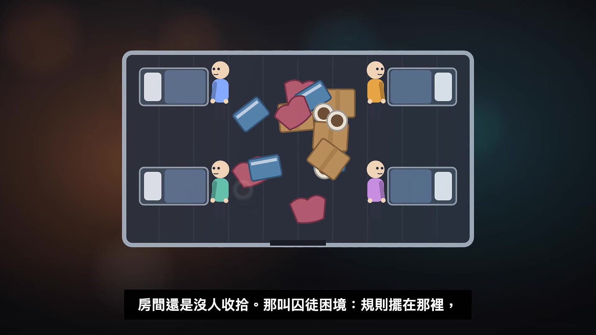

**逐字稿片段：** 那叫囚徒困境 規則擺在那裡 每個人照著私心走 加起來卻變成 大家都不想要的結果 這一集要問一個 反過來的問題 如果規則可以重寫呢 能不能換一套規則 讓同樣的私心 加起來變成好結果 2007年諾貝爾經濟學獎的新聞稿 開頭就在講這件事 理想的條件下 市場自己就會有效率 可是現實常常不理想 有用的資訊 散在每個人手上 而每個人都可能 拿自己的資訊 替自己牟利 所以難的地方 是私心再加上一樣東西 別人看不見的資訊

**話題推測：** 顯示「囚徒困境」的名稱。

---

## 00:01:35

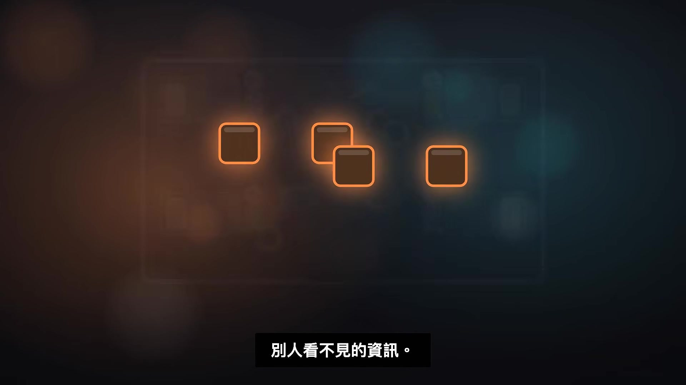

**逐字稿片段：** 諾貝爾官網用過一臺鋼琴當例子 Erica有一臺鋼琴 Peter想買 只要這臺鋼琴對Peter來說 比對Erica更值錢 成交就對兩個人都好 問題是 Erica心裡的價錢 Peter看不到 Peter心裡的價錢 Erica也看不到

**話題推測：** 引入新例子：諾貝爾官網以鋼琴交易說明資訊不對稱。

---

## 00:01:50

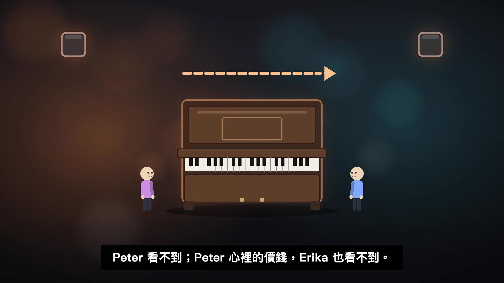

**逐字稿片段：** 這種一邊知道 一邊不知道的狀況 叫資訊不對稱 現在定一個看起來很公平的規則 兩個人各報一個價 取中間成交 你猜會怎樣 Erica會故意報高一點 Peter會故意報低一點 兩個人都在說謊 而且站在自己的立場 都很合理 結果是 有一些本來雙方都願意的交易 因為兩邊都喊得太遠 就這樣談不成了 鋼琴還在Erica家 Peter也沒買到 私心加上看不見對方的底牌 好好的交易就消失了

**話題推測：** 闡釋「資訊不對稱」的概念。

---

## 00:02:18

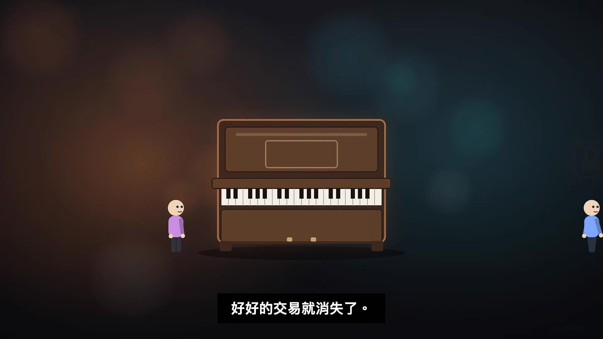

**逐字稿片段：** 研究這種問題的學問 叫機制設計 英文是Mechanism Design 這裡的機制 指的就是一套規則

**話題推測：** 引入新學科領域：「機制設計」（Mechanism Design）。

---

## 00:02:25

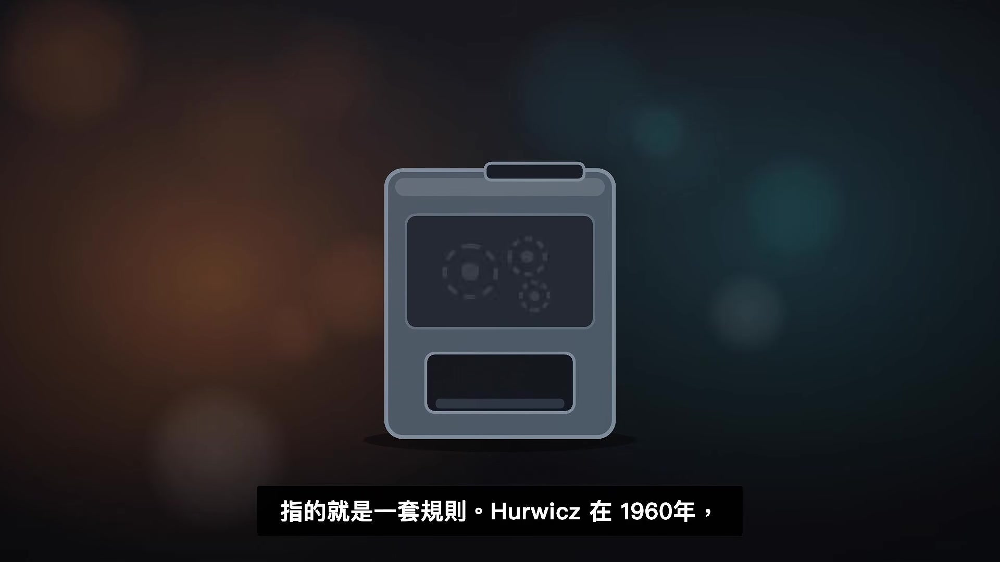

**逐字稿片段：** Hurwitz在1960年 最早把規則寫成數學 每個人送出一個訊息 可能是一個出價 可能是一張志願表 規則在把所有訊息對應到一個結果 誰拿到什麼 誰付多少錢

**話題推測：** 介紹經濟學家Hurwitz及其1960年的數學化規則工作。

---

## 00:02:37

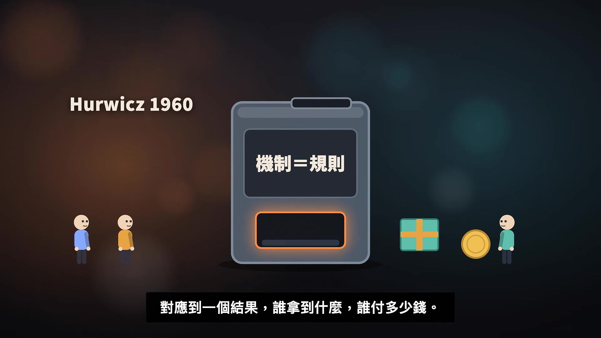

**逐字稿片段：** 2007年的得主Maskin 在諾貝爾演講一開頭就說 機制設計可以想成經濟理論裡工程的那一面 研究的方向是反過來的 賽局理論是拿到規則預測結果 機制設計是先決定想要的結果 再回頭設計規則

**話題推測：** 介紹2007年諾貝爾獎得主Maskin的貢獻。

---

## 00:02:51

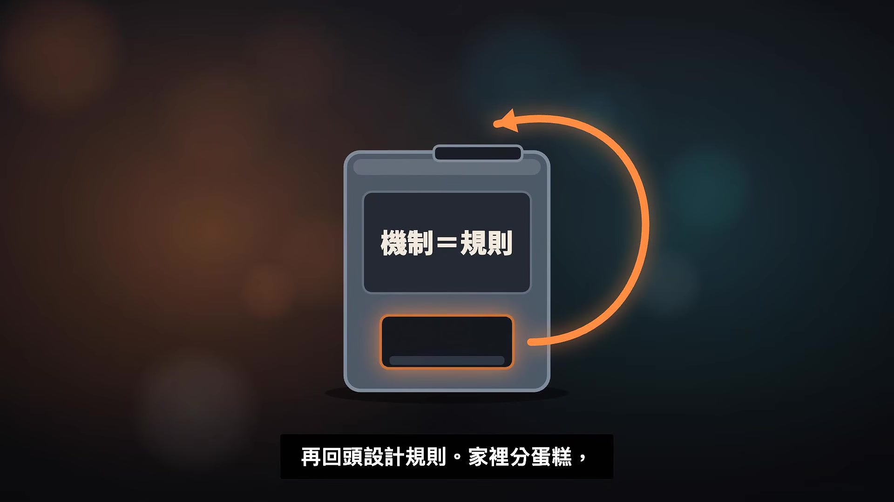

**逐字稿片段：** 家裡分蛋糕就是一個最小的機制 爸媽想要的結果是公平 可是他們不知道哪個小孩比較貪心 規則很簡單 一個人切 另一個人先選 切的人再怎麼只顧自己 對他最好的做法也是切得一樣大 切蛋糕這個規則好在哪裡? 好在他不需要任何人變成好人

**話題推測：** 引入新例子：家庭分蛋糕的機制。

---

## 00:03:09

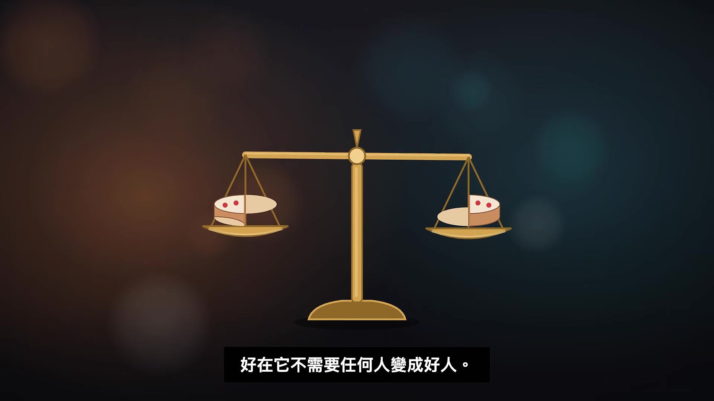

**逐字稿片段：** Hurwitz在1972年替這種性質取了名字 叫誘因相容 英文是Incentive Compatibility 誘因相容的意思是 規則要你做的事 剛好就是對你自己最有利的事 規則和私心站在同一邊 放回我們的問題 我們要的規則是讓說真話剛好最划算 還可以要求的更多 賽局理論上集講過納許均衡 在納許均衡裡 你得先猜對別人會怎麼做 才知道自己該怎麼做 如果有一種規則 不管別人怎麼出 你照實說都不會比較差 那你連猜都不用猜 這種不用看別人的最好做法

**話題推測：** 介紹Hurwitz在1972年提出的「誘因相容」（Incentive Compatibility）概念。

---

## 00:03:42

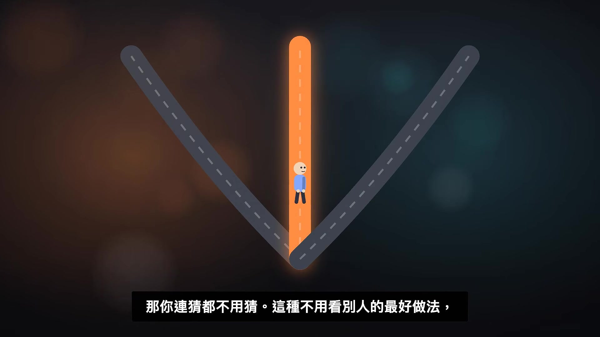

**逐字稿片段：** 叫優勢策略 所以第一步的問題 可以收成一句話 有沒有一種規則 讓說真話變成優勢策略

**話題推測：** 介紹「優勢策略」（Dominant Strategy）這個名詞。

---

## 00:03:48

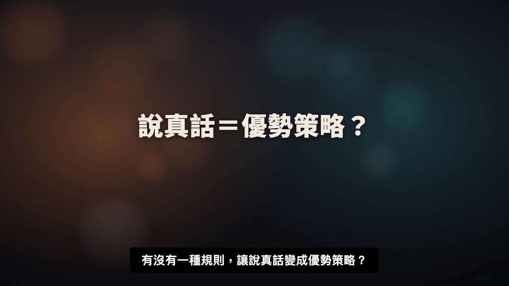

**逐字稿片段：** 答案出現在1961年 在一篇講拍賣的論文裡

**話題推測：** 揭示解決方案的發現時間：1961年。

---

## 00:03:52

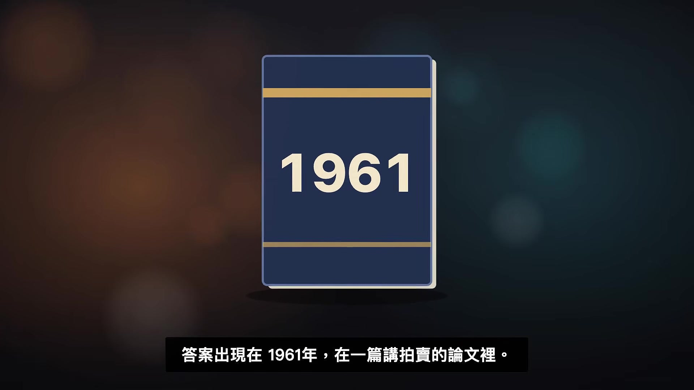

**逐字稿片段：** 這篇論文的作者 是哥倫比亞大學的經濟學家 William Vickrey 他提的規則 只動了拍賣裡的一個地方 大家把出價寫在紙上 密封起來交出去 出最高價的人得標 這部分跟平常一樣 不一樣的是付錢 得標的人不付自己寫的價錢 付的是所有出價裡次高的那一個

**話題推測：** 介紹論文作者：哥倫比亞大學經濟學家William Vickrey。

---

## 00:04:10

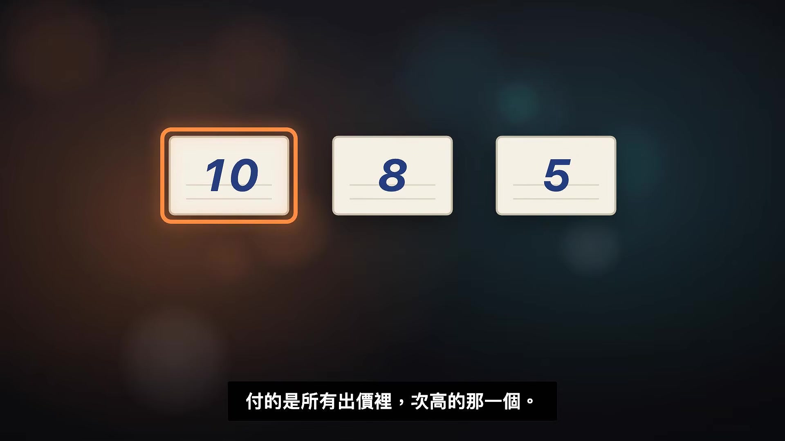

**逐字稿片段：** 這種拍賣叫第二價格密封拍賣 也常用它的名字叫維克裡拍賣 舉個例子 你出10 別人最高出8 你得標付8 第一次聽到的人 大多覺得這規則很怪 賣東西的人 為什麼要自己少收錢 我們賽局三級 一路跟著的也有教授Polak 在課堂上介紹他的時候 也是這個反應

**話題推測：** 介紹Vickrey提出的拍賣規則名稱：「第二價格密封拍賣」或「維克裡拍賣」。

---

## 00:04:28

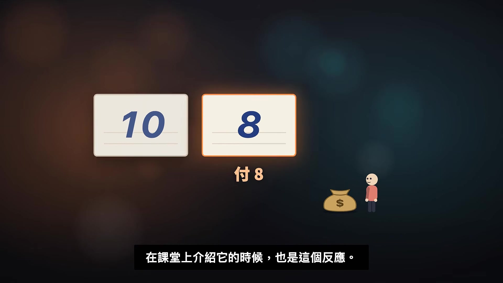

**逐字稿片段：** 我們聽他自己怎麼說 我們聽他自己怎麼說 So that seems crazy, doesn't it? Seems a bit crazy. - 這些叫做聖誕奢侈 And we'll come back and talk about it.

**話題推測：** 播放Polak教授的影片片段。

---

## 00:04:47

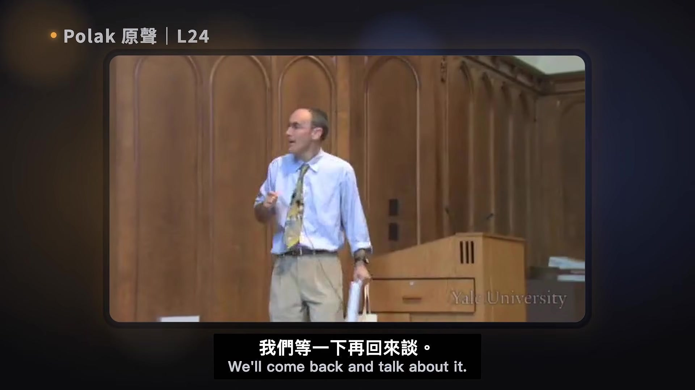

**逐字稿片段：** Polak說沒那麼瘋,我們就自己算一次。

**話題推測：** 回到敘述，繼續自行計算說明拍賣機制。

---

## 00:04:50

**逐字稿片段：** 假設你在搶一張演唱會的票,你心裡覺得這張票值五千元, 另一個人出了四千兩百,先看造實出。 你寫五千,你得標,付的是次高的四千兩百,等於你賺到八百。 那如果你耍一點心機 把價錢壓到4500呢 你還是最高 還是得標 付的還是4200 一樣賺800 壓低沒有讓你少付一塊錢 再壓低一點 壓到4000 這次你輸了 那張只要4200就能拿到的票 就這樣錯過了 本來可以賺的800 變成0 看出來了嗎 在這個規則裡 你寫的數字 不會改變你付多少錢 你付多少 是別人的出價決定的 你的出價就像一張門票 它只決定你能不能進場 不是你的賬單 反過來,喊高呢? 對手還是4200,你寫6000,你得標付4200 跟趙石出一模一樣,看起來沒差 可是換一個對手他出5500 你趙石寫5000,你輸了,不賺也不賠 你寫6000,你贏了,可是你得付5500 買到一張你只覺得值5000的票,倒賠500 所以喊高的好處是0,風險是賠錢 壓低的好處也是0,風險是錯過 不管對手出多少,趙石寫下你心裡的價錢都不會比較差 這就是第一步說的優勢策略 你不用猜對手是誰 不用猜他會出多少

**話題推測：** 設定演唱會門票拍賣的模擬情境及數字。

---

## 00:06:02

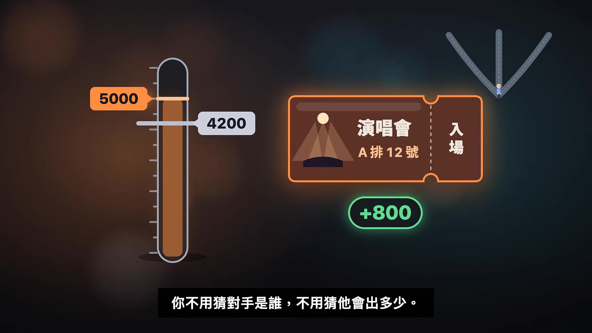

**逐字稿片段：** Polak在課堂上 直接讓全班舉手投票 is a weakly dominant strategy 他說的弱優勢策略 就是我們剛剛算出來的那句話 不管別人怎麼出 照實出都不會比較差 有時候還比較好

**話題推測：** 重回Polak教授的課堂畫面或場景。

---

## 00:06:44

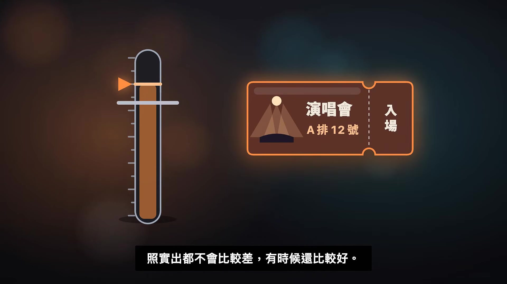

**逐字稿片段：** Vickrey不是第一個用這個規則的人

**話題推測：** 介紹維克裡拍賣規則的歷史起源。

---

## 00:06:46

**逐字稿片段：** 1893年 美國麻州一家機油商辦郵寄拍賣 公告上就寫著 每一批郵票 以比次高出價多1到10分錢的價格成交 那時候 Vickrey還要再過21年才出生 你在拍賣網站上設一個最高院付價 讓系統替你一路加價 最後付的是比次高出價多一點點 這也跟他很接近 Vickrey做的是把這個做法寫清楚 證明他為什麼會讓人說真話 可是論文發表之後 被忽略了大約十年

**話題推測：** 提及1893年美國麻州機油商的郵寄拍賣。

---

## 00:07:12

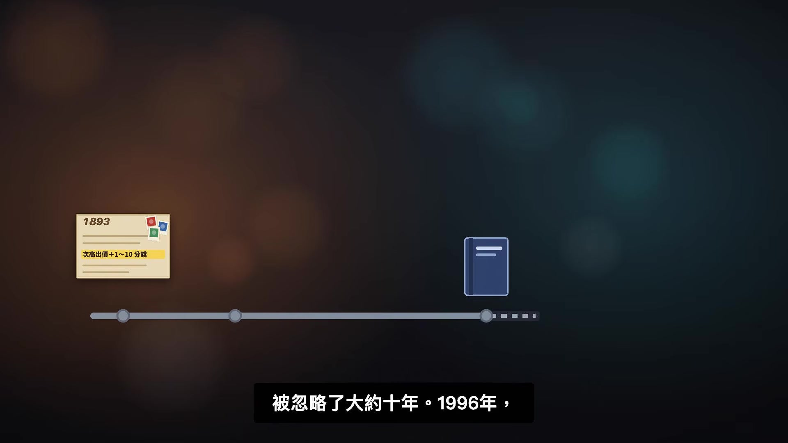

**逐字稿片段：** 1996年 他和Merlis一起拿到諾貝爾經濟學獎 理由是他們對資訊不對稱下誘因問題的研究 得獎公佈之後才三天 Vickrey就過世了

**話題推測：** 提及Vickrey於1996年獲得諾貝爾經濟學獎。

---

## 00:07:21

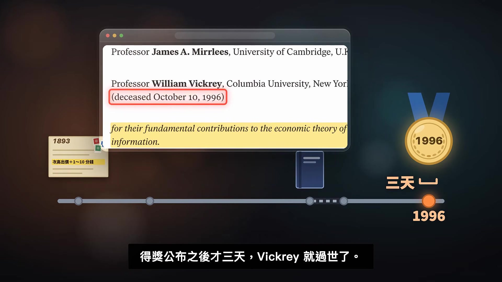

**逐字稿片段：** Vickrey解了一場拍賣 可是不是每件事都是拍賣 分配學校名額 決定誰該繳多少稅 能不能也找到讓人說真話的規則

**話題推測：** 從拍賣規則轉向機制設計的普遍應用。

---

## 00:07:30

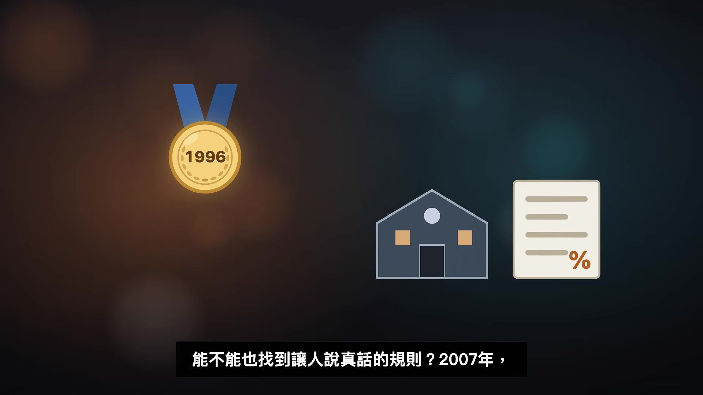

**逐字稿片段：** 2007年 諾貝爾經濟學獎頒給三個人 理由是他們奠定了機制設計理論的基礎 我們一個人用一句話講

**話題推測：** 提及2007年諾貝爾經濟學獎頒給機制設計理論的奠基者。

---

## 00:07:37

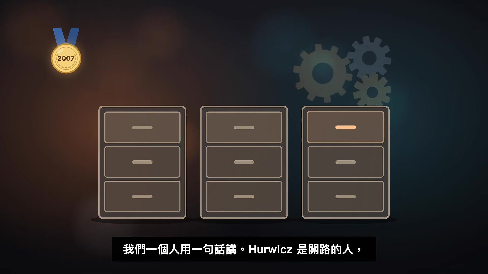

**逐字稿片段：** Hurwitz是開路的人 他大學唸的是法律 得獎時90歲 是經濟學獎歷史上最年長的得主 Maskin處理的是 同一套規則可能有好幾種玩法 有的好有的壞 怎麼設計成不管落在哪一種 結果都是好的

**話題推測：** 簡述Hurwitz在機制設計中的開路者角色。

---

## 00:07:51

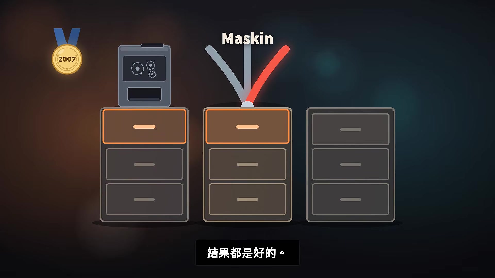

**逐字稿片段：** Myerson把一個叫顯示原理的結果 推到最一般的形式 顯示原理說的是 再複雜的規則能做到的是 一個直接問每個人 而且大家願意照實回答的規則 也做得到 所以找最好的規則 只要在讓人說真話的那一類裡找就夠了 講到這裡 答案看起來很漂亮

**話題推測：** 簡述Myerson在顯示原理（Revelation Principle）上的貢獻。

---

## 00:08:08

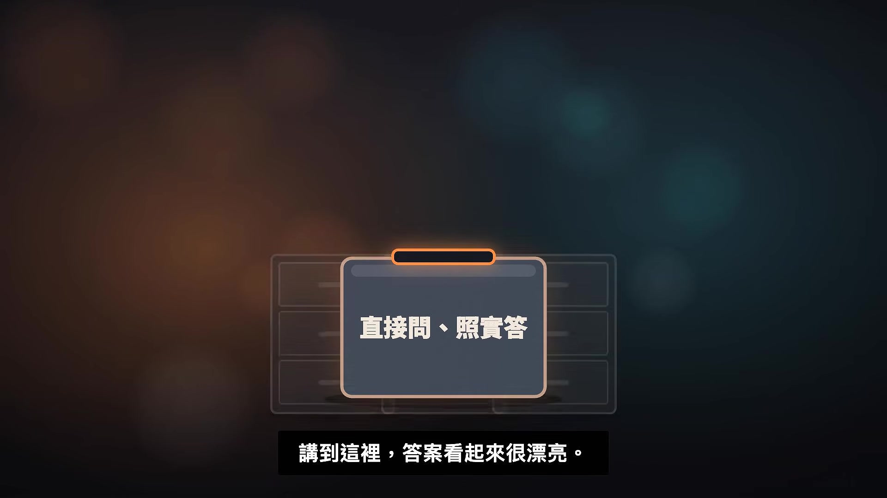

**逐字稿片段：** 可是如果你去看真實的拍賣 會發現很少人照這個規則賣東西

**話題推測：** 轉向討論理論在真實拍賣中的應用挑戰。

---

## 00:08:13

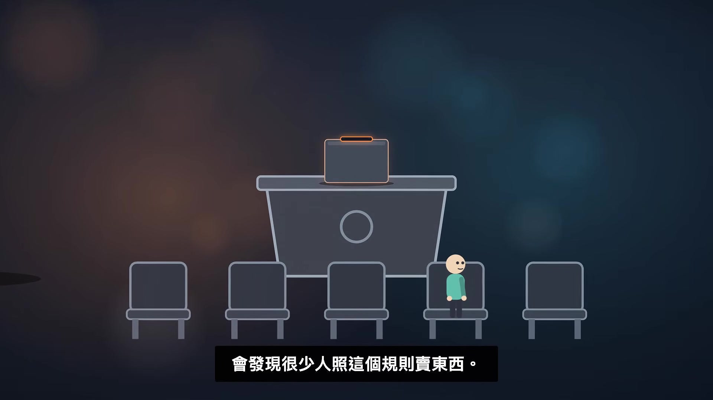

**逐字稿片段：** 2020年的得主Milgram 和另一位學者Ossible寫過一篇文章 標題就叫

**話題推測：** 介紹2020年諾貝爾獎得主Milgram及其著作。

---

## 00:08:18

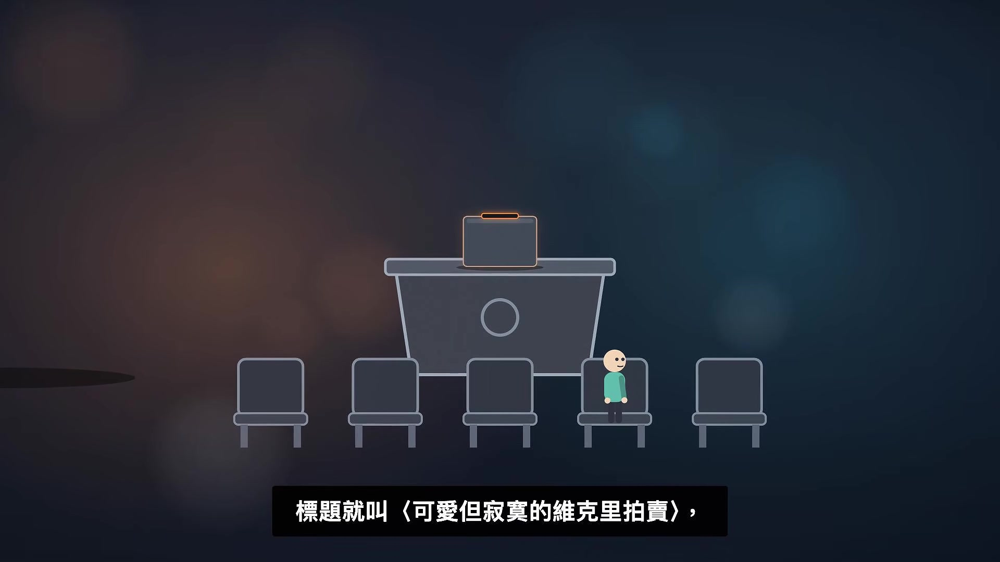

**逐字稿片段：** 可愛但寂寞的維克裡拍賣 理論上這麼可愛 實際上這麼寂寞

**話題推測：** 顯示Milgram文章標題：《可愛但寂寞的維克裡拍賣》。

---

## 00:08:23

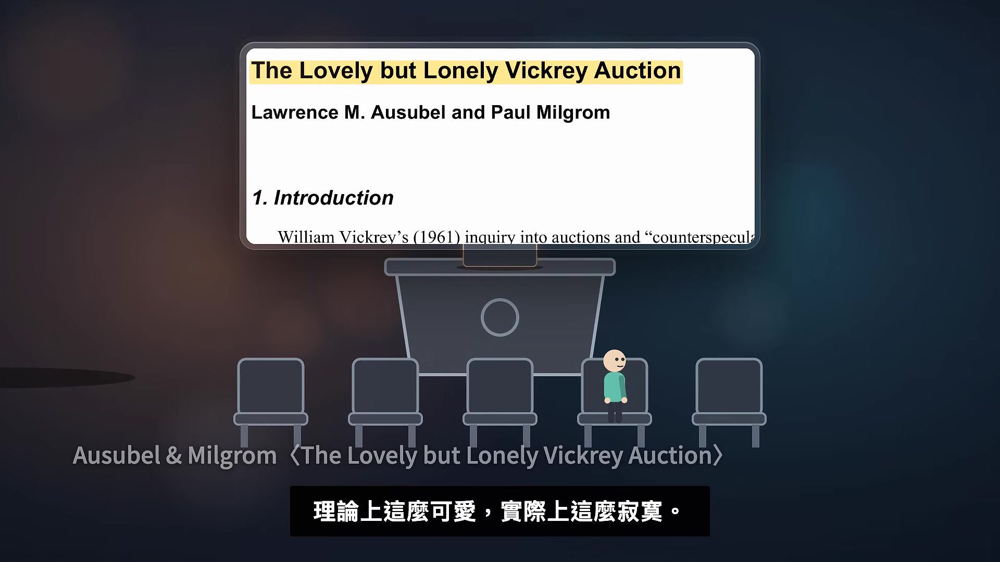

**逐字稿片段：** 原因可以分成兩類 一類是賣方怕的 照規則收次高價 賣方可能收得很少 甚至是零 輸掉的人如果私下聯手 也能壓低價錢 另一類是買方怕的 你得把心裡真正的底價交出去 怕之後被拿來對付你 而且出價是密封的 你看不到那個次高價 只能相信賣方沒有捏造一個 這一步的答案整理成一句話 讓人說真話的辦法 是讓他的話只決定他贏不贏 不決定他付多少 可是這個答案 放進真實世界以後會怎樣 紐西蘭政府就親身試了一次

**話題推測：** 歸納維克裡拍賣在實務上寂寞的兩大原因。

---

## 00:08:54

**逐字稿片段：** 回到開場那個畫面 1990年 紐西蘭政府要賣無線電頻譜的使用權 平普就是空氣中用來傳送電視、手機訊號的那些頻率 政府用的是次高價拍賣 可是沒有設最低價

**話題推測：** 重回開場的1990年紐西蘭無線電頻譜拍賣案例。

---

## 00:09:06

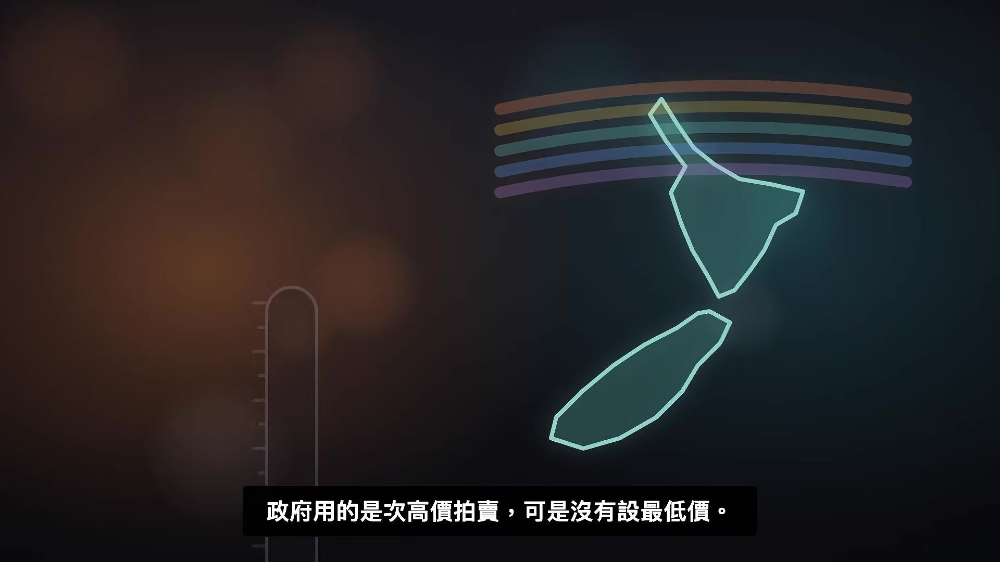

**逐字稿片段：** 結果有一家公司出價10萬紐西蘭幣 因為次高的出價只有6塊 他就只付6塊 總收入遠低於政府原本的預估 更難堪的是 得標價是公開的 每個人都看得到桌上留了多少錢 政府後來修改了規則

**話題推測：** 再次顯示公司出價10萬紐西蘭幣。

---

## 00:09:21

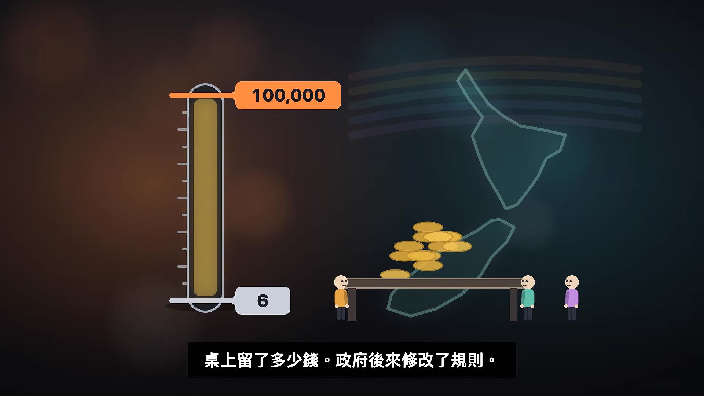

**逐字稿片段：** 這裡有兩個教訓 一個是最低價 如果只剩一家認真出價 次高價就可能低到不像話 另一個是 幾張差不多的使用權 同時分開拍賣 業者不知道該在哪一場認真出 出價就散掉了 問題不在那條數學 在搬進真實世界的時候 少了這些零件

**話題推測：** 歸納紐西蘭拍賣案例中的兩個教訓。

---

## 00:09:38

**逐字稿片段：** 平譜這種東西 還藏著一個更難的問題 賽局理論下集最後 我們玩過罐子拍賣 大家估一罐銅板值多少再出價 結果得標的人常常虧錢 因為贏本身就是壞消息

**話題推測：** 深入探討頻譜拍賣中更複雜的問題。

---

## 00:09:50

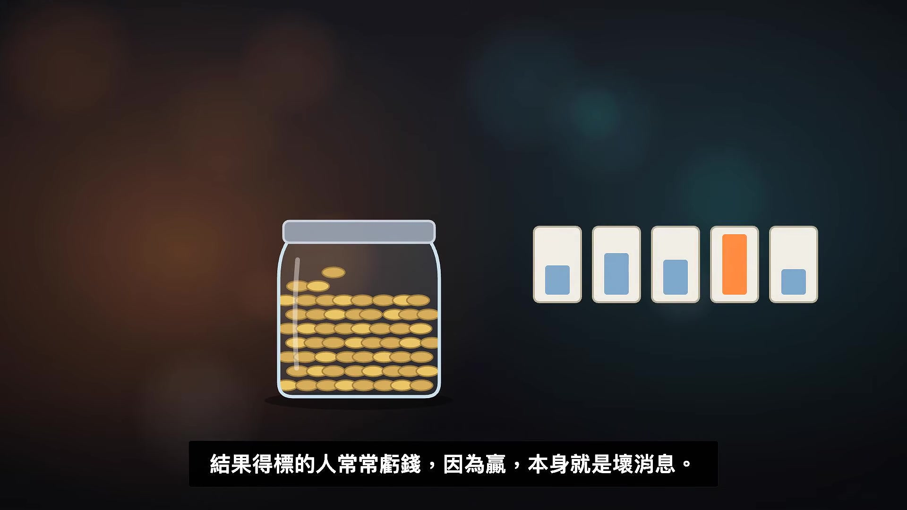

**逐字稿片段：** 這叫贏家詛咒

**話題推測：** 介紹「贏家詛咒」（Winner's Curse）的概念。

---

## 00:09:51

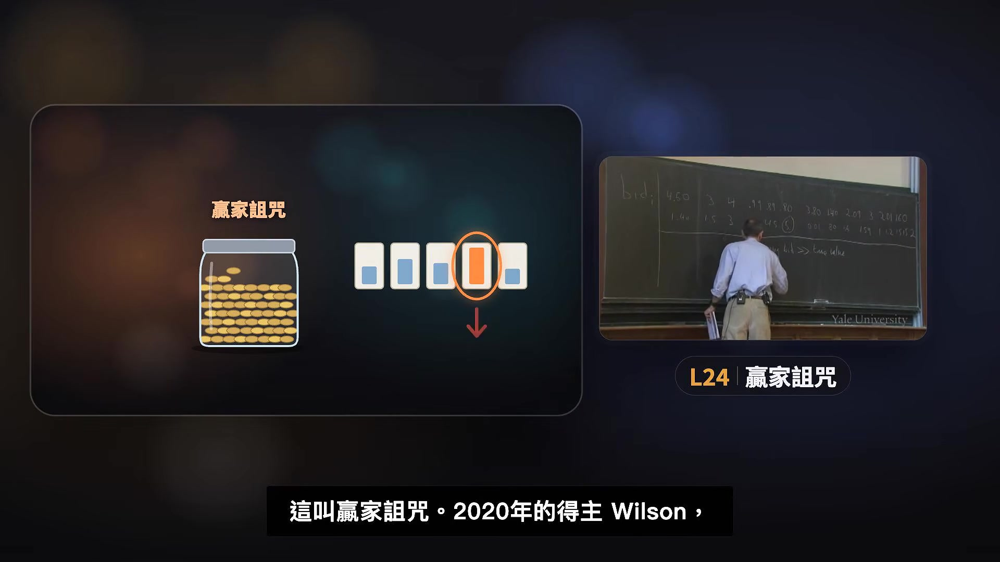

**逐字稿片段：** 2020年的得主Wilson 就研究這件事 他看的是一種東西

**話題推測：** 介紹2020年諾貝爾獎得主Wilson及其研究。

---

## 00:09:55

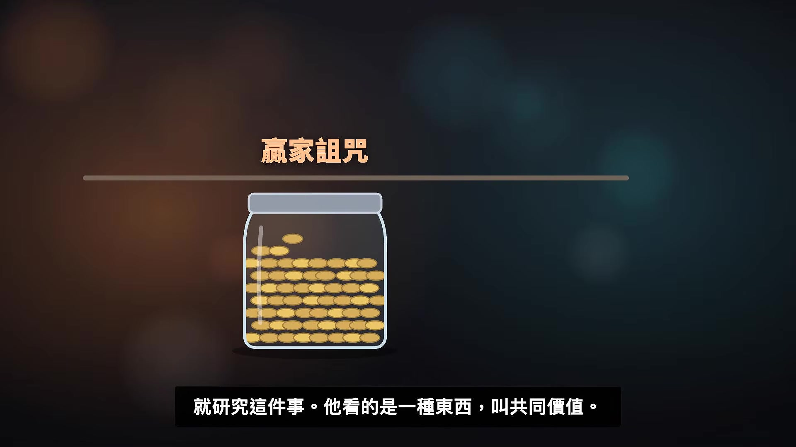

**逐字稿片段：** 叫共同價值 例如一塊油田 裡面有多少油 對每家公司都一樣 只是每家都估不準 這時候你得標 代表你是所有人裡 最樂觀的那一個 很可能估太高了 平譜也有這種成分 它能賺多少錢 每家電信業者 都在猜同一個答案 看懂這一點的業者 會把價錢壓低 壓到不怕贏為止 另一位得主Milgram 接著證明 拍賣進行時 讓大家多知道彼此的資訊 賣方的收入會更高

**話題推測：** 介紹「共同價值」（Common Value）的概念。

---

## 00:10:19

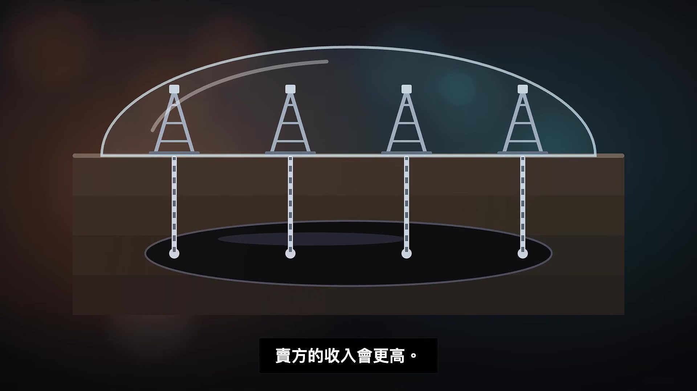

**逐字稿片段：** Milgram和Wilson 把這些教訓 做成一種新的拍賣 叫同時多回合上升拍賣 名字很長 我們一個詞一個詞看 同時是所有執照一起開賣 不是一張賣完再賣下一張 為什麼要同時 諾貝爾官網的例子是 從瑞典最北邊一塊一塊賣到最南邊 業者買北邊那塊時 不知道後面買不買得到 就算不出它值多少 多回合上升是價格從低往上 一輪一輪加 每一輪大家都看得到現在的價錢 另外還有一條活動規則 逼每個人每一輪都要真的出價 不能躲到最後才出手

**話題推測：** 介紹Milgram和Wilson設計的一種新拍賣方式。

---

## 00:10:52

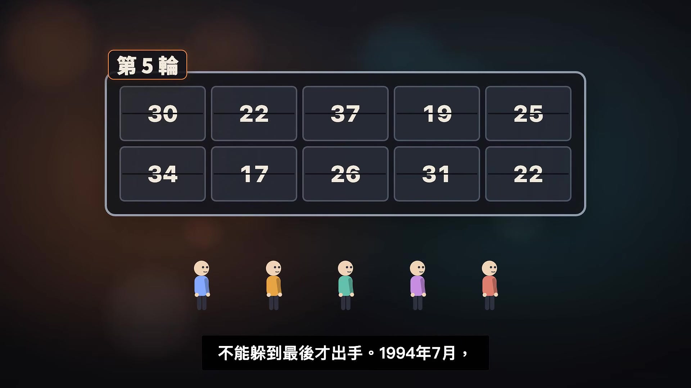

**逐字稿片段：** 1994年7月 美國聯邦通訊委員會用這種拍賣辦了第一場 在那之前 這些執照幾乎是免費發出去的 先是用審查 後來用抽籤 這一場拍了47輪 總共5天

**話題推測：** 提及1994年7月美國聯邦通訊委員會首次使用此拍賣。

---

## 00:11:04

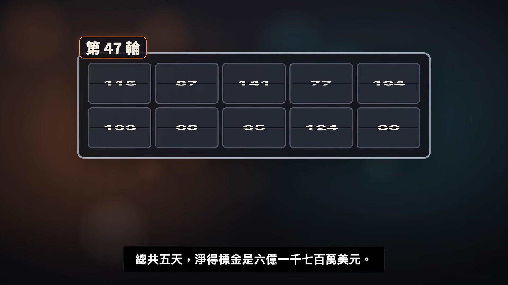

**逐字稿片段：** 淨得標金是6億1700萬美元

**話題推測：** 顯示該次拍賣的淨得標金：6億1700萬美元。

---

## 00:11:06

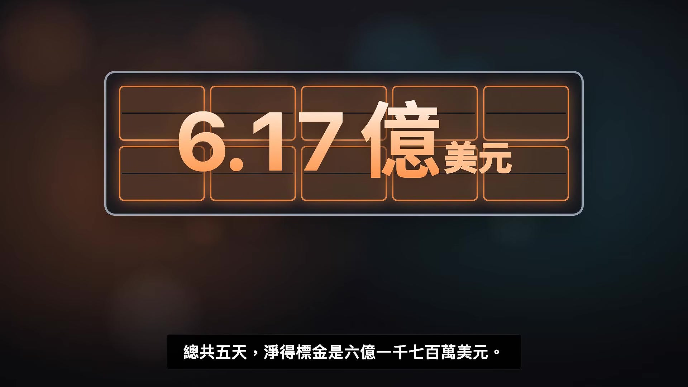

**逐字稿片段：** 2020年10月 Milgram和Wilson一起拿到諾貝爾經濟學獎 公佈的時候 加州還是半夜 Milgram為了睡個好覺 把手機關了 諾貝爾那邊聯絡不到他 結果去按他家門鈴的是Wilson 兩個人住的地方只相距大約40公尺 Wilson跟太太直接走過去 Milgram從視訊門鈴裡看到的 就是他的老師 Wilson後來在訪問裡說 敲門這種事 聽起來像19世紀 還有一件事 Milgram是Wilson的博士班學生 Wilson說 他是自己第三個 拿到諾貝爾獎的學生 前面兩個裡有一個 是2012年得獎的Roth 等一下我們還會遇到Roth 上升拍賣把資訊攤開 可是攤開的資訊

**話題推測：** 提及Milgram和Wilson於2020年10月獲得諾貝爾經濟學獎。

---

## 00:11:45

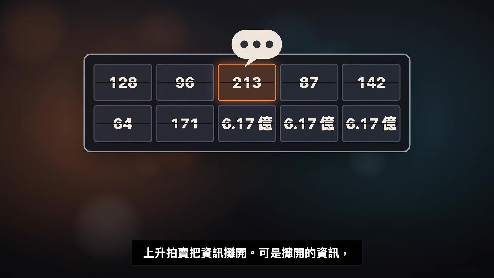

**逐字稿片段：** 也能拿來傳話 1996年到1997年 美國又一輪頻普拍賣 兩家公司 US West和McLeod 都想要明尼蘇達州 一個叫Rochester的地區 他在拍賣裡的市場編號是378 US West做了一件事 他轉頭在McLeod想要的另一個地區 愛荷華州的Waterloo

**話題推測：** 介紹開放資訊可能導致的新問題：勾結。

---

## 00:12:02

**逐字稿片段：** 出了313378美元 注意最後三位數 378 意思是 你別碰Rochester 不然我就在你想要的地方跟你搶 最後 Rochester由US West拿下 這種用出價傳暗號 讓彼此不要互相搶的做法

**話題推測：** 顯示作為暗號的出價金額：313378美元。

---

## 00:12:17

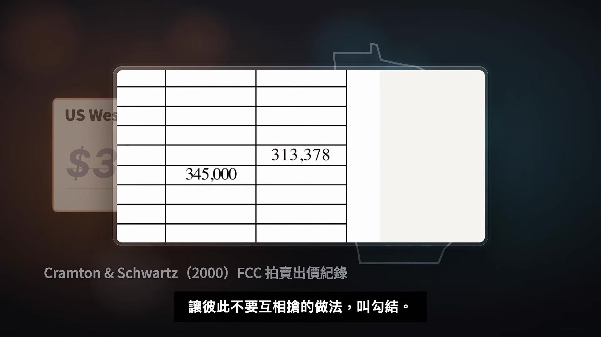

**逐字稿片段：** 叫勾結 規則可以讓人說真話 也可能讓人說悄悄話 所以設計拍賣 還得想辦法讓人沒辦法串通

**話題推測：** 顯示「勾結」（Collusion）這個名詞。

---

## 00:12:24

**逐字稿片段：** 拍賣後來最大的舞臺 在網路上 你在搜尋引擎打一個關鍵字 最上面那幾則廣告 位置都是拍賣出來的

**話題推測：** 將討論轉向拍賣在網路上的應用，如搜尋廣告。

---

## 00:12:31

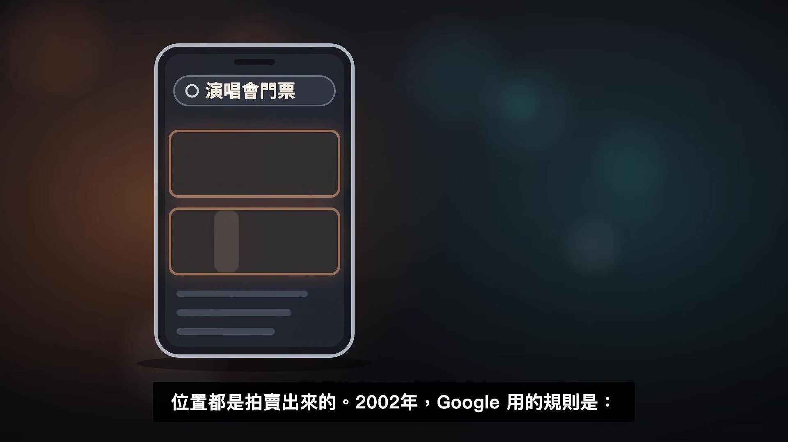

**逐字稿片段：** 2002年 Google用的規則是 得標的人付下一名的出價 再加一分錢 這叫GSP 意思是把次高價的想法 推廣到好幾個廣告位 開場那句廣告文案 說的就是這一套

**話題推測：** 提及Google於2002年開始使用的廣告拍賣規則。

---

## 00:12:43

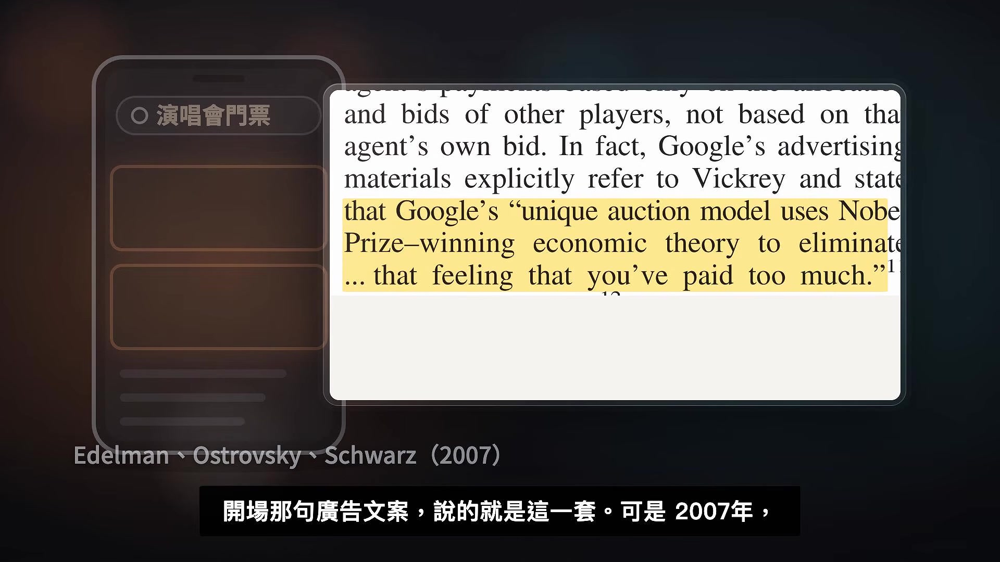

**逐字稿片段：** 可是2007年 有三位經濟學家發表論文 寫了一句很直接的話 GSP不是維克里那一套 他們舉了一個例子 兩個廣告位 上面那一格每小時有200次點擊 下面那一格有199次 三家廣告主 每次點擊對他們分別值10美元、4美元、2美元 值10美元的那家 照時出10 拿到上面那一格 付下一名的4美元 每小時賺1200 如果他故意只出3 掉到下面那一格 付最後一名的2美元 每小時反而賺1592 說謊 多賺了392 為什麼會這樣 回到演唱會門票那個比喻 只有一張票的時候 你的出價只是一張門票 決定你進不進場 一次賣好幾個位子 你的出價會決定你拿到哪一格 拿到哪一格 又決定你付誰的價錢 門票又變回了帳單 公平地說 同一篇論文也證明 GSP換成價格往上喊的版本 大家拿到的錢 跟人人說真話時一樣

**話題推測：** 提及2007年一篇批判GSP拍賣的經濟學論文。

---

## 00:13:37

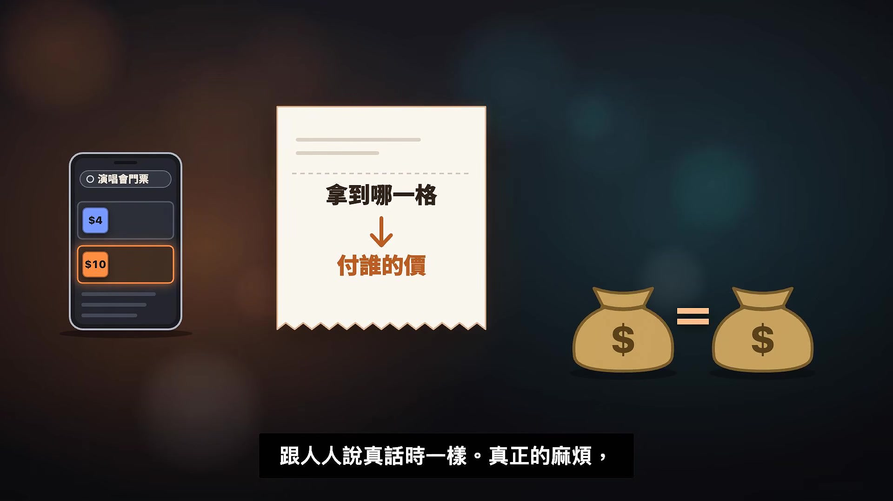

**逐字稿片段：** 真正的麻煩 出在定規則的人身上

**話題推測：** 轉向討論規則制定者本身可能存在的問題。

---

## 00:13:39

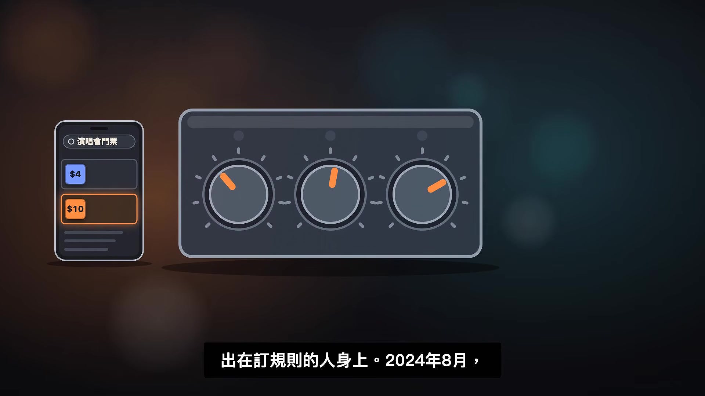

**逐字稿片段：** 2024年8月 美國政府告Google的案子 聯邦地方法院在判決裡 把今天的搜尋廣告拍賣描述成 經典的次高價拍賣加上修改 判決記錄了其中一項

**話題推測：** 提及2024年8月美國政府起訴Google的案件。

---

## 00:13:50

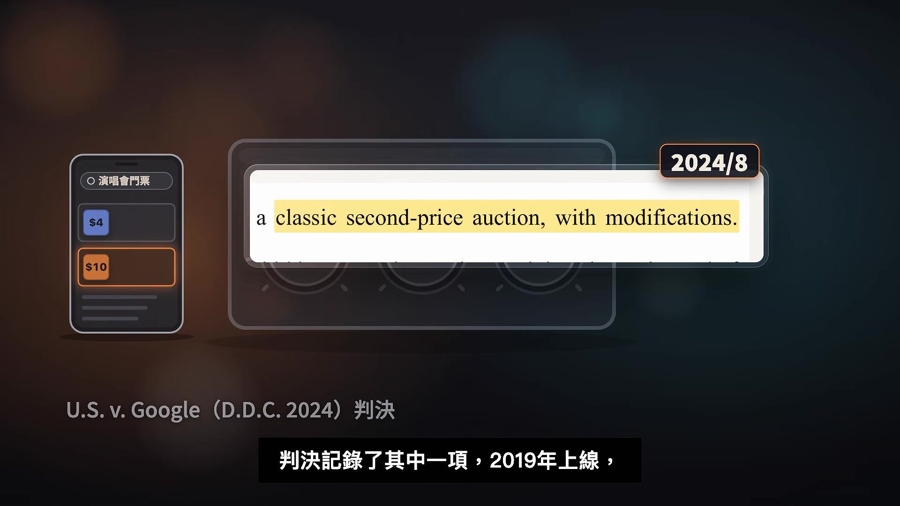

**逐字稿片段：** 2019年上線 會隨機把前兩名的位置對調 逼第一名出更高才穩贏 Google內部文件寫著 這會增加收入 而廣告組不能選擇退出 法院也寫到 許多廣告組甚至沒發現 價格變化是Google造成的 Google的說法是 有些調整是為了不讓一家獨大 讓小廣告組也有機會

**話題推測：** 介紹Google於2019年上線的隨機對調廣告位置機制。

---

## 00:14:09

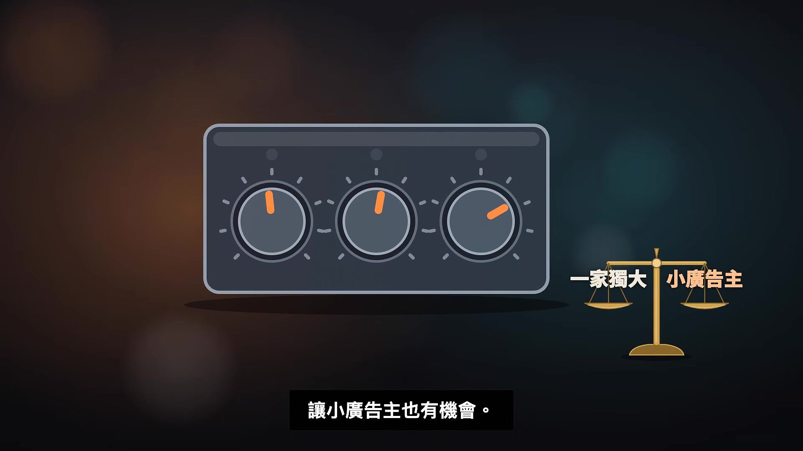

**逐字稿片段：** 到這裡的例子都有一個共同點 可以用錢

**話題推測：** 從涉及金錢的例子轉向不能用錢分配的資源。

---

## 00:14:13

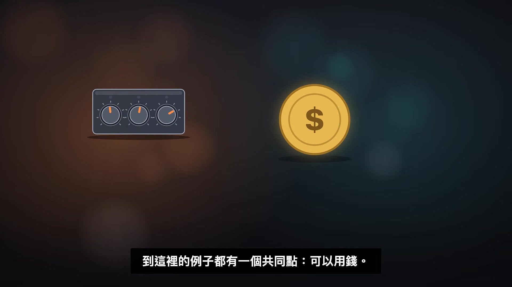

**逐字稿片段：** 如果有些東西根本不能用錢分呢 像是學校的名額

**話題推測：** 提出新問題：如何分配學校名額等非金錢資源。

---

## 00:14:16

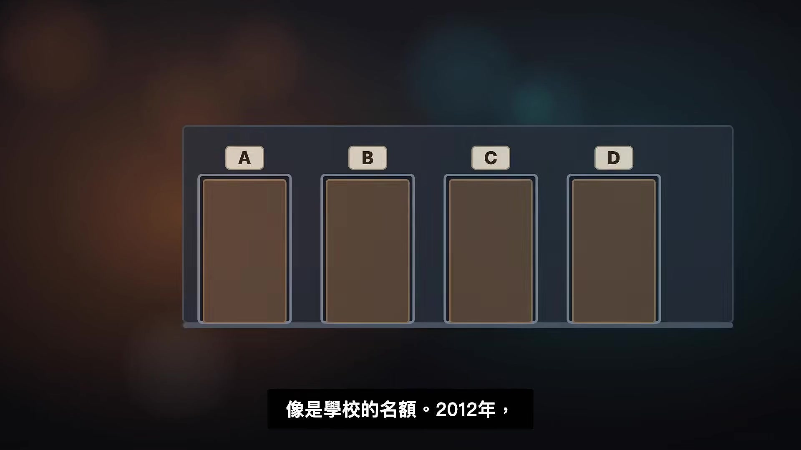

**逐字稿片段：** 2012年諾貝爾經濟學獎 頒給Roth和Shapley Roth就是剛才Wilson提到的那位學生 他們用的工具是1962年 Gale和Shapley提出的一個方法

**話題推測：** 提及2012年諾貝爾經濟學獎頒給Roth和Shapley。

---

## 00:14:26

**逐字稿片段：** 叫延遲接受 每個學生拿著志願表 先去敲第一志願的門 每所學校看看來敲門的人 按自己的標準 暫時留下最好的 其他的拒絕 被拒絕的學生 再去敲下一個志願的門 學校遇到更好的人 可以換掉暫時留著的人 一直到沒有人被拒絕為止 延遲指的就是學校先暫時留著 不馬上說定 這個方法對學生有一個好處 照時填志願是安全的

**話題推測：** 介紹Gale和Shapley提出的「延遲接受」（Deferred Acceptance）方法。

---

## 00:14:51

**逐字稿片段：** 紐約市以前不是這樣 就志只能填五個志願 學校又偏好把自己填第一的學生 學生不敢照時填 每年大約三萬人被分到沒填的學校

**話題推測：** 對比紐約市以前的學校分配制度。

---

## 00:15:00

**逐字稿片段：** 2003年改成延遲接受之後 這種人數減少了九成 波士頓在2005年也換了制度 他的就志先滿足第一志願 你第一志願沒上 後面的志願可能早被別人填滿了 家長只好用猜的

**話題推測：** 提及紐約市在2003年改用延遲接受方法。

---

## 00:15:12

**逐字稿片段：** 學校名額不能用錢買 勝仗更不行 諾貝爾官網的說法是 這裡要考慮禁止付款這種倫理限制 麻煩在這裡 一個病人可能有家人願意捐腎 可是兩個人不相容 捐不了

**話題推測：** 轉向更敏感的非金錢分配案例：器官捐贈。

---

## 00:15:25

**逐字稿片段：** Roth和同事設計了交換的方法 兩對這樣的家庭 互相把腎捐給對方的病人 後來交換越做越長 變成一條鏈

**話題推測：** 介紹Roth和同事設計的腎臟交換方法。

---

## 00:15:33

**逐字稿片段：** 2007年7月 一位沒有指定對象的人 自願捐出一顆腎 當作一條鏈的開頭 接力完成10次腎臟移植 跨了5個州 前後大約8個月 這裡沒有價格 能用的只剩規則本身怎麼設計

**話題推測：** 提及2007年7月一條腎臟交換鏈的成功案例。

---

## 00:15:45

**逐字稿片段：** 最後回到臺灣 回到你可能填過的那張志願表

**話題推測：** 將討論帶回台灣的教育志願填報制度。

---

## 00:15:49

**逐字稿片段：** 大學分發入學委員會的官方問答寫著 分發依照加權成績高低擇優錄取 志願序只是個人就讀意願的排序 不影響分發 他舉的例子是 甲的分數比乙高 甲把某個校系填在第十志願 乙填的比較前面 只要甲前面九個都沒上 還是甲優先錄取 官方沒有用延遲接受這個詞 可是效果跟他一樣 照實填 不會吃虧

**話題推測：** 說明台灣大學分發入學委員會的官方規定。

---

## 00:16:14

**逐字稿片段：** 你的分數 2014年

**話題推測：** 提及2014年12年國教高中免試入學制度。

---

## 00:16:15

**逐字稿片段：** 12年國教的高中免試入學 很多區走另一條路 志願填的越後面 扣越多分 以雞北區來說 每往後一個志願 就多扣一分 等於告訴學生 夢想學校填在前面 萬一沒上 後面的志願都要被扣分 數百人上街抗議 標語把它比作 拿孩子的未來賭博 但志願序計分 一直保留到今天 只是改成每五個志願一組 前五個不扣分 後來四位經濟學家 研究這套制度 發現扣得越重 越容易逼人不照識田 扣到很重 結果就跟波士頓的舊制一樣 同樣是一張志願表 一套規則讓你放心說真話 另一套逼你用猜的 差別不在學生誠不誠實 在規則怎麼定 這一集 我們從一臺賣不出去的鋼琴講起 私心 加上看不見對方的底牌 好好的交易就會消失 Vikry的答案 是讓你的話只決定你贏不贏 不決定你付多少 說真話就變成最划算的做法 可是放進真實世界 還得補上最低價 要防出價裡的暗號 要看住定規則的人 碰到不能用錢的地方 還得換成志願表和交換鏈 讓人說真話 靠的不是要求大家當好人 是把規則定成 說真話剛好對自己最好 最後問你一個問題 你遇過哪一個規則 讓你不敢照實說 是填志願 是喊價 還是別的 留言告訴我 喜歡的話 訂閱AI Notebook 開啟通知 我們下次見

**話題推測：** 介紹台灣高中免試入學的志願序計分方式。

---
