# jimainotebook_8Y6ovXMrdVs — 關鍵畫面索引

- 來源逐字稿：[jimainotebook_8Y6ovXMrdVs_FIN.srt](jimainotebook_8Y6ovXMrdVs_FIN.srt)
- 影片：https://www.youtube.com/watch?v=8Y6ovXMrdVs
- 截圖數：40

## 00:00:12

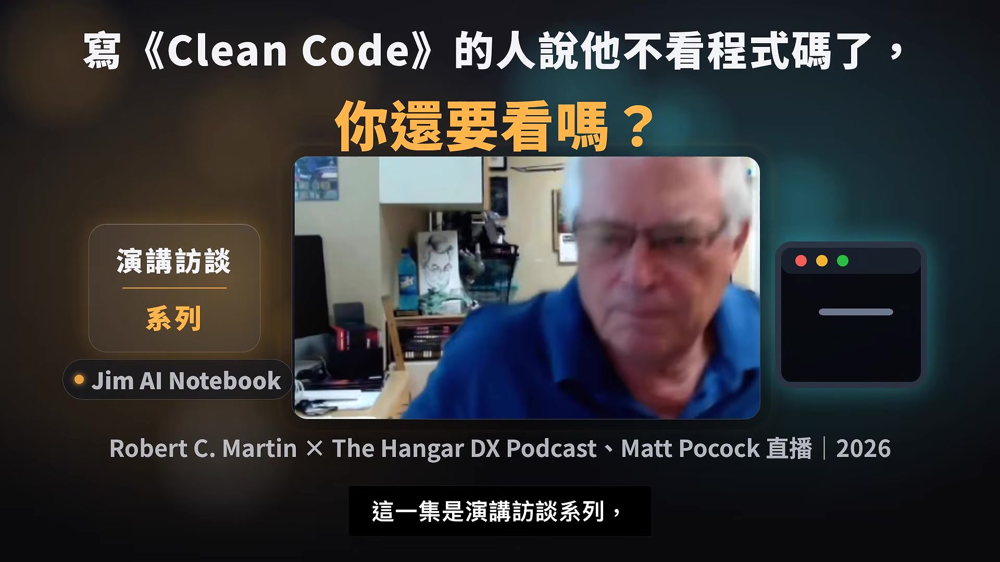

**逐字稿片段：** 主角是寫無暇的程式碼的Robert Martin,

**話題推測：** 介紹主角Robert Martin（Uncle Bob）

---

## 00:00:15

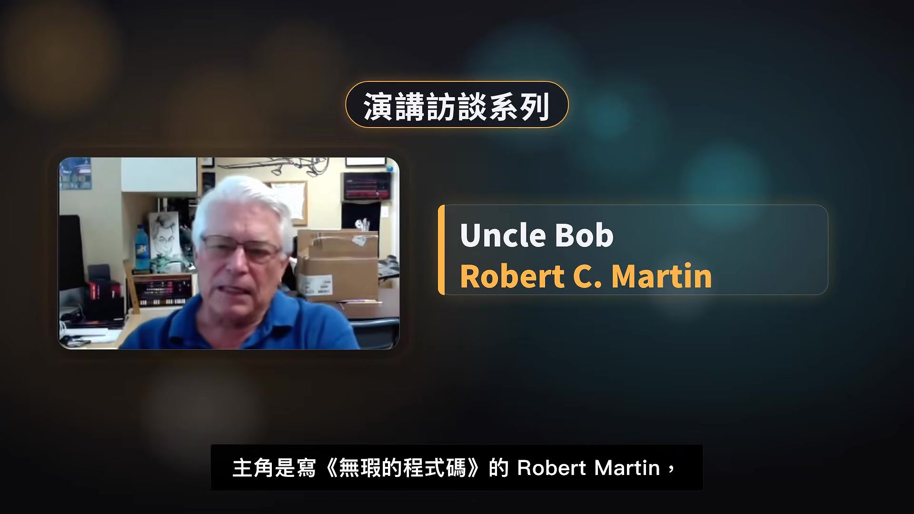

**逐字稿片段：** 大家叫他Uncle Bob, 他最近公開說他不看AI寫的程式碼了, 我們要問的是AI寫的程式碼的人還需要一行一行看嗎?如果不看, 要靠什麼放心?想像一個畫面, 黑色的終端機視窗裡, 程式碼一行一行往上捲, 快到看不清楚, 坐在螢幕前面的是一個寫了半個世紀程式的人, 他沒有去讀, 只是看著, 說這句話的人正好寫過一本教工程式報告, 把程式碼寫到讓人讀得懂的書 所以這不是一句玩笑話 它背後有一套做法 這一集是講者的觀點 加上我們的查證不是工程建議

**話題推測：** 提出Uncle Bob最近公開表示不看AI程式碼的關鍵議題

---

## 00:00:45

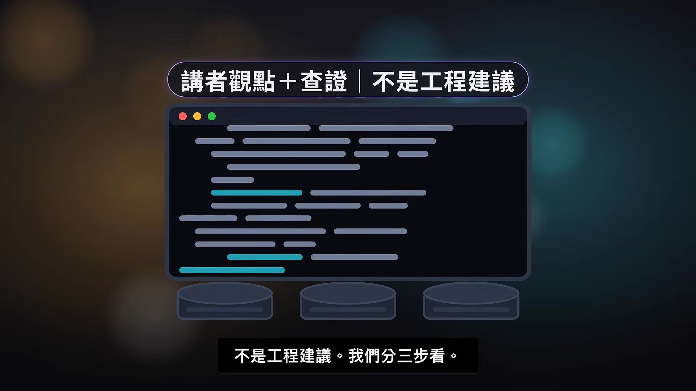

**逐字稿片段：** 我們分三步看 先看他為什麼不看了 用什麼代替 再看他怎麼在一個月之內推翻自己的做法 最後問出了事 責任在誰身上 你還要不要看 先認識這一集的主角 Robert Martin寫程式 到現在已經超過半個世紀

**話題推測：** 影片內容分三步驟的概覽

---

## 00:00:59

**逐字稿片段：** 他在2008年出了一本書英文叫Clean Code 臺灣的一本叫無暇的程式碼 講的是怎麼把程式碼寫乾淨 讓下一個接手的人讀得懂 去年秋天 這本書出了新的版本 中文版今年7月才上市

**話題推測：** 展示Robert Martin的著作《Clean Code》書封

---

## 00:01:11

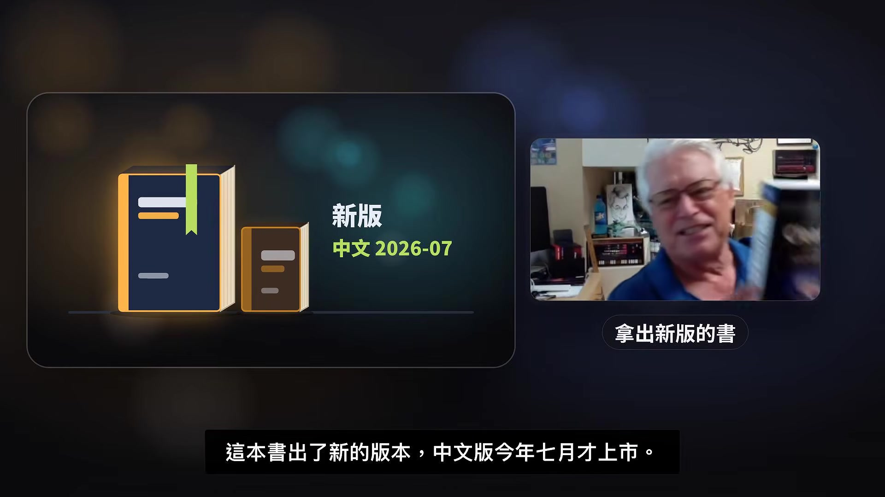

**逐字稿片段：** 這一集用了兩段訪談 主要的一段 是一家叫Aviator的公司 自己做的節目 叫The Hangar DX Podcast 主持人是創辦人Ankit Jain 9月24號上架 另一段是Matt Pocock的直播 8月19號播出

**話題推測：** 介紹影片引用的兩段訪談來源

---

## 00:01:25

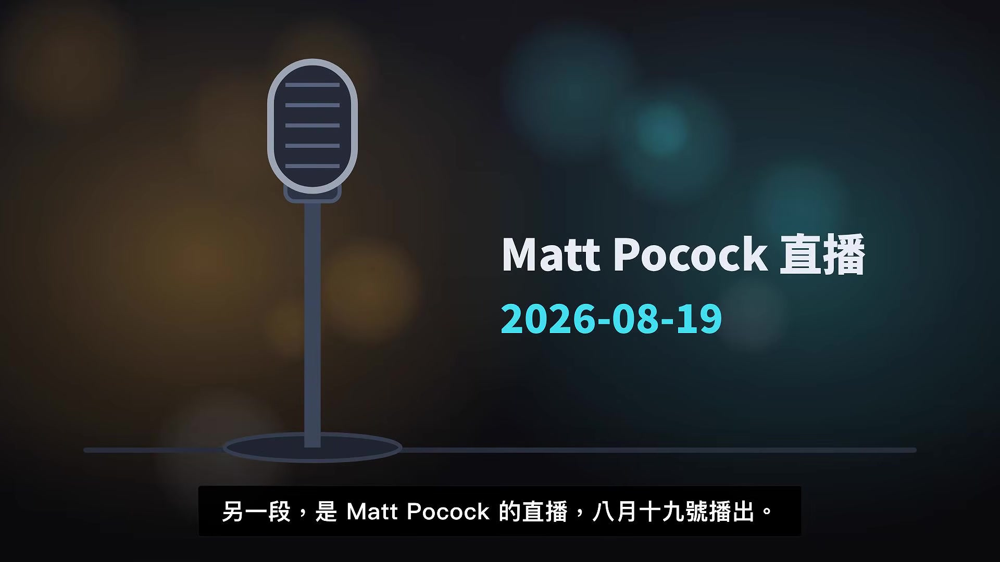

**逐字稿片段：** 先交代一件事 Aviator賣的工具 官網標語就是用 驗證取代城市碼生他 這個題目跟主持人的生意 直接相關 後面我們會再講一次 節目進行到一半 主持人直接問他 我們什麼時候會停止讀城市碼 聽他怎麼回答 95%的程式碼 他根本沒看過 偶爾打開一個小視窗 看一眼某個模組 覺得不喜歡而已 可是他不是一直這樣想 主持人說 他兩年前公開說過 AI不是寫程式的未來 我們去找了

**話題推測：** 介紹Aviator公司及其工具產品

---

## 00:02:03

**逐字稿片段：** 他在 X 上的一首發言 最早最明確的是 2025 年 9 月 大約一年前 那個月他寫了兩句話 一句是AI不會取代程式設計師 另一句是AI泡沫快要破了

**話題推測：** 展示Robert Martin在X（Twitter）上的相關發言截圖

---

## 00:02:14

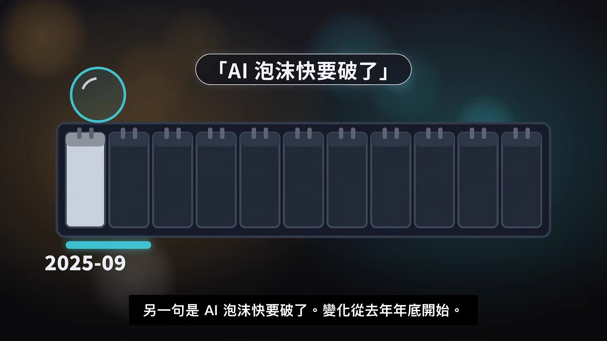

**逐字稿片段：** 變化從去年年底開始 他在直播裡說 大概聖誕節前後 他開始讓早期版本的Grok 幫他做專案 一開始一直在幫他收拾爛攤子 到了今年1月 他發現AI做得比較好了 之後幾乎每個月都更好

**話題推測：** 說明他對AI態度的轉變時間點

---

## 00:02:26

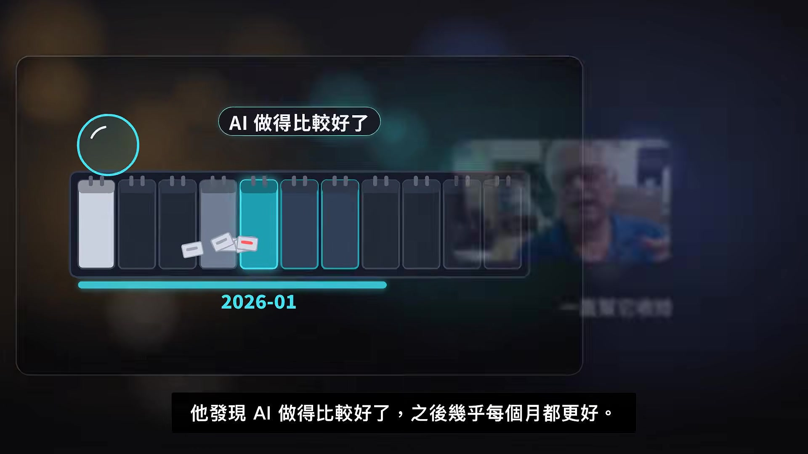

**逐字稿片段：** 今年4月 他在X上說 他不審查AI寫的程式碼 7月又說他一行都不讀 他為什麼敢這樣做 他在直播裡講得很直接 聽他自己說 他說 AI處理程式很快 他自己很慢 慢的地方就是一行讀 所以他不想把自己的慢 加在AI身上 他每天在做什麼

**話題推測：** 展示Robert Martin在X上的另一則發言，說明他不再審查AI程式碼

---

## 00:02:56

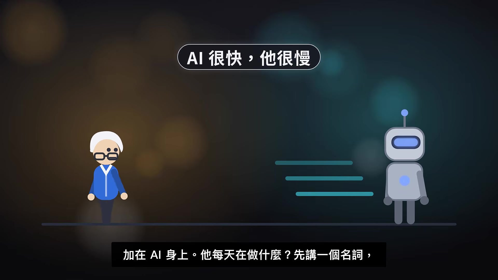

**逐字稿片段：** 先講一個名詞 叫代理人 英文是agent 代理人是會自己動手的AI 他不只回答問題 還會自己修改檔案 執行工具 看結果 再決定下一步 他現在不用一般寫程式的編輯器

**話題推測：** 解釋「代理人」（Agent）的定義

---

## 00:03:07

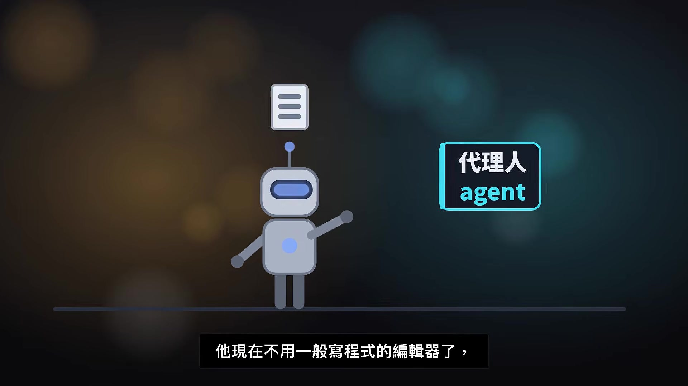

**逐字稿片段：** 主要的工具是一個終端機視窗 就是那種黑底 只能打字的畫面

**話題推測：** 展示終端機視窗的介面

---

## 00:03:11

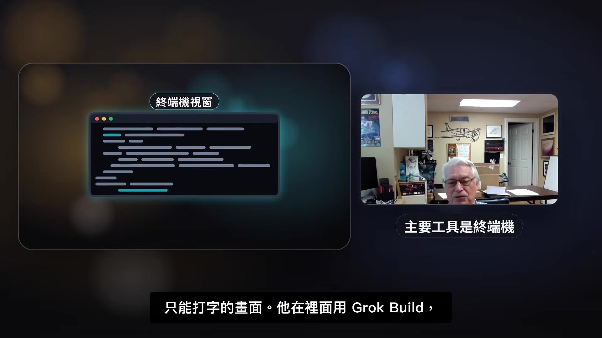

**逐字稿片段：** 他在裡面用Glock Build 也用過OpenAI的Codex 和Anthropic的Cloud 他告訴代理人 要做什麼 用什麼工具 要守哪些門檻 然後盯著他做 程式碼在視窗裡 捲過去 他讀不了 可是看得出方向對不對

**話題推測：** 列出他使用的AI代理人工具（Grok Build, OpenAI Codex, Anthropic Cloud）

---

## 00:03:24

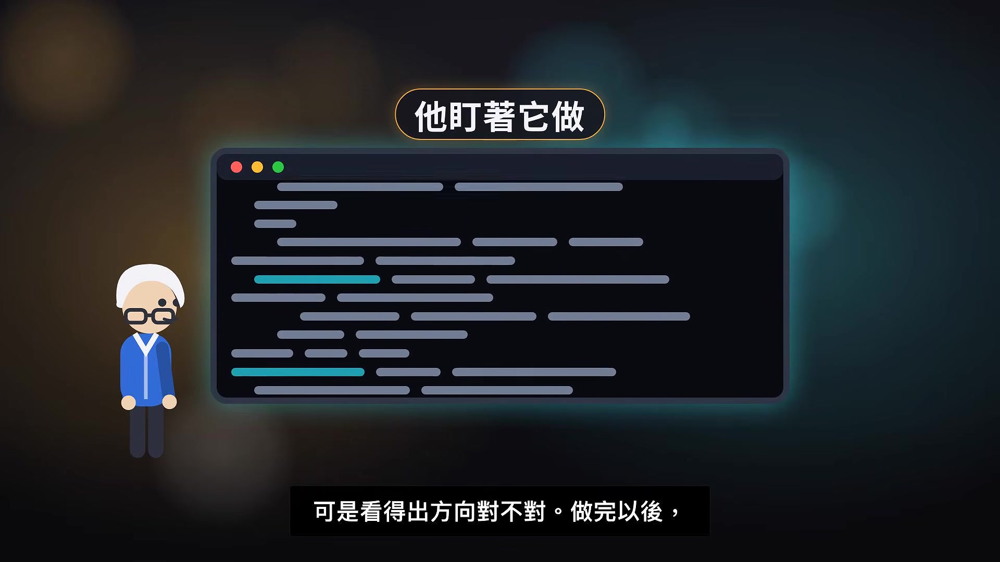

**逐字稿片段：** 做完以後 他看的是代理人 畫出來的架構圖 整個系統分成哪幾塊 誰依賴誰 所以問題變成 不讀程式碼 要用什麼代替

**話題推測：** 展示AI代理人生成的系統架構圖

---

## 00:03:32

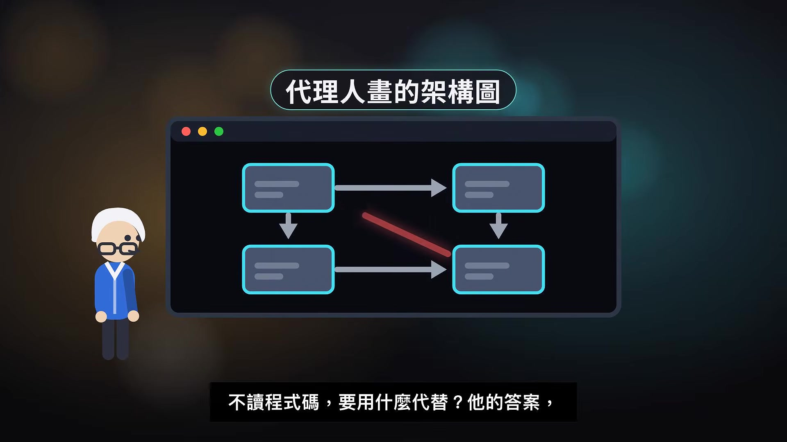

**逐字稿片段：** 他的答案是 三道機器可以檢查的約束 一開始的那一道

**話題推測：** 概覽他用於代替人工審查的三道機器約束

---

## 00:03:37

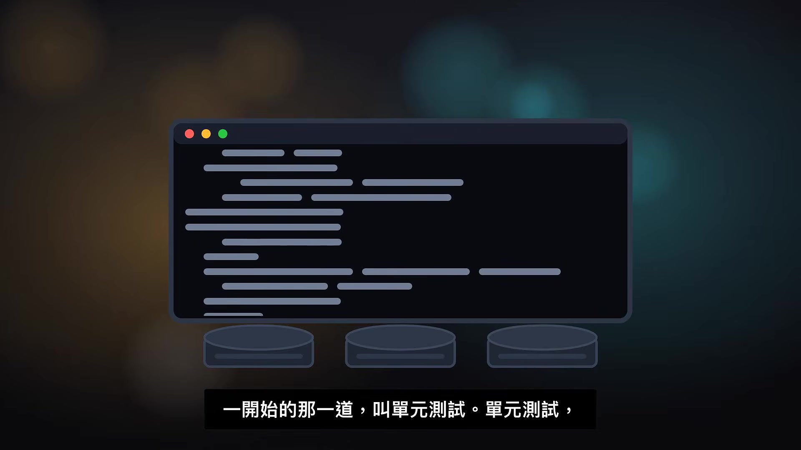

**逐字稿片段：** 叫單元測試 單元測試 是一小段 專門檢查程式的程式 他把一個功能拿來執行 看結果是不是 預先寫好的答案

**話題推測：** 介紹第一道約束：單元測試（Unit Test）

---

## 00:03:44

**逐字稿片段：** 他用了一個會計的說法來形容 叫複試不計 複試不計 是每一筆賬都記兩次 一邊記錢從哪裡來 一邊記錢到哪裡去 兩邊要對得上 對不上 就知道哪裡記錯了 寫程式也一樣 程式寫一遍 這個功能要做什麼 測試再寫一遍 他應該得到什麼 代理人如果走偏了 梁本仗對不起來 測試就亮紅燈 他說沒有單元測試的代理人 很快就會走到莫名其妙的地方去 他也看過好幾次 代理人自己弄壞了一個測試 馬上退回去換一個方向 這段聽他自己講 But if you have them write unit tests They have to say everything twice And that keeps them kind of in line They can look at the tests They can look at the code And they say oh yeah That's the direction we were going 兩本杖對得上 只能證明城市做到了測試說的事 可是測試夠不夠多

**話題推測：** 以會計的「複式不計」比喻單元測試概念

---

## 00:04:36

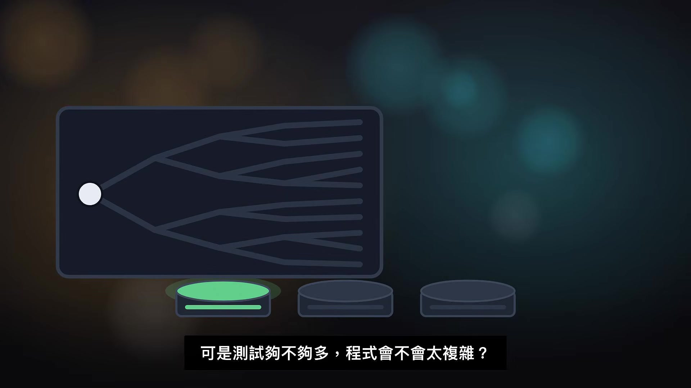

**逐字稿片段：** 城市會不會太複雜 接下來到名字有點不好聽 叫CRAP 它是一個分數 全名是Change Risk Anti-Patterns 測量的是修改城市的風險

**話題推測：** 介紹第二道約束：CRAP（Change Risk Anti-Patterns）分數

---

## 00:04:46

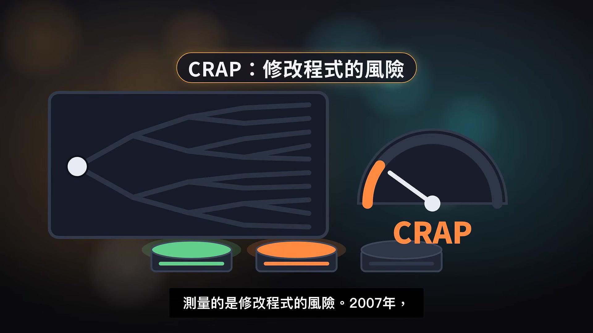

**逐字稿片段：** 2007年 Alberto Savoia和Bob Evans提出來 這個分數把兩樣東西合在一起 一樣叫圈複雜度 是一段城市裡有幾條分叉的路 每多一個判斷 或多一個重複的迴圈 就多一條路 另一樣叫測試覆蓋率 是測試實際執行到多少城市 公式不用記 記一句話就好 路越多測試越少 分數就爆充

**話題推測：** 介紹CRAP分數的提出者Alberto Savoia和Bob Evans

---

## 00:05:06

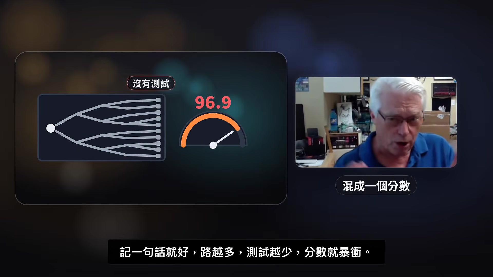

**逐字稿片段：** 一個有10條路的韓式 韓式就是一小段負責一件事的城市 一點測試都沒有 分數是110 測試到一半 降到22.5 全部測試到 剛好是10 原作者說 超過30就算斷層式 CRAP算的不是縮排 有幾層 是分岔的路 有幾條 他自己的門檻 比原作者嚴很多 聽他說 that I've been doing because the agents are getting so much better 他說放寬是因為 代理人越來越強 強在哪裡 他在節目後面 講得更清楚 他當初堅持 含釋要非常小 是為了人 人的短期記憶 就是腦子裡 同時抓得住的東西 大概只有五到七件 一個含釋的路太多人 讀到後面 就忘了前面 他說代理人 沒有這個限制 可以同時記住 幾十件事情 所以給人看的門檻 未必適合代理人 那要放寬到哪裡 他的測量方法很實際 看代理人 什麼時候開始搞混 代理人搞混的樣子 跟人很像 動了這裡壞了那裡 原本做好東西又被弄壞 主持人聽完說 這等於宣佈 這些程式碼是寫給代理人讀 不是寫給人讀的 他直接回答 是的 這是整件事最大的轉變 程式碼的讀者 換了一個

**話題推測：** 以具體數字範例說明CRAP分數的計算

---

## 00:06:29

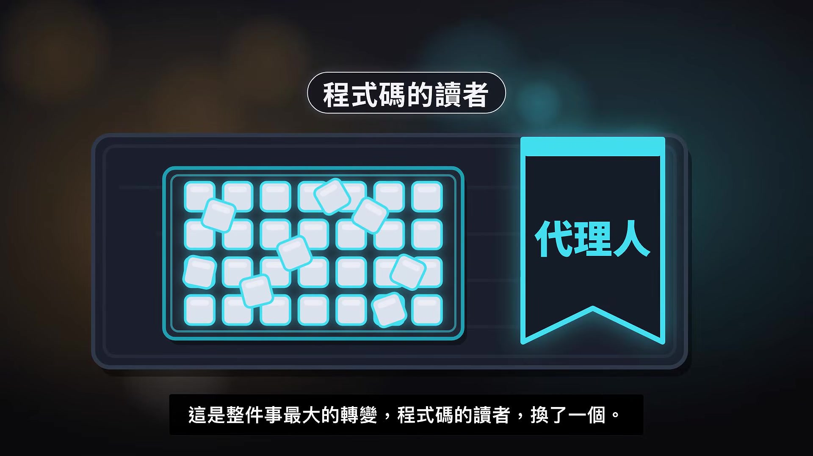

**逐字稿片段：** 最後一道叫變異測試 前面說的測試覆蓋率 有一個漏洞 他只告訴你 哪些程式被測試執行過 不告訴你 有沒有真的被檢查過

**話題推測：** 介紹第三道約束：變異測試（Mutation Testing）

---

## 00:06:37

**逐字稿片段：** 這是變異測試工具 PIT的官網講的 例如把大於換成小於 把等於換成不等於 每換一處 就把全部的測試執行一次 這就像在考卷上 故意寫錯一題 看閱卷老師有沒有抓出來 測試失敗 代表錯被抓到了 這是好事 測試還是全部通過 這個被弄壞的版本 就叫存活的突變題 代表那段程式 雖然被執行過 其實沒有人檢查 他要代理人 把存活的突變題 全部消滅 這兩招 他自己在2000年前後就試過 那時候一次編譯測試 要執行一整晚 抓到了問題還要自己一個修正 太不實際他就放下了 去年年底他突然想同一件事 聽他怎麼講 instead of an overnight run 一整晚的工作 代理人大約30分鐘做完 而且不嫌無聊 好點子一直都在 只是以前沒有人力去做

**話題推測：** 展示變異測試工具PIT的官方資訊

---

## 00:07:50

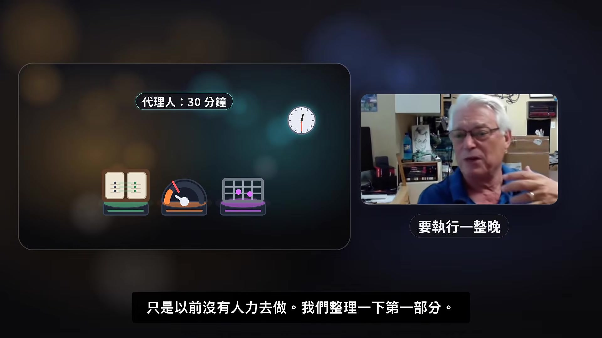

**逐字稿片段：** 我們整理一下第一部分 他沒有不檢查 他是把檢查換了一種方法 以前是人用眼睛 一行一行讀 現在是機器用數字測量 三道約數 各自管一件事 單元測試 像複式佈計 確認程式和測試對得上 CIAP看路有多少測試 夠不夠的路太多 就逼代理人把程式變簡單 變異測試 故意放錯 確認測試真的抓得到錯 門檻也不是死的 代理人記得比人多 就放寬一點 等他開始搞混再收緊 所以第一部分的答案是 他不讀程式碼 可是他測量程式碼 那光有這三道約束就夠了嗎

**話題推測：** 總結第一部分的重點

---

## 00:08:24

**逐字稿片段：** 他接下來做的事 是把好幾個代理人排成一整條線 8月那場直播 他正在做一件很有野心的事 一條多代理人的流水線 流水線上有好幾個代理人 一磅接一磅 最前面是寫規格的 把人寫的需求 變成可以執行的驗收規格 用的是一種叫Gurkin的格式 用接近人化的句子寫成測試 接著是寫程式的 負責寫單元、測試和程式本身 再來是清理的 執行CRAP把亂掉的地方整理乾淨 然後是強化的 專門執行編譯測試 一點都不留情 最後是品管的 把整套系統從畫面上操作一遍 這就像工廠的輸送袋 每個工人只做一件事 做完交給下一個 他都成果很好 可是時間也拉長很多 聽他自己怎麼說

**話題推測：** 介紹Robert Martin嘗試的多代理人流水線概念圖

---

## 00:09:24

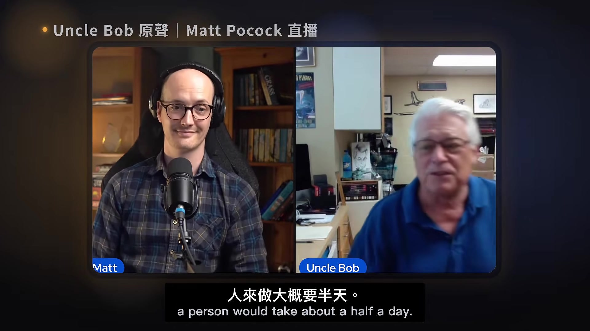

**逐字稿片段：** 一個代理人五分鐘品質可依 流水線一小時 品質很高 人自己做藥半天

**話題推測：** 比較單一代理人與流水線代理人的效率和品質數據

---

## 00:09:31

**逐字稿片段：** 聽起來很划算 可是一個月後 他在Aviator的節目裡 把這條流水線推翻了 他說代理人之間的交接很麻煩 只要互相洩露一點資訊 過一陣子 他們就全部變成同一個代理人 為了擋住這件事 他花了很多力氣 做好的時候還很得意 後來他發現 這套東西效率極差 而且有一個破綻 他做這條流水線的時候 從頭到尾都沒有用流水線來做 一直只是在指揮一個代理人 真正的轉折 在節目上架前大約十天 他跟一個代理人深談了45分鐘 當時用的是Grok 聽他描述那45分鐘 with this agent proposing things getting counter proposals back from the agent having the kind of discussion I could only have with an extremely seasoned senior engineer 那45分鐘裡 代理人會反駁他 他提一個方案 他說不行 然後列出好幾個理由 而且講得對 接著他再丟回一個新的方案 他心想 如果我願意這麼信任一個代理人 把他當成資深工程師在討論 為什麼還要把他放進流水線 當成只做雜事的工人 他說 他腦子裡的想法裝錯了 這就是這一部分的主要比喻 流水線是把代理人當成工人 每個只做一小段 交接要管得很嚴 資深工程師 是你坐下來跟他討論 讓他自己判斷 他現在選後面那種 一個代理人 加上一套看架構的視覺化工具 要注意 這是他在一個月之內 自己推翻自己 8月還說流水線成果很好 9月就說效率極差 他在節目裡也說 他現在的立場 下禮拜可能又變了 這反而讓人放心 他是照實說出實驗的結果 主持人接著提到另一個例子

**話題推測：** 宣布Robert Martin推翻多代理人流水線的做法

---

## 00:11:11

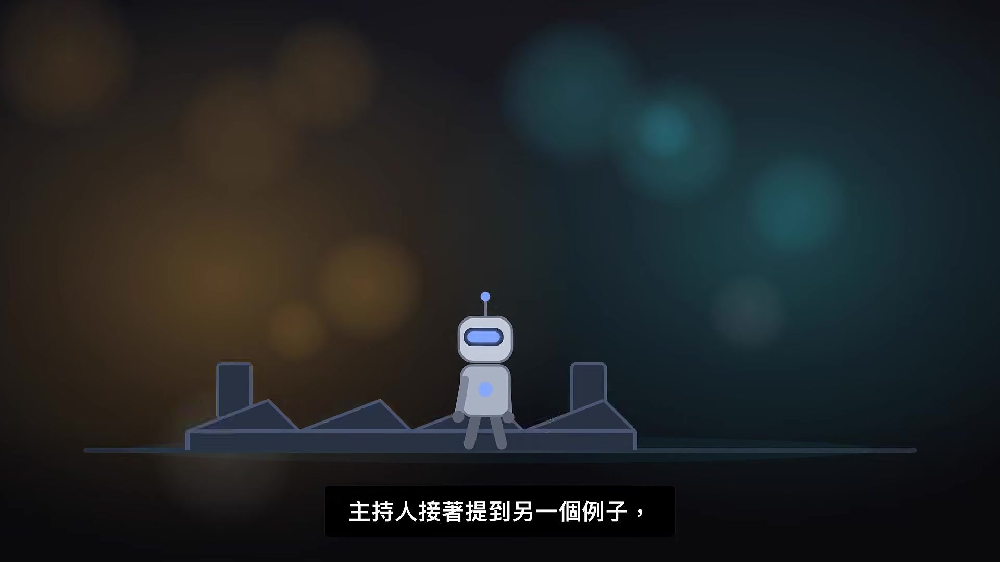

**逐字稿片段：** Steve Yeggs的Gastown Gastown是一套多代理人工廠 可以同時指揮幾十個寫程式的代理人 2026年1月1號開放原始碼 8月初 Yeggs自己寫文章說Gastown實際上已經燒燬了 可是兩個人的結論剛好相反 Uncle Bob回到一個代理人 Yeggs轉而做一套新的系統 叫Wheelhouse 指揮大約五六十個代理人 他的結論是 這種代理人系統要為自己的專案量身打造 拿別人做好的通用框架來用 不會順利 所以流水線過時了 是Uncle Bob的看法 不是業界的共識 主持人說Gastown要收掉也不精確 Yagley沒有正式宣佈關閉 只是轉而做別的

**話題推測：** 介紹另一個多代理人專案Gastown及其創辦人Steve Yeggs

---

## 00:11:48

**逐字稿片段：** 如果不讀城市碼 城市碼乾不乾淨 還重要嗎 他在直播裡講了一段經驗 去年年底 他讓Grok做一件事 他留下一堆亂七八糟的東西 他不收拾 直接叫他做下一件 亂得更多 慢慢的代理人變慢了 動了一個地方 就弄壞另一個地方 修正那個 又弄壞下一個 一直繞圈子 有一次代理人等於直接放棄了 所以他說 代理人跟人一樣 會被爛城市馬困住 只是受得了的程度可能不同 那寫一大份規則給他 叫他寫乾淨可以嗎 他試過寫了五到十頁 結果代理人把規則當成電影 神鬼奇航裡海盜的守則 只是參考建議 他說規則一長 中間的部分就被忽略了 所以他改用機器檢查 丁寧會被忘記 可是一個檢查工具 每次都會執行 不合格 就退回去重做 那他的書要不要重寫 主持人問了這個問題 他開始玩AI之前寫完的 那時候他還覺得AI不會有什麼發展 可是他不打算動任何一條基本原則 有一樣東西他不再要求了

**話題推測：** 提出新問題：如果人不讀程式碼，程式碼品質是否還重要？

---

## 00:12:44

**逐字稿片段：** 叫測試驅動開發 英文是TDD 測試驅動開發是先寫一小行測試 再寫一小行程式 一來一回往前推 他一直很推崇這套做法 可是他說這是配合人腦設計的紀律 他叫代理人照做 代理人最後總是回到先寫一個函式 再補測試的方式 他也就接受了 他的說法是把人的紀律強加給代理人 可能是錯的 把人的價值交給代理人 沒有錯 那書裡哪些東西還留著 聽他親口講 他說所有原則都還在 只是門檻可能不一樣

**話題推測：** 說明他不再要求測試驅動開發（TDD）

---

## 00:13:34

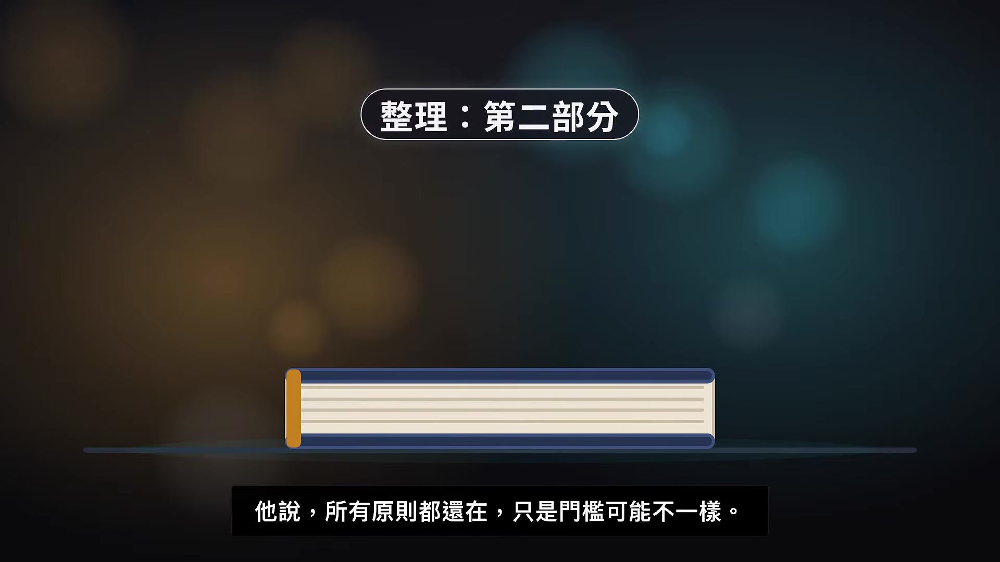

**逐字稿片段：** 我們整理一下這一部分 8月他把代理人排成一條流水線 當成只做一小段的工人 9月他發現自己願意把一個代理人 當成資深工程師來討論 就把流水線收掉了 回到一個代理人 同一個人 一個月就換了做法 說明這個領域變得很快 今天的最佳做法 下個月可能就過時 可是有一件事沒變 代理人跟人一樣 會被爛城市碼困住 所以城市碼還是要乾淨 好的切分 好的依賴關係 好的名字 一樣都不能少 變得是門檻 還有讓代理人守規矩的方法 從叮嚀換成機器檢查 所以這一部分的答案是 工具和門檻在變 基本功沒變

**話題推測：** 總結第二部分的重點

---

## 00:14:08

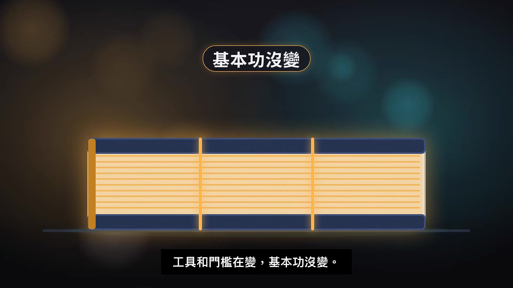

**逐字稿片段：** 接下來的問題更實際 如果人不看 出了事 誰要負責 在講他的答案之前

**話題推測：** 提出核心問題：如果人不看AI程式碼，責任歸屬為何？

---

## 00:14:14

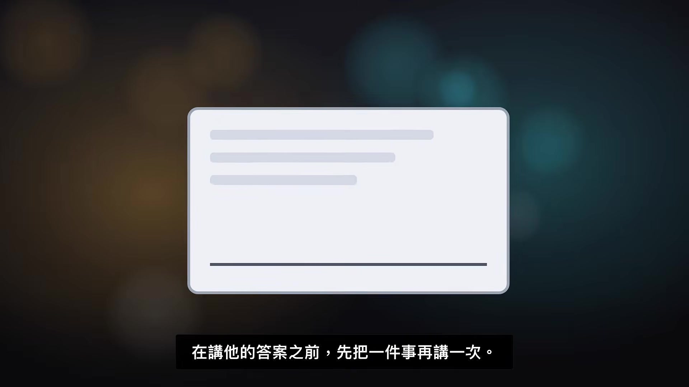

**逐字稿片段：** 先把一件事再講一次 這個節目是Aviator自己做的 他賣的工具標語 是用驗證取代程式碼審查 主持人自己也說 他剛在紐約演講 講的是怎麼消滅程式碼審查 所以這一集訪談 本身就站在不用看的那一邊 另一邊Uncle Bob 自己也跟兒子 開了一門AI代理人開發的課程 他的心理場跟他在交的東西也有關係 這不代表他們說錯 只是聽了之後要知道 說話的人站在哪裡 知道這些 我們在聽他的答案 主持人問 以前寫程式的人和審查的人 責任分得很清楚 現在代理人寫了大部分的程式 責任要怎麼算 聽他的回答 必須要用我們自己的技術和經驗 並且將其用於代理人所製造的產品 並於此決定 他說代理人不為任何事負責 只有人能負責 未來幾年大概也是這樣 所以工程師要拿出自己的技術和經驗 去檢查代理人做出來的東西 然後簽名承擔所有後果 可是他說的檢查不是讀程式碼 他覺得讀程式碼已經不太有用 而且會讓一切慢下來 他要人在程式碼上面一層負責 語法交給代理人 架構怎麼切 測試夠不夠 三道約束的分數合不合格 這些人要自己扛

**話題推測：** 提醒聽眾Aviator節目的背景與潛在立場

---

## 00:15:37

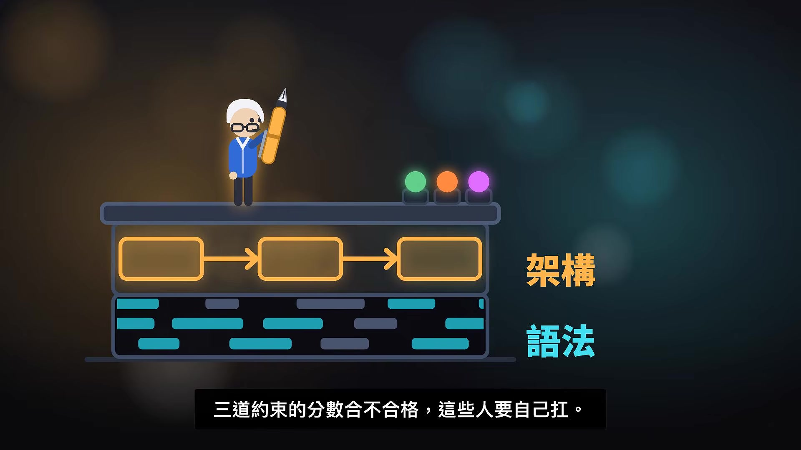

**逐字稿片段：** 這一點 Linux社心社群也同意 Linux核心 就是Linux作業系統 最中心的那一層程式 想修改它的人 要送一份補丁 也就是修改的內容 它的官方文件寫得很清楚 AI代理人不能在補丁上簽名 只有人能 送補丁的人要審查 AI產生的程式碼 負起完整的責任 差別在這裡 Linux核心的維護者 還是會讀補丁 同樣是人負責 一邊靠讀一邊靠測量

**話題推測：** 引用Linux核心社群對於AI程式碼責任的共識

---

## 00:16:02

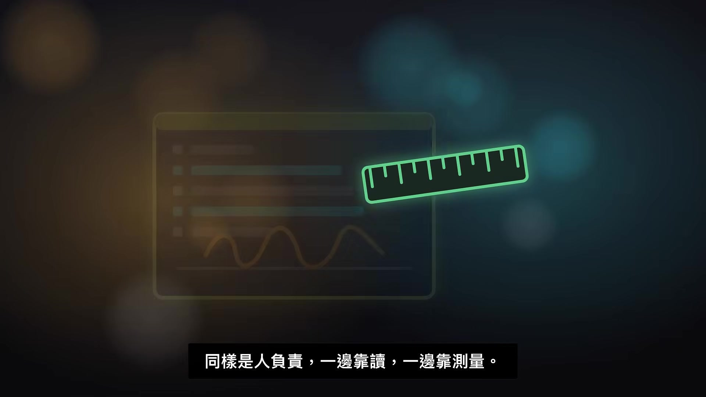

**逐字稿片段：** Linux的創造者Linux Torals怎麼看 2026年5月 在北美的開放原始碼大會上 他說了一段話 AI讓你的生產力提高10倍 可是編譯器讓你提高1000倍 所以AI很棒 但AI沒有改變寫程式 編譯器是把人寫的程式 翻譯成機器聽得懂的指令的工具 他的意思是 寫程式最難的部分還在人身上 今年10月在布拉格 他又說做真正重要的事情 用AI要非常小心 不過他也說 他現在其實很喜歡用AI

**話題推測：** 介紹Linux創造者Linus Torvalds的觀點

---

## 00:16:31

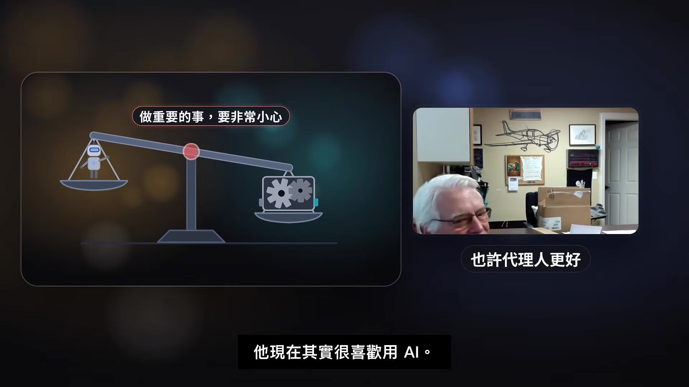

**逐字稿片段：** 另一位是工程師 Simon Willison 他給自己定了一條規則 如果他沒辦法跟別人解釋一段程式在做什麼 他就不會把它放進自己的專案 這跟Uncle Bob剛好相反 一個是不讀 但是測量 一個是讀到能講給別人聽 才算數

**話題推測：** 介紹工程師Simon Willison的程式碼審查原則

---

## 00:16:45

**逐字稿片段：** Stack Overflow 2025年的開發者調查 不信任AI準確度的人 有46%比信任的人還多

**話題推測：** 展示Stack Overflow開發者調查中對AI準確度的不信任數據

---

## 00:16:51

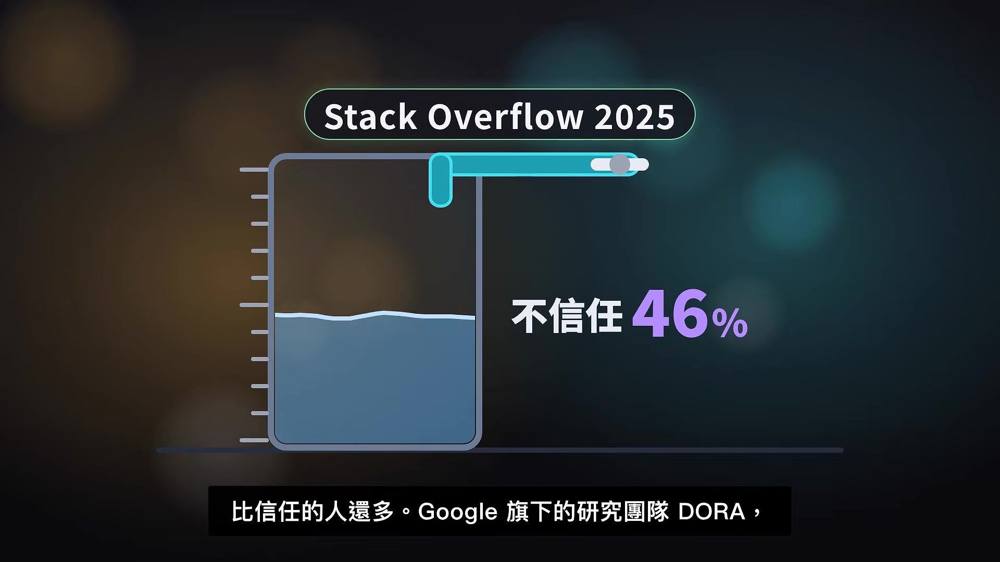

**逐字稿片段：** Google旗下的研究團隊Dora 同一年的報告說 九成的人工作上在用AI 可是AI用得越多 交付的穩定度反而越差 要注意 這是同時發生 不是證明AI造成的 他們的說法是 AI會放大團隊原本的樣子 還有一個常被引用的實驗 2025年初 Meter發現資深工程師用AI反而變慢 而且自己沒感覺到 後來再做一次 結果測量不準 連研究團隊都說要換方法 所以這個結論不能當成現在的情況 最後是現實的限制 主持人也點出來 他現在做的大多是一個人的專案 好幾個人一起修改同一套系統 或是出了錯 要負法律責任的系統 門檻就不一樣

**話題推測：** 展示Google Dora報告中AI使用與交付穩定度的數據

---

## 00:17:27

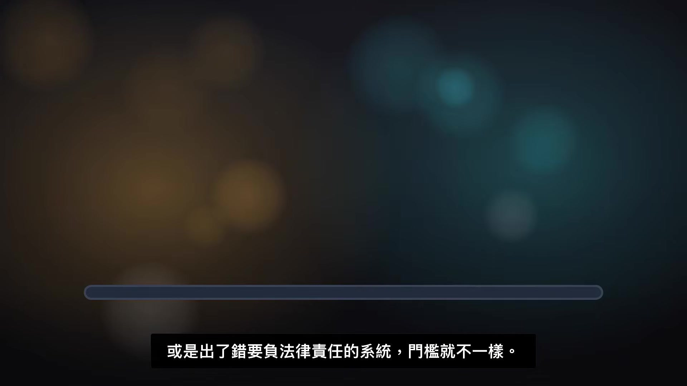

**逐字稿片段：** 那剛入行的人怎麼辦 如果代理人把寫程式的雜事都做完了 反而新人要從哪裡學到判斷力 這也是很多剛畢業的人 最想問的是 Matt Pocock在直播後段 問了這個問題 Uncle Bob說 他也沒有完美的答案 可是他有一個想法 先自己寫程式 寫一年左右 知道代理人每天在處理的是什麼 他以前也常勸人 花一個週末寫組合語言 才知道機器底下真正發生什麼事 他還說 他看得出代理人在掙扎 是因為他自己掙扎過 新人沒有經歷過 就認不出來 那進了公司以後呢 帶隊的資深工程師 手上管著一群代理人 他應該怎麼對待新人 聽他說明 He should look at you as an agent that the agents have that the agents have to use 你應該在那裡花幾個月 being horribly unproductive but learning a hell of a lot 當你經歷了那一堆 你可能會相信自己的代理人 行人先被當成代理人 接一樣的任務 過一樣的機器檢查 幾個月很沒效率 可是學很多之後 才能自己指揮代理人

**話題推測：** 討論新入行工程師在AI時代如何學習與成長的問題

---

## 00:18:39

**逐字稿片段：** 我們整理最後這一部分 代理人不能負責 簽名的只能是人 Uncle Bob 選擇在程式碼上面一層負責 Linux核心的維護者 選擇繼續讀補丁 Simon Wilson 選擇讀到能講給別人聽 這三種做法 都承認同一件事 責任在人身上 差別在於 你手上有沒有 讓你不讀也能放心的東西 還記得那張 故意寫錯一題的考卷嗎 如果你的測試 連故意放的錯都抓不到 機器測量出來的分數 就不值得相信 這時候你還是要賭 所以最後這一部分的答案是 責任一樣在人身上 要不要看 看你有沒有把檢查做到位

**話題推測：** 總結最後部分的重點

---

## 00:19:09

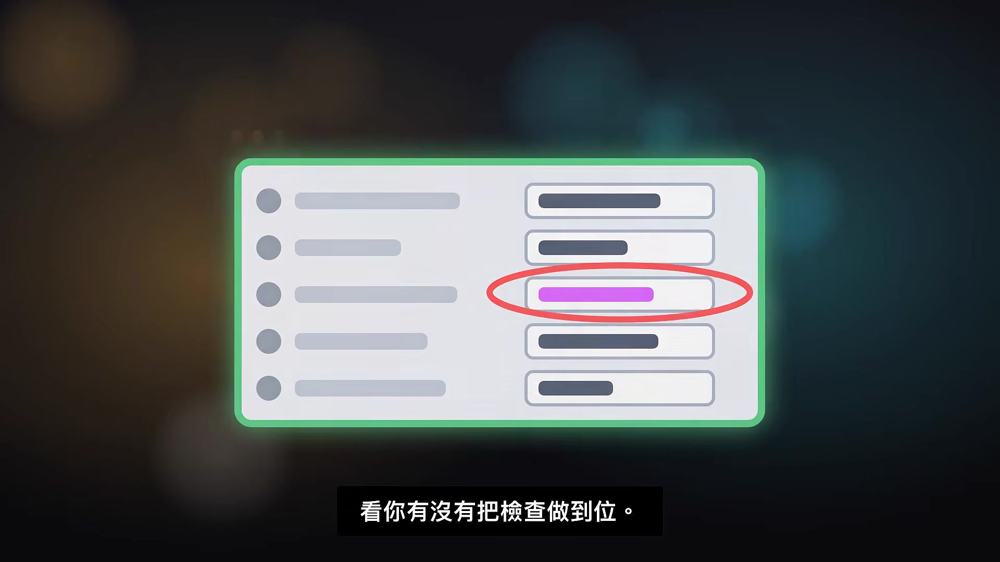

**逐字稿片段：** 我們回到開場那個問題 AI寫的程式 人還需要一行一行看嗎 如果不看 要靠什麼放心 Uncle Bob的答案是不看 但是測量 他用單元測試對賬 用CIAP管住分叉的路 用編譯測試 故意放錯 看測試抓不抓得到 他也從流水線 回到一個代理人 把他當成資深工程師 不是當成工人 可是這個答案有前提 你要有那三道機器檢查 你要看得懂架構圖 你要願意簽名負責 沒有這些前提的人和團隊 還是要看 還有一件事別忘了 他自己說過 他的想法下個禮拜可能又不一樣

**話題推測：** 回顧影片開場提出的核心問題

---

## 00:19:41

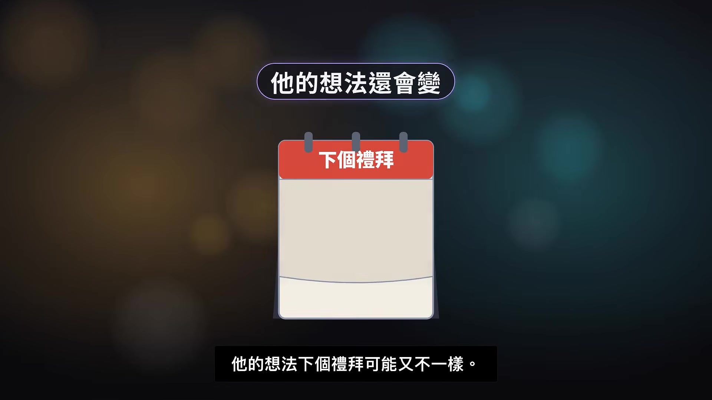

**逐字稿片段：** 最後問你一個問題 你會讓AI寫的程式碼 不經過人看就上線嗎 如果會 你的前提是什麼 留言告訴我 喜歡的話訂閱AI Notebook 開啟通知我們下次見

**話題推測：** 提出給觀眾思考的最終問題與行動呼籲

---
