# jimainotebook_9M-2AAyVdrg — 關鍵畫面索引

- 來源逐字稿：[jimainotebook_9M-2AAyVdrg_FIN.srt](jimainotebook_9M-2AAyVdrg_FIN.srt)
- 影片：https://www.youtube.com/watch?v=9M-2AAyVdrg
- 截圖數：69

## 00:00:09

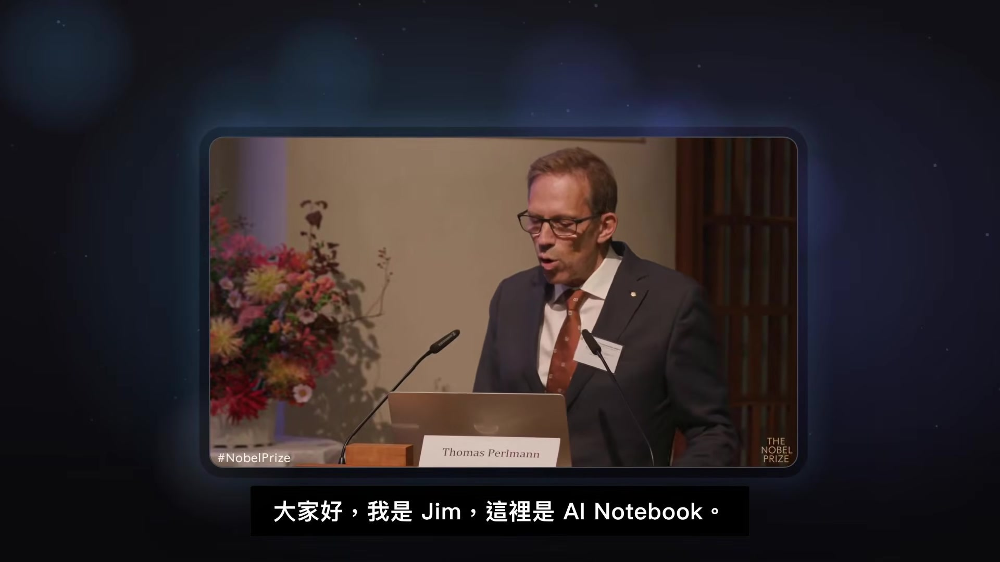

**逐字稿片段：** 今年10月5號,在瑞典斯德哥爾摩諾貝爾生理醫學獎宣佈了,

**話題推測：** 宣布諾貝爾生理醫學獎，可能顯示諾貝爾獎章或獎項資訊。

---

## 00:00:13

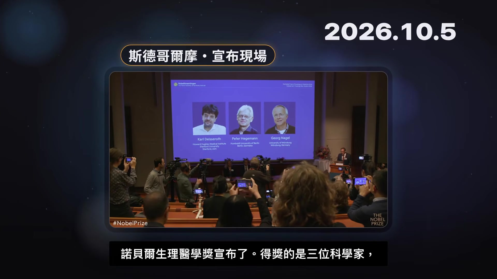

**逐字稿片段：** 得獎的是三位科學家,Carol Dyser Roth,Peter Hagman和Georg Nagel。

**話題推測：** 介紹三位得獎科學家，預計顯示他們的照片。

---

## 00:00:19

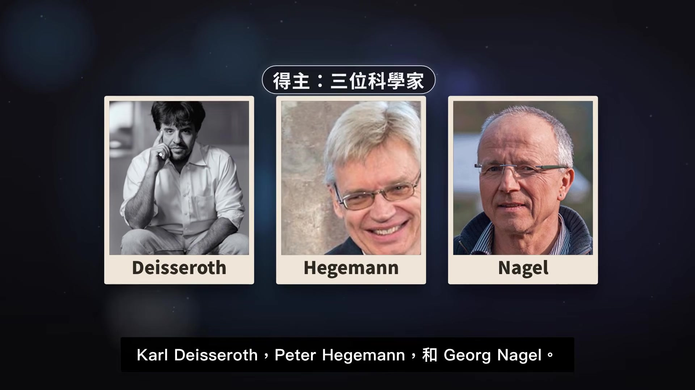

**逐字稿片段：** 得獎的理由跟一個叫光遺傳學的方法有關,英文是Optogenetics。 奇怪的地方在這裡,這是一個講大腦的講, 可是三位得主裡有兩位,Hagman和Nagel。 當年研究的不是腦,是一種在水裡游泳的小綠藻。 真正研究腦的只有Dyser Roth,他也是一位精神科醫師。 一個小綠棗 跟大腦有什麼關係 答案是一個開關 光遺傳學做的事 是在腦裡的某一種細胞上

**話題推測：** 提出核心概念「光遺傳學」，可能顯示定義或示意圖。

---

## 00:00:42

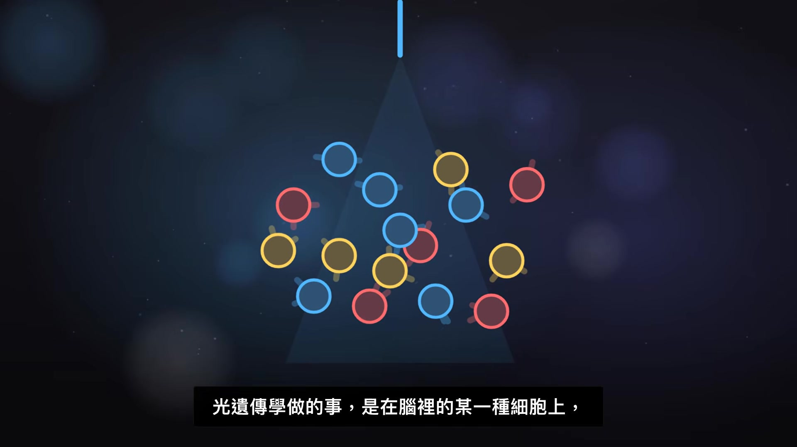

**逐字稿片段：** 裝一個開關 藍光一照 那一種細胞就送出訊號 旁邊的細胞不動 光是用光來控制遺傳 是用基因的方法 讓細胞自己長出這個開關 它跟遺傳給下一代 沒有關係 這個開關能做什麼 有一個實驗室用它 讓一隻老鼠在藍光亮起的時候

**話題推測：** 解釋光遺傳學在腦細胞上「裝開關」的原理，可能顯示動畫或圖表。

---

## 00:01:00

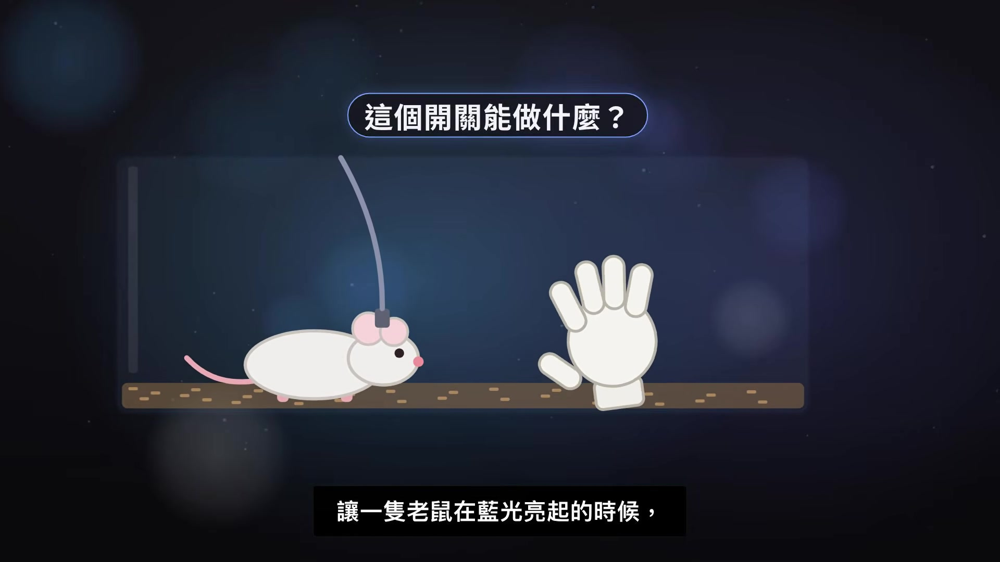

**逐字稿片段：** 撲向一隻晃動的橡膠手套 這個故事 我們後面會講到 這一集要回答的問題是 光怎麼控制大腦 人類花了多少年才做到 我說的控制 不是用電把一整塊腦電一下 而是想叫哪一種細胞做事 就只有那種細胞做事 答案的起點 在一篇雜誌文章裡 終點 在一隻老鼠的鬍鬚上

**話題推測：** 描述老鼠撲向橡膠手套的實驗，可能播放實驗影片或插畫。

---

## 00:01:19

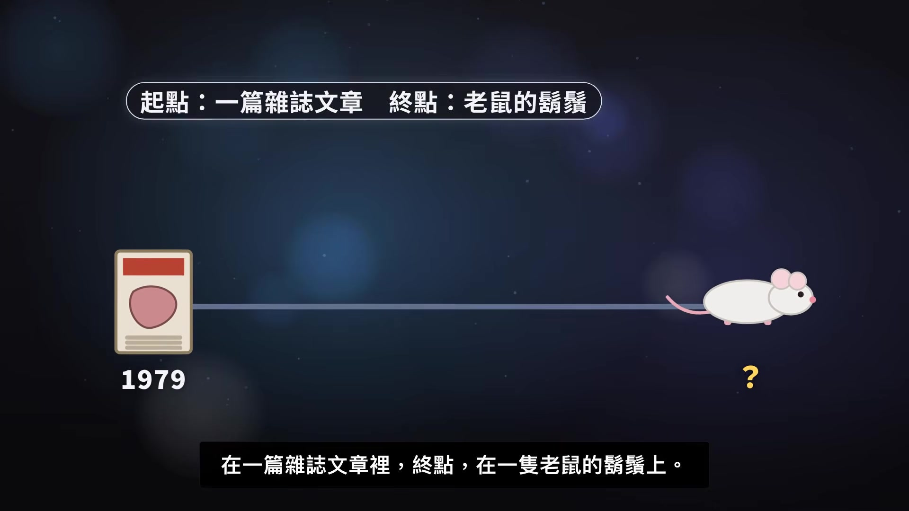

**逐字稿片段：** 中間卡了三道關 腦裡的細胞太多太擠 腦細胞看不到光 光又送不進活的大腦 我們沿著時間 一年一年往下走 看每一關難在哪裡 又是怎麼解開的 計時器 要從一位發現DNA結構的科學家 40多年前許下的一個願望開始 故事的第一個人是

**話題推測：** 列出研究路上遇到的三道關卡，預計顯示清單或圖表。

---

## 00:01:37

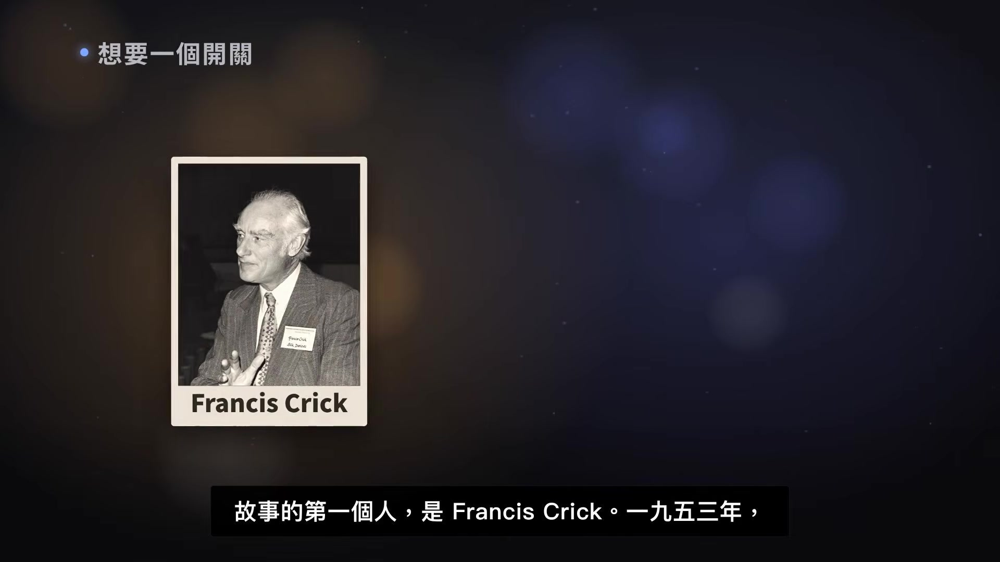

**逐字稿片段：** Francis Crick 1953年 他跟James Watson 一起提出了DNA的雙股螺旋結構 後來拿到諾貝爾獎 到了1970年代 他把興趣轉到另一個大問題 腦是怎麼運作的 1979年

**話題推測：** 介紹第一位關鍵人物Francis Crick，預計顯示他的照片。

---

## 00:01:49

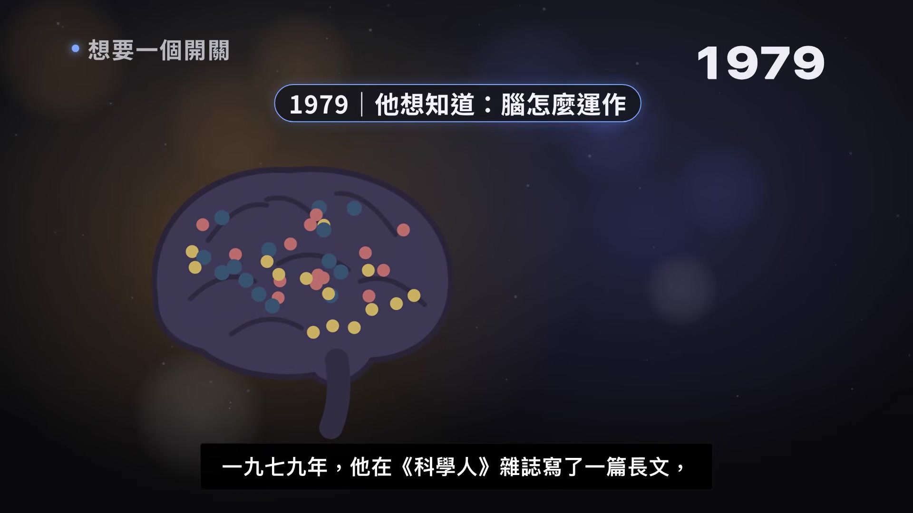

**逐字稿片段：** 他在《科學人》雜誌 寫了一篇長文 叫《思考腦》 文章裡有一個願望 他說 研究腦需要一種方法 能把某一種神經細胞全部打開 或者全部關掉 其他種類的細胞 大致不受影響 說穿了 他想要的就是一個開關 可是在當時 其實沒有人做得到這一集的計時器 就從這一年開始 為什麼一個開關會這麼難 我們先看看腦裡到底有什麼

**話題推測：** 提到Crick在《科學人》雜誌發表的文章，預計顯示雜誌封面或文章標題。

---

## 00:02:12

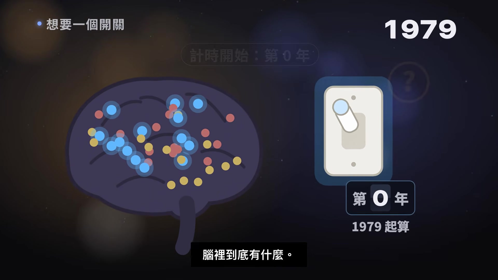

**逐字稿片段：** 一個人的腦大約有861個神經細胞 差不多是全世界人口的十倍 神經細胞也叫神經元 是腦裡負責傳訊息的細胞 它們之間靠電溝通 一個神經元被觸發的時候 會送出一個很短的電脈衝 這叫神經訊號 一次大約只有千分之一秒 也就是一毫秒 麻煩的是腦裡的細胞 不是照功能分區排好的 管不同事情的細胞 常常緊緊擠在一起

**話題推測：** 提到腦中的神經細胞數量，預計顯示腦細胞的資訊圖表。

---

## 00:02:36

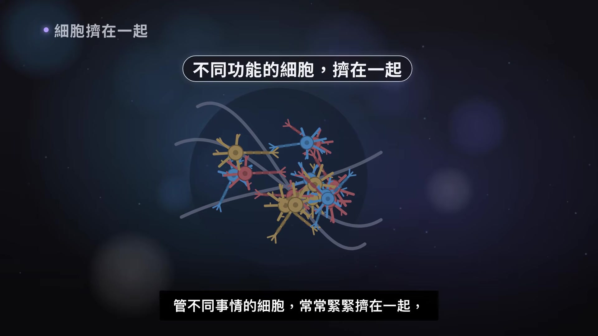

**逐字稿片段：** 像一團纏在一起的毛線 舉個例子 下四秋裡有一小塊地方 讓你覺得餓的細胞 和讓你覺得飽的細胞 就住在隔壁 中間還穿過一大堆 從別處來的神經纖維 你想知道某一種細胞在做什麼 第一步是找到它 再來是隻動它 不動它的鄰居 在光遺傳學出現之前

**話題推測：** 比喻腦細胞像一團纏在一起的毛線，預計顯示視覺化比喻。

---

## 00:02:54

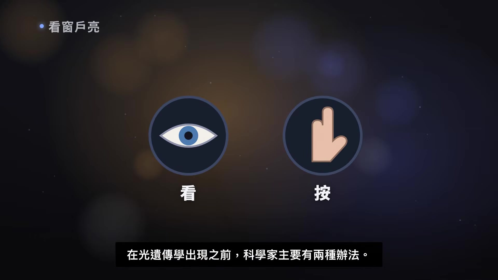

**逐字稿片段：** 科學家主要有兩種辦法 第一種是看 用電極貼近細胞 或者用腦部掃描 看動物在做某件事的時候 哪裡比較活躍 你可以把腦想成 晚上的一棟大樓 每扇窗戶是一個細胞 看的辦法 就是站在對街 記下哪些窗戶 在什麼時候亮 問題是 窗戶一起亮 不代表是他們 讓事情發生的 也許他們只是跟著亮 真正按下按鈕的 是另一扇 你沒注意到的窗 這種一起出現的關係

**話題推測：** 介紹光遺傳學出現前的兩種主要研究方法，預計顯示清單。

---

## 00:03:18

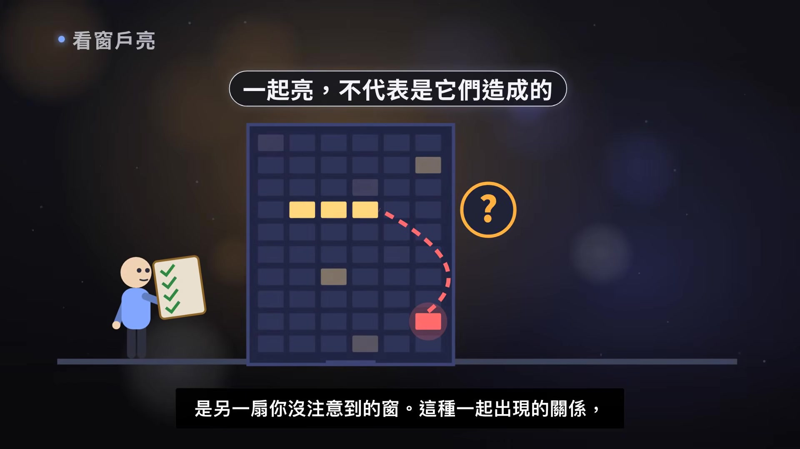

**逐字稿片段：** 叫相關 誰讓誰發生 叫因果 光是看 只能看到相關 要知道因果 你得自己去按開關 看看會發生什麼事 Dixon Rose

**話題推測：** 解釋「相關」與「因果」的差異，預計顯示文字或圖表。

---

## 00:03:28

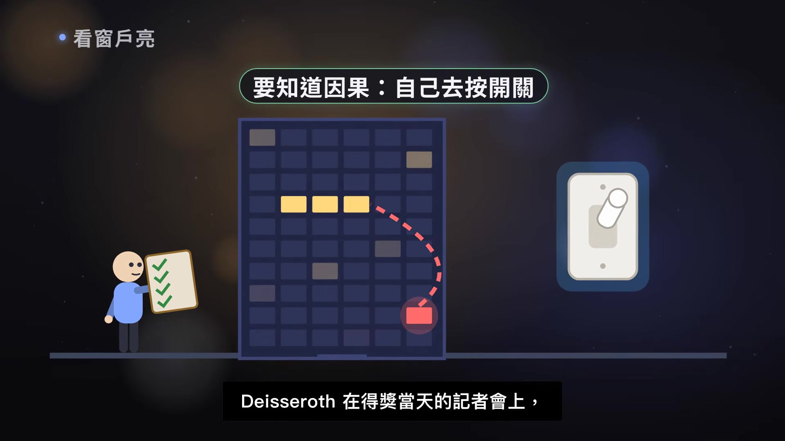

**逐字稿片段：** 在得獎當天的記者會上 也講了同一件事 聽聽他怎麼說 另一種辦法 就是去按 其實用電去動大腦 比Creek那篇文章 找得多 20世紀上半 加拿大的神經外科醫師

**話題推測：** 播放Deisseroth在記者會上的發言片段。

---

## 00:04:02

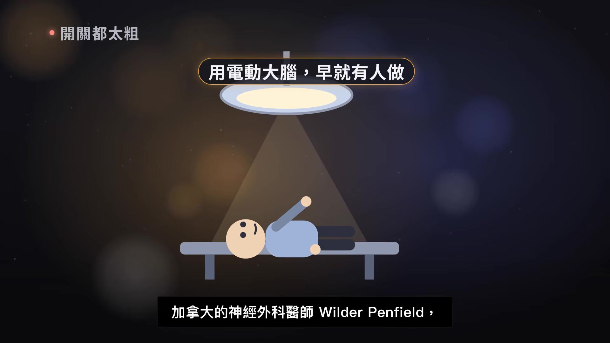

**逐字稿片段：** Wilder Penfield 在開刀的時候 用電刺激病人的大腦 病人的手會自己動 有人說聽到一段音樂 可是這種開關太粗了 電極可以把電送進腦裡 可是電會往四面八方散開 附近的細胞 連路過的神經纖維 全部一起被觸發 開場那個老鼠實驗的團隊 也寫到 以前用電刺激下嗜秋 能引發攻擊 卻說不清楚 到底是哪一群細胞在管 今天醫院裡治療帕金森氏症 有一種方法叫

**話題推測：** 介紹神經外科醫師Wilder Penfield，預計顯示他的照片及電刺激大腦示意圖。

---

## 00:04:27

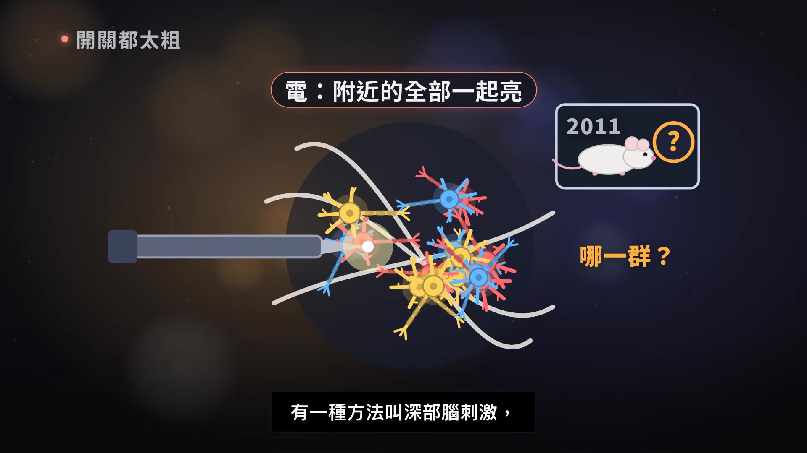

**逐字稿片段：** 叫深部腦刺激 把電極放進腦裡 持續放電 對不少病人有幫助 可是到了2007年 醫師和科學家還在爭論 電到底作用在哪些細胞上 藥物可以挑某一類細胞作用 可是吃下去 要幾分鐘到幾小時才生效 效果又會拖很久 神經訊號只有一毫秒 比你眨一次眼 快了一百倍以上 用藥物去研究 這麼快的東西 等於訊號早就傳完了 你的開關才剛開始動 所以Quick藥的那個開關 得同時滿足三個條件 第一 只碰一種細胞 旁邊的鄰居不受影響 再來 要夠快 快到能跟上一毫秒的神經訊號 說開就開 說關就關 最後 要能用在活著 會動的動物身上 這樣才看得到行為怎麼變 電極夠快 可是什麼都碰 藥物能挑細胞 可是太慢 過了20年 這個開關還是沒有人做出來 1999年Quick又寫了一篇文章 這次他多說了一句 他說 要在清醒的動物身上快速開關 某一種神經細胞 理想的訊號

**話題推測：** 介紹「深部腦刺激」治療方法，預計顯示裝置或示意圖。

---

## 00:05:24

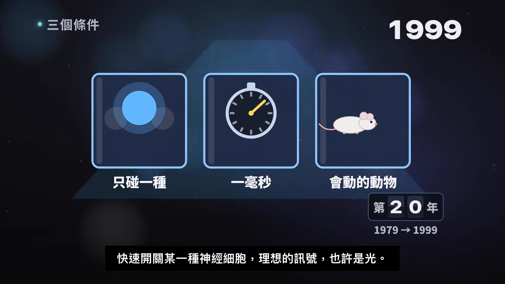

**逐字稿片段：** 也許是光 他自己也承認 這個想法聽起來有點不切實際 40多年後 戴斯洛羅斯接到諾貝爾獎的電話 也說這是大家想了很久的事 聽聽他怎麼說 腦細胞看不到光 一道藍光 憑什麼能指揮它 這是三道觀裡最難的一道 為什麼聽起來不切實際 光有很多好處 它能很快的開合觀 也能照得很準 可是腦裡的神經細胞看不到光 被光照到 不會有任何反應 只有眼睛裡的感光細胞 天生帶著接收光的零件 而且頭殼裡面是暗的 光本來就照不進去 用光當開關 等於要同時解決兩件事 先讓特定的細胞 長出能接收光的零件 再想辦法把光送到腦子深處 要去哪裡找這樣一個零件 被光一照就能讓神經細胞送出訊號 20多年後 戴瑟·羅斯在記者會上 用兩句話講了答案的方向 聽聽他怎麼說

**話題推測：** Crick猜想「光」可能是理想訊號，可能顯示光線的視覺意象。

---

## 00:06:54

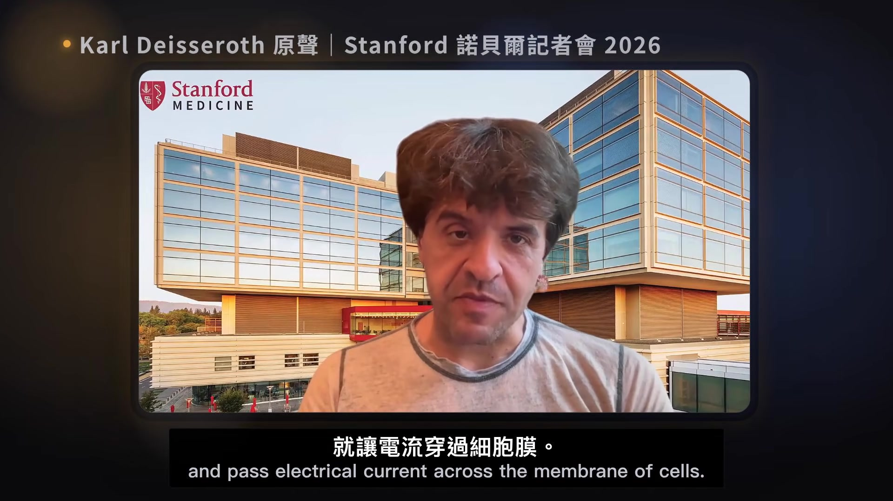

**逐字稿片段：** 整理一下第一部分 腦裡有800多億個細胞 不同功能的細胞集在一起 過去的方法 能看到哪些細胞跟行為一起量 卻很難證明是誰造成的 用電可以動大腦 卻是一整塊一起動 要證明因果 需要一個開關 只碰一種細胞 快到一毫秒 還要能用在會動的動物身上 到1999年 計時器走了20年 Creek手上只多了一個猜想 光 三道關 一道也還沒過 細胞太擠 要只碰一種 腦細胞看不到光 光送不進活的大腦啊 接下來的問題是 誰能給腦細胞一個接收光的零件 答案 要先把時間往回倒

**話題推測：** 總結第一部分內容，預計顯示重點整理頁面。

---

## 00:07:30

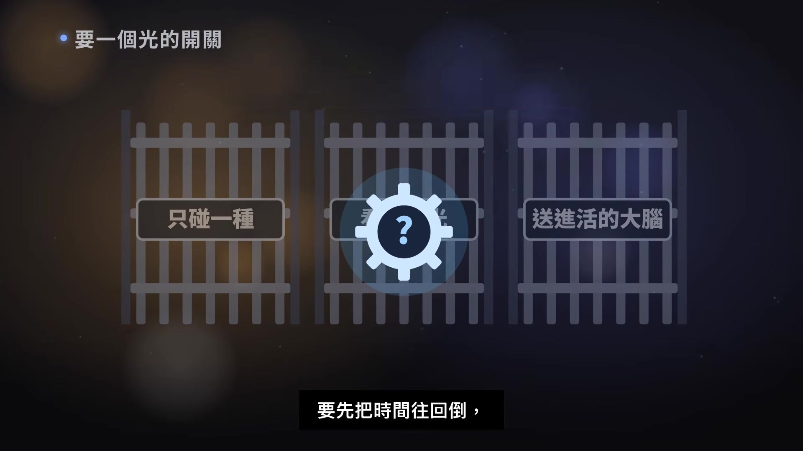

**逐字稿片段：** 從一種住在鹽水裡的微生物說起 這件事其實比Gregg的願望還早8年

**話題推測：** 引導至住在鹽水裡的微生物，預計顯示微生物圖片。

---

## 00:07:35

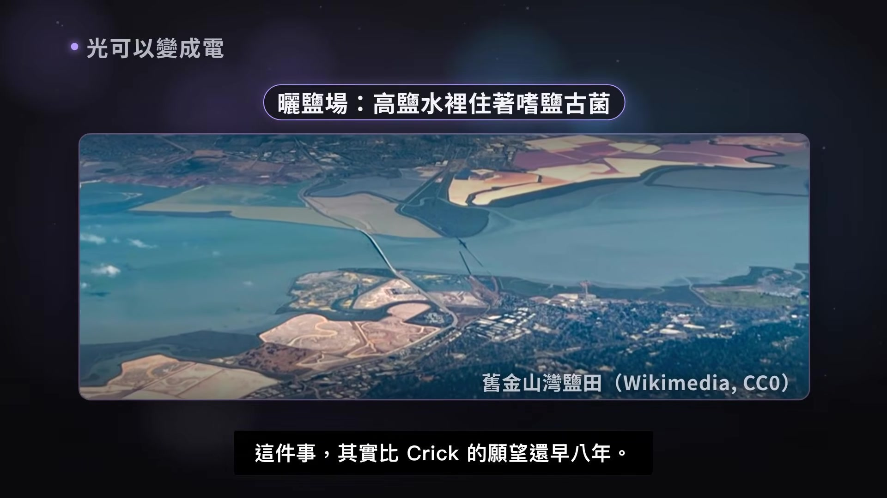

**逐字稿片段：** 1971年 德國科學家Dieter Esterhout 和Walter Stoke-Aeneas 在一種住在高鹽水裡的微生物身上 找到一個紫色的蛋白 這種微生物叫四鹽骨菌

**話題推測：** 提及1971年德國科學家們的發現，預計顯示科學家照片。

---

## 00:07:45

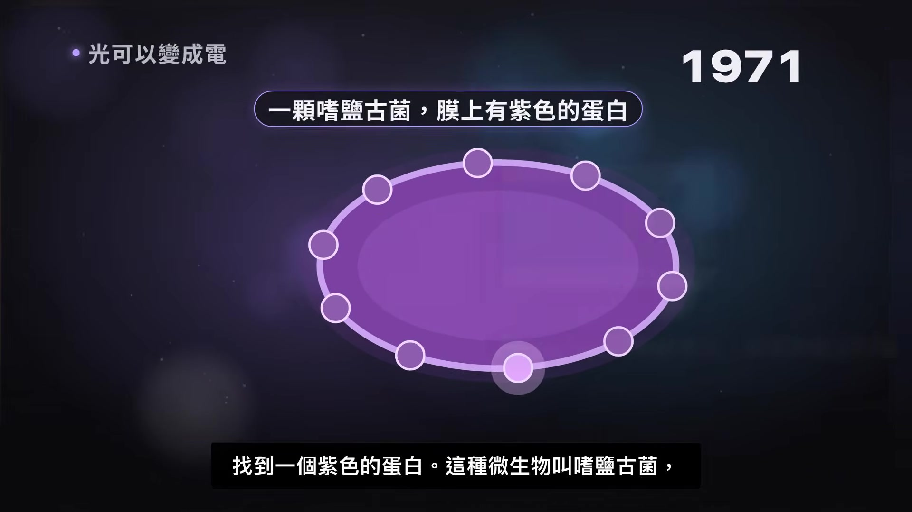

**逐字稿片段：** 有些曬鹽場的水會變成粉紅色或紫紅色 跟這類微生物有關

**話題推測：** 提到曬鹽場的水變色，可能顯示粉紅色或紫紅色鹽湖照片。

---

## 00:07:49

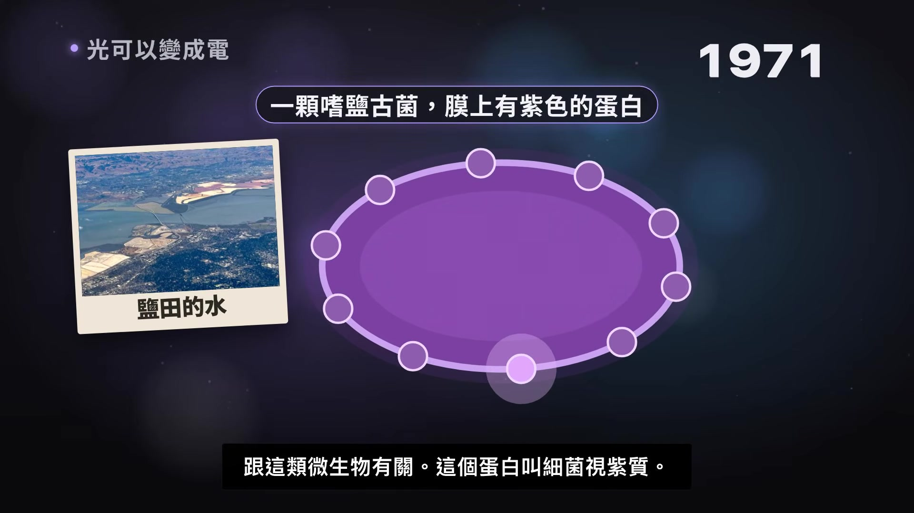

**逐字稿片段：** 這個蛋白叫細菌式 紙質 它厲害的地方是 單單一個蛋白就能接收光 再把帶電的小顆粒 推到細胞外面 這些帶電的小顆粒叫離子 離子移動 就是電流 後來日本的研究人員 又在同一類微生物身上 找到另一個被光推動的蛋白 他推的是另一種離子 帶負電的綠離子 這個蛋白 我們後面還會用到 這些發現告訴大家 大自然裡 真的有單獨一個蛋白 就能把光變成電 只是他們推離子的速度慢 一顆光只推動一個離子 力氣不夠大 Esther Held 有一個博士班學生

**話題推測：** 介紹「細菌視紫質」蛋白，預計顯示分子結構圖。

---

## 00:08:22

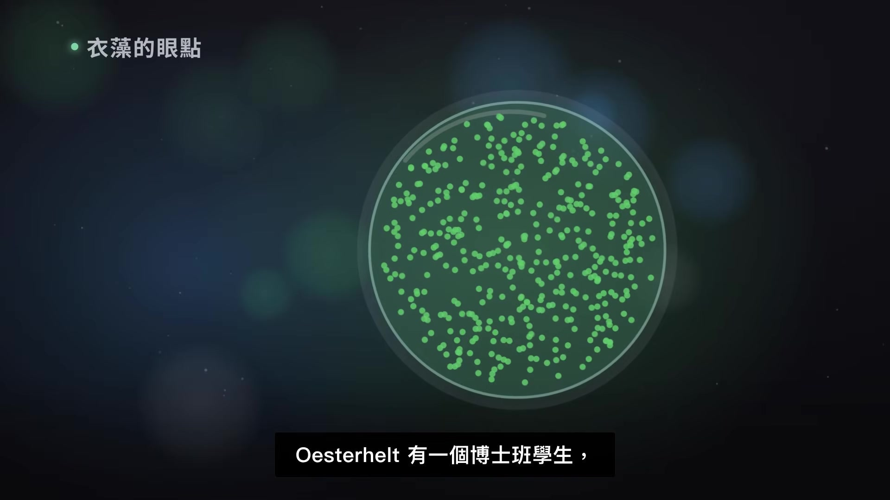

**逐字稿片段：** 叫Peter Hageman 他後來好奇的是另一種小東西

**話題推測：** 介紹Peter Hegemann，預計顯示他的照片。

---

## 00:08:25

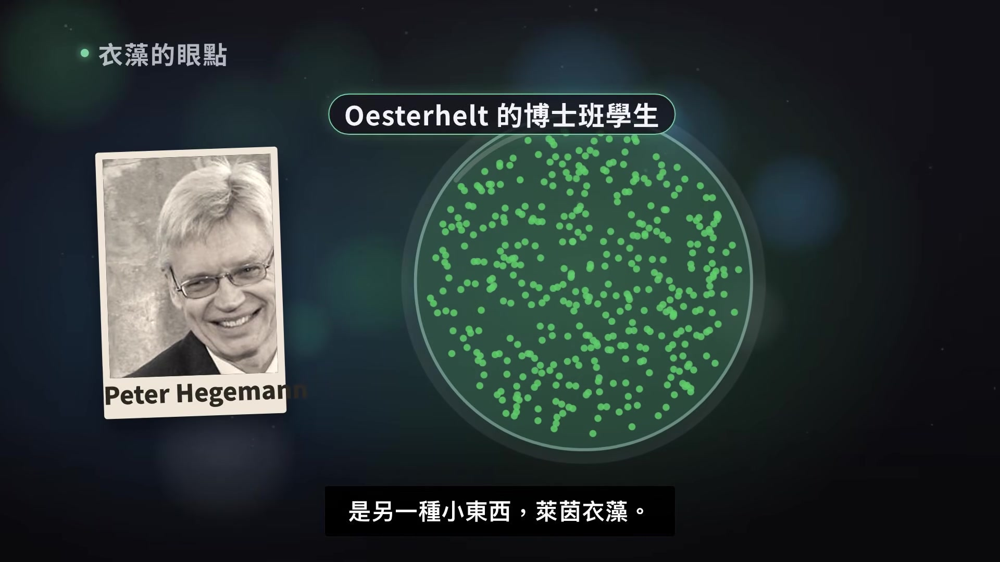

**逐字稿片段：** 萊茵衣藻 衣藻是一種單細胞的綠藻 大約只有一根頭髮粗細的五分之一 身上有兩根邊毛會游泳 把它們倒進培養皿 水會變成淡淡的綠色 從一邊打光

**話題推測：** 介紹「萊茵衣藻」，預計顯示其照片或動態圖。

---

## 00:08:36

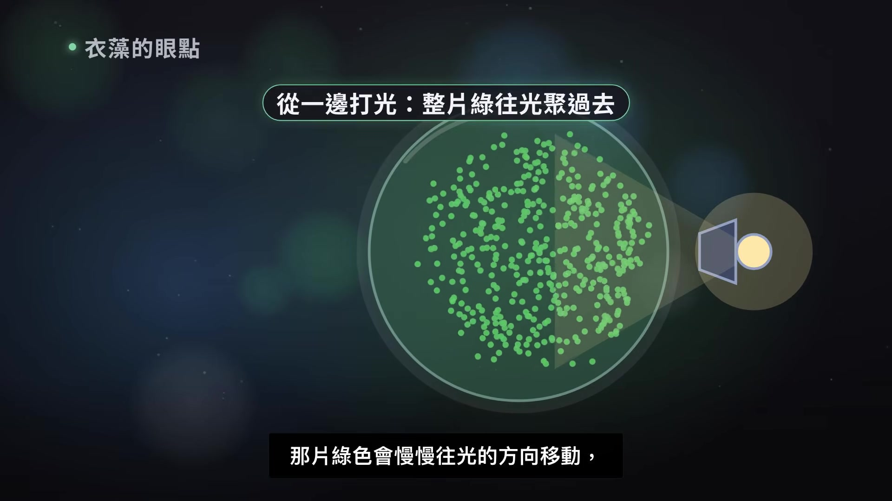

**逐字稿片段：** 那片綠色會慢慢往光的方向移動 因為衣藻全都往光游過去 它靠的是身上一個橘色的小點 叫鹽點 1990年代初 Hagman用很細的電極去測量衣藻的鹽點 被光照到時的電訊號 結果讓他很意外 光照到之後 只過了大約半毫秒 電訊號就出現了 依早為什麼會往光油 其實是一個很老的問題 德爾獎那天

**話題推測：** 描述衣藻游向光的現象，可能播放影片或動畫。

---

## 00:08:58

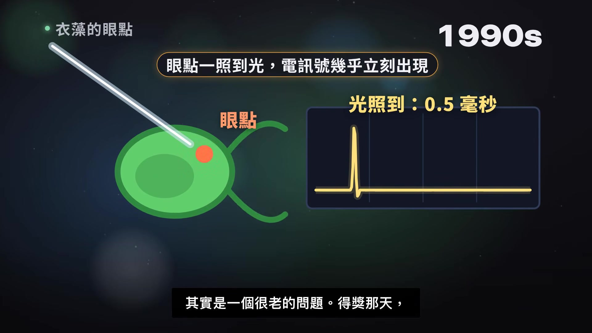

**逐字稿片段：** 黑格曼在電話裡講了他有多老 聽聽他怎麼說 這有多快 光進到我們的眼睛 要經過一連串的化學反應 一步接一步 最後才打開細胞上的通道 產生電訊號 整個過程至少要10毫秒 醫藻快了20倍以上 黑格馬想到的解釋是 醫藻的流程簡單得多 接收光的零件 跟讓電流通過的那扇門 很可能是同一個蛋白 這裡要先講一個名詞 細胞膜上讓離子進出的小門

**話題推測：** 播放Hegemann講述發現過程的片段。

---

## 00:09:46

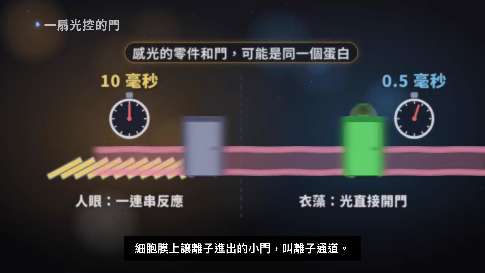

**逐字稿片段：** 叫離子通道 一般的離子通道 開關靠的是電壓或者化學物質 黑格馬等於在說 依早身上有一扇照到光 就自己打開的門 當時很多人不相信 因為大家知道的 離子通道里 沒有一種能自己感光 要證明 他得把這個蛋白找出來 這一找 就是將近十年 在繼續往下之前

**話題推測：** 解釋「離子通道」名詞，預計顯示細胞膜上的離子通道示意圖。

---

## 00:10:05

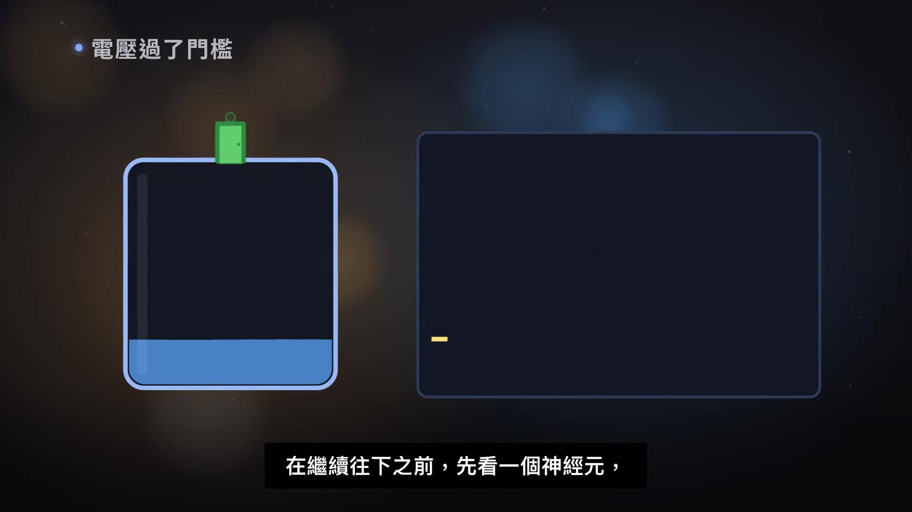

**逐字稿片段：** 先看一個神經元 是怎麼送出訊號的 神經細胞平常 裡面比外面多帶一點負電 像一顆充好電的小電池 當帶正電的離子流進去 裡面的電壓就往上升 升過一個門檻 細胞就送出一個神經訊號 然後很快回到原來的狀態 你可以把它想成一個

**話題推測：** 解釋神經元如何送出訊號，預計顯示神經元運作動畫。

---

## 00:10:20

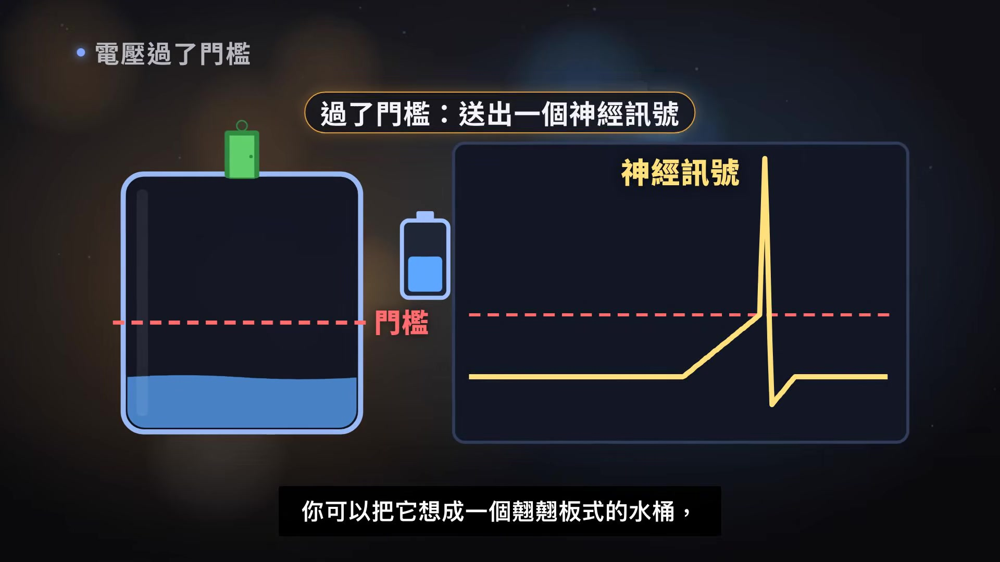

**逐字稿片段：** 一個翹翹板式的水桶 水一直倒進去 滿到某個高度 整桶就翻倒一次 再立回來 反過來 如果流進去的是帶負電的離子 電壓就往下掉 離門檻更遠 細胞就安靜下來 送不出訊號 所以能控制離子進出 就能控制神經訊號 醫藻身上 內散照到光就打開了門 如果真的存在 就是一個用光控制離子的開關 問題是 它到底在哪裡 轉機在2000年前後出現

**話題推測：** 比喻神經元為翹翹板式水桶，預計顯示示意圖。

---

## 00:10:46

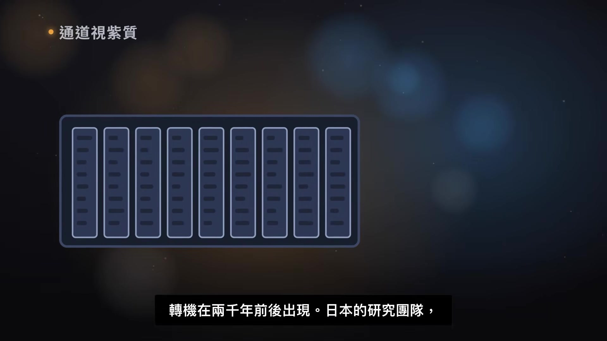

**逐字稿片段：** 日本的研究團隊 把醫藻的大量基因片段 整理成資料庫公開 Hagman的團隊也在裡面 找到兩個長得很像感光蛋白的基因 他聯絡了在法蘭克福的老朋友Jorg Nagel Nagel擅長一種方法

**話題推測：** 提到日本研究團隊公開基因資料庫，可能顯示資料庫介面圖。

---

## 00:10:59

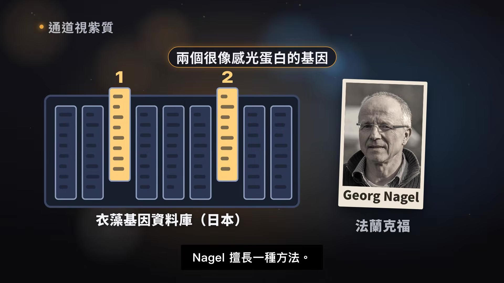

**逐字稿片段：** 他把想研究的基因放進青蛙的卵裡 青蛙卵很大 直徑大約一毫米多 肉眼看得見 他會照著這段基因把蛋白做出來 放在自己的表面上 Nagel把兩個一早的基因分別放進去 再用光照 他們先發表了第一個

**話題推測：** 描述將基因放入青蛙卵的實驗方法，預計顯示青蛙卵實驗示意圖。

---

## 00:11:13

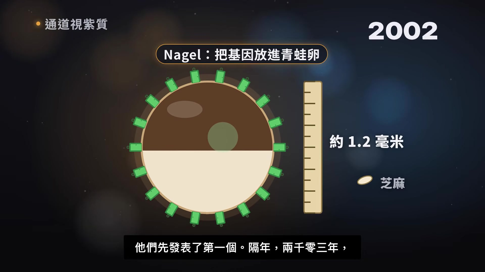

**逐字稿片段：** 隔年2003年 又發表了反應更強的另一個 藍光一照 軟的表面在五千分之一秒內就打開一個通道 帶正電的離子流進去 電流出現了 黑格門十年前的猜想是對的 這種蛋白中文叫通道式子質 英文是channel road of sin 名字有點長 你只要記得 它就是那扇照到藍光就打開的門 不過第一次亮到訊號 靠的有一點運氣 Nagel在得獎那天的電話訪問裡說了這一段 聽聽他怎麼說 And then suddenly I got a clear signal And then I could work it out But it is And then with the general toxin too Everything was actually much easier 他們還做了一件事 把這個基因放進人類的腎臟細胞 和倉鼠的細胞 結果這些細胞也一樣 被藍光照到就產生電訊號 換句話說 這扇門不挑細胞 放到哪裡都能用 2003年那篇論文裡 他們寫到 這個蛋白也許能變成一個好用的工具 用光去改變細胞的電壓 特別是在哺乳動物的細胞上 不過 腎臟細胞不是神經細胞 神經細胞很嬌貴 放進一個藻類的蛋白 會不會出問題 就算沒事 這扇門能讓多少電流進去 夠不夠觸發一個神經訊號 論文發表了 下一棒 交給了一位精神科醫師

**話題推測：** 提及2003年通道式視紫質的發現，可能顯示實驗數據或圖表。

---

## 00:12:35

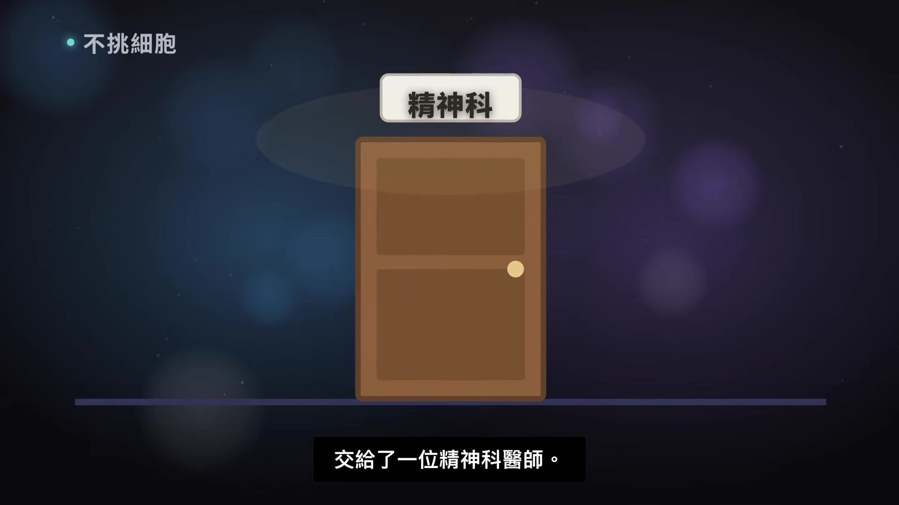

**逐字稿片段：** Carl Deisseroth 1971年出生 在史丹佛大學 拿到博士和醫學學位 念醫學院的時候 他本來考慮當神經外科醫師 可是在精神科實習時 他看到病人很痛苦 能給的治療常常效果不好 副作用又大 他想知道 憂鬱的人 為什麼這麼難感到快樂 要回答這個問題 得先能在活著的腦裡 研究一種一種的細胞 2004年 他剛在史丹佛成立自己的實驗室

**話題推測：** 介紹Carl Deisseroth，預計顯示他的照片。

---

## 00:13:00

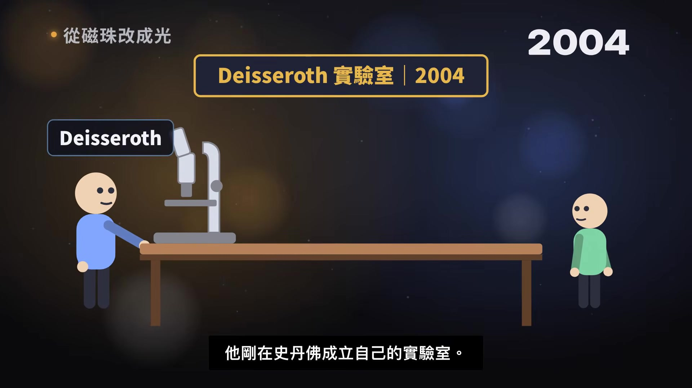

**逐字稿片段：** 那時他跟一位叫Ed Boyden的博士生 已經一起想了好幾個月 原本想的是用雌性小株子去推動細胞 2004年初 他們讀到Nagel和Hagman的論文 決定改用光 那年3月 Dice Erot寫信給Nagel 要到了這段基因 基因寄到之後 根據Diesel Road後來的回顧 那年7月初 他先用一個間接的方法 看到被藍光照過的細胞 留下了被打開過的痕跡 實驗很簡單 可是他告訴他 這件事做得到 可是那個簡單的實驗 只能間接看出細胞被打開過 要直接看到神經訊號 還差一步 當時也有不少人覺得 想用光控制神經細胞 可能只是浪費時間 根據Boyden後來寫的回憶 2004年8月4號 凌晨大約1點 他走進實驗室 把一盤長了這個

**話題推測：** 介紹博士生Ed Boyden，預計顯示他的照片。

---

## 00:13:43

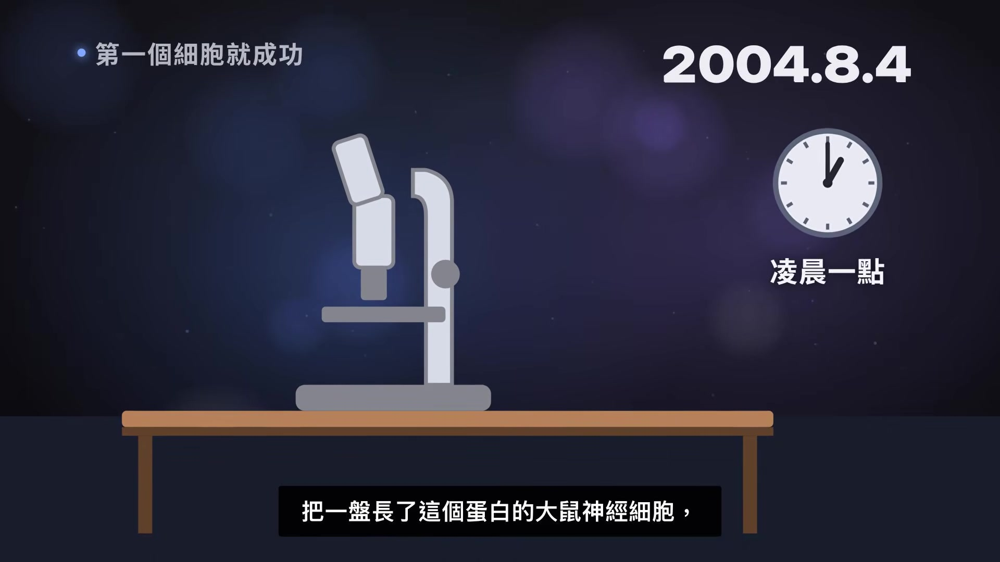

**逐字稿片段：** 蛋白的大鼠神經細胞 放到顯微鏡下 細胞發著黃綠色的熒光 代表蛋白真的長出來了 他把一根極細的玻璃電極

**話題推測：** 描述在大鼠神經細胞上進行的實驗，可能顯示實驗顯微鏡畫面或培養皿。

---

## 00:13:53

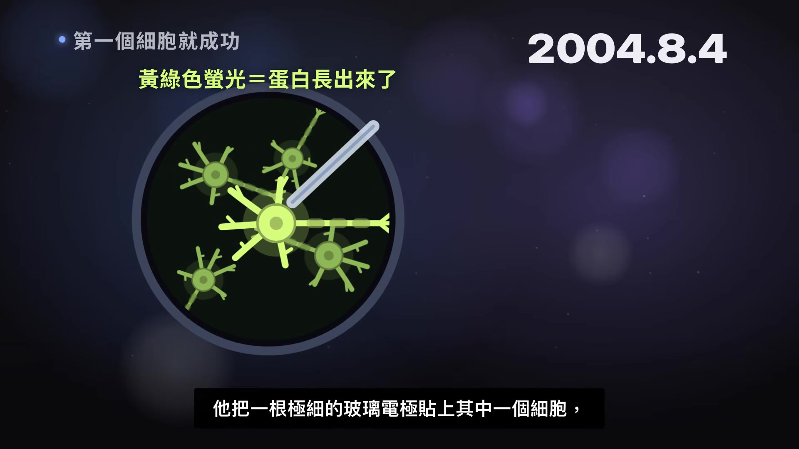

**逐字稿片段：** 貼上其中一個細胞 按下他自己寫的程式 讓藍光一下一下遞散 他測量的第一個細胞

**話題推測：** 展示細胞被電極貼上的畫面，預計顯示電生理實驗裝置圖。

---

## 00:13:58

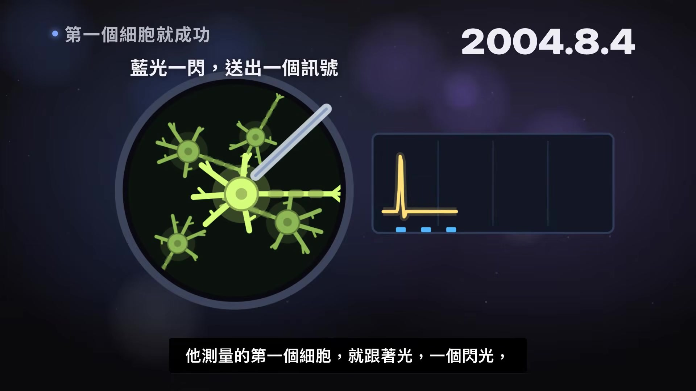

**逐字稿片段：** 就跟著光一個閃光 送出一個神經訊號 細胞沒有被堵死 那扇門浪進去的電流 也夠觸發訊號 那天晚上收集到的資料 就涵蓋了後來那篇論文的核心結果 從Crick的願望算起 即時期走到第25年看不到光的這一關 終於過了 波伊頓

**話題推測：** 顯示神經訊號（動作電位）圖，預計顯示示波器波形。

---

## 00:14:14

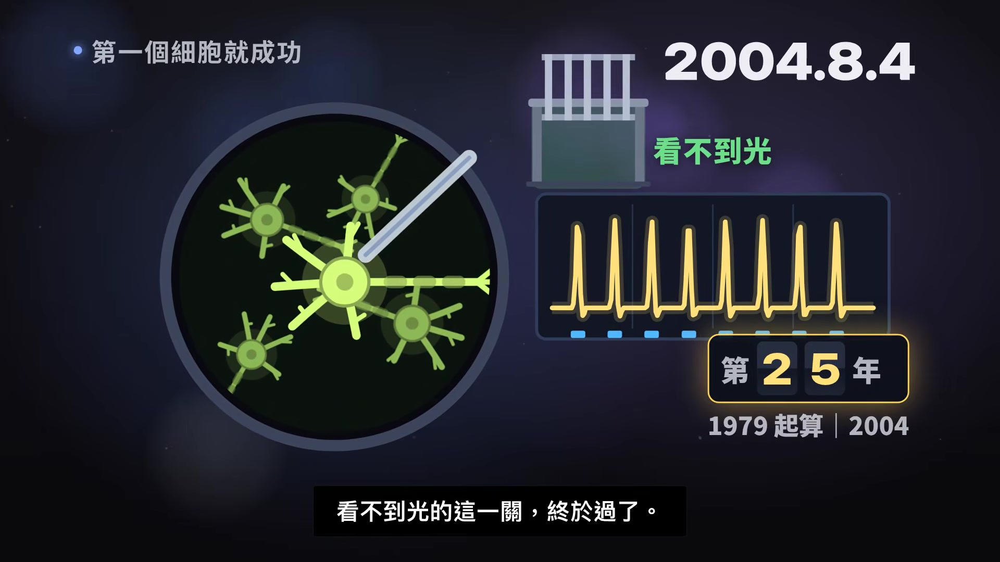

**逐字稿片段：** 後來在一次訪談裡也講到那一次 聽聽他怎麼說 它基本上是第一次使用 我們可以使它發射 生命鎖定的行動能力 這裡你可能會問 基因是怎麼放進神經細胞的

**話題推測：** 播放Boyden講述實驗成功的片段。

---

## 00:14:50

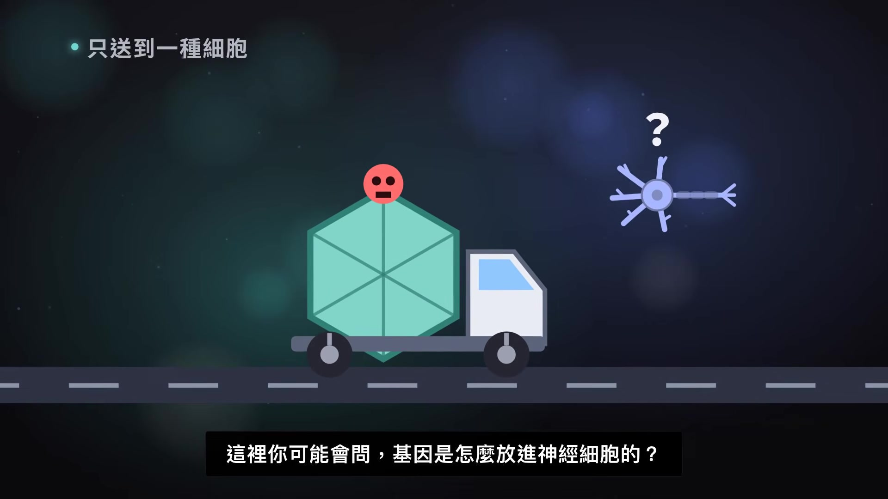

**逐字稿片段：** 他們用的是病毒 這種病毒叫病毒載體 科學家先把它會讓人生病的部分拿掉 只留下鑽進細胞 把基因交給細胞的本事 就像一臺快遞車 可是 光有快遞車還不夠 Crick要的是隻碰一種細胞 所以包裹上還得寫地址 這個地址是放在基因前面的一小段

**話題推測：** 解釋利用病毒作為基因傳遞工具，預計顯示病毒載體示意圖。

---

## 00:15:08

**逐字稿片段：** DNA 叫啟動值 英文叫 Promoter 不同種類的細胞 認得不同的啟動值 包裹送到很多細胞門口 只有認得這個地址的那種細胞 會打開包裹 照著做出通道試紙質 其他細胞收到了 我會做 快遞車加上地址 解決的就是Crick的第一個條件 只碰一種細胞 三道管理的第一道 細胞太擠也有解法了 2005年4月 他們把論文投給科學期刊 被退稿了 按照Boyden的說法 理由是 這篇論文除了證明 這個蛋白在神經細胞裡能用 沒有新的科學發現 他們重新投給自然 最後在2005年8月

**話題推測：** 解釋「啟動子」（Promoter）作為基因地址，預計顯示DNA上的啟動子位置圖。

---

## 00:15:43

**逐字稿片段：** 刊登在自然神經科學 從Crick的願望算起 第26年 現在回頭看 這正是他的價值 他不是一個發現 是一個能讓很多人做出發現的工具 這個工具也不是一個人做出來的 論文上除了Dice and Rose

**話題推測：** 提及論文發表在《自然神經科學》，預計顯示期刊封面或文章截圖。

---

## 00:15:57

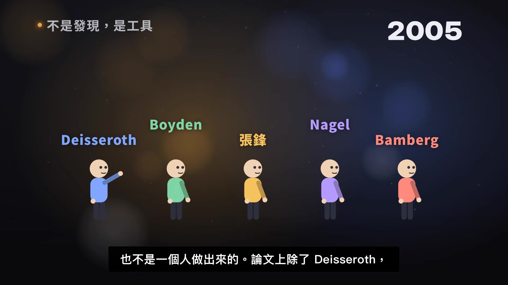

**逐字稿片段：** 還有當時的博士生Boyden和張峰 提供基因的Nagle和他的老師 Ernst Bamberg 前後一年內 日本和美國好幾個實驗室 也各自讓通道式紙質 在神經細胞上動起來 比他們更早三年 紐約的一個團隊就用另一種方法 讓神經細胞對光遊反應 只是要三種蛋白一起合作 速度也比較慢 諾貝爾獎最多頒給三個人 這次他們之中 很多人不在名單上

**話題推測：** 介紹參與論文的博士生張峰，預計顯示他的照片。

---

## 00:16:20

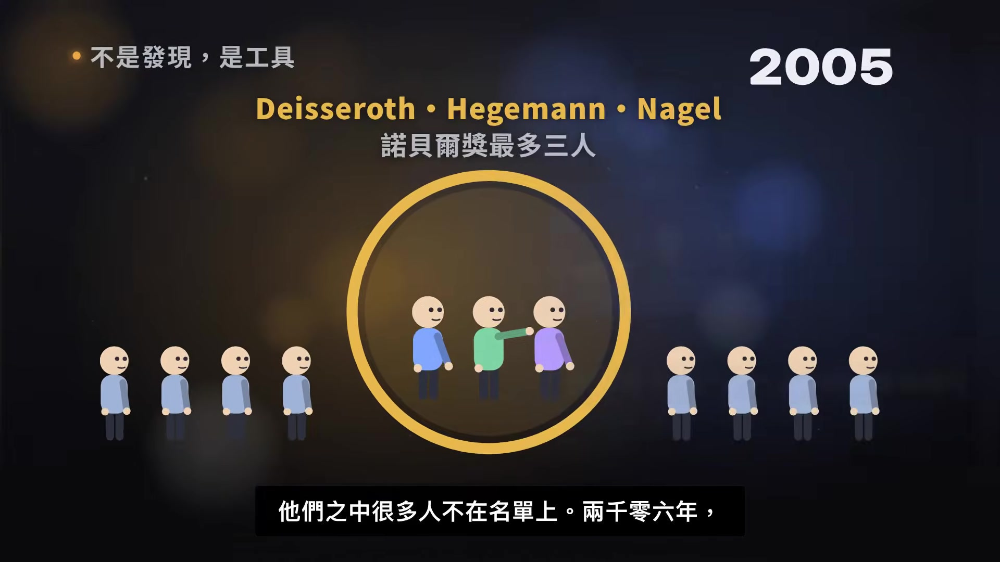

**逐字稿片段：** 2006年光遺傳學這個名字 正式出現在論文裡 用遺傳的方法 讓細胞長出接收光的零件 再用光去控制它

**話題推測：** 提到「光遺傳學」這個名字的正式出現，可能顯示術語定義或時間軸。

---

## 00:16:27

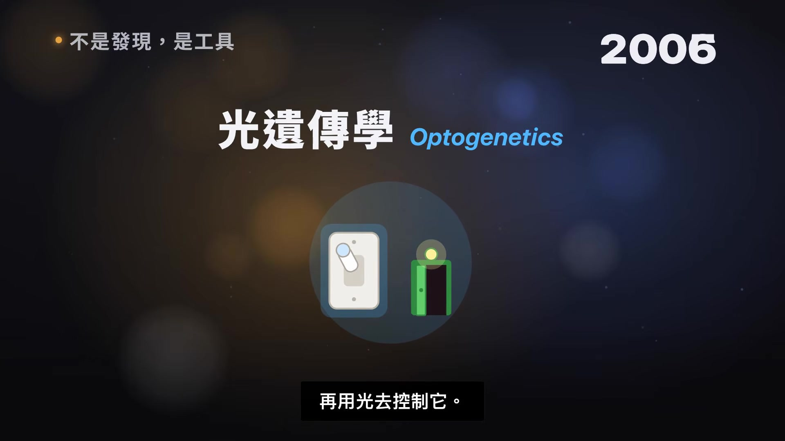

**逐字稿片段：** 整理一下 到這裡為止 計時器走到第26年 答案來自兩種微生物 鹽水裡的微生物告訴大家 一個蛋白就能把光變成電 會往光遊的醫藻 給了我們通道試指制 一扇被藍光一照 五千分之一秒就打開了門 這也是為什麼 今年的諾貝爾醫學獎 有兩位得主是研究綠藻的人 大腦缺的那個開關 是他們從綠藻身上找到的 Diesel Ross的團隊 把它裝進神經細胞 用病毒當快遞車 用啟動值當地址 回到Crick的三個條件 只碰一種細胞 有了 夠快 有了 三道關也過了兩道 剩下最後一個 能不能用在活著會動的動物身上 2005年的實驗 是在培養名理做的 頭殼裡的那片黑暗 還沒有解決 Dicer Ross後來說 那篇論文 還不算真正的光遺傳學 接下來好幾年 才證明他在大腦裡能用 解法很直接 把光送進去

**話題推測：** 總結至此的進展，預計顯示重點整理頁面。

---

## 00:17:20

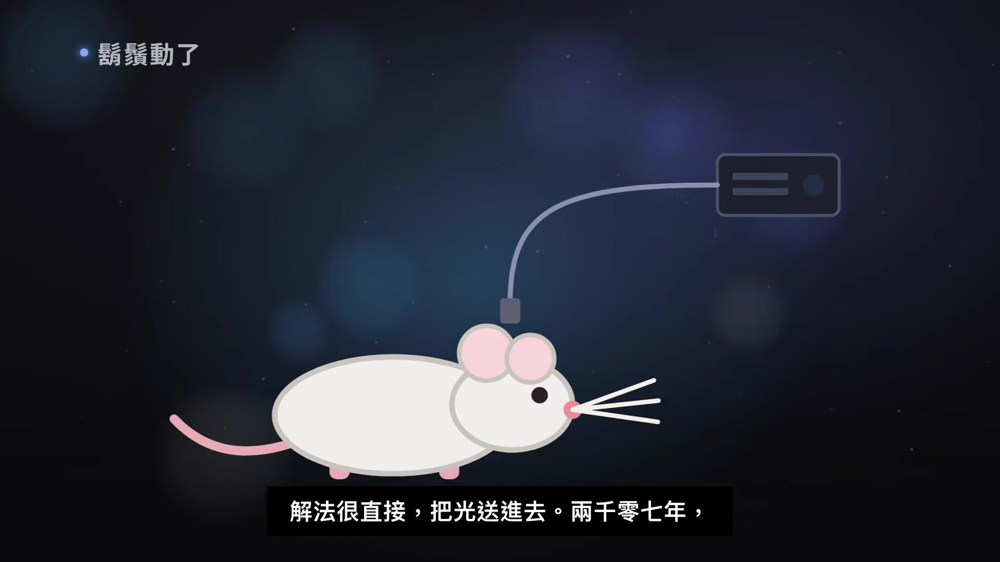

**逐字稿片段：** 2007年 Dicer Ross的團隊 做出一套裝置 一顆藍光雷射

**話題推測：** 提到2007年Dicer Roth團隊的技術突破，預計顯示實驗裝置圖。

---

## 00:17:24

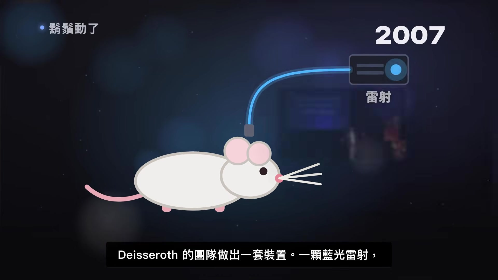

**逐字稿片段：** 接上一根很細的光纖 直徑大約五分之一毫米 差不多三根頭髮並排 他們在老鼠的頭骨上 開個小洞 把光纖放到 控制動作的那塊大腦皮質 那裡的細胞 已經用病毒裝上了 通道是紫緻 藍光一閃 老鼠的鬍鬚就跟著動 這是光遺傳學在活老鼠腦裡最早的示範之一 到這裡 Crick的三個條件全部滿足 三道關全部打開 從1979年那個冤枉算起 計時器停在第28年

**話題推測：** 展示細光纖的應用，預計顯示光纖植入大腦的示意圖。

---

## 00:17:50

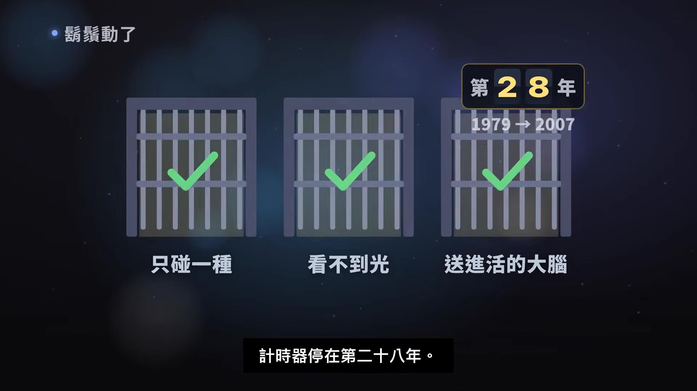

**逐字稿片段：** Diesel Rose在一場史丹佛的演講裡 播過一段那時候的老鼠影片 聽聽他怎麼說 打開它,放在底部,它停止了 這有點可怕,對嗎? 有開也要有關

**話題推測：** 播放Deisseroth在史丹佛演講中展示老鼠影片的片段。

---

## 00:18:28

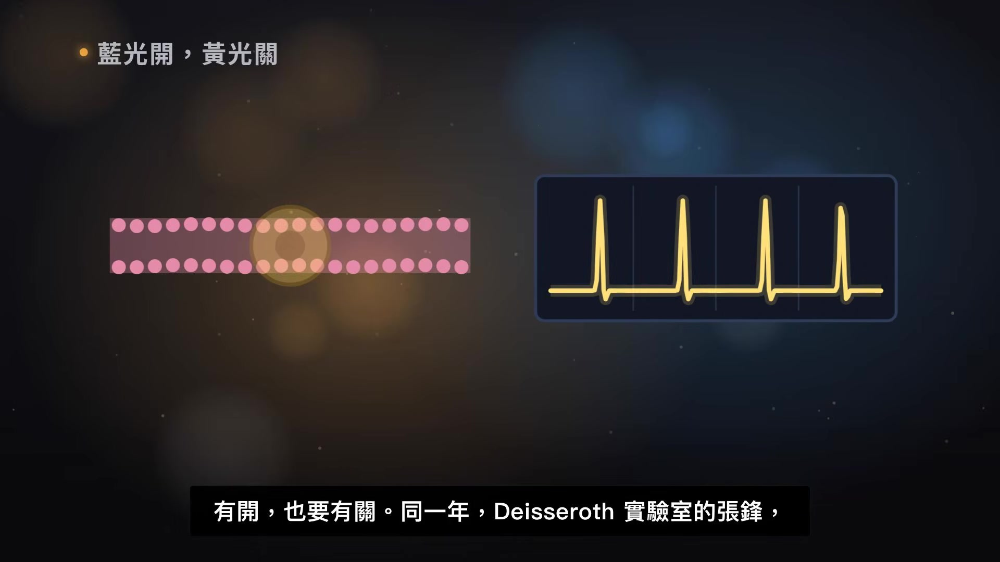

**逐字稿片段：** 同一年,Dyce-Earls實驗室的張峰 和已經到MIT的Boyden各自做到了 他們借用的是鹽水微生物身上 那個褪綠離子的蛋白 黃光一照 它把帶附電的綠離子推進細胞裡 細胞就安靜下來,送不出訊號

**話題推測：** 提到張峰和Boyden開發的「關閉」開關，可能顯示他們的照片。

---

## 00:18:42

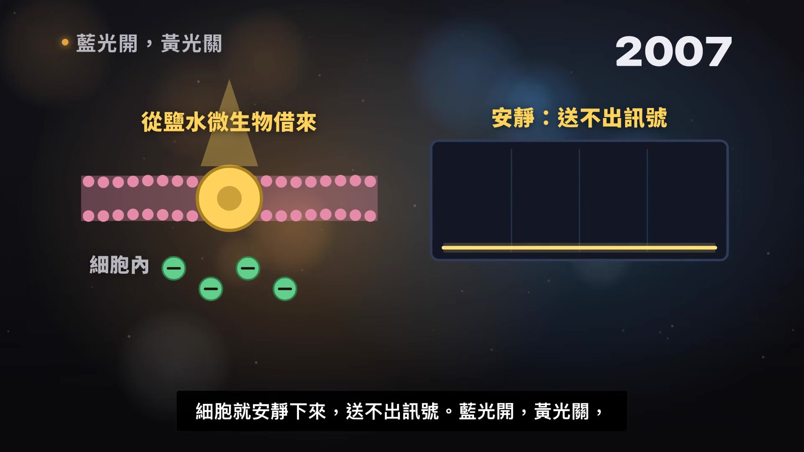

**逐字稿片段：** 藍光開,黃光關 兩種顏色互不幹擾 可以裝在同一群細胞上 Dyce-Earls的團隊 在一種一毫米長的小線蟲身上示範 藍光讓他的肌肉收縮 黃光讓他停下來 從此研究腦不只能問 打開這群細胞會怎樣 也能問關掉它會少了什麼 計時器停下來以後 全世界的實驗室開始用這把開關 一個一個去問腦問題 同樣在2007年

**話題推測：** 解釋藍光開、黃光關的雙色控制，預計顯示示意圖。

---

## 00:19:07

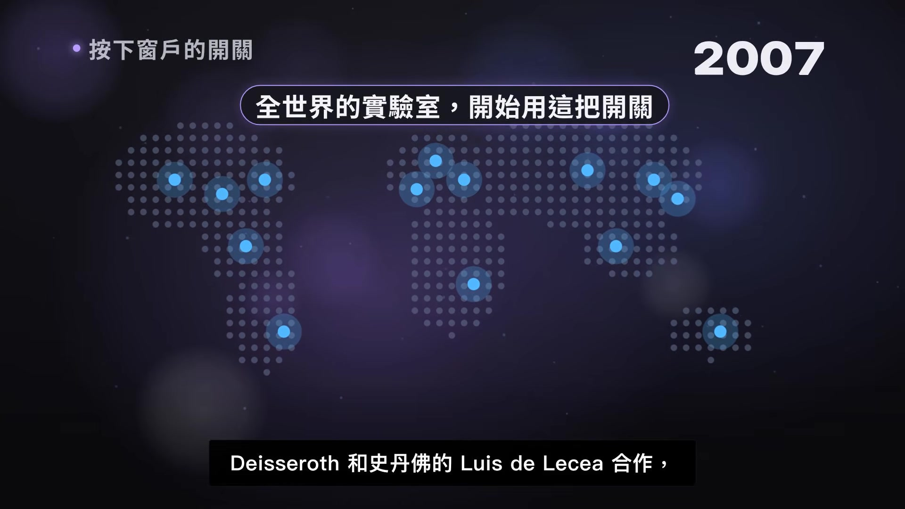

**逐字稿片段：** D.S.Roth和史丹佛的 Louis de Lysée A合作 找上一群叫夏氏丘分泌素的細胞 大家早就知道 這群細胞出問題的人 可能會得處睡症 白天突然睡著 可是這群細胞只是跟清醒一起出現 還是真的能把動物叫醒

**話題推測：** 介紹Louis de Lecea及其嗜睡症研究合作，預計顯示他的照片。

---

## 00:19:21

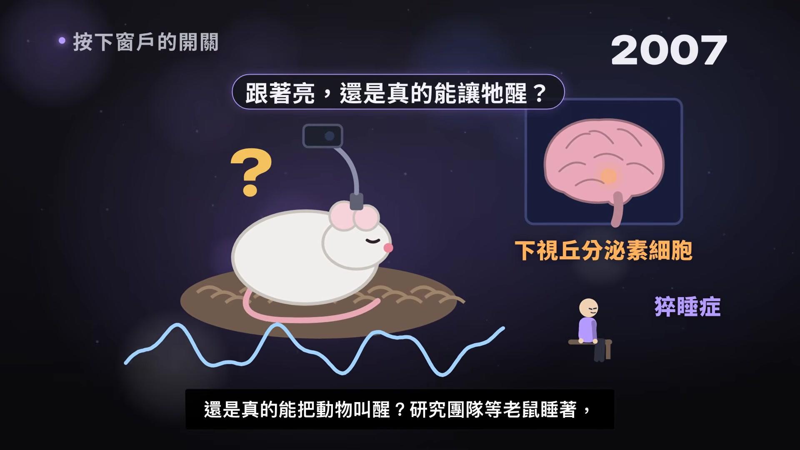

**逐字稿片段：** 研究團隊的老鼠睡著 再把光打在這群細胞上 光一秒閃五次到三十次的時候 老鼠比較快醒來 一秒閃一次就沒有效果 窗戶不只是跟著亮 按下它真的會讓事情發生 現在我們可以回到 開場那隻撲向手套的老鼠了 2011年

**話題推測：** 描述喚醒睡著老鼠的實驗，可能播放實驗影片或示意圖。

---

## 00:19:38

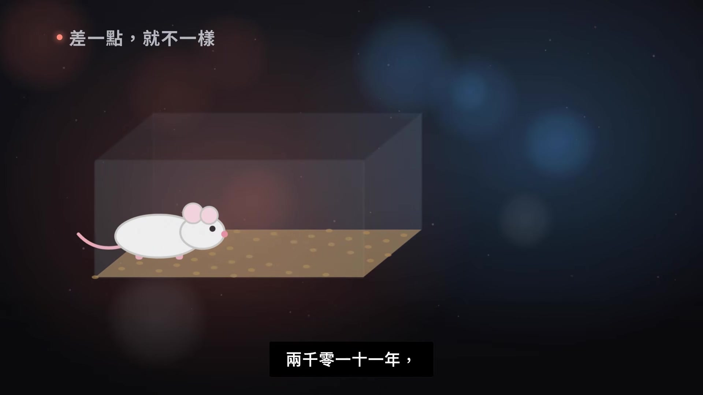

**逐字稿片段：** 美國加州理工學院David Anderson的團隊 把通道式紙質放進下肆丘裡 一小塊區域的細胞 這塊區域比一粒米還小得多 它們在公老鼠的頭上 同樣接一根光線 藍光一秒閃二十下 照進這一小塊腦 四五秒之後 公老鼠撲向籠子裡的 另一隻老鼠

**話題推測：** 介紹David Anderson團隊的老鼠攻擊行為實驗，預計顯示他的照片。

---

## 00:19:55

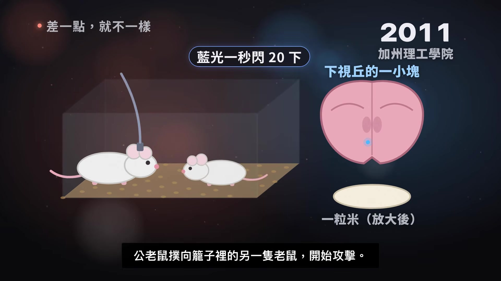

**逐字稿片段：** 開始攻擊 被攻擊的 是平常公老鼠 不太會去攻擊的母老鼠 光一關 攻擊就停了 16只這樣處理過的公老鼠裡 有11只出現這種反應 籠子裡換成一隻 吹寶器的橡膠手套 輕輕晃動 光一亮 8只裡有6只 撲了上去 可是同一個團隊發現 如果病毒偏了一點 主要打到旁邊的區域 光照下去

**話題推測：** 展示老鼠受光刺激後攻擊的影片或動畫。

---

## 00:20:16

**逐字稿片段：** 老鼠不是攻擊 而是僵住不動 或是逃開 差一點點 行為就不一樣了 這也是為什麼 以前用電磁機 很難找到這塊地方 電會把附近的細胞一起打開 他們還發現 這塊區域裡 跟攻擊有關的細胞 和跟交配有關的細胞 就擠在一起 很多跟攻擊有關的細胞 在交配的時候反而變安靜 光遺傳血 還被拿去碰一個更難的東西

**話題推測：** 對比老鼠受刺激後的攻擊、僵住或逃跑行為，可能顯示不同反應的影片。

---

## 00:20:37

**逐字稿片段：** 記憶 2012年 MIT立根川靜的實驗室 跟Dicerot合作 他們先讓老鼠在一個箱子裡 經歷一次輕微的電擊 同時用一種基因技巧 把當下正在活動的那一小群 海馬迴細胞標記起來 裝上通道式紙質 海馬迴 是腦裡跟記憶很有關係的一個區域 之後把老鼠放到另一個安全的箱子

**話題推測：** 光遺傳學應用於「記憶」研究，預計顯示記憶相關的腦區示意圖。

---

## 00:20:58

**逐字稿片段：** 光一打開 老鼠就僵住 像是響起的那隻電擊 隔年同一個實驗室更進一步 讓老鼠對一個 他沒被電過的箱子感到害怕 等於種下了一段假的記憶 不過要說清楚 光引起的僵住 比真的回到那個箱子時弱 而且這些都是老鼠實驗 回到Dice Urals當精神科醫師時 心裡的那個問題 憂鬱的人為什麼這麼難 感到快樂 2013年

**話題推測：** 展示老鼠因假記憶而僵住的影片或動畫。

---

## 00:21:19

**逐字稿片段：** 他的實驗室用老鼠做了一個實驗 老鼠先經歷好幾周溫和 但不停的壓力 之後會出現一些像憂鬱的行為 例如原本愛喝的糖水 沒那麼想喝了 被輕輕吊起尾巴的時候 比較少掙扎 研究人員用藍光 打開中腦裡一群會釋放多巴胺的細胞 多巴胺是一種跟獎勵和動機有關的化學訊號 光一亮 這些行為就回到接近沒有壓力時的樣子 反過來 在沒有壓力的老鼠身上 用黃光把這群細胞關掉 它們也變得比較少掙扎 對糖水沒那麼有興趣 研究團隊說 在這之前 連在動物身上都沒辦法這樣直接測試 不過要說清楚 老鼠的這些行為 不等於人的憂鬱症 憂鬱症也牽涉到很多種細胞 光遺傳學還改變了大家看待行為的方式 以前 我們常把一個行為當成一整塊 例如當父母照顧小孩

**話題推測：** 提到Deisseroth實驗室的憂鬱症研究，可能播放老鼠行為改變的影片。

---

## 00:22:08

**逐字稿片段：** 2018年 哈佛大學Catherine Dulek的團隊 研究老鼠腦裡一群跟照顧幼鼠有關的細胞 他們發現這群細胞又分成好幾小群 各自把訊號送到不同的地方 有一小群管身體的動作 去接近照顧幼鼠 有一小群管動機 想不想去找幼鼠 還有一小群管跟其他成年老鼠的互動 用光分別打開或關掉其中一小群 只會影響照顧行為的其中一部分 一個看起來完整的行為 其實是好幾個分開的模組組合起來的 有了光遺傳學 這種分工才看得清楚 開關也不只用在腦 2023年

**話題推測：** 介紹Catherine Dulac團隊的親代照顧行為研究，預計顯示她的照片。

---

## 00:22:43

**逐字稿片段：** Dice Arrows的團隊給老鼠穿上一件小背心 背心上有一顆會發光的小燈

**話題推測：** 展示老鼠穿著小背心控制心跳的實驗，預計顯示老鼠與裝置的照片。

---

## 00:22:48

**逐字稿片段：** 光穿過皮膚照在已經裝上感光蛋白的心臟上 這樣 他們可以把老鼠的心跳拉到每分鐘900下 結果老鼠只有在有風險的環境裡 焦慮的行為變多了 在安全的地方沒有什麼差別 100多年前

**話題推測：** 描述光照心臟控制心跳，預計顯示心臟運作示意圖。

---

## 00:23:01

**逐字稿片段：** 美國心理學家William James 主張情緒有一部分來自身體的反應 這個實驗給了他一個有條件的支持 那這把開關能用在人身上嗎?

**話題推測：** 介紹美國心理學家William James，預計顯示他的照片。

---

## 00:23:10

**逐字稿片段：** 目前最接近的是眼睛 有一種遺傳病 叫視網膜色素病變 眼睛裡負責感光的細胞會慢慢死掉 最後失明 眼睛有個好處 它是透明的 光本來就照得進去 2021年 法國、瑞士和美國的團隊發表了一個案例 一位58歲的男性 失明將近40年 醫師把一種感光蛋白的基因 用病毒打進他的一隻眼睛 讓視網膜裡還活著的其他細胞 長出感光的門 再讓他戴上一副特製的護目鏡 護目鏡上的攝影機 把看到的畫面 變成橘黃色的光點 打在視網膜上 經過幾個月的訓練 他能找到桌上的筆記本 數出桌上的杯子

**話題推測：** 光遺傳學在人體「眼睛」上的應用，預計顯示眼睛的解剖圖。

---

## 00:23:46

**逐字稿片段：** 看到斑馬線的白色條紋 可是他看不到顏色 也看不清細節 這是一位病人的結果 更多的試驗還在進行

**話題推測：** 模擬患者重見部分視覺的畫面，預計顯示視覺恢復的模擬圖。

---

## 00:23:53

**逐字稿片段：** Nego在接到諾貝爾獎的電話時 自己就提到了這件事 聽聽他怎麼說 連得主自己都說 現在真正受益的病人還很少 Dieser Rolf在得獎當天的記者會上也說 光遺傳學主要是一個用來發現的工具 為什麼 因為在腦裡 事情難得多 要先用病毒 把基因送進特定的細胞 要動手術 把光纖放進頭殼裡 他要確定長期下來是安全的 所以他提了另一條路

**話題推測：** 播放Nagel談論人體應用前景的片段。

---

## 00:24:45

**逐字稿片段：** 叫間接光遺傳學 先在動物身上 用光找出哪一種細胞跟症狀 有因果關係 就像先找到地址 再設計藥物或其他療法 把東西送到那個地址

**話題推測：** 提出「間接光遺傳學」的概念，可能顯示新的研究流程圖。

---

## 00:24:55

**逐字稿片段：** 他共同創辦的公司MapLight 就是走這條路 他在記者會上說 結果看起來很有希望 可是公開的結果是有好有壞 自閉症的藥 2026年6月公佈的中期臨床試驗 主要指標沒有達到 失覺失調症的藥 同年7月公佈 兩種劑量 一種達到主要指標 一種沒有 地址 找到了一些送貨的車 還在試 從能指揮老鼠的大腦 到能幫上病人 是另一個計時器 它從2007年開始走 到今天19年還沒有停 我們回到開場那個問題 光怎麼控制大腦 人類花了多少年才做到

**話題推測：** 提到MapLight公司，預計顯示公司Logo或資訊。

---

## 00:25:30

**逐字稿片段：** 先說怎麼控制 腦細胞看不到光 科學家就從綠藻身上 借來一扇 照到藍光就打開了門 用病毒當快遞車 用啟動值當地址 只裝在某一種細胞上 再用一根光纖把光送進去 光一來 門打開 帶電的離子流進去 那一種細胞就送出神經訊號 快到千分之一秒 旁邊的鄰居不受影響 那開場那個奇怪的地方呢

**話題推測：** 總結光遺傳學如何控制大腦，預計顯示完整的工作原理圖解。

---

## 00:25:53

**逐字稿片段：** 諾貝爾醫學講 為什麼搬給研究綠藻的人 因為腦細胞缺的那個開關 本來就長在綠藻身上 Heggman和Nagel在綠藻身上找到它 Dice Arrows把它裝進了腦裡 再說花了多少年 答案是28年 起點是1979年 Crick第一次把紙打開或關掉某一種神經細胞 寫成一個明確的願望 終點是2007年諾貝爾委員會的說明寫到 Dyson Ross的團隊在那一年 讓這個用光的開關在活老鼠的腦裡運作 如果從鹽水裡那個紫色蛋白被找到的 1971年算起是36年 從許願到今年拿到諾貝爾獎是47年

**話題推測：** 解釋為何綠藻研究者獲獎，預計顯示諾貝爾獎與綠藻的關聯圖。

---

## 00:26:29

**逐字稿片段：** 這件事為什麼值得一座諾貝爾獎 因為在他之前研究腦 大多隻能站在對街看哪些窗戶亮 有了它 科學家可以走進大樓 一個暗開關 看看到底是誰讓事情發生 睡覺 害怕 攻擊 記憶 很多老問題 開始有了因果的答案 可是另一個計時器還在走 從能指揮老鼠的大腦 到能幫上病人 用在人身上 目前最接近的是眼睛 腦還在很早的階段 而這一切的起點

**話題推測：** 闡述光遺傳學獲諾貝爾獎的重大意義，預計顯示總結性圖表。

---

## 00:26:55

**逐字稿片段：** 是有人好奇一個 小綠棗為什麼會往光的方向遊 如果你或身邊的人 正在被憂鬱或焦慮困擾 請找專業的醫師聊聊 這支影片不是醫療建議 最後問你一個問題 如果有一天 科學家確定的憂鬱或焦慮 跟哪一種細胞有關 你看待這些病的方式 會不會因此改變 留言告訴我 喜歡的話訂閱AI Notebook 開啟通知 我們下次見

**話題推測：** 回顧一切從好奇小綠藻開始，預計顯示小綠藻圖片作為結尾意象。

---
