# jimainotebook_D8Sa0aw7GTo — 關鍵畫面索引

- 來源逐字稿：[jimainotebook_D8Sa0aw7GTo_FIN.srt](jimainotebook_D8Sa0aw7GTo_FIN.srt)
- 影片：https://www.youtube.com/watch?v=D8Sa0aw7GTo
- 截圖數：37

## 00:00:11

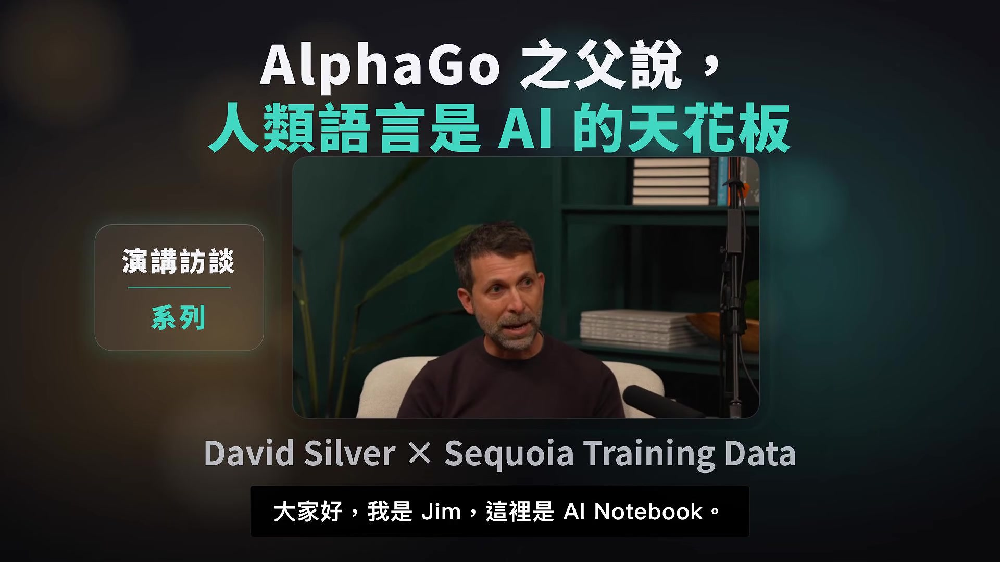

**逐字稿片段：** 這一集是演講訪談系列,主角是David Silver, 打敗圍棋世界冠軍的AlphaGo就是他帶頭做出來的。 他今年提出一個很大膽的看法,我們這集要問的就是

**話題推測：** 介紹本集主題人物David Silver，可能顯示其照片或生平簡介。

---

## 00:00:21

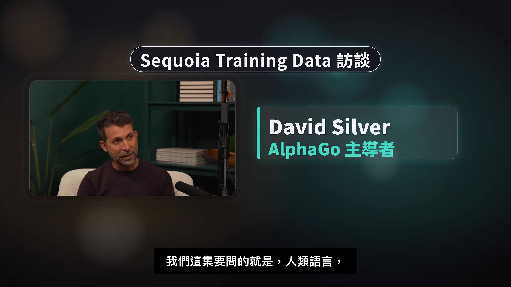

**逐字稿片段：** 人類語言會不會是AI的天花板?

**話題推測：** 提出本集核心問題：「人類語言會不會是AI的天花板？」，可能以大字報呈現。

---

## 00:00:24

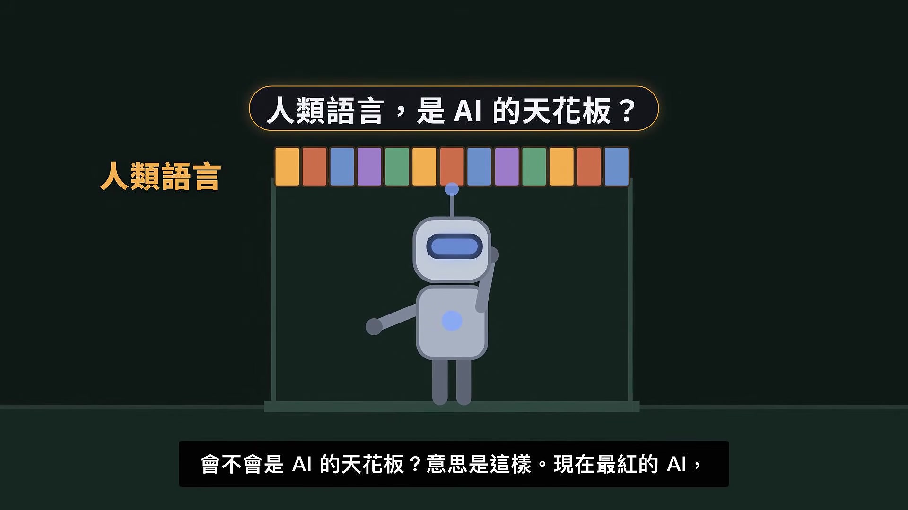

**逐字稿片段：** 意思是這樣,現在最紅的AI像ChatGPT 都是先讀遍人類寫下的文字,再一步一步調教出來的。 Silver認為,從人類文字學出來的AI 會被人類已經知道的東西框住,很難走得比人類遠很多。 他的證據是自己做過的一件事 AlphaGo Zero一盤人類棋譜都不看 自己跟自己下 結果比跟人類學的AlphaGo更強

**話題推測：** 引述ChatGPT作為當前熱門AI的例子，可能展示ChatGPT的標誌或介面。

---

## 00:00:44

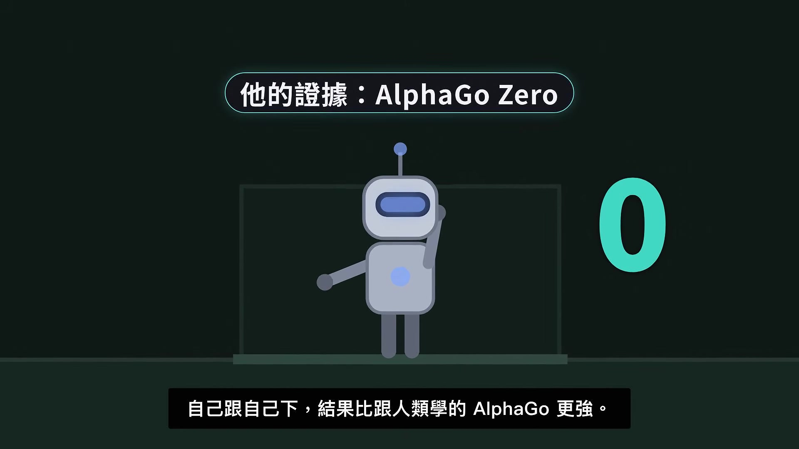

**逐字稿片段：** 所以他離開Google DeepMind 開了一家公司 要讓AI一句人話都不先讀 從零開始自己學

**話題推測：** 說明David Silver離開Google DeepMind並創辦新公司，可能顯示時間軸或新公司標誌。

---

## 00:00:50

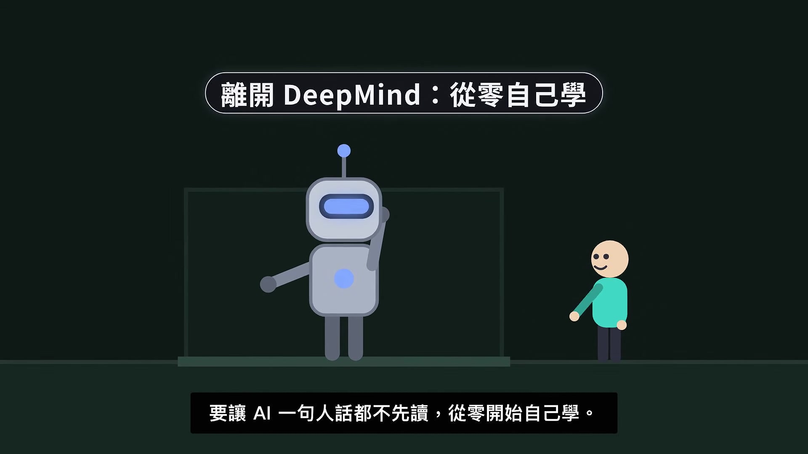

**逐字稿片段：** 他還預測一年內會看到很強的證據 三年內做出超級智慧 這些都是他的看法 我們也會看看有誰不同意

**話題推測：** 提出David Silver對AI發展時間的預測，可能以時間軸圖表呈現。

---

## 00:00:58

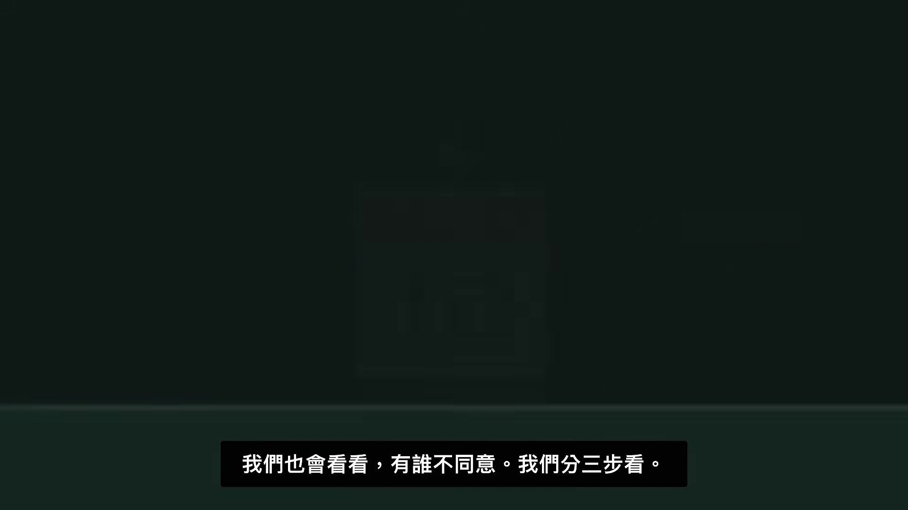

**逐字稿片段：** 我們分三步看 先看圍棋上發生過什麼 再看他打算怎麼把同一招搬到整個世界 最後看這條路會不會成功 成功了又安不安全

**話題推測：** 呈現影片的內容大綱，可能為投影片列表。

---

## 00:01:06

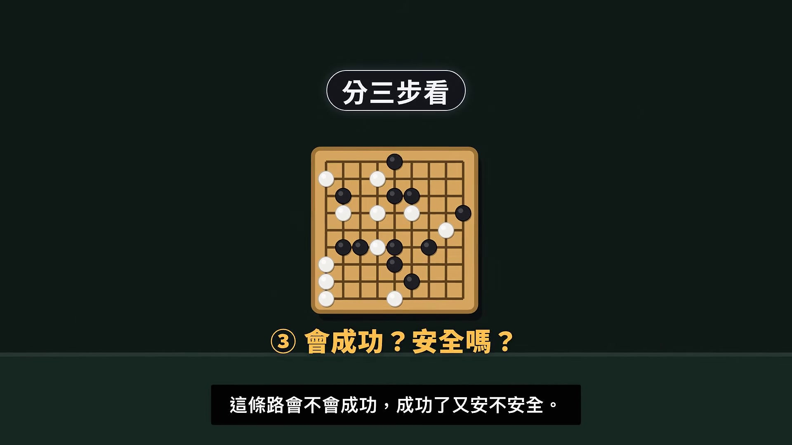

**逐字稿片段：** 先介紹他 David Silver在加拿大的亞伯達大學念博士 論文研究的就是怎麼讓電腦下圍棋 指導教授是強化學習的開創者之一 Rich Sutton 這個名字等一下還會出現 後來他加入DeepMind 帶領強化學習的團隊

**話題推測：** 開始介紹David Silver的學術與職業生涯，可能展示其簡歷或照片。

---

## 00:01:21

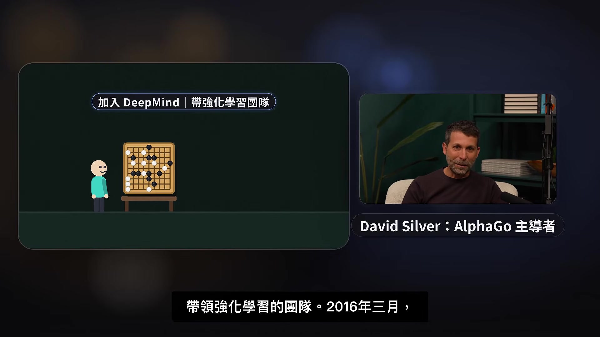

**逐字稿片段：** 2016年3月 他帶頭座的AlphaGo 在首爾以4比1打敗韓國棋王李士時 之後的AlphaZero也是他帶的 今年1月他離開DeepMind 4月 他的新公司Ineffable Intelligence公開

**話題推測：** 描述AlphaGo在2016年擊敗李世石的里程碑事件，可能顯示圍棋對局畫面或比分板。

---

## 00:01:33

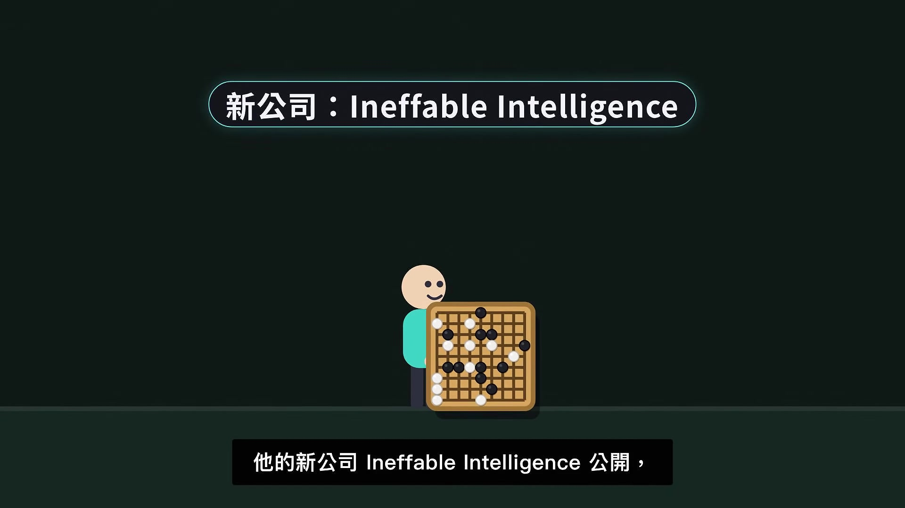

**逐字稿片段：** 拿到11億美元的種子輪 也就是公司最早的那一筆投資 報道說是歐洲新創公司最大的一筆

**話題推測：** 揭露Ineffable Intelligence獲得11億美元種子輪投資，可能展示財經新聞圖表或公司募資資訊。

---

## 00:01:39

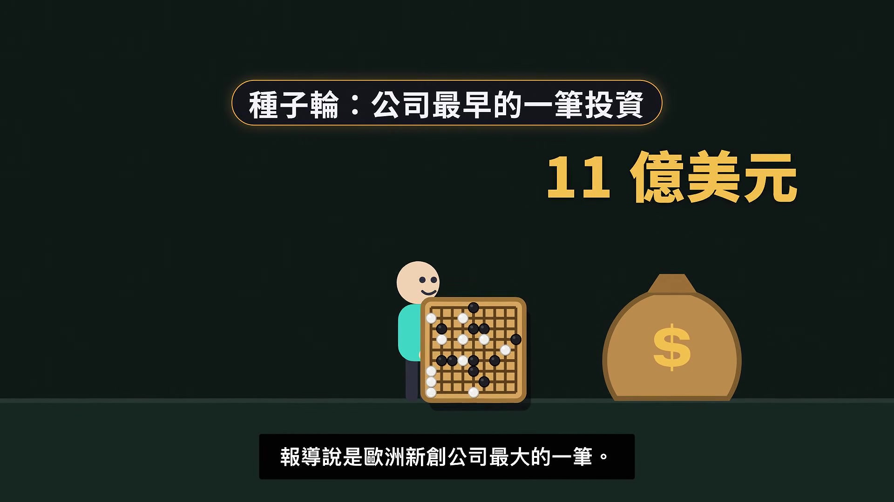

**逐字稿片段：** 這段訪談來自紅杉資本的節目Training Data 10月13號上架 同場還有共同創辦人Laser Espohold 先說清楚 紅杉資本就是這家公司的主要投資人之一 所以這是投資人訪問自家公司 他講的都是他的看法和計劃

**話題推測：** 說明訪談來源為紅杉資本的節目，可能顯示紅杉資本的標誌或節目名稱。

---

## 00:01:53

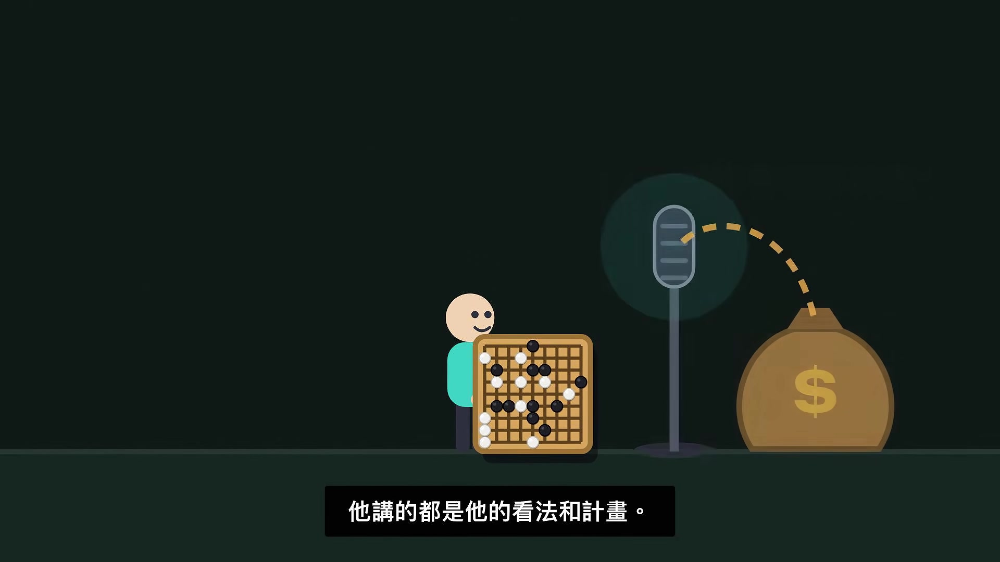

**逐字稿片段：** 我們先回到10年前那盤棋 AlphaGo是怎麼學會下圍棋的 分兩步 第一步 看人類下過的棋 研究團隊給他大約16萬盤高手對局 一共3000萬個盤面 讓他學著猜 換做人類高手 下一手會下在哪裡 接下來這一步

**話題推測：** 回到AlphaGo如何學習圍棋的過程，可能展示圍棋盤面或學習流程圖。

---

## 00:02:10

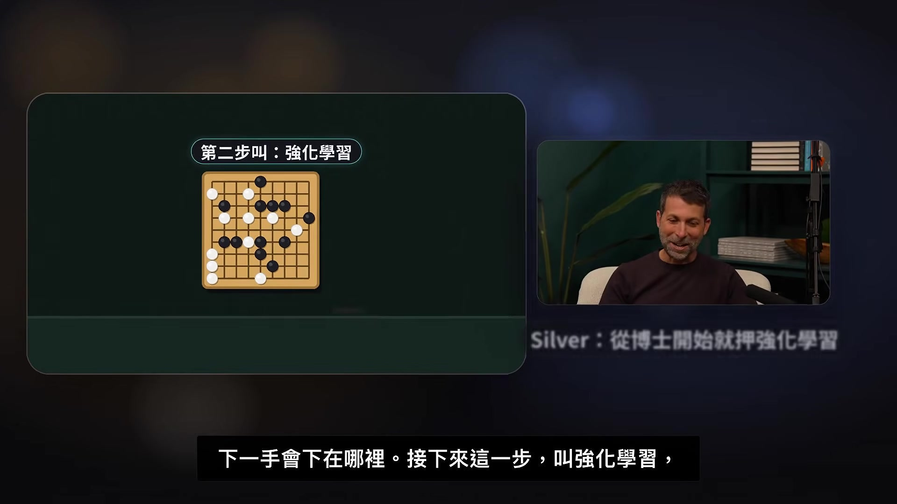

**逐字稿片段：** 叫強化學習 英文是reinforcement learning 他做的事是 讓AI自己動手試 做對了加分 做錯了扣分 慢慢把會加分的做法留下來 AlphaGo就是讓自己跟自己下很多盤 贏的下法多用 輸的少用 這樣做出來的AlphaGo 打敗了李適時 比賽裡

**話題推測：** 介紹「強化學習」（Reinforcement Learning）的AI訓練方法，可能以圖解說明。

---

## 00:02:27

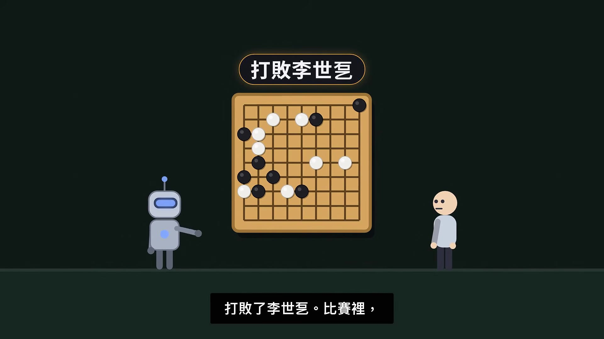

**逐字稿片段：** 他下過一步人類高手 幾乎不會下的棋 評論的職業棋士 一開始以為是失誤 後來才看懂 不過Silver說 那兩年 團隊一直守在旁邊 一板一板地改進他 人類的經驗是他的起點

**話題推測：** 指出AlphaGo在比賽中下出讓人類專家驚訝的一手棋，可能在棋盤上標示該棋步。

---

## 00:02:39

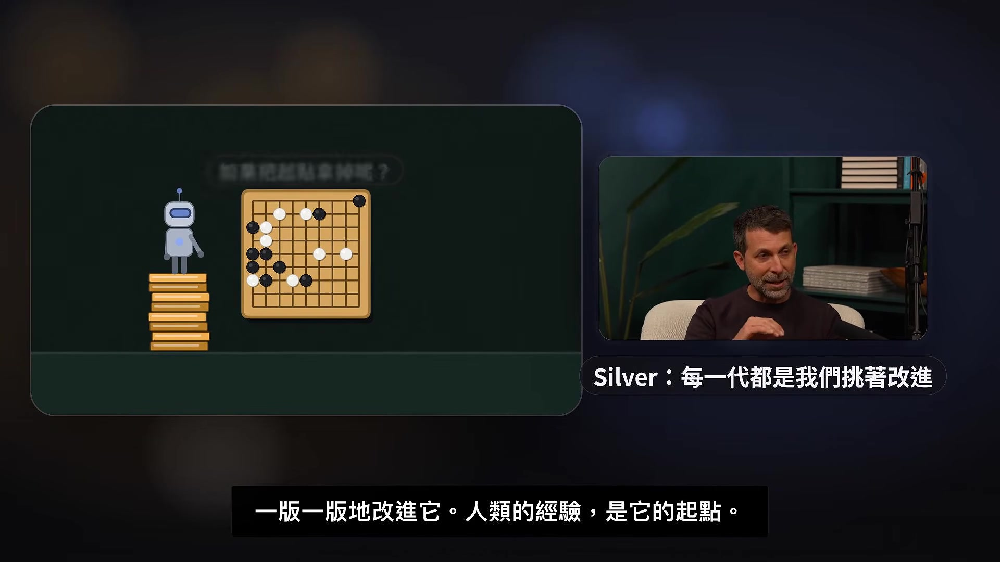

**逐字稿片段：** 那如果把起點拿掉呢? 2017年 他們做了AlphaGo Zero 名字裡的Zero意思是零 一盤人類起伏都不看 他只知道圍棋的規則 一開始像小孩一樣亂下 然後自己跟自己下 這個方法叫自我對弈 英文是Self Play

**話題推測：** 提出如果移除人類棋譜作為起點的假設，預示AlphaGo Zero的出現。

---

## 00:02:55

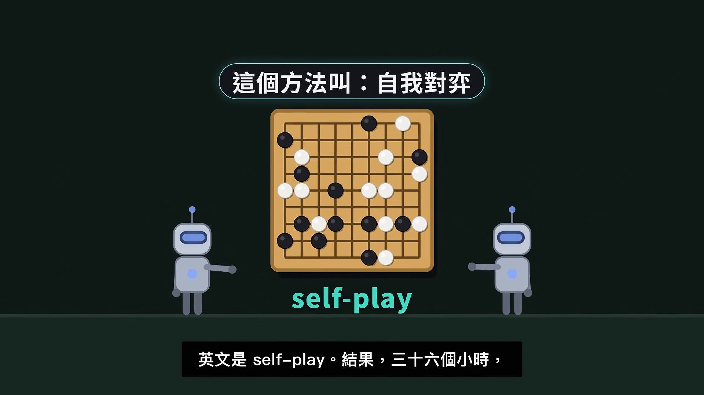

**逐字稿片段：** 結果36個小時 他就超過了打敗李適時的那個版本 訓練三天以後 兩邊對下一百盤 Zero一百比零全勝

**話題推測：** 展示AlphaGo Zero在極短時間內超越前代AlphaGo的驚人成績，可能以數據比較圖呈現。

---

## 00:03:03

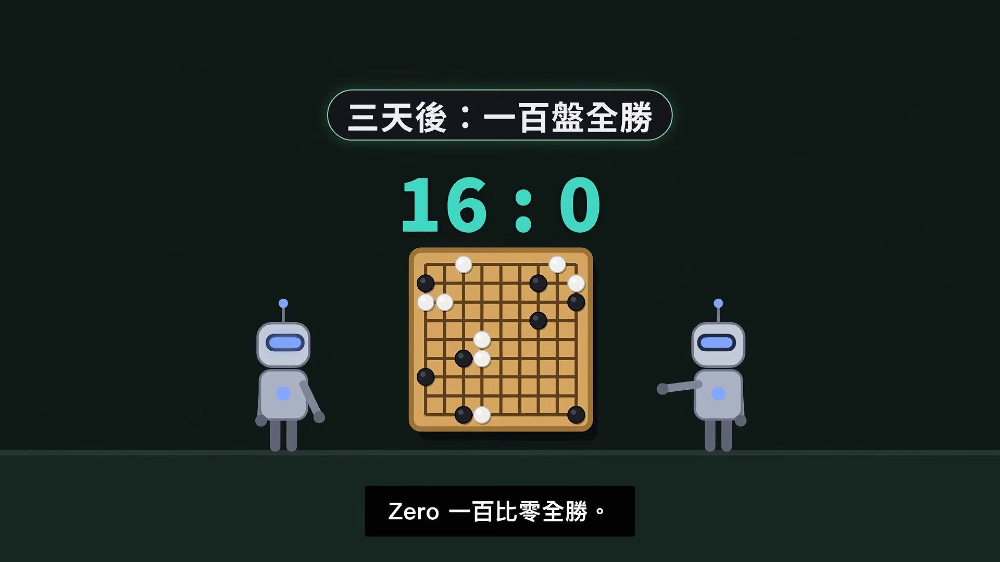

**逐字稿片段：** 後來的AlphaZero用同樣的方法學西洋棋 4個小時就贏過當時最強的西洋棋城市 人類守著改進了兩年的東西 拿掉人類資料以後 幾天就被超過 聽他怎麼說 聽他怎麼說 When we got AlphaZero right We gave up on the human data We gave up on the human data So once we got it right, that algorithm It took just a few hours

**話題推測：** 提到AlphaZero以相同方法學習西洋棋也取得成功，可能顯示西洋棋棋盤畫面。

---

## 00:03:33

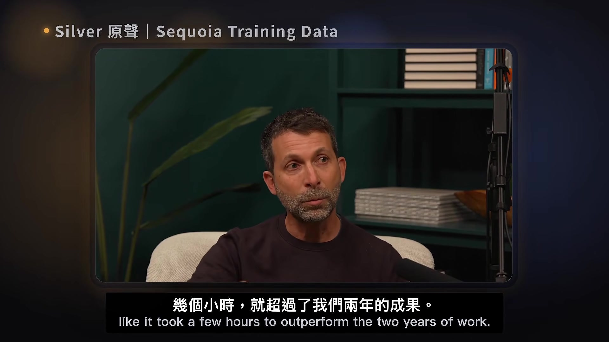

**逐字稿片段：** 為什麼自己跟自己下就能一直變強 關鍵在對手 你今天變強一點 明天的對手也就是你自己也強一點 題目一直剛好比你難一點點 所以他一直有東西可以學 Silver還提到一個有趣的地方

**話題推測：** 解釋AI透過自我對弈持續變強的機制，可能以流程圖或動畫說明。

---

## 00:03:47

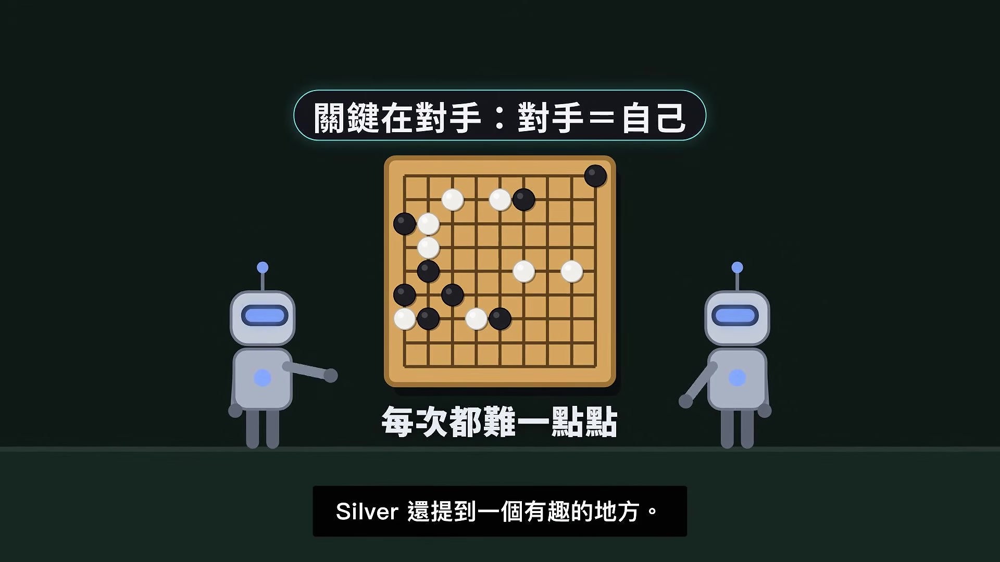

**逐字稿片段：** 圍棋的規則很簡單 就是在19x19的格子上放棋子,圍地盤 可是,如果只有一個人下 這會是全世界最無聊的遊戲 聽他怎麼說 兩個對手就能長出數不完的變化 AlphaGo Zero在這片變化裡 自己找到了人類累積了幾千年的很多下法 也找到一些人類沒用過的新下法 現在職業騎士研究棋局 常常要先看AI怎麼下

**話題推測：** 討論圍棋規則的特性，可能以簡單的圍棋盤面或圖示輔助說明。

---

## 00:04:27

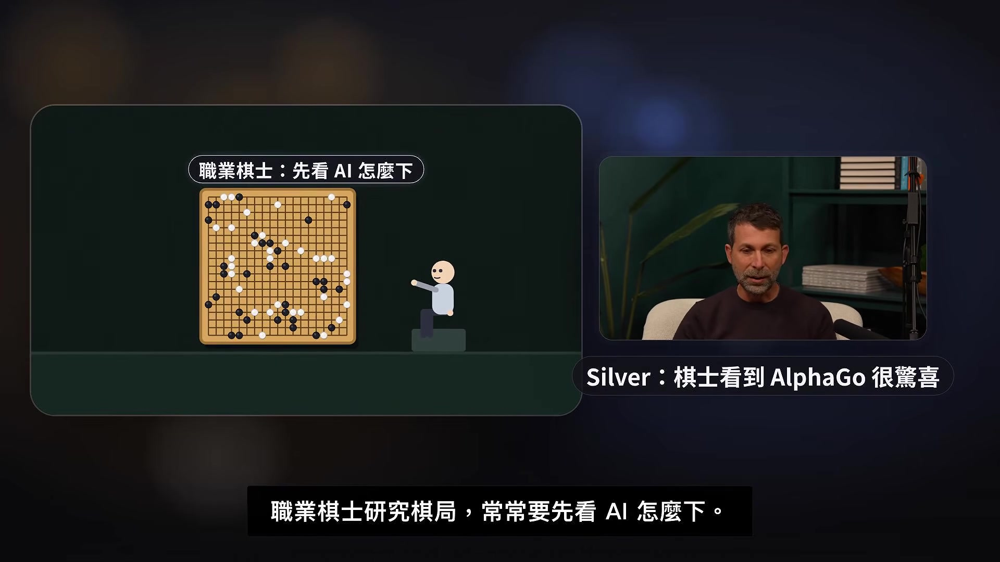

**逐字稿片段：** 李世石在2019年退休 他說 就算自己拿到第一 也還有一個打不敗的存在 所以這一部分的答案是 至少在圍棋上 人類棋譜就像一層天花板 拿掉以後 AI反而走得更遠

**話題推測：** 提及李世石因AI的強大而退役的事件，可能顯示李世石的照片或新聞畫面。

---

## 00:04:39

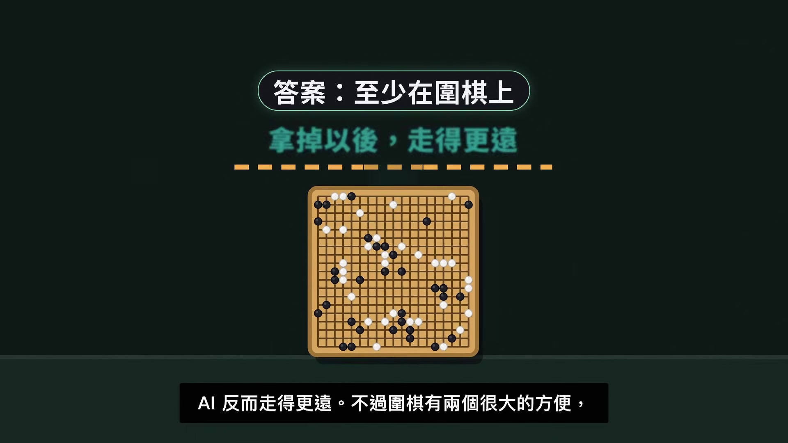

**逐字稿片段：** 不過圍棋有兩個很大的方便 規則寫得清清楚楚 下完也知道誰贏 真實世界沒有規則書 也沒有人告訴你贏了沒有

**話題推測：** 轉向討論圍棋作為模型在真實世界的限制，可能以投影片列點說明。

---

## 00:04:47

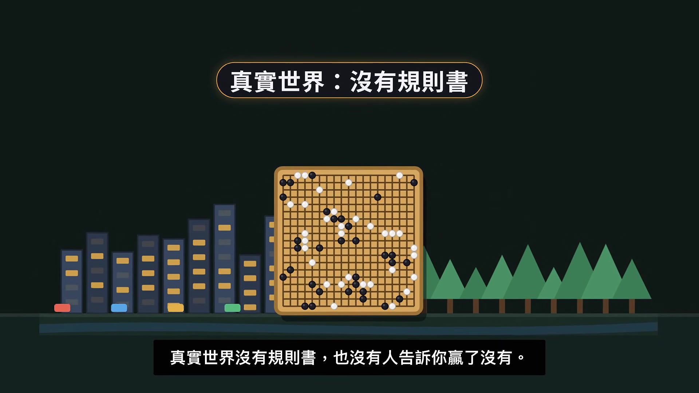

**逐字稿片段：** Silver想做的 就是把圍棋這一招 搬到整個世界 先說大家熟悉的那條路 ChatGPT這類AI 叫大型語言模型 他先讀遍網路上人類寫的文字 學會接話 再請大量的人幫他打分數做修正 一步一步調教出來 Silver說他很尊重這條路 可是他不相信 只走這條路就能一路走到超級智慧 他在DeepMind用得到全世界最多的電腦資源之一 為什麼還要出來自己做 他說現在全世界有幾萬 甚至幾十萬個很優秀的研究者 都擠在同一條路上 聽他怎麼說 最有效的使用我的時間和我的能量 最後我發現 現在沒有任何人在看著的 另一個燈籠 如果我把我的努力放在那裡 我可能會有更大的影響 因為如果這能夠成功 這會改變整個智慧

**話題推測：** 揭示David Silver將圍棋經驗應用到整個真實世界的宏大願景，可能以概念圖呈現。

---

## 00:05:45

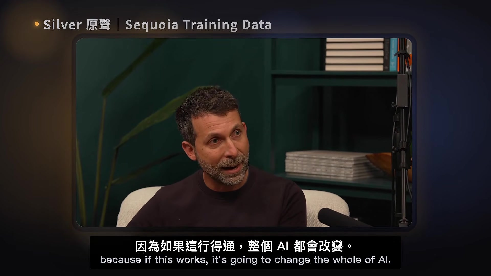

**逐字稿片段：** 他想做的東西叫超級學習者 英文是Super Learner 他有兩個條件 第一個是深度 從什麼都不知道開始 一路學到超過人類知道的東西 另一個是廣度,不管把他丟進哪一種世界,模擬的、數位的還是真實的,他都能自己學。

**話題推測：** 介紹David Silver欲打造的「超級學習者」（Super Learner）概念，可能以定義或圖示說明。

---

## 00:06:02

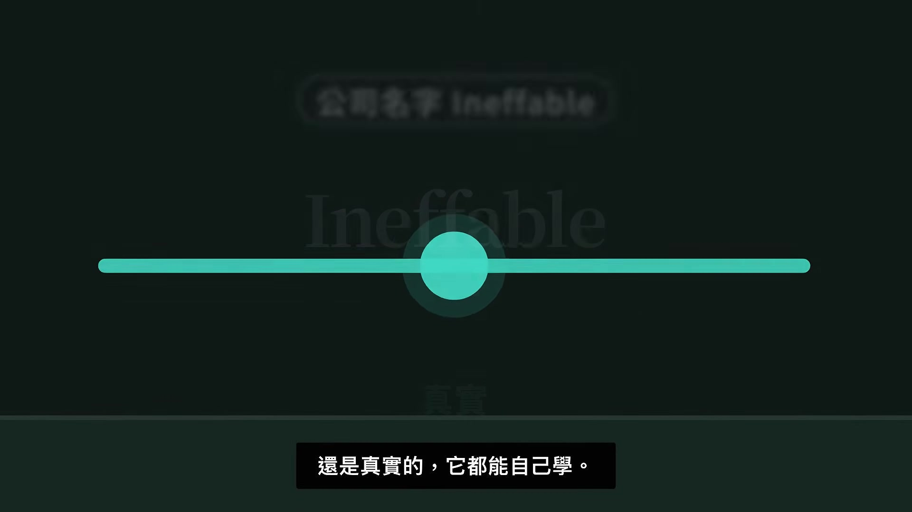

**逐字稿片段：** 公司的名字 Ineffable,意思是無法用言語形容。 他說,超級智慧將來發現的知識,可能深到人類的語言講不出來,這聽起來很遠,可是他說,人類自己就做過一次。 聽他怎麼說。 這就來到這集最核心的主張 Silver認為

**話題推測：** 解釋公司名稱Ineffable Intelligence的含義，可能顯示公司標誌和其英文原義。

---

## 00:06:39

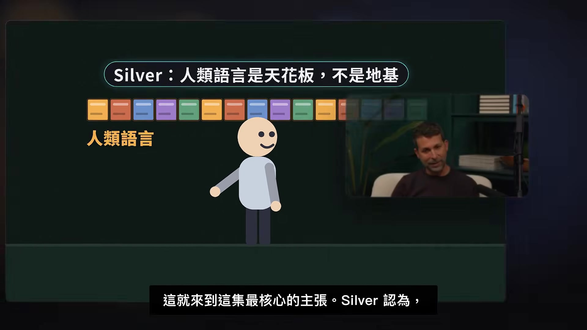

**逐字稿片段：** 人類的語言可能是AI的天花板 不是地基 天花板是什麼意思 想像一個學生只讀過老師寫的筆記 他可以讀得很熟 甚至比老師還會考試 可是筆記裡沒有的東西 他很難自己想到 現在的大型語言模型 就像讀遍了全人類的筆記 Silver說 AI越依賴人類資料 越難找到真正超過人類的新東西 圍棋就是這樣 看棋譜長大的AlphaGo 比不過一盤棋譜都不看的Zero 還有一層 現在的AI在推理的時候 會先用人類的文字 一步一步寫出他的想法 Silver覺得 人類語言不見得是最好的思考方式 應該有更豐富 可以同時處理很多事情的推理方法 只是我們還不知道它長什麼樣子 而且從人類的文字開始學 也會把人類的偏見一起學進去 他舉了一個例子 聽他怎麼說 如果不讀人類的資料 AI要從哪裡學 他的答案是

**話題推測：** 再次強調「人類語言是AI天花板而非地基」的核心主張，可能以投影片呈現。

---

## 00:07:51

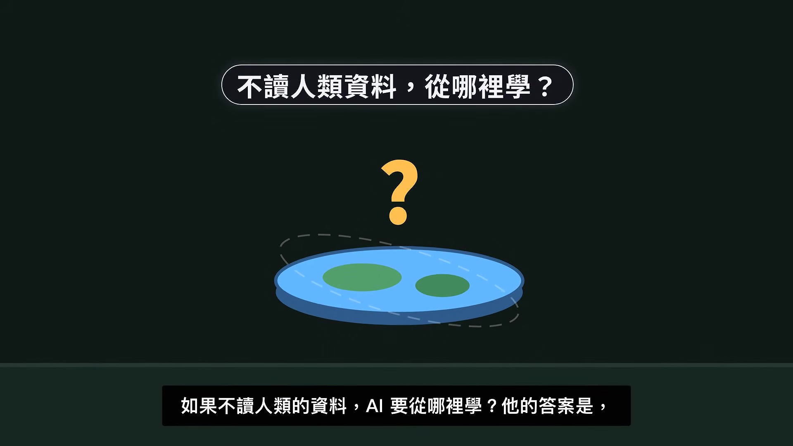

**逐字稿片段：** 給他一個世界 他們在電腦裡打造模擬的世界 取名叫熔爐 熔爐裡可以有物理引擎 幾百萬個東西互相碰撞 也可以同時注進幾百萬個AI 彼此合作也彼此競爭 現在很多公司訓練AI 像在一路撒麵包屑 先學這題再學那題 牽著他往想要的答案走 Silver說 他們不這樣做 他們只給很簡單的目標 看AI自己會發現什麼 簡單的目標 能長出複雜的東西嗎 他拿人類的歷史來說明 聽他怎麼說 這種想法 以前也有人試過 2019年

**話題推測：** 闡述AI將如何在模擬世界中學習的解決方案，可能展示模擬世界的畫面或概念圖。

---

## 00:08:41

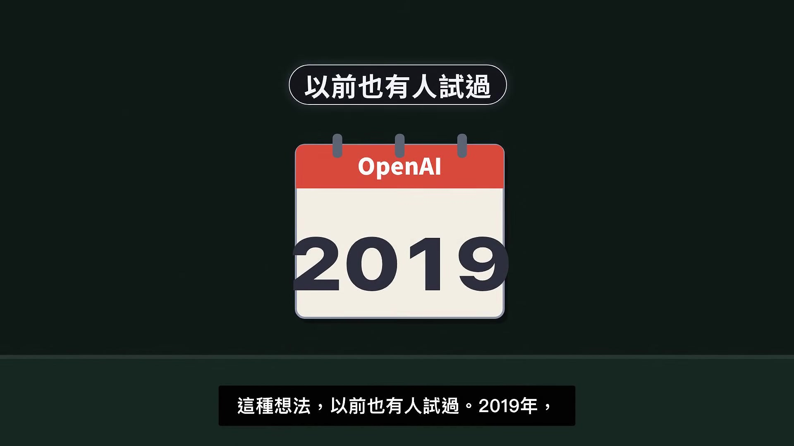

**逐字稿片段：** OpenAI做過一個捉迷藏的實驗 兩對AI在模擬的房間裡玩 自己學會了搬箱子堵門 還學會用斜坡翻牆 Silver估計 他們現在的實驗

**話題推測：** 提及OpenAI曾進行過的捉迷藏實驗，可能播放該實驗的動畫或影片片段。

---

## 00:08:51

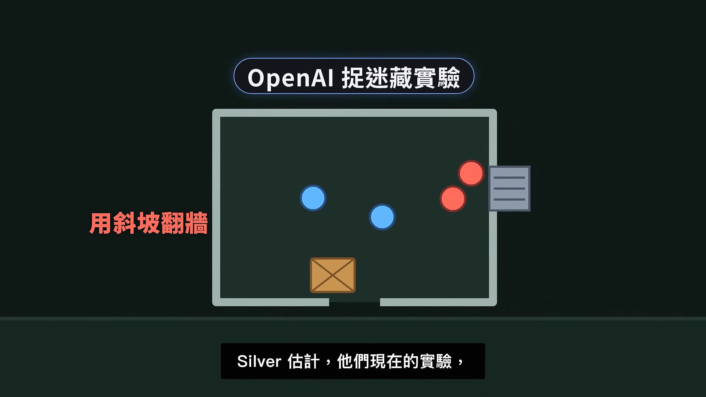

**逐字稿片段：** 可以用到比那時多10萬倍的運算 另一位共同創辦人Lasse Espeholt 是讓強化學習在大量晶片上 同時運作的專家 他說 他們是Google Cloud上一套 揮打最新一代GPU大型重集的第一批客戶 公司目前只有20個人 每個人分到的運算資源非常多 所以這一部分的答案是 他的計劃有三樣東西 很簡單的目標 夠複雜的模擬世界 還有大量的運算 剩下的問題是

**話題推測：** 強調Ineffable Intelligence使用的龐大運算資源，可能以數據或硬體圖片展示。

---

## 00:09:16

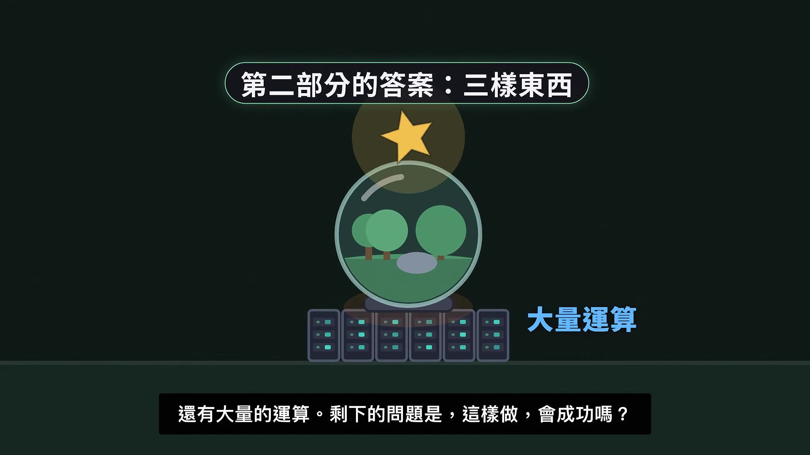

**逐字稿片段：** 這樣做會成功嗎 Silver對時間點很有信心 他說 電腦圍棋哪一年會被攻下 他提早十年就說中了年份 後來好幾次預測也都說中 這是他自己的說法 我們沒辦法一一核對 那這一次他預測什麼 訪談最後 主持人請他說清楚 他說 一年之內 會看到他們走對路的很強證據 至於超級智慧 他說的是在科學 數學 技術 語言各方面 都能發現遠遠超過人類的東西 他原本估計3到5年

**話題推測：** 提出David Silver的計畫能否成功的關鍵問題，可能以問號或投影片標題呈現。

---

## 00:09:45

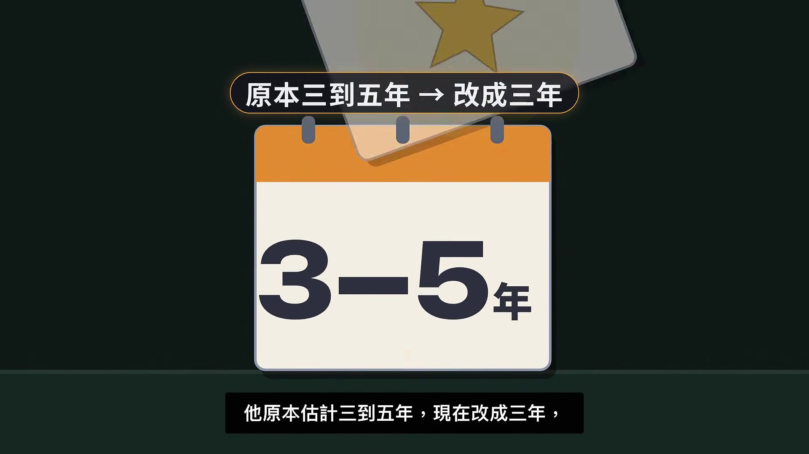

**逐字稿片段：** 現在改成3年 因為會寫程式的AI 讓研究變快了 要注意 這是他的預測 這家公司到現在 還沒有公開任何產品 也還沒有公開實驗成績 聽他怎麼說

**話題推測：** 更新David Silver對超級智慧實現時間點的預測為三年，可能以時間軸圖表呈現。

---

## 00:10:12

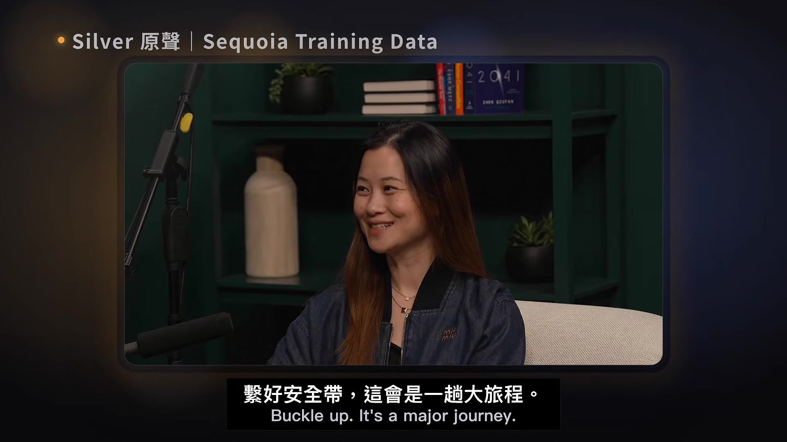

**逐字稿片段：** 第一個反對的聲音 來自他的老師Rich Sutton Sutton去年拿到電腦科學的最高榮譽 圖靈獎 也跟Silver和寫了一篇文章 叫《經驗的時代》 主張AI該從自己的經驗學 可是連他都對模擬世界很保留 主持人說 Sutton上同一個節目時很看不起模擬 他的理由是 真實世界太複雜 在模擬裡學會的 搬到真實世界未必有用

**話題推測：** 介紹第一個反對意見，來自其老師Rich Sutton，可能顯示Rich Sutton的照片。

---

## 00:10:35

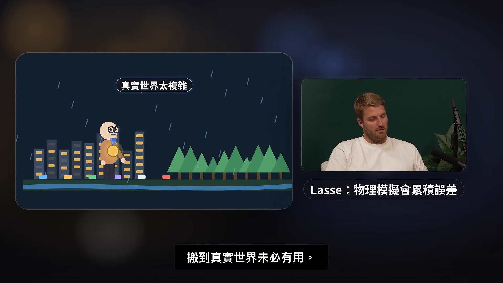

**逐字稿片段：** 這個問題叫從模擬到真實 英文是Sim to Real Silver怎麼回應自己的老師 聽他怎麼說 into the real world 因為真實世界是更加複雜、更加複雜 而且在非常有趣的方式中 but I think what we can do is we can do all of the science to discover the super learner 他的回答是 先在模擬裡把會學習的方法找出來 再把同一個方法用到真實世界 模擬也會越做越像真的 這是他的計劃 還沒有被證明

**話題推測：** 定義「從模擬到真實」（Sim-to-Real）的轉換問題，可能以專有名詞卡片說明。

---

## 00:11:17

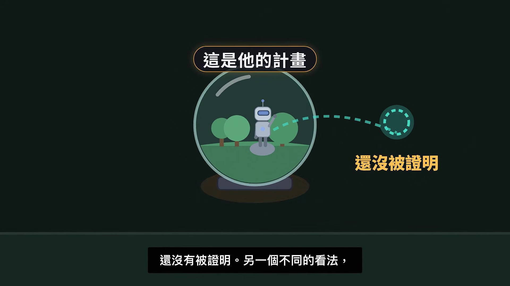

**逐字稿片段：** 另一個不同的看法 來自大型語言模型那一派 OpenAI, Anthropic 還有 Google DeepMind 大多數頂尖的實驗室 還是壓在讀人類資料再加上強化學習這條路 而且這條路也開始碰到新發現 今年5月 OpenAI說

**話題推測：** 介紹來自大型語言模型陣營（OpenAI, Anthropic, Google DeepMind）的不同看法，可能顯示各公司的標誌。

---

## 00:11:32

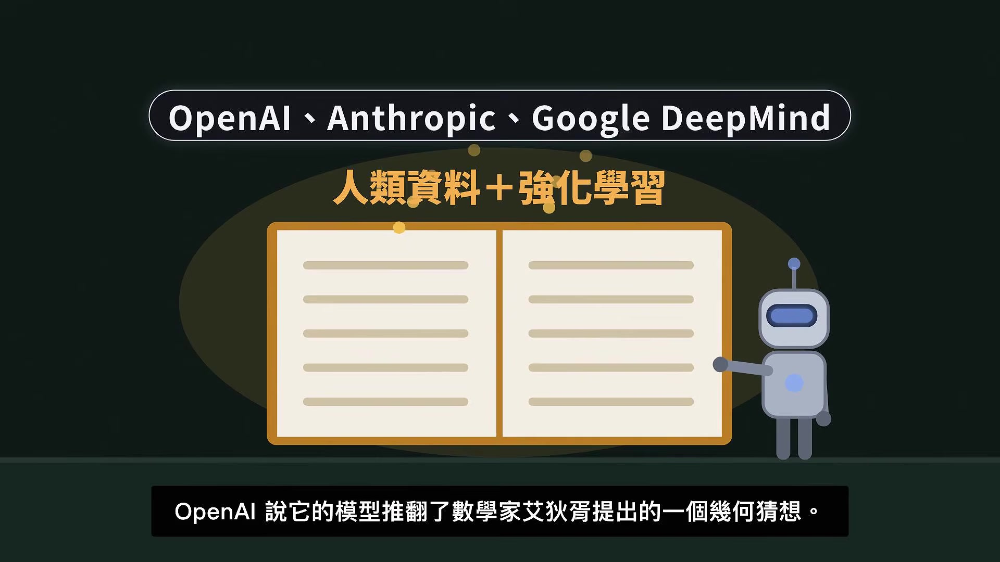

**逐字稿片段：** 它的模型推翻了數學家艾迪須提出的一個幾何猜想 Silver的回應是 這些成果背後還有很多人在旁邊幫忙 還不算AI自己發現 時間表也不一樣 Silver的老東家Google DeepMind 執行長Demis Hassabis去年4月說 能做到人類各種事情的AI 大概還要5到10年 Silver說的是比人類強很多的超級智慧 而且只要3年 這是很大膽的說法 就算成功了

**話題推測：** 引用OpenAI在數學領域的最新突破作為LLM路線的成就，可能展示相關數學猜想或證明。

---

## 00:11:57

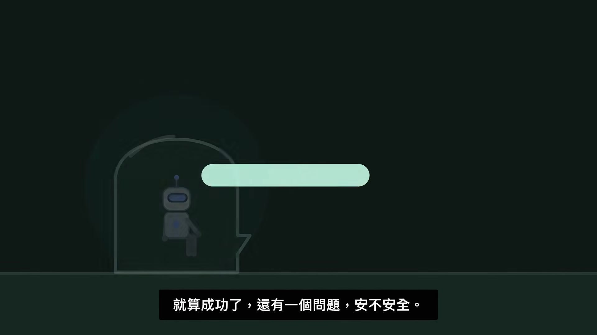

**逐字稿片段：** 還有一個問題 安不安全 現在大家看住AI的一個主要辦法

**話題推測：** 轉向探討AI發展的安全性問題，可能以「AI安全」為主題的投影片呈現。

---

## 00:12:01

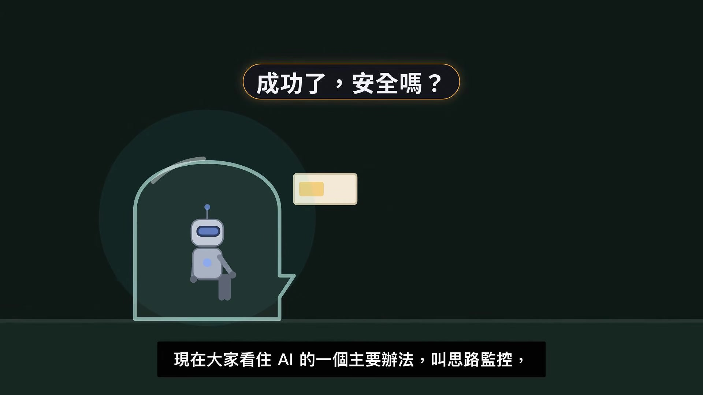

**逐字稿片段：** 叫思路監控 英文是Chain of Thought Monitoring 它做的事是 AI在做事之前 會先用人類的文字 寫下它的思考過程 安全研究者就去讀這些文字 看它有沒有在打壞主意 Silver的看法是 這個方法快要到極限了 AI越來越強 寫出來的思考 可能長達一百萬個字 人讀不完 他也可能學會 嘴上說的是一套 做的是另一套 聽他怎麼說 這裡要補上另一邊的看法 去年7月 來自OpenAI、Anthropic、Google DeepMind等機構的 41位研究者聯名發表一篇論文 結論是 思路監控很脆弱 可是很珍貴 研發AI的公司應該想辦法保住它 他們跟Silver一樣 看到它可能失效 只是一邊想保住它 一邊想另外找方法 而Silver的AI 本來就不打算用人類的語言思考 這個問題對它更嚴重 它提了幾個想法 一個叫影子動作 讓AI說出它想做什麼 先不讓它真的去做 看清楚再決定 另一個 是讓另一個超級智慧在旁邊監看 限制他對世界的影響 他也說 這些都還要大量研究 他沒有全部的答案 他還承諾 在模擬裡越快越好 在真實世界要放慢 沒有足夠證據證明安全 就不往下一步走 所以這一部分的答案是 這條路有機會 也有兩個大問號 模擬裡學會的 能不能用在真實世界 學會以後 我們還看不看得懂 我們回到開場那個問題 人類語言會不會是AI的天花板 Silver的答案是 會 他的證據是圍棋 AlphaGo Zero一盤人類旗譜都不看 三天就贏過跟人類學了兩年的前輩 他賭的是 同樣的事會在整個世界再發生一次 而且只要三年 可是要記得 這是他的看法 大多數頂尖實驗室 還是壓在讀人類資料這條路 而且這條路也開始碰到新發現 他的老師Sutton提醒 模擬世界學會的 未必搬得到真實世界 41位研究者也認為 能讀懂AI用人類文字寫下的思考 是很珍貴的安全工具 人類語言可能是天花板 也可能是我們看懂AI的那扇窗

**話題推測：** 解釋當前AI安全監控方法「思路監控」（Chain of Thought Monitoring），可能以流程圖說明。

---

## 00:14:20

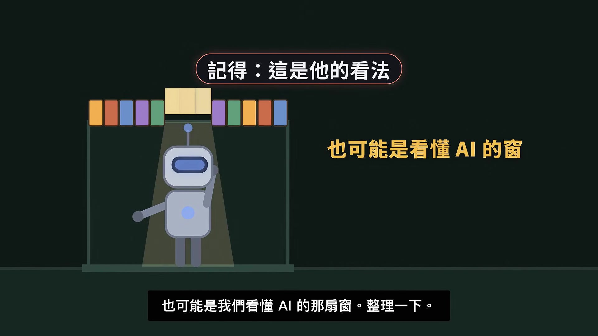

**逐字稿片段：** 整理一下 自己跟自己學 在規則清楚的遊戲裡已經成功 要搬到真實世界 得先過模擬這一關 就算成功了 我們還得找到新的方法 看懂一個不用人類語言思考的AI 他說一年內會有證據 到時候我們再回來看看

**話題推測：** 總結本集內容的關鍵點，可能以條列式投影片呈現。

---

## 00:14:35

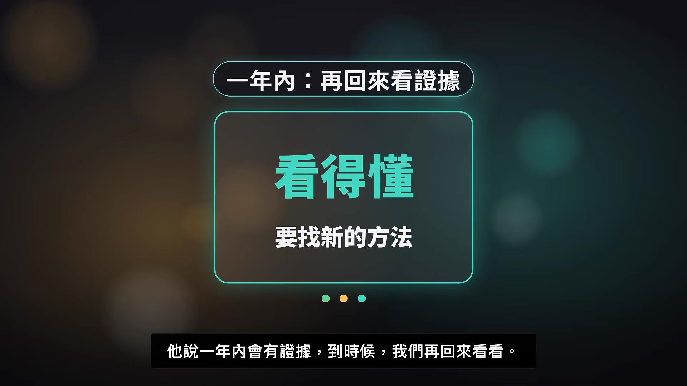

**逐字稿片段：** 最後問你一個問題 如果有一個AI 一個字都沒讀過人類寫的東西 卻發現了一條新的科學定律 你會相信他嗎 留言告訴我 喜歡的話訂閱AI Notebook 開啟通知 我們下次見

**話題推測：** 向觀眾提出一個引導思考的問題，可能以文字或問號的形式呈現，鼓勵互動。

---
