# jimainotebook_E4qG-jswnDw — 關鍵畫面索引

- 來源逐字稿：[jimainotebook_E4qG-jswnDw_FIN.srt](jimainotebook_E4qG-jswnDw_FIN.srt)
- 影片：https://www.youtube.com/watch?v=E4qG-jswnDw
- 截圖數：43

## 00:00:09

**逐字稿片段：** 講臺上是Paul Barkhouse, 他做了一個叫impeccable的設計skill, 在放成式碼的網站Github上, 拿到了7萬顆星, skill你可以想成交給AI助手的一份工作說明, 外加幾隻他能自己跑的小工具。 他整場在回答一個問題,規則明明寫得清清楚楚為什麼AI做出來的網頁還是長得都一樣,我們從他放上臺的第一張投影片開始。 你一定看過這種網頁 米色的底 也航切體的襯線大標題 標題上面還壓著一排 全大寫的小標籤 把Couse放上臺的這一頁

**話題推測：** 介紹講者Paul Barkhouse。

---

## 00:00:37

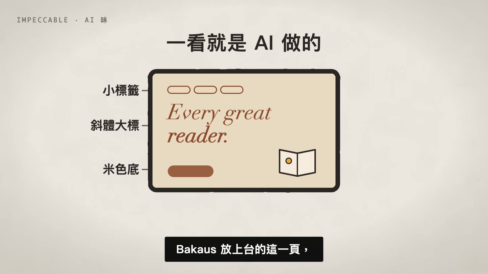

**逐字稿片段：** 是一個假的兒童閱讀APP 用官方的前端設計skill做出來的 他說這頁其實不差 可是臺下每個人一眼就認得出來 這是AI做的 這種東西

**話題推測：** 展示一個假的兒童閱讀APP網頁範例，說明AI生成的設計通病。

---

## 00:00:46

**逐字稿片段：** 有一個名字叫Slop 中文可以說AI位 就是挑不出錯 可是一看就知道 沒有人用心選過 他替這個米色取了一個名字 叫Cloud Beach 這是他自己的叫法 然後他說 AI位 是一個會移動的目標

**話題推測：** 定義「Slop」（AI味）這個詞彙。

---

## 00:00:59

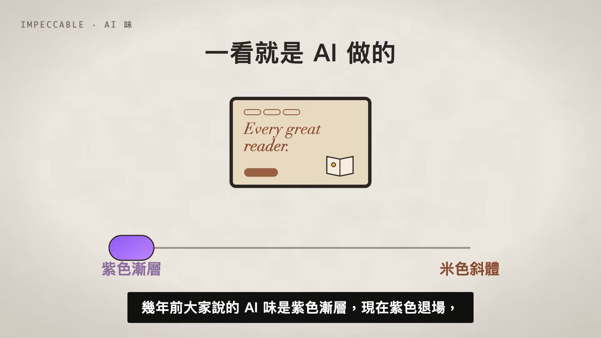

**逐字稿片段：** 幾年前大家說的AI位是紫色漸層 現在紫色退場 換成米色上場 那紫色又是從哪裡來的 答案有點好笑 紫色是一個預設值

**話題推測：** 討論過去AI味是「紫色漸層」的例子。

---

## 00:01:07

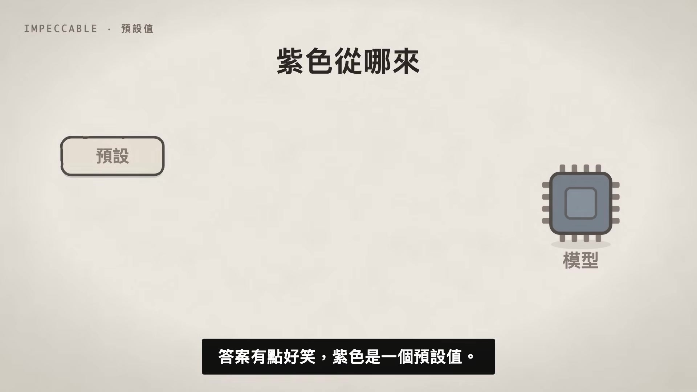

**逐字稿片段：** Tailwind是很多人做網頁用的樣式工具 他的官方原件範本叫Tailwind UI 去年Tailwind的作者Adam Offen在Exxon公開道歉 說當年他把Tailwind UI每一顆按鈕的預設顏色 都設成Indigo 500 一種偏紫的電藍色 大家照抄範本 範本變成網路 網路又變成模型學習的資料 包括Kaos自己也做過一樣的事

**話題推測：** 介紹Tailwind這款網頁樣式工具，解釋紫色漸層的來源。

---

## 00:01:28

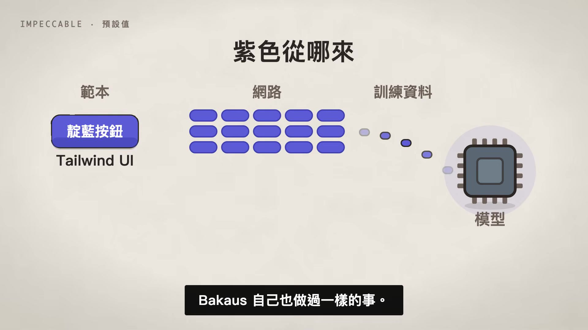

**逐字稿片段：** 他是JQueryUI的作者之一 那是早期幫網頁做按鈕的工具 他自己說JQueryUI第一個預設主題是橘色 他以為大家會改 結果沒有人改 整個網路一頁之間變成橘色 一個人隨手定下的預設值 最後會被模型全部讀過一遍 最直接的解法就是寫禁令 Becouse一開始也是這樣做 他用的就是官方那支前端設計skill 大約55行 裡面寫著 絕對不要用inter-roboto 這些用爛的字型 絕對不要紫色漸層配白底 結果大部分手沒用

**話題推測：** 提及Paul Barkhouse（Kaos）身為JQueryUI作者之一的經歷，及其導致的「橘色網頁」趨勢。

---

## 00:01:54

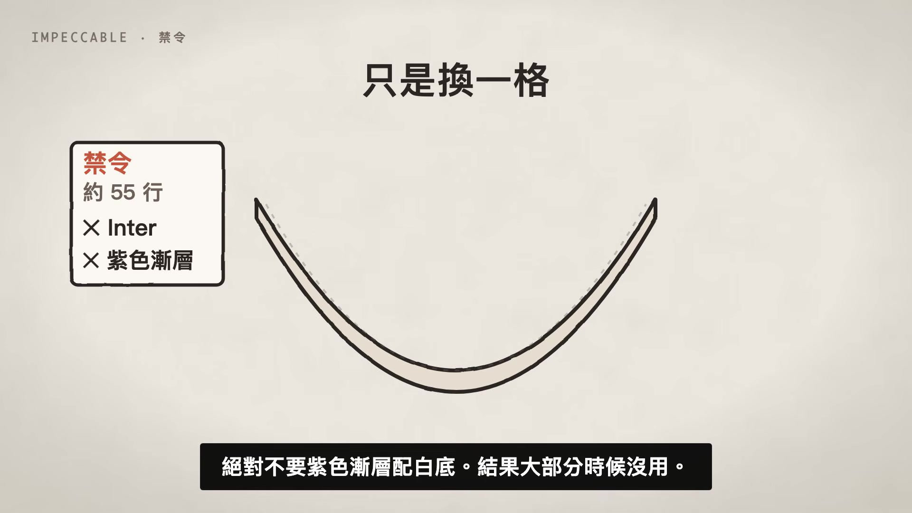

**逐字稿片段：** 這裡有一個詞叫吸引子 英文是attractor 他指的是模型最常寫出來的那個答案 你可以把它想成碗底 什麼東西丟進碗裡 最後都會滾回那裡 靜定將在碗底插一塊板子 球不會飛出碗外 它只會滾到板子旁邊那一格 你叫他不要用inter 他就去拿最像inter的下一個字型 所以靜止不會帶來原創 只會讓模型往旁邊挪一格 他在臺上的說法是 平均值就是模型的重力 那他後來怎麼辦 他沒有把靜定寫得更長 他給整場演講下了一個判斷 寫提示詞只是地板 harness工程才是天花板 Harness這個詞要先講清楚 他指的是包在模型外面的那一整套工作環境 模型能開哪些檔案 能跑哪些城市 做完之後誰來檢查全部都算

**話題推測：** 介紹「吸引子」（attractor）這個概念，可能搭配碗底的比喻圖示。

---

## 00:02:34

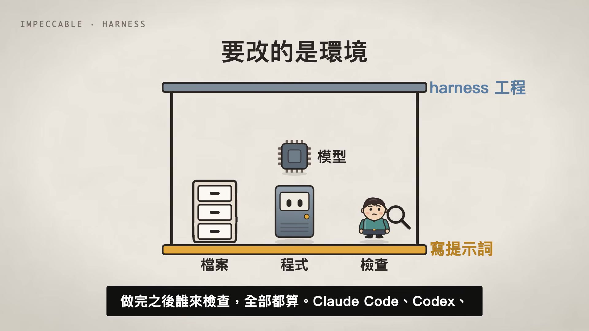

**逐字稿片段：** Cloud Code Codex Cursor這些寫程式的AI助手 就是各家做出來的Harness 一般人把skill當成一段包好的提示詞 他要你把skill當成改造那個工作環境的外掛 所以這支影片的主線是 規則寫再多 模型還是會回到平均值 要改的不是那段話 是他工作的環境

**話題推測：** 列舉Cloud Code、Codex、Cursor等寫程式的AI助手。

---

## 00:02:53

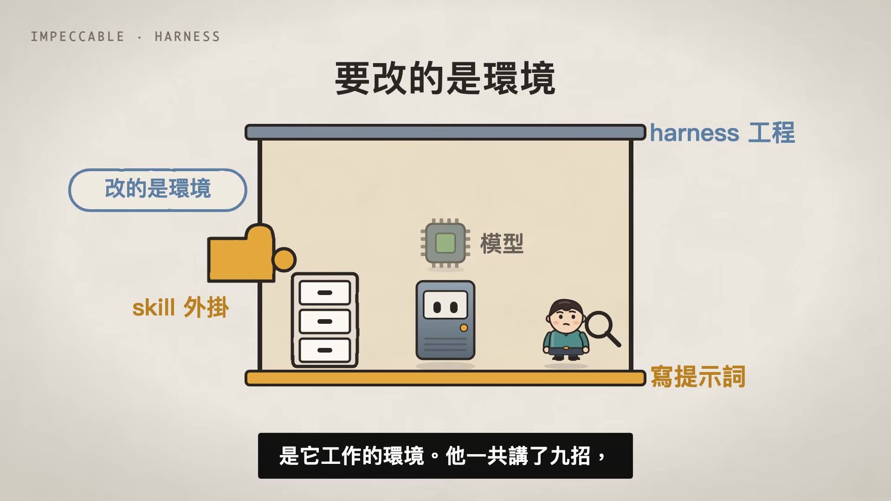

**逐字稿片段：** 他一共講了九招 每一招都在想辦法讓模型離開碗底 我們先看最基本的 誰來打分數 問題就出在打分數 你叫 Cloud Code 或 Codex 檢查 他剛做完的東西 他幾乎每次都說做得很好 But Cause 的比喻是 這就像自己改自己的考卷 模型剛寫完東西還在眼前 判斷會被那份作品拉住 這叫矛盾 你寫完一份報告 隔天再讀 錯字才會跳出來 因為隔了一段距離 模型沒有隔天 上一秒寫完 下一秒就要評

**話題推測：** 預告將介紹九種讓模型離開碗底的招數。

---

## 00:03:18

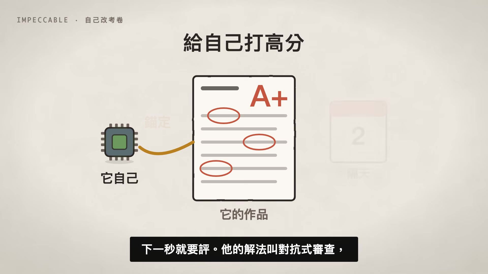

**逐字稿片段：** 他的解法叫對抗式審查 意思是不讓作者評自己 找另一個人來挑毛病 而且那個人 最好完全沒看過寫作的過程 寫程式的互相審查 治安檢查 幫幾個方案排名次 都是同一個坑 問題是模型要去哪裡找另一個人 他可以自己分身

**話題推測：** 提出「對抗式審查」作為解決模型自評偏誤的方法。

---

## 00:03:34

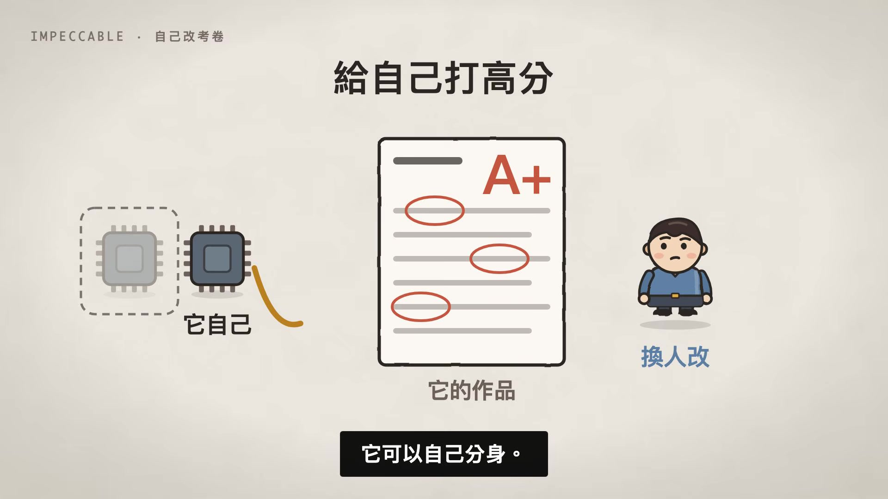

**逐字稿片段：** 這個分身叫子代理 英文是Subagent 他是主對話另外開出來的小幫手 從零開始 看不到你們前面聊過什麼

**話題推測：** 介紹「子代理」（Subagent）的概念，作為實現對抗式審查的工具。

---

## 00:03:41

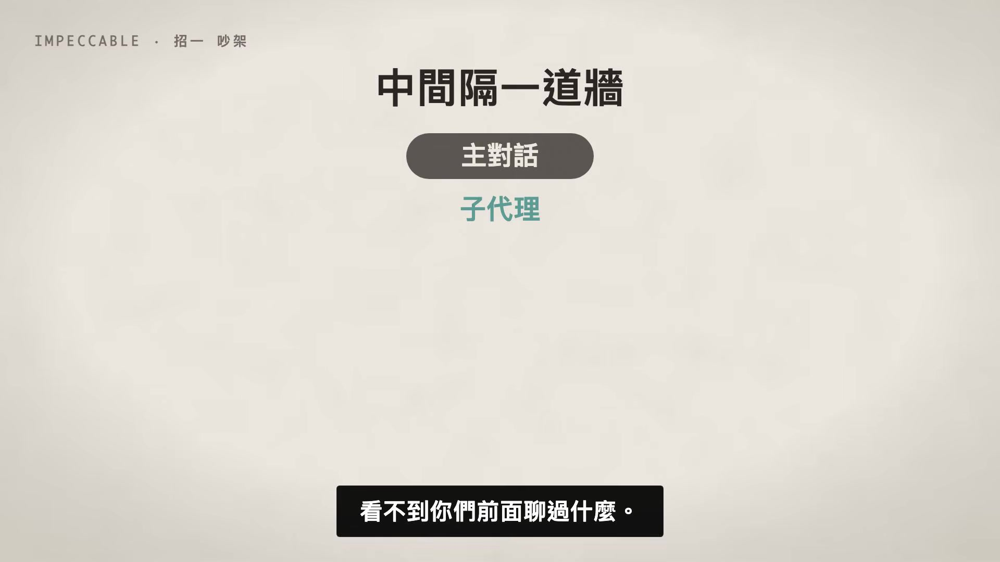

**逐字稿片段：** Impeccable的評論功能會開兩個子代理 一個辦設計總監 用眼睛看版面和AI位 另一個去跑檢查器 檢查器是一支照規則挑硬傷的程式 像對比不夠自行太多 為什麼兩個不能互相看

**話題推測：** 說明impeccable如何使用兩個子代理（設計總監和檢查器）進行評論，可能顯示流程圖。

---

## 00:03:54

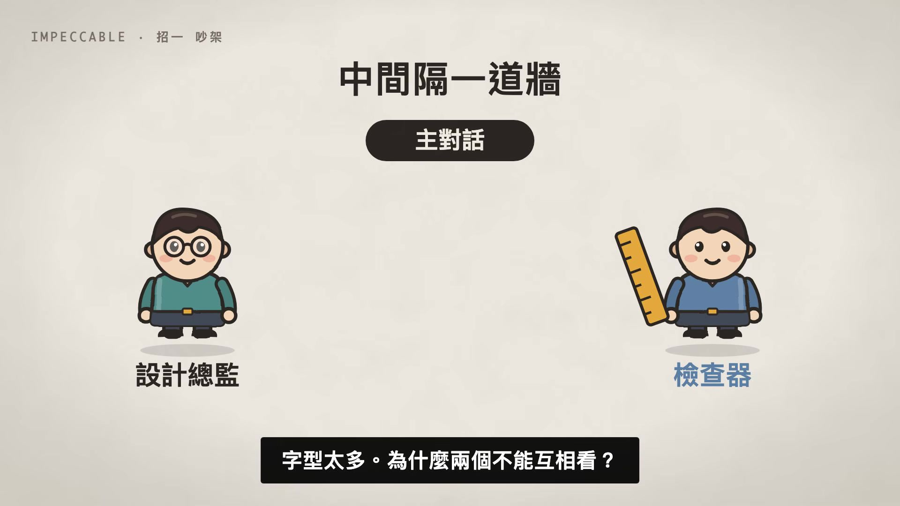

**逐字稿片段：** 他給了兩個相反的失敗 一頁很漂亮的網頁 檢查器挑出一大堆小問題 模型看到數字就說 這頁很爛 一頁幾乎空白的爛網頁 檢查器什麼都挑不出來 模型就說這頁很好 所以兩邊各自打分 中間隔一道牆 最後才交給組對話合併 原始碼裡連順序都寫死了 總監的意見先寫完 檢查器的數字才準進來 這招放到Codex上 一開始完全不動 Codex是OpenAI家的程式助手 Buckhouse 撞牆撞了很久 才發現Codex的權限規則不一樣 要使用者自己開口允許 他才能開子代理 麻煩的 還有第二件事 只要不開子代理沒有任何後果 Codex就會走比較輕鬆的那條路 自己一個人把評論做完 他沒有去求他 而是規定他 不能開子代理 就必須明白告訴使用者 你現在拿到的是降級版 他說Codex非常討厭承認這件事 現在的原始碼寫得更硬 只要兩個評審集在同一個對話裡跑 報告第一行就得印出降級的警告 依據他不想說出口的話 哇 比好生好氣了 拜託 還有用 打分數交出去之後 還有一件事也不能讓模型自己來 就是做選擇 我們回到那個碗 靜靜只能讓球滾到隔壁 他想讓球從碗外面出發

**話題推測：** 展示兩種子代理互相干擾的失敗案例，可能以並列圖示呈現。

---

## 00:04:58

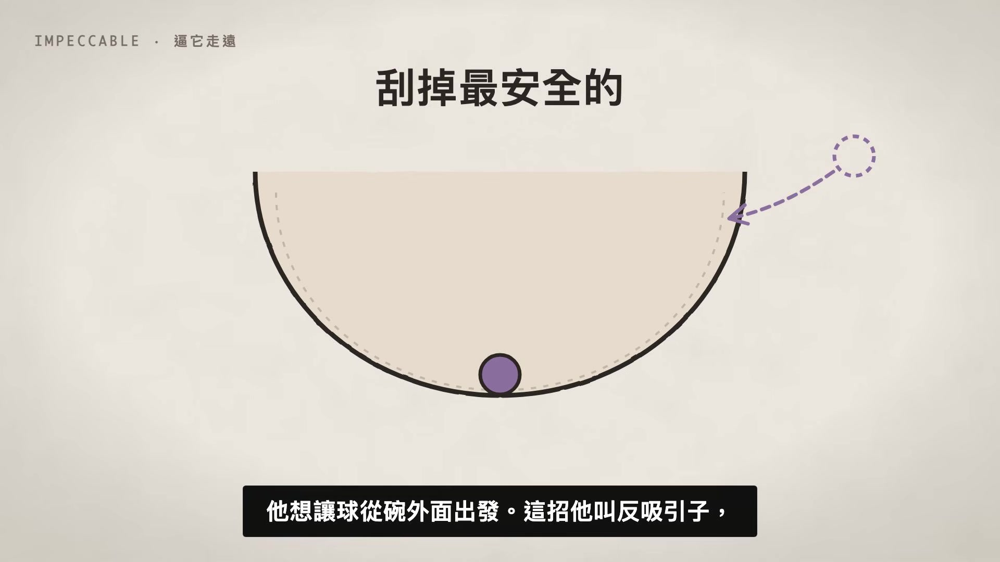

**逐字稿片段：** 這招他叫反吸引子 英文是Anti-Attractor 就是塞給模型一個他自己猜不到的起點 最簡單的做法 今天就能用 你先叫模型說出最想用的前三個字型 再叫他全部丟掉 最順手的答案被刮掉三層 他只好往遠處找 只是刮幾次後 又會慢慢收回來 第二種做法 用在他的Shader圖庫 Shader是網頁上會動的光影特效 他先丟一個怪題目

**話題推測：** 第二招：反吸引子（Anti-Attractor），介紹模型擺脫預設選擇的方法。

---

## 00:05:19

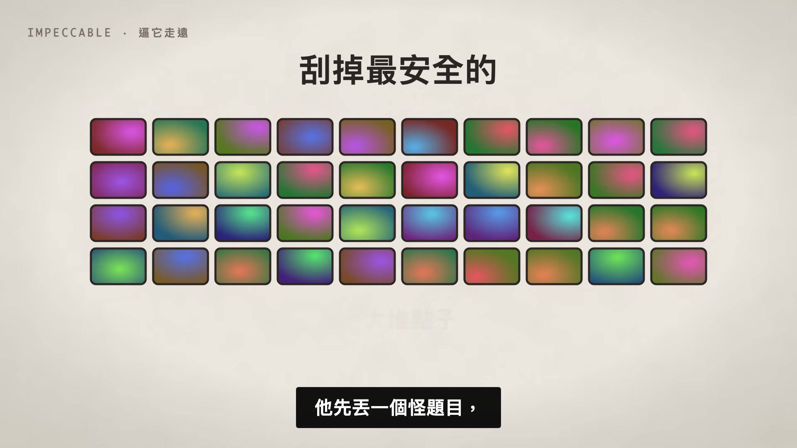

**逐字稿片段：** Rihanna做成Shader會長什麼樣子 讓模型一口氣生一大堆 再開一個沒看過前面對話的子代理來排名 排名的人如果看過前面的討論 又會偏心自己想出來的那幾個 第三種做法最徹底

**話題推測：** 以「Rihanna做成Shader會長什麼樣子」為例，可能展示抽象或意象圖。

---

## 00:05:30

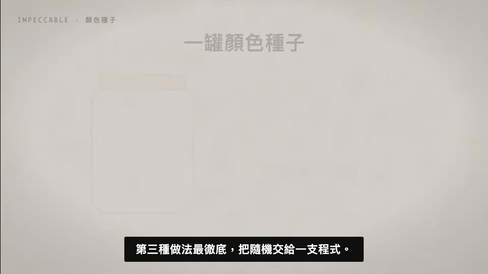

**逐字稿片段：** 把隨機交給一支程式 模型嘴上說隨機 其實他每次想到的隨機都差不多 所以Impeccable開心專案時會先跑一支腳本 腳本就是一小段會自己執行的程式

**話題推測：** 介紹反吸引子的第三種做法，將隨機性交給外部程式（腳本）。

---

## 00:05:39

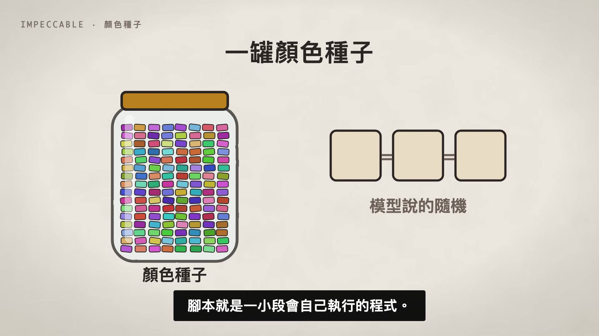

**逐字稿片段：** 他在臺上說這支叫Color.js 裡面是一整罐他親手挑的主色 現在改成了另一套引擎裡的配色表 每個顏色都配一句小情境 像是米蘭酒吧裡喝Nicrony的時刻 腳本抽一個出來 模型就繞著那個顏色配整套色 新版本走得更遠

**話題推測：** 提到「Color.js」這個腳本名稱，可能顯示程式碼片段或介面。

---

## 00:05:54

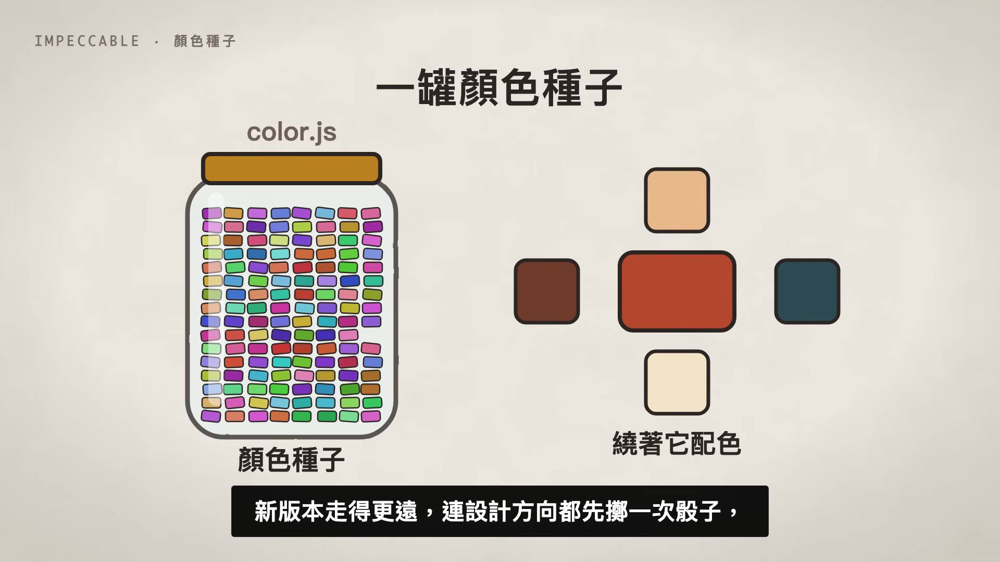

**逐字稿片段：** 連設計方向都先字一次骰子 原始碼寫得很白 還沒字骰就先寫畫面 算違約 他說 我不想要整個網路長得都一樣 一個預設值曾經把網路染成紫色 他的做法是發給每個人不同的起點 評分和選擇都交出去了 下一組問題是

**話題推測：** 展示impeccable新版本中設計方向也隨機骰選的功能，可能顯示UI或骰子圖示。

---

## 00:06:09

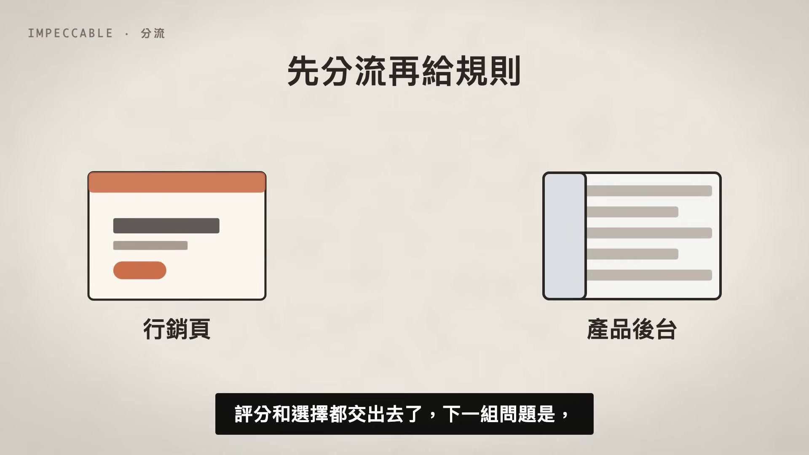

**逐字稿片段：** 規則放在哪裡 一隻Skill越塞越多 規則就開始互相打架 官方舊版寫著避免系統自行 也就是手機和電腦內建的那種字 這條放在行銷業是對的 放在產品後臺就是錯的 後臺就是要向系統原生 你在檔案裡寫一大堆 如果這樣就那樣又長又亂 效果也不好 他借了一個名詞叫混合專家 英文是mixture of experts 意思是先判斷這一題 該交給哪一位專家 所以impeccable的主檔很短 你下什麼指令 他才載入那一份說明 他也會先看你做的是 吸引目光的品牌業 還是每天要用的產品界面 兩套規則分開放 他在臺上講的是兩種

**話題推測：** 第三招：規則放在哪裡，討論規則的組織與擺放位置。

---

## 00:06:43

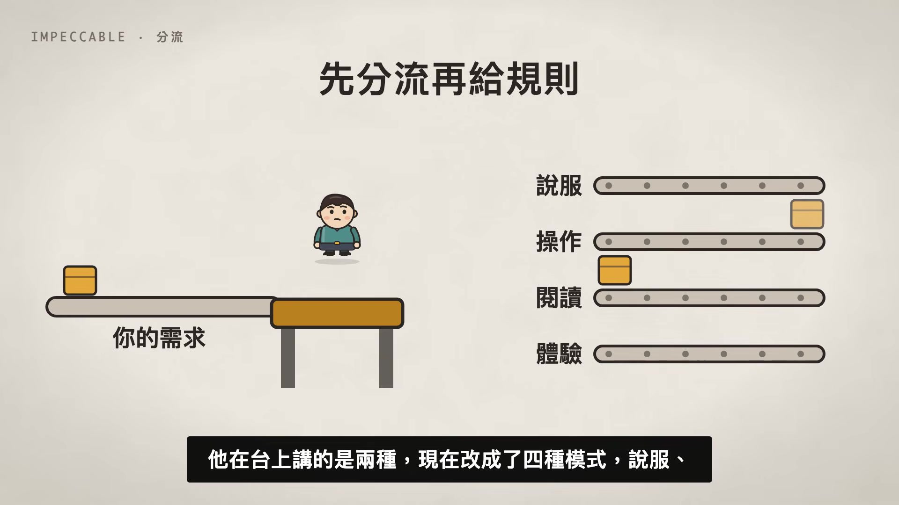

**逐字稿片段：** 現在改成了四種模式 說服 操作 閱讀 體驗 同一家公司 官網和說明文件 走的是不同的輸送帶 放對地方還有另一層意思 Buckhouse說 埋在長文件裡的規則

**話題推測：** 提及現在有四種模式（說服、操作、閱讀、體驗），可能列出清單。

---

## 00:06:54

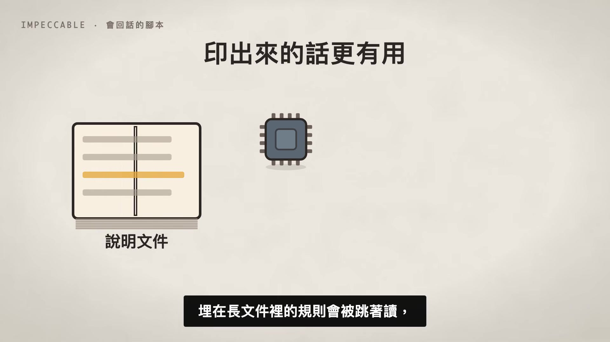

**逐字稿片段：** 會被跳著讀 他點名GBT-5 mini 這類比較弱的模型 尤其明顯 他還發現一件怪事 同一句指令 寫在說明文件裡 常常被略過 從一支腳本的輸出講出來 模型就照做

**話題推測：** 點名GBT-5 mini這類模型容易跳讀長文件，可能顯示模型名稱或圖示。

---

## 00:07:04

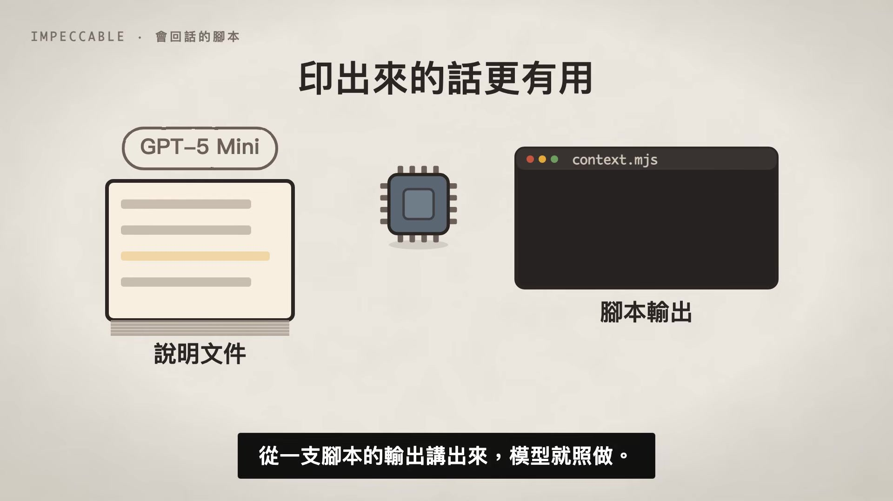

**逐字稿片段：** 這個輸出叫Standard Out 中文叫標準輸出 就是程式跑完 印在畫面上的那幾行字 impeccable每次都先跑一支腳本 把產品說明和設計說明拼好丟進對話 找不到產品說明 腳本就直接說 你沒有這份檔案 接下來要這樣做 它臺上講的是context.mjs 現在改成了impeccable context這個指令

**話題推測：** 介紹「標準輸出」（Standard Out）的概念，說明如何確保規則被模型讀取。

---

## 00:07:23

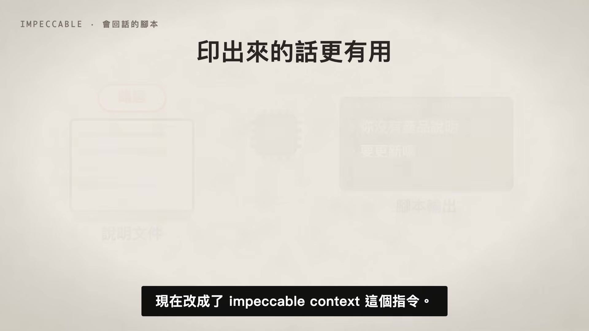

**逐字稿片段：** 代價是提示快取 英文是prompt cash 意思是送出的內容 前面一樣 那一段就不用重算 收費也比較便宜 腳本每次吐的都不一樣 那一段就吃不到快取 一來一回的互動使用 值得 要自動跑很多次 就變成一筆賬單

**話題推測：** 介紹「提示快取」（prompt cache）技術，討論其優點與代價。

---

## 00:07:38

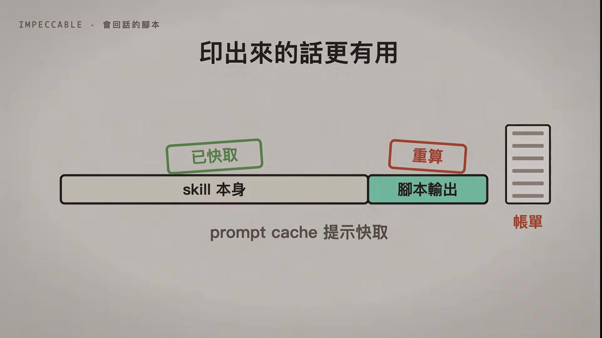

**逐字稿片段：** 規則放對地方 還有一個常被忘記的維度就是時間 skill預設沒有長期記憶 每一次叫他 他都從零開始 impeccable的做法很樸素

**話題推測：** 第四招：時間維度，討論讓模型擁有長期記憶的方法。

---

## 00:07:46

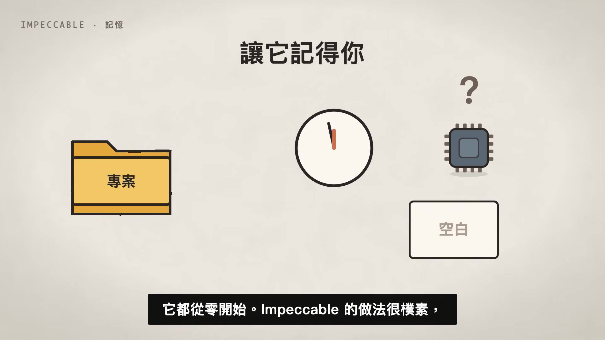

**逐字稿片段：** 在你的專案裡開一個叫impeccable的隱藏資料夾 每次做完設計評論 就把結果存成檔案 下次你叫他把頁面修得更精緻 就算是另一個對話 他也會先把之前的評論讀回來 你在某次評論裡說 這條我不同意 我就是喜歡這個字型 他會記下來 下次自動跳過

**話題推測：** 說明impeccable如何建立隱藏資料夾儲存評論結果，可能顯示檔案結構圖示。

---

## 00:08:02

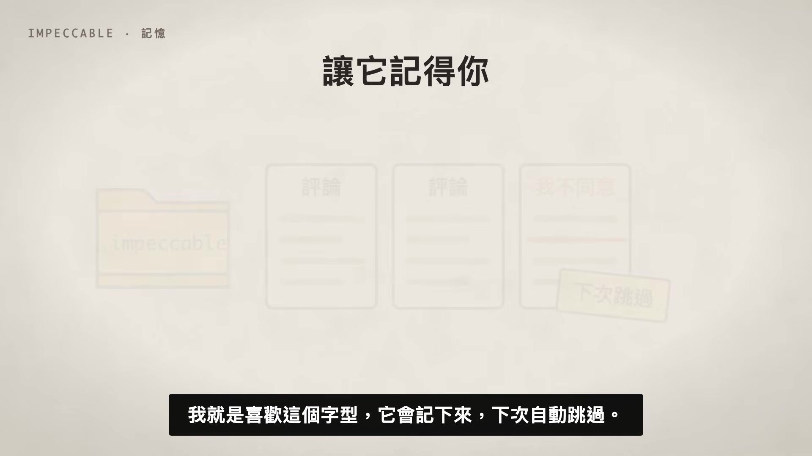

**逐字稿片段：** 他把這叫做複利工程 每一次執行都幫下一次加一點分 他自己重構程式也這樣用 重構就是功能不變 把程式整理乾淨 讓他一天處理一個檔案 一個對話接一個對話 一直累積到整個專案做完 前面這些招數都有一個前提 模型要記得去叫impeccable 可是模型常常忘記呼叫你在寫網頁 他根本沒想到設計規則 所以下一組問題是 怎麼讓他不用記得

**話題推測：** 介紹「複利工程」這個概念，說明每次執行如何累積成效。

---

## 00:08:24

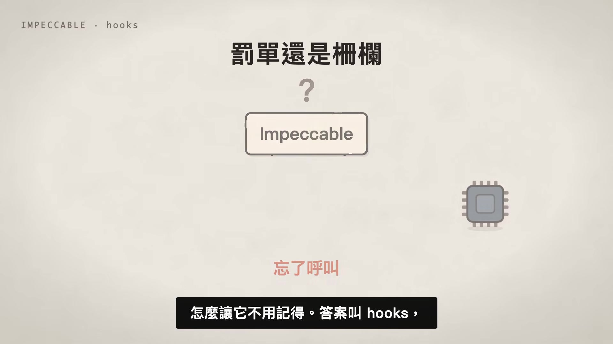

**逐字稿片段：** 答案叫hooks 中文可以叫掛鉤 它是harness 在固定時間點自動執行的小程式 例如每改原一個檔案就跑一次 impeccable 就在幾家程式住所裡掛上檢查器 每一次編輯都跑 掛法有兩種 一種是改原之後提醒 像開罰單車已經開過去了 聰明的模型收到罰單會自己回頭改 另一種是改之前直接擋下 像柵欄放下檔案根本寫不進去 比較弱的模型他就用柵欄 他的說法是 不用人記得的護欄 勝過一個沒人記得要跑的指令 他舉了一個例子

**話題推測：** 第五招：Hooks（掛鉤），介紹讓模型無需記憶也能自動執行規則的方法。

---

## 00:08:53

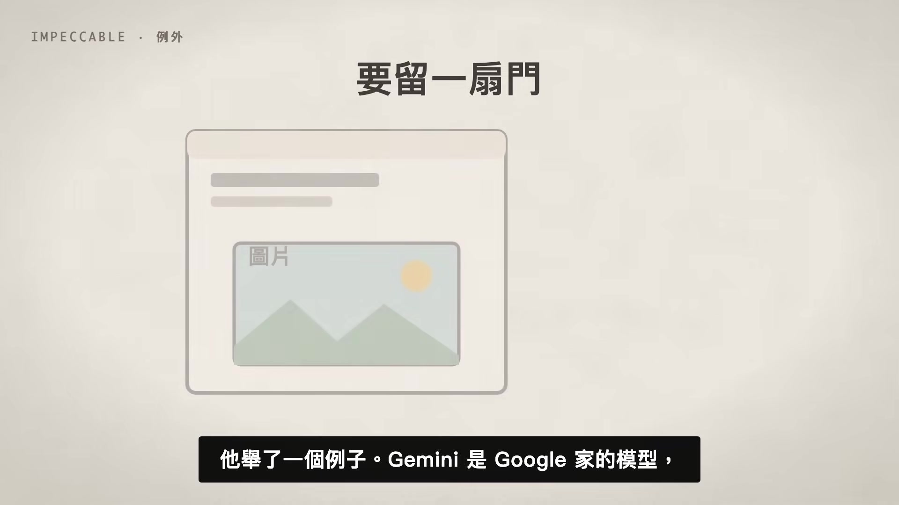

**逐字稿片段：** Gemina也是Google家的模型 他特別喜歡讓每一張圖片 在滑鼠移上去時放大一下 不管適不適合 掛鉤抓到這一行 安靜地提醒 模型自己就改掉了 使用者什麼都沒做 這是罰單有效的時候 可是他馬上補了一句

**話題推測：** 舉例說明Gemina模型喜歡圖片放大效果的習慣，可能顯示放大效果的網頁範例。

---

## 00:09:07

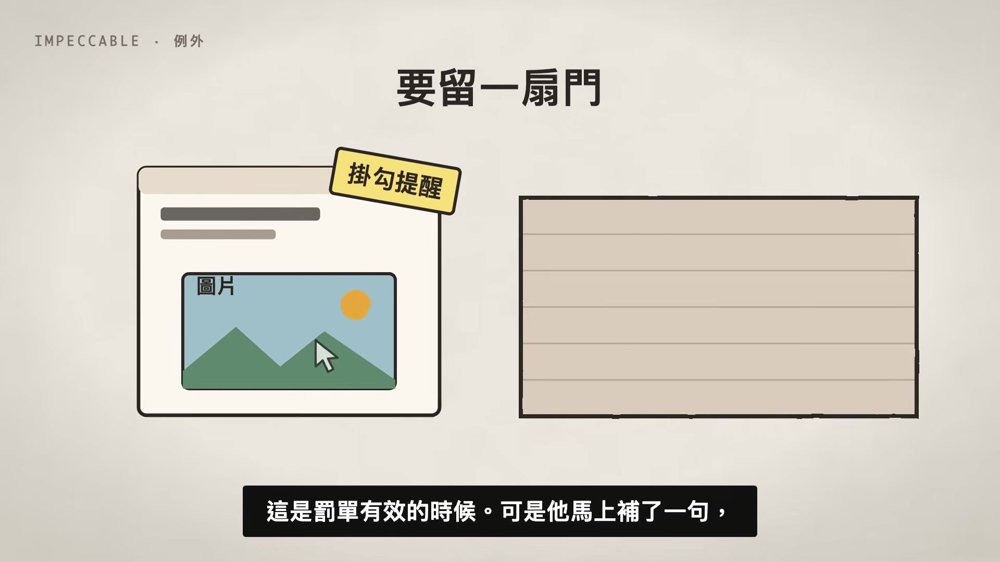

**逐字稿片段：** 一定要給例外 檢查器會誤判 有時候那個放大就是你要的 使用者如果關不掉 這個掛鉤很快就會被整個移除 所以impeccable的例外 可以寬可以窄 只放過一個數值 放過一個檔案 或者整條規則都不查 原始碼還加了一條限制 模型自己只准開最窄的那種 比較寬的 必須先問使用者 會擋人的東西 要留意一下使用者自己開的門 掛鉤是借用harness的一個能力 把Kaos接著問得更大 這個環境裡還有什麼可以借 他說你沒辦法在聊天框裡挑像素 Codex的桌面板內建的瀏覽器

**話題推測：** 強調掛鉤機制必須提供「例外」選項的重要性。

---

## 00:09:37

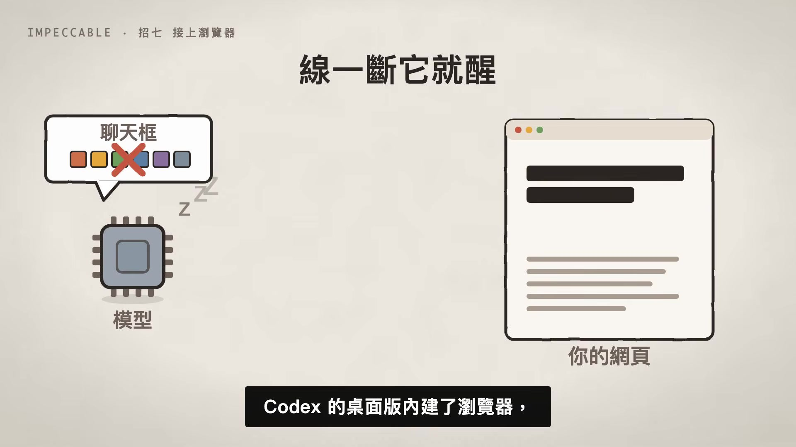

**逐字稿片段：** 他就讓Skill先開一個小小的伺服器 在你的網頁裡塞一段程式 你在網頁上點一個標題 按下Go 訊號送回那個伺服器 接著是最巧妙的一步 伺服器自己結束 它結束時會印出一行字 你還記得標準輸出嗎 就是那行字 把正在等的模型叫醒 模型就幫那個標題生出三個版本 網頁上直接換 喜歡就按Accept 他自己的評價很誠實 說這是一場侏羅紀公園式的實驗 做得出來 但問題很多 應該由Harness官方自己內建 到這裡這隻Skill 在他自己的電腦上已經很好用了 可是工程師都知道一句話 在我電腦上是好的 分享給別人才是麻煩的開始

**話題推測：** 介紹impeccable如何利用伺服器與Standard Out實現網頁互動選擇，可能顯示技術架構圖。

---

## 00:10:12

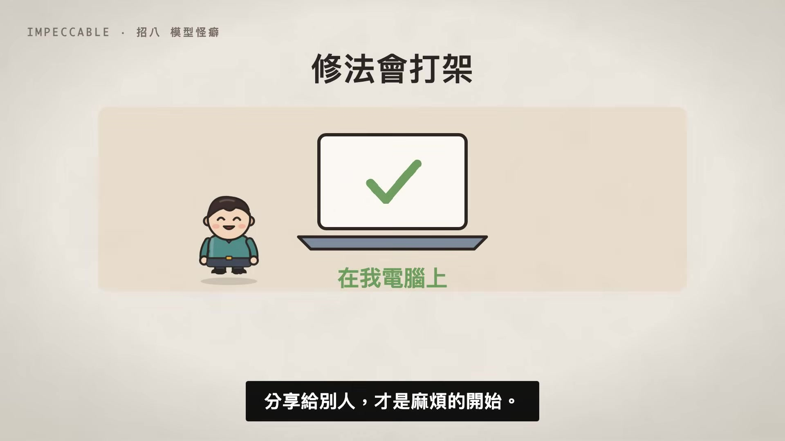

**逐字稿片段：** 他放了一張通緝海報 上面是各家模型改不掉的習慣 Jemmy Nye愛讓圖片放大 Codex愛把字句說得很怪 愛把每個角修得超遠 還愛像髮絲一樣細的邊框

**話題推測：** 展示一張「通緝海報」圖，列出各家模型改不掉的習慣。

---

## 00:10:22

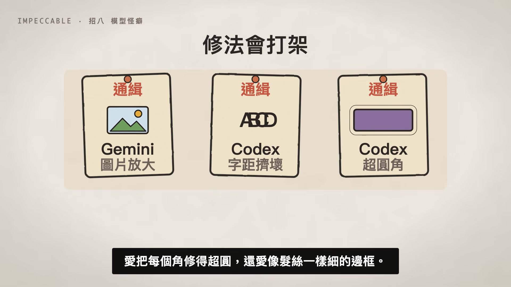

**逐字稿片段：** 他說這叫過擬合 英文是overfitted 意思是模型在訓練時 學出了自己的偏好 而且每個模型偏的方向都不一樣 更麻煩的是修法會互相打架 你叫Cloud去不要說那麼多 他會往反方向說過頭 所以給所有模型的提醒 沒辦法寫在同一份檔案裡給Codex的提醒 Cloud讀了反而會出錯 模型不一樣 Hannes也不一樣 同樣是開子代理 Cloud Code可以直接開 Codex要使用者點頭 Cursor多半由模型自己決定 還有那種跳出選單問你問題的工具 Codex只在計劃模式才能用 平常他就不問 自己猜 所以Impeccability 每一個Harness 每一個模型各做一個版本

**話題推測：** 介紹「過擬合」（overfitted）這個詞彙，解釋模型產生特定偏好的原因。

---

## 00:10:59

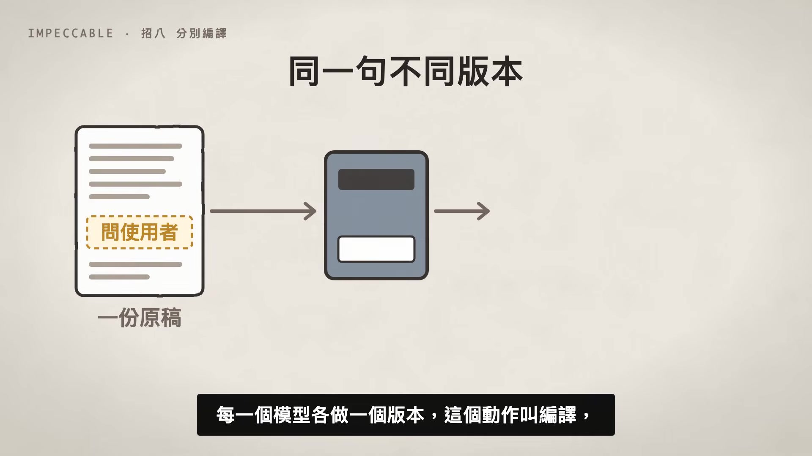

**逐字稿片段：** 這個動作叫編譯 意思是 同一份原稿 照不同的對象 產生不同的成品 原始碼裡有一種空格 寫的是問使用者問題 編給Crawlcode 就變成停下來呼叫那個選單工具 編給Cursor 就變成直接開口問 他還自己寫了安裝程式 因為一般的安裝工具 只會把同一份複製到所有地方 這很累 可是他說值得 最後一招

**話題推測：** 第六招：編譯，說明如何為不同模型和Harness生成不同版本。

---

## 00:11:19

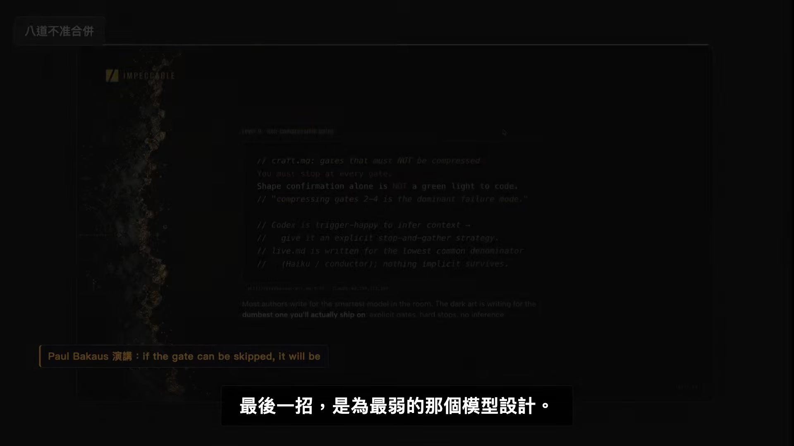

**逐字稿片段：** 是為最座的那個模型設計 Skill分享出去 你不知道對面跑的是哪個模型 只能照最不守規矩的那一個來寫 把Cause的觀察是 弱一點的模型 一樣有組件 他缺的是 照你規矩做事的紀律 他還發現GPT系列

**話題推測：** 第七招：為最弱的模型設計，說明設計Skill時應考量的模型差異。

---

## 00:11:32

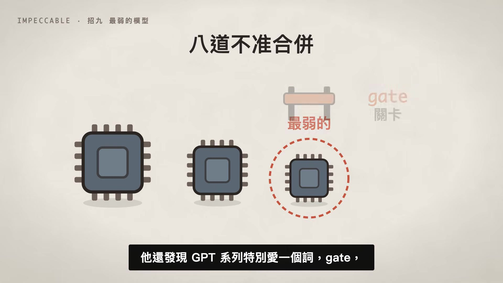

**逐字稿片段：** 特別愛一個詞 Gate 中文是關卡 你問他為什麼沒照做 他會說 我們需要一道關卡 那他就給他關卡 他說他替Codex

**話題推測：** 介紹GPT系列模型特別喜歡的詞彙：「Gate」（關卡）。

---

## 00:11:39

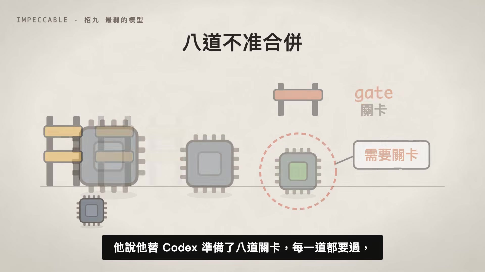

**逐字稿片段：** 準備了八道關卡 每一道都要過 不準合併 因為模型很愛壓縮指令 做完其中幾道就說好了 所以每過一道 都要把結果寫下來 這八道關卡的原始檔 在今天的公開原始碼裡找不到 這段只能照他臺上說的 你還記得柵欄嗎? 關卡 就是一整排柵欄 每一道都要蓋章才能過 他說 模型只要能從困難裡溜出去 就一定會溜 九招講員你一定想問

**話題推測：** 提到為Codex設計的「八道關卡」，可能顯示流程圖或關卡列表。

---

## 00:12:01

**逐字稿片段：** 他怎麼知道這些招數真的有用 問答是真的有人問了

**話題推測：** 轉向討論如何驗證這些招數的有效性。

---

## 00:12:04

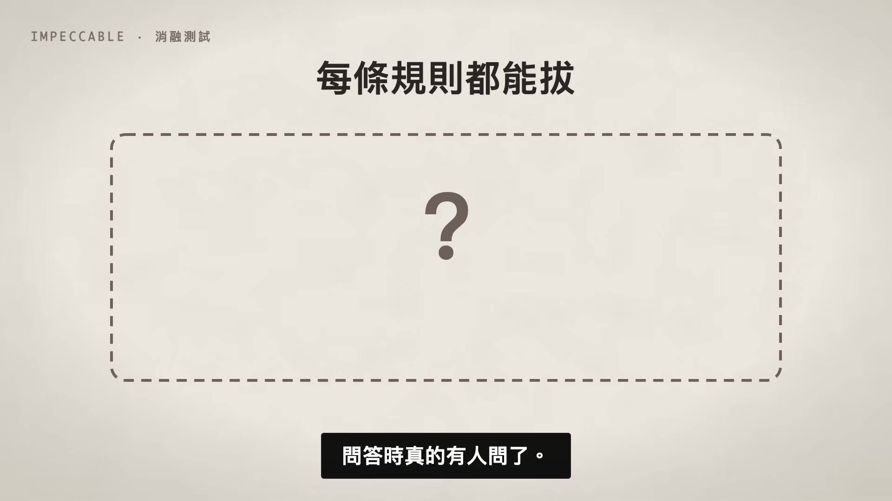

**逐字稿片段：** 他說他寫了一套自己的評測環境 目前還沒公開 他把幾家助手的工作環境重建一遍 找一個模型扮演使用者 再請一組會看畫面的裁判打分 他會跟官方那支skill對打

**話題推測：** 介紹Paul Barkhouse自行建立的評測環境。

---

## 00:12:14

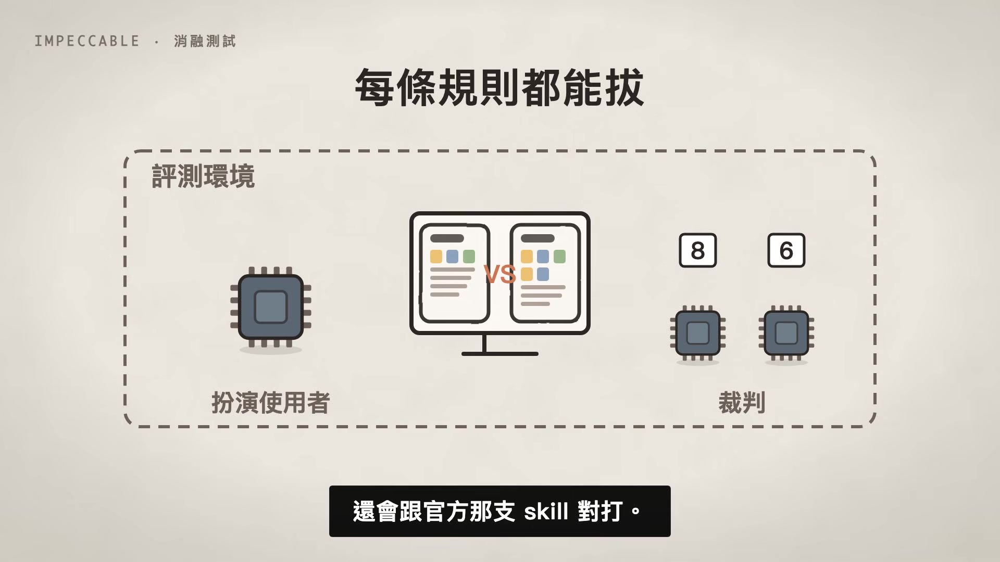

**逐字稿片段：** 最花錢的是消融測試 英文是ablation 意思是一次拿掉一條規則 其他都不動 再全部跑一次 看結果有沒有變 沒有變 那條規則就是白寫的 所以原始媽咪每一條規則都掛了專屬編號 我去數了一下

**話題推測：** 介紹「消融測試」（ablation test）這個驗證規則有效性的方法。

---

## 00:12:26

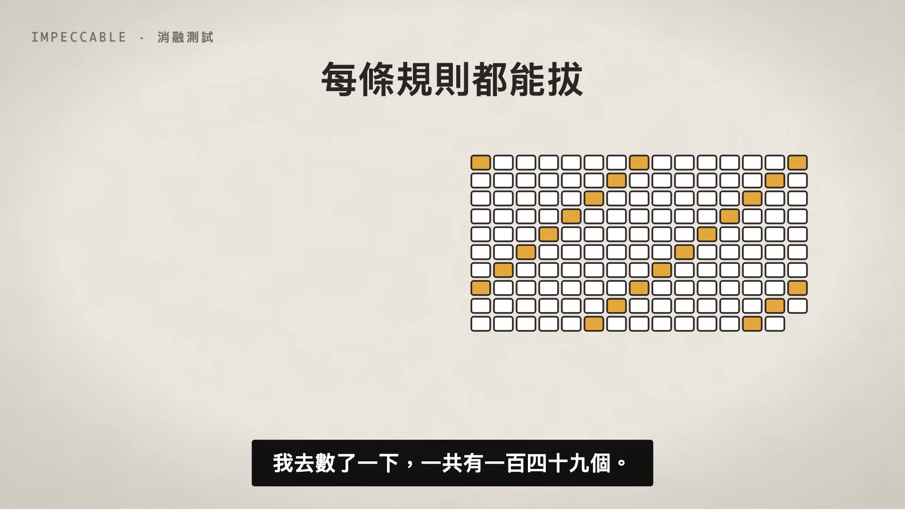

**逐字稿片段：** 一共有149個 他的起點是官方那份55行的說明 現在變成一條一條都能拿掉測試的規則 他說每一行都做過消融測試 這是他的說法 測試環境本身沒有公開 那品位呢

**話題推測：** 提及目前共有149條規則，每條都經過測試，可能顯示數字或列表。

---

## 00:12:38

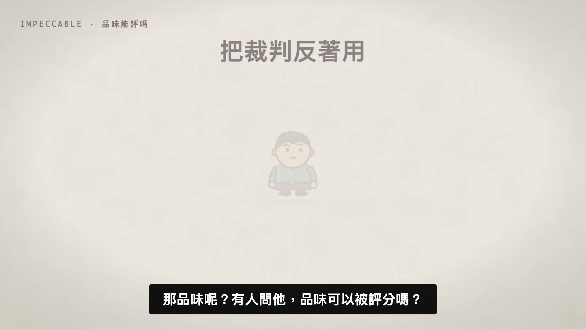

**逐字稿片段：** 有人問他品位可以被評分嗎 他的回答跟你想的不一樣 他說不行 品位是稀少的 每個人都用同一種 他就不再是品位了 他還發現模型當裁判也會偏心

**話題推測：** 探討「品味」是否能被評分，並提及模型作為裁判的偏心問題。

---

## 00:12:47

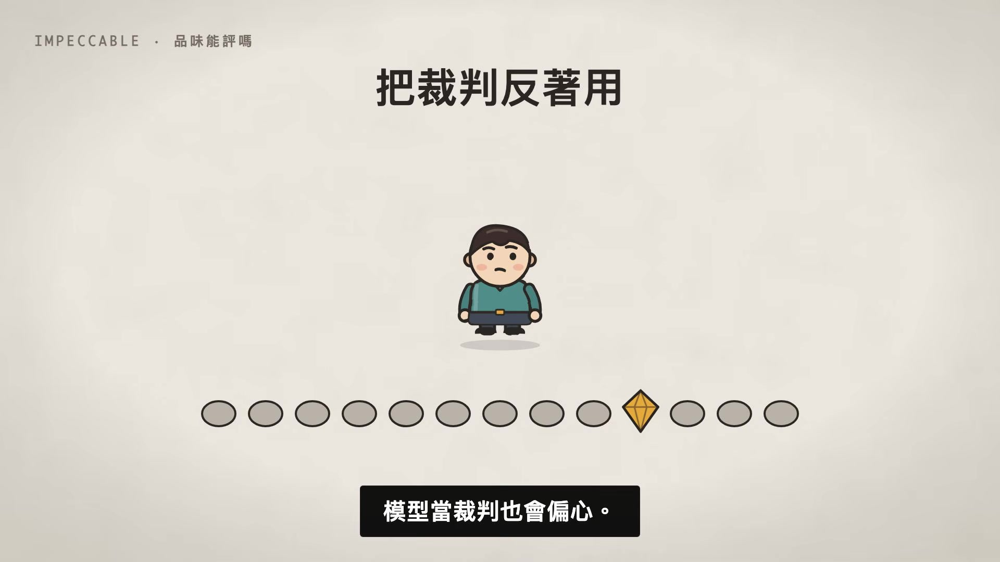

**逐字稿片段：** 他用Gemini評網頁打開的第一個畫面 結果畫面塞得越滿分數越高 所以他有些裁判是反著用的 分數越高他越懷疑 你看就算請別人來改考卷 那個別人也有自己的偏見 他說他的評測之筆亂猜好一點點 夠做第一輪篩選 剩下的還是靠他自己的眼睛 他在常問裡寫過 品位可以被放大 但不能在實驗室裡種出來 他也說大多數skill應該由使用者自己寫 要分享出去的 的花筆現在多很多的功夫 他寧願數量少一點 但每一隻都真的測過

**話題推測：** 提及Gemini模型在評估網頁時的偏好，可能顯示評分圖表或範例。

---

## 00:13:16

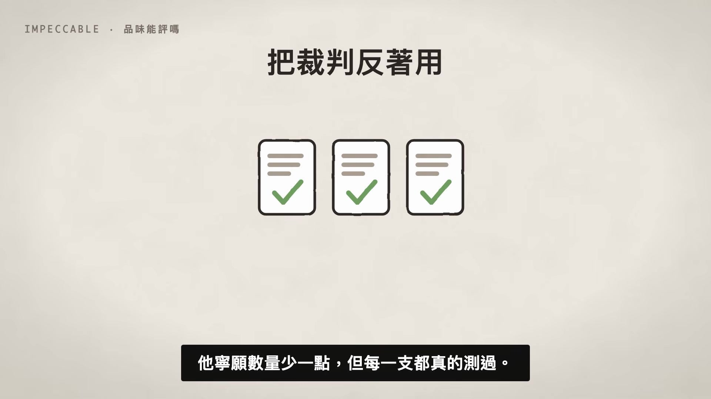

**逐字稿片段：** 我們回到開場那個問題 規則明明寫得清清楚楚 為什麼AI做出來的網頁 還是長得都一樣 把cause的九招給的是同一個答案 評分交給互相看不到的分身 起點交給一隻會制骰子的腳本 規則放在會被照做的位置 檢查交給不用人記得的掛鉤 最後再調一條拿掉 確認每一條都有用 他沒有一招是把那段話寫得更漂亮 他改的全是模型工作的環境 他在臺上留下一句話 能被跳過的關卡一定會被跳過 最後問你一個問題 你用AI做東西的時候 有沒有 哪一條規則你講了好幾次 它就是一直跳過 留言告訴我 喜歡這種把工程細節講清楚的內容 也可以訂閱AINOPL開啟通知 我是Jim 我們下次見

**話題推測：** 回顧影片開場提出的核心問題，總結九招的共通解決思路。

---
