# jimainotebook_GVhMPUGg2SU — 關鍵畫面索引

- 來源逐字稿：[jimainotebook_GVhMPUGg2SU_FIN.srt](jimainotebook_GVhMPUGg2SU_FIN.srt)
- 影片：https://www.youtube.com/watch?v=GVhMPUGg2SU
- 截圖數：51

## 00:00:15

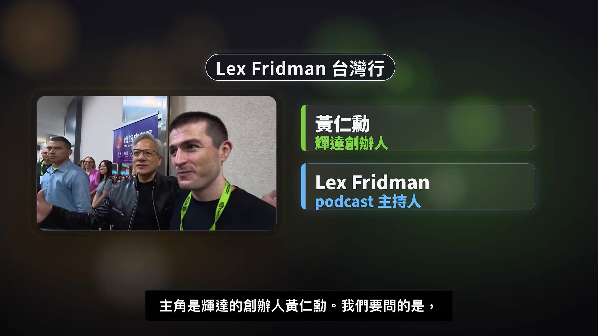

**逐字稿片段：** 為什麼全世界的AI都離不開臺灣?今年5月底到6月初, 美國的Podcast主持人Lex Friedman第一次來臺灣, 跟著黃仁勛走了好幾天, 逛電腦展、逛夜市、吃早餐, 一路聊天, 臺灣大半是山,

**話題推測：** 提出本集影片的核心問題「為什麼全世界的AI都離不開臺灣？」，可能搭配主題標題畫面。

---

## 00:00:27

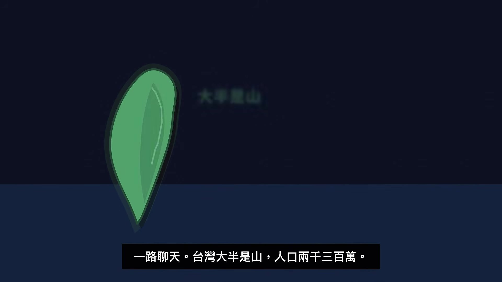

**逐字稿片段：** 人口2300萬, 可是根據美國半導體產業協會跟顧問公司BCG在2019年的估計, 全世界10奈米以下最先進的晶片產能,

**話題推測：** 提及臺灣人口2300萬，可能搭配相關統計圖表或地理資訊。

---

## 00:00:36

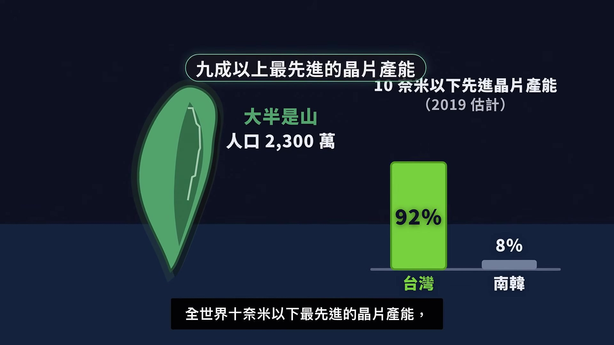

**逐字稿片段：** 9成以上在臺灣, 輝達是誰? GPU也是在臺灣做出來的 黃仁勳在臺南出生 9歲去了美國 長大以後因為晶片又回到臺灣 這幾天他講了很多故事

**話題推測：** 展示臺灣在全球10奈米以下最先進晶片產能的佔比（9成以上），可能搭配圓餅圖或柱狀圖。

---

## 00:00:46

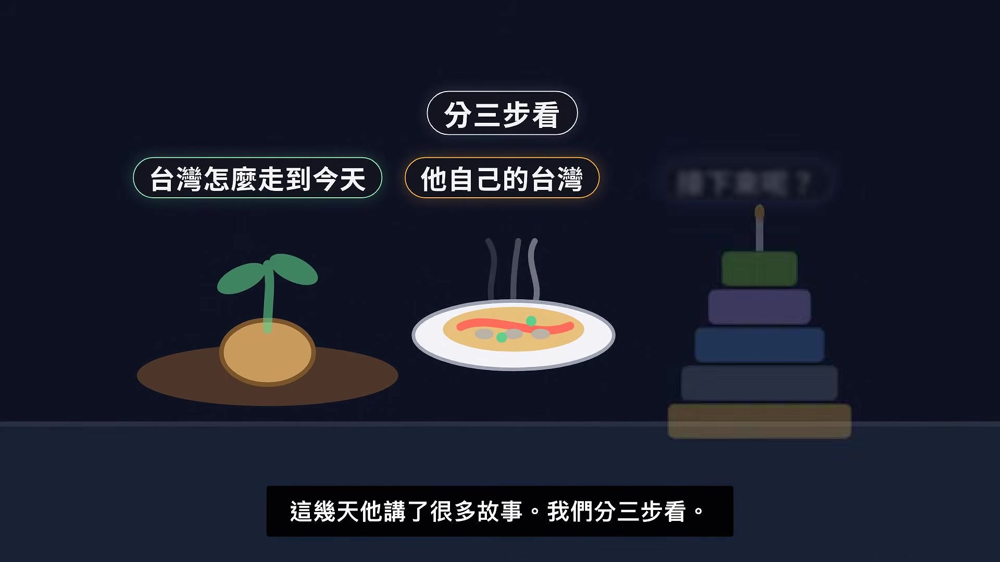

**逐字稿片段：** 我們分三部看 先看臺灣怎麼走到今天 再看他自己跟臺灣的故事 最後看為什麼偏偏是臺灣 接下來又會怎樣

**話題推測：** 介紹影片內容將分「三部」看，可能展示分段標題或摘要。

---

## 00:00:52

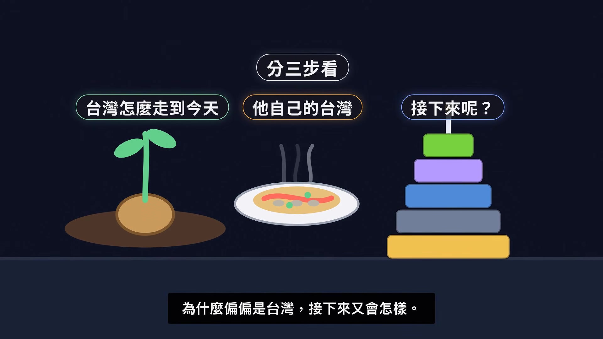

**逐字稿片段：** 先從電腦展說起 臺北國際電腦展 英文叫Computex 每年在臺北的南港展覽館 全世界做電腦的公司都會來 今年黃仁勳走到哪裡 人群就跟到哪裡 Lex說 他就像60年代的PTOS 黃仁勳馬上接一句 可是Pedos是真的有才華 他帶Lex 看灰達新一代的機軌

**話題推測：** 轉入第一個故事環節「電腦展」，可能切換到Computex相關的畫面或影片。

---

## 00:01:09

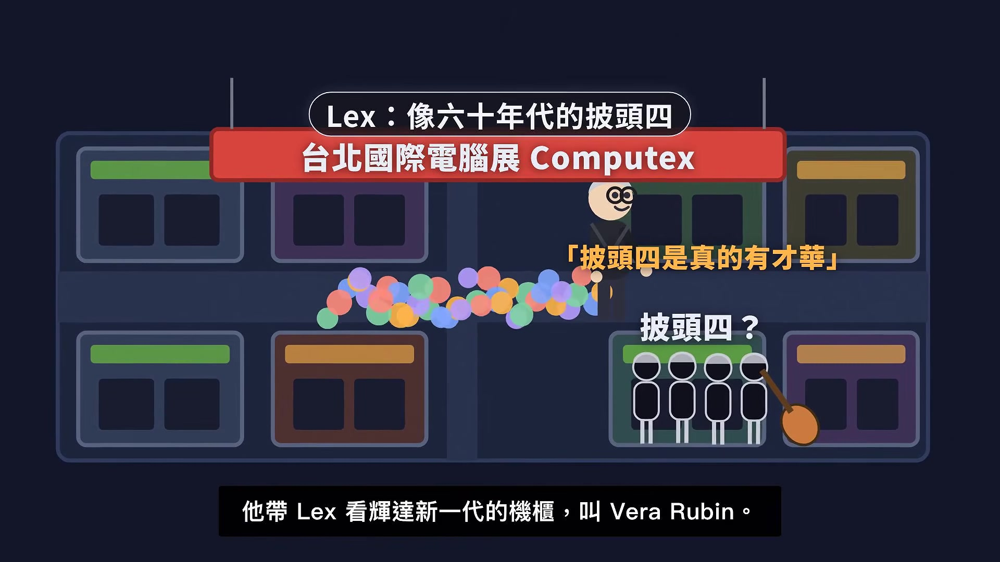

**逐字稿片段：** 叫Villa Rubin 黃仁勳說 上一代只有八成靠液體散熱

**話題推測：** 介紹輝達新一代的機櫃產品「Villa Rubin」，可能展示產品圖片或介紹簡報。

---

## 00:01:14

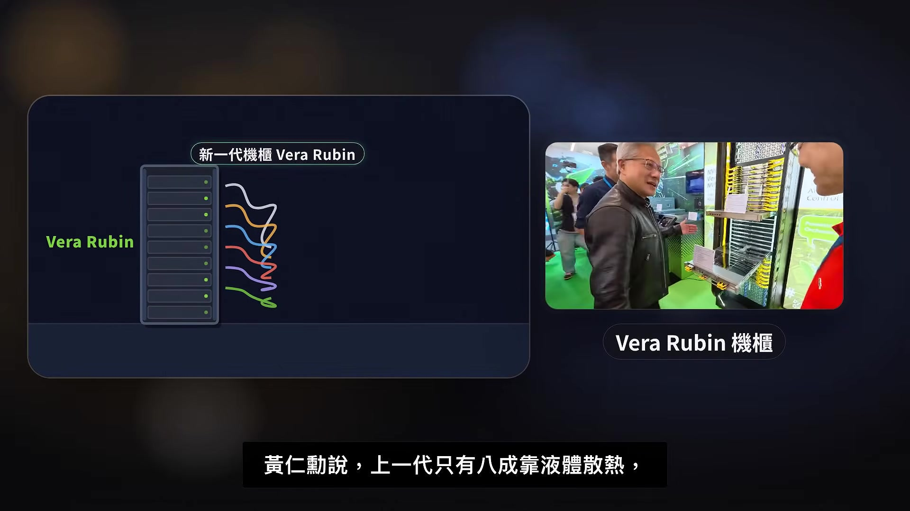

**逐字稿片段：** 這一代百分之百都是液冷 裡面看不到一條排線 以前組裝一臺要兩個小時

**話題推測：** 比較新舊產品的散熱技術，提及「百分之百液冷」，可能搭配產品技術規格對比圖。

---

## 00:01:18

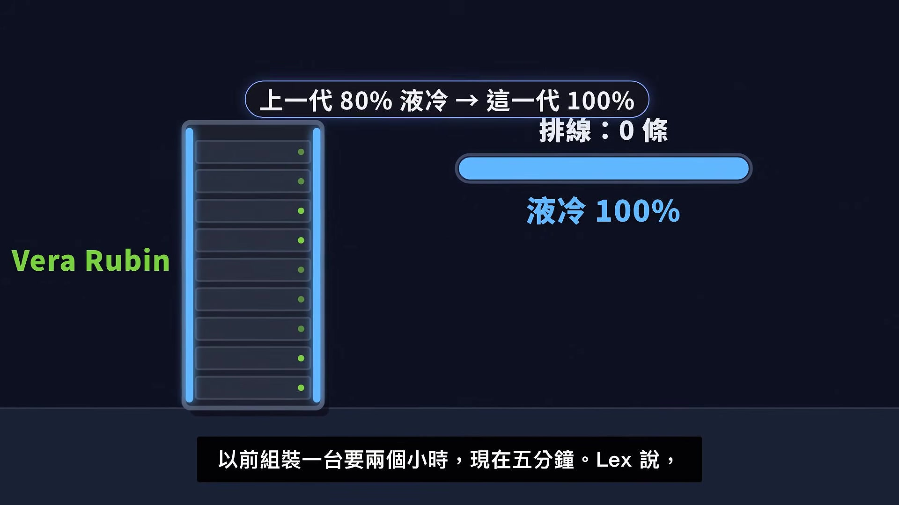

**逐字稿片段：** 現在五分鐘 Lex說 看到一個工程師被當成搖滾明星 他很感動 因為世界是工程師蓋出來的 有一天 排隊等他的人有好幾千個 連他自己都認住了 聽他怎麼說 我的心跳了,我根本沒想到要做什麼 我根本沒想到要做什麼,我的心跳了 電腦展開幕前一天

**話題推測：** 展示產品組裝效率的顯著提升，從「兩個小時到五分鐘」，可能搭配流程對比或時間軸。

---

## 00:01:43

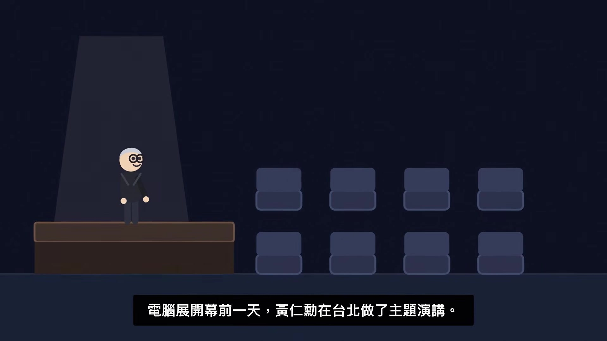

**逐字稿片段：** 黃仁勳在臺北做了主題演講 Lex問他 全世界都在看 會緊張嗎 他說 超級緊張,而且每一次公開演講都緊張 因為所有東西都是最後一刻才湊齊 根本沒辦法排練 臺上也沒有提示機 他自己都不知道會講出哪些字 那他為什麼這麼在意這場演講 因為臺下做的是一整個產業 他說接下來幾年 輝達要做出

**話題推測：** 提及黃仁勳在電腦展前的主題演講，可能播放演講片段。

---

## 00:02:01

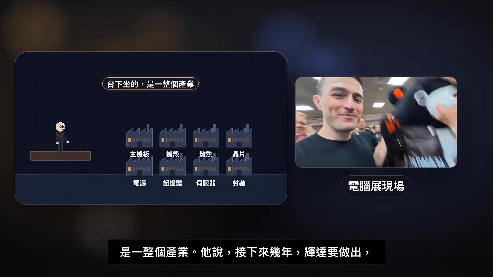

**逐字稿片段：** 也要賣出好幾兆美元的運算設備 臺下這些臺灣公司

**話題推測：** 提及輝達未來幾年將賣出「好幾兆美元」的運算設備，可能展示銷售目標或市場規模預測圖。

---

## 00:02:05

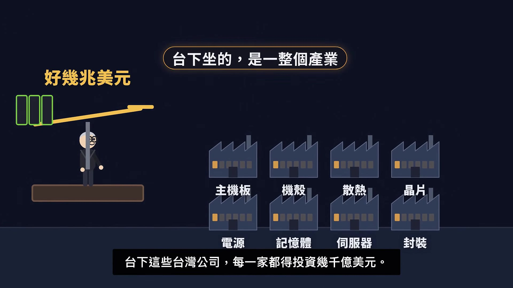

**逐字稿片段：** 每一家都得投資幾千億美元 他們要先聽懂 被打動 才會想一起做 聽他怎麼說 整座島都要一起來 可是為什麼是這座島 Lex在車上問了這個問題 他發現 從晶片 記憶體 主機板 到伺服器 硬體這一層 有一大堆很厲害的公司

**話題推測：** 強調臺灣公司預計投入「幾千億美元」資金，可能以數字或圖表呈現產業投資規模。

---

## 00:02:36

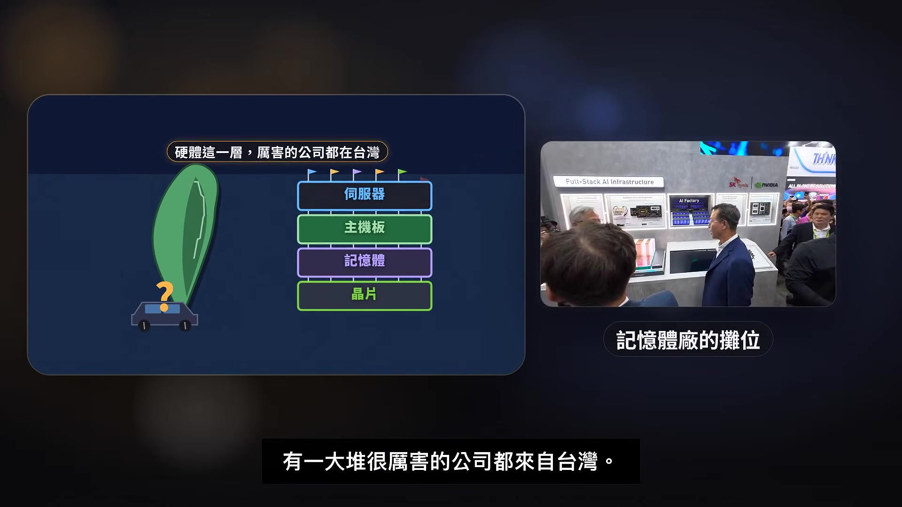

**逐字稿片段：** 都來自臺灣 他自己猜過幾個答案 一個是文化 一個是教育 臺灣很看重工程師 黃仁勳的答案 要從70多年前講起

**話題推測：** 討論臺灣在硬體供應鏈中的關鍵地位，可能展示臺灣相關公司的標誌或清單。

---

## 00:02:44

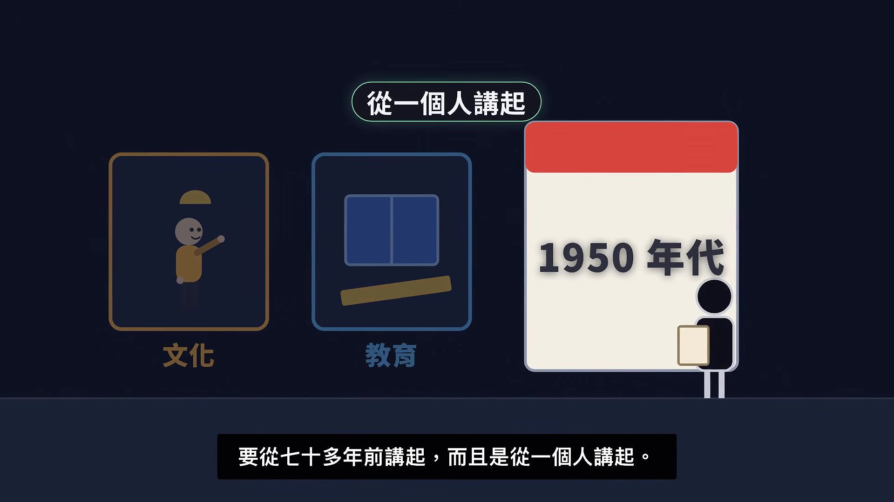

**逐字稿片段：** 而且是從一個人講起 聽他怎麼說

**話題推測：** 開始講述臺灣半導體產業的歷史，將從「一個人」講起，可能出現時間軸或特定人物照片。

---

## 00:03:10

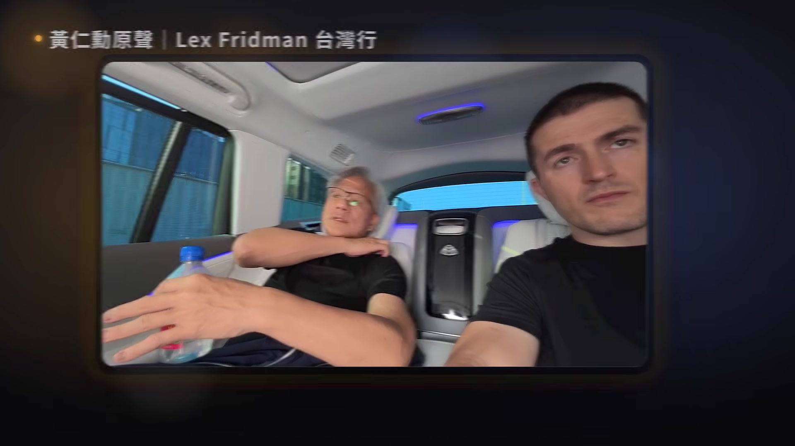

**逐字稿片段：** 黃仁勳說的這個人叫李國鼎 他是臺灣早年的財經官員 1950年代在工業委員會 後來當過經濟部長和財政部長 很多人叫他臺灣的科技教父 他很早就想把科學和製造業帶進臺灣

**話題推測：** 介紹臺灣科技教父「李國鼎」，可能展示其肖像或相關歷史照片。

---

## 00:03:22

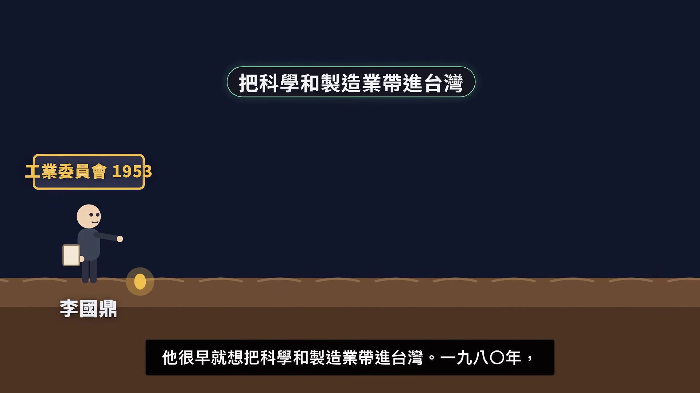

**逐字稿片段：** 1980年新竹科學園區成立 同一年工研院分出了連點 1985年張忠謀被請回臺灣 當工研院院長 兩年後創立臺積電 黃仁勳還提到荷蘭的菲利普 說臺積電跟ASML都是從菲利普分出來的 這裡要補充一下 臺積電成立的時候 那個時候政府的開發基金出了將近一半

**話題推測：** 提及「1980年新竹科學園區成立」，可能展示園區照片或歷史檔案。

---

## 00:03:40

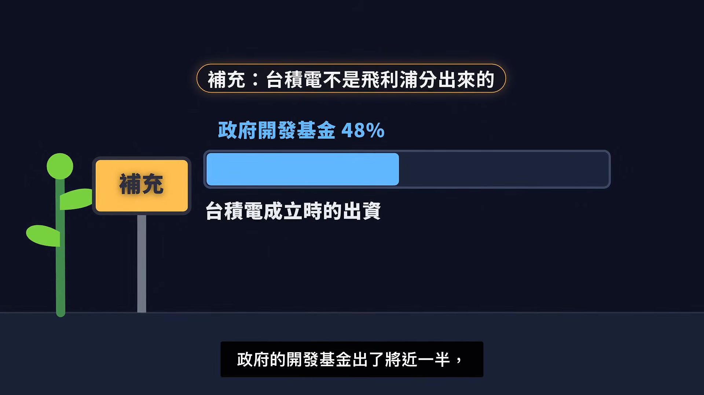

**逐字稿片段：** 菲利普出了將近三成 也給了製程技術 但臺積電不是菲利普分出來的 真正從菲利普分出來的

**話題推測：** 說明臺積電成立時，政府開發基金和菲利普分別出了「將近一半」和「將近三成」資金，可能搭配圓餅圖。

---

## 00:03:46

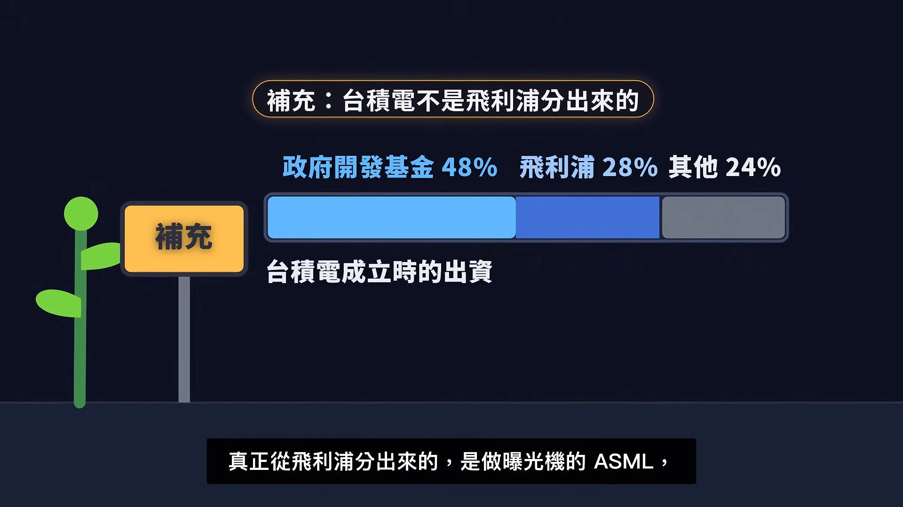

**逐字稿片段：** 是做曝光機的ASML 1984年由菲利普跟另一家公司合資成立 Lex把這叫做種下種子 種子有了還需要一塊地讓它長大 黃仁勳說這塊地是IBM給的

**話題推測：** 澄清真正從菲利普分出來的是「ASML」，可能展示ASML的標誌或其曝光機圖片。

---

## 00:03:58

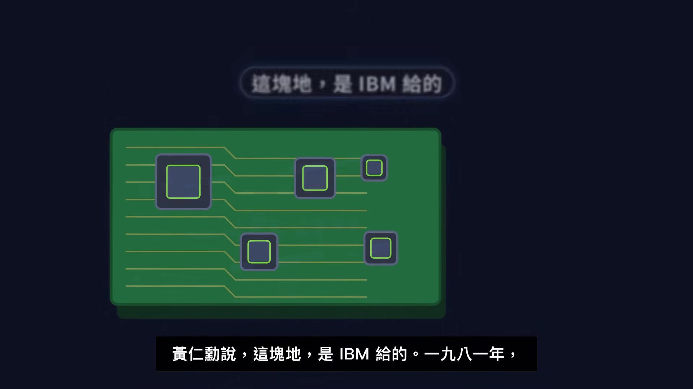

**逐字稿片段：** 1981年IBM推出個人電腦 而且把整臺機器的規格公開 主機板上 管記憶體管螢幕管各種訊號的那一組

**話題推測：** 提到「1981年IBM推出個人電腦」的歷史事件，可能展示舊式電腦圖片。

---

## 00:04:06

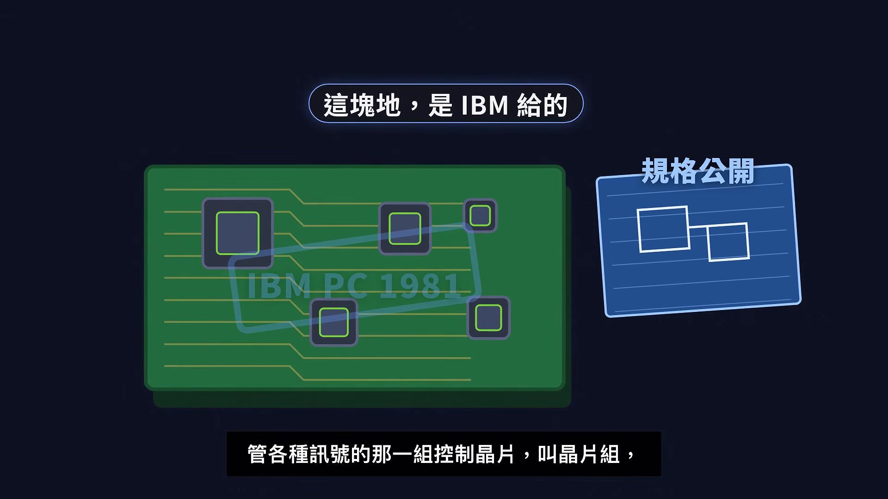

**逐字稿片段：** 控制晶片 叫晶片組 英文是chipset 規格一公開 誰都可以照著做 照他的說法 臺灣的工程師就照著規格 設計出一顆顆晶片組 交給臺積電和聯電這些代工廠生產 這樣一來 不管是誰 只要跟臺灣買主機板 再裝上作業系統 就能賣電腦 黃仁勳舉了一個例子 一個大學生在宿舍裡組電腦起家 聽他怎麼說 assembled them into a PC bought an operating system Bonding Operating System cube and PC 說到文化 Lex講了一個小故事 有一位在臺灣長大的女生跟他說 他小時候還沒學會拼古詞 就先學會拼Code Wars

**話題推測：** 解釋「晶片組」的概念，可能展示主機板結構圖或晶片組特寫。

---

## 00:04:55

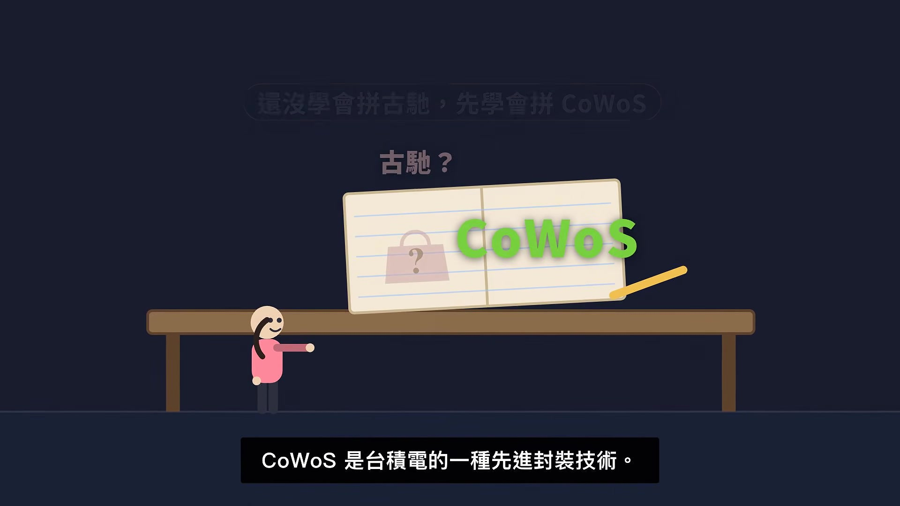

**逐字稿片段：** Code Wars是臺積電的一種先進封裝技術 他做的事是 把運算晶片跟記憶體 並排放在同一塊底板上 讓他們靠得很近 資料傳得很快 回答最新的AI晶片 都靠它包裝起來 在臺灣這是一般人也聽過的詞 Lex說 這代表在這裡 做工程是一件很酷的事 所以這一部分的答案是 臺灣不是一夜之間變成這樣的 先有官員種下種子 再有外國公司帶來技術和資金 然後IBM的開放規格 給了臺灣工程師一個舞臺 再加上一個 把工程師當明星的文化 不過這些都是大歷史 黃仁勳自己

**話題推測：** 介紹臺積電的「CoWoS」先進封裝技術，可能展示技術示意圖或應用案例。

---

## 00:05:26

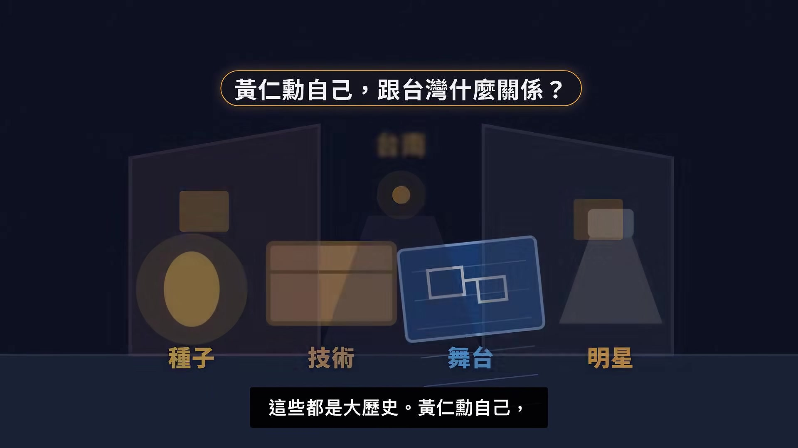

**逐字稿片段：** 跟臺灣又是什麼關係 隔天晚上

**話題推測：** 進入第二部分，探討黃仁勳「自己跟臺灣的關係」，可能切換到相關的主題標題。

---

## 00:05:29

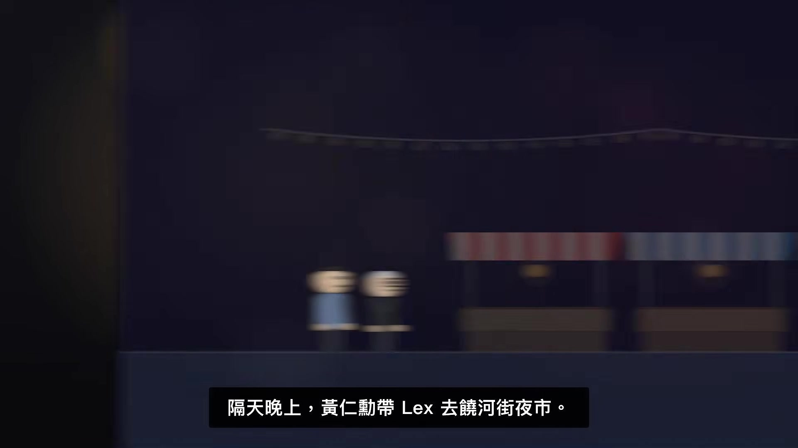

**逐字稿片段：** 黃仁勳帶Lex去撈和解夜市 他們吃了剛出爐的胡椒餅 吃了冰 最後吃到鬼仔煎 Lex說 這就是我來臺灣的理由 吃完粿仔煎在回程的車上 黃仁勳講起小時候 他說以前家裡沒什麼錢 所謂出去吃飯就是去夜市 坐在路邊的桌子吃 有一次在夜市 發生了一件他到現在都記得的事 那時候他差不多五歲 我聽他怎麼說 你可能以為經過這種事他會怕夜市 結果剛好相反他從此更愛夜市 他說攤販每個人都很辛苦 一份小吃的利潤可能只有幾塊錢 可是他們還是想多給你一點 就是想對你好 他說這就是臺灣人的做法 這幾天Lex也親身遇到 一個攤販堅持不收他的錢 Lex想給小費 老闆直接把錢塞回他的袋子 黃仁勳說 他是被當成臺灣小孩養大的 沒有零用錢 真的需要錢 就打電話回家

**話題推測：** 提及黃仁勳帶Lex逛「撈和解夜市」，可能展示夜市美食或人潮畫面。

---

## 00:06:39

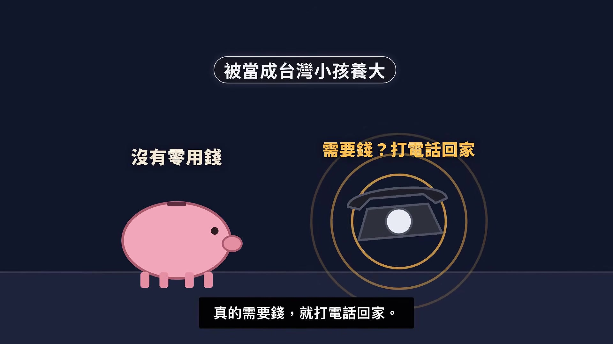

**逐字稿片段：** 後來他在大學認識太太Lori 發現他有零用錢

**話題推測：** 提及黃仁勳在大學時期結識太太「Lori」，可能展示其太太照片或兩人的合照。

---

## 00:06:42

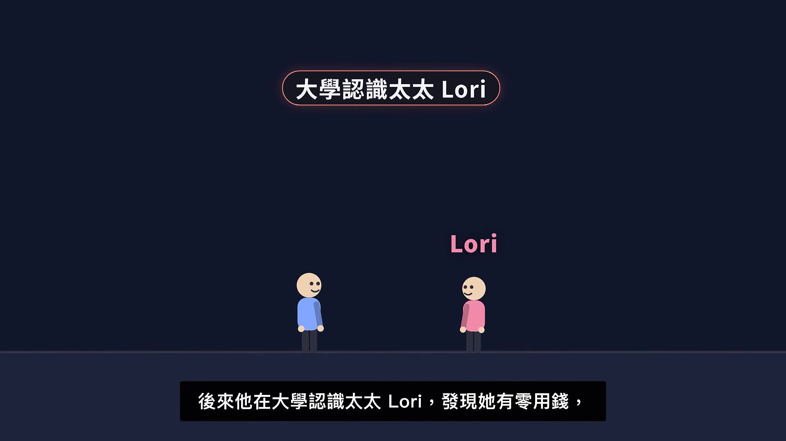

**逐字稿片段：** 一個禮拜2毛5美元 他開玩笑說 就是為了這個才跟他約會 好讓兩個人能去打電動 不過真正讓他跟臺灣 重新連在一起的

**話題推測：** 提及太太Lori的零用錢金額「一個禮拜2毛5美元」，可能以文字或圖示強調。

---

## 00:06:50

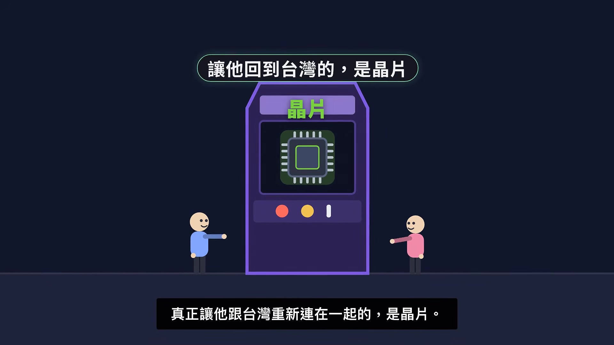

**逐字稿片段：** 是晶片 故事發生在一個早上

**話題推測：** 轉向討論黃仁勳與臺灣因「晶片」產業而重新連結，可能顯示晶片相關圖像。

---

## 00:06:53

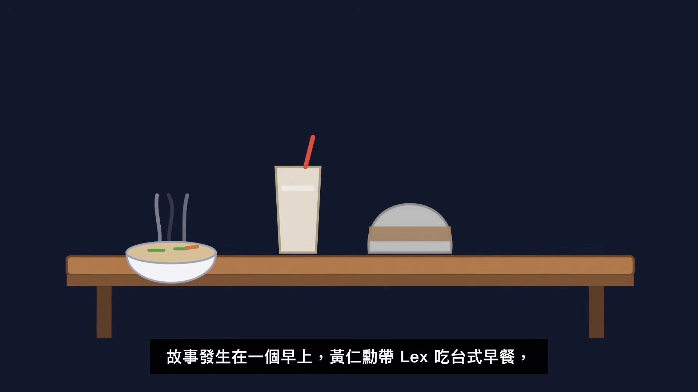

**逐字稿片段：** 黃仁勳帶Lex吃臺式早餐 冰豆漿鹹豆漿 飯糰燒餅油條 一邊吃一邊講

**話題推測：** 提及黃仁勳帶Lex吃「臺式早餐」，可能展示早餐店或美食畫面。

---

## 00:06:58

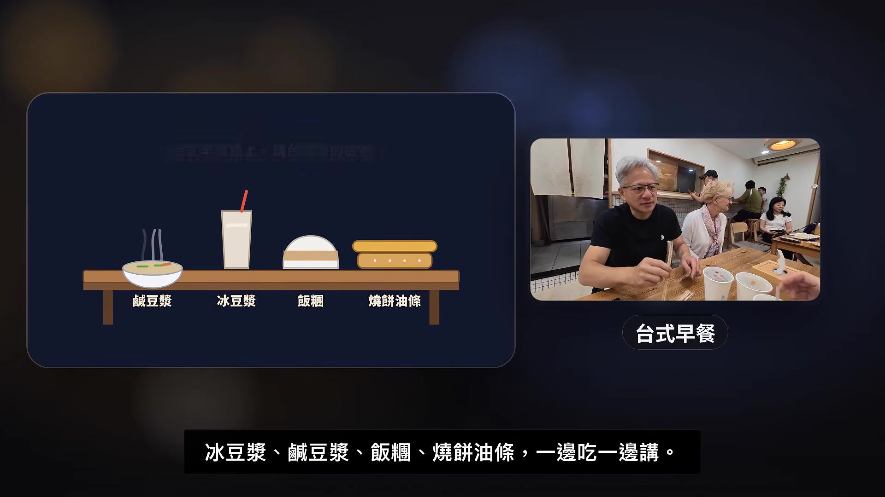

**逐字稿片段：** 1990年代個人電腦大爆發 輝達剛成立 要做電腦繪圖晶片 可是自己沒有工廠 得找人代工 幫別人制造晶片的工廠 叫晶圓代工廠

**話題推測：** 描述「1990年代個人電腦大爆發」，可能搭配歷史時間軸或產業數據圖。

---

## 00:07:08

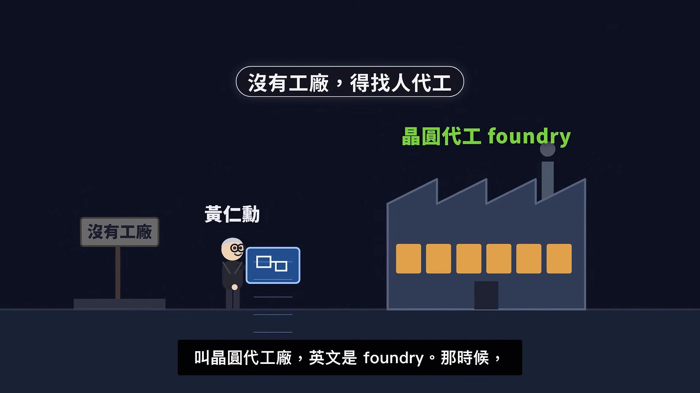

**逐字稿片段：** 英文是Fungry 那時候大家都在搶代工廠的產能 想用人家的工廠 常常得先把自己的技術授權給對方 黃文勳說 只有你想象現在有些AI公司 要拿到運算資源 也得先交出一些東西

**話題推測：** 解釋「晶圓代工廠」（Fungry）的概念，可能展示工廠內部或晶圓片圖像。

---

## 00:07:19

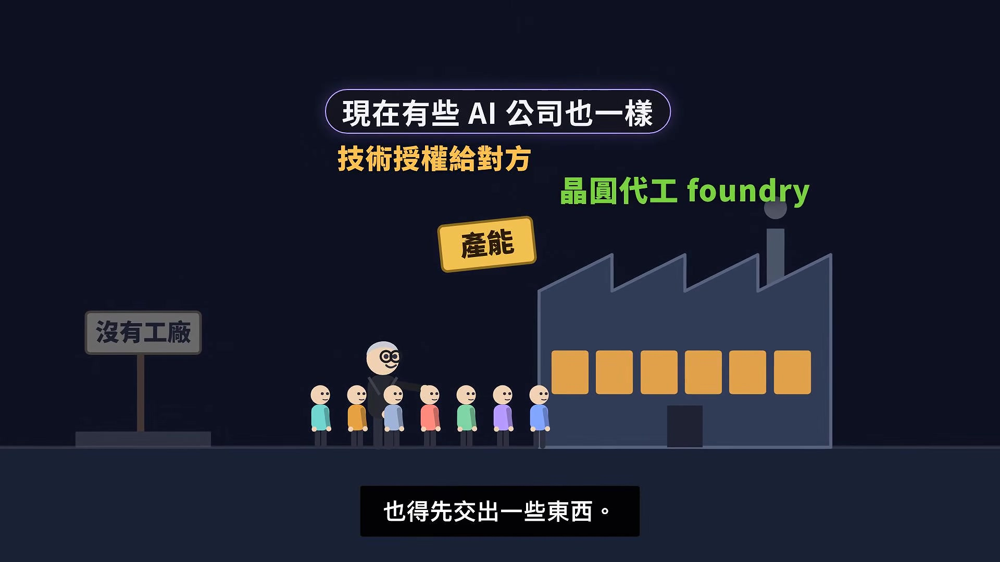

**逐字稿片段：** 他先找了歐洲的SGS Thompson 前兩代晶片也是那一座的 後來他聽說臺灣有家臺積電 就在黃頁上找到臺積電 美國辦公室的電話打過去 是錄音 他留了言打了好幾次 都沒人回 最後他寫了一封長信給張忠謀

**話題推測：** 提及輝達曾尋求歐洲的「SGS Thompson」代工，可能顯示公司標誌或簡介。

---

## 00:07:33

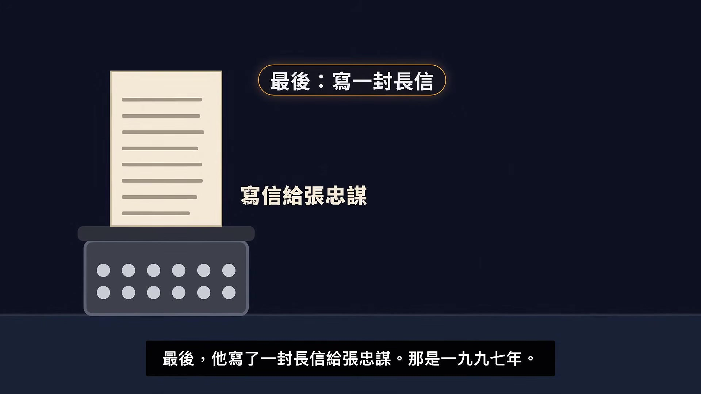

**逐字稿片段：** 那是1997年 信寄出去 很久都沒有迴音 直到有一天傍晚,6點半左右 電話響了,聽他怎麼說

**話題推測：** 提及黃仁勳寫信給張忠謀的年份「1997年」，可能在時間軸上標示此事件。

---

## 00:08:02

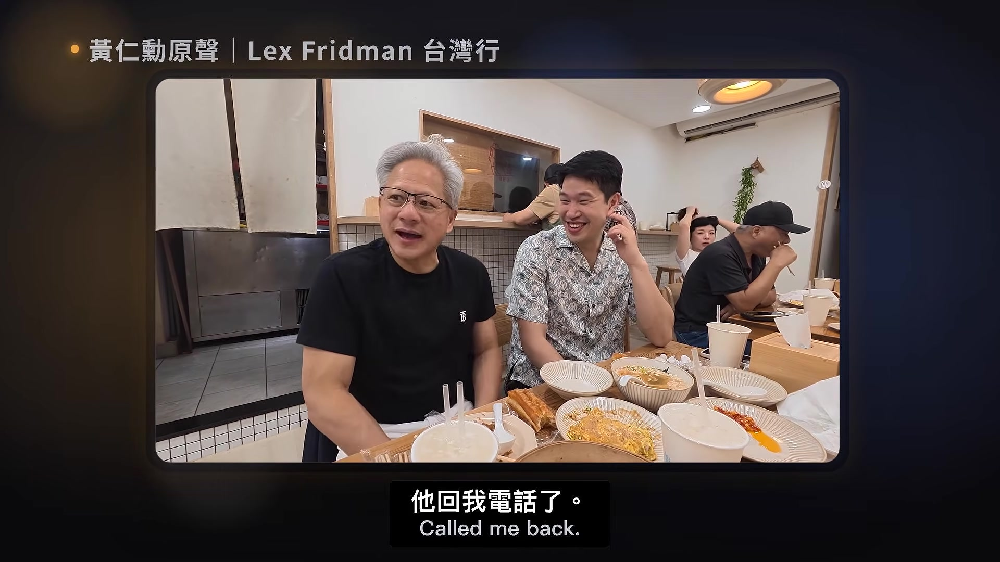

**逐字稿片段：** 張忠謀回了電話,要他來臺灣 黃仁勳說這是他小時候離開臺灣以後 第一次回來

**話題推測：** 描述張忠謀回電並邀請黃仁勳來臺，可能搭配象徵性通話畫面或人物對話。

---

## 00:08:07

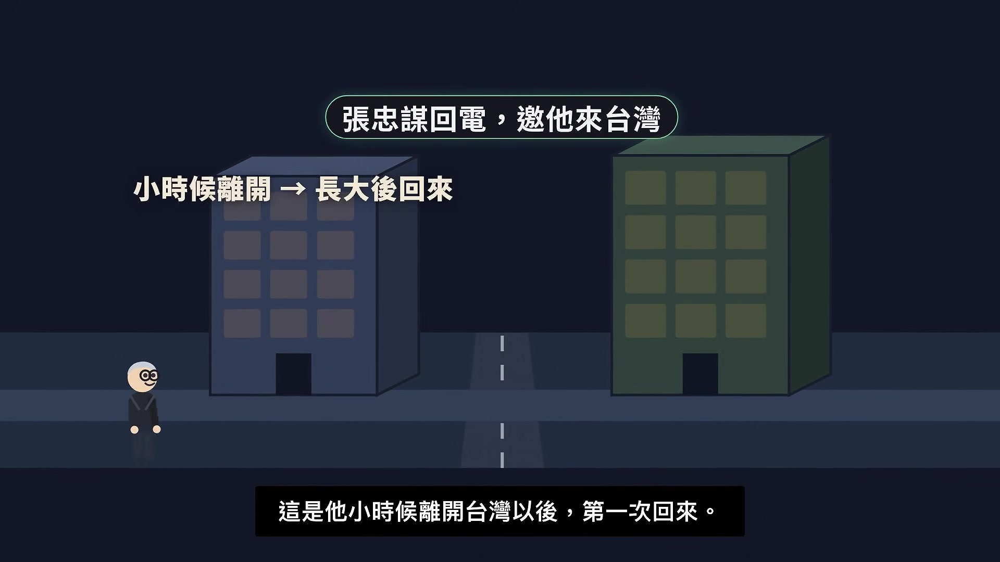

**逐字稿片段：** 他先去拜訪聯電 再去臺積電 兩家都在新竹科學園區 離得很近 很多人問他 為什麼最後選臺積電 他說 兩家都很好 他一樣喜歡 可是他提出很多要求 張忠謀一直說 這個我們做不到 那個也做不到 張忠謀整場都在講公司治理 講誠信 講長期合作 一句都沒講別的 最後張忠謀說 如果我們合作 我保證會為你赴湯蹈火 黃仁勳說 接下來快30年 臺積電真的做到了 1998年起

**話題推測：** 提及黃仁勳拜訪「聯電」，可能展示聯電的標誌或工廠畫面。

---

## 00:08:32

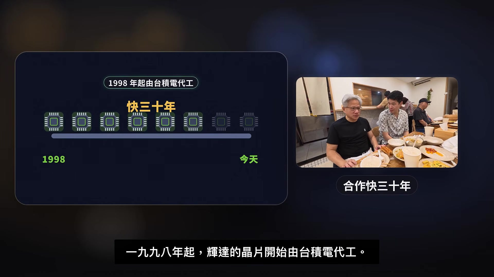

**逐字稿片段：** 回答的晶片開始由臺積電代工 這背後他有一套怎麼挑夥伴的想法 聽他怎麼說 他還用了一個比喻 合作關係就像婚前協議 條件寫得越細 關係反而越脆弱 因為未來會發生什麼 沒有人寫得完 所以他跟臺積電保持很寬鬆 邊做邊找答案 他們有一個說法 叫粗略的公平

**話題推測：** 標示「1998年起」輝達晶片開始由臺積電代工的年份，可能在時間軸上強調此合作關係。

---

## 00:09:11

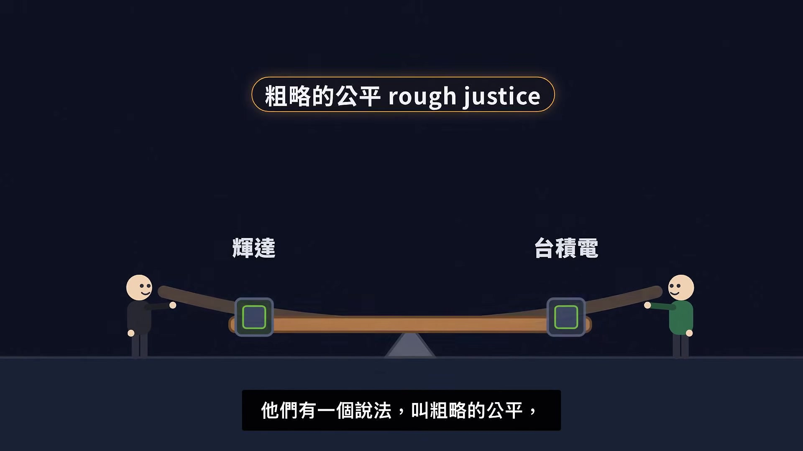

**逐字稿片段：** 英文是rough justice 有時候臺積電佔一點便宜 有時候回答佔一點便宜 時間拉長就會扯平 他對自己的員工也是這樣 他們之間沒有綁死的合約 是彼此選擇一起做事 他還說在這座島上 如果你只想著 逼大家互相砍價 讓所有人都賺不到錢 只有你賺 大家會記得一輩子 所以要留一點在桌上

**話題推測：** 介紹黃仁勳與臺積電合作的核心概念「粗略的公平」（rough justice），可能以文字標示或圖解。

---

## 00:09:32

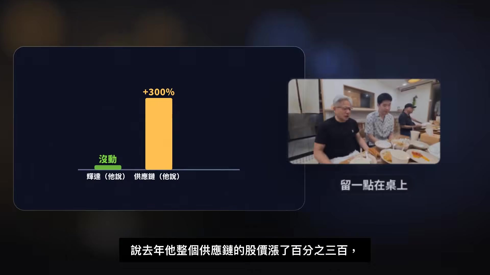

**逐字稿片段：** 漲了300% 他自己的卻沒動 這句話有點誇張

**話題推測：** 提及供應鏈中某公司股價「漲了300%」，可能展示相關股票走勢圖或財務數據。

---

## 00:09:36

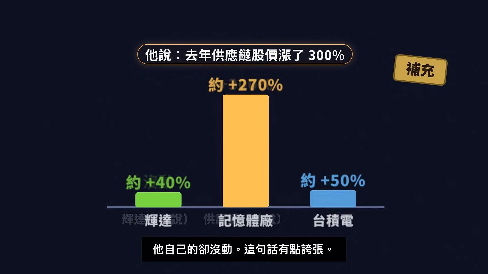

**逐字稿片段：** 輝達去年其實也漲了大約4成 供應鏈裡 記憶體廠漲了將近300% 臺積電大約漲了5成 不過他想說的是 平臺夠大 夥伴才能一起長大 所以這A部分的答案是 黃仁勳選臺積電 選的不是要買什麼 而是要跟誰一起做 這種長期的關係 就是臺灣這條供應鏈的核心 那為什麼臺灣人做得到這種關係 答案是在一場派對上說出來的 電腦展期間

**話題推測：** 更正輝達去年股價「漲了大約4成」，可能搭配輝達的股價走勢圖。

---

## 00:09:58

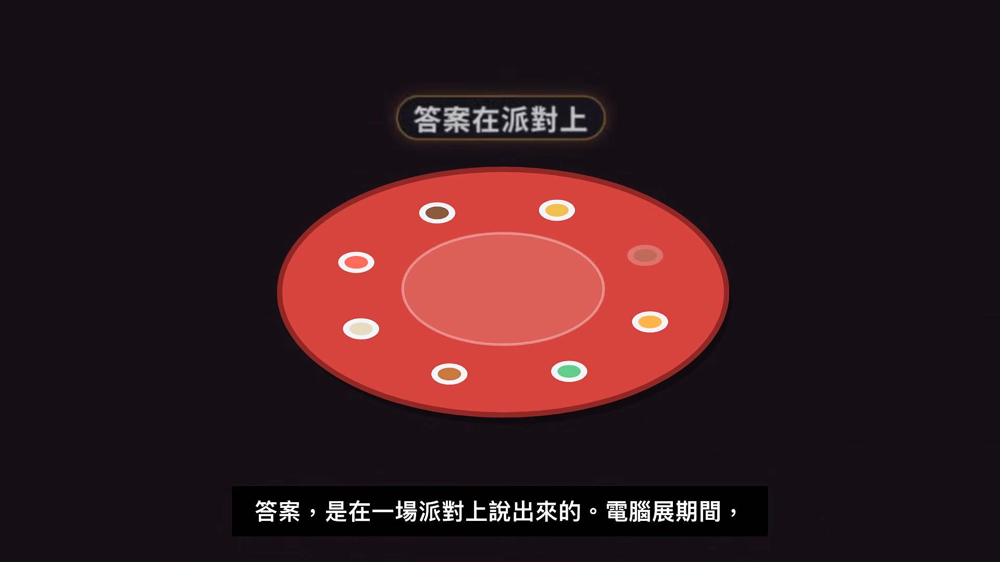

**逐字稿片段：** 輝達在臺北辦了員工聚會 擺了臺灣辦桌的大圓桌 還開了臺灣的威士忌 黃仁勳到處發食物 連在場外工作的記者 他都親手送餐過去 Lex說 這些歡呼的背後是 黃仁勳當天又走了好幾個小時的展場 那天 他講出了他心中臺灣的答案 聽他怎麼說 能量和能力幫助其他人 是世界的供應鏈的原因 it comes from that 黃仁勳常說

**話題推測：** 提及輝達在臺北舉辦員工聚會，可能展示聚會現場的畫面。

---

## 00:10:38

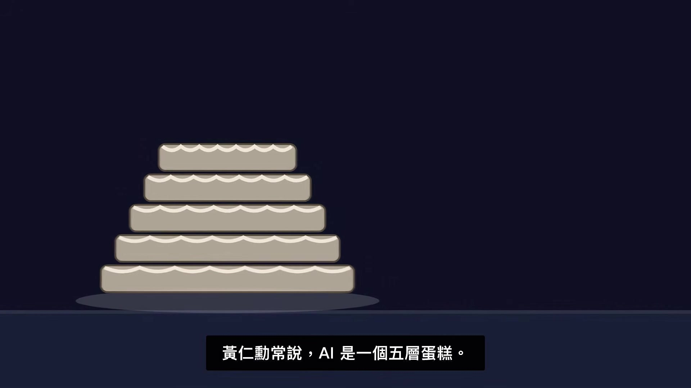

**逐字稿片段：** AI是一個五層蛋糕 最下面一層是能源 往上是晶片 再往上是資料中心 這些基礎設施 然後是模型 最上面是應用 少了任何一層 AI都做不起來 臺灣剛好在晶片跟基礎設施這兩層 扮演很重的角色 他也說 AI的生意跟以前不一樣 以前的伺服器 是把處理器的核心租給別人用 所以核心越多越好 AI不租核心

**話題推測：** 介紹黃仁勳的「AI是一個五層蛋糕」理論，可能展示分層的示意圖。

---

## 00:10:59

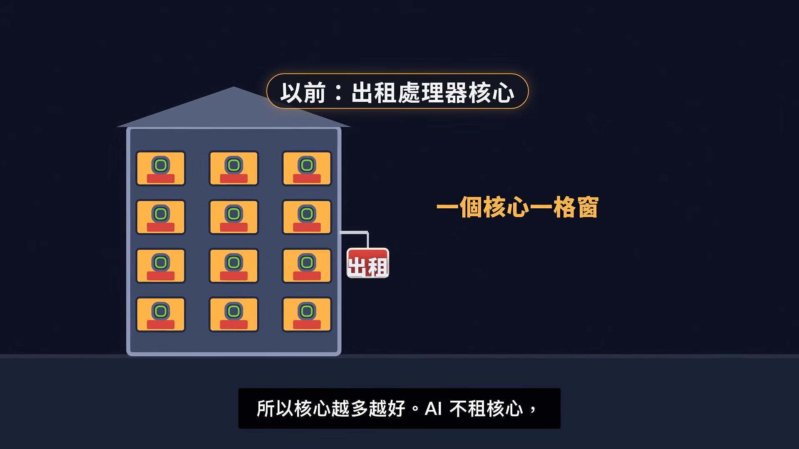

**逐字稿片段：** AI是在產生Token 也就是一個一個的致詞 在把Token賣出去 所以要越快越好 回答在臺灣

**話題推測：** 解釋AI在產生「Token」而非租用核心的概念，可能搭配AI運作流程圖。

---

## 00:11:04

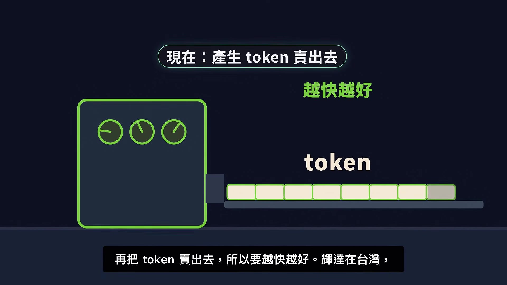

**逐字稿片段：** 現在大約有1000個員工 做供應鏈 系統工程 封裝跟測試

**話題推測：** 提及輝達在臺灣現有「1000個員工」，可能以數字或圖示呈現。

---

## 00:11:08

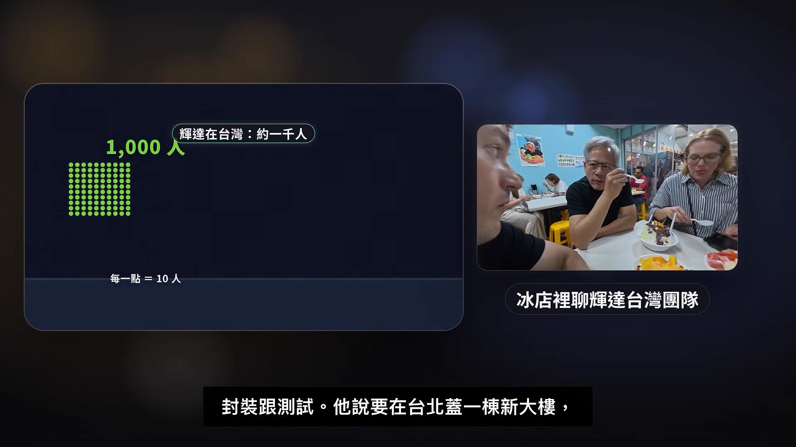

**逐字稿片段：** 他說要在臺北蓋一棟新大樓

**話題推測：** 提到輝達計劃在臺北蓋一棟「新大樓」，可能展示建築渲染圖或規劃地圖。

---

## 00:11:10

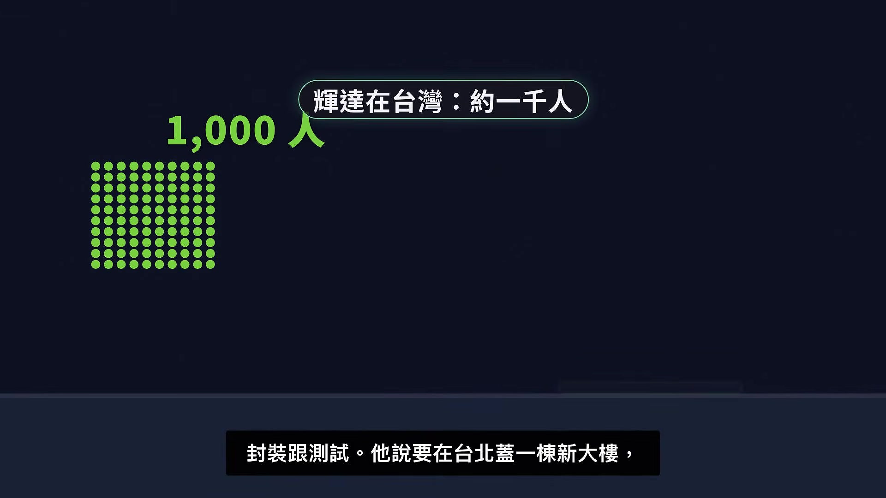

**逐字稿片段：** 可以容納4000人

**話題推測：** 說明新大樓可以容納「4000人」，可能以文字或圖示呈現規模。

---

## 00:11:12

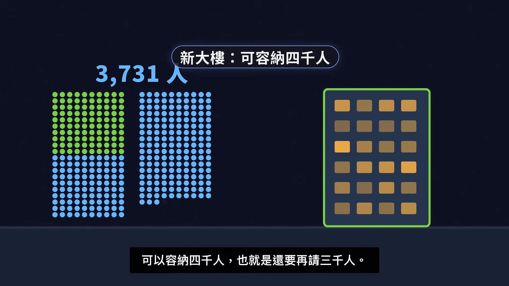

**逐字稿片段：** 也就是還要再請3000人 這棟大樓叫星座 蓋在北投士林科技園區 預計今年底開工 臺灣以外呢 他對美國也有很直接的看法 Lex也問到美國 黃仁勳說 美國得把製造業找回來 這波AI熱潮 投資電網 投資能源 重新蓋工廠最好的機會 需求大到在哪裡做都划算 那不如也在美國做 臺積電的人跟Lex說

**話題推測：** 指出未來預計「還要再請3000人」，可能以招聘圖表呈現。

---

## 00:11:32

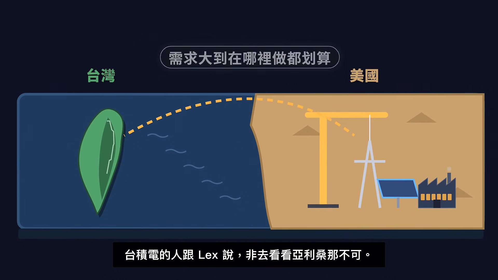

**逐字稿片段：** 非去看看亞歷桑那不可 亞歷桑那第一座廠 已經在生產4奈米的晶片 也做了回答的Blackwell 不過後面的封裝 目前還是要送回臺灣 下一座廠 預計明年下半年 量產更先進的3奈米 黃仁勳說 美國最缺的是人才 所以臺灣送了一大批工程師過去 一邊蓋廠一邊訓練當地人 他說從技術來看 臺灣是美國真正的戰略伙伴 他希望大家看見這一點 接著是最敏感的話題

**話題推測：** 提及臺積電在「亞歷桑那」的設廠情況，可能展示廠區照片或地圖。

---

## 00:11:57

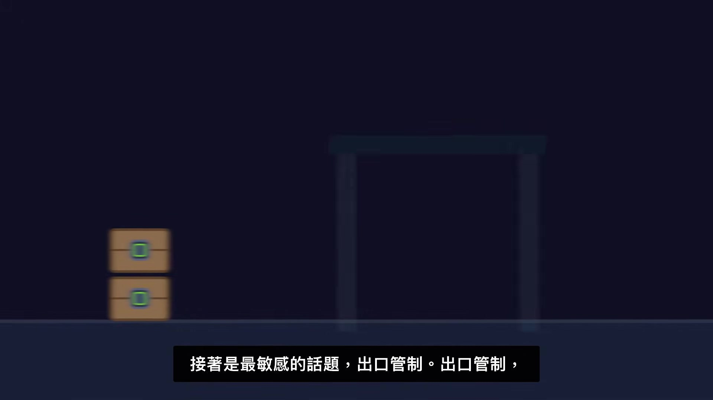

**逐字稿片段：** 出口管制 出口管制就是政府規定 哪些技術不準賣到哪些國家 美國這幾年 限制先進的AI晶片賣到中國 支持管制的人認為 先進晶片可能被拿去提升軍事能力 所以不能賣 黃仁勳公開反對過 他說管制反而逼中國自己做晶片 揮打在中國的市佔率

**話題推測：** 引入敏感議題「出口管制」，可能展示相關新聞標題或政策圖表。

---

## 00:12:15

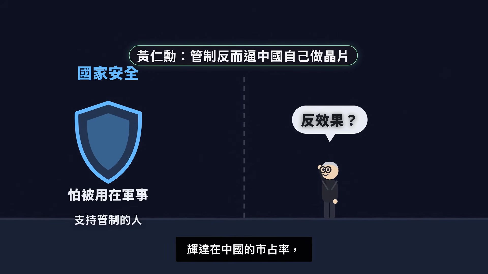

**逐字稿片段：** 從大約9成5掉到幾乎是0 Alex 請他把兩邊的理由都講清楚 他說像稀土 子彈 炸彈這些實體的東西 不讓對手拿到 確實能保持優勢 可是他用了另一個比喻

**話題推測：** 展示輝達在中國市佔率因出口管制而從「大約9成5掉到幾乎是0」，可能搭配市場份額變化圖。

---

## 00:12:26

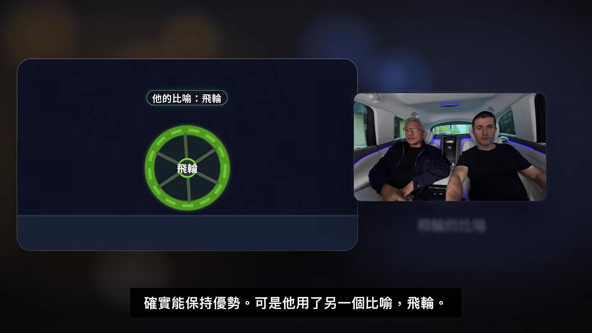

**逐字稿片段：** 飛輪 技術領先帶來更多客戶 客戶帶來財富 財富又讓技術進步得更快 像一個越轉越快的輪子 他問的是 你到底要讓對手拿不到 還是要讓自己的飛輪一直轉 聽他怎麼說 is to optimize for a flywheel 他的結論是 有些技術要非常嚴格的挑選 可以給誰 可是其他的 要讓飛輪越大越好 他也說 每個國家都有權決定 自己做出來的東西要怎麼用 這是他的看法 支持管制的人 並不同意 Lex接著說 兩個國家如果是 朋友之間的競爭 跟敵人之間的競爭 中間有一條線 一旦跨過那條線 所有人的飛輪都可能毀掉 黃仁勳說 要競爭 這是免不了的 可是要盡一切努力 避免衝突 Lex補充 大家用一樣的硬體 一樣的軟體 彼此躲對方的大雪 這種互相依賴越多 越難打起來 所以這部分的答案是 黃仁勳眼中的臺灣 不只是一座工廠 而是一個靠信任跟人情運作的生態系 至於美國要怎麼重建製造業 出口管制要怎麼拿捏 這些都還在進行中 誰也不知道答案 最後一天早上

**話題推測：** 黃仁勳以「飛輪」比喻技術發展與商業模式，可能展示飛輪效應的示意圖。

---

## 00:13:41

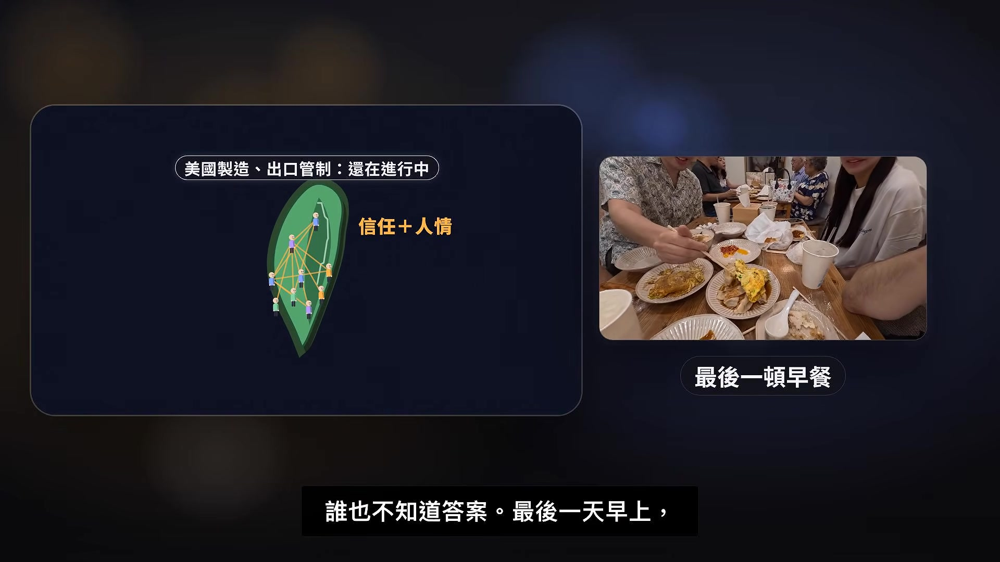

**逐字稿片段：** 吃完一頓14道菜的早餐 Lex說 這是我人生中最不可思議的一週 我們回到開場那個問題

**話題推測：** 提及一頓包含「14道菜」的豐盛早餐，可能展示早餐的菜餚畫面。

---

## 00:13:48

**逐字稿片段：** 為什麼全世界的AI都離不開臺灣 黃仁勳給的答案有三層

**話題推測：** 回顧影片開頭提出的核心問題「為什麼全世界的AI都離不開臺灣」，可能再次顯示主題標題。

---

## 00:13:52

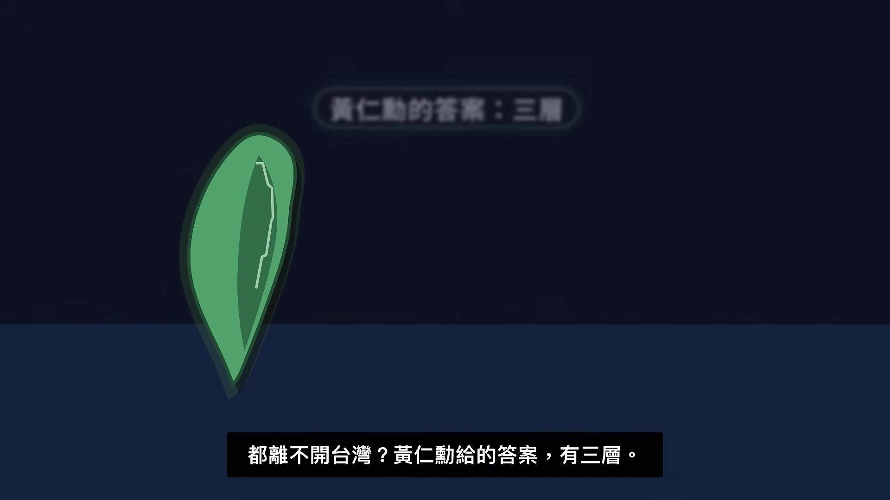

**逐字稿片段：** 第一層是歷史 政府先種他的種子 菲利普帶來技術 IBM的開放規格給了五臺 再來是關係 他選臺積電 選的不是要買什麼 是要跟誰一起做 一做 就是快三十年

**話題推測：** 總結黃仁勳給出的「第一層答案：歷史」，可能是歷史時間軸的重點回顧。

---

## 00:14:02

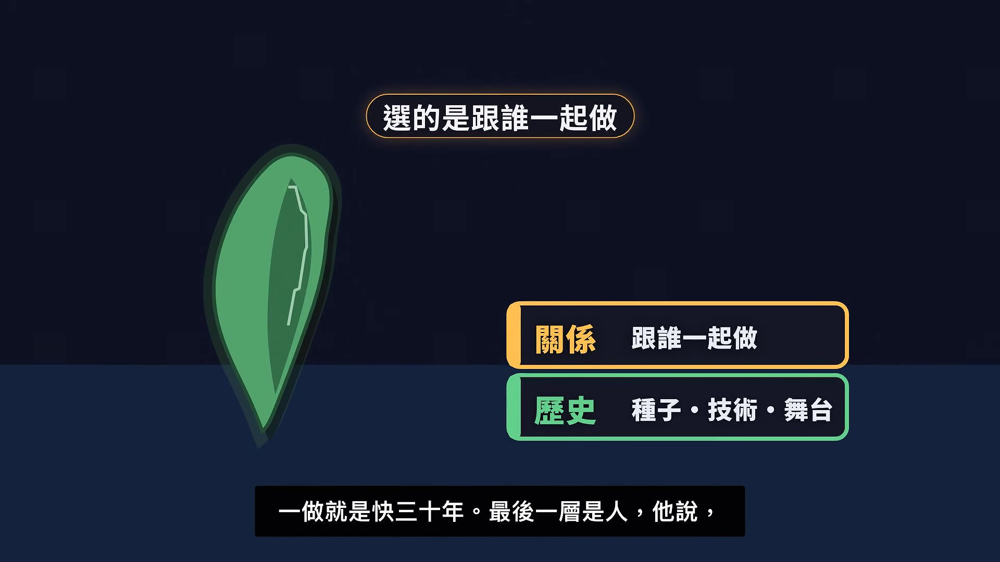

**逐字稿片段：** 最後一層是人 他說願意幫別人 又願意拼命工作 這兩樣加在一起 臺灣才成了全世界的供應鏈 要記得這是他的看法 也是一個跟臺灣關係很深的人說的話 美國要把工廠搬回去 出口管制要怎麼拿捏 這些問題都還在進行中 沒有人知道答案 一層一層疊出來的 不是運氣 下一次你在夜市排隊 看到老闆把錢塞回你的袋子 也許就會想起這段故事 最後問你一個問題 你覺得臺灣做晶片的本事 最難被別人學走的是哪一點 留言告訴我 喜歡的話訂閱AI Notebook 開啟通知 我們下次見

**話題推測：** 總結黃仁勳給出的「最後一層答案：人」，可能展示以人為本的文化意象。

---
