# jimainotebook_JBRvK5SdZRs — 關鍵畫面索引

- 來源逐字稿：[jimainotebook_JBRvK5SdZRs_FIN.srt](jimainotebook_JBRvK5SdZRs_FIN.srt)
- 影片：https://www.youtube.com/watch?v=JBRvK5SdZRs
- 截圖數：60

## 00:00:14

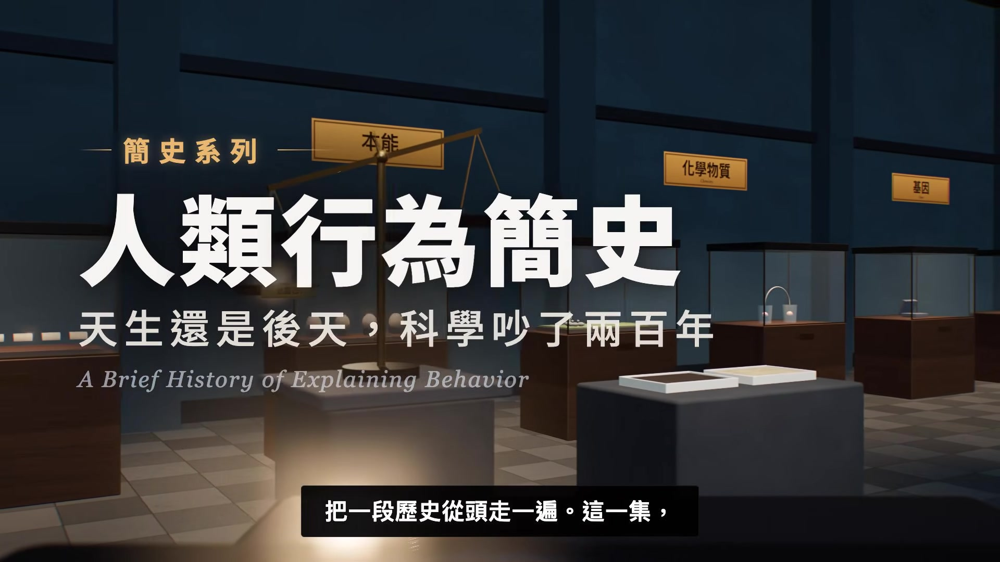

**逐字稿片段：** 我們走人類用生物學解釋行為的200年, 你在開車, 旁邊一臺車突然切到你前面, 你踩了一下煞車, 你心裡冒出來的第一句話, 大概是, 這個人怎麼這樣?這句話裡藏著一個很老的答案, 他這個人就是這樣, 那是他自己選的, 科學家接著問的是下一個問題, 他為什麼會變成這樣的人?是天生的,

**話題推測：** 介紹影片主題：人類用生物學解釋行為的200年

---

## 00:00:32

**逐字稿片段：** 還是後天養成的?天生還是後天?

**話題推測：** 提出核心爭議點：天生還是後天？

---

## 00:00:35

**逐字稿片段：** 這場爭論科學炒了200年 一邊說答案在血統 本能和基因裡 另一邊說答案在經驗和環境裡 這一路上一部分原因 從他這個人身上 移到他身體裡的某個東西

**話題推測：** 展示200年科學爭論的時間線

---

## 00:00:48

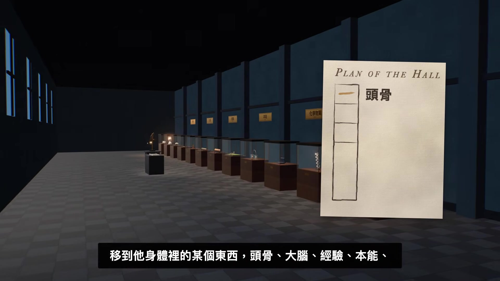

**逐字稿片段：** 頭骨大腦經驗本能化學物質基因 這樣的移動幫助過很多人 也傷害過一些人 這場爭論底下壓著一個更私人的問題 一個人做的事有多少是他自己決定的 我先把答案放在前面 這場爭論沒有哪一邊贏 因為把它當成二選一 本身就問偏了 基因要放在環境裡 才看得出它的作用 很多原因 在不同長度的時間裡 一起推出了那一個動作 科學沒有給我們一個百分比 它改變的 是我們該怎麼問這個問題

**話題推測：** 列舉解釋行為的不同層面：頭骨、大腦、經驗、本能、化學物質、基因

---

## 00:01:14

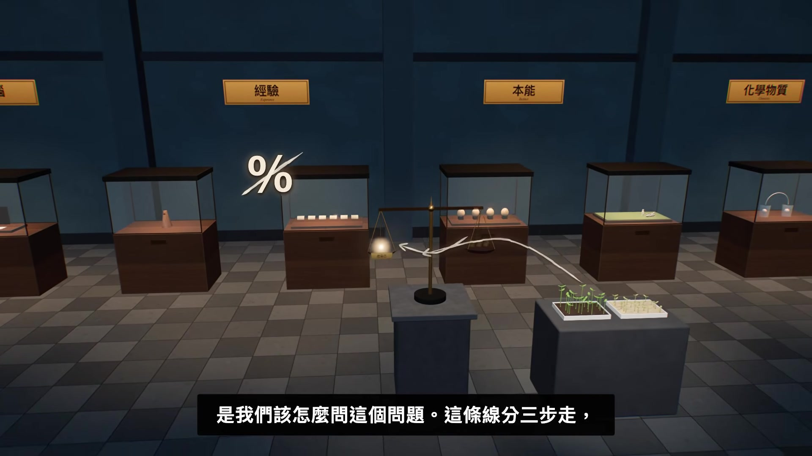

**逐字稿片段：** 這條線分三步走 先看原因怎麼從人格走進身體 再看天生的後天 怎麼這邊爭了大半個世紀 最後看化學 基因跟時間 怎麼被放回同一張圖裡 中間有一個男人 連著三天練習 畫一顆星星 越畫越好 卻每一次都說 自己沒有畫過 我們留到後面

**話題推測：** 介紹影片的三段式結構

---

## 00:01:30

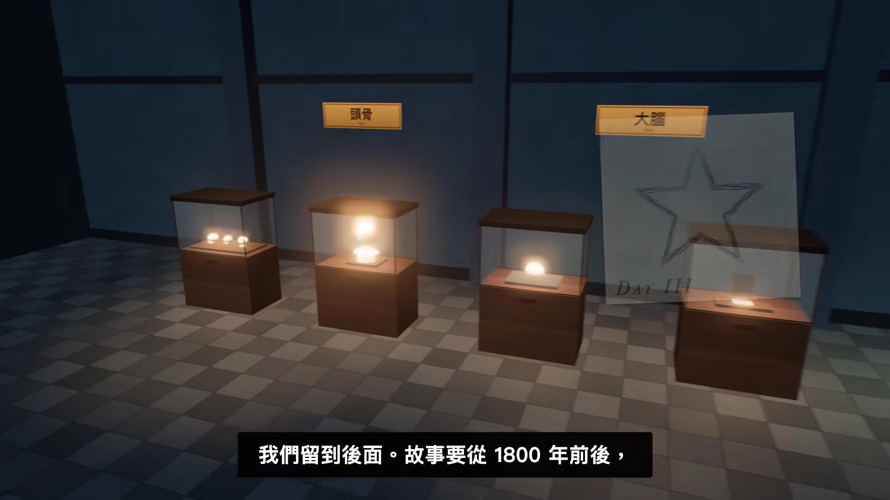

**逐字稿片段：** 故事要從1800年前後 維也納一位醫生的頭骨收藏開始 1800年前後 維也納有一位醫生叫

**話題推測：** 開啟新的歷史篇章：從1800年前後的維也納醫生開始

---

## 00:01:37

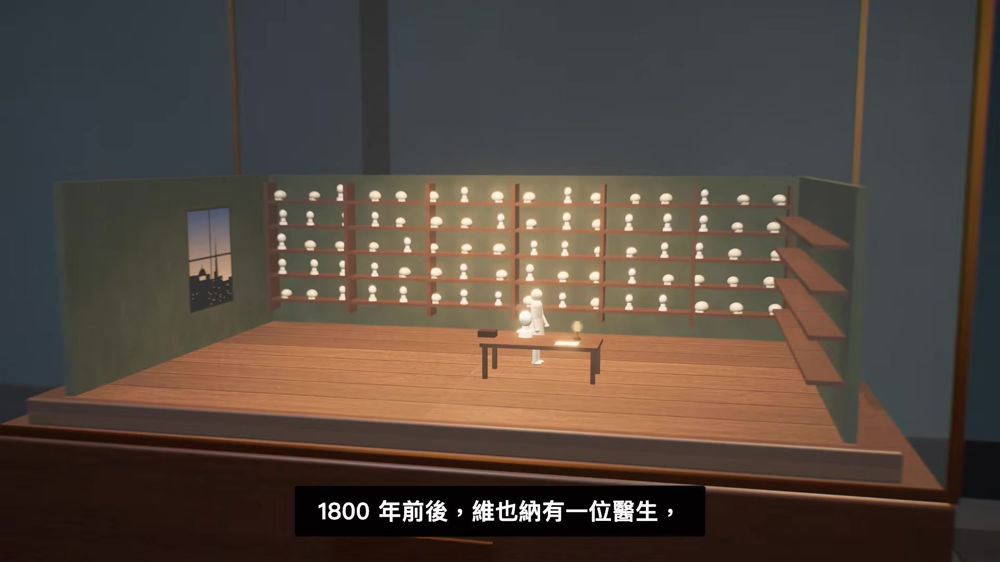

**逐字稿片段：** Franz Josef Gau 他收藏了大量的頭骨 還有用石膏翻制的頭像 他想回答一個問題 一個人的個性跟才能 放在身體的哪裡 在他那個年代 很多人認為 人的心思屬於靈魂 跟身體的器官關係不大 Gau提出一個大膽的主張 心思是大腦在做的事 而且大腦不是一整塊不同的部位 負責不同的事 這個主張 後來被證明有一部分是對的 可是他接著又走了一步 問題就出在這一步 他認為大腦哪一塊比較發達 那一塊就會長得比較大 把頭骨往外推 在頭上鼓起來 所以只要摸一個人的頭骨 就能讀出他的個性 這套學問

**話題推測：** 介紹Franz Josef Gau及其頭骨收藏

---

## 00:02:13

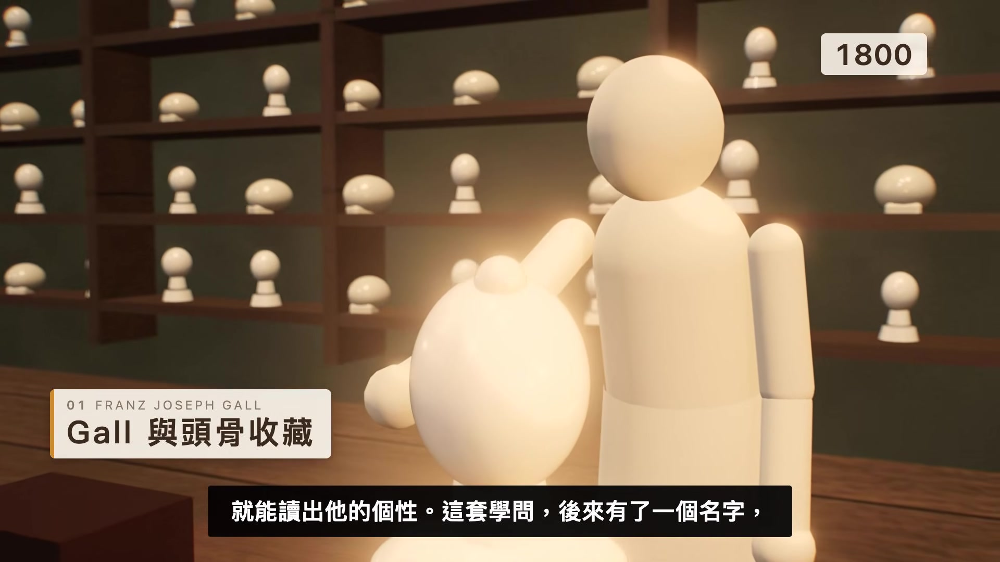

**逐字稿片段：** 後來有了一個名字叫Phenology 中文叫如相學 照他的說法 頭上某一個地方鼓起來 這個人就比較好鬥 另一個地方鼓起來 就比較疼愛小孩 奧地利政府覺得他的說法 把心思說成了物質 禁止他公開講課 他離開維也納 最後在巴黎住了下來 如相學反而從那裡傳得更遠 盧向雪很快傳遍了歐洲和美國 1815年 一位英國醫生替他取了Phenology這個名字 Gould的合作者Spursheim 把他講到了英國和美國 1830、40年代 在英國和美國 有人開店替人摸頭 有人拿他來挑員工 挑結婚的對象 也有人用他替對某些人的歧視找理由 他好懂 聽起來又很科學 可是他的證據是怎麼來的 Gould的方法是去找符合的例子 看到一個很好鬥的人 頭上那個地方剛好鼓起來 就記下來 不符合的 就想辦法解釋掉 只收集支持自己的例子 一個錯的想法 就可以看起來一直被證實 1820年代 法國生理學家

**話題推測：** 介紹「顱相學」（Phenology）概念圖

---

## 00:03:07

**逐字稿片段：** Pierre Florence 用鴿子和兔子做實驗 他一次移除一小部分大腦 看動物少了什麼能力 少掉的能力 跟盧相學那張地圖 對不起來 後來的人也發現 頭骨外面的起伏 跟底下大腦的形狀 關係很小 盧相學錯在方法 可是他留下一個問題 大腦的某一塊 真的會跟某一種行為有關嗎 這個問題 在1848年的美國 用一種沒有人想要的方式 得到了一個線索

**話題推測：** 介紹法國生理學家Pierre Flourens的實驗

---

## 00:03:33

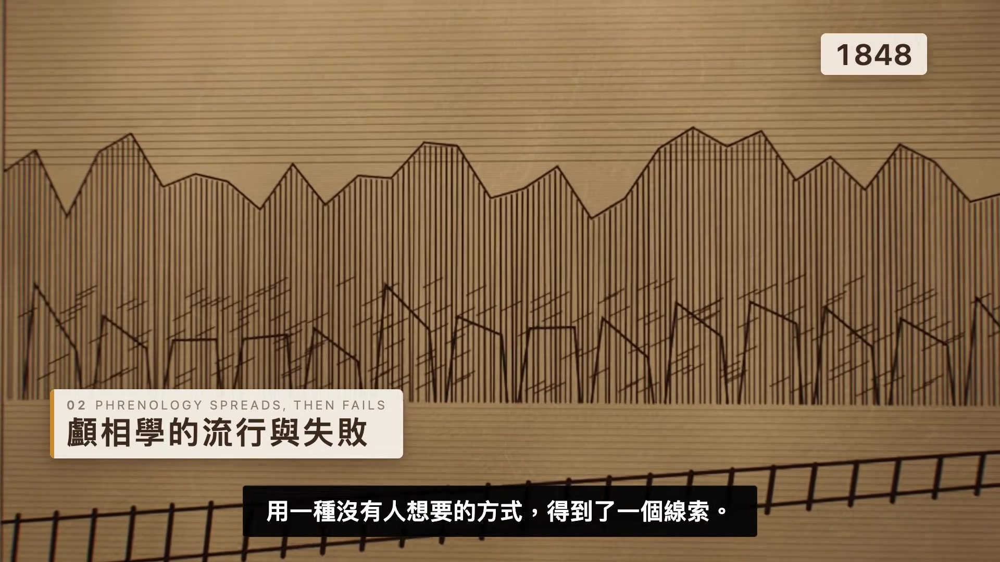

**逐字稿片段：** 1848年9月 美國佛蒙特州 一群工人在山裡開鐵路 工頭叫Fenix Gage 25歲 他的工作是在岩石裡鑽洞 倒進炸藥 再用一根鐵棍把炸藥壓死 那根鐵棍大約一公尺長 6公斤重 那一天炸藥提早爆開 鐵棍從他左邊臉頰下方穿進去 從頭頂穿出來 Gage活了下來 他被送回住處 一路上還能開口說話 照顧他的醫生叫John Harlow 20年後 Halo發表了一份報告 他寫說Gage傷好以後 心思有了很大的改變 變得粗魯 沒耐性 很固執 又常常改變主意 朋友們說 他不再是Gage了 鐵棍經過的地方 是大腦前面左邊那一塊

**話題推測：** 開始Phineas Gage的事故故事

---

## 00:04:14

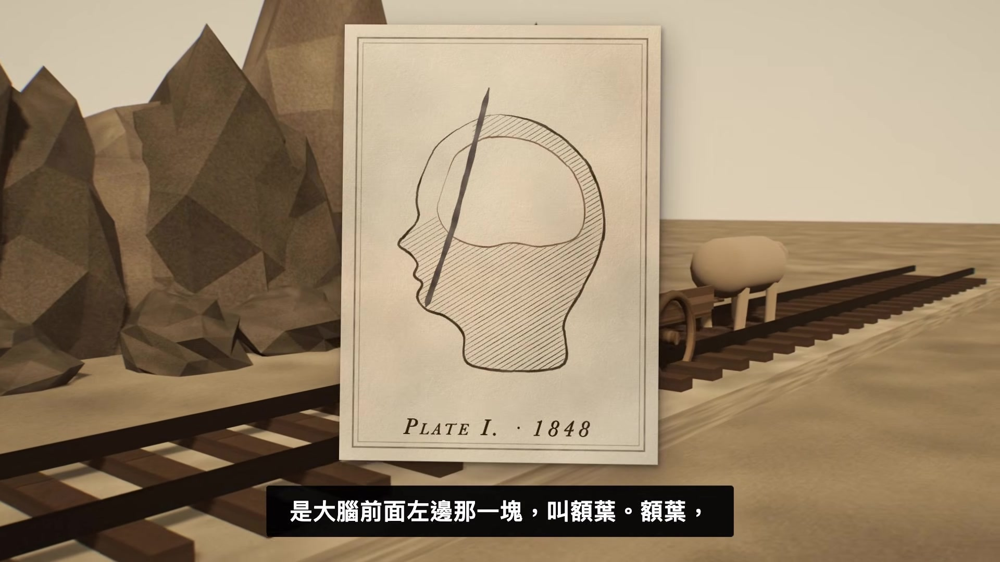

**逐字稿片段：** 叫額葉 額葉 你可以先繼承大腦裡負責計劃 還有踩煞車 忍住衝動的地方 這是很早的一個案例 讓人看到大腦的某一塊受了傷 一個人的行為可能跟著改變 可是這個故事 後來被講成了好幾個不同的版本 很多教科書 後來把Gage寫成一個徹底毀掉的人 到處流浪 再也沒有辦法工作

**話題推測：** 說明大腦「額葉」的功能

---

## 00:04:34

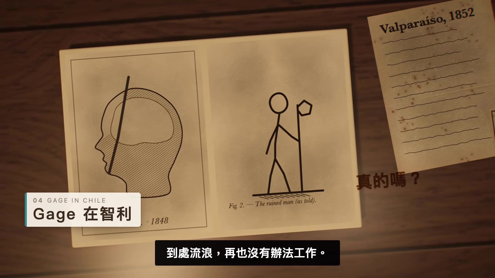

**逐字稿片段：** 澳洲的心理學家Malcolm McMullen 花了很多年追查原始記錄 發現證據沒有那麼多 Gage受傷幾年後 去了南美洲的智利 從1852年起 大約七年 他在那裡駕駛長途的一馬車 在港口城市瓦爾帕萊索 和首都聖地雅各之間來回 駕一馬車要照顧好幾匹馬 要記住路線 要在固定的時間出發 還要應付乘客 Mcmillan認為Gage在受傷以後 很可能慢慢恢復了不少規律的工作 也許幫了他 1859年 他身體變差 回到美國西岸的家人身邊 1860年因為癲癇發作過世

**話題推測：** 介紹Malcolm Macmillan追查Gage原始記錄的研究

---

## 00:05:07

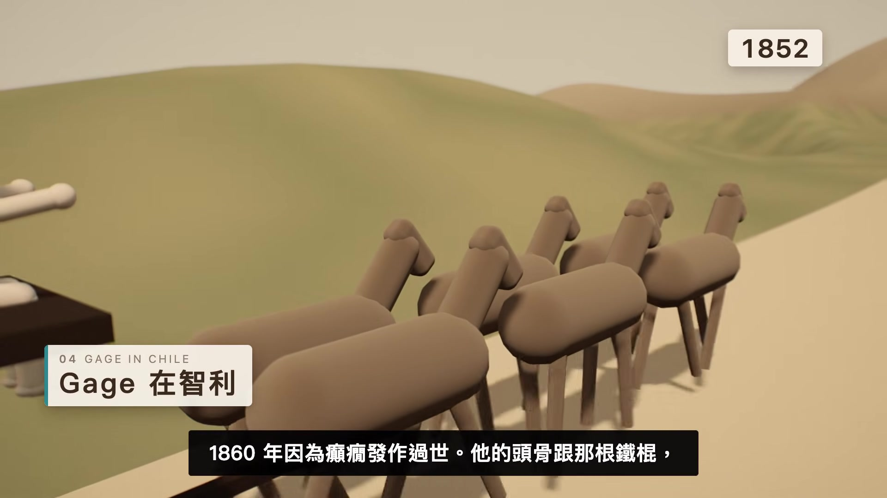

**逐字稿片段：** 他的頭骨跟那根鐵棍 今天收藏在哈佛大學醫學院的博物館 這個故事告訴我們兩件事 大腦受傷確實可能改變行為 可是一個好故事 很容易被講得比證據更大 這件事 我們在這一集後面還會再遇到 13年後 巴黎的一位醫生 用一個安靜得多的方式 把大腦的分工往前推了一步

**話題推測：** 展示Gage的頭骨與鐵棍照片

---

## 00:05:27

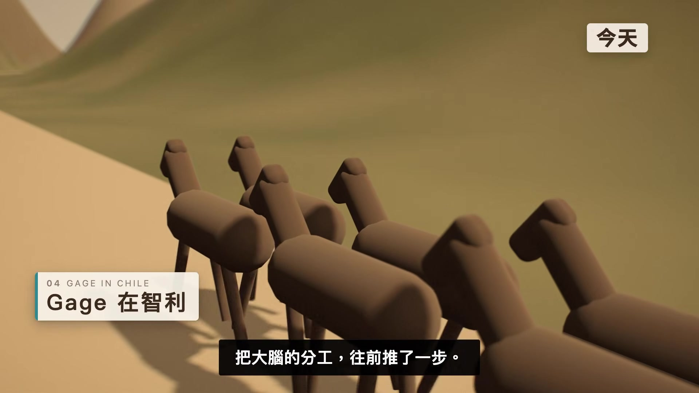

**逐字稿片段：** 1861年4月 巴黎 醫生Paul Broca 遇到一位病人叫Lebogne 他聽得懂別人說話 也能用手勢回答 可是20多年來 他自己能說出口的 幾乎只有一個音 Ten 醫院裡的人就叫他Ten 他過世以後 Broca檢查他的大腦 發現左邊額葉的下方

**話題推測：** 開啟Paul Broca與大腦分工的故事

---

## 00:05:44

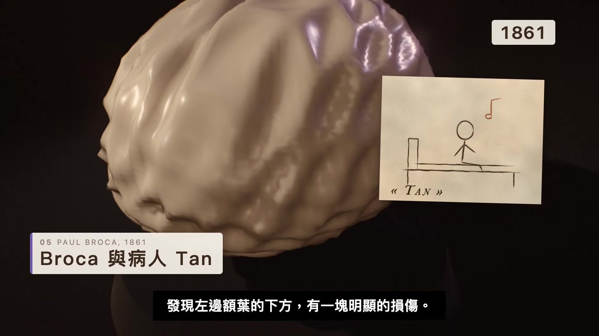

**逐字稿片段：** 有一塊明顯的損傷 接下來幾年 Broca又看了更多 說不出話的病人 1865年 他提出 說話這件事 跟左腦的關係特別深 這一塊區域 後來被叫做Bloca's area 中文叫布洛卡區 它跟爐香穴差在哪裡 爐香穴摸的是頭骨 外面靠的是挑選粒子 Bloca看的是大腦本身 一個病人去對照 而且別的醫生 可以拿自己的病人來檢查 他說的對不對 同樣是說 大腦的某一塊 跟某件事有關 一個是挑出來的 一個是可以被別人重複檢查的 從這裡開始 大腦有分工 變成了一件可以研究的事 可是大腦為什麼會長成這樣 人為什麼生來 就會有某些表情 某些反應 要回答這一題 得把時間往前推得非常遠

**話題推測：** 展示Broca's area（布洛卡區）的大腦圖示

---

## 00:06:26

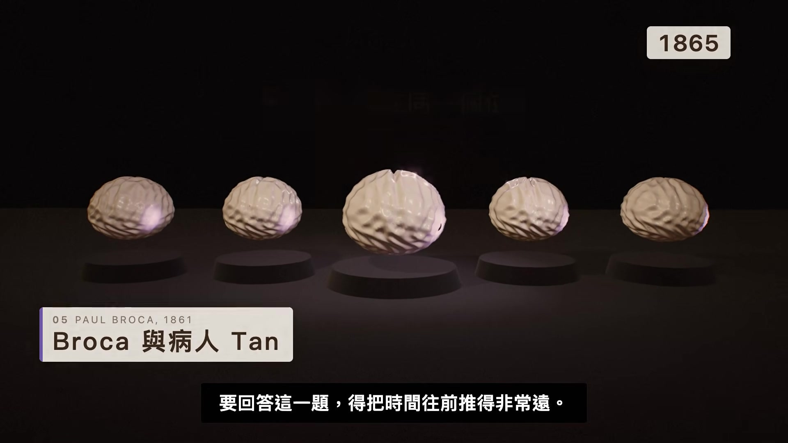

**逐字稿片段：** 1872年 英國的Charles Darwin出版了一本書 叫The Expression of the Emotions in Man and Animals 人和動物的情緒表達 在這之前 他已經提出了演化論 說人跟其他動物有共同的祖先 這本書把同樣的想法用在表情上 他問生氣的時候露出牙齒 驚訝的時候張大眼睛 這些是學來的還是生來就有的 他的方法很特別 他寄出一份問卷 給在世界各地的傳教士 旅行者和觀察者

**話題推測：** 介紹Charles Darwin及其《人和動物的情緒表達》一書

---

## 00:06:53

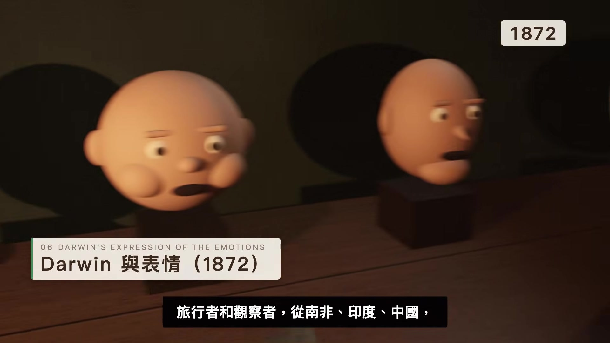

**逐字稿片段：** 從南非印度中國到澳洲和北美洲 問卷上問的是 你身邊的人驚訝的時候會不會張大眼睛 害羞的時候會不會臉紅 他也把表情的照片拿給家裡的客人看 請他們說出這是什麼表情 未來的答案有很多相似的地方 當然那些回信也帶著當時殖民者的偏見 這是今天讀這本書要知道的 Darwin的結論是 很多表情不是哪一個文化發明的 是人類共有的 有些在動物身上也找得到相似的樣子 行為從這裡開始也有了一段演化的歷史 可是接下來 有人把遺傳這個想法 帶往了另一個方向 達文有一位表弟

**話題推測：** 展示Darwin問卷調查的全球範圍地圖

---

## 00:07:27

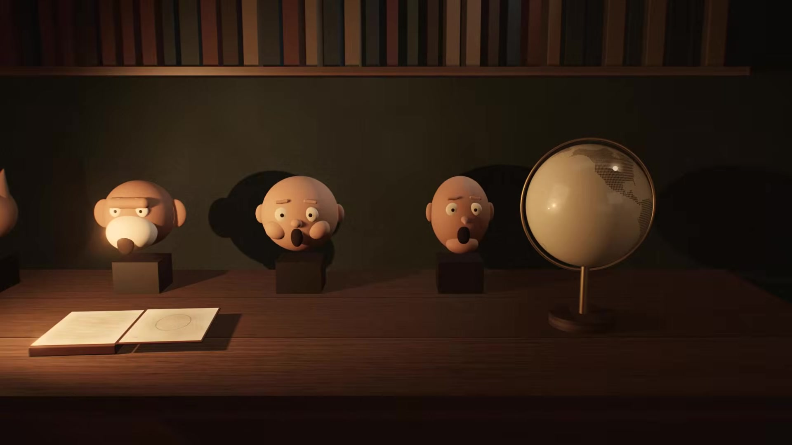

**逐字稿片段：** 叫Francis Galton 兩個人有同一位祖父 Galton讀了演化論以後 想到另一件事 如果身體的特徵會遺傳 那才能跟個性 是不是也會 他去研究名人的家族 發現有名的人 親戚裡比較容易出現有名的人 他把這當成 才能會遺傳的證據 可是出身名門的孩子 也有比較好的教育 人脈跟機會 在他的資料裡 這兩件事分不開 1875年 他寫了一篇文章 把天生跟後天分開來看 這個點子 後來變得非常重要 1883年 他造了一個新詞

**話題推測：** 介紹Francis Galton與遺傳研究

---

## 00:07:59

**逐字稿片段：** Eugenics 中文叫優生學 他的主張是 社會應該鼓勵某些人 多生小孩 讓另一些人少生 甚至不要生 好讓下一代變得更好 誰算好 誰算不好 由誰來決定 在當時 答案往往是 有錢有地位的人 一個關於遺傳的科學問題 就這樣被變成了一個 關於誰可以生小孩的政策 優生學在20世紀初 走進了很多國家的法律

**話題推測：** 介紹「優生學」（Eugenics）概念

---

## 00:08:21

**逐字稿片段：** 1907年 美國印第安納州 通過了第一步強制絕育的法律 絕育 就是用手術讓一個人不能生小孩 被盯上的 通常是被認定智力不足的人 有精神疾病的人 坐牢的人 很多時候也包括窮人

**話題推測：** 美國印第安納州通過第一部強制絕育法的時間點

---

## 00:08:33

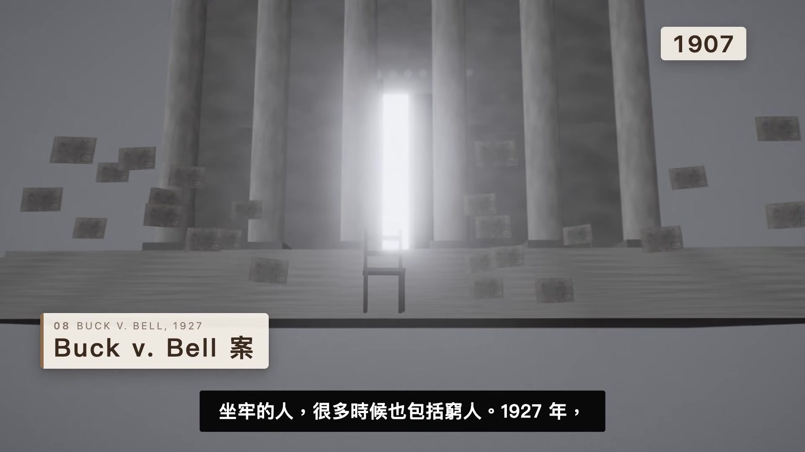

**逐字稿片段：** 1927年 美國最高法院審理一個案子 主角是一位年輕女性叫凱瑞巴 州政府說 她跟她的母親 她的女兒 都智力不足 所以要替她絕育 最高法院以8比1 判州政府可以這麼做 判決書裡有一句話 後來很有名也很刺耳 三代都是低能 已經夠了 後來的研究發現 Carrie Buck並不像判決說的那樣 她的女兒在學校 還上過成績優良的名單 從1907年到1960年代 美國有好幾萬人 在各州的法律下被絕育 決定誰該被絕育的 往往不是生物學的證據 是當時社會對窮人病人弱勢族群的看法 只是被說成了科學 而這個判決到今天都沒有被正式推翻 優生法不只出現在美國

**話題推測：** 介紹美國最高法院審理的《Buck v. Bell》案

---

## 00:09:14

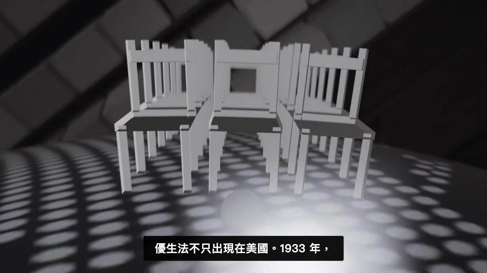

**逐字稿片段：** 1933年 納粹德國通過了絕育法 他的條文跟美國優生學者擬出來的範本法很接近 美國大屠殺經典博物館估計 在這部法律下大約40萬人被強制絕育 後來納粹用同樣的理由 殺害了大量的身心障礙者 這條路不只出現在獨裁國家

**話題推測：** 提及納粹德國通過的絕育法

---

## 00:09:31

**逐字稿片段：** 瑞典從1935年起實施絕育法 到1975年為止好幾萬人被絕育 其中很大一部分是被強迫 或者在壓力下才同意的 1999年瑞典國會通過法律賠償這些人

**話題推測：** 提及瑞典實施絕育法

---

## 00:09:43

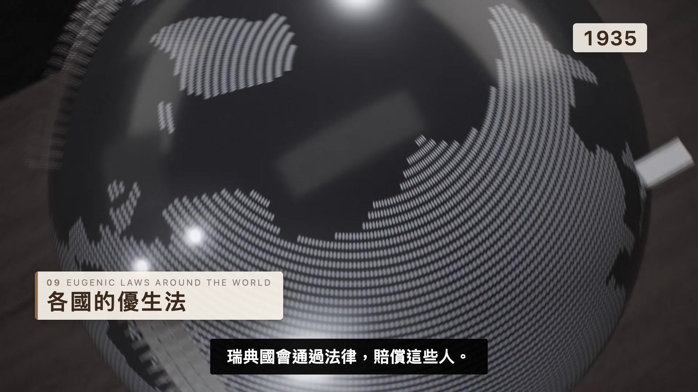

**逐字稿片段：** 日本在1948年通過了優生保護法 一直到1996年才把優生的條文刪掉 兩萬多人被絕育 其中大多數沒有經過本人同意

**話題推測：** 提及日本通過優生保護法

---

## 00:09:53

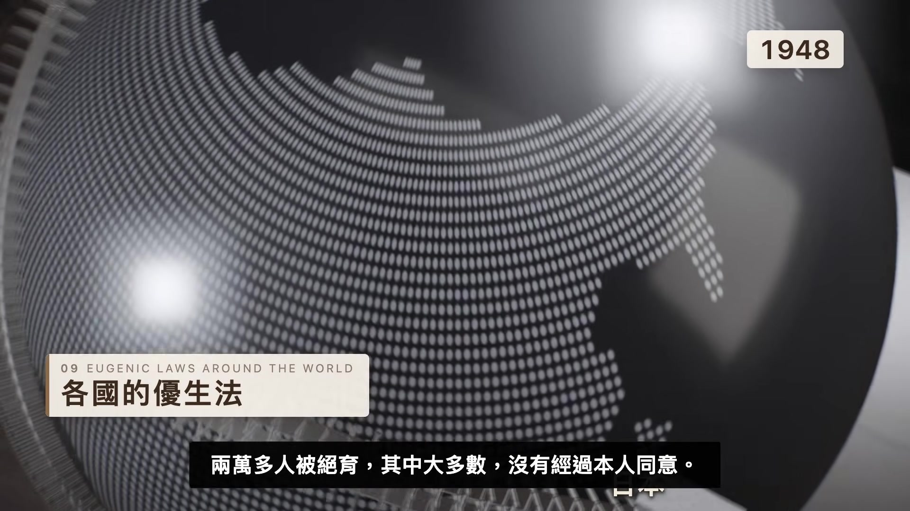

**逐字稿片段：** 2024年7月 日本最高法院判決 這部法律違反憲法 國家要賠償 這些國家有獨裁的也有民主的 他們有一個共同的想法 行為跟能力是遺傳的 而且可以由別人來決定 誰的遺傳值得留下來 幾乎同一個時期 另一個想法也走進了醫院 這一次動的是大腦本身 還記得Gage嗎 他受傷的地方是額葉

**話題推測：** 日本最高法院判決優生保護法違憲的新聞畫面

---

## 00:10:14

**逐字稿片段：** 1930年代 由醫生開始反過來想 如果嚴重的精神疾病 跟大腦的某一塊有關 能不能用手術 把那一塊跟其他部分切開 1935年11月 在葡萄牙里斯本神經科醫生 Agus Moniz主導 外科醫生Almeda Lima動刀 替精神病院的病人做了一種手術 切斷額葉跟大腦其他部分的連結 這種手術 後來叫做lobatomy 中文叫腦白質切除術 Moniz報告說 有些病人變得比較安靜 比較不焦慮

**話題推測：** 開啟腦白質切除術（lobotomy）的討論

---

## 00:10:41

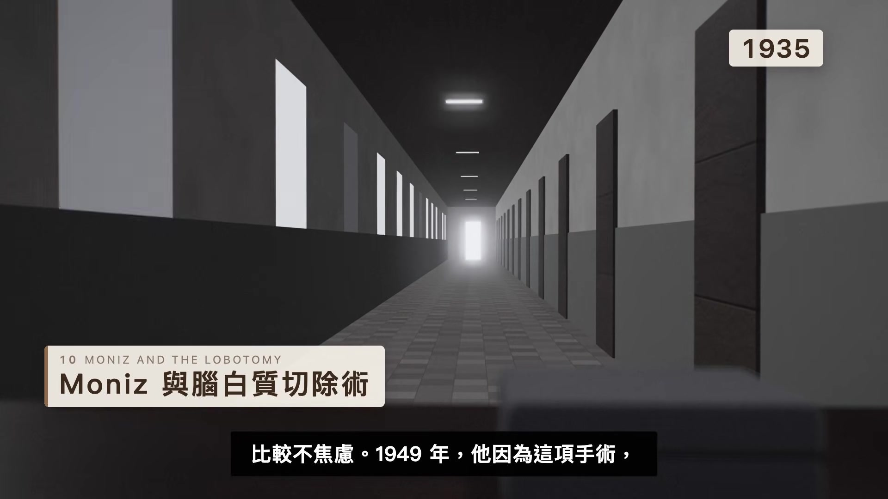

**逐字稿片段：** 1949年 他因為這項手術 拿到了諾貝爾生理醫學獎 在美國 醫生Walter Freeman 把手術改良得更快更簡單 到各地的醫院推廣 美國一共做了好幾萬例 很多病人手術以後變得遲鈍 失去主動做事的能力 有些人一輩子都需要別人照顧 1950年 蘇聯禁止了這種手術 理由是它違反人道 其他國家的醫生 也越來越多人質疑 這一段我第一次讀到的時候 最難接受的 不是這種手術曾經存在 是它曾經拿到醫學最高的肯定 到今天 諾貝爾獎沒有被撤回 也一直有人要求撤回 腦部手術的年代 還留下了另一個改變神經科學的人

**話題推測：** Moniz因腦白質切除術獲得諾貝爾獎

---

## 00:11:16

**逐字稿片段：** 1953年9月 美國康乃狄克州 一位27歲的年輕人 為了治療很嚴重的癲癇 接受了手術 外科醫生William Scoville 切除了他大腦兩側伸出的一部分 其中包括一個叫Hippocampus的構造

**話題推測：** 介紹病人HM（Henry Molaison）的案例

---

## 00:11:29

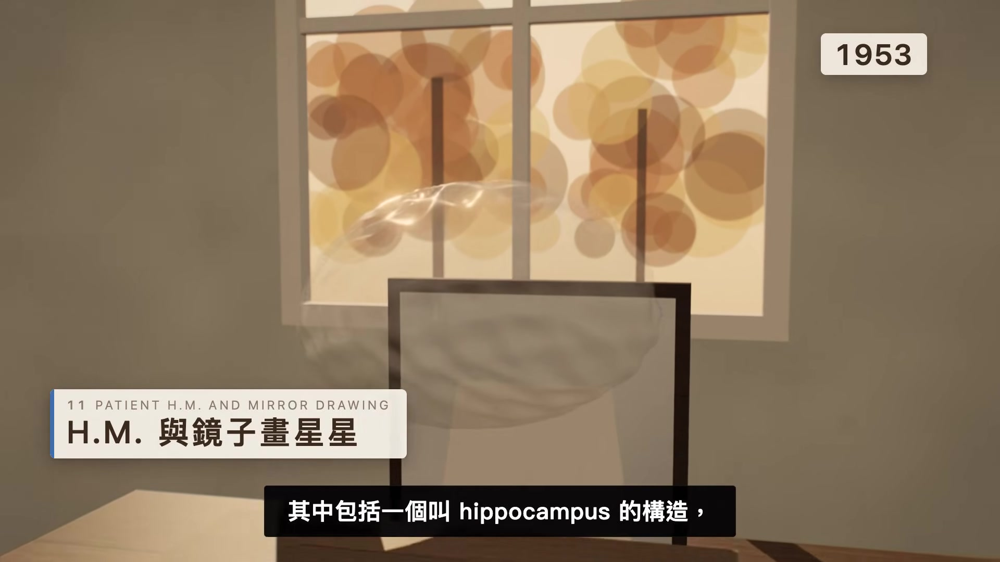

**逐字稿片段：** 中文叫海馬迴 癲癇減輕了 可是從此以後 他幾乎記不住任何新的事 研究上用他名字的縮寫 叫他HM 他在2008年過世以後 大家才知道他的名字 Henry Moleson

**話題推測：** 展示大腦「海馬迴」（Hippocampus）的結構圖

---

## 00:11:40

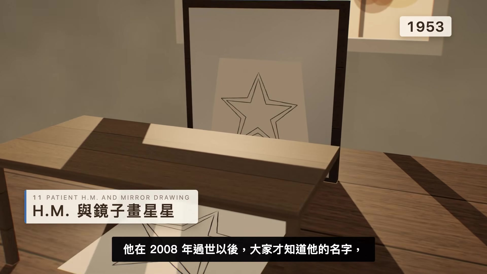

**逐字稿片段：** 加拿大的心理學家Brenda Milner 請他做一件事 看著鏡子 沿著一顆星星的輪廓劃線 鏡子裡左右顛倒 一開始誰都畫得歪歪扭扭 HM連著三天 每天練習十次 畫得一天比一天好 可是每一天開始的時候 他都說自己沒有做過這件事 他學會了 卻不知道自己學過 這讓科學家看到 記得一件事 跟學會一個動作 用的是大腦裡不同的系統 我們身上有一部分的學習 是在我們自己沒有察覺的地方發生的 這也讓開場那個問題 變得更不簡單 走到這裡 原因已經從他這個人 走進了身體 Gage跟Blocker的病人 讓我們看到大腦的某一塊受了傷 行為會跟著變 Dawn 讓我們看到表情有很長的演化歷史 HM 讓我們看到有些學習 連本人都不知道 這些發現 到今天都站得住 可是同一段歷史裡 優生學把一個還很粗糙的遺傳想法 變成了決定誰能生小孩的法律 腦白質切除術 把大腦有分工 變成了一場手術 出問題的地方很像 都是把一個發現 當成整個人的答案 再拿來替別人做決定 在天生跟後天這場爭論裡 這一部分的故事 大多站在天生那一邊 答案在身體裡 在血統裡 另一群科學家 其實早在20世紀初 就走上了另一條路 他們說 行為是學來的 天生跟後天 從這裡開始正面交鋒 20世紀初 俄國聖彼得堡

**話題推測：** 介紹Brenda Milner與HM的畫星星實驗

---

## 00:12:55

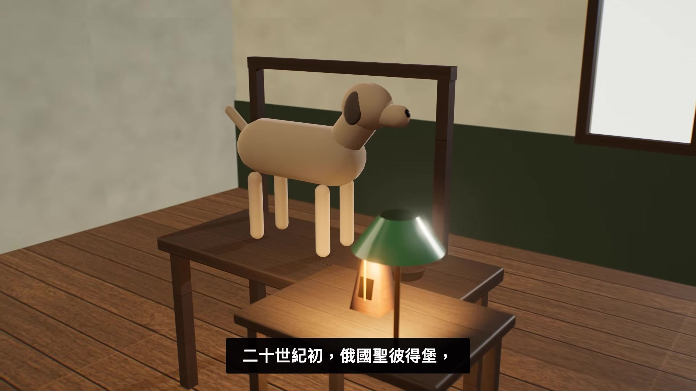

**逐字稿片段：** 生理學家艾萬·佩佩羅 在研究狗的消化 他在1904年 拿到諾貝爾生理醫學獎 得獎的理由 就是消化的研究 實驗作者作者 他注意到一件事 狗不止在吃到食物的時候流口水 看到餵食的人 聽到餵食線的聲音 也會開始流口水 他把一個聲音 跟食物一再配在一起出現 後來只有聲音 沒有食物 狗也會流口水 這個現象叫conditioned reflex

**話題推測：** 介紹Ivan Pavlov（艾萬·佩佩羅）的狗消化研究

---

## 00:13:17

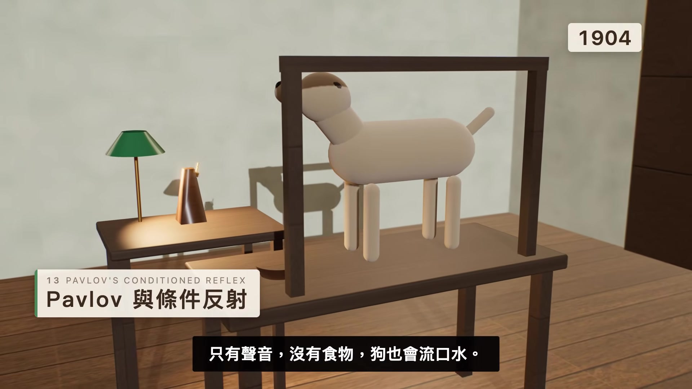

**逐字稿片段：** 中文叫條件反射 很多人記得的畫面 是一個鈴鐺 他的實驗室 其實用過很多種訊號 節拍器 哨子 風鳴器 都有 這件事的意思是 一個本來沒有意義的訊號 可以透過經驗 接上身體的反應 你聽到手機的提示音 就想把手機拿起來 背後有類似的道理 行為不見得在出生的時候 就寫好了 經驗可以把它接上去 這個想法傳到美國 被推到了很遠的地方

**話題推測：** 展示Pavlov「條件反射」（conditioned reflex）實驗的圖像

---

## 00:13:43

**逐字稿片段：** 1913年 美國心理學家John Watson 發表了一篇文章 主張心理學只研究 看得見的行為 不要再去猜心理在想什麼 這個學派叫Behaviorism 中文叫行為主義 他後來在書裡 寫了一段很有名的話 給我一打健康的嬰兒 讓我用我自己安排的環境 把他們養大 我保證隨便挑一個 都能把他訓練成 我想要的任何一種人 醫生 律師 藝術家 甚至乞丐和小偷 不管他的天分 喜好 或是祖先是什麼人 很少人會引用的 這下一句 他說 我承認 我說的已經超出了 我手上的事實 在那個年代 這段話有它的意義 優生學說 你的命運 寫在你的家族裡 Watson說 不是這樣 給我環境 什麼人都養得出來 可是這兩種說法 有一個共同點 他們都把行為的原因 放在一個人自己之外 一邊放在血統 一邊放在環境 行為主義走得最遠的人 是哈佛的心理學家

**話題推測：** 介紹美國心理學家John Watson與「行為主義」（Behaviorism）

---

## 00:14:34

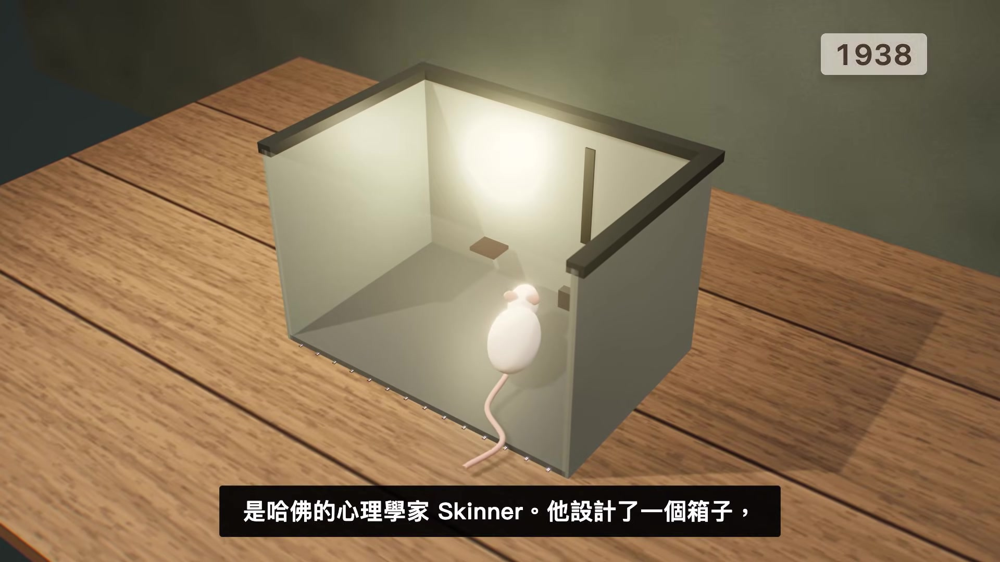

**逐字稿片段：** Skinner 他設計了一個箱子 裡面有一根槓桿 老鼠壓下槓桿 就會掉出一顆食物 老鼠很快就學會一直去壓 大家後來把這種箱子 叫做Skinner Box 石金蠟箱 他研究的是一種 叫Operant Conditioning的學習 中文叫操作制約 意思是 一個行為之後 跟著什麼結果 會決定這個行為 以後多長出現 有獎勵行為變多 沒有好處行為慢慢變少 1971年Skinner出了一本書 書名叫Beyond Freedom and Dignity 中文是超越自由與尊嚴 他主張我們以為是自己做的選擇 其實是過去的獎勵和懲罰 一點一點塑造出來的 所以與其談自由 不如好好設計環境 回到這一集的問題 一個人做的事 有多少是自己決定的 Skinner的答案非常接近 沒有 可是有一群在野外觀察動物的人 越看越覺得事情沒有這麼簡單 這些人研究的是 是動物在自己的生活裡 本來就會做的事

**話題推測：** 介紹心理學家Skinner與其設計的「Skinner Box」（史金蠟箱）

---

## 00:15:25

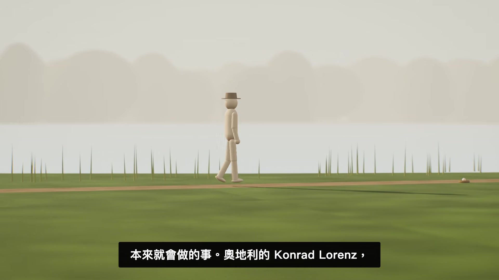

**逐字稿片段：** 奧地利的Conrad Lawrence 在家裡養灰燕 他發現小燕破殼以後 會跟著他看到的 第一個會動的東西走 通常是媽媽 可是如果那時候出現的是 Lawrence小燕 就一路跟著他 這個現象叫imprinting 中文叫明映 Lawrence不是第一個 看到這件事的人 可是他把它研究得很仔細 明映很像學習 小燕要跟著誰 是經驗決定的 可是他又跟Skinner 箱子裡的學習不一樣 他只在出生後 很短的一段時間裡發生 錯過了 早就準備好了 就是去認一個 要跟著的對象 動物會學 可是學什麼 什麼時候學 有一部分是天生安排好的 Lawrence的故事 也有黑暗的一面 1938年 他加入了納粹黨 還在文章裡 用過種族衛生的說法 他晚年表示後悔 可是很多人覺得 他的反省不夠 他的科學貢獻是真的 他的錯誤也是真的 這兩件事要一起記得 另一位是荷蘭的 Nicole Timbergan 他研究一種小魚 叫刺魚 到了繁殖的季節 熊魚的肚子會變紅 會去攻擊其他紅肚子的熊魚 Tim Bergen做了幾個很粗糙的模型 一個做得很像魚 可是肚子不紅 一個只是一塊形狀很怪的東西 下面塗成紅色 熊魚 那塊塗紅的東西 攻擊得比較兇 觸發這個行為的 是一個很簡單的訊號 1963年Tim Bergen寫了一篇文章說 要理解一個行為

**話題推測：** 介紹奧地利科學家Konrad Lorenz（康拉德·勞倫茲）與「銘印」（imprinting）現象

---

## 00:16:41

**逐字稿片段：** 至少要問四個問題 先問這一刻身體裡發生了什麼 再問這個行為是怎麼從小長成的 接著問它對生存和繁殖有什麼用 最後問他在演化上是怎麼一路變過來的 這四個問題不是四個互相競爭的答案 是同一個行為的四個面 天生跟後天 在這張表上不用二選一 他們只是不同的問題 這四個問題 在這一集的最後會再出現一次 同一個時期

**話題推測：** 展示Tinbergen的理解行為的四個問題圖示

---

## 00:17:07

**逐字稿片段：** 德國的Carl von Fritsch在研究蜜蜂 他發現找到花的蜜蜂回到蜂巢 會跳一種八字形的舞 舞中間那一段直線的方向 告訴同伴花在哪個方向 跳的時間長短 告訴同伴花有多遠 這個說法在1960年代被質疑過 有人認為蜜蜂靠的是氣味 2005年 研究者用雷達追蹤蜜蜂的飛行 證實它們確實照著舞的資訊飛

**話題推測：** 介紹德國科學家Karl von Frisch（卡爾·馮·弗里希）與蜜蜂的舞蹈

---

## 00:17:30

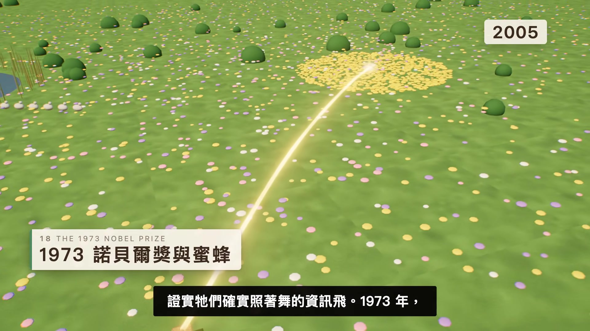

**逐字稿片段：** 1973年諾貝爾生理醫學獎 頒給了Fong, Fritch, Lawrence 跟Tim Bergen三個人 理由是 他們發現了個體跟群體行為模式 是怎麼組織起來 又是怎麼被引發的 這門學問叫Ethology 中文叫動物行為學 它跟行為主義最大的不同 是它到動物自己生活的地方 去看他們本來就會做的事 到這裡天生和後天的爭論 出現了一個新的說法 動物會學習 可是學習這個能力本身也是演化留下來的 下一個問題跟愛有關

**話題推測：** 提及Lorenz、Tinbergen、von Frisch共同獲得諾貝爾獎

---

## 00:17:58

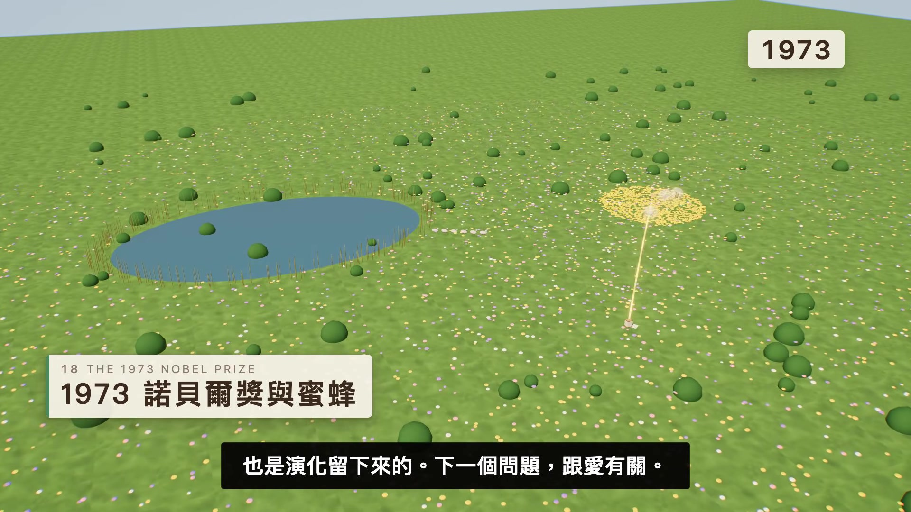

**逐字稿片段：** 1958年美國心理學家Harry Harlow 發表了一場演講 題目叫The Nature of Love 愛的本質 當時很多心理學家相信嬰兒愛媽媽 是因為媽媽給他吃的所謂的愛 就是吃飽的獎勵 Harlow用小猴子做實驗 他做了兩個假媽媽 一個用鐵絲做成 身上裝著奶瓶 一個用布包起來 軟軟的沒有奶 小猴子只有在餓的時候 去鐵絲媽媽那邊喝奶 其他的時間幾乎都抱著布媽媽 遇到害怕的東西 他也是跑去抱布媽媽 被抱著被安撫的需要 沒有辦法用食物的獎勵來解釋 這個結果跟英國精神科醫生 John Bobet的Attachment Theory 中文叫依附理論互相支持 他講的是 孩子需要一個穩定 可以依靠的照顧者 可是Halo後來的實驗 把小猴子長時間隔離 造成很深的傷害 今天看來很難接受 他的學生後來說 這些實驗也推動了美國保護實驗動物的運動 回到人類身上 要分開天生跟後天 最常用的方法就是 高騰在1875年提出的那個點子

**話題推測：** 介紹美國心理學家Harry Harlow（哈利·哈洛）的「愛的本質」實驗

---

## 00:18:57

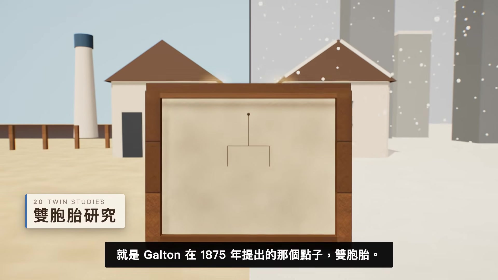

**逐字稿片段：** 雙胞胎 同卵雙胞胎 基因幾乎一樣 異卵雙胞胎 就像一般的兄弟姊妹大約一半一樣 如果某個特徵 同卵雙胞胎比異卵雙胞胎更相像 就表示這個特徵的差異跟基因的差異有關 1979年起 美國明尼蘇達大學研究了100多 從小被分開 在不同家庭長大的雙胞胎 有些人重逢的時候 發現彼此的小習慣 像得讓人驚訝 2015年 一篇整理了50年雙胞胎研究的 大型分析發現 被研究過的特徵裡 幾乎每一種差異 都有一部分跟基因有關 從這種研究算出來的數字 叫做heritability 中文叫遺傳率 它聽起來像是在說 一個特徵有幾成 是天生的 這個數字 可能是這一段歷史裡 最常被誤會的一個 遺傳率回答的 不是一個人身上 有幾層是基因決定的 他回答的是 在某一群人 某一個環境裡 大家之間的差異 有多少跟基因的差異有關 身高是最容易看懂的例子 在今天很多國家 身高的遺傳率很高 同一個地方長大的人 誰高誰矮 很大一部分跟基因有關

**話題推測：** 引入「雙胞胎研究」（Twin Studies）作為天生與後天分離的方法

---

## 00:19:57

**逐字稿片段：** 可是一份2016年的研究 整理了200個國家 100年的資料 發現男韓女性的平均身高 在這100年裡 增加了大約20公分 100年 一個民族的基因 變不了這麼多 改變的是營養 衛生 還有醫療 遺傳率很高 跟環境可以大幅改變 結果這兩件事 可以同時成立 所以當有人說 某個行為的遺傳率是五成 意思並不是你身上 有一半是天生的 你身上每一個特徵 都是基因跟環境 一起做出來的 沒有辦法切成兩半 各自算比例 那麼兩群人之間的差距呢 一位遺傳學家 用一把種子 回答了這個問題

**話題推測：** 展示2016年關於身高趨勢的研究數據圖表

---

## 00:20:32

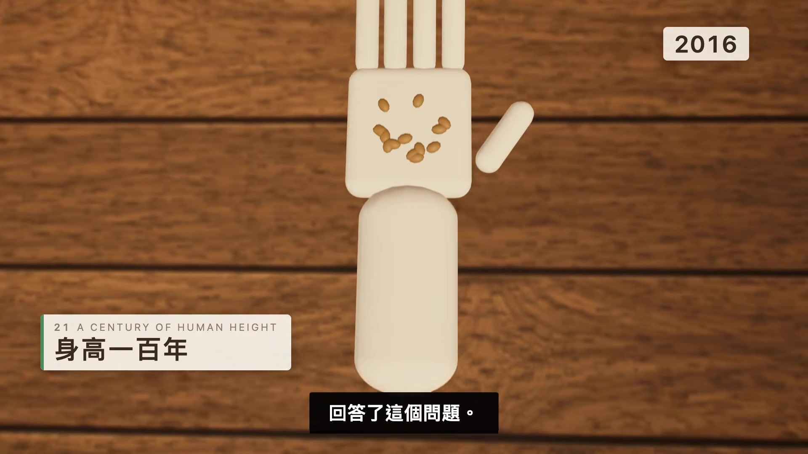

**逐字稿片段：** 1970年 美國遺傳學家 Richard Lewontin 用一個思想實驗 把這件事講得很清楚 大意是這樣的 拿一把種子 每一克的基因都不太一樣 把一半種在養分充足的盤子裡 另一半種在缺乏養分的盤子裡 在同一個盤子裡 有的長得高 有的長得矮 因為土是一樣的 這些差異都來自基因遺傳率非常高 可是兩個盤子之間 平均高度的差距跟種子沒有關係 全部來自土 所以一群人裡面差異的遺傳率很高 不能拿來證明 兩群人之間的差距是天生的 劉旺廷寫這段話的時候 美國正在爭論不同種族之間 測驗分數的差距是怎麼來的 主張這個差距是天生的 他的種子就是在回答這件事 兩年後他又發表研究 指出人類的基因差異 大部分落在同一個群體裡的人與人之間 群體跟群體之間的差異 只佔一小部分 天生跟後天的爭論 到了1975年 變成了一場公開的衝突

**話題推測：** 介紹美國遺傳學家Richard Lewontin（理查德·劉旺廷）的種子思想實驗

---

## 00:21:28

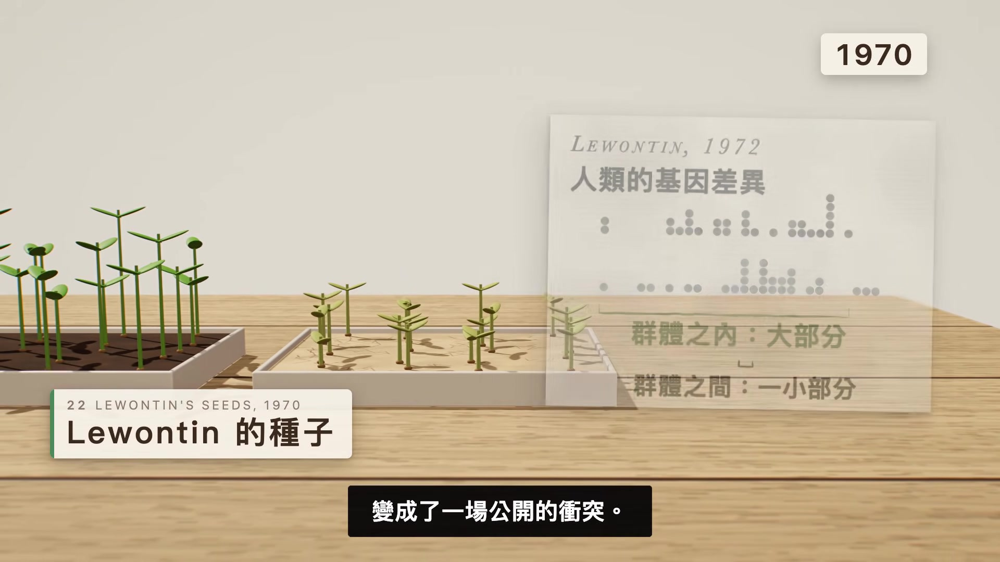

**逐字稿片段：** 1975年 哈佛的生物學家Edward Wilson 研究螞蟻出生 出版了一本很厚的書 叫Socio-Biology 社會生物學 他用演化來解釋動物的社會行為 像是合作 照顧後代 分工 全書最後一章 才談到人類就是這一章 引來的強烈的批評 同一年 包括劉汪廷在內的一群學者 聯名投書一份書評刊物 說這種理論沒有科學支持 而且他描繪出來的世界 剛好很像作者自己身處的那個社會 他們擔心的是 第一部分那段歷史 生物學又被拿來替不平等找理由 1978年2月 威爾森在美國科學促進會的年會上 準備發言 一群抗議者衝上講臺 把水倒在他頭上 還喊著指控他是種族主義者 威爾森說 描述人性從哪裡來 不是在說世界應該怎樣 今天回頭看 雙方都說中了一部分 用演化來研究人類行為 已經是正常的科學 可是每一次有人說 某件事是天性 所以無法改變 都值得多問一句 證據在哪裡 第二部分走到這裡 我們整理一下 行為主義說 行為是學來的 動物行為學說啊 學什麼 什麼時候學 有天生的安排 哈羅的小猴子說 需要被安撫 不只是為了吃飽 雙胞胎研究說 幾乎每一種特徵的差異 都跟基因有關 Rewanting的種子 說這個數字只講一群人裡面的差異 講不了一個人 也講不了兩群人之間的差距 同一把種子種在不同的土裡 結果就不一樣 基因的作用要放在環境裡才看得出來 炒了大半個世紀 這場爭論走到這裡 答案開始變成不是誰贏 是兩邊一起作用 天生跟後天不是兩個盒子 是同一件事的 兩面 所以開場那個問題 有多少是自己決定的 沒有辦法用一個百分比回答 接下來科學家走進了更小的地方 大腦裡的化學物質和一個一個的基因

**話題推測：** 介紹生物學家Edward Wilson（愛德華·威爾森）與社會生物學爭議

---

## 00:23:11

**逐字稿片段：** 1921年 奧地利的藥理學家 Otto Roi 做了一個很簡單的實驗 他後來回憶 這個點子是在 復活節前的一個晚上 在夢裡出現的 他把兩顆青蛙的心臟 分別泡在液體裡 刺激第一顆心臟上的 一條神經 這顆心臟跳得變慢了 接著 他把第一顆心臟周圍的液體 移到第二顆心臟那裡 第二顆心臟 也跟著跳慢了 也就是說 神經不只是靠電 在傳訊息 他還會放出一種化學物質 把訊息帶過去 後來大家知道 這種物質叫乙烯膽鹼 這一類物質叫做neurotransmitter 中文叫神經傳導物質 神經細胞跟神經細胞之間 有一道很小的縫 訊息要靠這些化學物質 從縫的這邊傳到那邊 1936年 Lowy和英國的Henry Dale 一起拿到了諾貝爾生理醫學獎 從這裡開始 解釋行為多了一個新的層次 化學 如果一種化學物質能改變心跳 那它能不能改變情緒和行為

**話題推測：** 介紹奧地利藥理學家Otto Loewi（奧托·勒維）的青蛙心臟實驗，揭示化學傳導

---

## 00:24:03

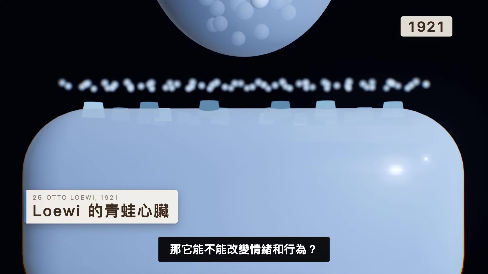

**逐字稿片段：** 答案在1952年的巴黎出現 法國的外科醫生Henry Laborit 在找一種讓病人手術前比較平靜的藥 注意到一種叫綠丙禽的藥 會讓人變得很放鬆 卻不會昏睡 巴黎的精神科醫生們 接著把它用在精神病院的病人身上 其中最有名的是Gene Delay和Pierre Daniker 有些病人原本長期處在激動和幻覺裡 用藥以後可以開始跟人說話 有些人可以出院 幾年之內 這個藥傳到了歐洲各地和北美洲

**話題推測：** 介紹綠丙禽（Chlorpromazine）藥物在精神醫學上的應用

---

## 00:24:30

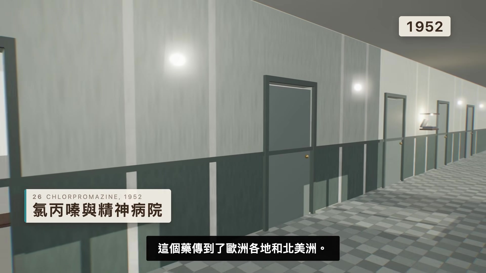

**逐字稿片段：** 美國公立精神病院的住院人數 在1955年前後 到了最高之後的幾十年大幅下降 藥物是原因之一 社區照顧的政策 健康保險的改變 法院的判決 也都很重要 還記得腦白質切除術嗎 有了這類藥物 那種手術 在1950年代之後很快變少了 可是藥也有代價 長期使用 有些人會出現自己控制不了的動作 他幫了很多人 可是有一件事他沒有做到 他沒有告訴我們 病是怎麼來的 藥有用 很容易讓人反過來推一件事 1960年代 科學家發現 一些能改善憂鬱的藥 會影響大腦裡的血清素 還有其他幾種化學物質 慢慢的一個很好懂的說法流傳開來 憂鬱症 就是大腦裡血清素不夠 化學物質失去了平衡 到了1990年代 這個說法也出現在藥品的廣告裡

**話題推測：** 展示美國公立精神病院住院人數的趨勢圖

---

## 00:25:17

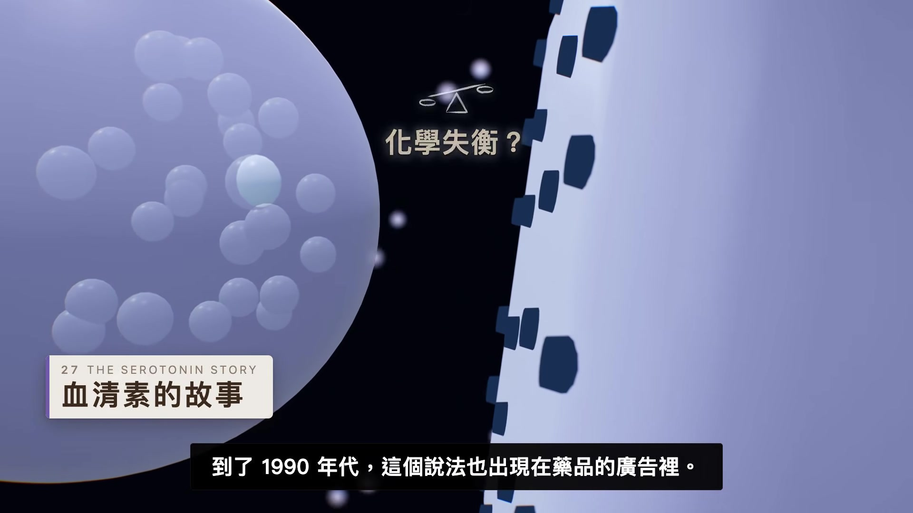

**逐字稿片段：** 2022年 英國的精神科醫生 Joanna Moncrief和同事 整理了幾十年的研究 結論是沒有一致的證據 顯示憂鬱症是血清素太低造成的 這不代表藥沒有用 另一份2018年的大型分析 比較了21種抗憂鬱藥 平均來說都比安慰劑有效 只是效果不算大 每個人的反應也差很多 藥為什麼有效 到今天還在研究 頭痛的時候吃止痛藥 頭痛會好 可是這不代表 頭痛是因為身體裡缺了止痛藥 一種藥能改變行為和情緒 不代表我們已經找到了原因 化學物質之後

**話題推測：** 提及2022年關於憂鬱症與血清素假說的新研究

---

## 00:25:47

**逐字稿片段：** 下一站是基因

**話題推測：** 話題轉向「基因」層面

---

## 00:25:49

**逐字稿片段：** 1993年 荷蘭的遺傳學家Han Brunner 發表了對一個家族的研究 這個家族裡 好幾位男性有輕度的智能障礙 也常常出現衝動的攻擊行為 他們發現 這些男性在同一個基因上

**話題推測：** 介紹荷蘭遺傳學家Han Brunner（漢·布倫納）的MAOA基因研究

---

## 00:26:02

**逐字稿片段：** 有一個很罕見的突變 讓身體做不出一種叫MAOA的酵素 MAOA的工作是 把大腦裡用過的幾種神經傳導物質分解掉 這種完整失去作用的突變 非常少見 大部分人身上的MAOA 有活性比較高跟比較低的幾種常見版本 這是另一回事

**話題推測：** 詳細說明MAOA基因的罕見突變

---

## 00:26:19

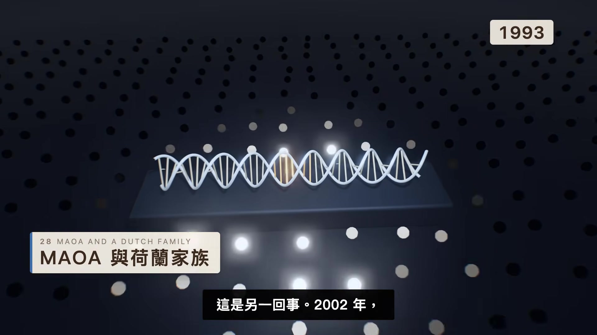

**逐字稿片段：** 2002年 研究者F.Shalom Caspi和Terry Moffitt 用紐西蘭一群從出生就被追蹤的人做研究 他們發現 帶著活性比較低版本的男性 如果小時候受過虐待 長大以後出現反社會行為的比例比較高 小時候沒有受過虐待的 就看不出這個差別 這個研究重要的地方 是他說基因的影響 要看環境 這正是劉王廷的種子在說的事 可是接下來 他被講成了一個簡單的多的故事

**話題推測：** 介紹Caspi與Moffitt的MAOA基因與環境互動研究

---

## 00:26:44

**逐字稿片段：** 2004年 一篇科學新聞的標題 把活性比較低的MAOA版本 叫做Warrior Gene戰士基因 這個綽號很好記 很快就傳開了 2006年 紐西蘭有研究者在一場會議上 把這個基因版本跟毛利人連在一起 說他可能跟一些社會問題有關 紐西蘭的醫學期刊上 很快有學者回應 沒有直接的證據支持這種關聯 這個說法把一整個族群 跟一個基因綁在一起 也忽略了殖民的歷史和社會條件 受到很多批評

**話題推測：** 提及MAOA基因的「戰士基因」（Warrior Gene）綽號

---

## 00:27:12

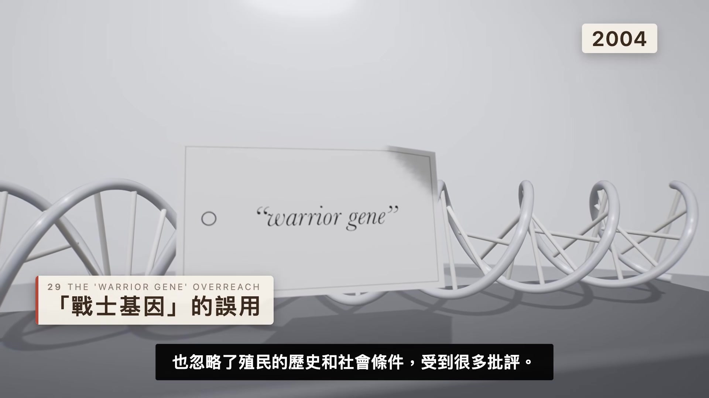

**逐字稿片段：** 2009年 意大利的一個上訴法院 在一宗殺人案裡 參考了被告好幾個基因的檢測結果 其中包括MAOA 把刑期再減了一年 後來的整合研究發現 CASP那個結果 在男性身上大致重複的出來 可是效果很小 而且帶著這個版本的人 大多數一輩子都不會有暴力行為 這是第一部分的那個錯誤 又回來了 一個有條件的發現 被縮成一個標籤 貼在一個人身上 甚至貼在一整個族群身上 那麼環境是怎麼碰到基因的 基因要看環境 那環境到底是怎麼碰到基因的

**話題推測：** 提及義大利法院引用基因檢測結果判決殺人案

---

## 00:27:42

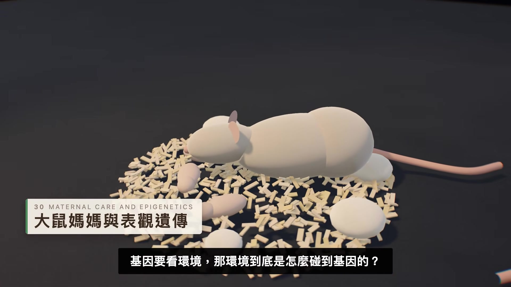

**逐字稿片段：** 其中一個答案叫epigenetics 中文叫錶冠遺傳 他研究的是 DNA上面的一些化學標記 這些標記 不會改變基因的內容 可是會影響一個基因 被讀出來的多廣

**話題推測：** 介紹「表觀遺傳」（epigenetics）概念

---

## 00:27:53

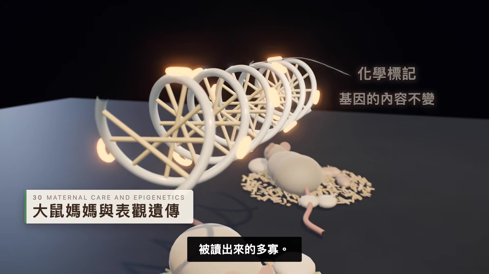

**逐字稿片段：** 加拿大麥基爾大學的 Michael Meany團隊 研究大鼠媽媽 有的媽媽 很常舔小鼠 幫它們理毛 有的很少 被舔得多的小鼠 長大以後 面對壓力比較冷靜 2004年 他們發現 這些小鼠的大腦裡 一個跟處理壓力有關的基因 上面的化學標記 跟其他小鼠不一樣 而且 把剛出生的小鼠 交給另一個媽媽養 結果是跟著養母走 不是跟著生母 照顧的方式 在基因上留下了痕跡 這是一個做得很仔細的研究 可是要從大鼠走到人 中間還有很長的一段路

**話題推測：** 介紹Michael Meaney團隊對大鼠媽媽照顧與基因標記的研究

---

## 00:28:26

**逐字稿片段：** 有一段讓人難過的歷史 後來變成了研究的資料 1944年到1945年的冬天 荷蘭西部被德軍封鎖 糧食嚴重不足 很多人捱餓 這段時間叫荷蘭飢餓冬天

**話題推測：** 引入荷蘭飢餓冬天（Dutch Hunger Winter）的人類表觀遺傳研究

---

## 00:28:37

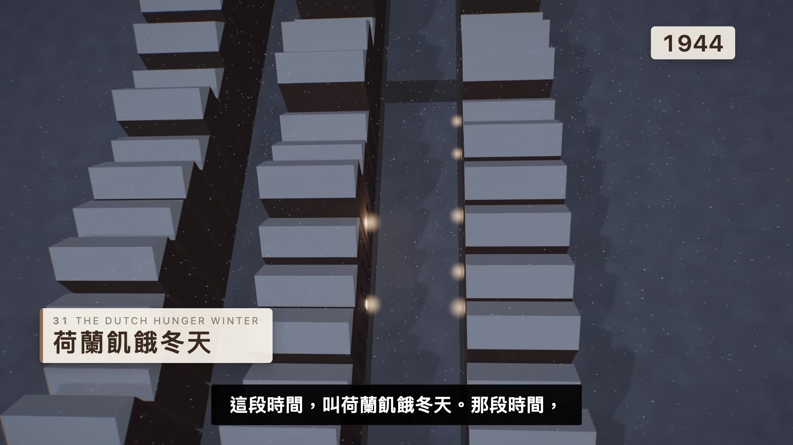

**逐字稿片段：** 那段時間還在媽媽肚子裡的孩子 後來被研究者一路追蹤 2008年的一項研究發現 大約60年後 這些人身上 一個跟生長有關的基因 化學標記 跟他們沒有經歷饑荒的兄弟姊妹 不太一樣 這個結果很重要 可是他的界限也要講清楚 差別不大 亮的是血液 也不是大腦 而且還不能證明這個標記 造成了後來的健康問題 你可能看過一種說法 說創傷會透過表觀遺傳 一路傳給孫子那一代 在人類身上 這方面的證據還很薄弱 表觀遺傳讓我們看到 環境可以在身體上留下痕跡 它還不是一個 可以解釋一切的新答案 環境留下痕跡的地方 還有另一個 就是一個正在長大的大腦 還記得一開始 那個白瓷頭像嗎 200年後

**話題推測：** 闡述荷蘭飢餓冬天對胎兒基因標記的影響

---

## 00:29:19

**逐字稿片段：** 科學家終於可以 不用摸頭骨 直接看見活人的大腦 怎麼長大 1990年代 美國國家心理衛生研究院的JGID團隊 用M-ART-I 也就是磁振照影 每隔一兩年掃描同一批孩子 一路看到他們成年 他們發現 大腦不是在小時候就長好了 大腦前面的額葉 負責計劃 忍住 衝動 想到後果 是比較晚成熟的部分 到了20歲出頭都還在改變 額葉就是Gage受傷的那一塊 你可能聽過一個說法 大腦要到25歲才發育 完畢 這個數字是被簡化過的 那些研究追蹤到的人 最大直到21歲 而且不同的人 不同的能力 時間不一樣 也沒有哪一天 會有一個開關突然打開 可是大方向是清楚的 青少年的大腦 跟大人的大腦不一樣 這件事後來走進了法院

**話題推測：** 引入透過磁振照影（M-ART-I）觀察活人大腦發育的研究

---

## 00:30:06

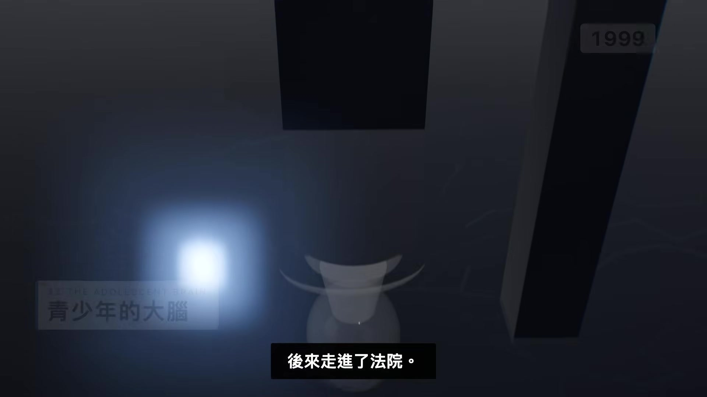

**逐字稿片段：** 2005年3月 美國最高法院判決了一個案子 叫Roper對Simmons 被告Christopher Simmons 在17歲的時候犯下謀殺 被判了死刑 最高法院以5比4判決 對犯案時未滿18歲的人判處死刑 違反憲法 多數意見寫了三個理由 青少年比較不成熟 責任感還沒長好 比較容易受到同伴和環境的影響 人格還沒有定型 還有改變的可能 美國心理學會等團體 交給法院的意見書 引用了青少年大腦發育的研究 可是判決書本身 引用的主要是心理學的研究 五年後 另一個判決就直接寫到 心理學和腦科學的發展 持續顯示青少年和成年人的心智 有根本的差異 放到全世界來看 1989年 聯合國的兒童權利公約 已經禁止對未滿18歲犯案的人 判死刑或不得假釋的無期徒刑 這一次生物學被拿來減輕懲罰 不是拿來替人貼標籤 可是他仍然沒有回答 那一個人在那一刻為什麼那樣做 要回答這一題 需要把所有的原因放回同一張圖裡 到這裡 我們手上已經有很多種原因了 大腦的某一塊 學習、本能、化學物質、基因、表觀、遺傳、發育 它們要怎麼放在一起 Tim Bergen的四個問題在這裡用得上 史丹佛大學的神經生物學家

**話題推測：** 介紹美國最高法院《Roper v. Simmons》案判決

---

## 00:31:15

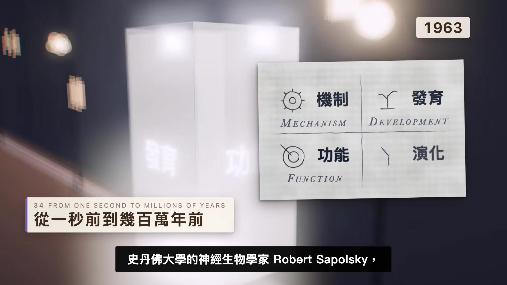

**逐字稿片段：** Robert Sapolsky 在2017年出版的書 Behave裡 把類似的問題 排成了一條時間軸 回到開場那臺 切到你前面的車 前一秒 那位駕駛的大腦裡 發生了什麼 幾分鐘前 他看到了什麼 聽到了什麼 前一天晚上 他睡了幾個小時 身體裡的荷爾蒙 是什麼狀態 再往前 是他的青春期 他的童年 他還在媽媽肚子裡的 那幾個月 再往前 是他的基因 他從小長大的文化 最後是幾百萬年的演化 每往後退一步 時間就拉長一次 而每一步 都在影響那一秒 如果你看過我們頻道上 人類行為生物學那三集 這也是Sapolsky在那門課裡 一直在用的看法 那麼把這條時間軸全部加起來 還剩下多少是他自己決定的 Sapolsky在2023年的書 Determined裡 給了一個很少科學家敢給的答案 他主張把這條時間軸全部加起來 沒有留下自由意志的位置 這個主張很有爭議 很多哲學家跟科學家不同意 有人認為就算行為有原因 一個人能停下來想一想 能改變做法 這本身就是我們說的自己決定 也有人認為 有沒有自由意志 不是科學能回答的問題 而是哲學的問題 這場爭論還沒有結束 這一集也不打算 替他下結論 可是200年的歷史裡 有一件事越來越清楚 邊賢 在很多文化裡 曾經被當成被附身 或者是道德出了問題 今天我們知道 他是大腦的疾病 憂鬱症 以前常被說成 意志不夠堅強 青少年犯錯 現在法律會考慮他的年紀 每一次 我們把一部分原因 看得更清楚 對人的判斷 就多了一點理解 可是同樣這段歷史 也告訴我們 每一次看清楚一點

**話題推測：** 介紹神經生物學家Robert Sapolsky（羅伯特·薩波爾斯基）的行為時間軸觀點

---
