# jimainotebook_JtQDKcQfdKs — 關鍵畫面索引

- 來源逐字稿：[jimainotebook_JtQDKcQfdKs_FIN.srt](jimainotebook_JtQDKcQfdKs_FIN.srt)
- 影片：https://www.youtube.com/watch?v=JtQDKcQfdKs
- 截圖數：41

## 00:00:19

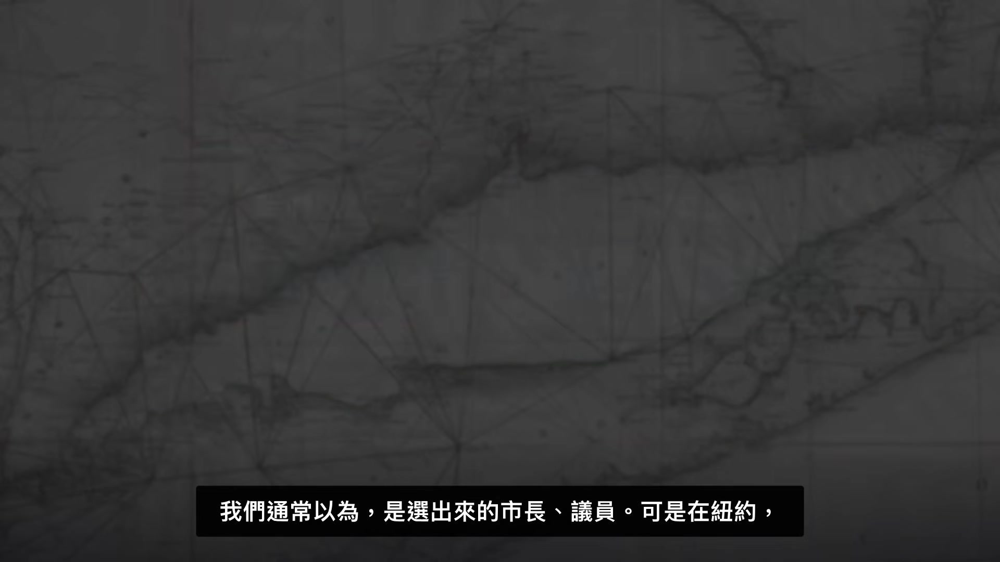

**逐字稿片段：** 可是在紐約,有一個人從來沒有當選過任何公職, 卻蓋出了這座城市大部分的橋、高速公路和海灘。 他叫Robert Moses。 整整40年,他比任何一位紐約市長、州長都有權利。 這一集要回答一個問題, 一座城市長什麼樣子,到底是誰決定的?

**話題推測：** 介紹核心人物Robert Moses。

---

## 00:00:36

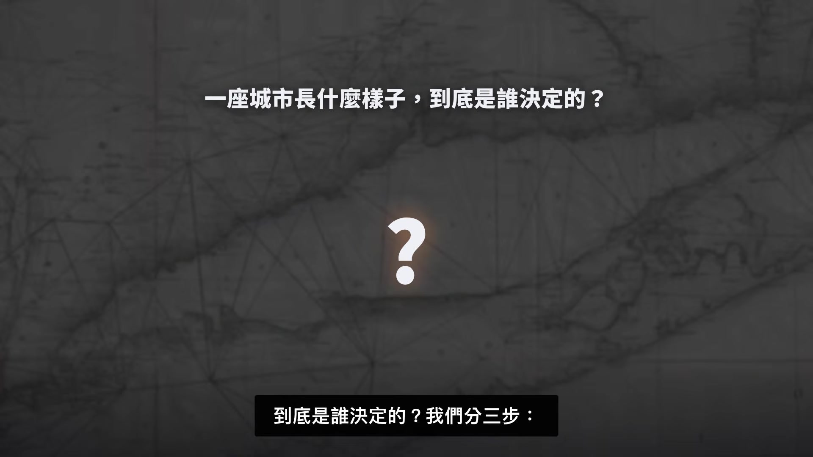

**逐字稿片段：** 我們分三步 先看Moses怎麼拿到權力 再看這份權力付出了什麼代價 最後看今天的城市 為什麼又走到了另一個極端

**話題推測：** 說明本集的三個分析步驟/重點。

---

## 00:00:44

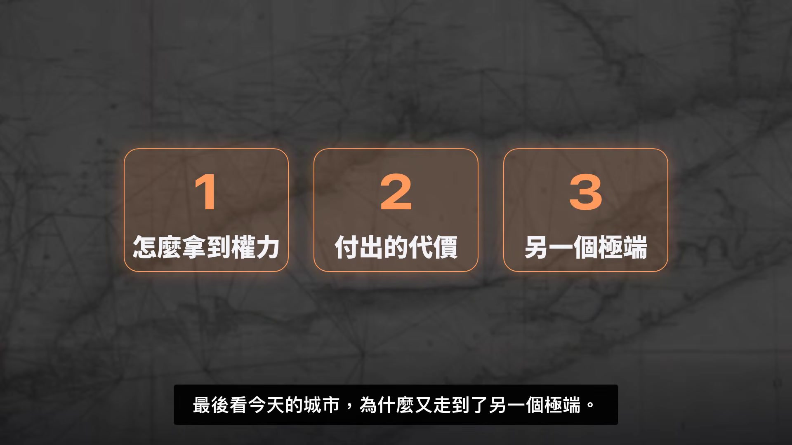

**逐字稿片段：** 先介紹這集的講者 Robert Carroll是美國的傳記作家 今年91歲 1974年他出版了Moses的傳記 書名叫The Power Broker 中文可以翻成權力前客 前客就是在中間牽線 替人促成交易的人 這本書隔年拿到普利茲獎 到今天還常被列為 最好的美國政治書之一 他花了七年寫這本書 光是為了這一本就做了大約700次訪談 原稿嚐到出版社裝不下 最後砍掉了三分之一 之後50年 他都在寫另一位美國總統佔生的傳記

**話題推測：** 介紹本集講者Robert Carroll及其著作。

---

## 00:01:15

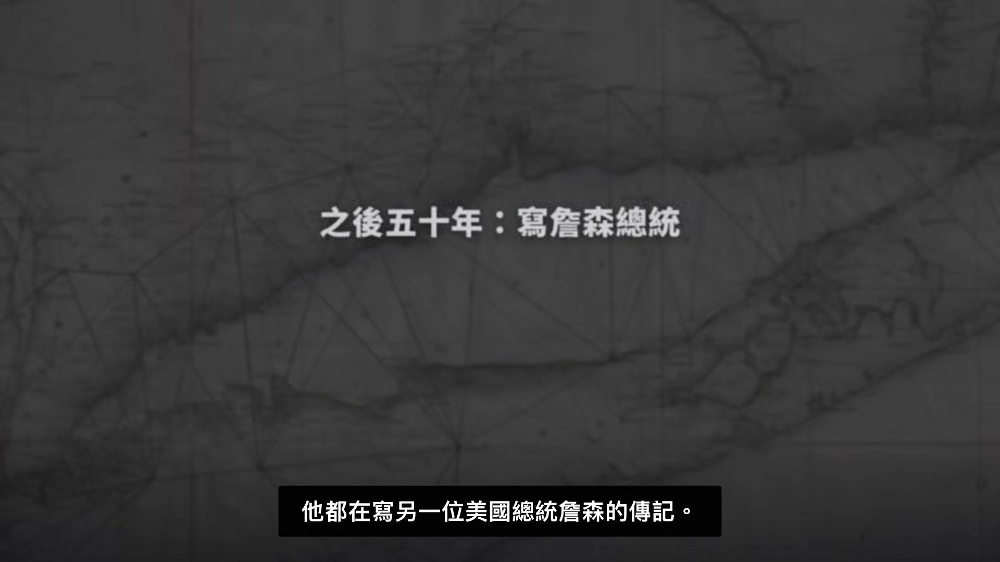

**逐字稿片段：** 今年10月底 Dwarkish Patel的訪談節目終於請到他 主持人說 做節目6年 每次有人問他最想訪問誰 答案都是Carol Carol談Moses 第一個講的不是他有多壞 而是他做到了一件大家都說做不到的事

**話題推測：** 提及Dwarkish Patel的訪談節目。

---

## 00:01:29

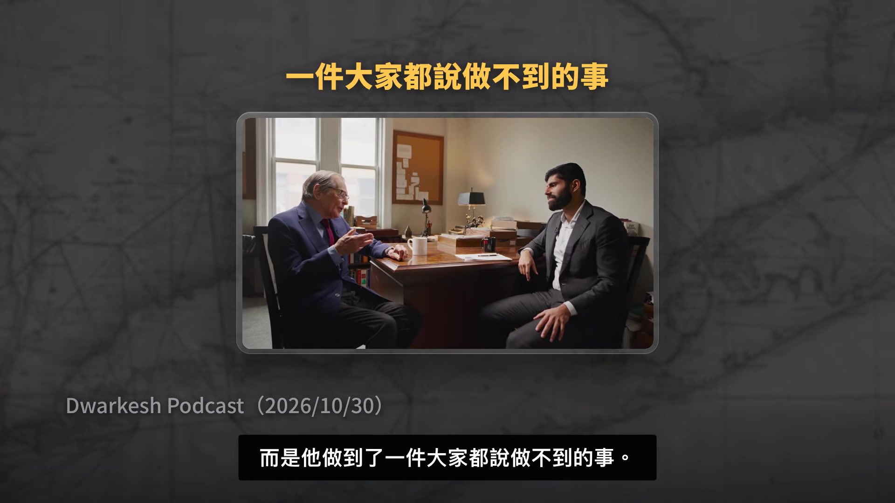

**逐字稿片段：** 1920年代的紐約 汽車越來越多 路卻還是舊的 大家說 政府什麼都蓋不出來 因為要蓋一條路就得經過幾十塊農地 地主不同意,路就停在那裡 Moses那時候還很年輕 他看到長島南邊的一片沙灘 認定這是他見過最好的海灘 問題是,紐約市的人到不了那裡 Carroll說,他就是決定 這條路一定要蓋

**話題推測：** 開始講述1920年代紐約的背景以及Moses的早期成就。

---

## 00:02:22

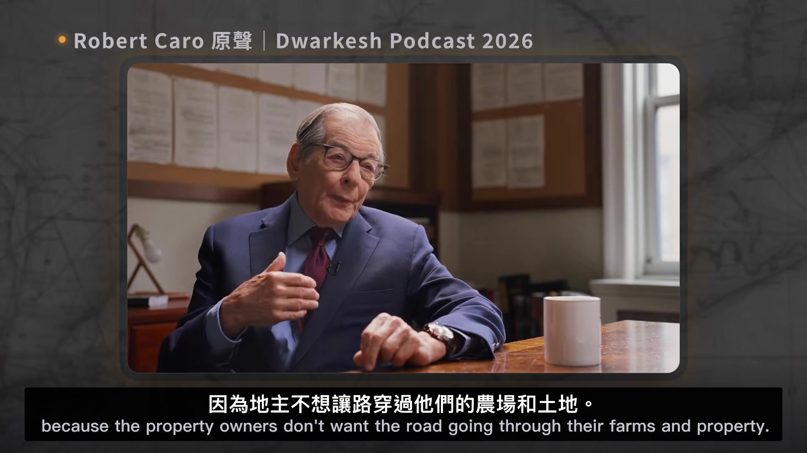

**逐字稿片段：** 1929年,Jones Beach開幕,一到夏天,海灘上擠滿從城裡來的人。 Carroll提醒,很多人沒看完他的書,就以為Moses從頭到尾都是壞人。

**話題推測：** 提及Jones Beach開幕的具體事件。

---

## 00:02:32

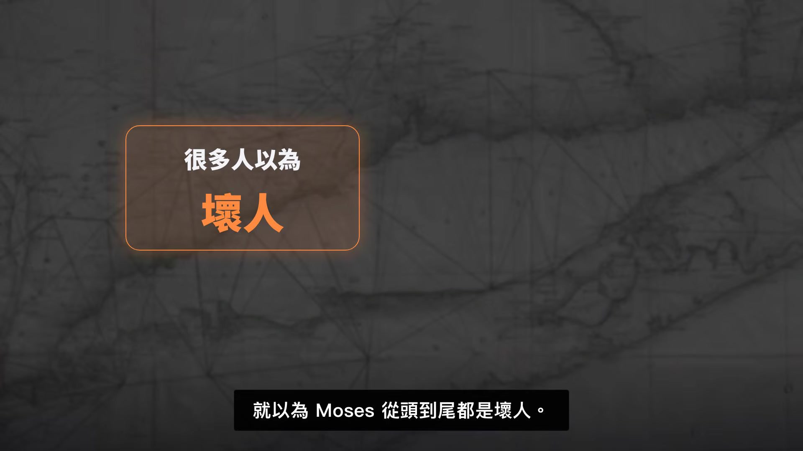

**逐字稿片段：** 其實書的前幾百頁,寫的是一個年輕的理想主義者。 Moses年輕時想改革紐約的公務員制度 讓人靠能力升遷而不是靠關係 可是當時紐約政壇被一個叫坦木尼協會的政治團體把持 他的改革一次一次被擋掉 Moses從失敗裡學到一件事 再好的理想沒有權利就什麼都做不成 所以他開始找權利 而他找到的方法不是去選舉

**話題推測：** 轉述Carroll對Moses年輕時理想主義的看法。

---

## 00:02:55

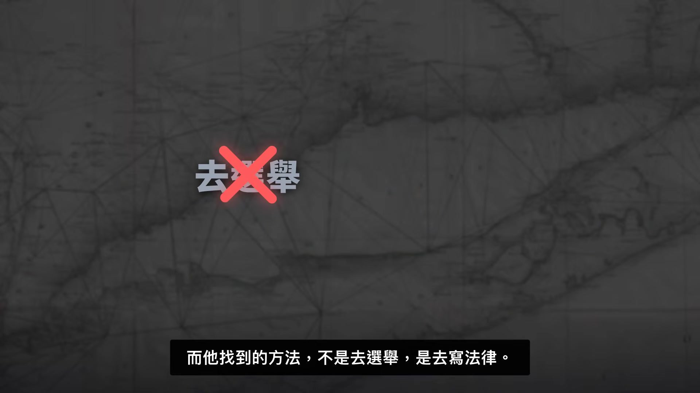

**逐字稿片段：** 是去寫法律 Moses有一個本事 他是當時紐約州議會公認最會寫法案的人 這一點最後讓他拿到了大部分的權利

**話題推測：** 說明Moses獲得權力的方式是透過撰寫法律。

---

## 00:03:03

**逐字稿片段：** 1933年紐約州通過一個法案 成立一個機構負責蓋Triborough大橋 大橋管理局 這種機構叫公共管理局 它是政府設立的公司 自己發債券借錢 蓋好橋以後收過路費還債 債還完了就把橋交給市政府 然後解散 至少大家以為是這樣

**話題推測：** 提及1933年法案與Triborough大橋管理局的成立。

---

## 00:03:21

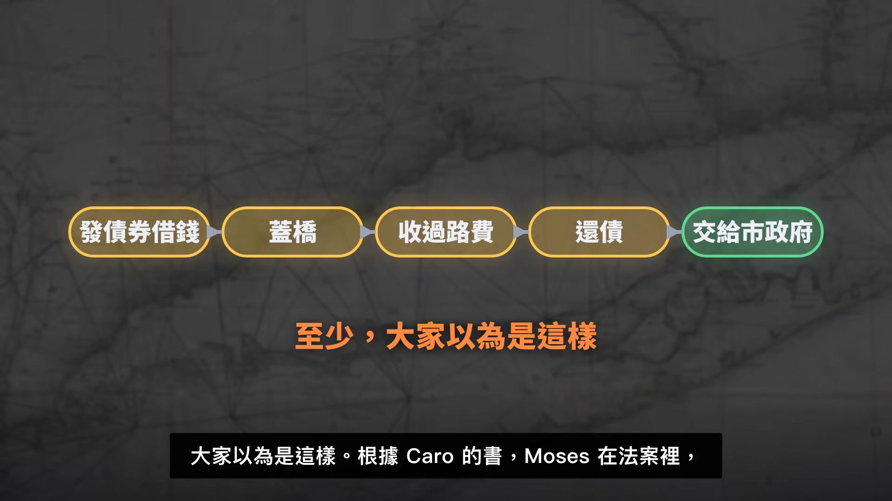

**逐字稿片段：** 根據Carroll的書 Moses在法案裡悄悄加了幾行小字 一行說管理局可以發新債去還舊債 新的錢還可以拿去做別的事 另一行說 它可以蓋跟大橋相連的道路和設施 最厲害的是第三行 這些權利可以直接寫進債券的合約裡 美國憲法規定 州政府不能立法破壞已經簽好的合約 所以債券一賣出去 議會、州長、市長都收不回這些權利 一座橋的法案 就這樣變成一個可以在紐約到處蓋東西 而且沒人能停下來的機器

**話題推測：** 說明Moses在法案中加入關鍵條款的細節。

---

## 00:03:50

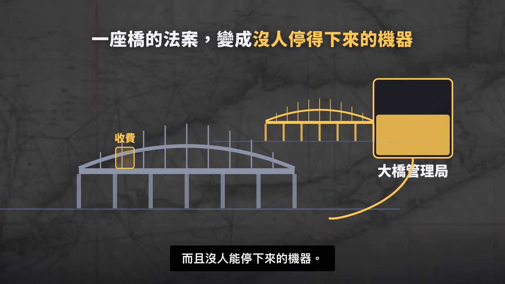

**逐字稿片段：** 他拿到的還有時機 1930年代是大蕭條 到處都是失業的人 Carol在訪談裡說 Moses要找建築師 第五大道上就排了上千個沒工作的建築師 等著被他用很低的薪水僱用 他讓工人日夜輪班整修公園和遊樂場 Carroll的書裡寫 公園開幕時 家長會帶著小孩一起喊 Moses先生!Moses先生!

**話題推測：** 說明Moses利用大蕭條的時機優勢。

---

## 00:04:12

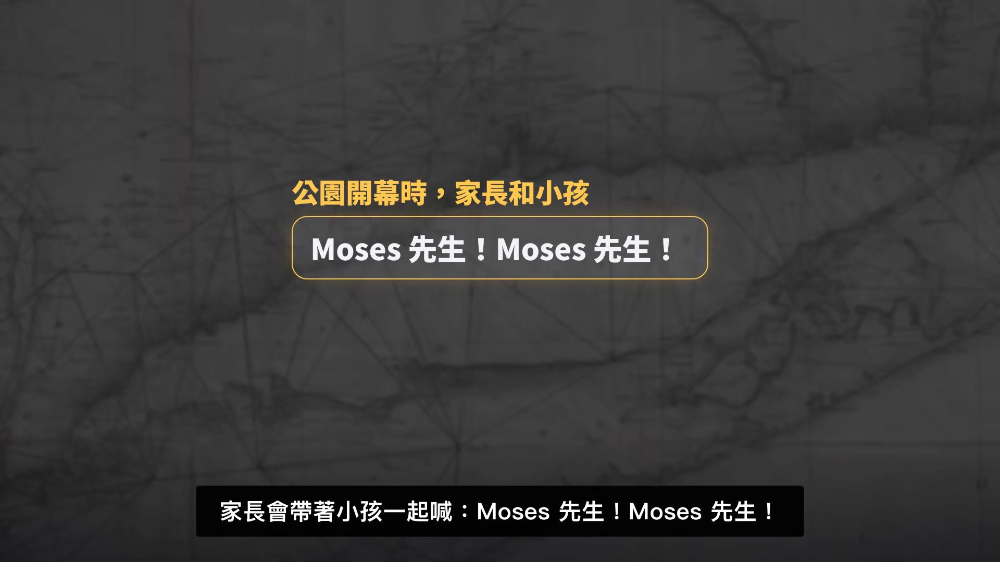

**逐字稿片段：** 他手上還有全國最大最好的規劃團隊 聯邦政府撥下大蕭條的工程款 誰的設計圖先準備好 錢就先給誰 市長如果想蓋別的東西 自己根本畫不出藍圖 只能選蓋Moses想蓋的 或者什麼都不蓋

**話題推測：** 說明Moses擁有全國最大的規劃團隊。

---

## 00:04:25

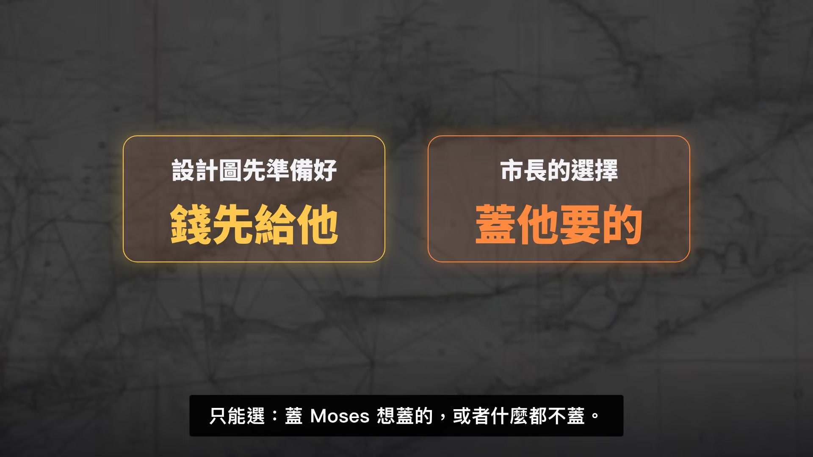

**逐字稿片段：** 錢還有另一個來源 就是過路費 橋越蓋越多 過路費源源不絕

**話題推測：** 說明資金的另一個來源是過路費。

---

## 00:04:30

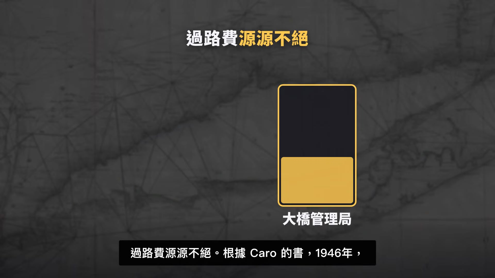

**逐字稿片段：** 根據Carroll的書 1946年 紐約市政府最多隻能借1億5千萬美元 Moses的大橋管理局卻可以借3億6千萬 是整個市政府的兩倍多

**話題推測：** 呈現1946年紐約市政府與Moses管理局的借款數字比較。

---

## 00:04:40

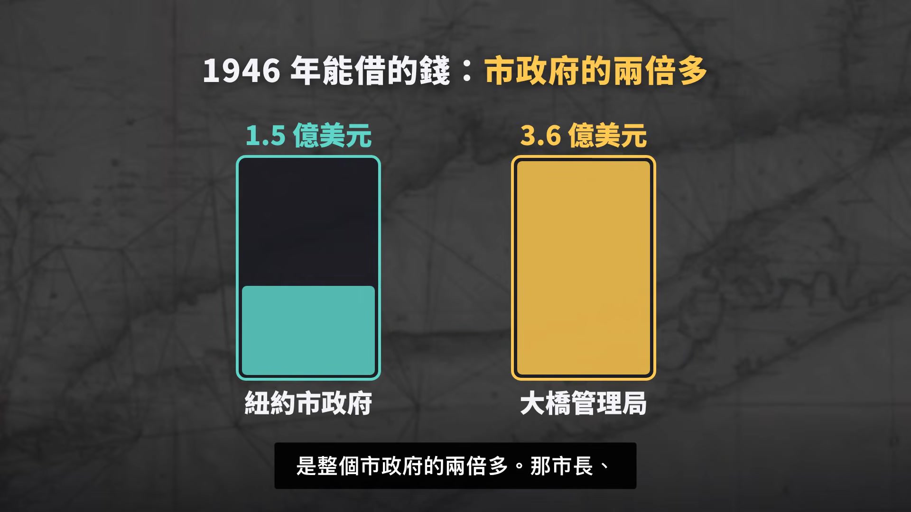

**逐字稿片段：** 那市長、州長為什麼不開除他 他明明不是民選官員 Carroll說 理論上可以 實際上辦不到 一個原因是他太受歡迎了 另一個原因

**話題推測：** 探討為何市長和州長無法開除Moses的原因。

---

## 00:04:50

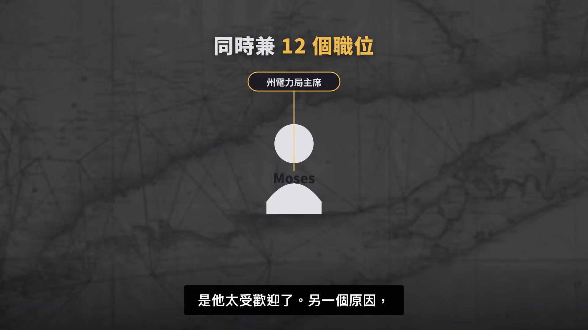

**逐字稿片段：** 是他同時兼了12個職位 有的由市長任命 有的由州長任命 任期都不一樣 有的根本沒有人有權開除他 這就像一張網 剪斷一條線 網還在 在他所有不同的職位中 總統的權力權力 總統的城堡權力 公共公務員 他設立了一個非常隱藏的 你不能把他從任何地方拘捕 因為任務的程序不同 有些你沒有權力拘捕他 他真的讓這件事變得不可能

**話題推測：** 指出Moses同時兼任12個職位。

---

## 00:05:33

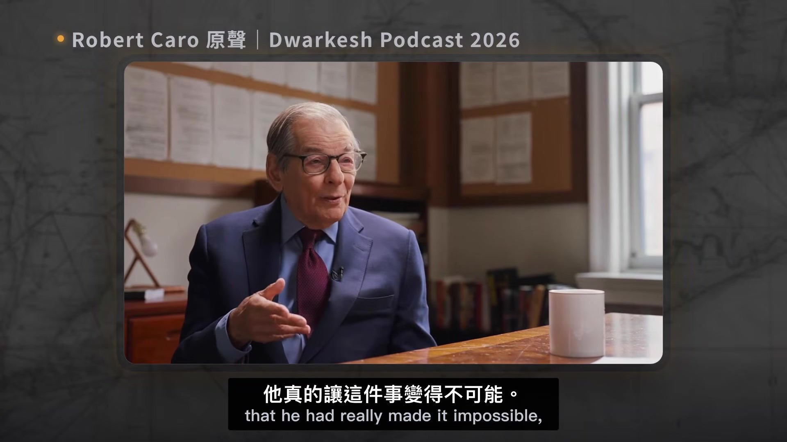

**逐字稿片段：** 第一部分的答案是 Moses沒有靠選票 他靠的是三樣東西 第一 他自己寫的法律 讓權力寫進合約收不回來 第二 過路費 讓他手上的錢比市政府還多 第三 人氣 一座座海灘、公園、泳池 讓市長覺得開除他 比留著他更危險

**話題推測：** 總結Moses獲得權力的三大支柱。

---

## 00:05:51

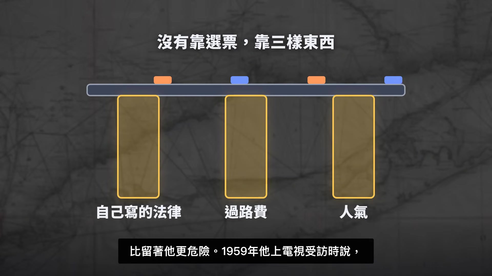

**逐字稿片段：** 1959年他上電視受訪時說 30多年來 一直有人對他說 你又不是選出來的 他的標準回答是 你也不是 他還有一招

**話題推測：** 引用Moses在1959年電視受訪時的發言。

---

## 00:06:00

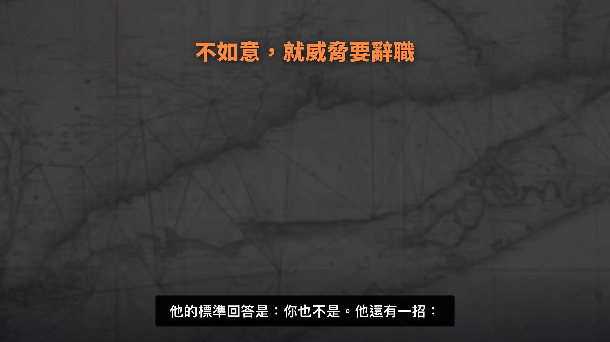

**逐字稿片段：** 每次不如意就威脅要辭職 拉瓜地亞市長的律師 乾脆印了一疊空白的辭職信 讓他填名字就好 這三樣東西 讓一個沒當選的人 決定了紐約長什麼樣子 可是權力越大 Carol說 Moses也在變 Carol說 Moses最大的轉變 是從我要讓大家能去海灘 變成這裡應該有一條路 不管誰反對

**話題推測：** 說明Moses慣用的威脅辭職策略。

---

## 00:06:21

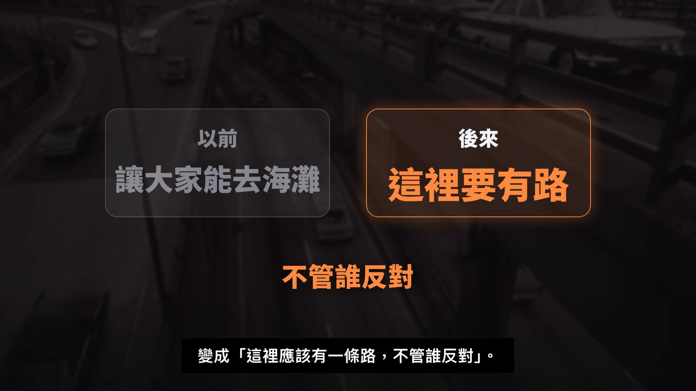

**逐字稿片段：** 最有名的例子 是穿過布朗克斯區的一條高速公路 叫Cross Bronx Expressway 跨布朗克斯高速公路 當時有一位地方政治人物告訴他 你只要把路線往南移兩個街區 要搬走的就不是上萬人 只有幾百人 Moses沒有改 Carroll說 他還找出這位政治人物私生活的把柄 放出消息 毀掉了他的政治生涯 只要擋在他前面的人有弱點 他就會用 Carroll認為 這是Moses年輕時改革失敗學到的 只講理想 事情做不成

**話題推測：** 舉例Cross Bronx Expressway說明Moses的轉變。

---

## 00:06:50

**逐字稿片段：** 為什麼他非蓋這些路不可 二次大戰以後 美國家家戶戶開始買車 大家搬到郊區 每天開車進城上班 當時的想法很簡單 車多了就蓋更多更寬的路

**話題推測：** 探討Moses執意修建這些道路的原因。

---

## 00:07:01

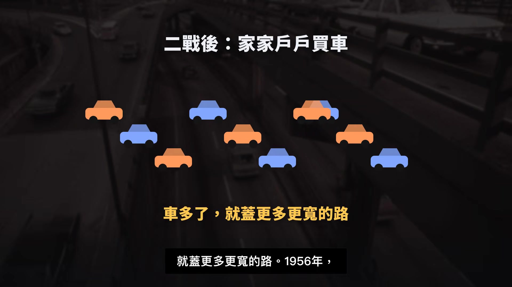

**逐字稿片段：** 1956年 美國聯邦政府通過 賙濟高速公路法 蓋高速公路的錢大部分由聯邦政府出 在紐約,誰手上有現成的計劃 有一支工程團隊,錢就留到誰那裡 那個人就是Moses 紐約州那個年代蓋的高速公路 大部分都出自他的團隊 問題是,高速公路要進城 就得穿過一個個早就住滿人的社區 在紙上那是一條直線 在地上那是一排排別人的家 而決定這條線劃在哪裡的 只有他和他的工程師 住在線上的人往往是最後才知道的

**話題推測：** 提及1956年美國聯邦政府通過的賙濟高速公路法。

---

## 00:07:32

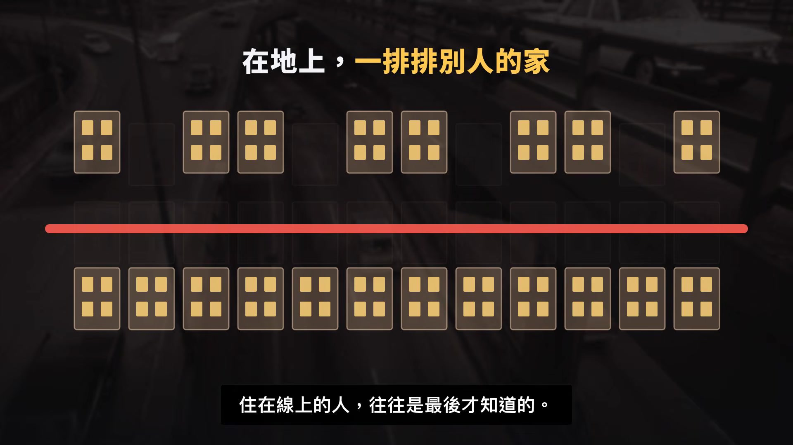

**逐字稿片段：** 這條路從1948年開始蓋 經過一個叫東崔蒙特的社區 那裡原本是一整片中低收入家庭住的公寓 社區裡有學校、教堂、猶太會堂、小雜貨店 很多家庭從上一代就住在這裡 鄰居彼此認識 小孩在街上一起長大 路線一劃下去 一整排一整排的公寓就要清空 Caro為了寫這一張 一戶一戶去找當年被迫搬走的居民 聽他們講那條街原本的樣子 這一張刊在紐約客雜誌上的時候 引起很大的討論 他說 這不是一個人突然變壞的故事 而是權力怎麼一點一點 讓一個人對所有反對的聲音變得越來越硬 不是每個人都擋不住他

**話題推測：** 描述高速公路對東崔蒙特社區的影響。

---

## 00:08:40

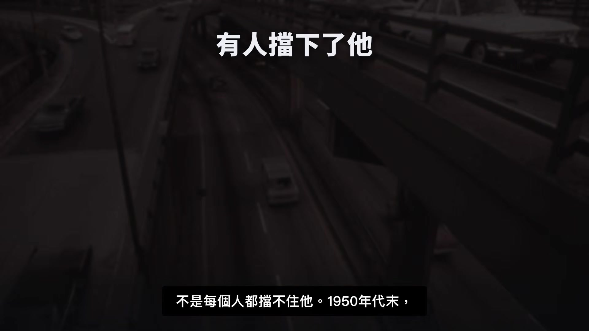

**逐字稿片段：** 1950年代末 Moses想讓一條路 穿過曼哈頓的華盛頓廣場公園 住在附近的作家Jane Jacobs 和一群媽媽、鄰居組織起來反對 最後公園保住了 車子不能再開進去 這是Moses少見的敗仗 一個掌握十幾個職位的人 輸給了一群媽媽和鄰居 他們的方法很簡單 寫信、聯署、找報紙 去每一場公聽會 讓這件事變成全市都在看的新聞 Moses靠的是在議會和辦公室裡把事情談好 Jacobs這群人把戰場搬到了大家看得到的地方 後來,Moses想蓋一條穿過夏曼哈頓的高架高速公路 也在1960年代末被擋下來

**話題推測：** 介紹Jane Jacobs反對Moses在華盛頓廣場公園修路的案例。

---

## 00:09:16

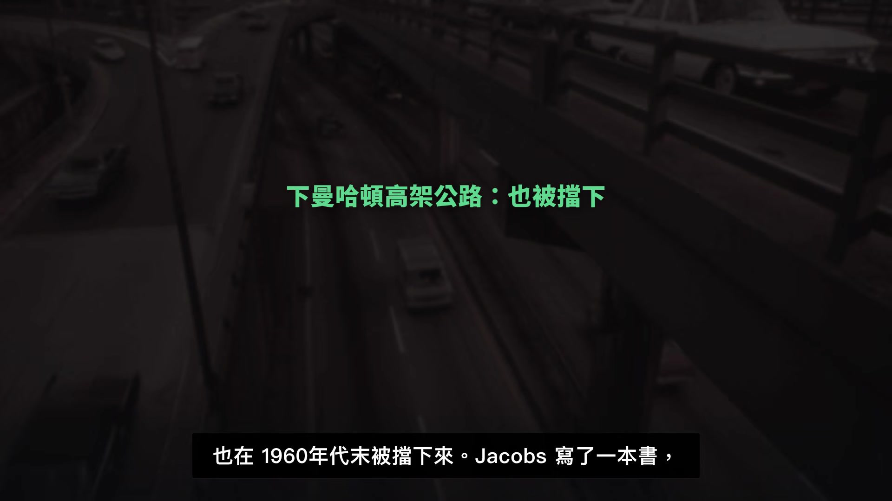

**逐字稿片段：** Jacobs寫了一本書《偉大城市的誕生與衰亡》 他說,城市的活力來自街道上的人 而不是一條條穿過去的大路 這本書在1961年出版 他寫的是他自己住的那條街 早上有人開店,小孩上學 老人坐在門口,人來人往 街道自然就安全,有生氣 一條高速公路切過去 這些就沒了 這本書後來成了都市規劃的經典 到今天還是很多都市規劃系的必讀書

**話題推測：** 提及Jane Jacobs的著作《偉大城市的誕生與衰亡》。

---

## 00:09:42

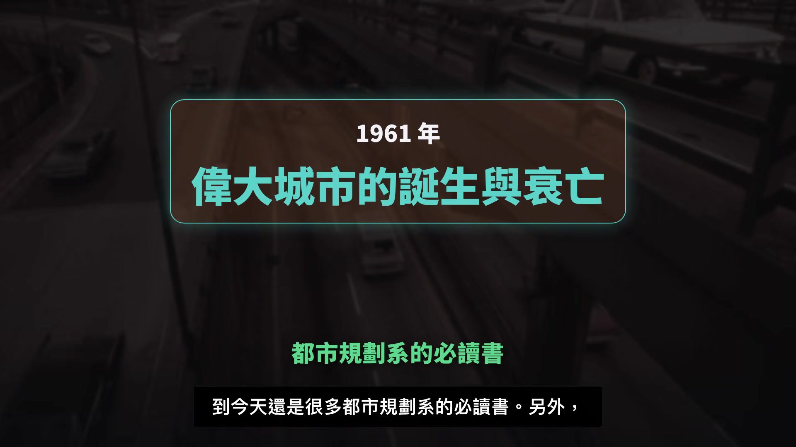

**逐字稿片段：** 另外 Carroll書裡還有一個很有名的故事 說Moses故意把長島公園道上的橋蓋得很低 讓公車過不去 窮人和黑人就到不了海灘 這個故事流傳很廣 可是它只有一個消息來源 後來有學者指出 當時的公園道本來就不讓公車和貨車走 橋普遍都很低 到今天 這件事還有爭議

**話題推測：** 提及Carroll書中關於長島公園道橋樑高度的爭議故事。

---

## 00:10:02

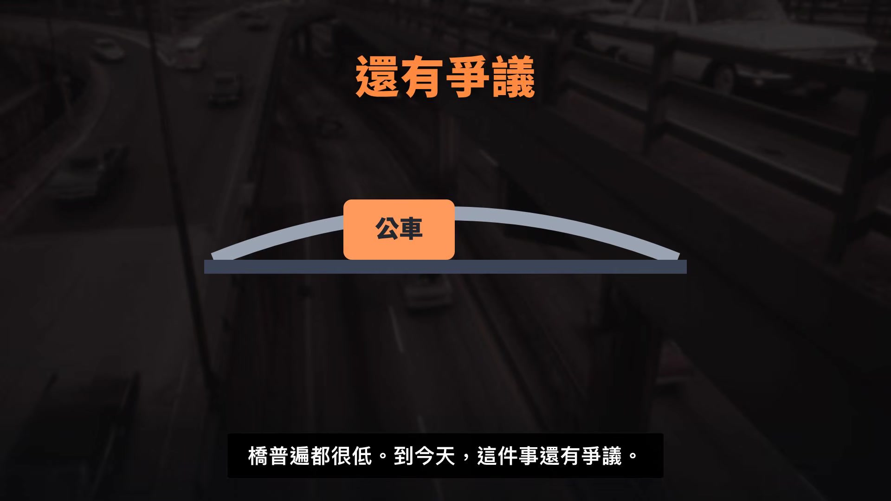

**逐字稿片段：** 那Moses最後怎麼失去權利 先講一件很少人知道的事

**話題推測：** 轉入探討Moses最終如何失去權力。

---

## 00:10:06

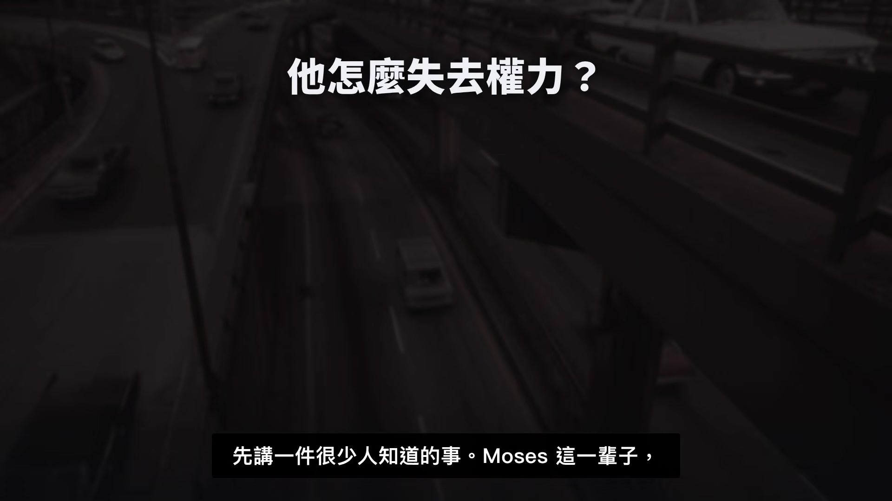

**逐字稿片段：** Moses這一輩子其實參選過一次 1934年他代表共和黨選紐約州長 結果輸得很慘 一個拿不到選票的人 卻比贏了選舉的人更有權利 這正是他的權利最奇特的地方 他從來不靠選民 所以選民也拿不走 最後拿走他的 是另一個有權利的人

**話題推測：** 提及Moses在1934年參選紐約州長。

---

## 00:10:24

**逐字稿片段：** 1962年 他又拿辭職威脅紐約州長洛克斐勒 這一招他用過無數次 每次都有效 這一次洛克斐勒回他 很遺憾 我接受 主持人問Carol 那之前的市長和州長 是不是其實也都可以這樣做 Carol說 部分是 他們有權利 可是過去幾十年 他太受歡迎 沒有人敢 到了晚年 他的盔甲開始出現裂縫

**話題推測：** 說明1962年洛克斐勒州長接受Moses辭職事件。

---

## 00:10:46

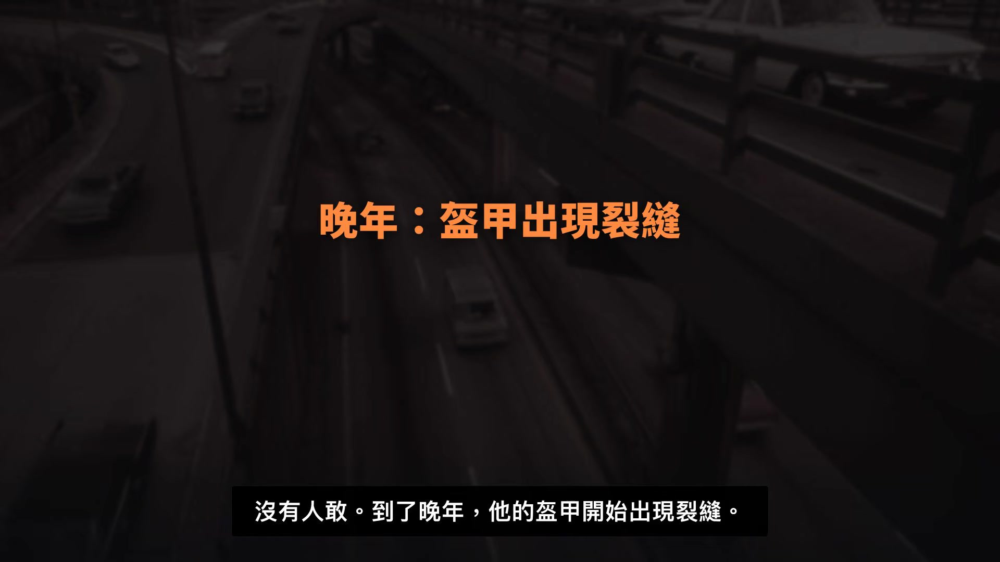

**逐字稿片段：** 1968年 洛克斐勒把大橋管理局 並進新成立的大都會運輸署 Moses失去了最後的實權 Carol那時候正在寫這本書 他親眼看到了這一刻 Carol在Moses還有權利的時候 在他的辦公室訪問過他好幾次 辦公室在大橋管理局的總部 蓋在紐約東河中間的一座小島上 Carol說 你走進去就感覺得到他的權利 門外坐滿的人都在等他點頭 每次訪問一結束 秘書就會拿著一長串來電記錄進來 全是等著他做決定的人 到了1960年代末 同一間辦公室 同一張桌子 人還是那個人 So whatever you thought of Moses, 你會感受到某人失去力量的嚴重性 Carroll說,那時候Moses已經80多歲,耳朵也不太聽得見了 身邊還是那群跟了他幾十年的部署,用以前的方式對待他 他知道自己的工程停了,可是他以為只要像以前一樣一直推,總有一天會再贏一次 Carroll認為,他到最後都沒有真正意識到,權力已經走了

**話題推測：** 提及1968年大橋管理局併入大都會運輸署。

---

## 00:12:03

**逐字稿片段：** 第二部分的答案是,當一個人能決定城市長什麼樣子 又沒有人能叫他停下來 城市會得到很多東西 也會付出很多 紐約得到了海灘、公園、大橋和高速公路 蓋的速度快到一位市長任期內就能剪綵 代價是好幾萬個家庭被迫搬走 還有一些後來證明是錯的路 Carroll的書在1974年出版 那時候紐約正陷入犯罪和衰退 很多人把責任都怪到Moses身上 主持人Dwarkesh倒是提醒 同一時期 底特律、聖路易斯 這些Moses沒碰過的城市衰退得更嚴重 書出版後 美國各地開始設下很多新規定 避免再出現一個Moses

**話題推測：** 總結第二部分，說明Moses權力帶來的得與失。

---

## 00:12:40

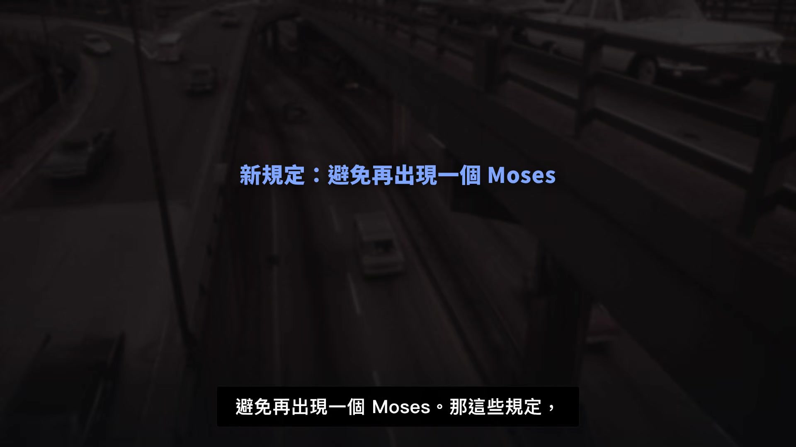

**逐字稿片段：** 那這些規定 後來又把城市帶到哪裡? Moses失事前後 美國開始改規則

**話題推測：** 轉入第三部分，探討後Moses時代的新規定對城市的影響。

---

## 00:12:46

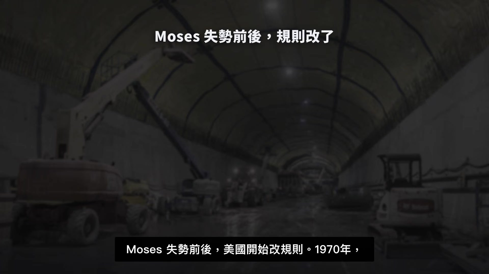

**逐字稿片段：** 1970年 美國的國家環境政策法上路 大型工程要先做環境影響評估 評估一次就可能要好幾年

**話題推測：** 提及1970年美國國家環境政策法上路。

---

## 00:12:53

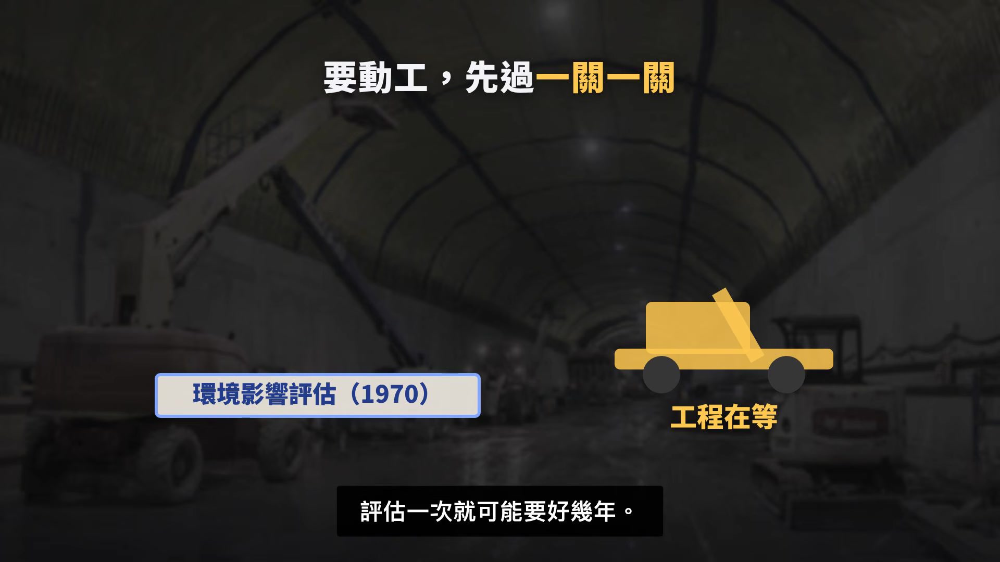

**逐字稿片段：** 紐約也在1970年代 設立土地使用審查程序 工程要經過社區委員會 區長、市議會 一官一官表示意見 居民也可以上法院 一場官司就能讓工程停好幾年 這些規定 讓住在路線上的人至少有機會說話 可是現在很多人說 矯枉過正了

**話題推測：** 提及1970年代紐約設立土地使用審查程序。

---

## 00:13:13

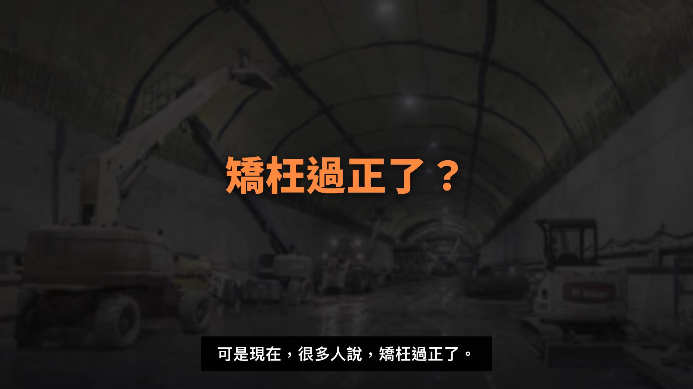

**逐字稿片段：** 主持人舉了一個例子 紐約的第二大道地鐵 1972年就開工 中間停工 到2017年第一段才通車 只有大約兩英里 三個車站 花了超過40億美元

**話題推測：** 舉例紐約第二大道地鐵建設的耗時與成本。

---

## 00:13:24

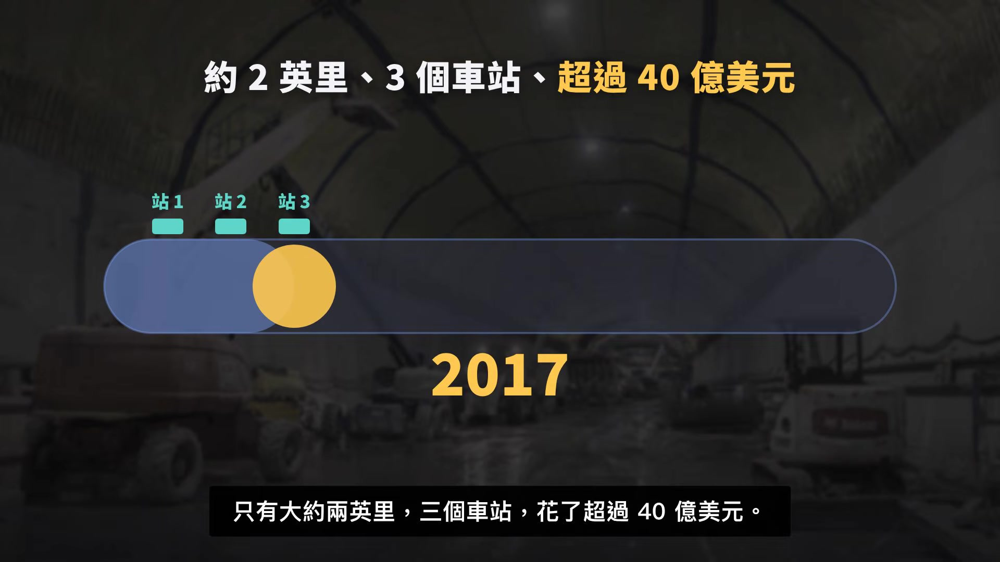

**逐字稿片段：** 主持人住的加州 也花了大筆經費蓋高速鐵路 到現在還沒有一段通車 他也提到另一邊

**話題推測：** 提及加州高速鐵路的建設情況。

---

## 00:13:30

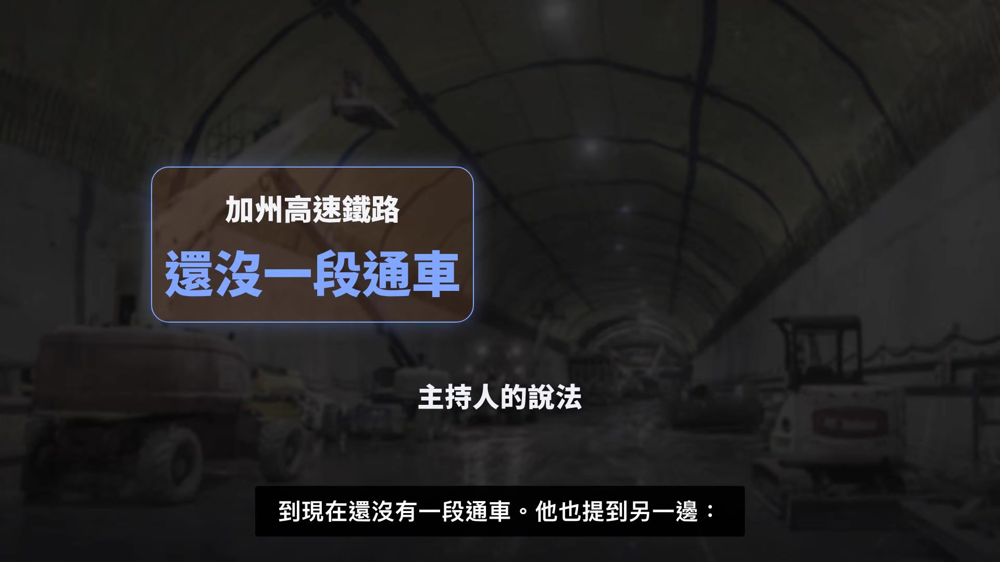

**逐字稿片段：** 今天的中國 有點像1940年代到1950年代的紐約 十幾年蓋了幾萬公里的鐵路 代價是很多人被迫搬家 主持人在影片評論裡還指出一件事

**話題推測：** 提及當代中國基礎建設的快速發展作為對比。

---

## 00:13:40

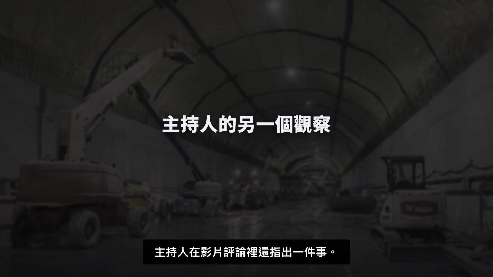

**逐字稿片段：** 今天大家很熟悉一種反對 叫別蓋在我家後院 一小群住在附近的人 就能擋下大家都需要的工程

**話題推測：** 說明「別蓋在我家後院」(NIMBY)現象。

---

## 00:13:47

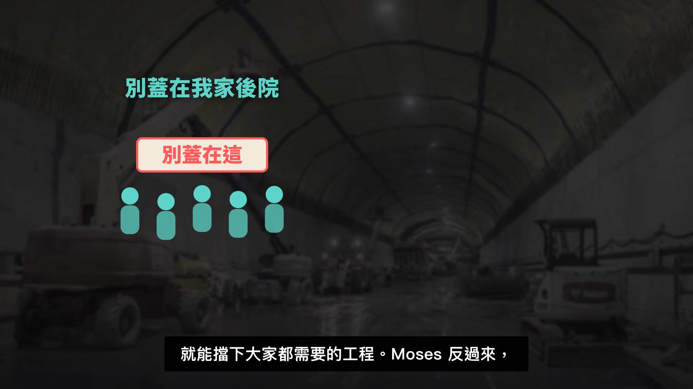

**逐字稿片段：** Moses反過來 替自己組了一群 請蓋在我家後院的人 銀行低價買他的債券 工會拿到工作 律師拿到案子 政黨老闆拿到保險佣金 每一個新工程 這些有利人士都分得到好處 誰擋路 他們就會打電話去施壓 他問Carol 今天如果再出現一個Moses 還有辦法做成事嗎 Carol的回答很有意思 他說 1920年代 Moses剛出來的時候 大家講的話 跟今天一模一樣 限制太多 什麼都蓋不出來 然後就有一個人出現 把他蓋出來了 那主持人追問 所以你覺得 我們今天需要一點點Moses?

**話題推測：** 說明Moses建立「請蓋在我家後院」的支持群體。

---

## 00:14:46

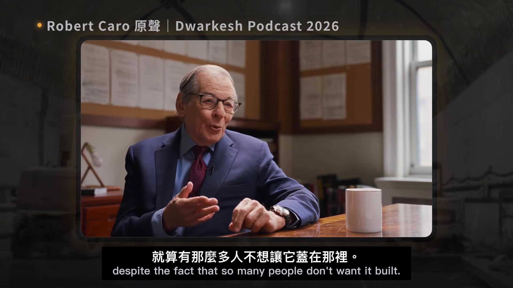

**逐字稿片段：** 回到開場的問題 一座城市長什麼樣子 到底是誰決定的 Carroll的答案不是一句話 在Moses的紐約 是一個沒當選的人 靠法律、錢和人氣決定的 事情做得很快 代價由住在路線上的人承擔 後來 美國把決定權分給了更多人 審查委員會、社區、法院 每個人都能說不 代價變成什麼都蓋得很慢 Carroll說 他不確定中間有沒有一個剛剛好的位置 他只知道每隔一段時間 就會出現一個人 找到方法把大東西蓋起來 有時候一等就是幾十年

**話題推測：** 重述開場問題並總結全集核心論點。

---

## 00:15:19

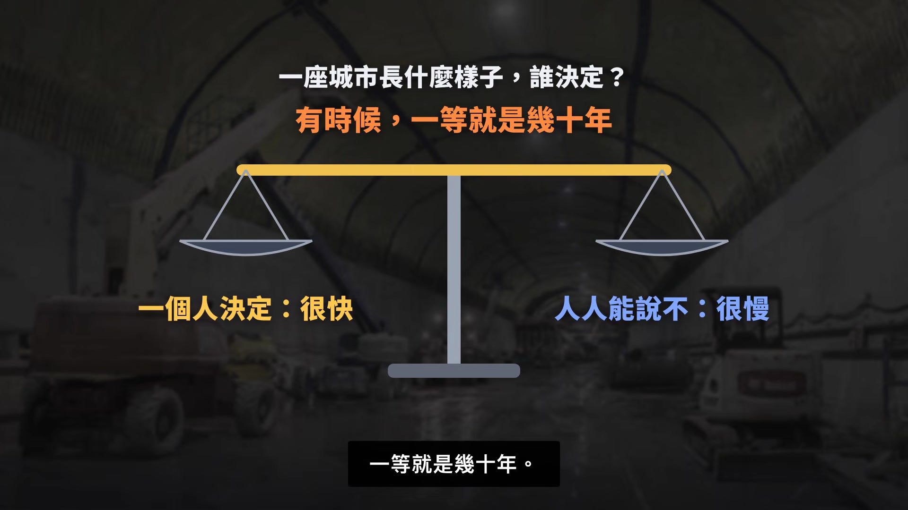

**逐字稿片段：** 臺灣的城市也一直在這兩端之間拉扯 一條捷運 一個都市更新案 要多少人同意才能動工 動工之後 誰搬走 誰得到好處 其實就是同一個問題 Karo說 如果還能再訪問Moses一次 他只想問一個問題 你知道自己在改變嗎 這一集整理的是Karo的訪談 和他梳理的技術 部分說法後來有學者質疑 我們都在片中標明瞭 最後問你一個問題 如果一條大家都需要的路要經過你家 你覺得該由誰來決定 留言告訴我 喜歡的話訂閱AI Notebook 開啟通知 我們下次見

**話題推測：** 將討論延伸至台灣城市的發展困境。

---
