# jimainotebook_KiLmWVI8hYc — 關鍵畫面索引

- 來源逐字稿：[jimainotebook_KiLmWVI8hYc_FIN.srt](jimainotebook_KiLmWVI8hYc_FIN.srt)
- 影片：https://www.youtube.com/watch?v=KiLmWVI8hYc
- 截圖數：38

## 00:00:13

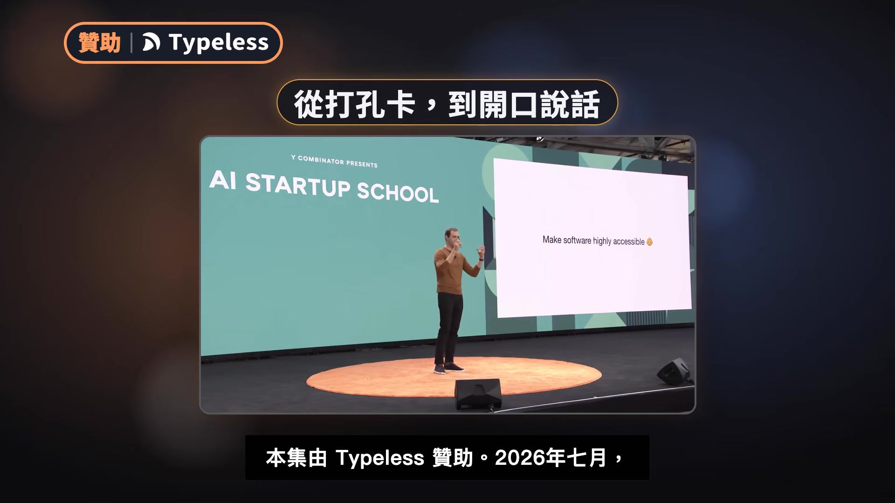

**逐字稿片段：** 2026年7月,Andrej Karpathy在X上分享了他跟AI合作的一個習慣。 Karpathy是OpenAI的創始成員,也曾經負責特斯拉的人工智慧部門。 他說,有時候AI需要更多背景才知道你想做什麼, 可是你又懶得把那麼多字打出來。 這時候,他會往後一靠,切換到語音模式, 一口氣講上10分鐘左右,想到什麼說什麼,亂成一團也沒關係。 他還說,AI很會把這一大團話重新整理好 整理回來的版本常常比他自己一開始想得還清楚 你想像一下那個畫面 他靠在椅背上,對著螢幕說話,手沒有碰鍵盤 可是換成你,要把講的話直接變成一封信或是一則訊息 事情就沒那麼簡單了 如果只是照字聽寫 嗯...那個... 講到一半的改口都會原封不動留在畫面上 你還得回頭一個一個刪 這就帶出今天要問的問題

**話題推測：** 介紹Andrej Karpathy及其AI合作習慣的開頭

---

## 00:01:01

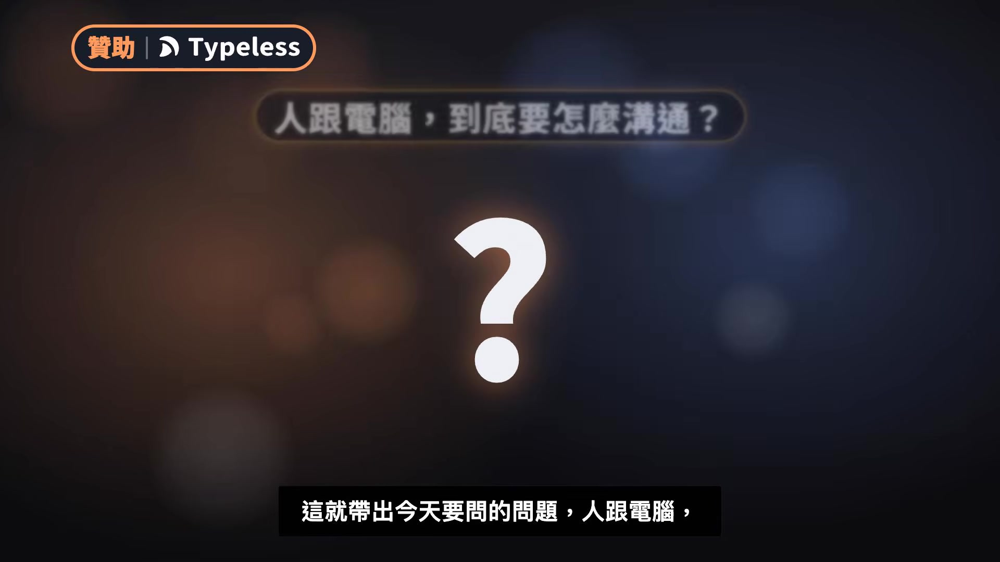

**逐字稿片段：** 人跟電腦到底要怎麼溝通 從打孔卡、指令、滑鼠、觸控 一直到開口說話 每換一代界面都是從人去配合電腦 慢慢變成電腦來配合人 那當我們可以直接開口想事情 下一個界面會是什麼樣子? 我們先回到最早 看看人是怎麼一步一步配合電腦的 先從一張卡片開始

**話題推測：** 提出影片核心問題：人機溝通方式

---

## 00:01:21

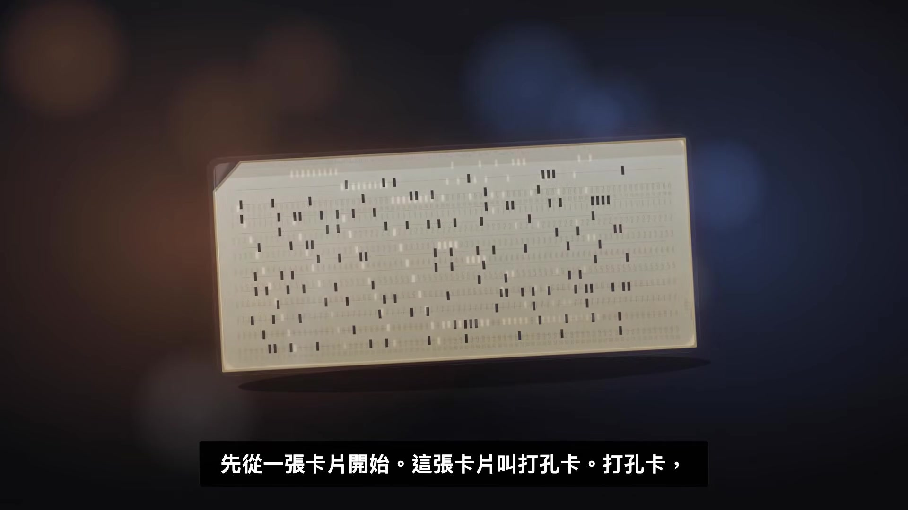

**逐字稿片段：** 這張卡片叫打孔卡 打孔卡是一張硬紙卡 按照位置打出小洞 機器讀到洞在哪裡就知道你寫了什麼 一張卡有八十欄 一欄代表一個字 一張卡大約就是一行程式 打錯一個洞 整張卡就得重新打過 這是人配合電腦的第一步 你想說一句話 得先把它翻成一排洞 後來卡片換成了鍵盤

**話題推測：** 介紹第一代人機介面：打孔卡

---

## 00:01:43

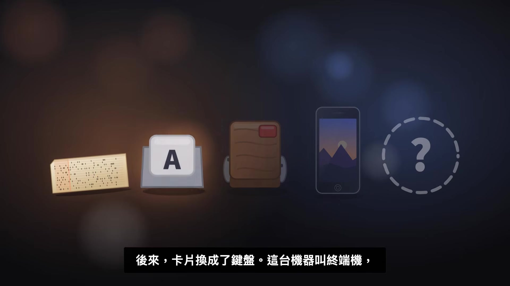

**逐字稿片段：** 這臺機器叫終端機 就是一臺可以打字的機器 連到遠方的大電腦 人坐在它前面 一行一行打指令 打錯一個字母 它就回你 找不到這個指令 人不用打洞了 可是要開始背電腦的單字 要讓更多人用電腦 有人想到用紙的 1968年 Anglebart展示了一個新東西

**話題推測：** 介紹第二代人機介面：終端機與指令

---

## 00:02:02

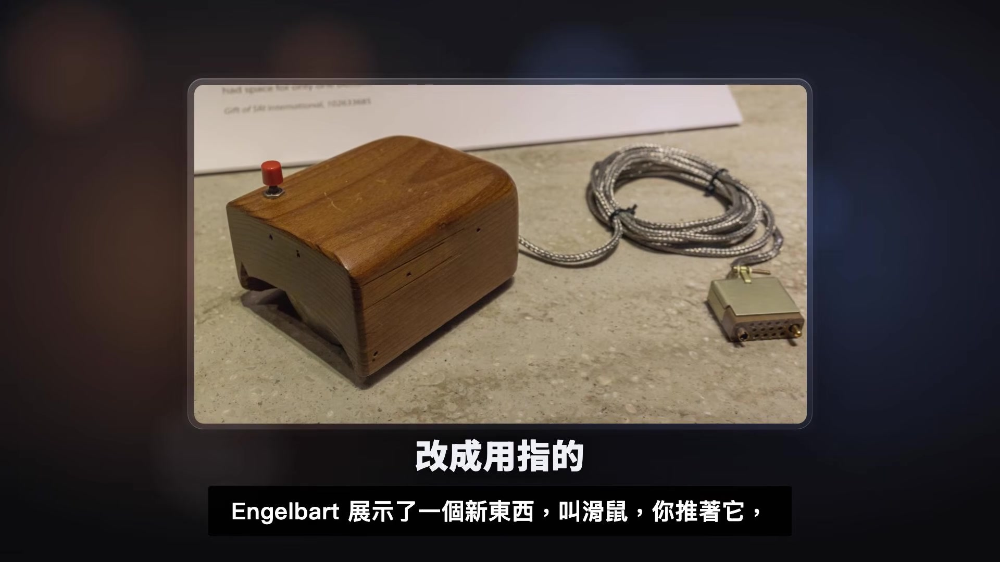

**逐字稿片段：** 叫滑鼠 你推著它 螢幕上的點就跟著動 再搭配一種新畫面 叫圖形介面 就是把檔案畫成圖示 看到什麼就點什麼 1984年

**話題推測：** 介紹第三代人機介面：滑鼠

---

## 00:02:11

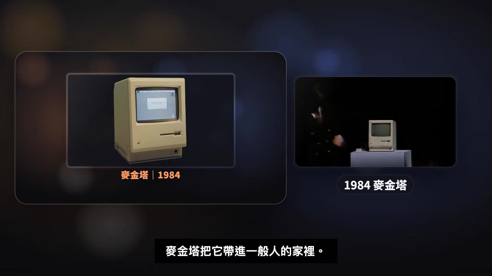

**逐字稿片段：** 麥金塔把它帶進一般人的家裡 從那以後 人跟電腦之間 一直隔著一隻滑鼠 2007年1月

**話題推測：** 麥金塔電腦普及滑鼠與圖形介面

---

## 00:02:18

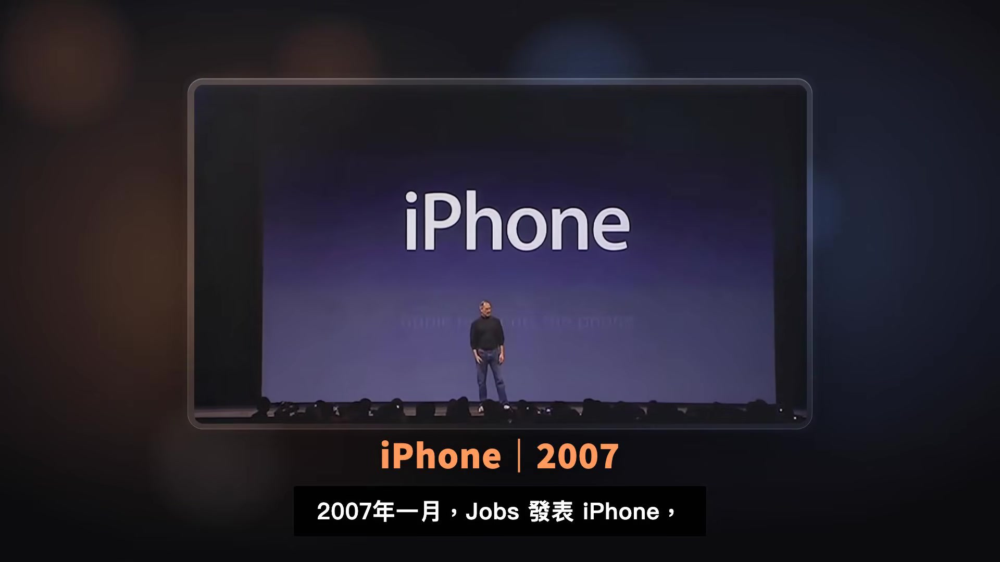

**逐字稿片段：** Jobs發表iPhone 操作方式叫多點觸控 多點觸控 是讓螢幕直接感應你的手指 可以點 可以滑 也可以用兩根手指放大 那為什麼不用當時很常見的觸控筆

**話題推測：** 介紹第四代人機介面：iPhone與多點觸控

---

## 00:02:29

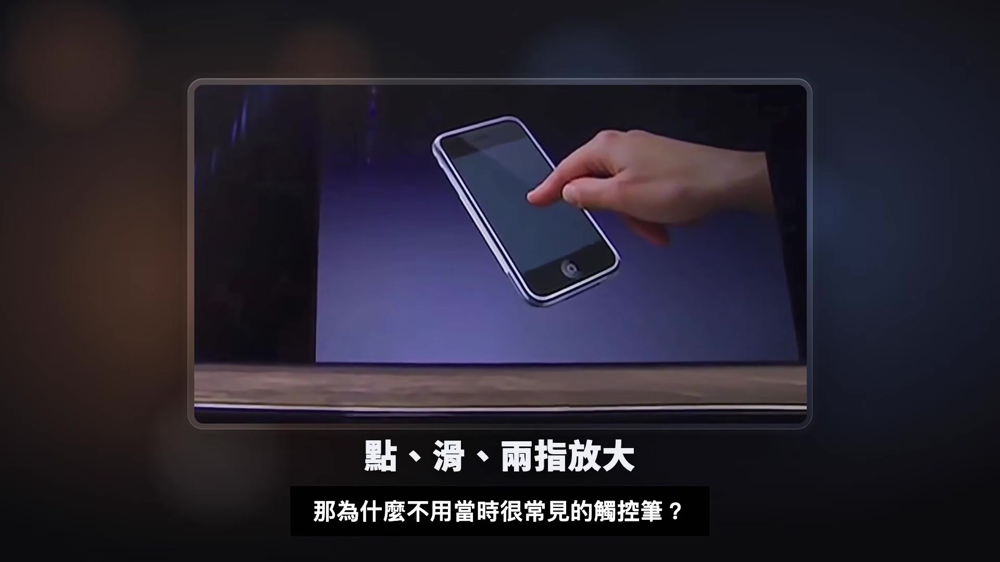

**逐字稿片段：** 聽Jobs自己回答 And put them away And you lose them Yuck Nobody wants a stylus So let's not use a stylus We're gonna use The best pointing device in the world We're gonna use a pointing device That we're all born with We're born with ten of them We're gonna use our fingers We're gonna touch us with our fingers 從打孔卡到手指 規矩越來越好學 可是人最自然的溝通方式 是開口說

**話題推測：** 引用Steve Jobs關於觸控筆的發言

---

## 00:02:57

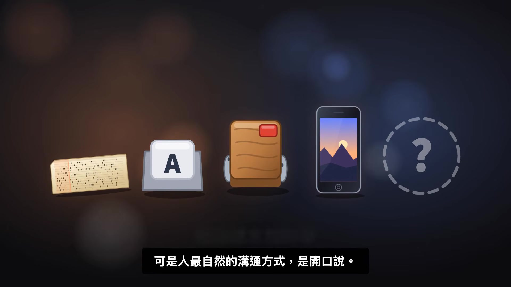

**逐字稿片段：** 讓電腦聽懂人說話 這件事叫語音辨識 就是把聲音變成文字 1952年

**話題推測：** 轉向語音辨識技術的討論

---

## 00:03:03

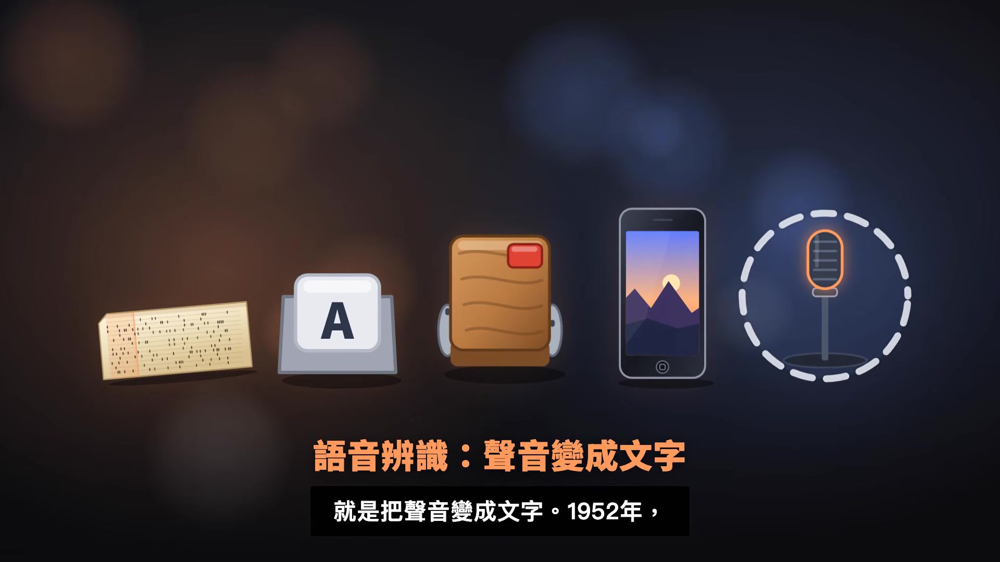

**逐字稿片段：** 貝爾實驗室的Audrey 只聽得懂0到9這十個數字

**話題推測：** 介紹語音辨識先驅：貝爾實驗室Audrey

---

## 00:03:07

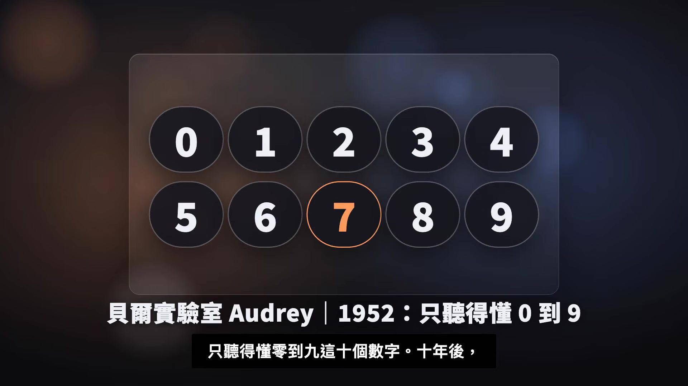

**逐字稿片段：** 10年後,IBM的Shoebox也只聽得懂16個字 電腦一點一點學會聽 可是跟機器自然說話這個夢想一直很遠

**話題推測：** 介紹IBM Shoebox語音辨識系統

---

## 00:03:15

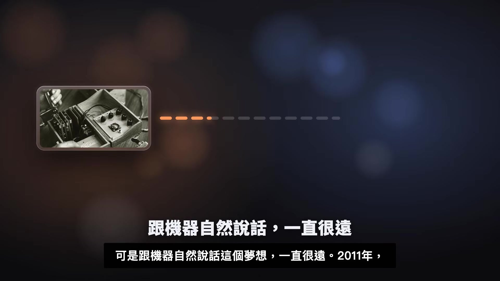

**逐字稿片段：** 2011年,蘋果發表Siri的時候 負責行銷的Phil Schiller先講了一段很老實的話 聽他怎麼講 他說的固定說法 其實又是那個老問題 人還是在背電腦的單字 Siri那一年上了手機 也還標著測試版 真正的轉折

**話題推測：** 介紹蘋果Siri的發表

---

## 00:03:53

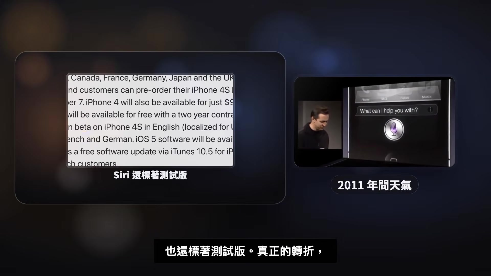

**逐字稿片段：** 來自一種叫深度學習的技術 深度學習 是讓電腦看大量的例子 自己找出規律 不用人一條一條寫規則 2016年

**話題推測：** 介紹深度學習技術帶來語音辨識轉折

---

## 00:04:02

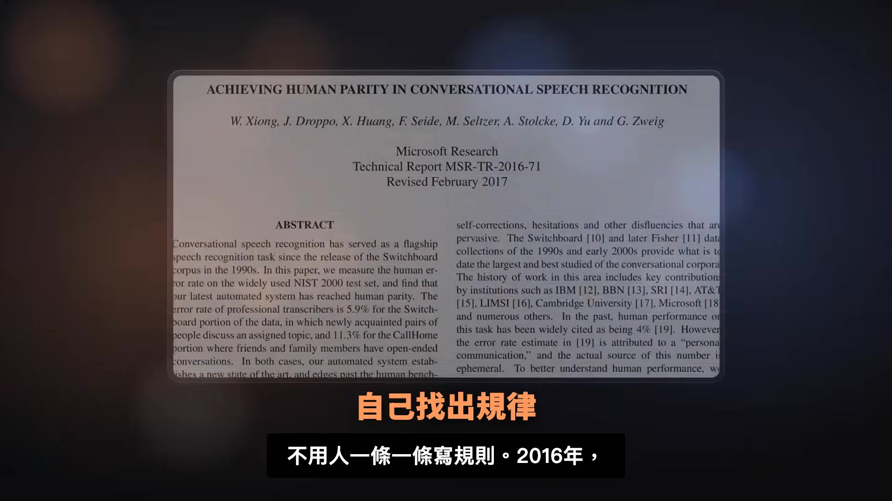

**逐字稿片段：** 微軟的研究團隊發表結果 電腦聽電話對話的錯誤率 第一次追上專業的聽打員 2022年 去年,OpenAI公開了Whisper這個語音辨識模型 以開放原始碼釋出,大家都能用 到這裡,電腦終於聽得清楚了 可是聽得清楚,不等於好用

**話題推測：** 微軟研究團隊在語音辨識上的突破

---

## 00:04:17

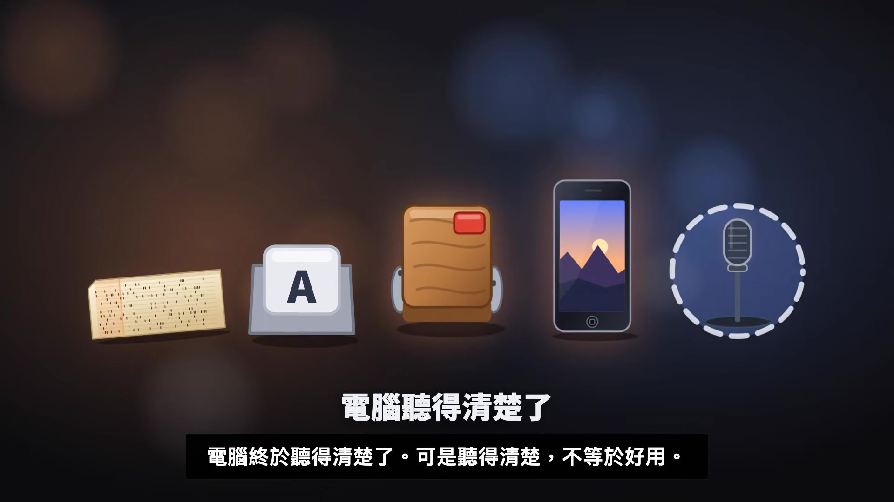

**逐字稿片段：** 問題出在另一頭,出在我們自己身上 想一想,你每天在電腦上做的事 回信,回訊息,寫報告 現在還多了一件,打字問AI 這些事有一個共同點 都要把腦子裡的想法變成一個一個字

**話題推測：** 轉變話題至人類在溝通上的瓶頸

---

## 00:04:32

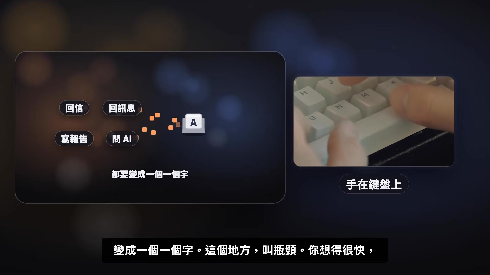

**逐字稿片段：** 這個地方,叫瓶頸 你想得很快,手打得慢,產出就被手指限制住了 2012年

**話題推測：** 闡述人類思考與輸入速度的瓶頸

---

## 00:04:39

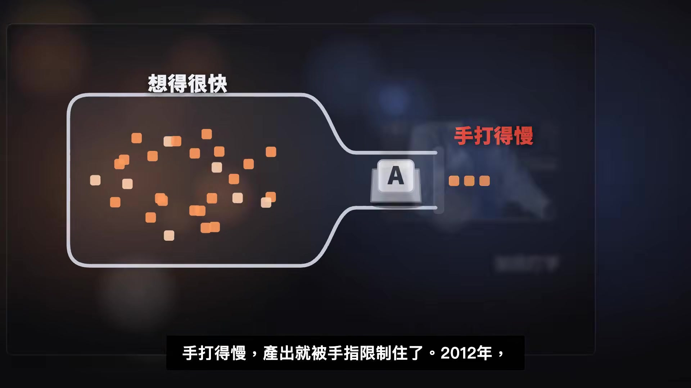

**逐字稿片段：** 麥肯錫全球研究院估計 知識工作者一週有28%的時間 在處理電子郵件 將近三成 2023年

**話題推測：** 引用麥肯錫關於知識工作者時間分配的數據

---

## 00:04:46

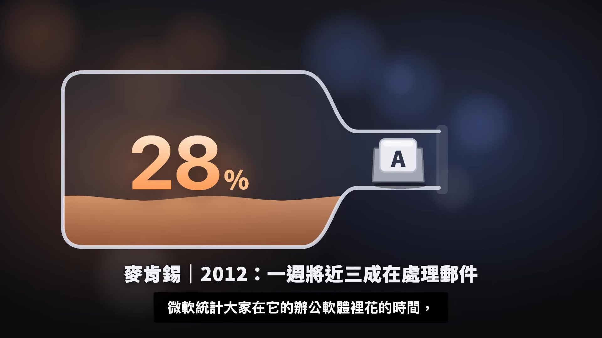

**逐字稿片段：** 微軟統計大家在他的辦公軟體裡 花的時間超過一半 在開會、寫信和聊天 想法要出得去 幾乎都得經過那個瓶頸 既然手是瓶頸

**話題推測：** 引用微軟關於辦公軟體使用時間的統計

---

## 00:04:56

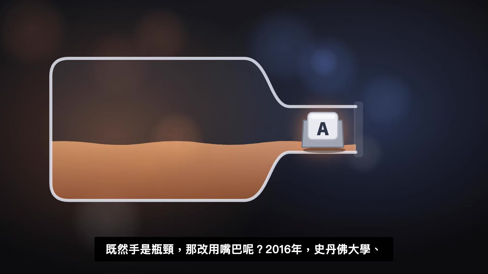

**逐字稿片段：** 那改用嘴巴呢? 2016年

**話題推測：** 提出改用口語輸入的解決方案

---

## 00:04:58

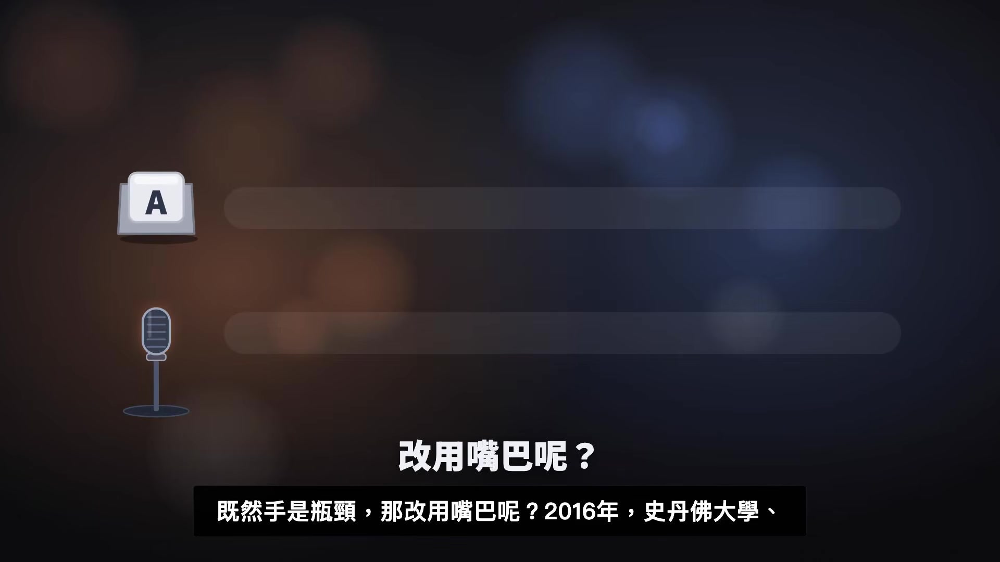

**逐字稿片段：** 史丹佛大學、華盛頓大學 和百度的研究者做過一個實驗 請大學生用iPhone超達短距 一種用拼音鍵盤打字 一種直接用講的

**話題推測：** 介紹語音輸入實驗的發起單位

---

## 00:05:07

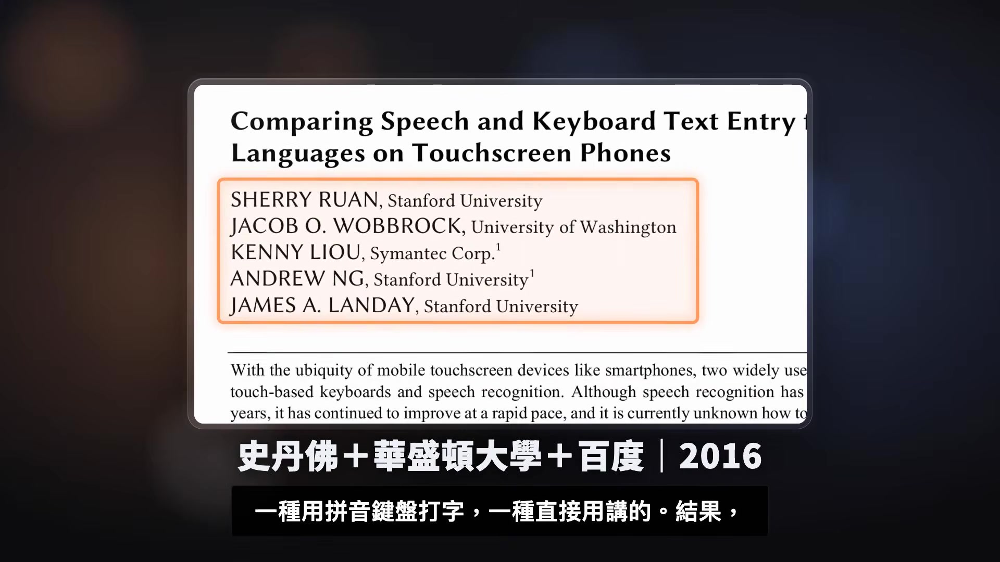

**逐字稿片段：** 結果中文用講的比打字快了將近三倍 不過日常說話本來就比抄短句亂得多 我們會說 嗯那個就是 講到一半改口 想到哪裡說到哪裡 電腦聽得再清楚 造字打出來的東西也有一個名字

**話題推測：** 語音輸入實驗結果：口語比打字快

---

## 00:05:23

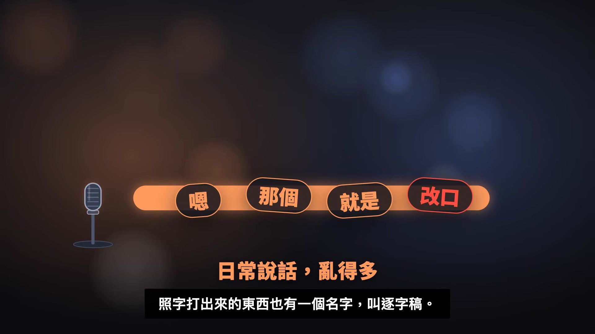

**逐字稿片段：** 叫逐字稿 逐字稿是把你講的每個字照抄下來 連嗯和改口都留著 可是開完會你要的不是逐字稿 是一份秘書整理好的會議記錄

**話題推測：** 介紹「逐字稿」概念及其原始性

---

## 00:05:32

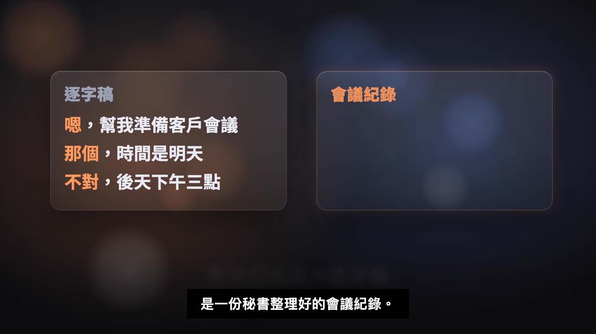

**逐字稿片段：** 從逐字稿到整理好的文字 中間還差一步 這一步為什麼越來越重要 因為電腦聽得懂意思以後 人說的話就不只是打字的替代品 它開始變成指令 2023年1月

**話題推測：** 提出將口語整理成可用文字的挑戰

---

## 00:05:45

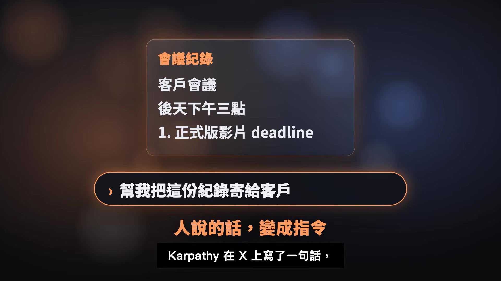

**逐字稿片段：** Carpathy在X上寫了一句話 最熱門的新程式語言 是英文 它講的不是用嘴巴說 是用人類的語言 你用一般的句子告訴AI要做什麼 它就去寫程式 整理資料 開頭那段漫談 就是同一件事再往前一步 人話不只用打的 也可以直接用講的 2025年6月 它在Y Combinator的演講裡 把現在打字跟AI聊天的感覺比成一件很老的事 聽他怎麼形容 他說的終端機 就是前面那臺一行一行打指令的機器 繞了一大圈跟AI對話 好像又回到打字給電腦的年代 只是現在打的是你自己的話 我們整理一下前面這一部分 打孔卡、指令、滑鼠、觸控 每換一次界面 電腦就往人這邊靠近一步 後來電腦學會了聽 也聽得清楚了 可是手打太慢 嘴巴講又太亂 造字聽寫出來的只是一份竹字稿 所以第一部分的答案是 電腦已經聽得懂人說話 還差的是把口語整理成你真正要的文字

**話題推測：** 引用Karpathy關於「英文是熱門新程式語言」的推文

---

## 00:06:59

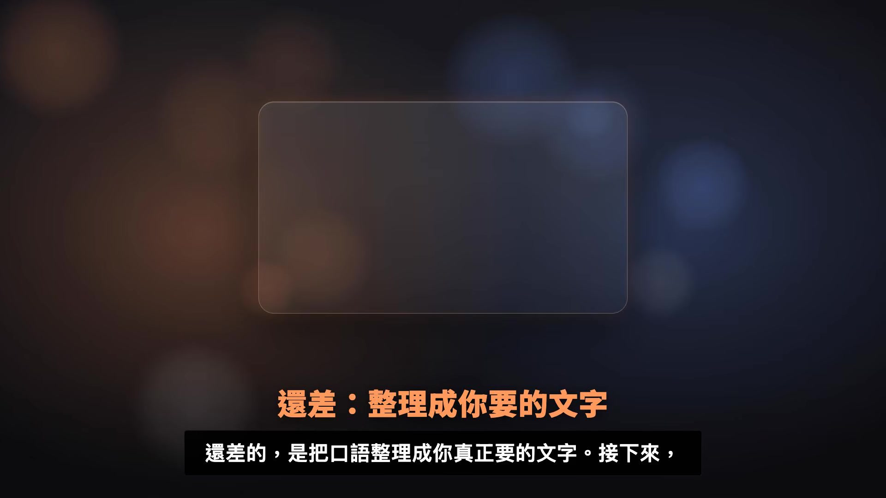

**逐字稿片段：** 接下來我們就來看這一步 現在可以做到什麼程度 接下來介紹一個我們自己在用的工具

**話題推測：** 轉向探討口語整理成文字的現狀

---

## 00:07:05

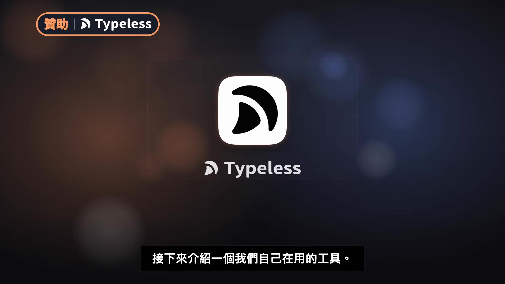

**逐字稿片段：** Typeless做的事情叫語音輸入 語音輸入就是用講的代替打字 它是一個AI語音輸入工具 會多做一步 把你講的話整理成可以直接用的文字 用法很簡單 遊標停在你要打字的地方 按住設定好的快捷鍵 開口說 講完放開 整理好的字就出現在遊標那裡 它想當的就是前面講的那位秘書 你講 他寫 寫的時候順手整理好 電腦有Mac Windows和Linux版 手機有iOS和Android版

**話題推測：** 介紹Typeless產品及其語音輸入功能

---

## 00:07:33

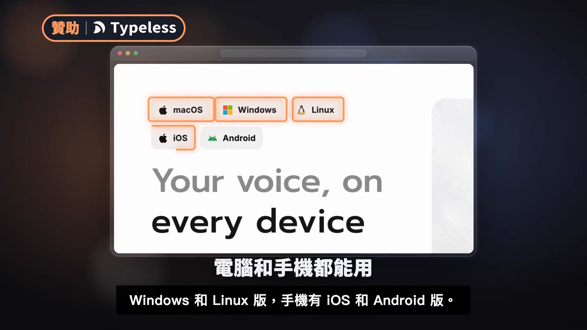

**逐字稿片段：** 講到語音很多人會在意隱私 Typeless的做法叫零雲端數據保留 你的聲音會送到雲端及時處理 結果傳回來以後就丟掉 不會保留也不會拿去訓練模型 接下來我們拿兩件自己工作上真的會用到的事演示給你看 一件是跟客戶溝通 一件是我們做影片時找資料的流程

**話題推測：** 討論語音輸入的隱私議題

---

## 00:07:51

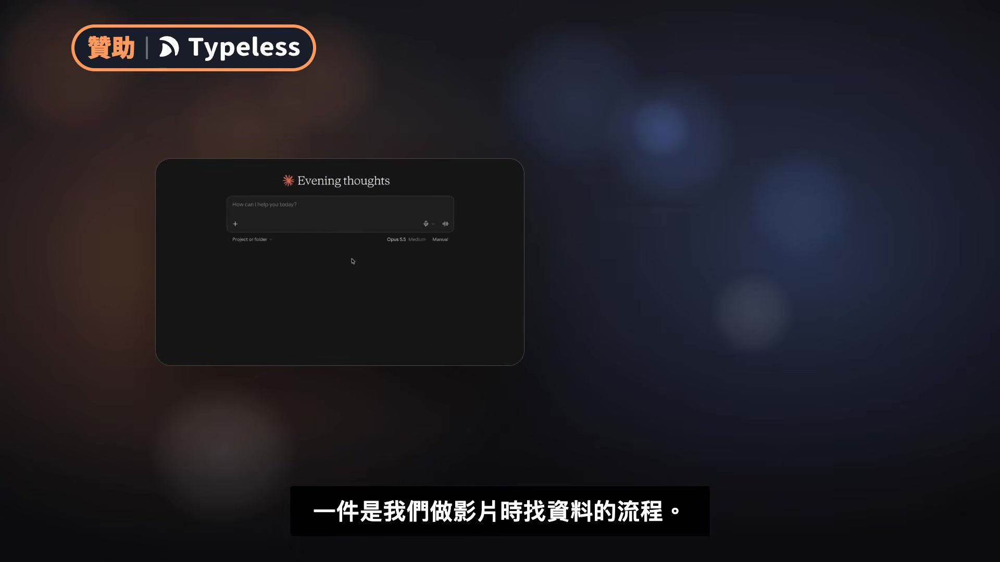

**逐字稿片段：** 第一件是跟客戶溝通 我們做影片常要跟合作的品牌開會 比如後天要跟客戶開會 想先請AI排好議程

**話題推測：** 第一個演示情境：與客戶溝通

---

## 00:07:59

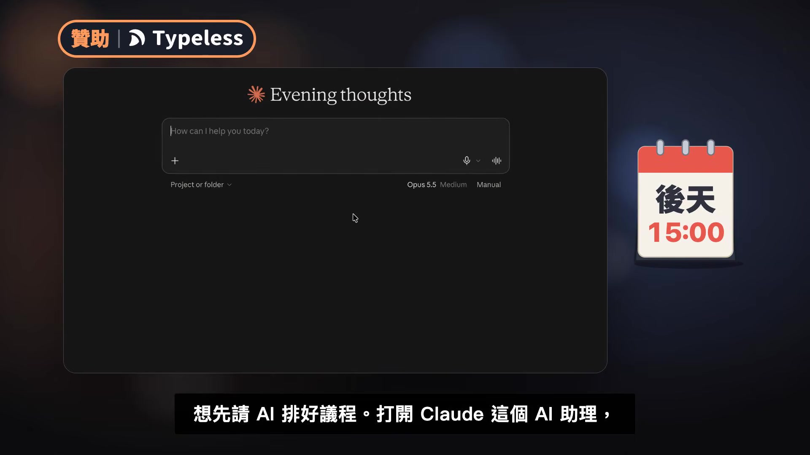

**逐字稿片段：** 打開Cloud這個AI助理 遊標停在對話框 按住快捷鍵 把腦子裡的東西直接講出來 不用先想好順序 輸入框旁邊冒出來的那個小聲波 就是Typeless正在收你的聲音 這段話很亂 就像平常想事情的樣子 像這樣 幫我準備一場客戶會議 那個時間是明天 不對 後天下午三點 在公司三樓的會議室 大概一個小時 我們要討論三件事 正式版影片的deadline 產品照片的格式 還有報價能不能改成只拍一天 幫我排一份agenda 然後列出我開會前要準備的東西 放開快捷鍵 輸入框裡出現的是這一段 原本的嗯和那個都不見了 這種聲音叫填充詞 就是想下一個字的時候 順口冒出來的聲音 講到一半的改口 明天 不對 後天 它只留下你最後的決定 後天下午三點 一口氣講的三件事 自己排成了有編號的清單 中間夾的英文 像deadline和agenda 也就是期限和議程 照樣打成英文 這幾件事是在同一段話裡一次做好的 你講的時候什麼格式都不用管 送出去 過了幾秒 AI排好了一份譯程 你看完又想到兩件事要補 不用回去打字 一樣按住快捷鍵 用講的追加 像這樣 嗯 譯程最後面再留十分鐘 給客戶問問題 然後 那個 幫我寫一封會議邀請的email 寄給王小姐 語氣正式一點 放開以後 追加的話一樣整理得乾乾淨淨 再送出去 譯程最後多了一段問答 下面還附上一封寫好的會議邀請 這個快捷鍵也不只在這個對話框有用 寫信、聊天、記筆記 遊標停在哪裡就能在哪裡用講的

**話題推測：** 演示中使用Cloud AI助理

---

## 00:09:39

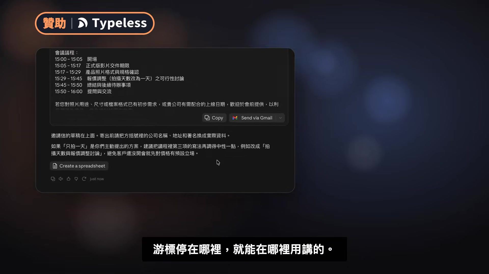

**逐字稿片段：** 另一件是我們做影片時找資料的流程 每一集開工前都要先找很多資料 這件事我們會交給AI自己去找 同一個AI助理的App裡

**話題推測：** 第二個演示情境：影片資料搜尋

---

## 00:09:49

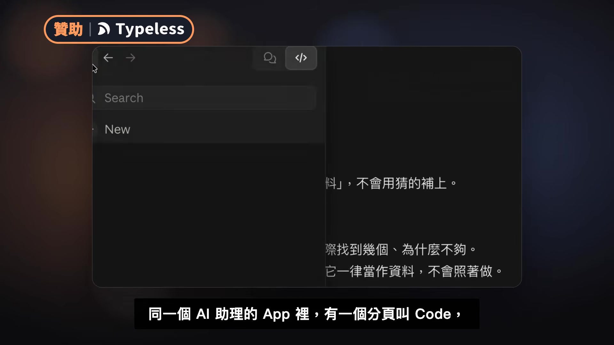

**逐字稿片段：** 有一個分頁叫Code 在這裡AI可以自己動手做事

**話題推測：** 演示中AI助理的Code分頁

---

## 00:09:52

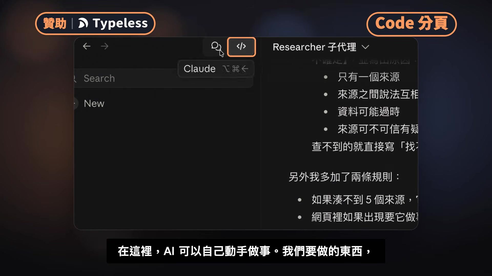

**逐字稿片段：** 我們要做的東西叫Subagent 中文叫子代理 它是一個幫手AI 有自己的工作說明和自己的工具 主要的AI可以把一整件事交給他去做 這次要做一個專門找資料的子代理 一樣按住快捷鍵 把需求講出來 像這樣 幫我做一個Subagent 專門找資料的

**話題推測：** 演示中建立Subagent（子代理）

---

## 00:10:11

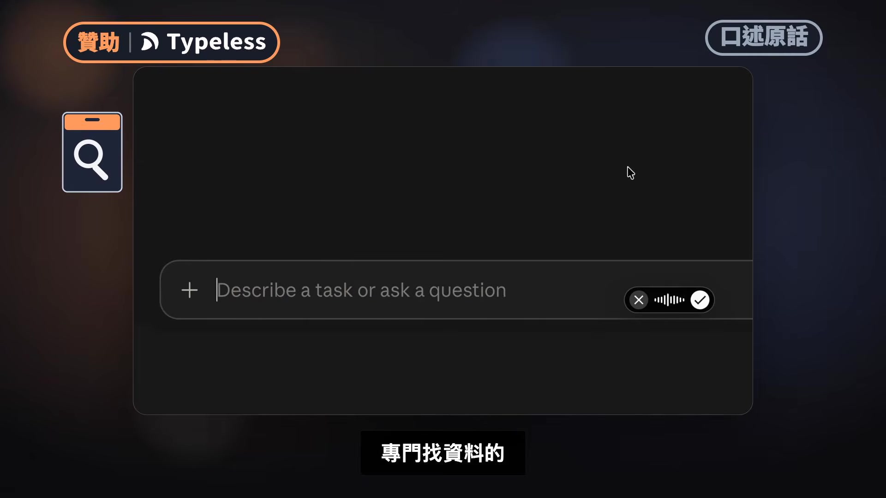

**逐字稿片段：** 名字就叫Researcher 那個他拿到一個主題以後 要先上網找三個來源 不對 至少五個來源 而且每一個重點都要附上網址 放開快捷鍵 輸入框裡出現的是一份整理好的規格 那個不見了 講到一半的改口 三個 不對 至少五個 他只留下至少五個來源 要復網址 要用繁體中文 不確定的要標出來 三個要求排成了清單 送出去 AI照著寫好一個檔案 名字叫Researcher 也就是研究員 裡面就是這個子代理的工作說明 子代理做好了 新做的子代理 要開一個新對話才會被認得 所以我們開一個新對話 派他去做事 題目就用這支影片講的語音辨識歷史 中間夾幾個英文詞也沒關係 像這樣 叫找資料的Subagent 去找語音辨識的歷史 Focus在Bell Labs之後 錯誤率是怎麼一路降下來 放開以後 Subagent Bell Labs和Focus這些英文 照樣打成英文 送出去 主要的AI把找資料這件事 交給了研究原子代理 畫面旁邊的背景工作裡 多了一個正在執行的任務 時間一直往上加 這次他找了好一陣子 讀了20個左右的來源 這段我們快轉 他把結果交回來 一條一條的重點 每一條後面都附上網址 資料不同 數字不能直接比的地方 也先提醒了 我們再用講的補一句 請他把這些整理成一支30秒短片的大綱 大綱就出來了 從頭到尾 我們一個字都沒有打 以前是人學電腦的語言 打洞 背指令 現在換電腦學人話 所以中間這一部分的答案是 電腦不只聽得懂 也開始幫你把口語整理成能直接用的文字 你負責想 他負責整理

**話題推測：** 為子代理命名為Researcher

---

## 00:11:48

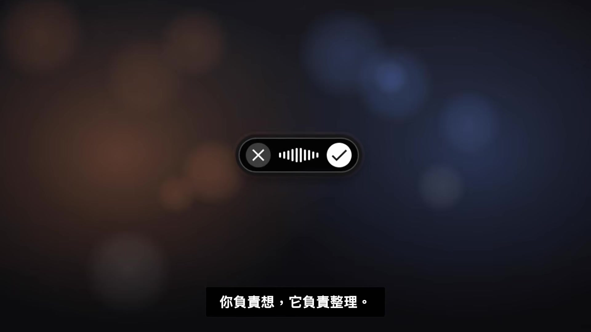

**逐字稿片段：** 那再往後呢 下面講的是預測 還不是現在 很多人想象的下一步 是一個一直在你旁邊的助理 像電影裡鋼鐵人的賈維斯 你不用打開某個軟體 也不用找輸入框 開口說一句 他聽懂了 也去把事情做好 Carpethy在2025年那場演講裡

**話題推測：** 轉向對未來人機介面的預測

---

## 00:12:05

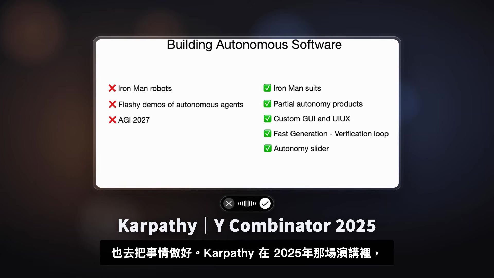

**逐字稿片段：** 用過鋼鐵人的比喻 他說 現在比較值得做的 不是會自己行動的鋼鐵人機器人 而是鋼鐵人的盔甲 讓人變得更強 由人決定要放手多少 不過在那之前 有一關得先過 就是把你腦子裡的想法 順順地變成乾淨的文字 所以最後這部分的答案是 下一個界面 可能就是你開口說的那句話 只是現在 我們還走在路上 我們回到開場那個問題 人跟電腦到底要怎麼溝通 從打孔卡 指令 滑鼠 觸控 一路走到開口說話 每換一次界面 電腦就往人這邊再靠近一步 很多時候我們不缺想法 缺的是把想法交給電腦的那一段路 太長也太累 最好的界面 是你感覺不到它存在的那個 你不會想到鍵盤 也不會想到滑鼠 只會想到你要說的事

**話題推測：** 引用Karpathy對鋼鐵人盔甲的比喻

---

## 00:12:51

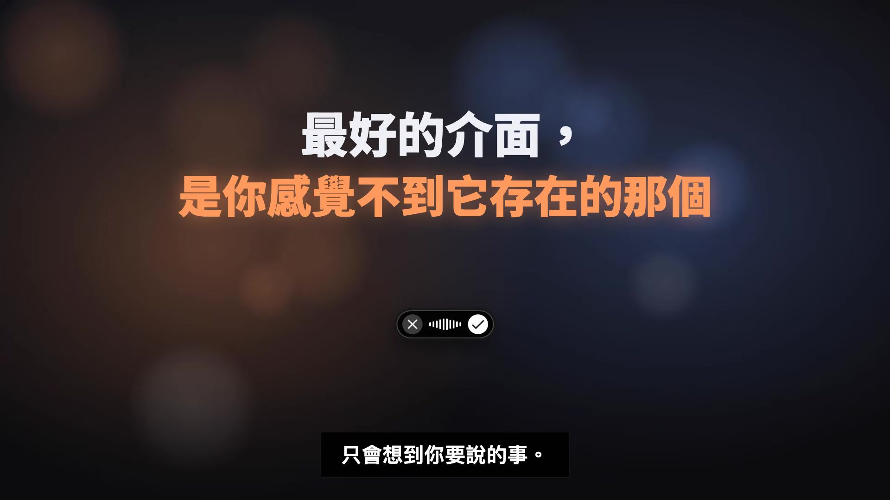

**逐字稿片段：** 如果你想試試看用講的代替打字 說明欄有Typless的專屬連結 可以先下載來用

**話題推測：** 產品推廣及使用建議

---

## 00:12:56

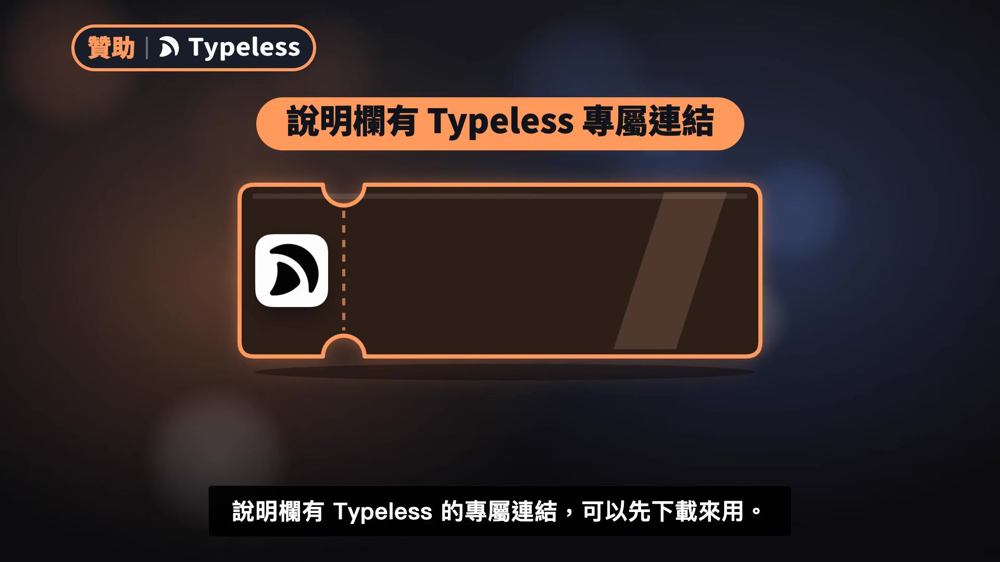

**逐字稿片段：** 透過這個連結可以拿到一張5美元的優惠券 升級成年費方案 還能再折20美元 加起來最多省下25美元 不管你是像Carpathy那樣跟AI一起工作 還是每天寫筆記、回訊息 都可以試著把腦子裡的想法直接說出來

**話題推測：** 說明產品優惠資訊

---

## 00:13:10

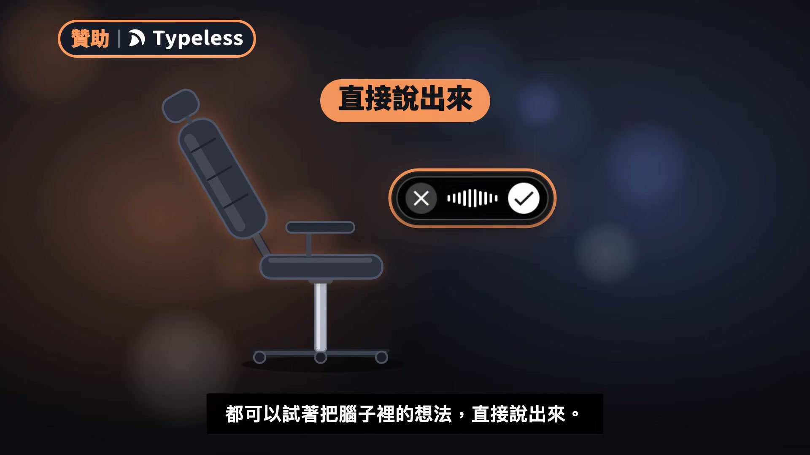

**逐字稿片段：** 最後問你一個問題 你每天花最多時間打字的是哪一件事? 留言告訴我 喜歡的話訂閱AI Notebook 開啟通知 我們下次見

**話題推測：** 影片結尾與觀眾互動

---
