# jimainotebook_PHJW-eF3-fs — 關鍵畫面索引

- 來源逐字稿：[jimainotebook_PHJW-eF3-fs_FIN.srt](jimainotebook_PHJW-eF3-fs_FIN.srt)
- 影片：https://www.youtube.com/watch?v=PHJW-eF3-fs
- 截圖數：83

## 00:00:14

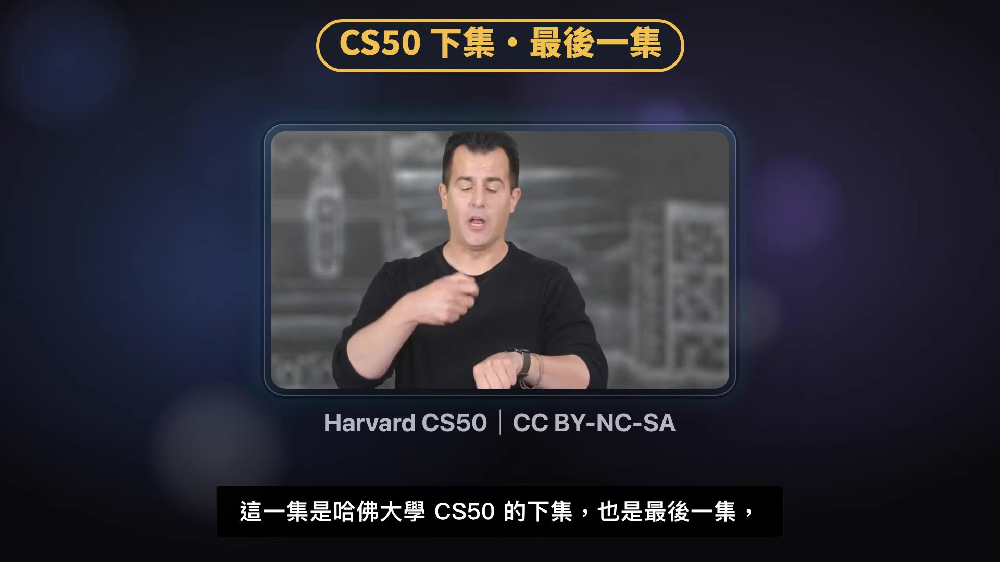

**逐字稿片段：** 上第七到第十堂課,資料庫、網頁、網站的伺服器,還有最後一堂告別課。 這一集只問一件事,網站怎麼記住你? 或者說,你一打開網站,他怎麼知道你是誰? 你昨天放進購物車的東西,今天打開還在? 你沒有輸入密碼,他就跟你說歡迎回來。 可是每天有幾百萬人連上同一個網站,他怎麼知道這個是你? 終極最後我們上了一堂AI特別講 看CS50的鴨子怎麼開口說話 這一集換個方向 資料多到要好好存起來 隨時要找的時候該放在哪裡

**話題推測：** 概述本集將講解的課程主題：資料庫、網頁、網站伺服器。

---

## 00:00:45

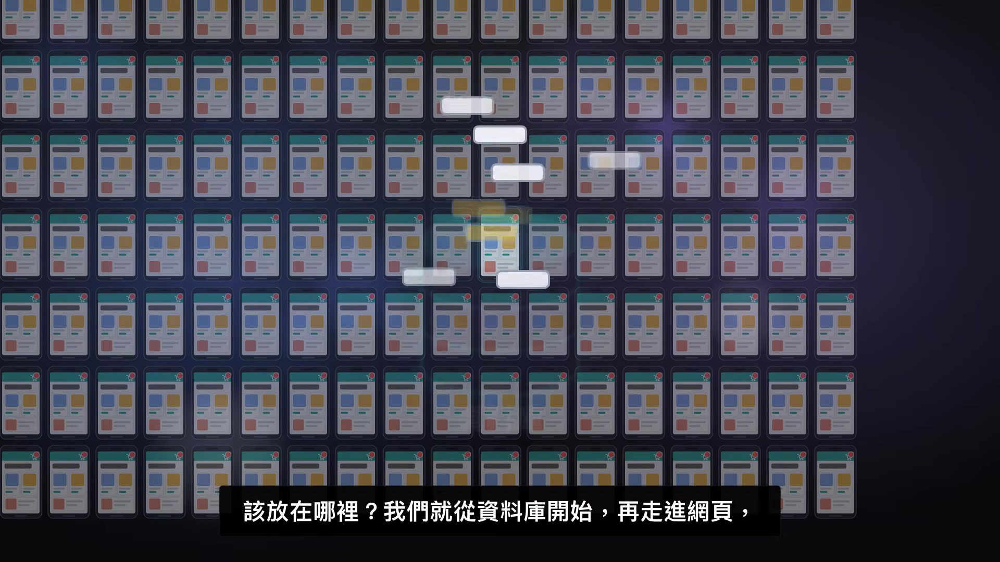

**逐字稿片段：** 我們就從資料庫開始 再走進網頁 而且你會發現 答案跟終極那些門牌 其實是同一件事 我們跟著Marlon上課的順序 走三段路 先看你的資料住在哪裡 再看你的話怎麼送過去 最後看網站怎麼認出你 開場那個蓋章的動作 答案就藏在裡面 我們先從一份問卷開始

**話題推測：** 介紹第一個主要主題：資料庫。

---

## 00:01:03

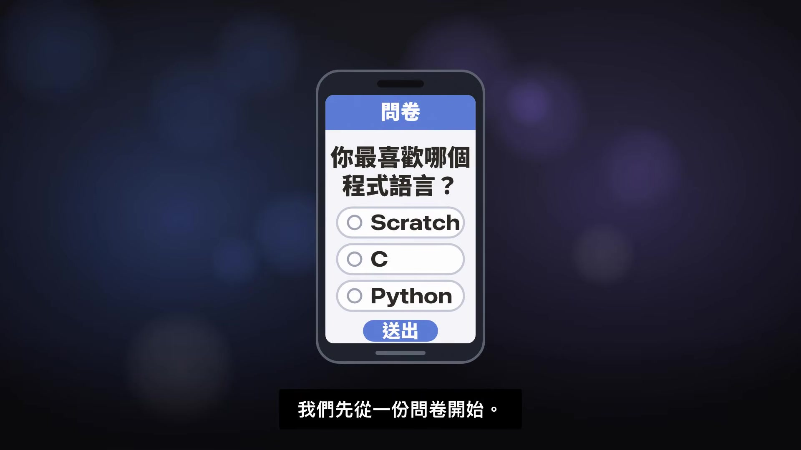

**逐字稿片段：** 第七堂課一開場 畫面就跟前面不一樣了 臺下沒有觀眾 只有Mullen一個人

**話題推測：** Mullen開啟CS50第七堂課，講解他將用一份問卷開始。

---

## 00:01:08

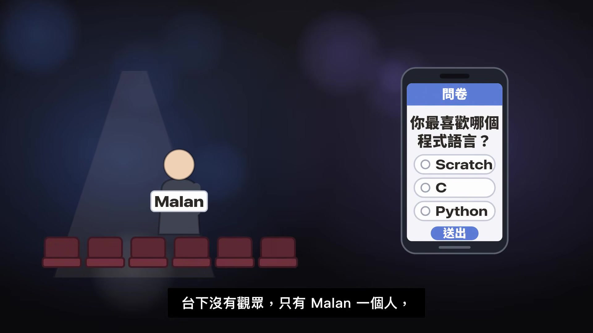

**逐字稿片段：** 站在一面灰色的哈佛建築圖前面 資料庫、網頁、伺服器這三堂課 是在攝影棚錄的 最後一堂課才回到那間大講堂 他先請大家用手機填一份問卷 只問一題 你最喜歡哪一個城市語言

**話題推測：** Mullen站在哈佛建築圖前，講解課程是在攝影棚錄製。

---

## 00:01:21

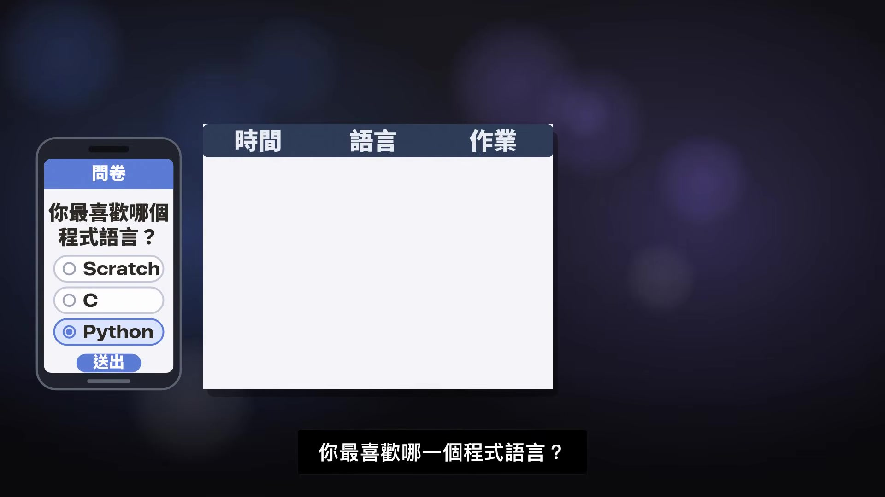

**逐字稿片段：** 回覆一筆一筆湧進Google試算表 最後一共313筆 接著他用終極學的Python 寫城市去數每個語言有幾票 為了數出這三個數字 他寫了14行 讀檔案 跳過第一行的標題 一筆一筆數 最後再排順序 每一步都要自己交代清楚 他自己也笑說 如果老闆從你背後問一句 大家最愛哪個語言 你再試算表上框一下 右下角就有答案 寫程式反而更累 資料一多 總要有一個更省力的辦法 那個辦法 就是這堂課的主角 專門存資料 找資料的軟體

**話題推測：** 問卷回覆湧入Google試算表，顯示資料統計過程。

---

## 00:01:53

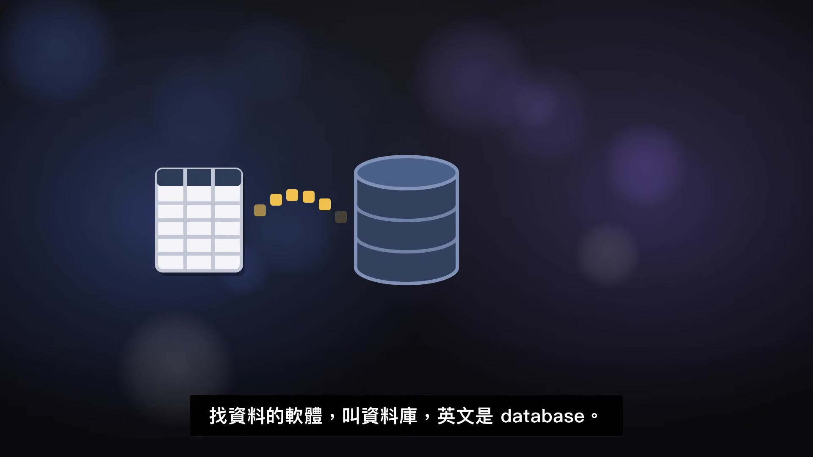

**逐字稿片段：** 叫資料庫 英文是Database 跟資料庫講話的語言

**話題推測：** 介紹資料庫的定義，並顯示英文術語Database。

---

## 00:01:57

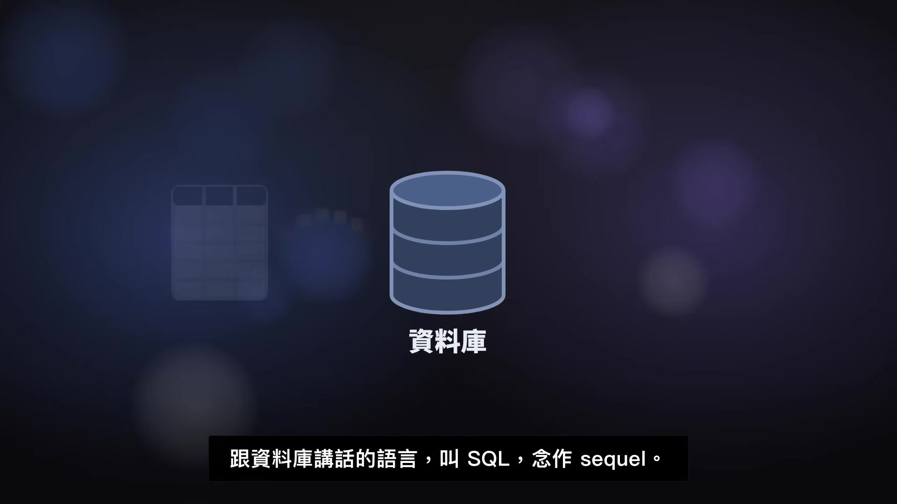

**逐字稿片段：** 叫SQL 唸作SQL 它跟前面學的語言 最大的不同是 你不用告訴他 一步一步怎麼找 只要說你要什麼 資料庫自己去找 Mullen說 他想把那隻14行的Python 縮成一行 結果真的做到了

**話題推測：** 介紹與資料庫溝通的語言SQL。

---

## 00:02:10

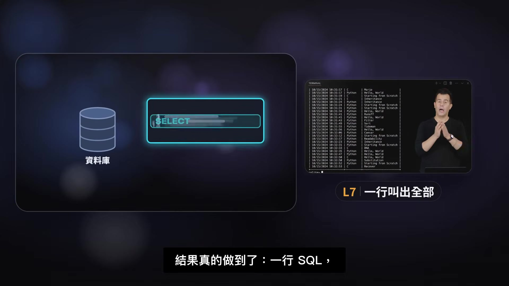

**逐字稿片段：** 一行SQL 問最愛C語言的有幾個人 答案立刻出來 他再加上分組、排序 只取第一名幾個字 同樣一行 就回答了全班最愛哪個語言 Python

**話題推測：** 示範用一行SQL指令快速查詢資料。

---

## 00:02:21

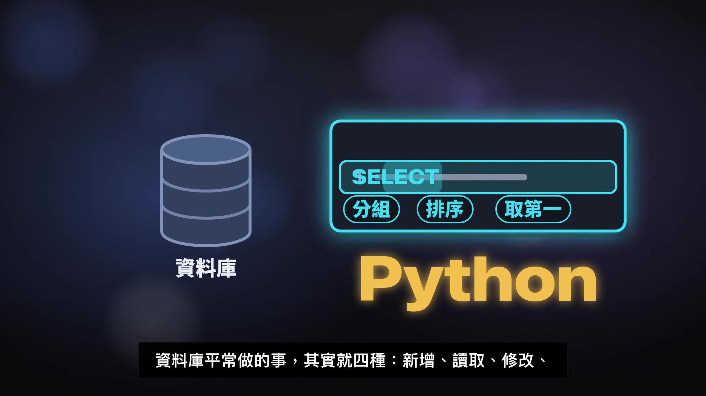

**逐字稿片段：** 資料庫平常做的事 其實就四種 新增、讀取、修改、刪除 這套做法 1970年代就有人提出來了 到今天 每一隻手機裡 都裝著這種小小的資料庫 可是有了試算表

**話題推測：** 列出資料庫的四種基本操作：新增、讀取、修改、刪除。

---

## 00:02:33

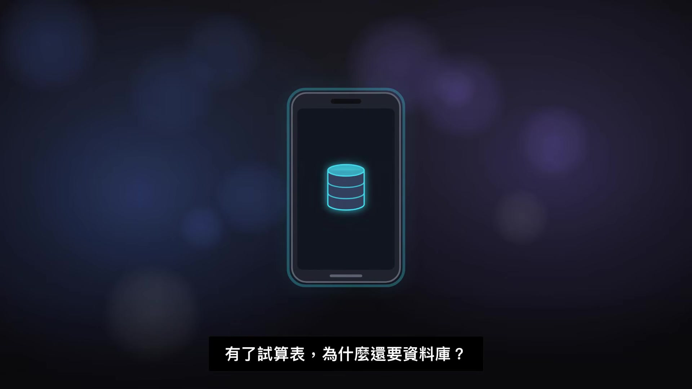

**逐字稿片段：** 為什麼還要資料庫 Mullen舉了兩個例子 第一個 每個用過試算表的人都碰過

**話題推測：** 提出問題：為何需要資料庫而非試算表？

---

## 00:02:38

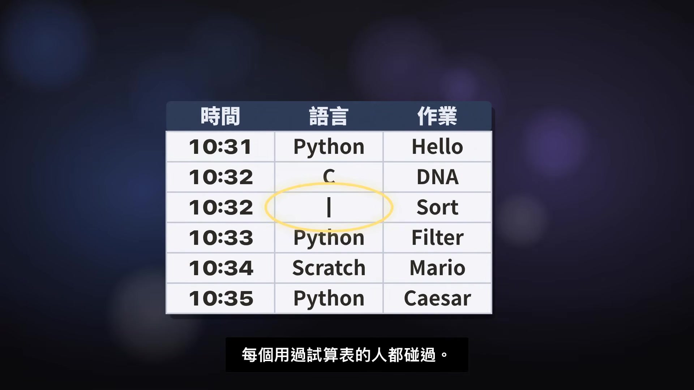

**逐字稿片段：** 這個例子是空格 試算表裡有一格是空的 它到底是什麼意思 是故意不填 是不知道答案 還是晚點再補 光看那一格看不出來 如果你是會計 拿到一份報表 有一格空著 你不會知道該打電話去問人 還是直接當成零來算 資料庫給這種情況 一個專門的寫法 叫Null 意思是這裡刻意沒有值 它是一個明確的記號 不是一片空白 在C語言裡 Null是一個 不指向任何地方的門牌 到了資料庫 同一個字換了用法 意思卻很像 這裡什麼都沒有 而且是故意的 我們在試算表上 沒有這種記號 只好自己想辦法 Mullen講了兩個 大家都做過的辦法 聽他自己說 slash a it's ambiguous so maybe you color it in a different color like maybe black it out in the spreadsheet just to indicate there's nothing here but a color is not an explicit value for a cell

**話題推測：** 舉例試算表中空格的模糊性。

---

## 00:03:42

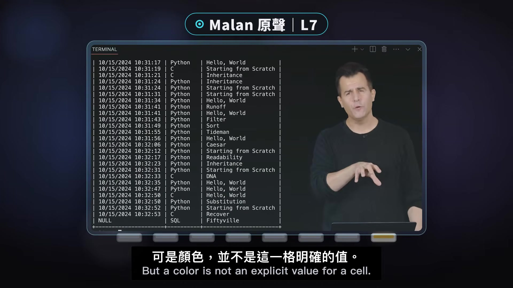

**逐字稿片段：** 第二個例子更痛 馬蘭故意示範 一個常見的錯誤 要修改資料 卻沒有加上 只修改哪幾筆的條件 按下去 全班三百多個人的答案 全部變成最愛Sequel 他說 跟大部分軟體不一樣 這裡沒有ctrl z 可以還原 只能從備份救回來 而他沒有備份 他苦笑說 真希望現在沒有人要問舊的資料 因為全班都最愛Sequel了 他也提醒 這種事在真實世界發生過

**話題推測：** 舉例資料庫修改錯誤，示範缺少條件可能導致全部資料被更改。

---

## 00:04:08

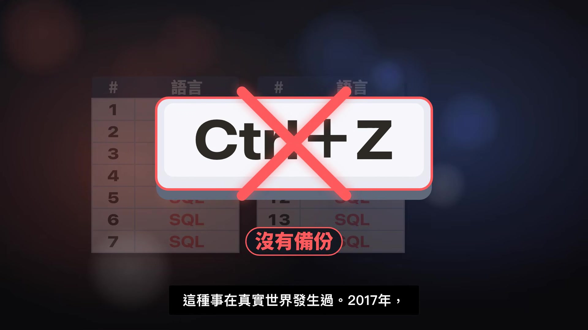

**逐字稿片段：** 2017年 一家叫GitLab的公司 工程師一個指令打錯 刪掉了正在用的資料庫 6個小時的資料救不回來 指令這麼有威力 那誰來擋住不該發生的事 試算表擋不住 誰都可以在任何一格打字 刪掉一整列 資料庫可以 聽他自己說 所以資料庫不只是比較快的試算表 它是一份會守規矩的表格 這一欄不準空著 那一欄不準重複 不該進來的資料進不來

**話題推測：** 提及GitLab公司因指令錯誤刪除資料庫的真實事件。

---

## 00:05:01

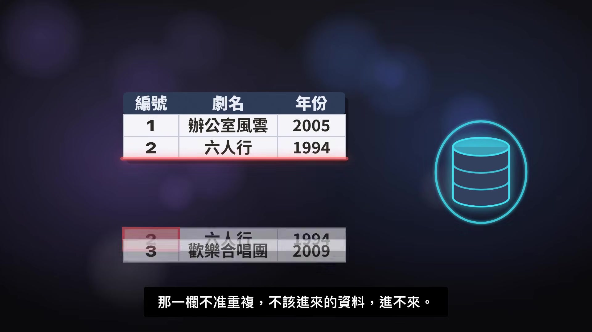

**逐字稿片段：** 休息之後資料變大了 Mullen換上IMDB 一個電影和電視節目的資料網站 CS50 用他公開的資料 做了一個二十幾萬部節目的資料庫 這麼多資料要怎麼存才對

**話題推測：** 課程從小型資料轉向大型資料，以IMDB為例。

---

## 00:05:14

**逐字稿片段：** 他先打開試算表 試了幾種排法 第一種 美國版辦公室風雲放一列 演員一個一個往右加欄位 可是每部戲的演員人數不一樣 表格會越來越寬 怎麼也不知道要留幾欄 第二種 一欄放劇名 一欄放演員 一個演員一列 結果辦公室風雲這幾個字 要重複寫上一百遍 打錯一個字就變成另一部戲 兩種都不對 第三種才是資料庫的做法

**話題推測：** Mullen使用試算表示範錯誤的資料儲存方式。

---

## 00:05:38

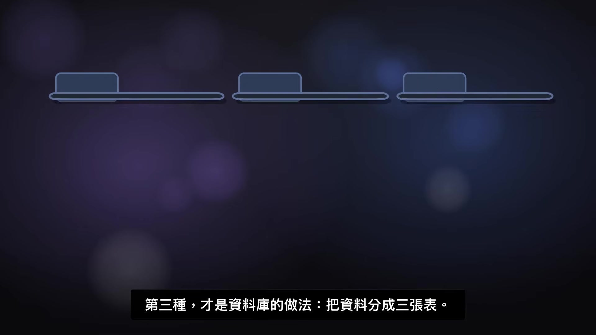

**逐字稿片段：** 把資料分成三張表 一張只放節目 一張只放人 每一部戲 每一個人 都配一個不會重複的編號 辦公室風雲的編號是386676 第三張表最簡單 只寫哪個編號的人 演了哪個編號的戲 表裡這個獨一無二的編號

**話題推測：** 介紹資料庫的正確做法：將資料分成三張表，並使用編號連結。

---

## 00:05:54

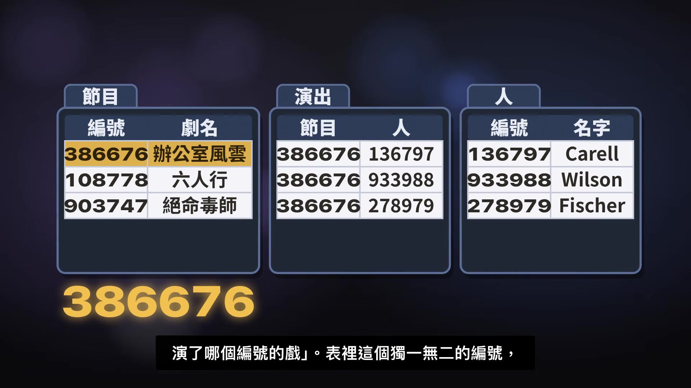

**逐字稿片段：** 叫組件 英文是primary key 同一個號碼出現在別張表裡 馬蘭說 就像它出現在外國的土地上 所以叫外建 終極我們說 電腦裡每一樣東西 都住在一個有門牌的格子裡 資料庫也一樣 在這裡 你不是一個名字 你是一個編號 這是今天主問題答案的第一塊 你在任何網站註冊 資料庫裡就多了一列 最前面就是屬於你的那個號碼 號碼省空間 卻不好讀 表裡只看到一串串數字 人看不出這是誰 所以要問 誰演了辦公室風雲 資料庫得先在節目表 找到386676 再去中間那張表 找出所有演過他的人的編號 最後到人名錶 把編號換回名字 把幾張表照著編號接回來 這個動作叫join 中文是合併 馬冷用投影片演給大家看 兩張表的編號欄靠在一起 一推就合成一張 反過來 問Steve Carell演過哪些戲 也是同一條路 只是方向相反

**話題推測：** 介紹資料庫中的「組件」（primary key）概念。

---

## 00:06:47

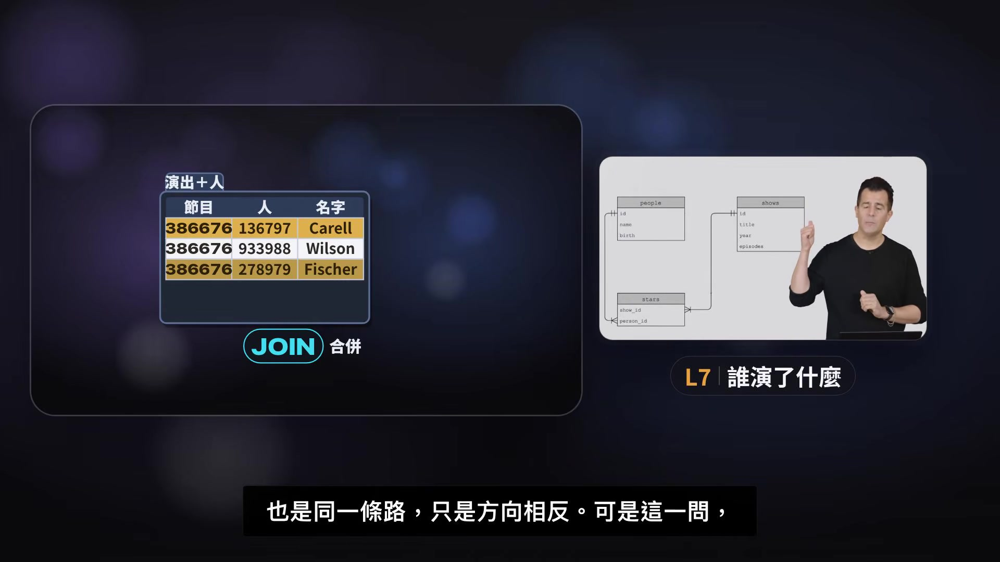

**逐字稿片段：** 可是這一問 資料庫花了三秒多 對一個網站來說 三秒很久 使用者會等到不耐煩 按下重新整理 然後再等一次 為什麼這麼慢 原因 上集就學過了 上集最開始

**話題推測：** 指出大型資料查詢速度慢的問題，引入效率討論。

---

## 00:06:59

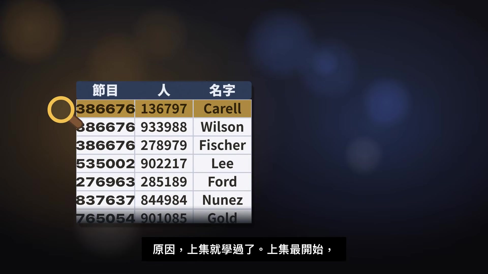

**逐字稿片段：** 馬冷撕過一本電話簿 示範兩種找人的方法 一頁一頁往後翻 或是從中間翻開 每次丟掉一半 資料庫手上沒有任何線索的時候 只能用第一種 從第一列看到最後一列 一筆一筆筆 這叫線性搜尋 電話簿有一千頁 一頁一頁翻 最壞要翻一千次 從中間翻開 十次左右就找到了 表格只有幾百列 這樣做沒什麼關係 表格有二十幾萬列 一個問題又要跨好幾張表 就慢下來了 Steve Carell那一問更累 先在人名錶從頭找他的名字 再到中間那張表從頭找他的編號 最後到節目表 一步一步對回片名 三張表全都從第一列看起 馬冷講到這裡 自己把這一課接回了這門課的第一堂 聽他自己說 解法是替資料庫做一份目錄 叫索引 英文是index Mullen先換了一種寫法 同一個問題說到五分之一秒左右

**話題推測：** 回顧上集電話簿查找的兩種方法，引出線性搜尋。

---

## 00:08:06

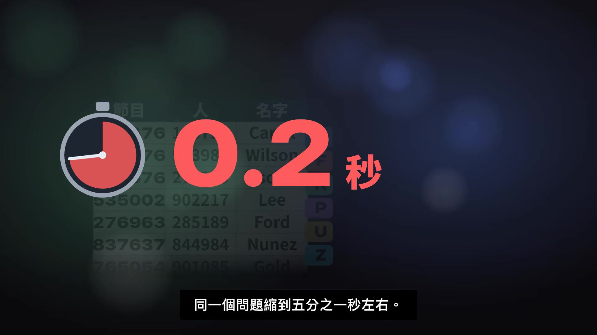

**逐字稿片段：** 接著他只打了一行建立索引的指令 等了一兩秒 再問一次 從五分之一秒變成千分之一秒 索引在資料庫裡是一棵樹 重極講過的樹 每一個節點分成兩邊 這種樹不一樣

**話題推測：** 示範建立索引指令後，查詢速度從五分之一秒降至千分之一秒。

---

## 00:08:18

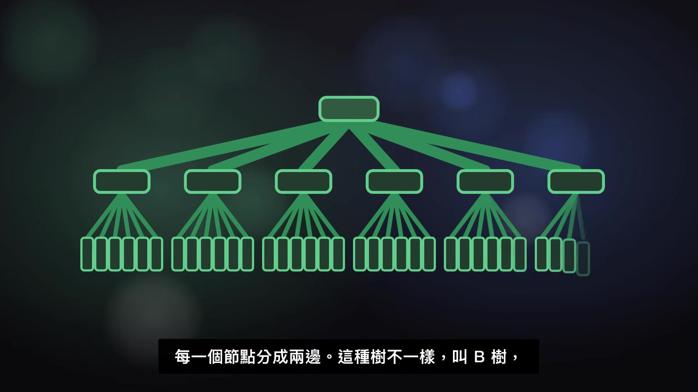

**逐字稿片段：** 叫B樹 每個節點可以分出很多枝 所以它很寬但很矮 從最上面走到最下面 只要幾步 Mullen特別說 這棵樹不用你自己寫 不用指標也不用C語言 一行指令 資料庫就替你蓋好 Mullen也算了一筆賬 查詢快了幾十倍 同樣多的使用者 就可以少買很多臺伺服器 省下的是真的錢 代價是索引要佔一些空間 而且每次新增資料 數都要跟著整理一次 像IMDB這種 看的人遠比修改的人多的網站 很划算 資料庫找得又快又準 剩下一件事要擔心

**話題推測：** 介紹資料庫索引的資料結構：B樹。

---

## 00:08:50

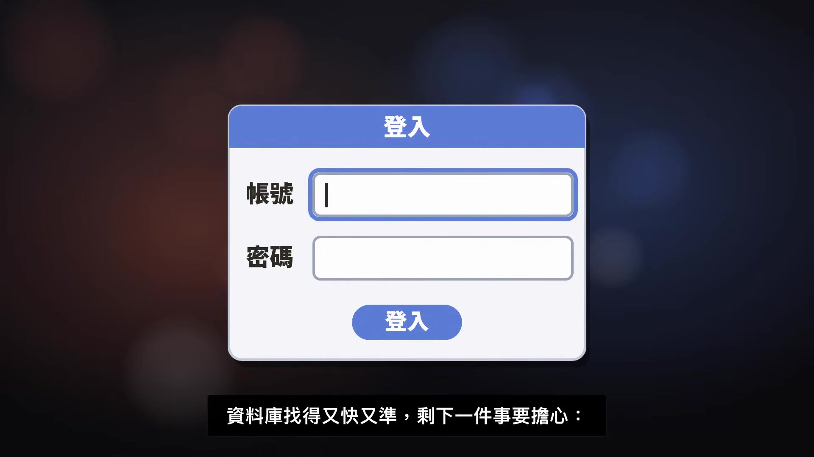

**逐字稿片段：** 有人使壞 Mullen這堂課最後示範的 是一種很老的公級 叫SQL注入 英文是SQL Injection

**話題推測：** 提出資料庫安全問題，介紹SQL注入攻擊。

---

## 00:08:58

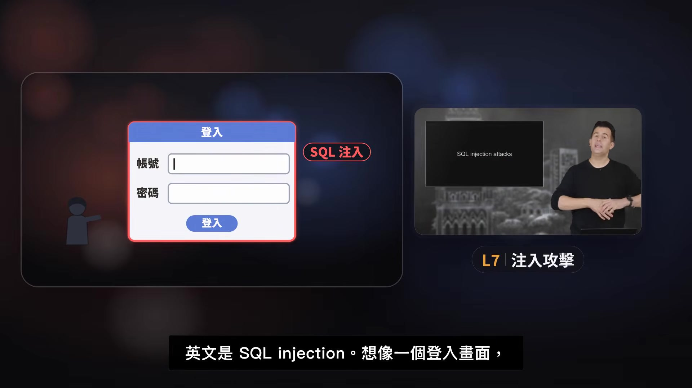

**逐字稿片段：** 想像一個登入畫面 你輸入賬號和密碼 網站把他們塞進一句SQL 找出賬號是這個 而且密碼是那個的人 壞人在賬號欄打上別人的賬號 例如jimatexample.com 後面再加一個單引號和兩個簡號 單引號把賬號那一段提早關上 兩個簡號在SQL裡的意思是 後面都是註解不用理 於是而且密碼是那個整句話 被當成註解丟掉 沒有密碼也登進去了 資料庫只照字面做事 分不出這段字是資料還是指令 馬倫說這招你其實聽過另一個名字 聽他自己說

**話題推測：** 示範SQL注入攻擊，透過特殊輸入繞過密碼驗證。

---

## 00:09:48

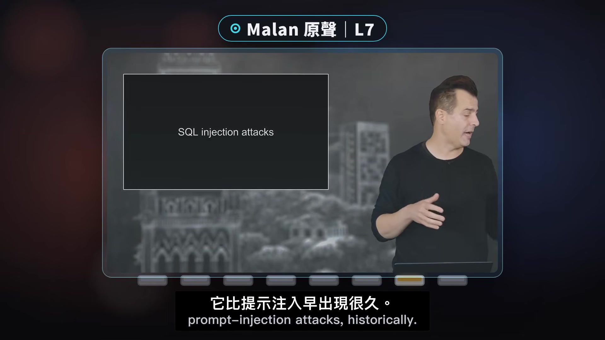

**逐字稿片段：** 提示注入這個名字 是2022年才有人提出來的 當時就直接說 它跟SQL注入是同一回事 SQL注入呢 1998年就有人公開寫過 比提示注入早了二十幾年

**話題推測：** 將SQL注入攻擊與提示注入攻擊進行對比。

---

## 00:10:00

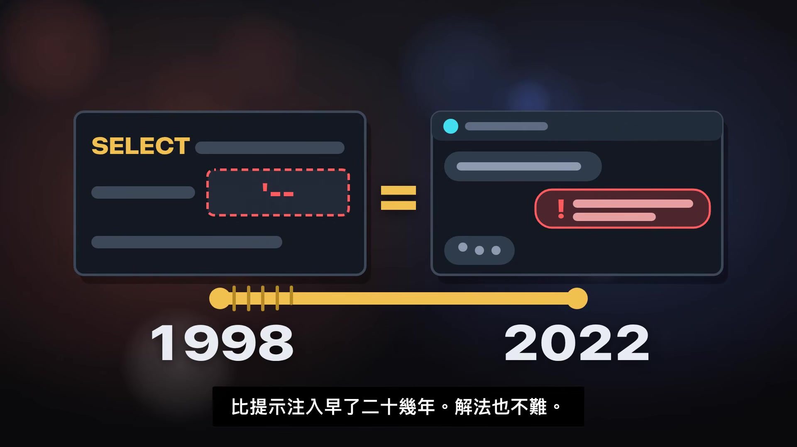

**逐字稿片段：** 解法也不難 網站不要把你打的字 直接接進指令裡 而是在指令裡留一個空位 用一個問號站著 再由資料庫把你打的東西填進去 不管你在賬號欄打什麼 它都只會被當成賬號 不會變成指令 Mullen收尾時

**話題推測：** 講解SQL注入的防禦方法，使用問號站位避免直接拼接指令。

---

## 00:10:14

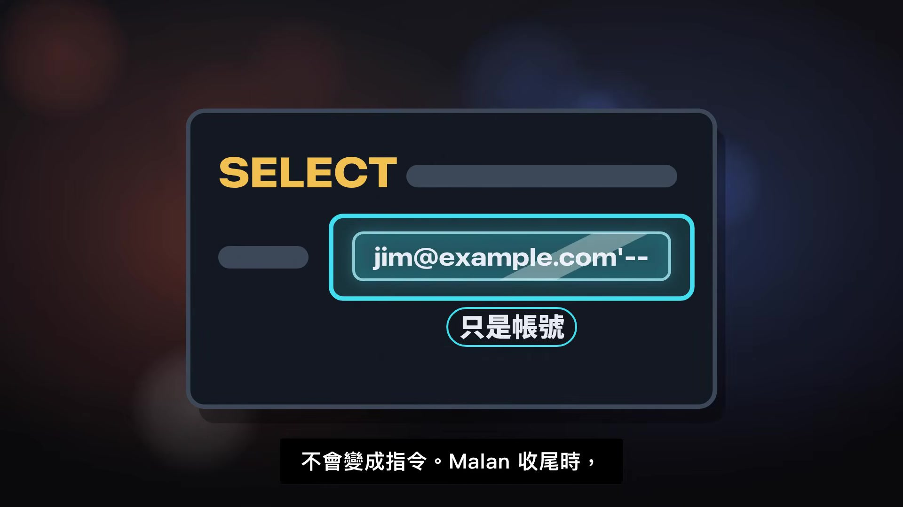

**逐字稿片段：** 提到一則工程師都知道的漫畫 一個媽媽替兒子取了一個 帶著SQL指令的名字 學校的學生名單 就這樣整張被刪掉 她的結論只有一句 永遠不要相信 使用者打進來的東西 這句話我們後面還會再碰到兩次

**話題推測：** 引用工程師漫畫，強調「永遠不要相信使用者輸入的資料」。

---

## 00:10:28

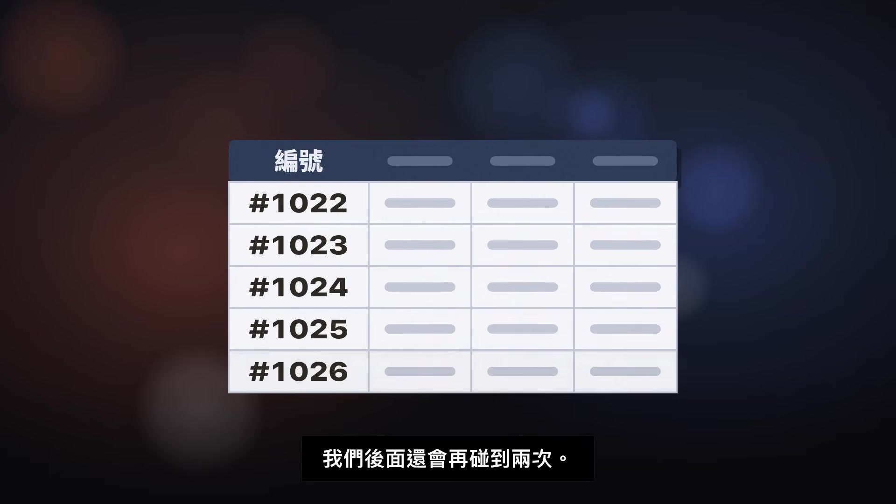

**逐字稿片段：** 我們整理第一段 你在網站上的賬號、購物車、訂單 都住在資料庫裡的某一列 每一列有一個編號 資料庫跟試算表不一樣 它會擋下不該進來的資料 它找得快是因為有索引 一棵很寬很矮的樹 它只知道字面做事 所以分不出誰是好人 可是這一整堂課的問題 都是Modern自己在電腦前 一行一行打指令問的 IMDB的使用者不會打SQL 他們只會在網頁上打一個具名 按下搜尋 那幾個字是怎麼從你手上的手機 送到遠方那臺電腦的資料庫裡 這是第二段要回答的事 在那之前先記住第一段的一句話 後面兩段都會用到它 在網站眼中你是一個編號

**話題推測：** 總結第一段資料庫的重點。

---

## 00:11:08

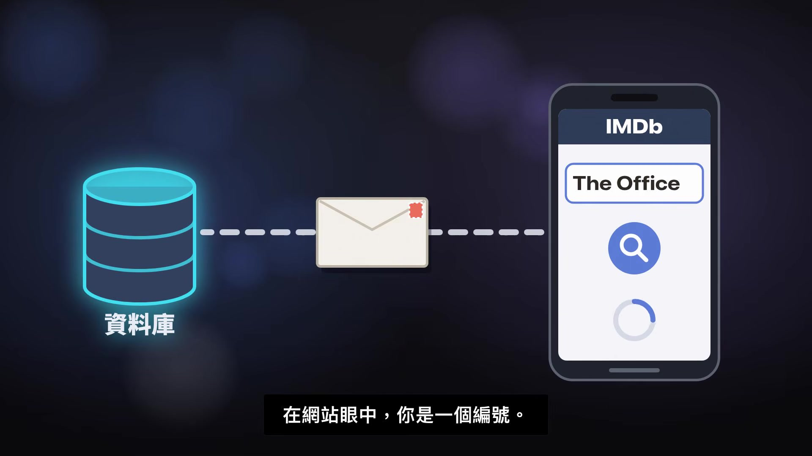

**逐字稿片段：** 第八堂課 Mullen手上拿著一疊白色的信封 他說 你按下搜尋的那一秒 你的電腦做的事就像寄一封信 這一集要一直用到的第一個畫面 就是這個信封 寄信要寫地址 網路上每一臺裝置 電腦、手機、伺服器

**話題推測：** Mullen開啟CS50第八堂課，手上拿著信封比喻網路通訊。

---

## 00:11:23

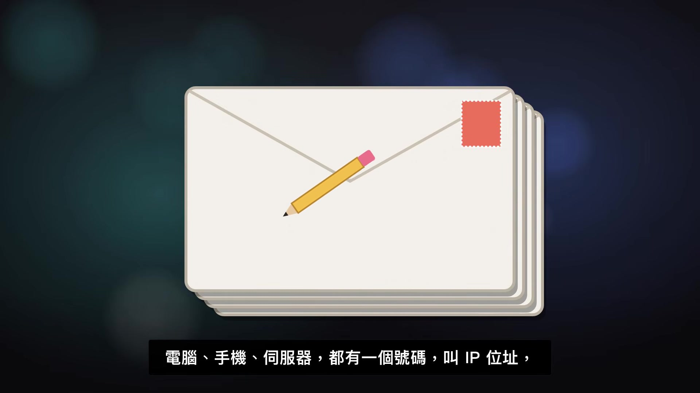

**逐字稿片段：** 都有一個號碼叫IP位置 由四組數字組成 每一組從0到255 它跟終極講的記憶體門牌很像 只是這一次門牌掛在整臺機器上 信封中間寫收件人的號碼 左上角寫寄件人的號碼 回信才知道要寄回哪裡 信寄出去以後

**話題推測：** 介紹網路裝置的地址：IP位置。

---

## 00:11:39

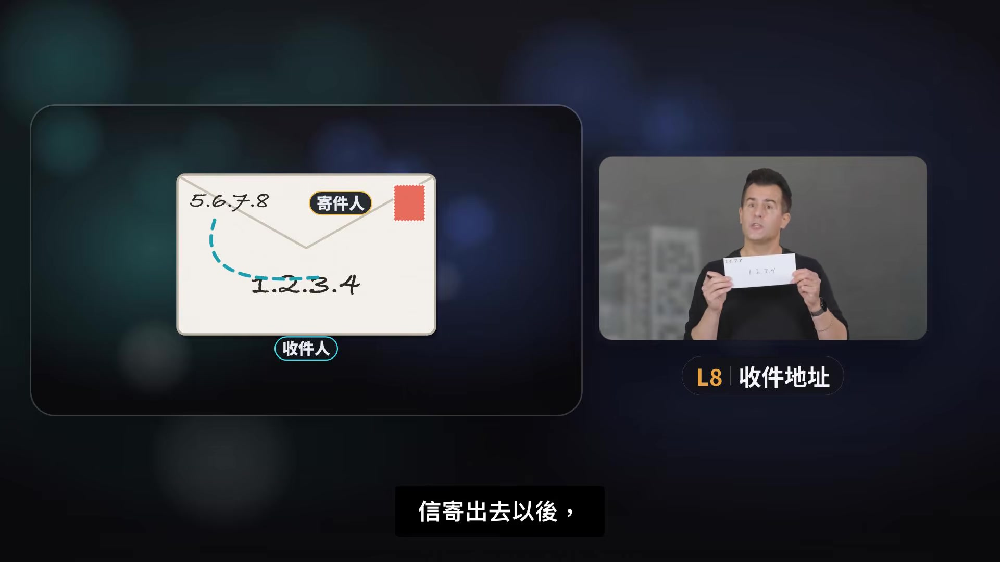

**逐字稿片段：** 會經過一臺又一臺叫路由器的電腦 每一臺只決定下一步往哪裡送 就像郵局一站一站往下轉 不一定走最短的路 這套寄信的網路 最早是1969年 從美國的幾所大學連起來 可是有些東西太大 一個信封裝不下 網路上什麼最多

**話題推測：** 解釋網路封包透過路由器傳遞的過程。

---

## 00:11:55

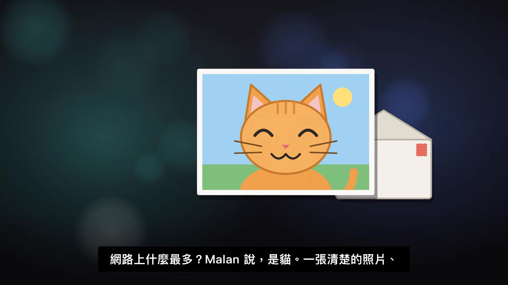

**逐字稿片段：** 馬蘭說 是貓 一張清楚的照片 一段影片 在電腦裡就是一大串零和一 動輒好幾百萬個位元族 不可能一口氣塞進一封信 一張照片在網路上切成幾百 幾千小塊 是很平常的事 你寄一封email附上一段影片 或在社群上傳一張照片 都會碰到這個問題

**話題推測：** 以貓的照片為例，說明大檔案如何被切割傳輸。

---

## 00:12:12

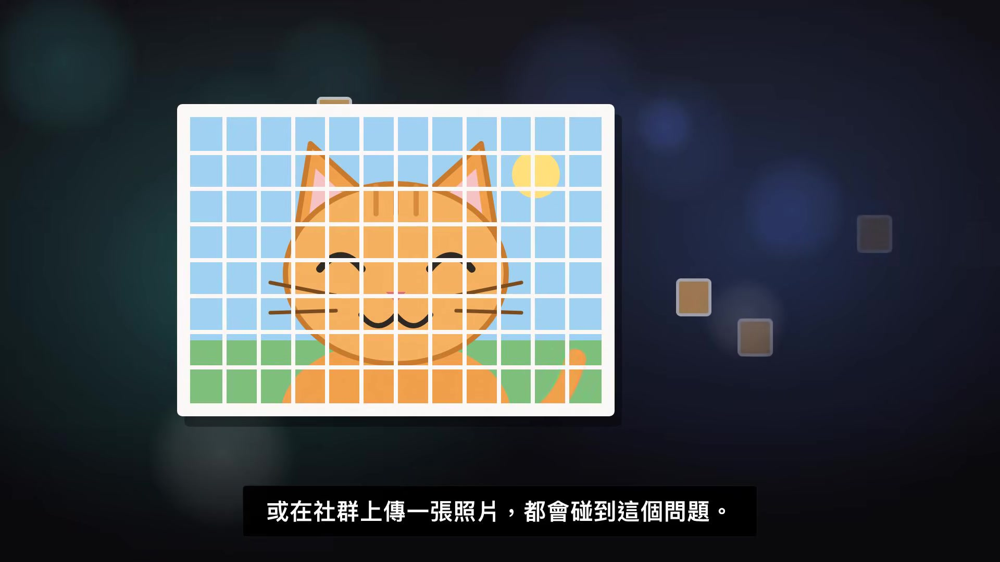

**逐字稿片段：** 馬蘭拿出一張印出來的快樂貓照片 比信封大得多 怎麼折都塞不進去 如果硬要整張一起寄 路上只要有一臺電腦塞車 整張照片就得從頭再寄一次 別人的信也全都跟著排隊 電腦遇到這種情況 有一個很簡單的辦法

**話題推測：** Mullen拿出印出的貓照片，示範大檔案無法一次寄送的問題。

---

## 00:12:27

**逐字稿片段：** 他當場示範給大家看 動作有點粗魯 聽他自己說 撕開的四塊,各裝一個信封,各自上路 問題是,他們不一定走同一條路,也不一定照順序道 所以每個信封上,還要多寫一行 第一封共四封 收件的那臺電腦湊齊了,就把貓拼回來 少了一封,就請對方再寄一次 免得收到一隻少了一腳不太開心的貓 路上要是有哪臺電腦太忙,把某一封丟掉了 收件那一端也會發現少的是哪一封

**話題推測：** Mullen當場撕開貓照片，比喻大檔案被切成小塊傳輸。

---

## 00:13:19

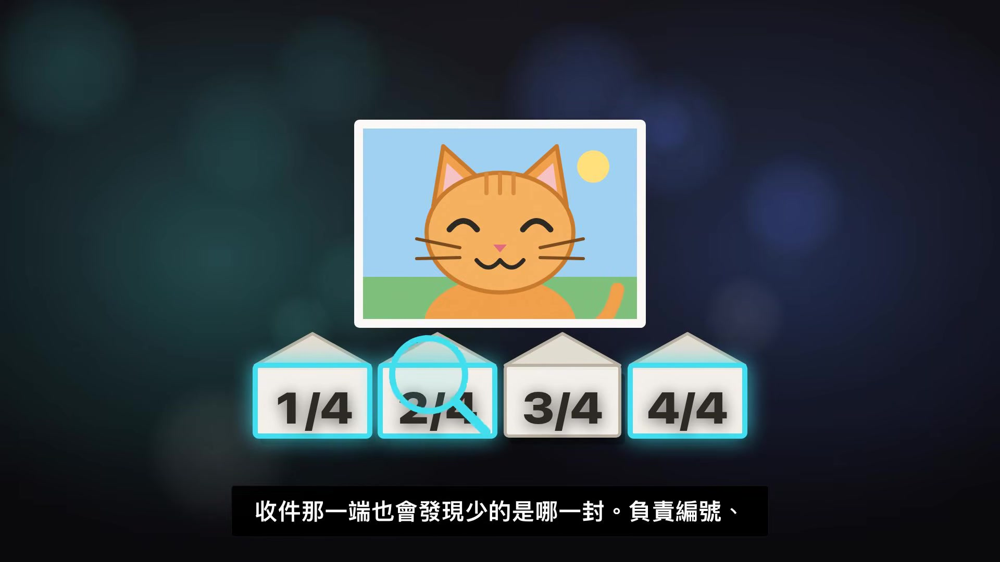

**逐字稿片段：** 負責編號、負責補記的這套規則叫TCP 信封上還可以再多寫一個號碼 指定交給那臺電腦裡的哪個窗口 例如收網頁的、收信件的 就像同一棟大樓裡不同的辦公室 到這裡,信封長什麼樣子你都知道了 誰寄的、寄給誰、第幾封、交給哪一個窗口 可是你平常打的是網址,不是一串號碼 誰幫你換?

**話題推測：** 介紹負責編號與補記封包的規則：TCP。

---

## 00:13:40

**逐字稿片段：** 這個服務叫DNS 它像一本字典 左邊一欄是網址,右邊一欄是號碼 馬蘭特別點出來 這就是終極學過的字典 用一個鍵去找一個值

**話題推測：** 介紹將網址轉換為IP位置的服務：DNS。

---

## 00:13:50

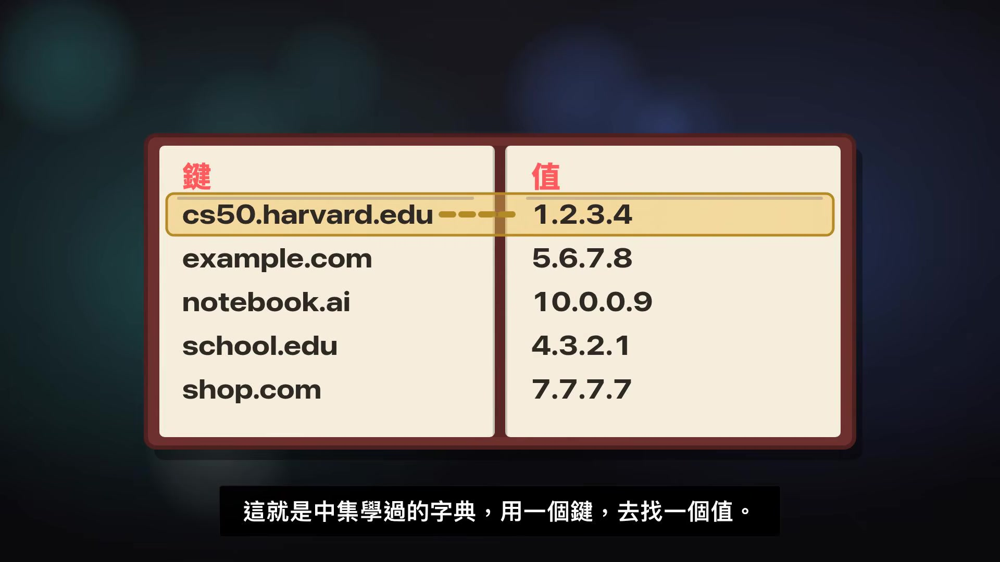

**逐字稿片段：** 全世界登記的網址將近三億九千萬個 一臺電腦記不了那麼多 所以DNS是一層一層的 你家網絡業者的DNS 先記住熱門的答案 不知道的就往上一層問 最上面那一層 只知道.com的網址該去問誰 順帶一提 你花錢買網址 其實是年年付費 請人在這本字典裡幫你留著那一行 哪一年沒付 那個網址就不再是你的了 還有一個冷知識 很多AI公司愛用的.ai網址 本來是加勒比海小島安歸拉的國馬 跟人工智慧一點關係也沒有 信封送到了 裡面寫什麼 瀏覽器跟網站之間寫信 有一套固定的格式

**話題推測：** 指出全球網址數量龐大，解釋DNS分層運作方式。

---

## 00:14:26

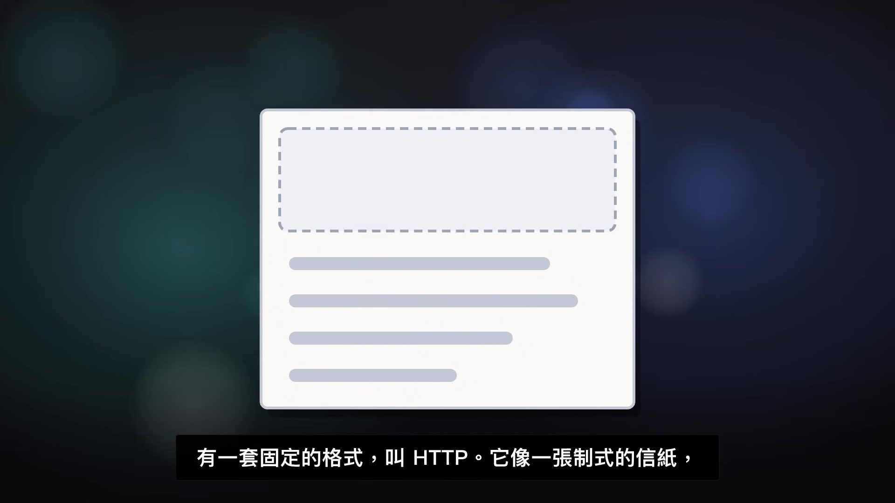

**逐字稿片段：** 叫HTTP 它像一張制式的信紙 第一行寫要做什麼 接著寫要哪一頁 寄給哪個網站 你要一個網頁 信裡就寫Get 意思是請給我 你要送出表單 例如密碼、信用卡 就寫Post 意思是我寄東西給你 網址前面多一個S的HTTPs

**話題推測：** 介紹瀏覽器與網站溝通的固定格式：HTTP。

---

## 00:14:43

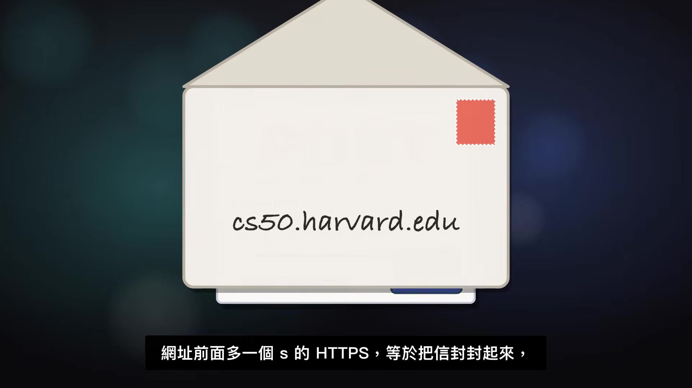

**逐字稿片段：** 等於把信封封起來 路上的人只看得到你寄去哪個網站 看不到信裡寫什麼 網站的回信 第一行一定有一個數字 叫狀態碼 200代表一切順利

**話題推測：** 介紹加密後的HTTP協議：HTTPS。

---

## 00:14:54

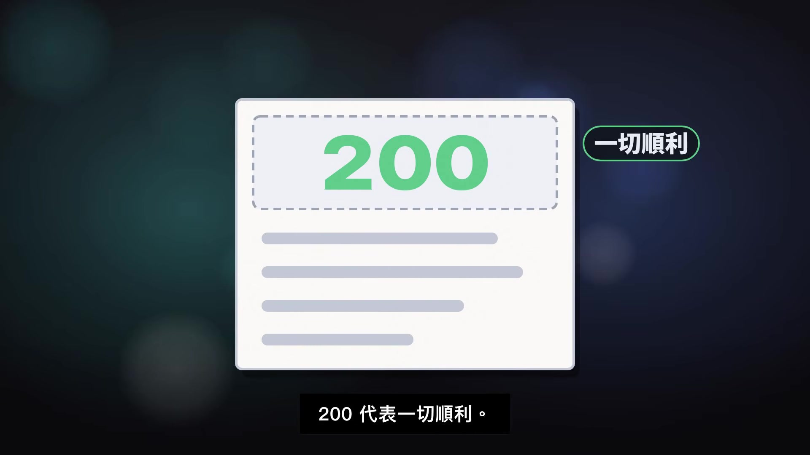

**逐字稿片段：** Malene打開瀏覽器的開發者工具 重新整理哈佛大學的首頁 畫面底下一口氣 列出好幾十封來來回回的信 其中有一個狀態碼 你一定看過 聽他自己說 and something is missing that's a little weird that we as humans have been acclimated to a fairly esoteric http status code but that's all it is 還有一個常見的狀態碼是301

**話題推測：** Mullen打開瀏覽器開發者工具，示範查看HTTP請求與狀態碼。

---

## 00:15:25

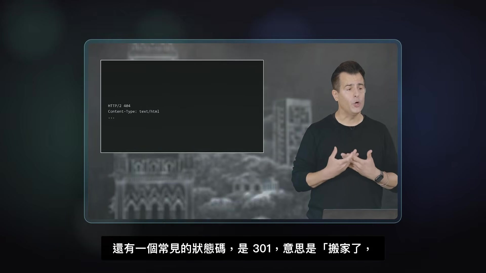

**逐字稿片段：** 意思是搬家了請去新地址 瀏覽器收到就會自動跟過去 馬蘭用它講了一個流傳很久的玩笑 有一個網址叫safetyschool.org 意思是保底學校 就是申請大學時 最後一定考得上的那一間 打開它 你會被直接送到耶魯大學的首頁 對哈佛的人來說 說這是一句不用解釋的玩笑 這個網址從2000年就存在 到今天點進去 還是會被送到耶魯 是誰年年在付這筆錢 沒有人知道 這個玩笑也說明了一件事 網站回你什麼 完全由網站那一端決定 你寄出去的只是一封信 回信裡要放什麼 是對方的事 回信裡最常裝的 就是網頁

**話題推測：** 介紹常見狀態碼301（永久轉移），並舉例網站玩笑。

---

## 00:16:05

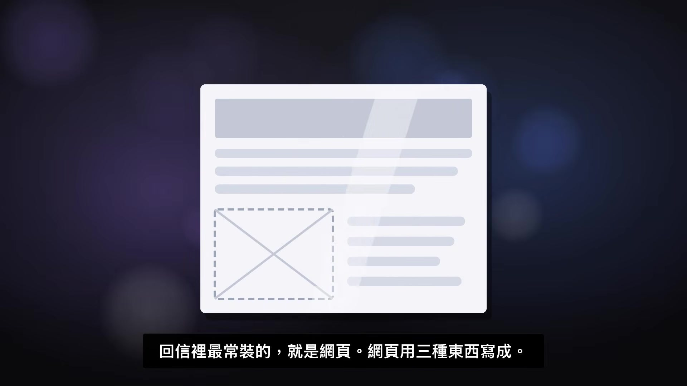

**逐字稿片段：** 網頁用三種東西寫成 HTML決定網頁上有什麼 標題、段落、圖片、連結 CSS決定它長什麼樣子 顏色、大小、位置 JavaScript讓它會動 Mullen做了一個小網頁 上面三個按鈕 寫著RGB 按一下 整頁變成紅色 再按另一個 變成綠色 他又做了一個搜尋框 每打一個字 底下的清單就少一節 打一個C 跳出一長串 打到Cats 只剩下四個字 你在Google打字時 看到的自動完成 原理就是這樣 Gmail開著不動 星星自己冒出來 也是JavaScript在背後 替你跟伺服器要新的資料 這三種東西 都是網站寄來 在你的瀏覽器裡打開的 重點來了

**話題推測：** 介紹構成網頁的三種主要技術：HTML、CSS、JavaScript。

---

## 00:16:46

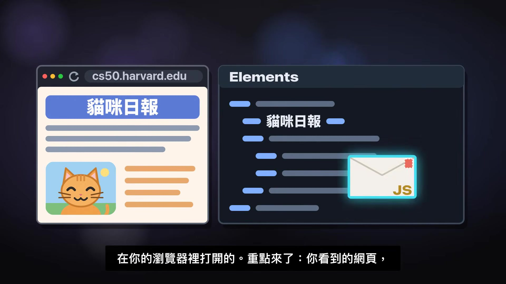

**逐字稿片段：** 你看到的網頁 是網站寄給你的一份副本 每個瀏覽器都有一個開發者工具 在網頁上按右鍵 選檢查 就能看到這份副本的原文 滑鼠移到哪一行 網頁上對應的那一塊就亮起來 它不只能看 還能直接動手修改 修改完 畫面馬上跟著變 不過你做的任何修改 都只發生在你自己的電腦上 網站那一端完全不知道 重新整理一次 副本就變回網站寄來的原樣

**話題推測：** 指出網頁是網站寄給你的「副本」。

---

## 00:17:10

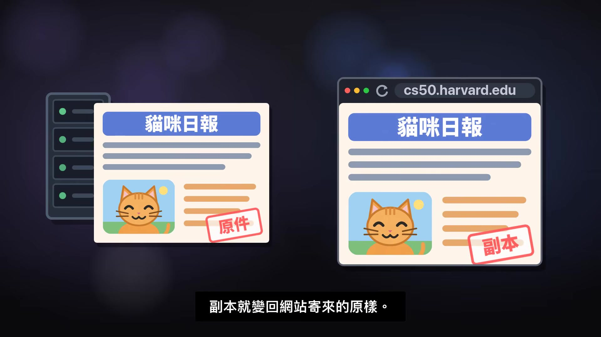

**逐字稿片段：** Mullen打開哈佛大學的招生網頁 上面寫著大大的一行 為什麼選哈佛 身為哈佛的老師 他決定調皮一下 對隔壁那間學校示個好 聽他自己說 在哈佛的網站上 我可以得到新版本 實際上的資訊 馬倫動手修改的 只是自己那一份副本 對哈佛的網站沒有任何影響 可是反過來想 網站寄給你的東西 你也都能動手修改 他做了一個註冊表單 規定E-mail那一欄 一定要有小老鼠符號 打錯了 瀏覽器就跳出提醒擋住你 可是他打開開發者工具 把那條規定刪掉 照樣送出 網頁上的檢查 擋得住打錯字的人 擋不住故意的人 這是別相信使用者第二次出現 同樣的道理 要做一個看起來跟銀行一模一樣的假網站也不難 所以點連結之前先看一下網址 這一堂還留下一個洞 Mullen做的搜尋框 按下去是交給Google去搜尋的 他說我沒有後端 沒有資料庫 但Google有 那個搜尋框是怎麼把字交給Google的

**話題推測：** Mullen打開哈佛招生網頁，示範將「哈佛」改為「MIT」。

---

## 00:18:26

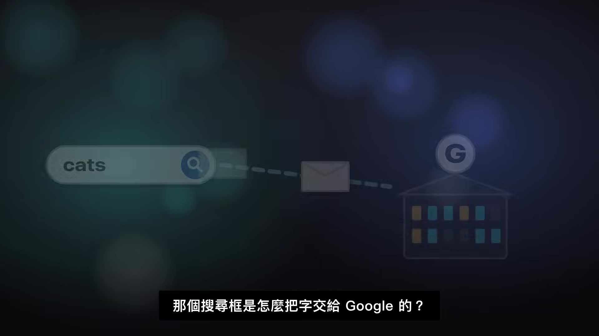

**逐字稿片段：** 答案寫在網址裡 網址後面如果有一個問號 問號後面就是要交給網站的東西 寫成名字等於什麼

**話題推測：** 解釋網址後面的問號用於傳遞給網站的參數。

---

## 00:18:33

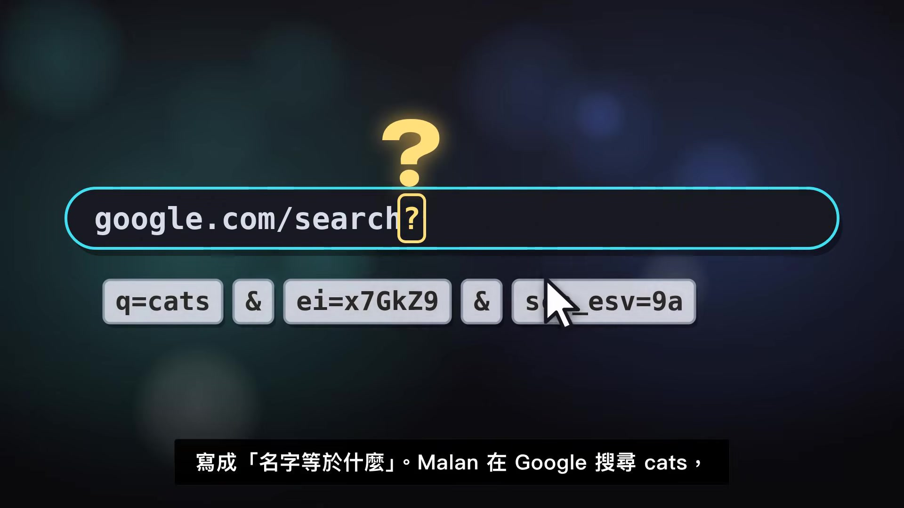

**逐字稿片段：** Mullen在Google搜尋Cats 網址列跳出一長串 他把後面一段一段刪掉 刪到只剩Q等於Cats 按下去 搜尋結果一模一樣 那多出來的一大串是什麼 他說 大多是網站用來追蹤的資料 記錄你從哪裡來 點了什麼 他自己做的搜尋框 就是照這個格式 替你寫好Q等於你打的字 再把信寄到Google 所以 網頁上的表單 說穿了就是幫你寫信的工具 填好的欄位 變成信裡的一行一行 下次你複製一個很長的網址給朋友 可以看一下問號後面那串 很多都可以刪掉

**話題推測：** Mullen在Google搜尋Cats，示範網址參數Q=Cats。

---

## 00:19:05

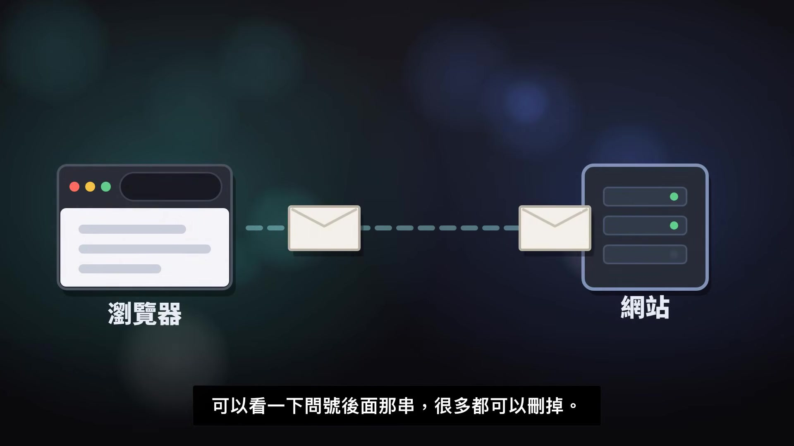

**逐字稿片段：** 我們整理第二段 你在網站上做的每一件事 都是瀏覽器寄出一封信 網站回你一封信 信封上有雙方的號碼 太大的東西就切成好幾封 信裡寫著你要什麼 回信裡裝著網頁 而網頁只是一份副本 使用者想動手修改哪裡都可以 可是這裡藏著一個問題 HTTP這套寫信的規矩 在設計上 就是每一封信各自獨立 網站讀完回完就忘了 而且信只是照格式寫的文字 誰都能照著格式 寫一封信寄過去 你點下一頁是一封新的信 網站不記得上一封是誰寄的 那他怎麼知道 這一封跟上一封是同一個人 要回答這個問題 網站那一端 得有一臺會想事情的電腦

**話題推測：** 總結第二段網頁通訊的重點。

---

## 00:19:46

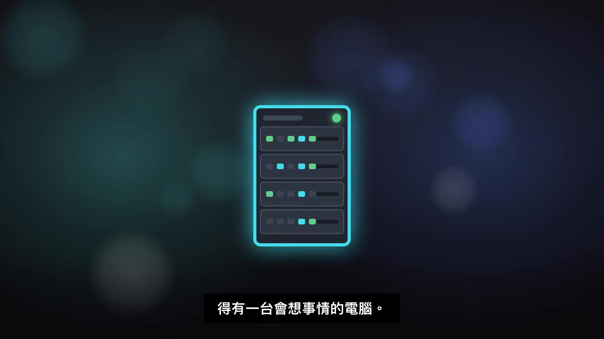

**逐字稿片段：** 第九堂課 Marlon一開場就說 這是今年最後一週在攝影棚了 收信回信的那臺電腦叫伺服器 上一週的網頁 是寫好放在伺服器上的檔案 誰來要就原封不動寄一份 這一週伺服器要開始想事情 看你寄來的信裡寫了什麼 去資料庫找資料 在當場做一頁網頁回給你 一個網站有幾千頁 沒有人是一頁一頁手寫的

**話題推測：** Marlon開啟CS50第九堂課，講解伺服器如何處理請求。

---

## 00:20:07

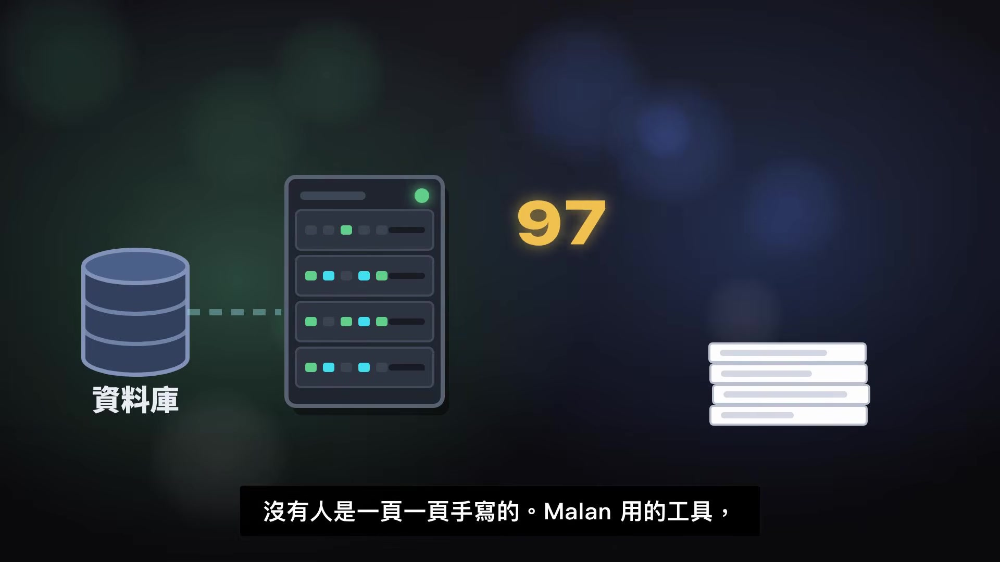

**逐字稿片段：** Mullen用的工具 是一套叫Flask的Python工具組 幾行程式就能讓伺服器開始回信 他也很快碰到了第一個錯誤

**話題推測：** Mullen使用Flask工具組來讓伺服器回信。

---

## 00:20:14

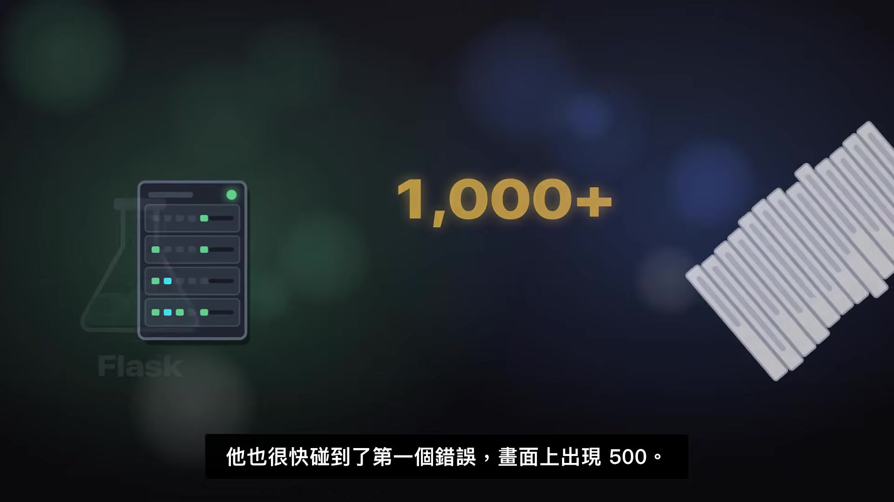

**逐字稿片段：** 畫面上出現500 他說 這就是網頁版的當機 看到500 雖然你很不想承認 但就是你自己拿裡寫錯了 伺服器讀信的時候 有一件事你每天都碰得到 第二段說 要網頁寫Get 送資料寫Post 用Get送出的東西 會直接接在網址後面

**話題推測：** 示範伺服器程式碼錯誤時，瀏覽器顯示500狀態碼。

---

## 00:20:32

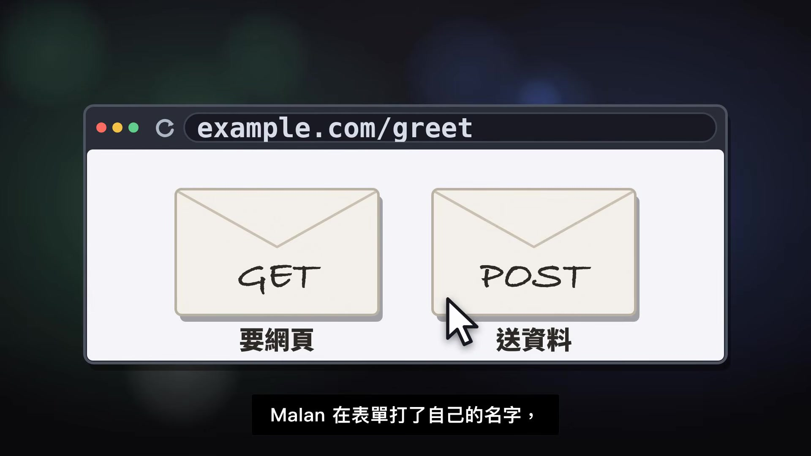

**逐字稿片段：** Mullen在表單打了自己的名字 網址最後就多了一段 Name等於David 所以密碼、信用卡這種東西 要用Post 它把資料放在信封裡面 不會出現在網址列 也不會留在瀏覽記錄裡 不過Post本身沒有上鎖 真正把信封封起來的 還是網址前面的HTTPS 還有一個小地方 你在網路上付完款 再按一次重新整理 瀏覽器會跳出一個視窗 問你要不要重新送出表單 這不是瀏覽器多事 是怕同一筆款項被送出兩次 Marlon也打開開發者工具 讓大家看信封裡真正寄出去的內容 他說 下次登入網站時 你也打開來看 會看到比想象中多很多的東西

**話題推測：** Mullen在表單中輸入名字，網址後顯示Name=David，示範Get傳輸資料。

---

## 00:21:08

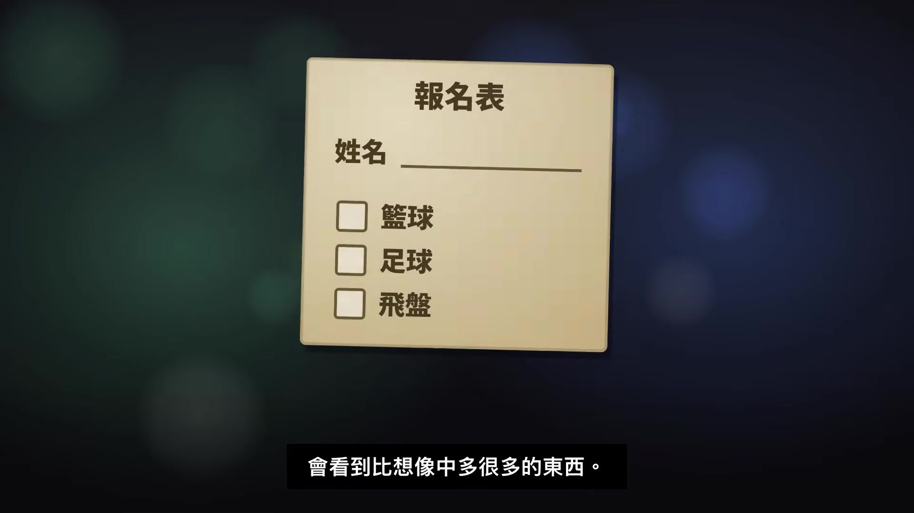

**逐字稿片段：** 接著他講了一段自己的故事 1997年 哈佛的新生要報名校內的運動比賽 方法是拿一張紙 寫上名字 勾選想參加的運動 然後走過校園 推開宿舍的門 把紙從負責辦比賽的宿舍輔導員房門底下塞進去 馬冷前一年才上完CS50 那時候的CS50還不交網頁 他自己學 做了一個線上報名網站 他說 上完CS50再多走一步 你就有能力自己學一個新的語言 他當年就是這樣 他秀出那個網站當年的截圖 背景是一整片重複的運動器材圖案 他說 到現在也都不知道當時為什麼要這樣做 這一堂 他要用今天的工具 把這個報名網站重做一次 一個填名字的欄位 一個選運動的下拉選單 一顆送出按鈕 選單上只有三項 籃球 足球 飛盤 網頁還加上必填 什麼都不選就送不出去 看起來很安全 可是對網站來說 送進來的只是一封信 信裡寫什麼都可以 可是上一堂我們才看過 網頁是你自己手上的副本

**話題推測：** Mullen分享自己1997年用程式架設哈佛新生運動報名網站的故事。

---

## 00:22:05

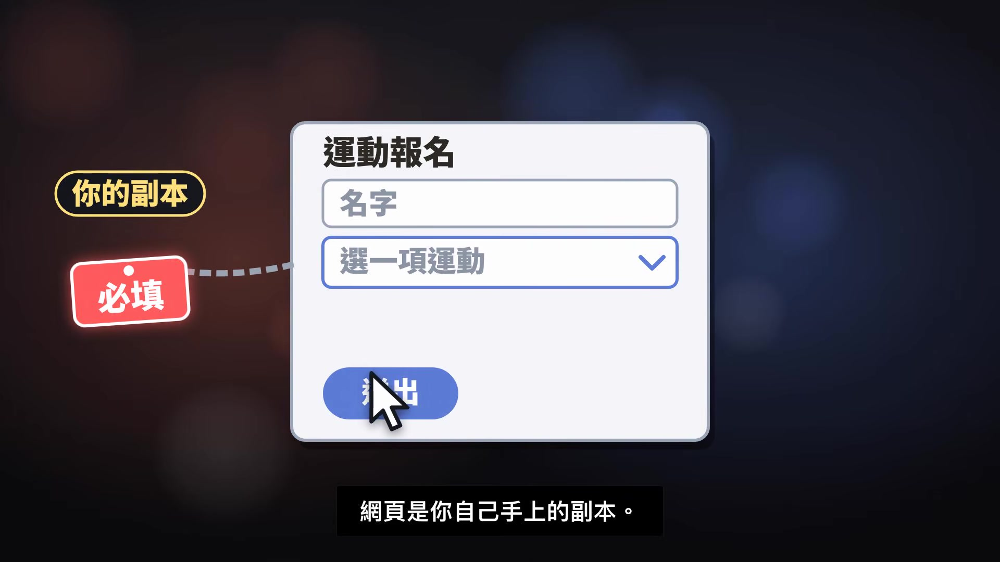

**逐字稿片段：** Mullen打開開發者工具 先把碧田刪掉 什麼都不選就送出 成功 他又玩得更大一點 把選單裡的一個選項 換成選單上根本沒有的運動 按下送出 網站照樣說 你報名成功了 一個寫著只能選三種的表單 就這樣收下了第四種 如果這一欄是商品價格 或是轉賬金額 後果就不只是好笑了 Mullen停下來 對著鏡頭說了一段話 聽他自己說

**話題推測：** Mullen再次示範透過開發者工具繞過前端驗證，提交無效資料。

---

## 00:22:46

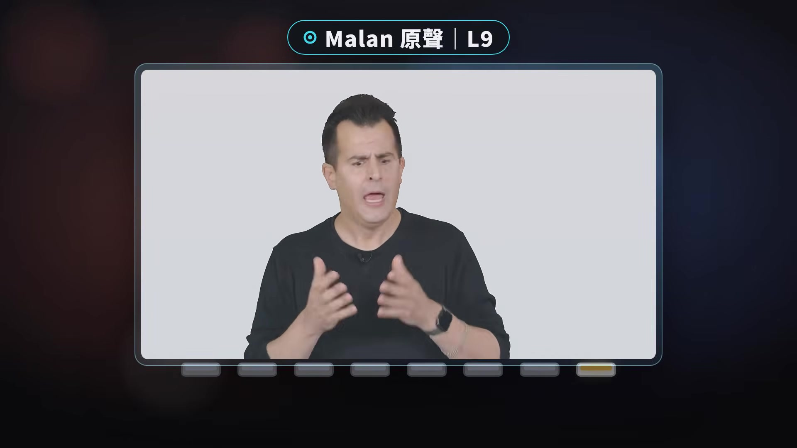

**逐字稿片段：** 解法是把檢查搬到伺服器那一端 伺服器自己留一份正式的運動清單 網頁上的選單照著這份清單產生 收到報名時再核對一次 你送來的運動不在清單上就退回去

**話題推測：** 提出解決方案：將驗證邏輯搬到伺服器端。

---

## 00:22:57

**逐字稿片段：** Mullen再害一次自己的表單 這次被擋下來了 中間他連打錯兩次 還自嘲說他不要再碰鍵盤了 多寫這幾行程式 網站就安全很多 網頁上的檢查是給一般人方便 伺服器上的檢查才是真正的門 到這裡 同一個道理已經出現第三次了 第一段 資料庫分不出帳號欄裡塞的是不是指令 第二段 網頁只是一份副本 誰都能動手修改 這一段 表單上的規定一刪就沒了 網站真正能相信的只有自己那一段

**話題推測：** Mullen再次嘗試提交無效表單，但這次被伺服器端成功擋下。

---

## 00:23:26

**逐字稿片段：** 報名成功的人要記在哪裡? 馬攬先用最簡單的方法

**話題推測：** 提出新問題：報名成功的人要將資料記在哪裡？

---

## 00:23:30

**逐字稿片段：** 在伺服器的記憶體裡放一本名冊 名字對到運動 名冊放在記憶體裡讀寫都很快 這是它的好處 這本名冊就是重吉學過的字典 名字是鍵,運動是值 網頁上多了一頁報名名單 名字一欄,運動一欄 看起來就是個像樣的網站了 可是這本名冊有兩個問題 第一,兩個人都叫David 後報名的會把前一個蓋掉 因為字典裡同一個鍵只能對到一個值 第二個問題更大 記憶體裡的東西 程式一結束 電腦一關就沒了 伺服器總有重新啟動的時候 更新程式 停電 當機都會 馬蘭就真的重新啟動了一次 聽她自己說 to keep track of everything 答案就在第一段

**話題推測：** Mullen最初將名單儲存在伺服器記憶體中。

---

## 00:24:27

**逐字稿片段：** Mullen把名單存進資料庫 開一張報名表 每一筆有自己的編號 再加上名字和運動 網站收到報名就新增一列 有人要看名單 就把全部讀出來 第一段 Mullen自己打指令 做的新增和讀取 現在由網站 替每一個使用者去做 寫進資料庫的指令裡 他照樣用問號站位 防的就是第一段的Sequel注入 這一次再重新啟動伺服器 名單還在 他說 這就是一個完整的網站了 雖然很醜 但資料會一直留著

**話題推測：** 解決方案：將名單儲存到資料庫中。

---

## 00:24:55

**逐字稿片段：** 我們把這一堂到目前的樣子連起來看 瀏覽器寄來一封信 伺服器讀信 去資料庫找資料或寫資料 再回一頁網頁 第一段的資料庫 和第二段的信 在這裡接上了 可是這個網站還缺一樣東西

**話題推測：** 總結本堂課瀏覽器、伺服器、資料庫的連結。

---

## 00:25:08

**逐字稿片段：** 它不知道你是誰 任何人只要打對網址 都看得到整份報名名單 照理說 應該只有負責辦比賽的人能看 那就要登入 問題來了 第二段最後說 HTTP每一封信各自獨立 網站讀完就忘了 你登入之後點下一頁 是一封新的信 網站不記得你剛剛登入過 可是你每天用的Gmail 網路銀行 購物網站 登入一次 之後點來點去 都不用再輸入密碼 難道他們每點一頁 都在背後偷偷幫你重新登入一次 要是真的每一頁都要你輸入密碼 你每點一個商品就得打一次 沒有人會想用這種網站

**話題推測：** 提出新問題：網站如何識別你是誰？

---

## 00:25:43

**逐字稿片段：** Marlon用一個生活裡的東西來回答 聽他自己說 So for instance in the real world if you go into a club an amusement park or a bar 一家娛樂場 or sometimes they stamp your hand and that hand stamp is meant to confirm if you come and go through the same door oh we've already authenticated you we've already checked who you are 我們已經檢查到你 and look at it again 說完

**話題推測：** Marlon以真實世界「手背蓋章」的比喻，引入身份識別機制。

---

## 00:26:06

**逐字稿片段：** 他真的拿出一個小印章 在自己的手腕上蓋了一個笑臉 這是今天的第二個畫面 手背上的章

**話題推測：** Marlon拿出印章，在手腕上蓋一個笑臉，具象化比喻。

---

## 00:26:13

**逐字稿片段：** 網站上的這個章叫Cookie 英文的意思是餅乾 你第一次登入 伺服器確認過你的帳號密碼 回信裡會多一行設定Cookie 這就是在你手背上蓋章 從此以後 你的瀏覽器寄出的每一封信 都會自動附上這個cookie 就像每次進門都把手背亮出來 蓋章只發生一次 之後的每一次 都只是亮出來給人看 cookie本身 是存在你自己電腦上的一小段文字 由瀏覽器替你保管 章上寫的是什麼? 通常不是你的名字 更不是密碼 只是一大串隨機號碼 伺服器拿這串號碼 去自己那邊的記錄裡對一下 就知道這是剛剛登錄的那個人 馬蘭接著做了一個

**話題推測：** 介紹網站上實現「蓋章」功能的技術：Cookie。

---

## 00:26:48

**逐字稿片段：** 一個最簡單的登入網站 只要輸入名字 不用密碼 登入 就是伺服器在這個章底下記一筆 這個號碼是David 登出 就是把章擦掉 伺服器那邊的那一筆 也跟著清掉 他把網站設定成 你一關掉瀏覽器 章就失效 很多網站讓你勾 記住我 其實就是把章的有效期限拉長 讓你過幾天回來 還是登入的狀態 他還特別提醒一件事 每個人手上的章都不一樣 所以伺服器會替每個人各記一份 前面那份報名名單 是全網站共用一份 誰來都看到同一份 章底下寄的東西 只屬於拿著那個章的人 所以同一個網站 你看到的是你的購物車 別人看到的是別人的 這時候

**話題推測：** Marlon製作簡易登入網站，示範Cookie如何記錄用戶狀態。

---

## 00:27:27

**逐字稿片段：** Mala拿出一盒真的餅乾 邊講邊吃 說這堂課實在太長 還好有帶點心 我們回頭看那一大串號碼 三段的答案 就在這裡會合 第一段 你在資料庫裡是一個編號 第二段 每一次連線都是一封信 第三段 網站在你手背蓋章 章就印在每一封信上 伺服器拿章上的號碼去對 才認得你 購物車也是這樣記住的

**話題推測：** Marlon拿出餅乾，幽默緩解課程長度，並回歸講解Cookie。

---

## 00:27:49

**逐字稿片段：** Marlon做了一個只有五本書的線上書店 按下加入購物車 網頁送出的不是書名 是編號123 他說 大型購物網站就是這樣做的 你把一本書加進購物車 瀏覽器送出去的 是那本書在資料庫裡的編號 伺服器把它記在你這個章底下 幾天後回來 東西還在車裡 也因為章就是一串號碼 它要是被別人拿到 別人就能冒充你

**話題推測：** Marlon製作線上書店，示範購物車如何透過商品編號與Cookie記住內容。

---

## 00:28:11

**逐字稿片段：** 同一個章 還有另一面 Marlon提到 廣告公司就算不知道你叫什麼 也能認出又是同一個人 再用你點過的東西拼出你的輪廓 他們的辦法主要有兩種 一種是廣告公司的程式放在很多網站上 在你手背蓋同一個章 你逛到哪裡他都認得出來 另一種叫瀏覽器指紋 看你的電腦和瀏覽器有哪些特徵 連章都不用蓋 Chrome原本說要停用第一種 延了好幾年 到2025年決定保留 讓使用者自己選

**話題推測：** 指出Cookie的另一面：被用於廣告追蹤。

---

## 00:28:40

**逐字稿片段：** 那無痕模式呢? Mullen說 他會給你一個全新的空的餅乾罐 關掉視窗 章就全部清掉 但它不是隱身斗篷 網站、公司的網管、網路業者 照樣看得到你去了哪裡

**話題推測：** 探討無痕模式對Cookie和追蹤的影響。

---

## 00:28:51

**逐字稿片段：** 我們整理第三段 也回答主問題 網站怎麼記住你 其實它記不住任何人 你的資料住在資料庫裡的一列 有一個編號 你每次連上網站 都像記一封沒有署名的信 網站第一次認出你 在你的手背蓋一個章 章上是一串隨機號碼 之後你的瀏覽器每一封信 都附上這個章 網站拿號碼回到資料庫去對 才認得你 也因為一切都只是號碼和文字 網站永遠不能相信你送來的東西 你也要知道 同一個章可以拿來記住你 也可以拿來追蹤你 下次網站問你要不要接受Cookie 你就知道他在問什麼 可不可以在你的手背上蓋一個章 到這裡 資料庫、網頁、伺服器 三堂課都上完了

**話題推測：** 總結第三段內容，回答主問題：網站如何記住你。

---

## 00:29:32

**逐字稿片段：** 最後一堂 Marlon終於回到了一個有人的地方 第十堂課

**話題推測：** Marlon進入CS50最後一堂課的總結。

---

## 00:29:36

**逐字稿片段：** 又回到了那間大講堂 臺下坐滿了學生 講臺旁邊站著一隻 比人還高的黃色充氣鴨子 就是終極那隻會說話的橡皮鴨 這是最後一堂課 沒有新的技術 比較像一場結業典禮 前三堂在攝影棚裡只有他一個人 這一堂臺下有笑聲也有掌聲

**話題推測：** Marlon回到大講堂，台上擺著一隻充氣鴨子。

---

## 00:29:54

**逐字稿片段：** 馬冷先放出第一週的一張圖 一個人對著消防水管喝水 他說如果這學期每一週 都覺得像被水柱直接灌進嘴裡 現在回頭看 那些水就是你一路累積起來的東西 他說期末專題的目的 就是讓你相信你不再需要老師 只需要朋友、同事、搜尋引擎還有AI 想想十週前,光是在螢幕上排出幾個磚塊有多難 接著,他講了一段我覺得整個系列最值得記住的話 聽他自己說 他說的不只是學生

**話題推測：** Marlon展示第一週課程的比喻圖：「用消防水管喝水」。

---

## 00:30:37

**逐字稿片段：** 馬冷從檔案櫃裡翻出自己1996年上這門課時的第一份作業 一個只印出一行字的小程式 被扣了兩分

**話題推測：** Marlon展示自己1996年CS50的第一份作業。

---

## 00:30:44

**逐字稿片段：** 接著他回到第一堂課的那張圖 輸入 經過一套步驟 變成輸出 他說 電腦科學不是寫程式本身 是解決問題 程式只是工具箱裡的一個工具

**話題推測：** Marlon回到第一堂課的「輸入-處理-輸出」圖，強調解決問題。

---

## 00:30:56

**逐字稿片段：** 然後他玩了一個遊戲 一位學生上臺 只有他看得到 螢幕上的一個立方體 要用嘴巴指揮全場 在紙上畫出來 他先說 畫一個立方體 結果臺下畫得五花八門 他改口說 先畫一個六邊形 再畫一個Y 最後乾脆說 從紙的正中央開始 往左一條線 往右一條線 往下一條線

**話題推測：** Marlon開始玩一個指揮學生畫立方體的遊戲，強調溝通的重要性。

---

## 00:31:14

**逐字稿片段：** 紙收上來以後 Marlon 一張一張舉到鏡頭前 有的畫得很小 有的轉了方向 全場笑成一團

**話題推測：** Marlon展示學生們根據指令畫出的各式各樣立方體。

---

## 00:31:21

**逐字稿片段：** 遊戲之後 Marlon 講下課以後怎麼辦 他說 你們一直用的是 CS50 準備好的線上環境 接下來要在自己的電腦上裝工具 這是脫掉最後一組輔助輪 終極他在臺上舉過一副腳踏車的輔助輪 講的是同一件事 他也老實說 自己一年裡只有九月十月會用到 C 語言 隔年還得重新熟悉一次 所以這門課教C、教Python、教SQL、教網頁 目的都不是要你背下每一種語言

**話題推測：** Marlon講述課程結束後，學生如何在自己的電腦上安裝工具。

---

## 00:31:46

**逐字稿片段：** 他還提到ChatGPT 說這大概是他看過唯一一個 在幾天、幾周之內就改變他自己習慣的技術 學生的期末專題也可以拿他來幫忙 工具會一直換 會留下來的是遇到新東西時 知道從哪裡開始想問題的那個習慣

**話題推測：** Marlon提到ChatGPT，說明它如何改變學習與解決問題的習慣。

---

## 00:32:01

**逐字稿片段：** 最後一個活動是全場拿手機作答的測驗 一共15題 特別的是 這些題目是學生自己在前一份作業裡出的 等於全學期的總複習 從上集的第一支程式 到終極的記憶體和鏈接串列 再到這一集的Sequel都考到了 每答完一題

**話題推測：** Marlon進行一場全場手機作答的期末測驗。

---

## 00:32:17

**逐字稿片段：** 臺上就公佈答案和全場的長條圖 答錯的人一看 就知道自己忘了哪一段 有一題問 什麼會造成堆疊異位 全場答對的人不到四成 Mullen又用終極那個比方再講一次 自助餐廳的餐盤一個一個往上疊 韓式一層一層呼叫 疊得太高就倒了 也有幾乎全場都答對的 C語言裡 存著記憶體地址的那種變數叫什麼 大家都選了指標 一學期以前 這些字對他們來說 跟對你一樣陌生

**話題推測：** 每次答題後，台上會公佈答案和全場長條圖。

---

## 00:32:44

**逐字稿片段：** Mullen說 這就是抽象化 最上面一層 一句話就懂 卻不夠精確 往下一層就越來越具體

**話題推測：** Mullen談到「抽象化」的概念，強調層層堆疊的知識體系。

---

## 00:32:51

**逐字稿片段：** 三集一路走來 也是一層站在一層上面 最底下是0和1 0和1組成字 字住進有門牌的格子 格子串成各種資料結構 資料結構上面蓋起了資料庫 資料庫外面套上了信封和網頁 最上面是一個會認得你的網站 每一層的人 都不用重新發明底下那一層 只要站在上面往上蓋就好 Mullen說 這門課最好的成就 是教會你自己學新東西 它不是一門教C的課 也不是教Python的課 而是一門教程式設計的課 測驗的最後一題 題目就是CS50 鴨子當年唯一會做的那件事 聽他自己說

**話題推測：** Mullen以分層圖總結三集內容：從0和1到會識別你的網站。

---

## 00:33:53

**逐字稿片段：** 我們回到開場那個問題,網站怎麼記住你? 答案是, 你在網站上其實只是一串號碼, 資料庫裡你那一列有一個編號, 每一次連線都是一封寄出去的信, 手背上的章是另一串號碼, 網站拿它去對才認得你。

**話題推測：** 回顧開場問題，再次總結「網站怎麼記住你」的答案。

---

## 00:34:09

**逐字稿片段：** 三集連起來看 上集說電腦只會0和1 中集說每樣東西都住在有門牌的格子裡 這一集說連你在網站眼中也是一個號碼 CS50的課就上到這裡 馬蘭說 跟剛開始的自己比才是真正的進度 最後問你一個問題 你會開無痕模式嗎 你以為它幫你擋掉了什麼 留言告訴我 喜歡的話訂閱AI Notebook 開啟通知 我們下次見

**話題推測：** 將三集課程的關鍵概念串聯起來，強調電腦世界的本質。

---
