# jimainotebook_PJscSW7V7qc — 關鍵畫面索引

- 來源逐字稿：[jimainotebook_PJscSW7V7qc_FIN.srt](jimainotebook_PJscSW7V7qc_FIN.srt)
- 影片：https://www.youtube.com/watch?v=PJscSW7V7qc
- 截圖數：57

## 00:00:12

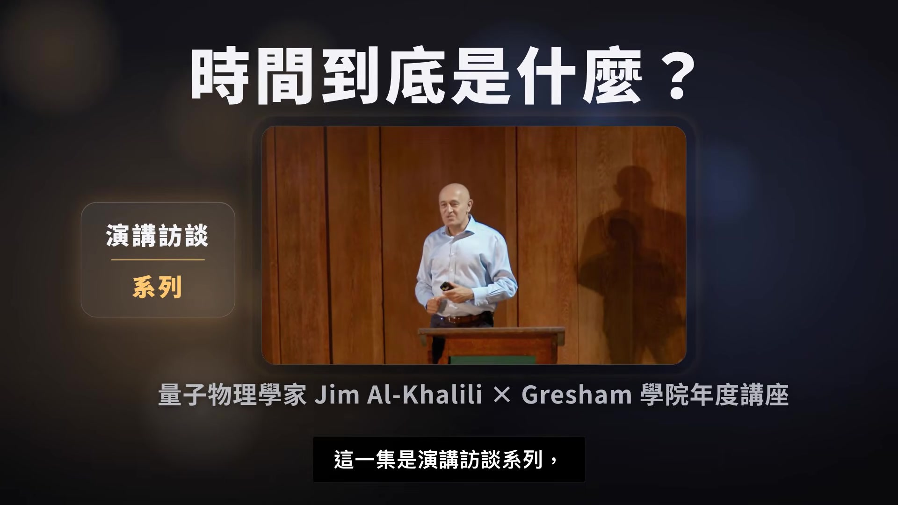

**逐字稿片段：** 主角是英國量子物理學家Jim Al-Khalili,他跟我同名。

**話題推測：** 介紹本集主題人物：英國量子物理學家Jim Al-Khalili。

---

## 00:00:16

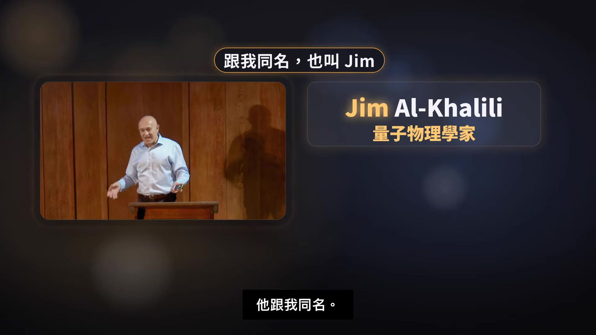

**逐字稿片段：** 我們用他在倫敦Grisham學院的年度講座回答一個問題,時間到底是什麼? 先講一件聽起來很怪的事。

**話題推測：** 提出本集核心問題：時間到底是什麼？

---

## 00:00:21

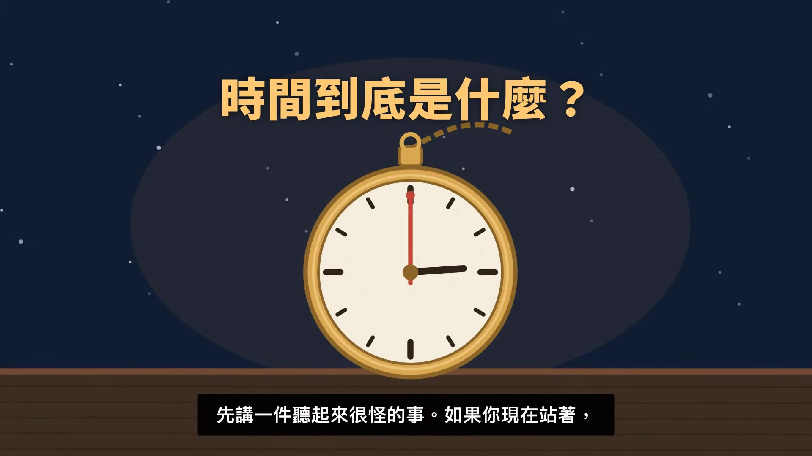

**逐字稿片段：** 如果你現在站著,你的頭正在比你的腳老得快一點點。

**話題推測：** 提出一個關於重力與時間流逝速度的奇特現象。

---

## 00:00:25

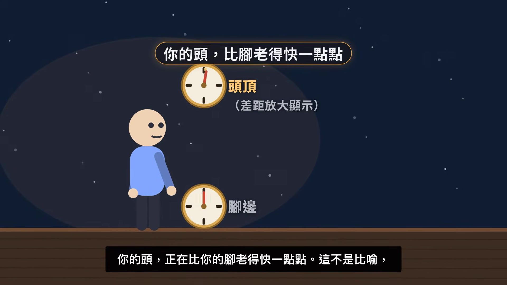

**逐字稿片段：** 這不是比喻,美國的研究單位用兩臺原子鐘真的量到過這種差別。 時間會被重力拉長,會因為速度變慢。 可是我們每天感覺到的時間,卻像一條穩穩往前流的河。 哪一個才是時間真正的樣子 Al-Khalili自己也說 這題物理學家還在炒 有些地方是他個人的看法 我們會一路標清楚

**話題推測：** 提及美國研究單位使用原子鐘測量時間差異的實驗。

---

## 00:00:42

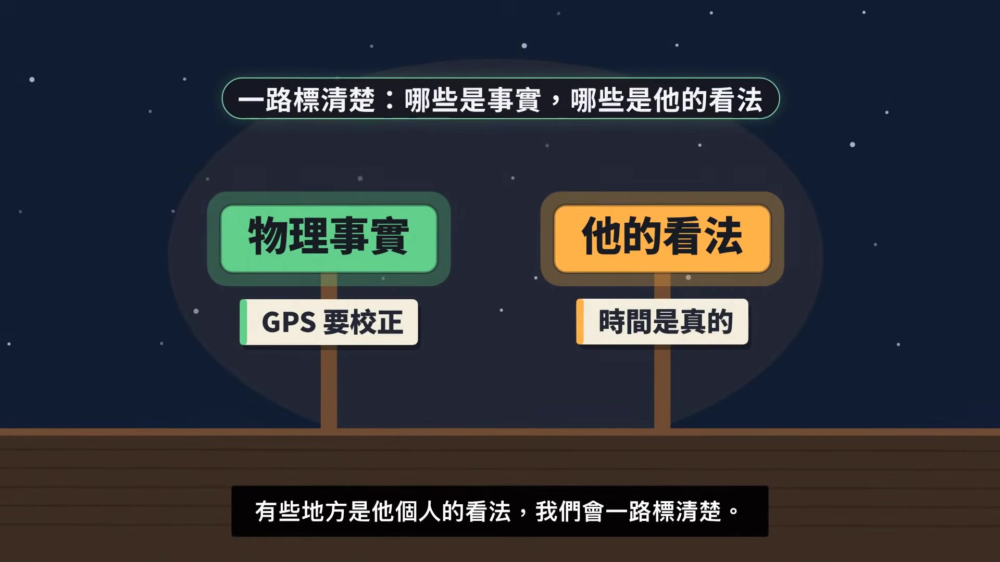

**逐字稿片段：** 我們分三步看 先問時間會不會流動 再看時間怎麼被拉長 最後問時間為什麼只往一個方向走 我們為什麼會變老

**話題推測：** 概括本集將從三個主要面向探討時間。

---

## 00:00:49

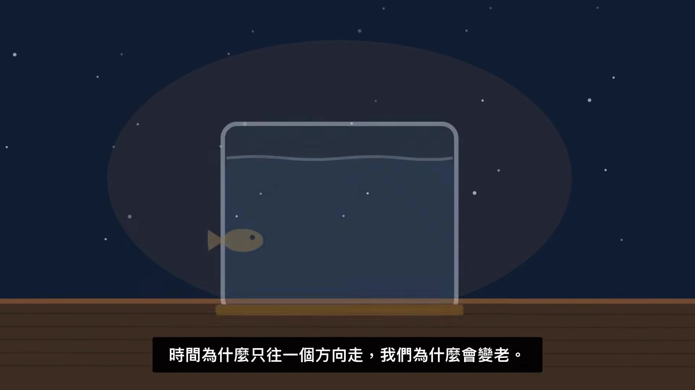

**逐字稿片段：** 先認識一下Al-Khalili

**話題推測：** 開始詳細介紹Jim Al-Khalili的背景。

---

## 00:00:51

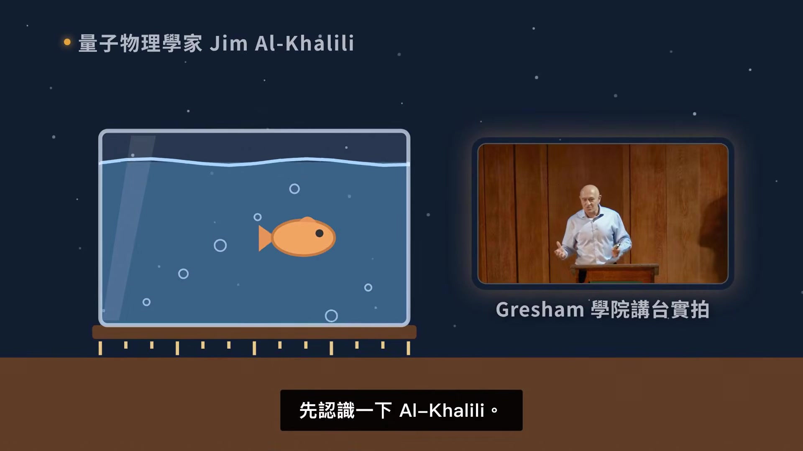

**逐字稿片段：** 他是英國薩里大學的量子物理學家 也是BBC廣播節目

**話題推測：** 提及Al-Khalili任職的英國薩里大學。

---

## 00:00:54

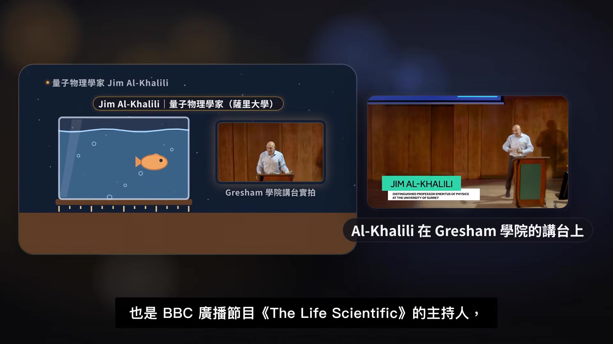

**逐字稿片段：** The Life Scientific的主持人 這個節目每一集專訪一位科學家

**話題推測：** 提及Al-Khalili主持的BBC廣播節目《The Life Scientific》。

---

## 00:00:58

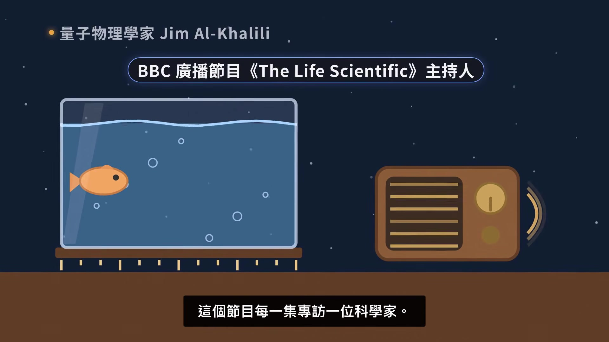

**逐字稿片段：** 他現在正在寫一本講時間的新書 這一集用的是他今年6月

**話題推測：** 提及Al-Khalili正在撰寫一本關於時間的新書。

---

## 00:01:03

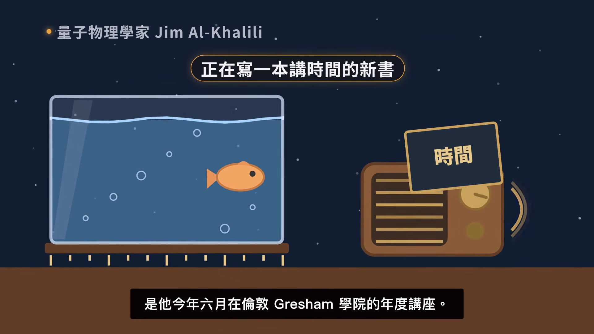

**逐字稿片段：** 在倫敦Gresham所願的年度講座

**話題推測：** 提及本集內容取自Al-Khalili在倫敦Gresham學院的年度講座。

---

## 00:01:05

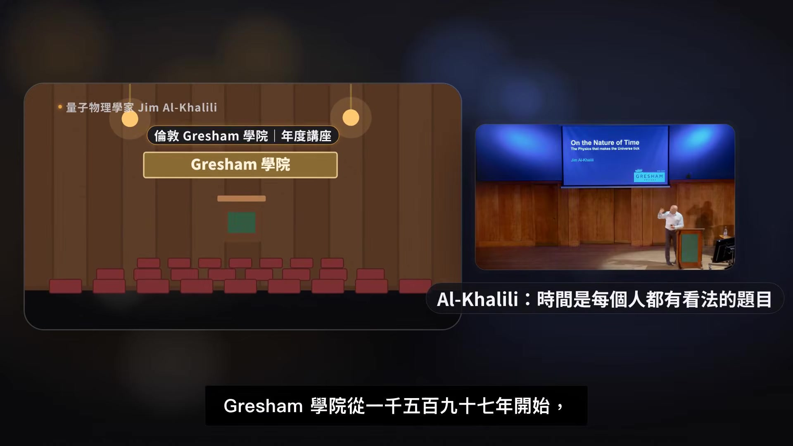

**逐字稿片段：** Gresham 合約,從 1597 年開始就在倫敦辦免費的公開講座,到現在 400 多年 他一上臺,先講了研究時間的難處,研究別的東西你可以站在旁邊看,做實驗,量數據 可是時間不一樣,我們整個人都泡在時間裡面沒辦法走出去,從外面看它 所以這個問題,幾千年來一直有人在問,聽他怎麼說

**話題推測：** 介紹Gresham學院的歷史背景，從1597年開始辦講座。

---

## 00:01:36

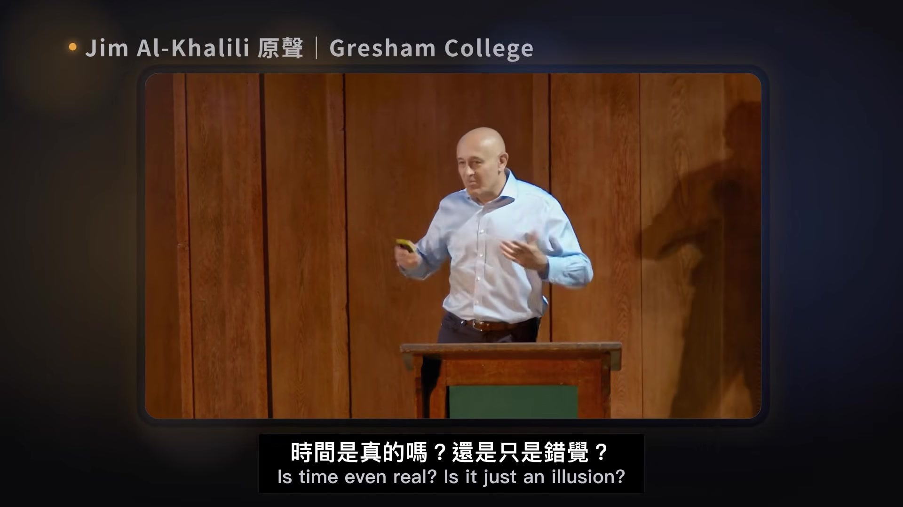

**逐字稿片段：** Why is there past, present and future? Does time flow and so on? 我們先從最直覺的感覺開始 大家都覺得時間在流動 未來一直靠過來 變成現在 再變成過去

**話題推測：** 引述Al-Khalili關於過去、現在、未來的英文提問。

---

## 00:01:45

**逐字稿片段：** 2500年前的希臘哲學家赫拉克利特 就把萬物不停的變化比成一條河 可是艾爾卡利底說 你翻開物理課本 找不到這條河

**話題推測：** 提及古希臘哲學家赫拉克利特將萬物變化比作河流的觀點。

---

## 00:01:54

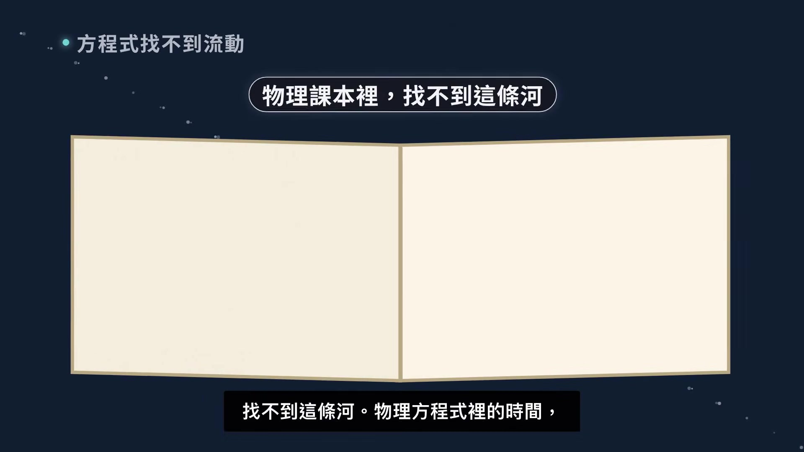

**逐字稿片段：** 物理方程式裡的時間 是一個字母t 這個t叫時間參數 它就是一個數字 你代進一個t 算出那一顆東西在哪裡 再代進另一個t 算出另一顆

**話題推測：** 討論物理方程式中時間（字母t）的意義。

---

## 00:02:03

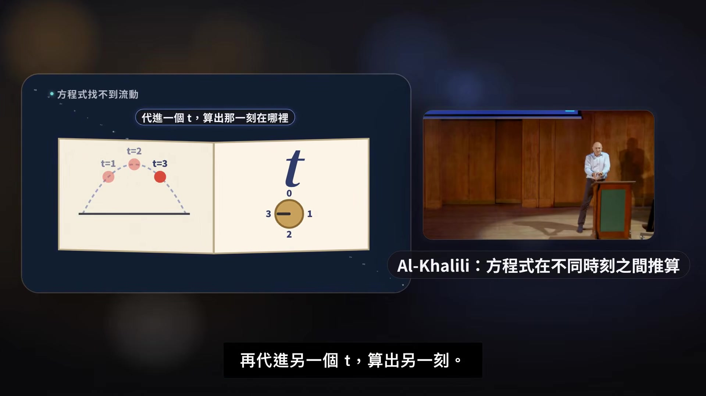

**逐字稿片段：** 這很像看影片的進度條 你可以把進度條拖到任何一格 每一格都是一張完整的畫面 可是進度條本身不會告訴你 哪一格才是現在 方程式也一樣 它沒有一個記號寫著 現在在這裡 聽他怎麼說 那過去呢 我們會覺得過去也是真的 因為我們記得 Al-Khalidi提醒 過去已經不在了 留下來的是記錄

**話題推測：** 將物理時間比喻為影片進度條的視覺內容。

---

## 00:02:35

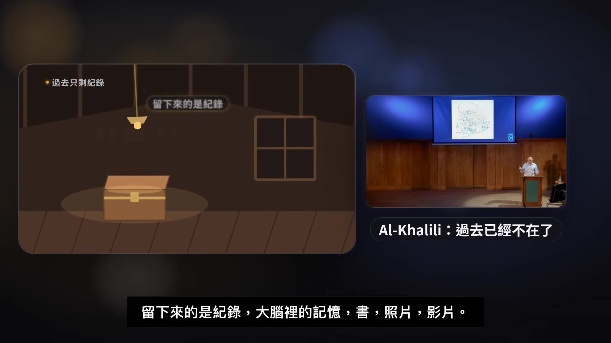

**逐字稿片段：** 大腦裡的記憶 書 照片 影片 而且你翻看這些記錄 都是在現在翻的 未來更不用說 它還沒發生 我們只能猜 這就是我們對時間 最熟悉的感覺 站在現在 背後是記得的事 前面是還沒發生的事 所以我們跟時間的關係 很奇怪 我們能看清楚的是身後 前面卻一片黑

**話題推測：** 討論記憶的形式，如大腦記憶、書籍、照片、影片。

---

## 00:02:51

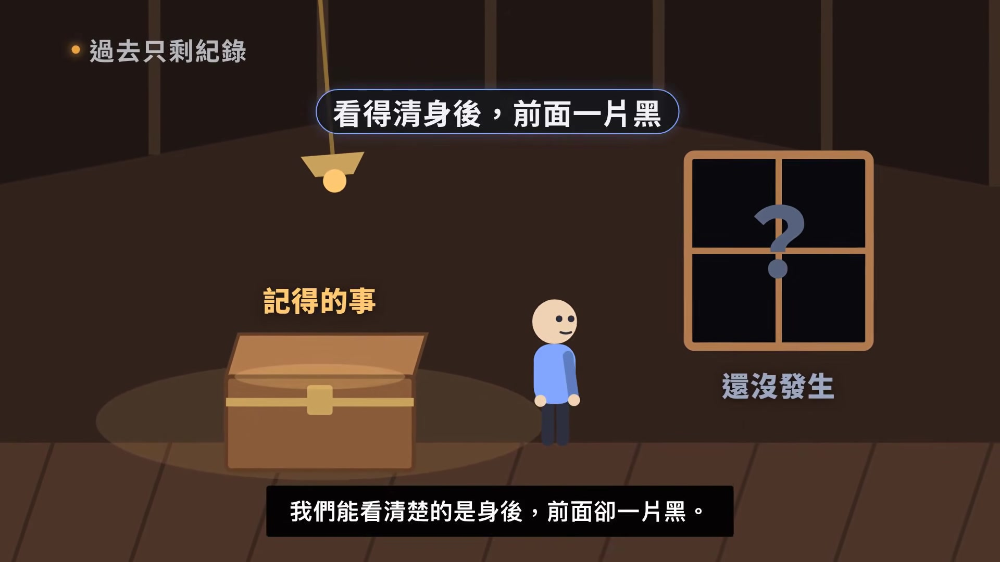

**逐字稿片段：** 他用開車來比喻這種感覺 聽他怎麼形容 背景鏡頭在運作 你可以看到過去在你背後 當你進入不明的未來 可是物理學家怎麼看這件事

**話題推測：** 使用開車比喻我們對過去和未來的感知方式。

---

## 00:03:15

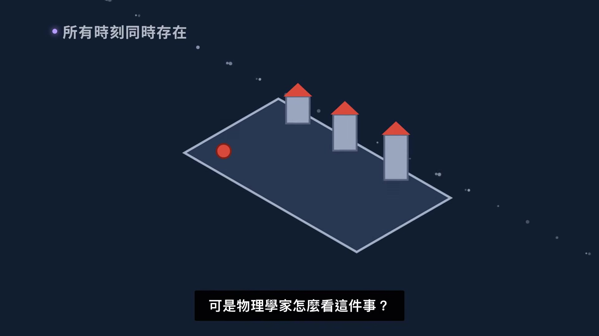

**逐字稿片段：** 相對論給了一個很不一樣的畫面 這個畫面叫區塊宇宙 英文是block universe 它的意思是所有的時刻 像所有的地點一樣 同時都存在 要想像它 Alkali的做法是先少化一個維度 把我們的立體空間壓扁成一張紙 紙上就是某一顆的整個宇宙 再把每一顆的紙 一張一張往上疊 疊出來的就是一整塊 時間是這一塊的厚度

**話題推測：** 引入「相對論」對時間的不同詮釋。

---

## 00:03:35

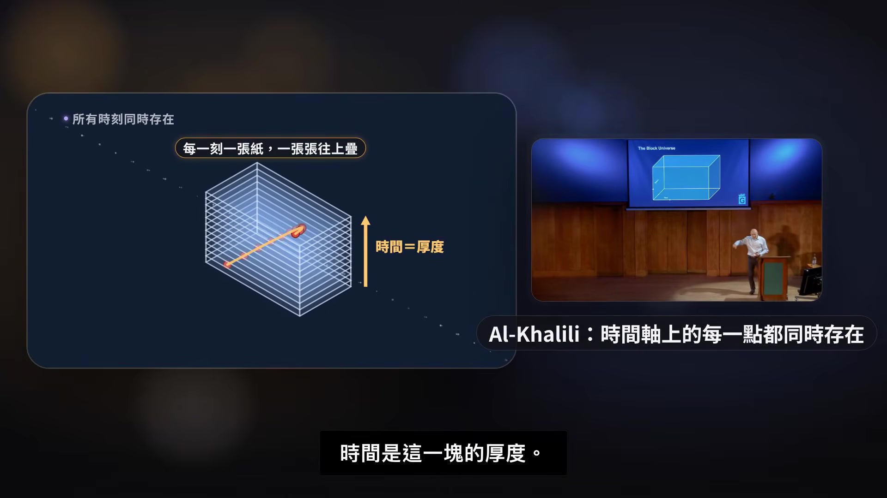

**逐字稿片段：** 用一本翻頁動畫書來想最清楚 每一頁是一個瞬間 你快速翻過去就看到小人在動 可是整本書一直都在你手上 第一頁和最後一頁同時存在 在區塊宇宙裡 所謂現在就是你正在看的那一頁 這套時空的說法

**話題推測：** 將區塊宇宙比喻為一本翻頁動畫書。

---

## 00:03:48

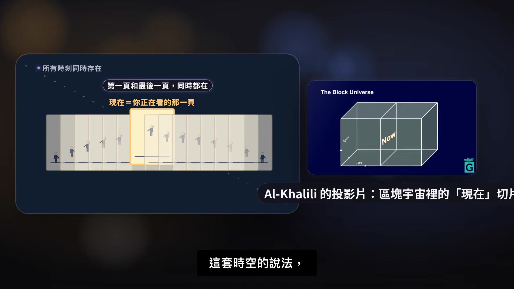

**逐字稿片段：** 來自數學家Minkowski 在1908年的演講 不過要先講清楚 區塊宇宙是很多物理學家 理解相對論的方式 不是唯一的方式 也有學者認為 未來還沒有寫好 區塊宇宙 看起來替我們找到了 現在就是正在看的那一頁 可是相對論馬上又把他拿走

**話題推測：** 提及數學家Minkowski在1908年演講中提出的時空說法。

---

## 00:04:04

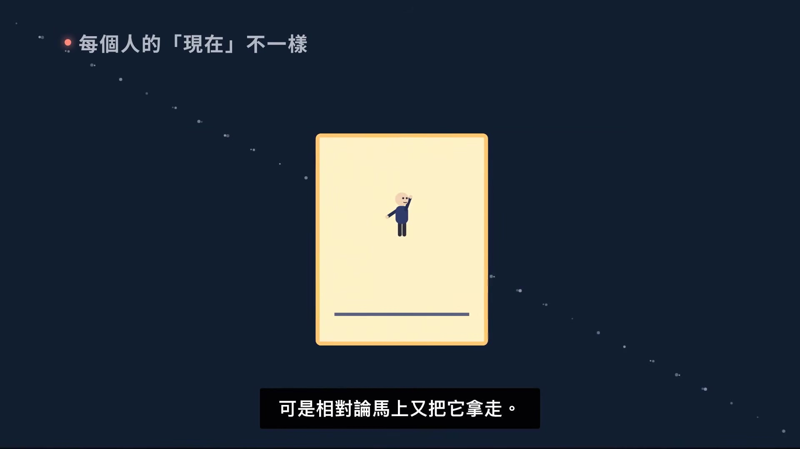

**逐字稿片段：** 這個現象叫同時的相對性 他的意思是 兩件離得很遠的事 到底是不是同時發生 不同的觀察者會給出不同的答案 一個站著不動的人 跟一個用接近光速飛過去的人 他們的現在不是同一張紙 回到那一整塊 站著的人把這一塊水瓶切開 每片是他的現在

**話題推測：** 解釋「同時的相對性」現象。

---

## 00:04:21

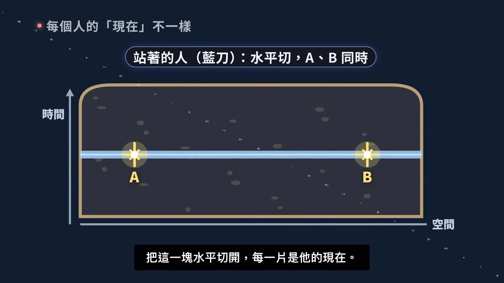

**逐字稿片段：** 飛過去的人切的角度是斜的 對 站著的人來說 遠方兩件事同時發生 對 飛過去的人來說 其中一件已經是過去 另一件還在未來 艾爾卡里說 兩個人都沒有錯 這裡有一個條件 這隻發生在兩件事離得很遠 遠到光都來不及 從一件傳到另一件 有因果關係的事 像先點火才有煙 所有人看到的先後都一樣 愛因斯坦的老朋友Bessel過世以後 他在寫給Bessel家人的信裡說 對我們這些相信物理的人來說 過去現在未來的分別 只是一種頑固的錯覺

**話題推測：** 透過不同觀察者切割時空塊的角度，視覺化同時性的差異。

---

## 00:04:50

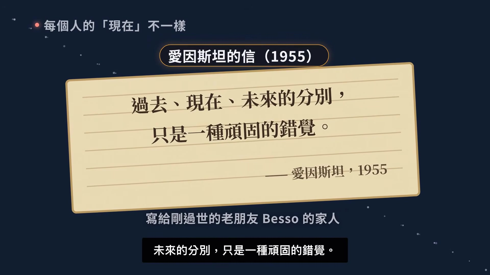

**逐字稿片段：** 所以第一部分的答案是這樣 物理的方程式裡 找不到時間在流動 也找不到全宇宙共用的現在 我們感覺到的流動 很多物理學家認為 是大腦給我們的感覺 不是時間本身的性質 不過這是其中一派的看法 到現在還在爭論 記住這一句 在物理的方程式裡 時間不會流動 也沒有一個大家共用的現在 聽到這裡你可能會想 那時間是不是根本不存在 艾奧卡利裡的回答是 不 時間很真實 真實到它可以被拉長 也可以被壓縮 而且你每天都在用這件事

**話題推測：** 總結第一部分關於時間流動與全宇宙共用現在的討論。

---

## 00:05:17

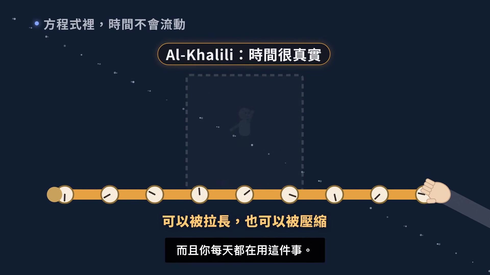

**逐字稿片段：** 這個現象叫時間膨脹 英文是time dilation 它的意思是 同樣過一秒 不同地方的時鐘 走得快慢不一樣

**話題推測：** 引入新主題：時間膨脹（time dilation）現象。

---

## 00:05:24

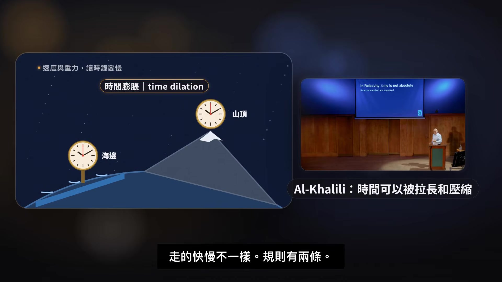

**逐字稿片段：** 規則有兩條 第一條來自狹義相對論 你移動得越快 你的時鐘走得越慢 另一條來自廣義相對論 重力越強時鐘走得越慢

**話題推測：** 列出時間膨脹的兩條規則：速度與重力對時間的影響。

---

## 00:05:33

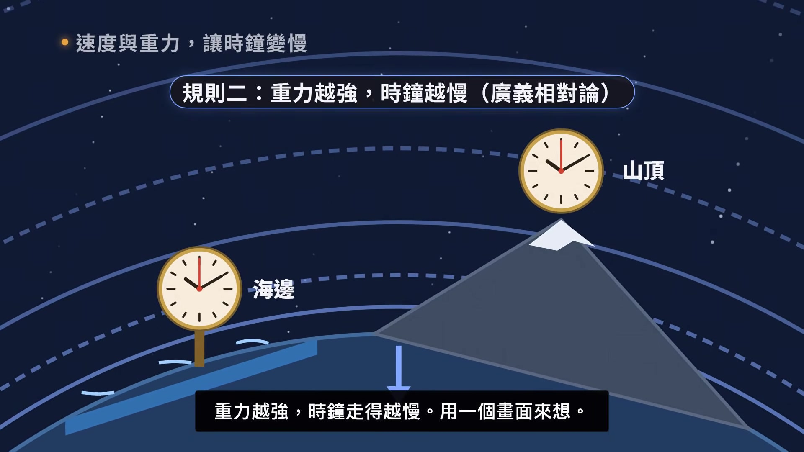

**逐字稿片段：** 用一個畫面來想 兩臺一模一樣的時鐘 一臺放在高山頂上 一臺放在海邊 海邊離地心比較近 重力比較強 所以海邊那臺會走得慢一點點 慢的量小到人感覺不到 可是精密的原子鐘亮得出來 還有卡利裡在臺上 就拿他自己的身體當例子 聽他怎麼說 比我的腿還要低 所以時間比我的腿還要慢 他說的不是玩笑 2010年

**話題推測：** 透過高山頂與海邊兩座時鐘的對比，解釋重力對時間的影響。

---

## 00:06:18

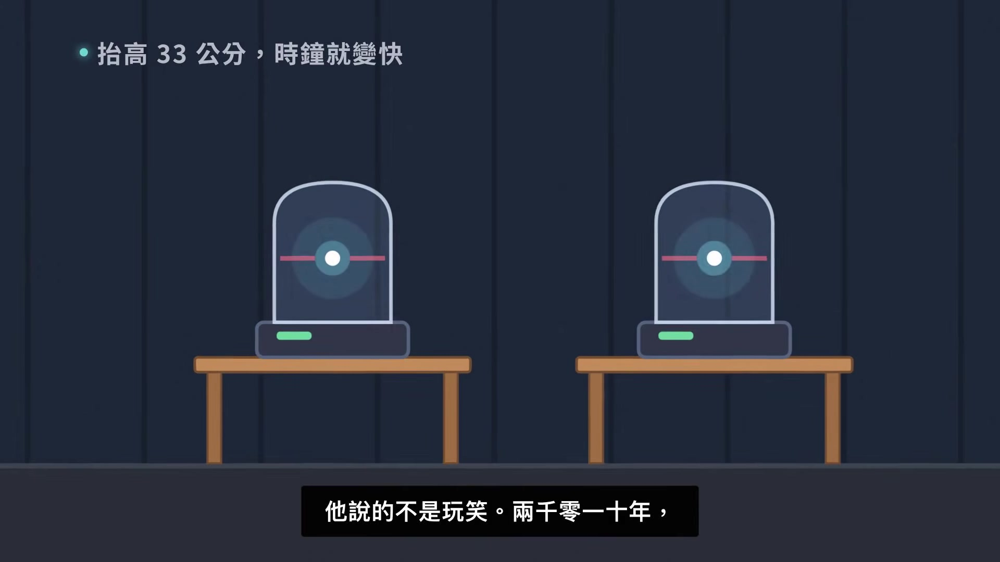

**逐字稿片段：** 美國國家標準語技術研究院 英文說寫NIST 做了一個實驗 他們有兩臺光學原子鐘 這是目前世界上最準的一種時鐘

**話題推測：** 提及美國國家標準與技術研究院（NIST）在2010年進行的實驗。

---

## 00:06:25

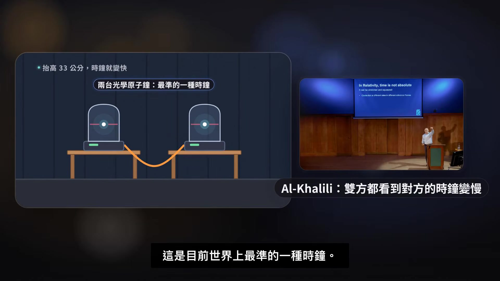

**逐字稿片段：** 他們把其中一臺架高33公分 大概是一張椅子座位的高度 結果高的那一臺 真的走得比較快 研究單位估算過

**話題推測：** 描述NIST實驗中將原子鐘架高33公分的具體設定。

---

## 00:06:33

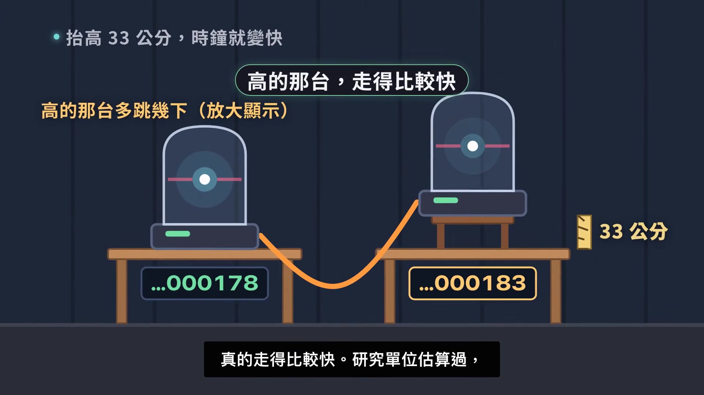

**逐字稿片段：** 如果一個人一輩子79年 都比另一個人高33公分生活 他會多老大約90耐秒 耐秒是十一分之一秒 所以你不用擔心 住高樓不會讓你明顯老得比較快 後來美國另一個團隊

**話題推測：** 提供「79年多老90耐秒」的具體數字來量化時間差異。

---

## 00:06:43

**逐字稿片段：** 連一毫米的高度差 都量得出時間的差別 這麼小的差別 跟我們的生活有什麼關係 關係很大 而且你每天都在用 聽他怎麼說

**話題推測：** 提及另一個團隊甚至能量出「一毫米的高度差」造成的時間差別。

---

## 00:07:10

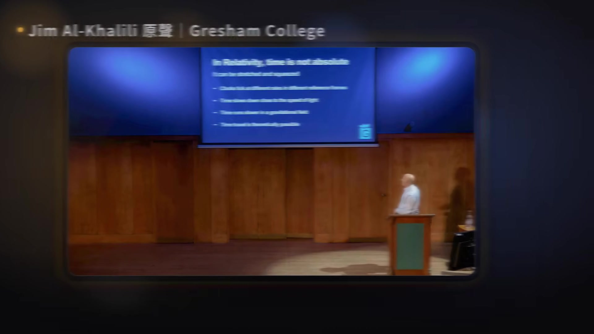

**逐字稿片段：** GPS衛星,在大約2萬公里的高空,每天繞地球兩圈,每一顆上面都有原子鐘 你的手機定位,就是比對好幾顆衛星傳來的時間訊號,算出你離每一顆衛星有多遠

**話題推測：** 解釋GPS衛星如何應用時間膨脹原理進行定位。

---

## 00:07:19

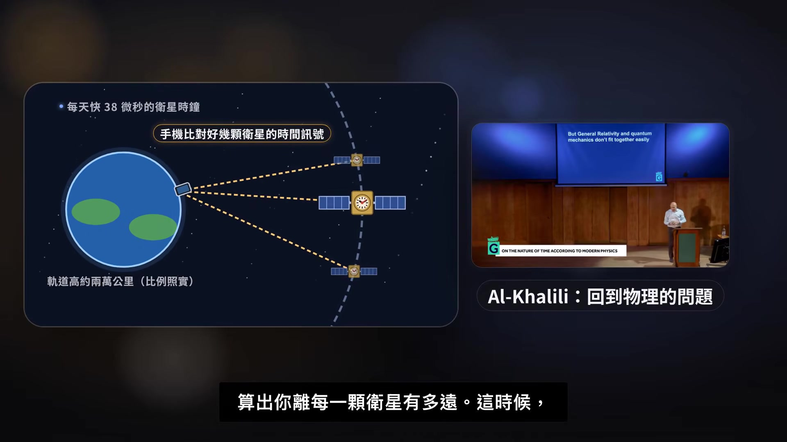

**逐字稿片段：** 這時候兩條規則一起上場,衛星離地面遠,重力比較弱,它的時鐘每天會快大約45微秒 每秒是百萬分之一秒,可是衛星移動的很快,每秒將近4公里 這又讓它每天慢大約7微秒,45減7 每天儘快大約38微秒 38微秒聽起來很少 可是光一每秒就走300公尺 38每秒 光可以走大約11公里 如果放著不管 常見的估計是 每天會拼掉大約10公里 所以工程師在衛星發射以前 就先把衛星時鐘的頻率 設定得慢一點點 讓它上了太空以後 剛好跟地面對齊 愛因斯坦的兩個理論 就藏在你的地圖程式裡 地球的重力 只讓時鐘每天差幾十每秒 如果換成重力強到極點的地方

**話題推測：** 詳細說明GPS衛星時鐘因速度與重力每天快45微秒、慢7微秒的具體數值校正。

---

## 00:07:58

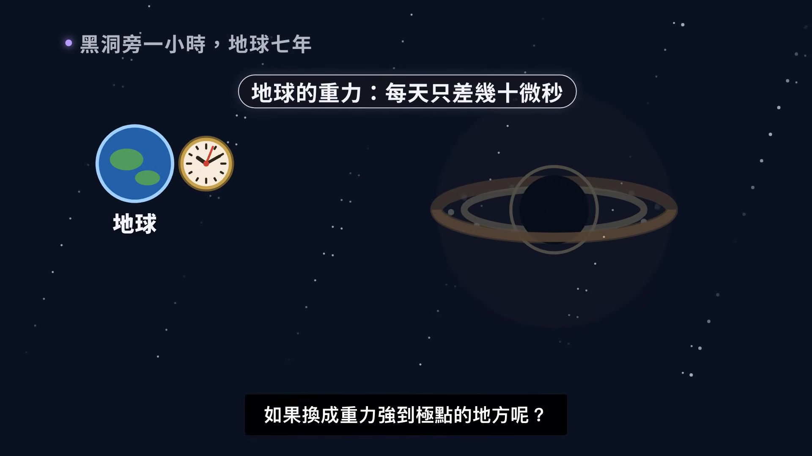

**逐字稿片段：** 那地方叫黑洞 黑洞是質量極度集中的天體 重力強到連光都逃不出去 越靠近它 時間就走得越慢 艾奧卡利說

**話題推測：** 將討論焦點轉向重力極強的「黑洞」對時間的影響。

---

## 00:08:06

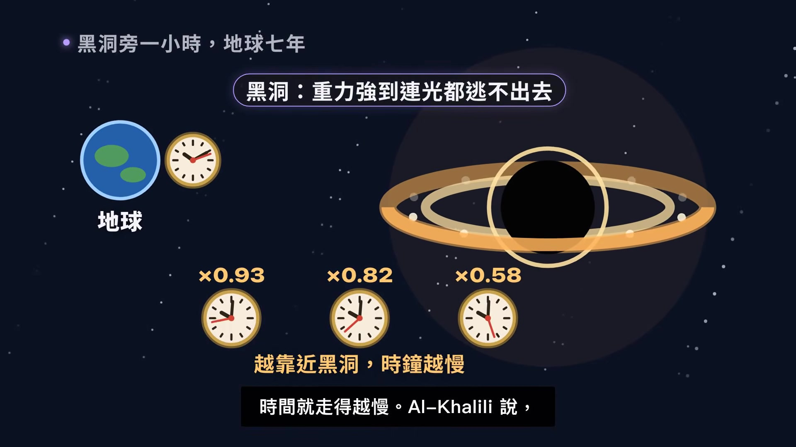

**逐字稿片段：** 他最喜歡的科幻電影是星際效應 電影裡的太空人 降落在一顆繞著超大質量黑洞的星球 在那裡待一小時

**話題推測：** 提及科幻電影《星際效應》中黑洞附近的時間膨脹情節。

---

## 00:08:13

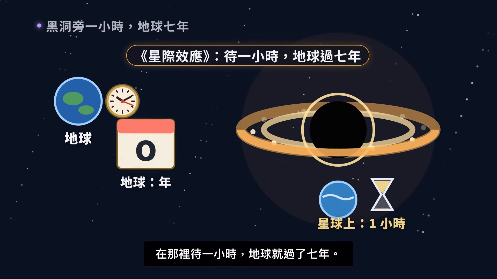

**逐字稿片段：** 地球就過了七年 這部片的科學顧問 也是製作人之一的物理學家 Kip Thorne 後來拿了諾貝爾物理獎 要先講清楚 一小時換七年 需要非常極端的設定 黑洞要轉得飛快 星球要貼著它繞 宋永在講這部電影《科學》的書裡也這樣說明 可是重力讓時間變慢 這件事本身是真的 聽他怎麼說

**話題推測：** 具體說明《星際效應》中「一小時換七年」的時間差。

---

## 00:08:58

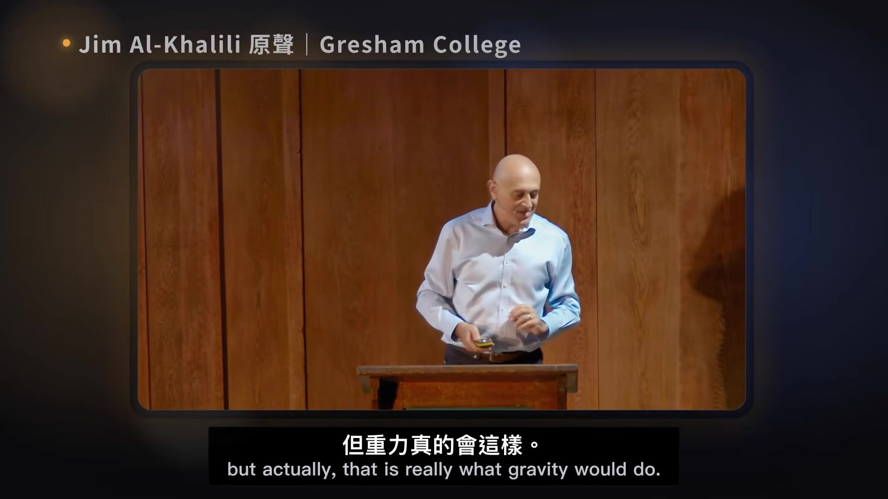

**逐字稿片段：** 所以這一部分的答案是 時間是時空的一部分 速度和重力都能改變它走的快慢 GPS每天替它校正 原子中連33公分的高度差都量得到 從這個角度看 時間非常真實 記住這一句 時間會被拉長 也會被壓縮 但到目前為止 每一個實驗裡的時鐘 都是往前走 這就帶出最後一個 也是最貼近我們生活的問題 物理的方程式 倒過來算也成立

**話題推測：** 總結第二部分關於時間膨脹與真實性的討論。

---

## 00:09:20

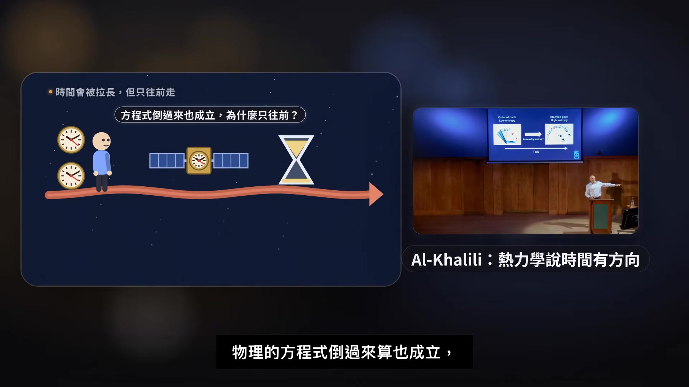

**逐字稿片段：** 為什麼我們只看到時間往一個方向走 為什麼杯子摔碎了 不會自己黏回去 為什麼人會變老 卻不會變年輕 先講一個名詞

**話題推測：** 引入最後一個問題：時間為什麼只往一個方向走？（時間箭頭）

---

## 00:09:28

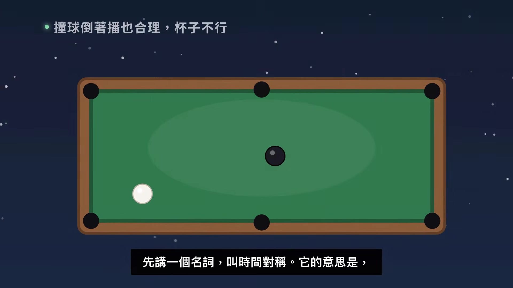

**逐字稿片段：** 叫時間對稱 它的意思是 一條物理定律 把時間倒過來撥 也一樣成立

**話題推測：** 解釋「時間對稱」這個物理學名詞。

---

## 00:09:32

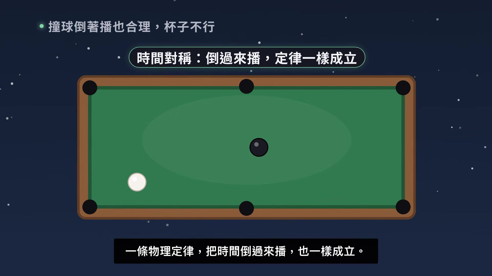

**逐字稿片段：** 拍一段撞球 白球撞上黑球 兩顆往不同方向滾開 倒著撥 兩顆球從兩邊滾回來 撞在一起 一顆停住 另一顆繼續走 看起來也很合理 行星繞太陽也是 倒著撥 只是反方向繞

**話題推測：** 透過撞球影片正反播放，說明時間對稱的例子。

---

## 00:09:44

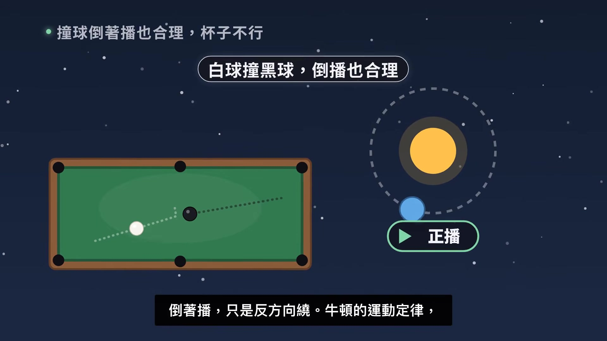

**逐字稿片段：** 牛頓的運動定律 還有幾乎所有基本的物理定律 都是這樣 可是你拍一個杯子

**話題推測：** 提及牛頓運動定律等基本物理定律的時間對稱性。

---

## 00:09:48

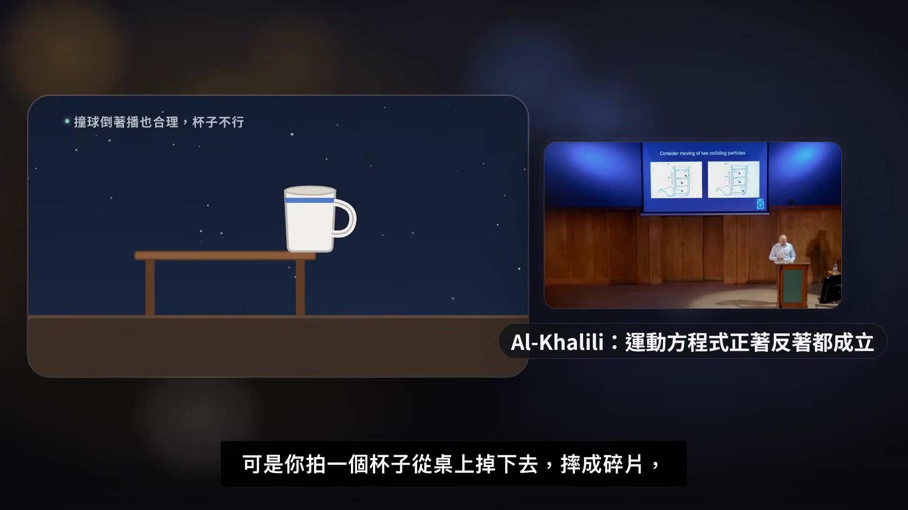

**逐字稿片段：** 從桌上掉下去 摔成碎片倒著撥 碎片從地上飛起來 拼回一個完整的杯子 你一眼就知道是倒帶 兩顆球的時候看不出方向 東西一多方向就出來了 差別到底在哪裡

**話題推測：** 透過杯子摔碎與復原的對比，說明時間的不對稱性。

---

## 00:10:00

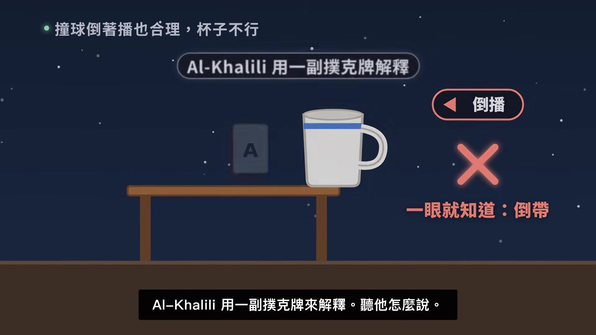

**逐字稿片段：** 艾爾卡利利用一幅撲克牌來解釋 聽他怎麼說 Things move from order to disorder From low entropy to high entropy

**話題推測：** 用撲克牌的例子來解釋為何時間有方向。

---

## 00:10:32

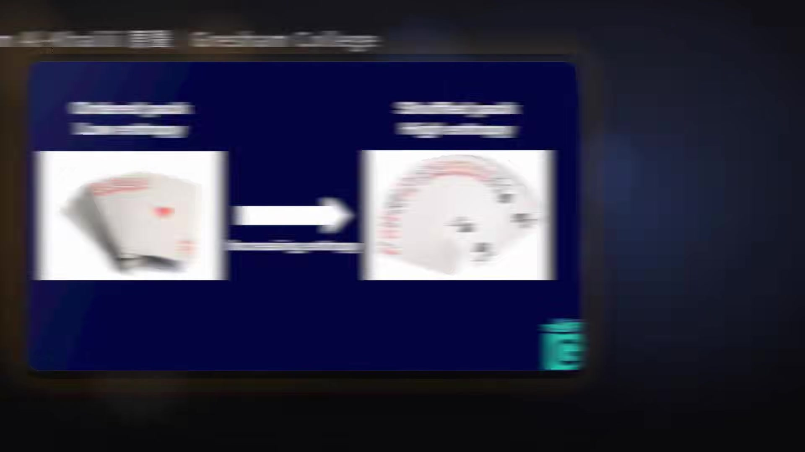

**逐字稿片段：** 他說的傷 英文是entropy 常被說成亂度 比較準確的說法是 傷算的是一種狀態 有多少種排法 一副撲克牌 照花色和數字排好的順序 只有一種 洗亂的順序有多少種

**話題推測：** 引入「熵（entropy）」概念，解釋亂度。

---

## 00:10:43

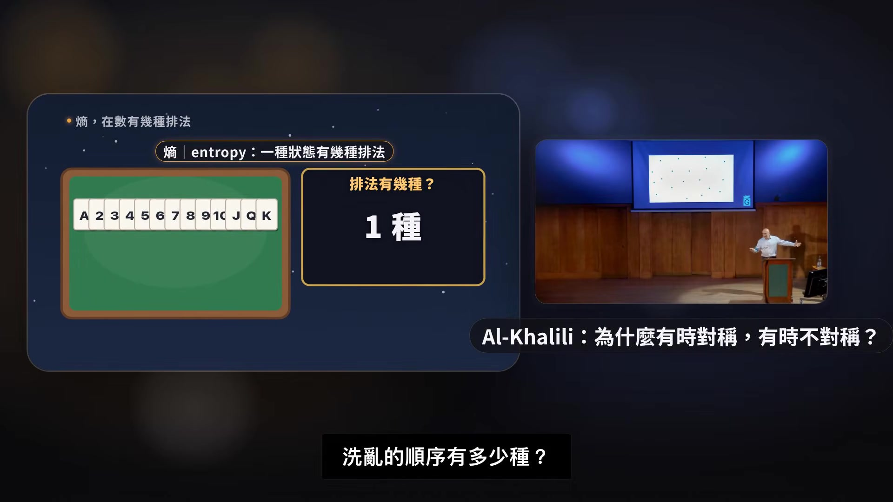

**逐字稿片段：** 大約是8後面接67個0那麼多 所以你隨便洗一次 洗回原來順序的機會 幾乎是0 不是物理禁止它 是亂的排法實在太多 整齊的排法太少 杯子也是這樣 完整的杯子是極少數的牌法 碎片散在地上 牌法多到算不清

**話題推測：** 以「8後面接67個0」量化撲克牌亂序的排列組合數。

---

## 00:10:57

**逐字稿片段：** 一盒氣體也一樣 分子擠在盒子一角 過一陣子就會散滿整個盒子 不會自己擠回角落

**話題推測：** 以一盒氣體從角落擴散到整個盒子，解釋熵的增加。

---

## 00:11:02

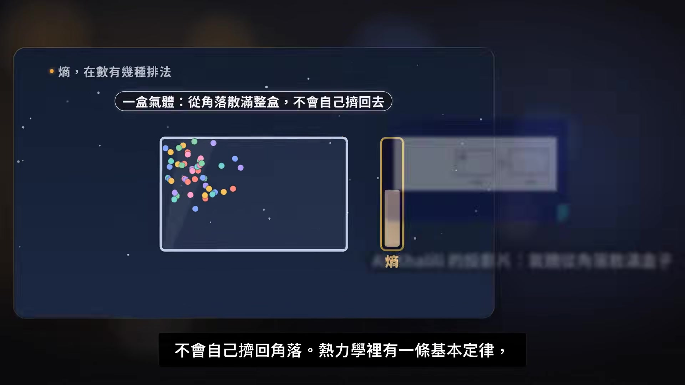

**逐字稿片段：** 熱力鐵裡有一條基本定律 說的就是這件事 一個不受外界干擾的系統 傷值會增加 會維持不變 事情從整齊走向混亂 這個方向 就是物理學家說的時間箭頭 可是這裡有個漏洞 19世紀就有人指出來了

**話題推測：** 提及熱力學第二定律與時間箭頭的關係。

---

## 00:11:16

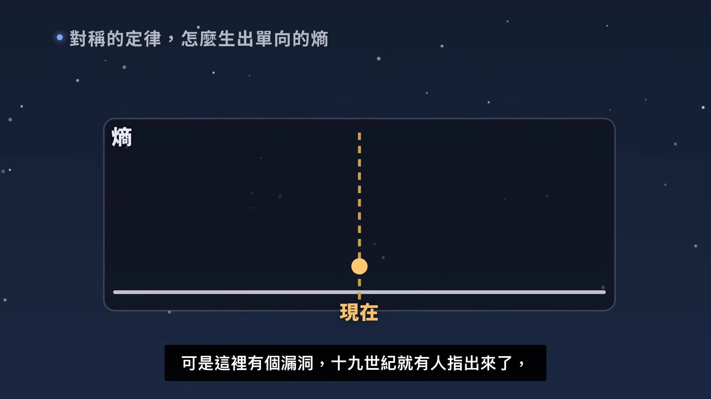

**逐字稿片段：** 這叫Lushmiddel 他的意思是 如果每一顆分子的運動 都是時間對稱的 那由這些分子組成的整體 怎麼會只有一個方向 照理說 三網未來會增加 往過去推 也應該增加才對 L.Halili 用一盒氣體來說明 下午三點 氣體分子全擠在盒子一角 四點一定散滿整個盒子 對稱的方程式會說 往回推 兩點的時候 它也應該是散開的 那三點那一刻 為什麼這麼整齊 答案是 應該有什麼東西 從外面 把它們推進角落 所以重點不在方向 在起點 一盒氣體 可以有外面的手 可是整個宇宙沒有外面 那宇宙的起點 為什麼這麼整齊 聽他怎麼說 他講的這個想法

**話題推測：** 提及19世紀提出的「洛施密特悖論（Loschmidt's Paradox）」。

---

## 00:12:20

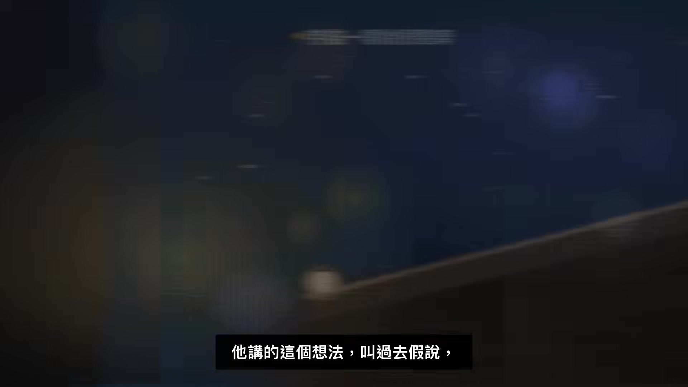

**逐字稿片段：** 叫過去假說 英文是 past hypothesis 他的意思是

**話題推測：** 解釋解決洛施密特悖論的「過去假說（past hypothesis）」。

---

## 00:12:24

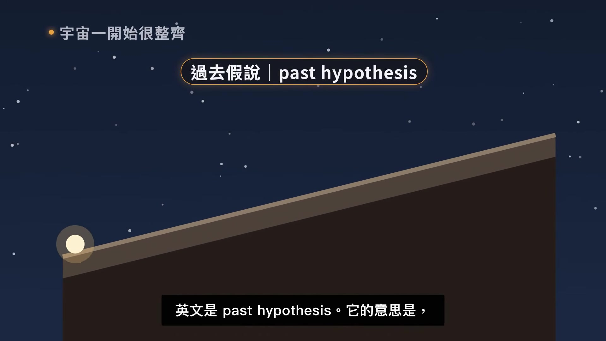

**逐字稿片段：** 宇宙在大霹靂的時候 傷非常低 非常整齊 所以從那一刻開始 傷就一路往上 時間箭頭就這樣來的 要注意 它是一個假說 不是被證明的定律 宇宙為什麼一開始這麼整齊 到現在沒有人知道答案 那這跟我們有什麼關係 你會變老 杯子會碎 熱咖啡會變涼 你記得昨天 卻記不得明天 物理學家認為 這些方向 都對齊同一支箭頭 從宇宙的起點指向未來

**話題推測：** 提及宇宙在大霹靂時熵值非常低的起點狀態。

---

## 00:12:47

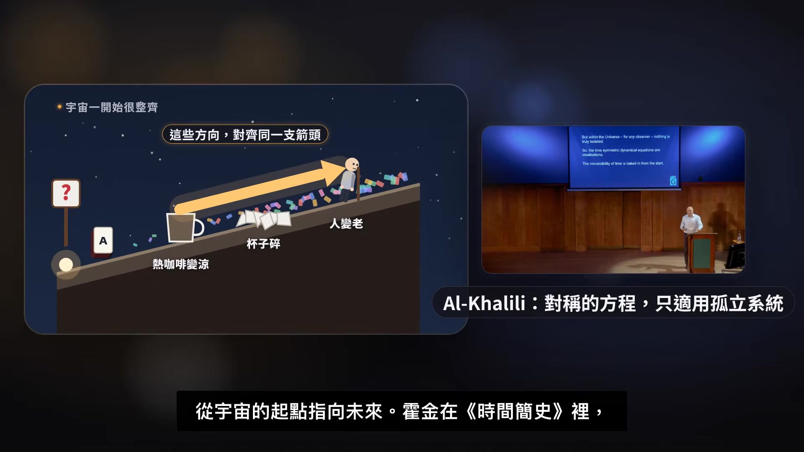

**逐字稿片段：** 霍金在《時間簡史》裡 用電腦的記憶體說明過 要記下一筆資料 得消耗能量 散出熱 讓傷增加 他認為大腦也一樣 所以我們的記憶跟傷走同一個方向 不過要小心 這不是說傷造成老化 人活著的時候 靠吃東西在身體裡維持秩序 老化是很多生物過程一起累積的結果 可以說的是 老化跟所有不可逆的事一樣 走的是同一個方向

**話題推測：** 提及霍金在《時間簡史》中用電腦記憶體解釋記憶與熵的關係。

---

## 00:13:10

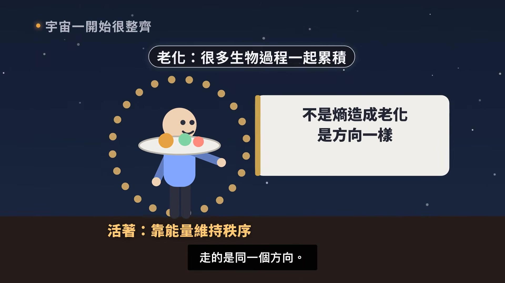

**逐字稿片段：** 所以時間到底是什麼 El-Khalili在臺上整理了物理學家的三種答案 第一種說 時間只是一個工具 是我們用來排列事情先後的方式 就是時鐘量出來的那個數字 另一種說 時間是真的 它是時空的一個維度 會被重力彎曲 還有一種看法 越來越多學者支持 時間是真的 但不是最基本的東西 它是從更深的東西浮現出來的 浮現這個詞

**話題推測：** 總結物理學家對「時間到底是什麼」的三種主要答案。

---

## 00:13:31

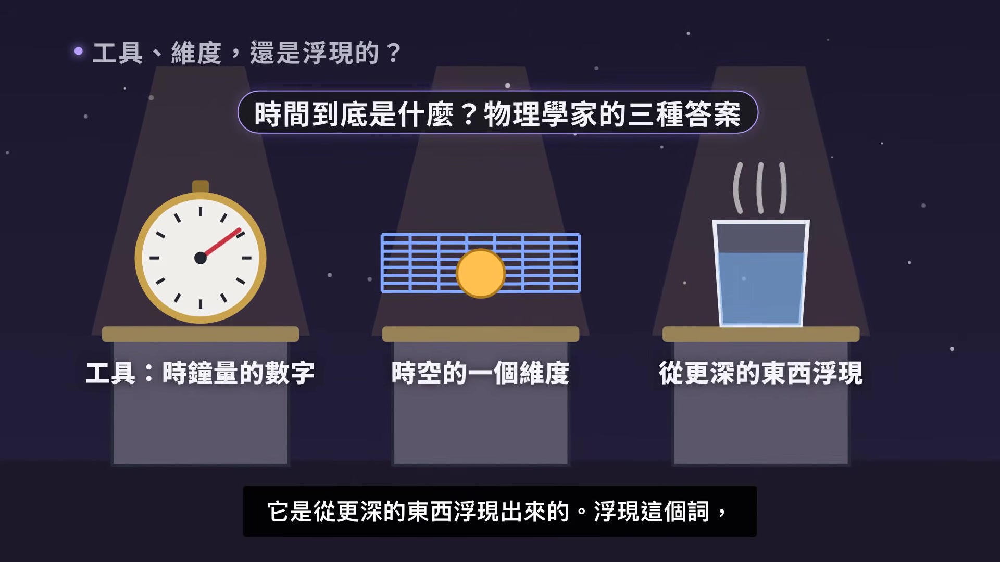

**逐字稿片段：** 可以用溫度來理解 一顆分子沒有溫度 它只有速度 可是幾兆顆分子聚在一起 平均起來 就出現了溫度 有些物理學家猜 時間也是這樣 可能從量子糾纏這類 更深的東西里浮現出來 不過這還沒有被證實 更極端的是,50多年前有人試著把量子力學和廣義相對論合在一起

**話題推測：** 以溫度為例，解釋時間可能是一種「浮現（emergent）」現象。

---

## 00:13:48

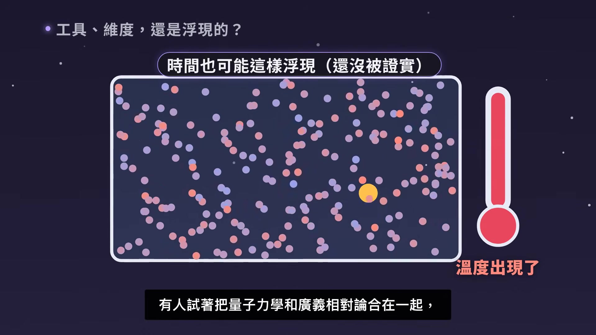

**逐字稿片段：** 寫出威勒·德韋的方程,結果方程失禮,時間整個不見了 那艾奧卡里迪自己站在哪一邊,聽他怎麼說

**話題推測：** 提及威勒·德韋方程（Wheeler-DeWitt equation）中時間消失的現象。

---

## 00:14:08

**逐字稿片段：** 所以第三部分答案是,時間指往一個方向,是因為商 宇宙從一個非常整齊的起點出發 從那以後事情就從整齊走向混亂 杯子會碎 人會變老 我們只記得過去 艾奧卡利裡認為 這隻箭頭是真的 從大坯地就在 也有物理學家

**話題推測：** 總結第三部分關於時間方向與熵的討論。

---

## 00:14:23

**逐字稿片段：** 像寫了時間的秩序的卡羅羅維利 認為時間在最基本的層次並不存在 這兩拍到現在還在爭 記住這一句 時間的方向 來自宇宙一開始的那份整齊 我們回到開場那個問題

**話題推測：** 提及物理學家卡羅·羅維利（Carlo Rovelli）認為時間在基本層次不存在的觀點。

---

## 00:14:35

**逐字稿片段：** 時間到底是什麼 這集物理學給了三個角度 在方程式裡 時間是一個數字 找不到流動 也沒有全宇宙共用的 現在 在相對論裡 時間是時空的一個維度 會被速度和重力拉長 你手機裡的GPS 每天都在替它矯正 在熱力學裡 時間是一隻箭頭 從整齊指向混亂 所以杯子會碎 人會變老 我們只記得昨天 L卡里裡的答案是 時間是真的 那隻箭頭從宇宙一開始就在 也有物理學家認為 時間在最基本的層次並不存在 這個問題 到現在還沒有定論 最後問你一個問題 聽完這一集 你覺得時間到底是什麼

**話題推測：** 最終回顧本集從方程式、相對論、熱力學三個角度對時間的詮釋。

---

## 00:15:07

**逐字稿片段：** 是一條河 一本翻頁書 還是一隻箭 留言告訴我 喜歡的話 訂閱AI Notebook 開啟通知 我們下次見

**話題推測：** 提出問題，讓觀眾思考時間是「一條河」、「一本翻頁書」還是一隻「箭」。

---
