# jimainotebook_PQqK1wr5yI0 — 關鍵畫面索引

- 來源逐字稿：[jimainotebook_PQqK1wr5yI0_FIN.srt](jimainotebook_PQqK1wr5yI0_FIN.srt)
- 影片：https://www.youtube.com/watch?v=PQqK1wr5yI0
- 截圖數：99

## 00:00:18

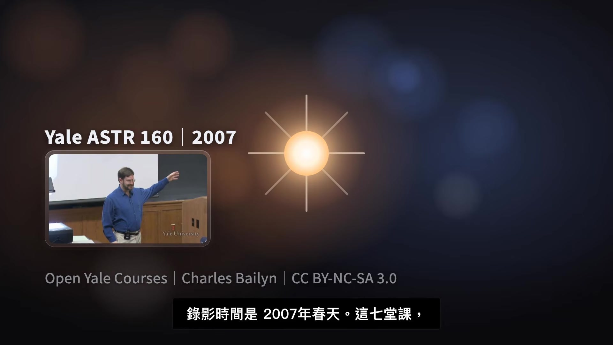

**逐字稿片段：** 這七堂課其實在回答同一個問題,一顆你看不見的行星,要怎麼證明它存在?

**話題推測：** 提出本集核心問題：如何證明看不見的行星存在

---

## 00:00:24

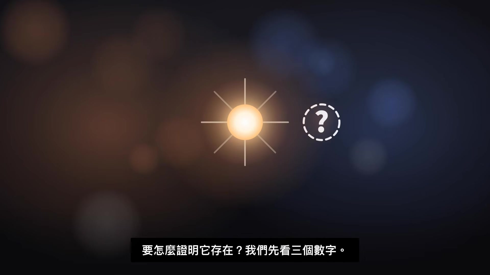

**逐字稿片段：** 我們先看三個數字。 1995年以前,繞著像太陽這種恆星的行星,人類一顆都沒有確認過。 到這門課開課的2007年,依今天的資料庫回推,大約200多顆。 截至2026年10月 NASA的清單上確認了6400多顆 這6000多顆裡 絕大部分沒有人親眼看過 它們是被推出來的 這是一門19年前的課 為什麼還值得聽 因為Baylen教的不是當時的清單 是一套推理的方法 看不見的東西 要從他怎麼拉動看得見的東西 把它推出來 方法沒有過時 過時的是數字和預言 所以這一集 我們一邊上課 一邊替他對答案 2007年他這樣說 後來發生了什麼

**話題推測：** 預期畫面切換到顯示三個時間點的數字統計

---

## 00:01:01

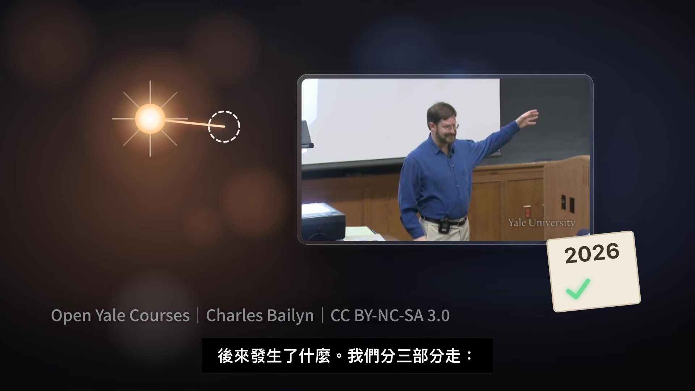

**逐字稿片段：** 我們分三部分走 先弄清楚為什麼看不見 再看怎麼從恆星的晃動找到行星 最後看行星擋住星光的影子 能告訴我們什麼 以及這19年來的答案 這門課開在耶魯 對象是不念理科的大學生

**話題推測：** 介紹本集內容將分為三個部分

---

## 00:01:15

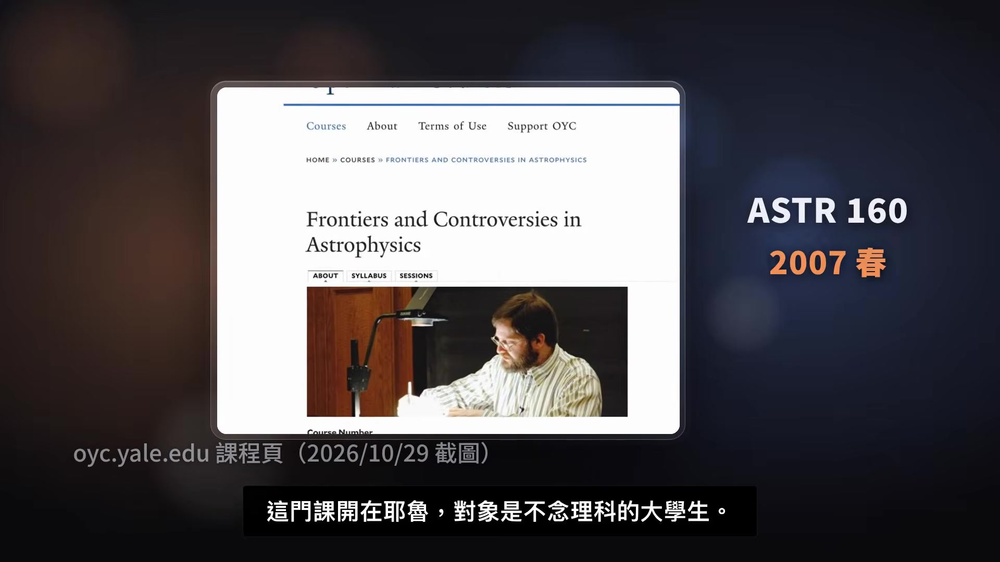

**逐字稿片段：** 貝林在第一堂課說得很直接 上這門課 用到的數學大概是國三高一的程度 可是他要帶你走到天文學正在爭論的地方 他的理由是這樣的 在網絡時代 上網找一個事實很容易 難的是你找到兩組事實 彼此互相矛盾 這時候你該信誰 他說 如果你沒有能力自己判斷 就只能看專家吵架 然後相信那個最大聲 或是學歷最好看的人 所以他希望學生練習的 是在答案還沒定下來的時候 自己看證據 這也是我們這一集想做的事 他還說了一句話 對一門錄影保存下來的課來說 特別有意思

**話題推測：** 引述教授貝林對課程難度的說明

---

## 00:01:49

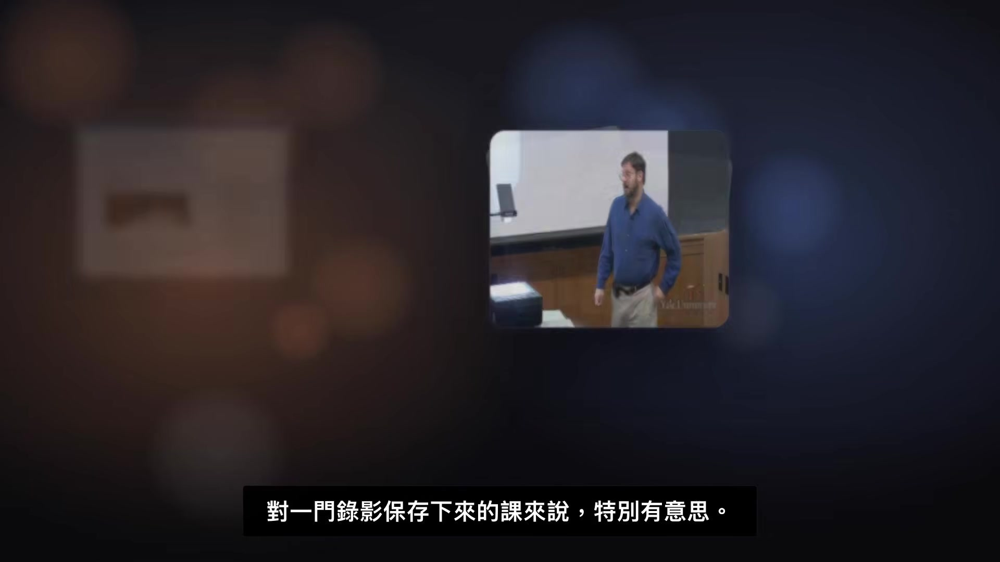

**逐字稿片段：** 聽他自己怎麼說 他說的沒錯,而且比他想的還多 從那時候到現在過了19年 被新論文改變的不只是課綱的一部分 這一集我們會一條一條補上 不過有一樣東西沒有被改變 就是這門課的骨架

**話題推測：** 播放教授貝林的原話音頻/影片

---

## 00:02:26

**逐字稿片段：** 這門課一整學期講三個主題 第一個主題叫系外行星 就是繞著別的恆星轉的行星 不在我們的太陽系裡 另外兩個主題是黑洞和暗能量 暗能量是一種讓宇宙越脹越快的東西 到現在還沒有人知道它到底是什麼 三個主題聽起來差很遠 可是貝林在第一堂課就說 它們有一個共同點 這個共同點就是我們這一集的主問題 也是我們這個系列三集的主線

**話題推測：** 介紹課程的三個主要主題

---

## 00:02:50

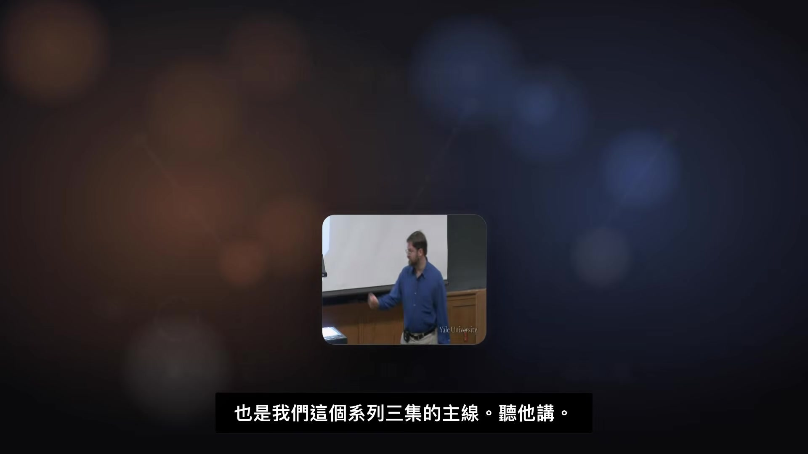

**逐字稿片段：** 聽他講 所以我們怎麼知道這些東西在那裡呢? 而答案就是,我們知道它們在那裡,是因為它們的影響力 在我們可以看到的其他物體上 特別是在我們可以看到的其他物體上 看不見,就從他的重力,怎麼拉動看得見的東西,把它推出來

**話題推測：** 播放教授貝林對主題共同點的解釋

---

## 00:03:25

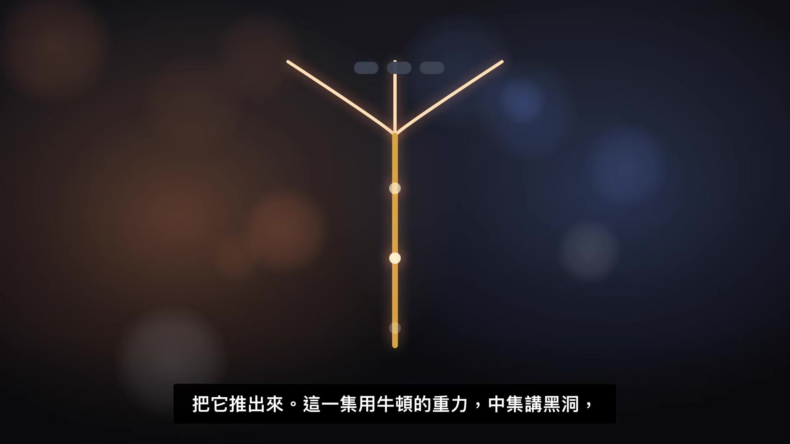

**逐字稿片段：** 這一集用牛頓的重力,終極講黑洞,要換成愛因斯坦的廣義相對論 下集的暗能量,貝林說,可能連愛因斯坦都不夠用 要靠重力推出看不見的東西 得先有一套可靠的重力理論 貝林用一個很老的故事 講這套理論是怎麼來的 將近2000年前 托勒密的模型 讓所有天體繞著地球轉 可是行星在天上 會往前走一段 倒退一段 再往前走 為了解釋這件事 托勒密讓行星在大圓上 再繞小圓 這種小圓叫本輪 觀測對不上 就再加一圈本輪 到後來 本輪這兩個字 在科學界變成罵人的話 意思是為了湊出答案 一直往理論上打補丁 貝林自己承認 這個故事被簡化了 他說 這種科學史的小故事 要當預言來聽 重點不是每個細節都對 是他要教的那一課 這一課是 簡單的理論比較好 後來哥白尼把太陽放到中間 克普勒發現軌道是橢圓 可是克普勒只描述了行星怎麼走 沒有解釋為什麼

**話題推測：** 提到本集使用牛頓重力，並與愛因斯坦相對論做對比

---

## 00:04:19

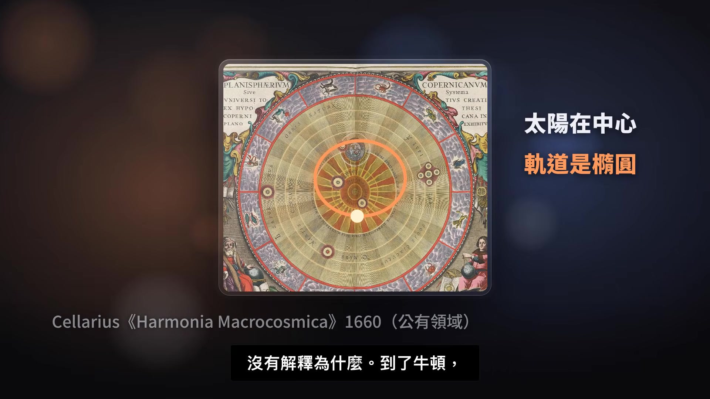

**逐字稿片段：** 到了牛頓 用運動定律加上萬有引力 把克普勒的發現全部推了出來 牛頓背後有兩個大膽的假設 同一套定律 在宇宙每個地方都成立 而且這套定律 可以寫成數學 前面那個假設 就是這一集的地基 如果牛頓的重力 在別的恆星旁邊也成立 我們就能拿它 去推那些看不見的行星

**話題推測：** 介紹牛頓的運動定律與萬有引力

---

## 00:04:38

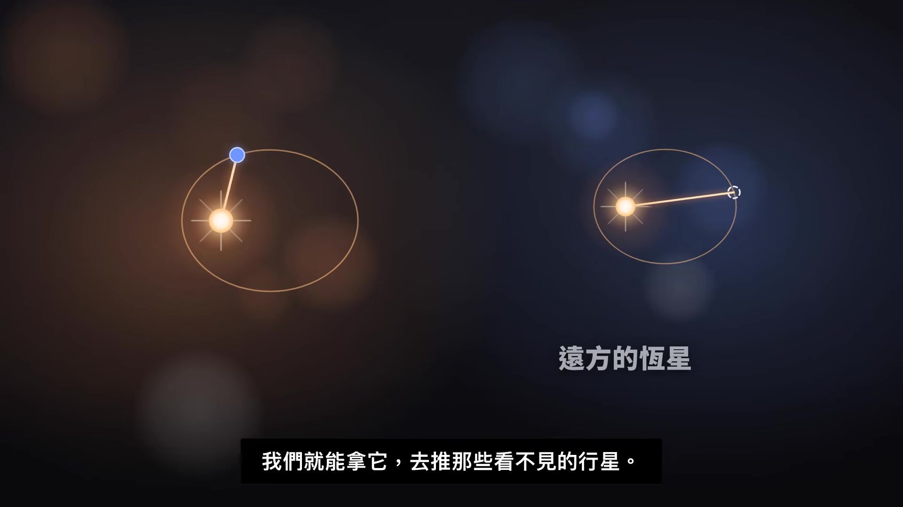

**逐字稿片段：** 牛頓推出來的工具裡 這一集最常用到的一條 叫克普勒第三定律 牛頓修正過的版本 它說的是 一個東西繞著另一個東西轉 轉一圈要多久 離中心有多遠 中心那個東西有多重 這三個數綁在一起 知道其中兩個 就能算出另一個

**話題推測：** 引入克普勒第三定律作為主要計算工具

---

## 00:04:55

**逐字稿片段：** 貝林用的單位很省事 距離用天文單位 一個天文單位 就是地球到太陽的距離 時間用年 質量用太陽的質量 在這組單位裡 公式變成 距離的三次方 等於週期的平方 乘上中心的質量 拿地球來試 距離是1 週期是1年 算出來 太陽的質量是1 聽起來像廢話 可是換個角度想 這代表你只要知道 一顆行星 離它的恆星多遠 繞一圈多久 就能稱出那顆恆星有多重 不用把它放上磅秤 反過來也行 知道恆星多重 又知道行星繞一圈多久 就能算出行星離恆星多遠 貝林在黑板上算木星 木星離太陽大約五個天文單位 五的三次方是125 所以週期就是125開根號 他說 不要算125開根號 算121開根號 答案是11 木星大約11年繞太陽一圈 真實的數字是11.9年 很接近 物理用不著算到小數點後面好幾位 抓住大小就夠了 這是他整門課的習慣 這把尺 等一下我們會拿來算一顆 讓整套理論出問題的行星

**話題推測：** 說明克普勒第三定律中使用的特定單位

---

## 00:05:57

**逐字稿片段：** 有了尺 下一步是找到行星 最直接的辦法 當然是用望遠鏡去看 可是先看看

**話題推測：** 轉入討論如何實際找到行星的方法

---

## 00:06:03

**逐字稿片段：** 我們自己太陽系最外面的那一顆 在2007年長什麼樣子 冥王星在海王星的外面 它自己不發光 只反射一點點太陽光

**話題推測：** 以冥王星為例說明直接觀測的困難

---

## 00:06:12

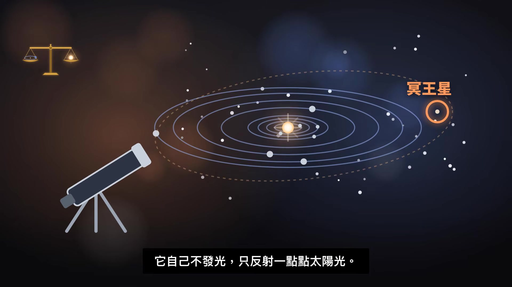

**逐字稿片段：** 貝林在課堂上放了兩張照片 一張從地面上拍 就是一個小點 另一張是哈勃太空望遠鏡拍的 哈勃在大氣層外面 沒有空氣擾動 那張好一點 可以看出旁邊還有一顆衛星 可是冥王星本身還是一團模糊的光點 看不出任何表面的樣子 這還是在我們自己家門口

**話題推測：** 展示冥王星從地面與哈勃望遠鏡拍攝的照片

---

## 00:06:30

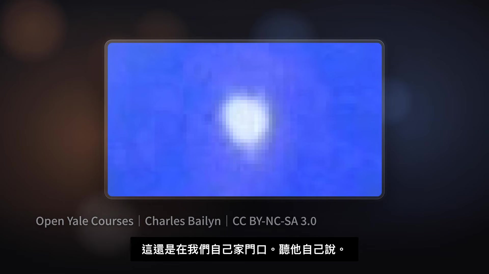

**逐字稿片段：** 聽他自己說 他說的那艘在陸上的太空船

**話題推測：** 播放教授貝林對觀測冥王星難度的講解

---

## 00:06:52

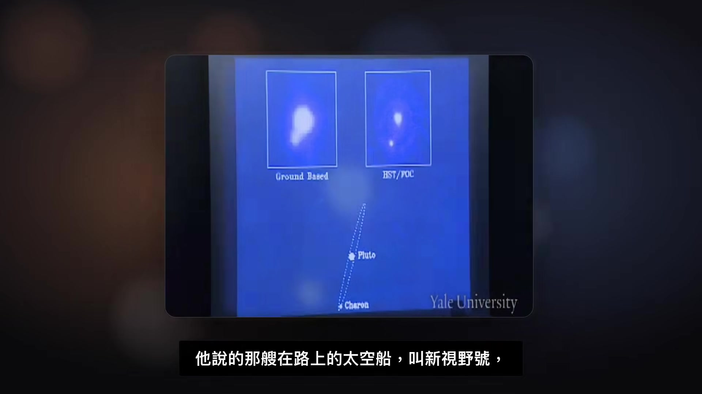

**逐字稿片段：** 叫星視野號 英文是New Horizons 它在2015年7月14日飛過冥王星 最接近的時候 離表面大約一萬兩千多公里 Belling說大概十年後到 實際上八年後就到了

**話題推測：** 介紹新視野號太空船及其任務

---

## 00:07:05

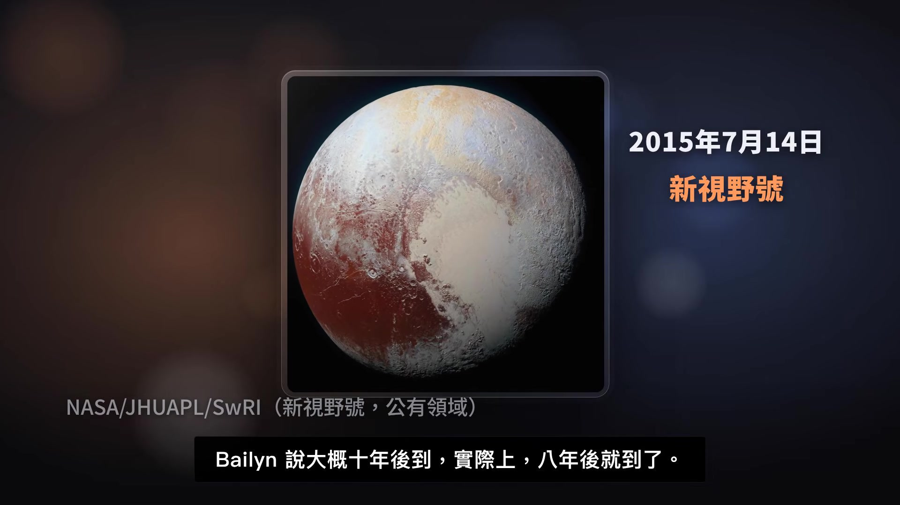

**逐字稿片段：** 那一團光點 變成一個有山 有平原 有大氣的世界 照片上有一大塊星形的亮區 左半邊是一片淡冰結成的平原 冰還在慢慢流動 平原旁邊有水冰組成的山 高度大約三千五百公尺 而且可能很年輕 代表冥王星的地質還在活動 冥王星外面還包著一層霧霾 可是在星視野號飛向冥王星的路上 冥王星的身份先改變了 2006年8月 國際天文學聯合會投票 定出行星的定義

**話題推測：** 展示新視野號拍攝的冥王星高解析度照片

---

## 00:07:33

**逐字稿片段：** 要符合三個條件 繞著太陽 夠重 重到把自己拉成接近圓球 還要把軌道附近清乾淨 冥王星混在一整群海王星外面的 冰質小天體中間 軌道沒有清乾淨 所以被改成矮行星 星視野號的計劃主持人 Alan Stern 是反對這個定義最大聲的人之一 貝林下一堂課講到他的處境 Stern的反對 有他的科學理由 他說這個定義有漏洞 海王星的軌道也跟冥王星交錯 憑什麼只算冥王星沒清乾淨 可是貝林提醒學生 聽一個科學家的意見 也要看他站在哪裡

**話題推測：** 列出國際天文學聯合會行星定義的三個條件

---

## 00:08:22

**逐字稿片段：** 發現Eris的天文學家Mike Brown也一樣 Eris是一顆跟冥王星差不多大的海王星外天體 如果照他比較喜歡的定義 他就會變成人類歷史上少數幾個發現過行星的人 貝林把這個故事也當成預言 寓意是科學會受到文化的影響 尤其是科學家講給記者聽的時候

**話題推測：** 提及發現Eris的天文學家Mike Brown的立場

---

## 00:08:40

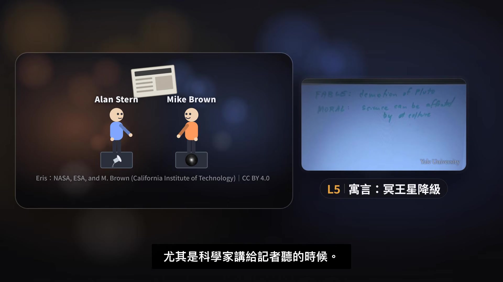

**逐字稿片段：** 這裡有一個要對的答案 2007年的課堂上 大家相信Eris比冥王星大 這是冥王星身份出問題的原因之一 星視野號飛過之後 把冥王星的直徑測量得很精準 結果冥王星其實比Eris大一點點 直徑大約多50公里 而國際天文學聯合會的定義 到2026年10月還是沒有修改 這段故事跟我們的主問題有關 連一顆拍得到照片的冥王星 大家對它算不算行星 都可以爭論好幾年 那一顆連照片都拍不到的行星 要說它存在 證據就得夠硬 硬到有立場的人 也不得不接受 冥王星在自己家門口 都只是一團光點 換成別的恆星旁邊的行星 問題更大

**話題推測：** 揭示2007年關於Eris與冥王星大小比較的錯誤

---

## 00:09:19

**逐字稿片段：** 貝林放了一張天狼星的照片 天狼星是夜空中最亮的恆星 照片上 它是一大團刺眼的光 旁邊有一個小小的點 那是它的半星 一顆比較暗的恆星 大約50年繞天狼星一圈 你可能會想 找行星就是這樣找 拍一張照片 看恆星旁邊有沒有小點 連續拍個幾年 看那個小點有沒有在繞圈 問題是 那個小點本身是一顆恆星 換成行星 會比它再暗一萬倍 而且位置差不多 就貼在那一大團刺眼的光旁邊

**話題推測：** 展示天狼星照片，說明其亮度與伴星的觀測難度

---

## 00:09:49

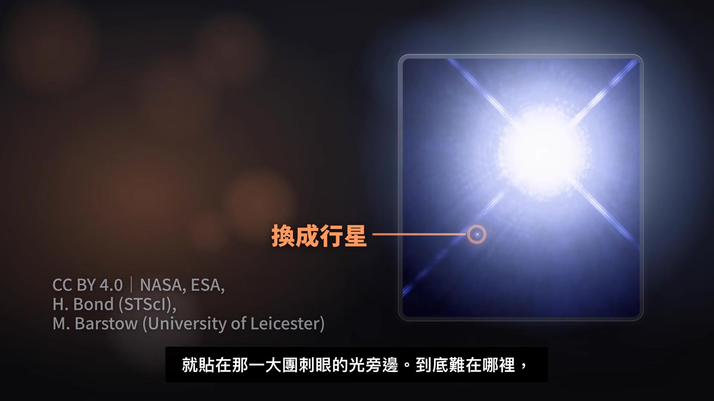

**逐字稿片段：** 到底難在哪裡?聽他自己講 白天找星星是貝林給的比喻 白天看不到星星 不是星星不見了 是天空的背景太亮 把它蓋過去

**話題推測：** 播放教授貝林解釋直接觀測系外行星的具體困難

---

## 00:10:22

**逐字稿片段：** 接著他用算的 讓學生看這件事有多難

**話題推測：** 透過計算來展示觀測行星的挑戰

---

## 00:10:26

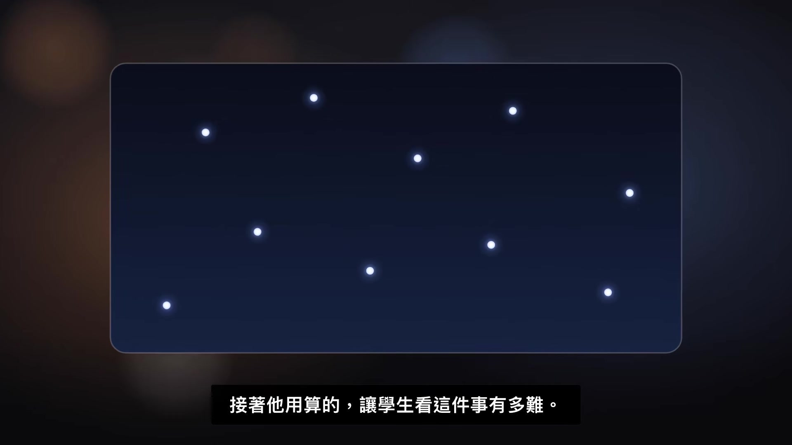

**逐字稿片段：** 先講一個名詞 叫角秒 是測量天上角度的單位 把一度再切成3600份 一份就是一角秒 非常非常小

**話題推測：** 解釋「角秒」這一角度測量單位

---

## 00:10:34

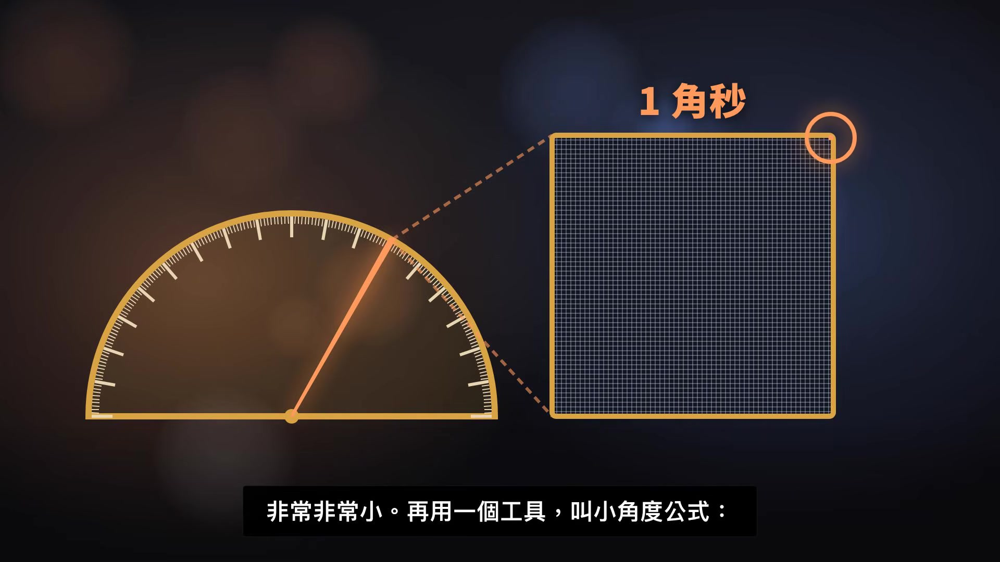

**逐字稿片段：** 再用一個工具 叫小角度公式 行星離恆星的距離 除以我們到那顆恆星的距離 就是你在天上看到 兩者之間張開的角度

**話題推測：** 引入「小角度公式」作為計算工具

---

## 00:10:42

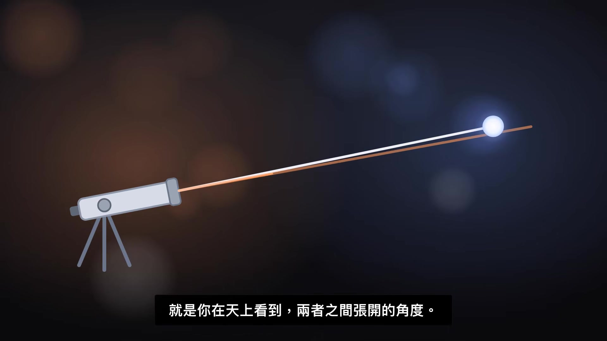

**逐字稿片段：** 他在課堂上算了一題 一顆繞恆星40年一圈的行星 先用克普勒第三定律 從週期算出它離恆星多遠 那顆恆星離我們大約十光年 算是很近的鄰居 算出來 行星跟恆星 在天上只差大約三角秒 如果恆星再遠一點 就只剩千分之一角秒 可是地球的大氣 會把星光胡開好幾角秒 望遠鏡本身也會把光散開一些 換句話說 行星就埋在恆星胡開的那團光裡面 他說 這種題目 答案的小數點後面幾位根本不重要 光看單位就知道結果 這句話 我們到第三部分會回來對答案 因為19年後 它沒有完全成立 不過它的推理到今天還站得住 絕大部分的系外行星 確實不是被直接看到的 我們先整理一下 我們有一把尺 科普勒第三定律 知道週期就能算距離算質量 我們也知道行星本身太暗 又貼著太亮的恆星 就像白天找行星直接看行不通 那還剩下什麼 剩下那顆恆星本身 行星我們看不到 恆星我們看得很清楚 如果行星會對恆星做一點什麼 我們就盯著恆星看 行星會對恆星做什麼

**話題推測：** 在課堂上演算行星與恆星的角距離範例

---

## 00:12:06

**逐字稿片段：** 答案藏在一條物理定律裡 叫動量守恆 動量是質量乘上速度 在沒有外力的時候 一群東西加起來的總動量不會改變 Bavin很不喜歡課本上 作用力與反作用力的講法 他寧可用動量守恆來講這件事 放到行星和恆星身上 意思是 不是隻有行星繞著恆星轉 恆星也在動 兩個一起繞著中間一個平衡點轉

**話題推測：** 引入動量守恆定律來解釋行星對恆星的影響

---

## 00:12:30

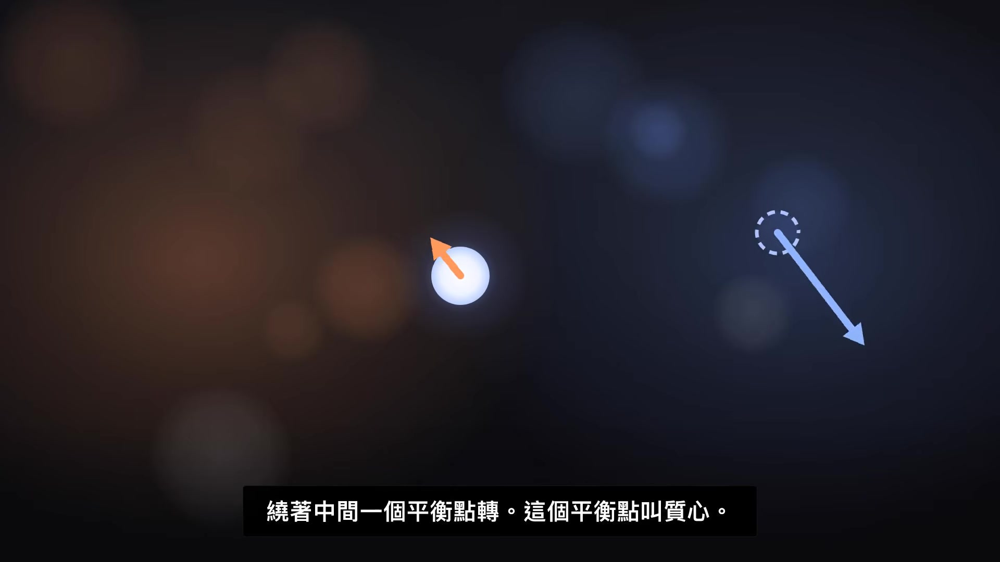

**逐字稿片段：** 這個平衡點叫直星 恆星比行星重得多 所以直星很靠近恆星 恆星只畫一個小圈 行星畫一個大圈

**話題推測：** 解釋「質心」概念及恆星與行星圍繞其旋轉的現象

---

## 00:12:38

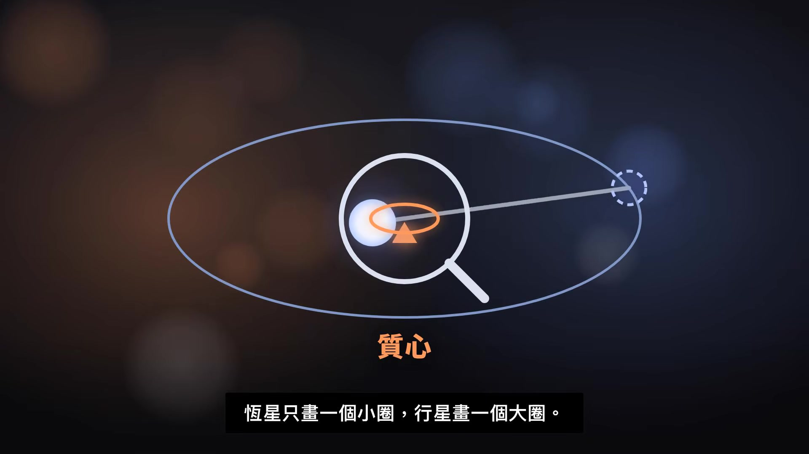

**逐字稿片段：** 你可以想象一個練球選手 他甩練球的時候 自己也被拉著 在原地繞小圈 你站得很遠 看不到那條鏈子和那顆球 可是看得到選手在晃 練球越重甩得越近 選手晃得越明顯 恆星就是那個選手 行星就是那顆練球 這一招人類其實用過一次 19世紀 天文學家發現天王星的軌道上 有一些多出來的小晃動 用已知的行星解釋不了 幾個數學家就從這些晃動 算出另一顆行星應該在哪裡 天文學家照著去找 真的找到了 就是海王星 貝林說 那是牛頓物理的一場大勝利 一顆沒有人看過的行星 先被重力算出來才被看到 我們的主問題在太陽系裡早就有過一次答案 可是別的恆星太遠了 就算它在晃 晃的幅度也小到在照片上看不出來 所以要換一個方法 不看位置 看速度 這個方法靠的是都普勒效應 都普勒效應說的是 一個發出波的東西朝你過來 你收到的波會被擠密 離你而去 波會被拉開 救護車朝你開過來 警笛聲比較高 開走了聲音變低 就是這個效應 光也是波 恆星朝我們過來 光會往藍色那一端偏一點 這叫藍移 離我們而去 往紅色那一端偏一點 這叫紅移 偏移的大小 跟速度成正比 天文學家測量的 是恆星朝著我們 或是離開我們

**話題推測：** 用甩鏈球選手的比喻說明行星對恆星的影響

---

## 00:13:54

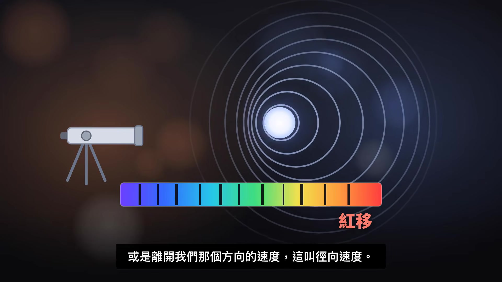

**逐字稿片段：** 那個方向的速度 這叫鏡像速度

**話題推測：** 解釋「徑向速度」及其在找行星方法中的應用

---

## 00:13:56

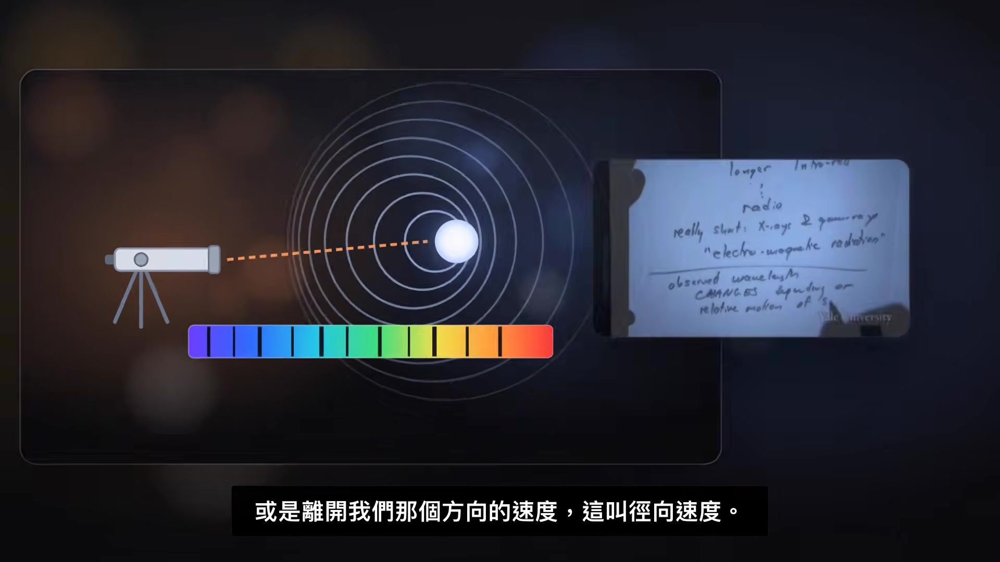

**逐字稿片段：** 所以這個找行星的方法 叫鏡像速度法

**話題推測：** 闡明「徑向速度法」為一種行星偵測技術

---

## 00:13:59

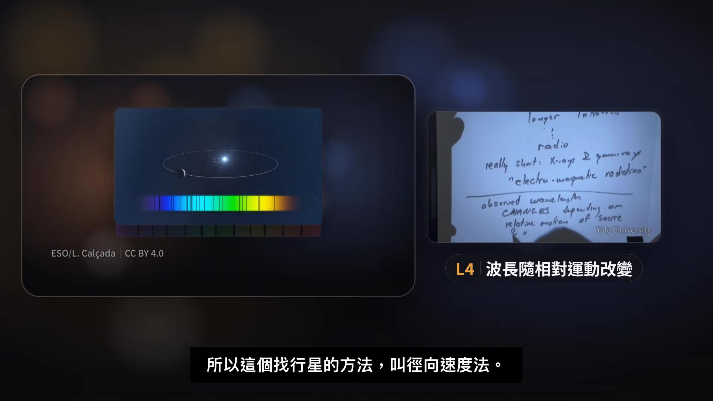

**逐字稿片段：** 貝林用動量手痕 算了一下 木星讓太陽晃動的速度 大約每秒15公尺 地球讓太陽晃動的速度 只有每秒10公分左右 他說 以現在的技術 這麼慢的晃動

**話題推測：** 貝林演算木星對太陽造成的徑向速度

---

## 00:14:10

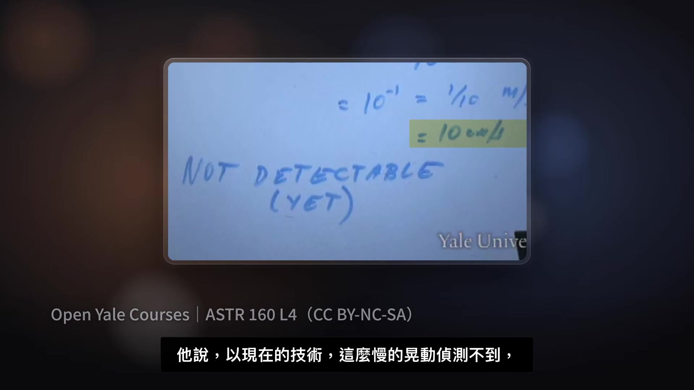

**逐字稿片段：** 偵測不到 然後在投影片上 補了一個字 海 2003年

**話題推測：** 投影片上補充「海」字，暗示技術進步

---

## 00:14:16

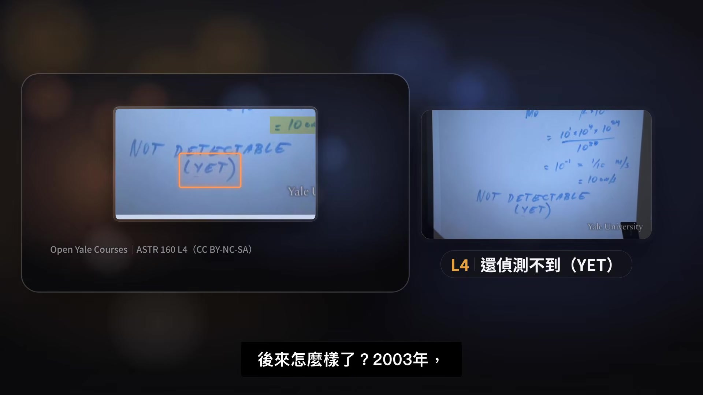

**逐字稿片段：** 歐洲南方天文臺的HARPS光譜儀開始運作 設計目標是每秒1公尺左右 這就是2007年課堂上的水準

**話題推測：** 介紹HARPS光譜儀的啟用及其目標精度

---

## 00:14:23

**逐字稿片段：** 現在更新的Espresso光譜儀 在很短的時間內 看得到每秒10公分等級的變化 可是拉長到好幾年 精度大約是每秒40公分 2022年 天文學家用它在比鄰星旁邊 找到一顆很輕的行星的訊號 比鄰星是離太陽最近的恆星 那顆行星讓它晃動的速度 大約每秒40公分 可是像地球繞著太陽這樣的訊號 到今天還沒有用這個方法找到 有了方法就可以出去找了

**話題推測：** 介紹更新的Espresso光譜儀的更高精度

---

## 00:14:47

**逐字稿片段：** 可是貝林先做了一件很有科學精神的事 在看資料之前 先講理論會預測什麼 這套理論是從我們自己的太陽系歸納出來的 一團旋轉的氣體和塵埃 慢慢塌成一個扁平的盤子 中間變成太陽 盤子裡的小顆粒互相碰撞 粘在一起 越長越大 變成小石塊 這種石塊叫微行星 微行星再互撞 合併 在每一個距離上長出一顆大行星 這也解釋了為什麼行星的軌道都接近圓形 而且大致在同一個平面上 靠近太陽的地方很熱 冰會蒸發掉 剩下的材料只有岩石和金屬 所以長出來的是小小的岩石行星 像水星、金星、地球、火星 離太陽遠的地方夠冷 冰也能當材料 行星長得很大 大到能把周圍的氫氣和氦氣抓過來 變成木星、土星那樣的氣體巨行星 所以理論的預測很清楚 別的恆星旁邊 也應該是內側小岩石 外側大氣體 像木星那樣的大行星 會在離恆星很遠的地方 繞一圈要好幾年 講完這套理論

**話題推測：** 貝林先講述行星系統形成的理論預測

---

## 00:15:47

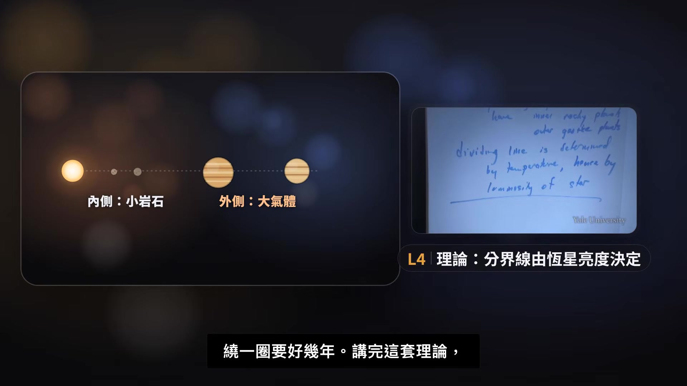

**逐字稿片段：** 貝林先把結局說了出來 他說 我先告訴你答案 測完全行不同 1995年

**話題推測：** 貝林預告實際觀測結果與理論預測的巨大差異

---

## 00:15:53

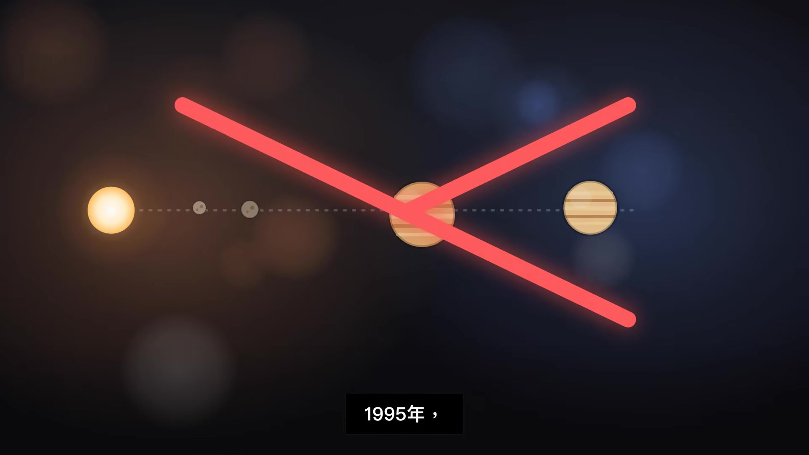

**逐字稿片段：** 瑞士的兩位天文學家 Michel Maillot和D.J. Quillot 在法國南部的 尚普羅旺斯天文臺 用鏡像速度法

**話題推測：** 介紹瑞士天文學家發現第一顆系外行星

---

## 00:15:59

**逐字稿片段：** 盯著一顆叫 飛馬座51的恆星 它的光譜很規律的 一下偏藍 一下偏紅 來回一次只要四天多 四天是什麼概念 水星是離太陽最近的行星 繞太陽一圈也要88天

**話題推測：** 揭示被發現的第一顆行星圍繞飛馬座51的特性

---

## 00:16:12

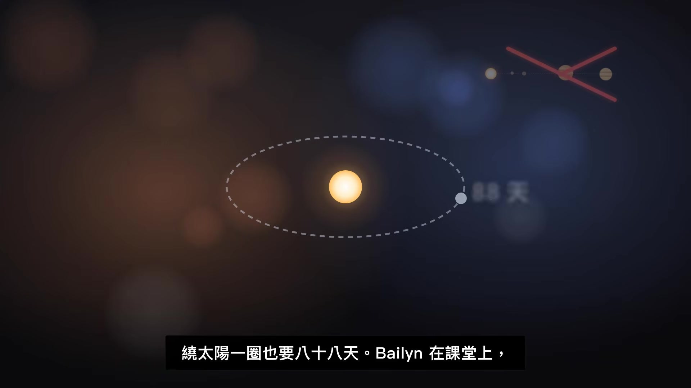

**逐字稿片段：** 貝領在課堂上把數字帶進去 先用第一部分那把尺 克普勒第三定律 這顆恆星跟太陽差不多重 週期四天 算出來 這顆行星離恆星只有日地距離的二十分之一 比水星近得多 再用動量守恆 恆星晃動的速度大約每秒50公尺 配上行星自己繞行的速度 就能算出行星有多重 貝領粗算出來 大約三分之一個木星 比土星還重 一顆比土星還重的大行星 緊貼著它的恆星 他估計表面溫度超過1000度 這種行星後來有了名字 叫熱木星 李問說 大行星應該在外面繞一圈要好幾年 第一顆找到的卻在最裡面四天一圈 他說這是一場災難 理論被推翻

**話題推測：** 貝林演算飛馬座51b的距離和質量

---

## 00:17:15

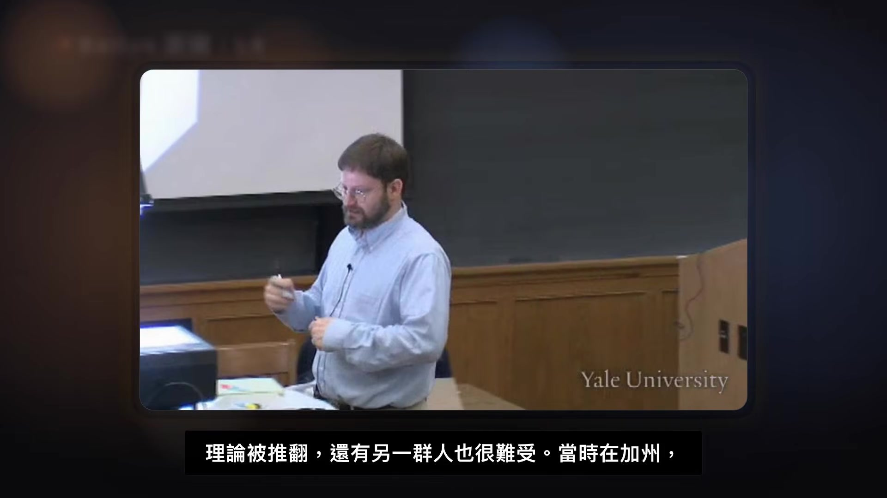

**逐字稿片段：** 還有另一群人也很難受 當時在加州 有一個美國團隊 擁有最精密的鏡像速度設備 正在一顆一顆追蹤像太陽這樣的恆星 想找到像木星那樣的行星 飛馬座51就在他們的觀測名單上 資料早就收在抽屜裡 可是他們預期的週期是10年以上 像木星那樣 所以他們找的是很慢很長的變化 瑞士團隊發表之後 他們回頭打開自己的資料 一個禮拜內就確認了那顆四天的行星確實存在

**話題推測：** 提及美國團隊因未及時發現飛馬座51b而錯失先機

---

## 00:17:42

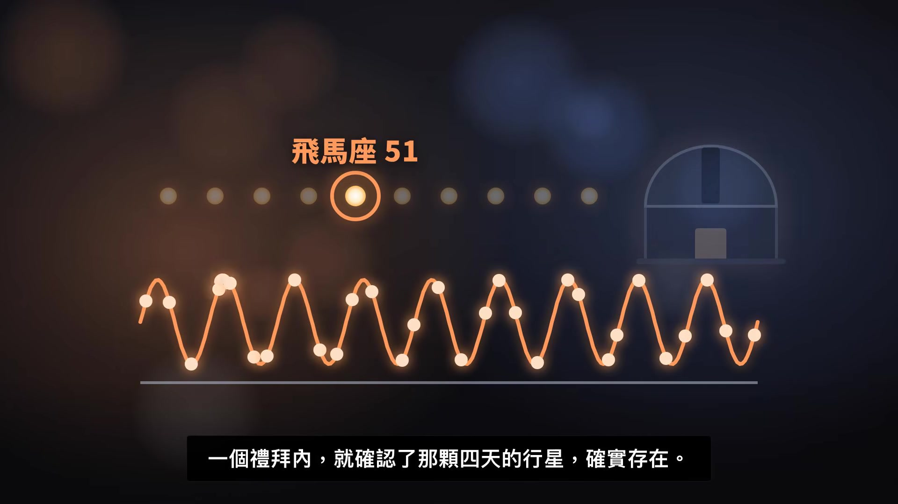

**逐字稿片段：** 聽貝林怎麼說 他們為什麼沒有先發現 貝林也把這個故事當成預言 寓意有兩種說法 一種是要預期意料之外的事 另一種更簡單 看你的資料 不只看你預期會看到的東西 也要看那些你沒想到的

**話題推測：** 播放教授貝林解釋美國團隊為何錯過發現

---

## 00:18:16

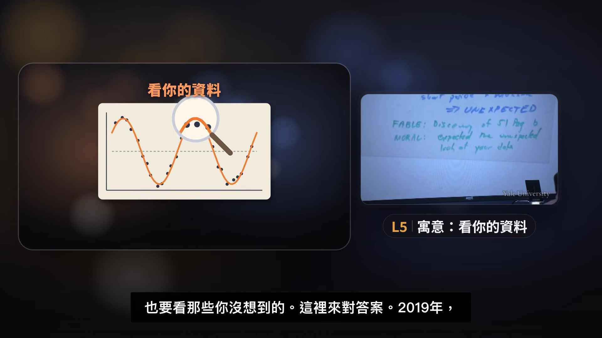

**逐字稿片段：** 這裡來對答案 2019年諾貝爾物理獎有一半 頒給了Mayer和Kwellos兩個人 理由是發現第一顆繞著淚太陽恆星的系外行星 另一半頒給了研究宇宙學的Peebles

**話題推測：** 更新諾貝爾物理獎頒給Mayer和Queloz的資訊

---

## 00:18:27

**逐字稿片段：** 注意得獎理由裡的淚太陽恆星這幾個字 其實早在1992年 就有人在一顆脈衝星旁邊找到行星

**話題推測：** 澄清諾貝爾獎理由中「類太陽恆星」的涵義

---

## 00:18:35

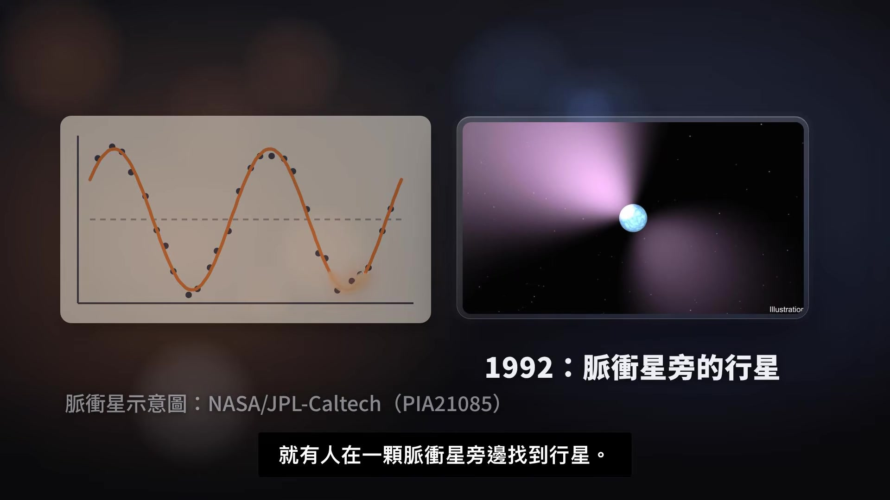

**逐字稿片段：** 脈衝星是大質量恆星爆炸以後 留下來的一種很小 而且轉得很快的星體 我們重集會講到它 所以貝林說 1995年以前沒有證據 指的是繞著像太陽 這種正常恆星的行星 從一顆四天一圈的熱木星開始 這一行在二十幾年後 拿到了物理學最高的獎 可是先別急著慶祝 一顆四天繞一圈的大行星 跟理論完全相反

**話題推測：** 解釋「脈衝星」的形成與特性

---

## 00:18:58

**逐字稿片段：** 最自然的懷疑是 它會不會根本不是行星 貝林在課堂上 列了兩種替代解釋 第一種是雙星 兩顆恆星互相繞 剛好軌道面幾乎正對著我們 所以看到的晃動很小 被誤以為是行星 可是如果是這樣 應該看得到另外那顆恆星的光 而且不可能每一顆熱木星 都剛好正對著我們 另一種是恆星自己在漲縮 恆星表面一下漲大 一下縮小 表面朝我們來又離我們去 也會造成藍移和紅移 這個假說可以驗證 因為兩種情況 在光譜上長得不一樣 光譜上有很多細細的暗線 是恆星大氣裡的原子 吸收掉特定的顏色留下來的

**話題推測：** 提出對熱木星性質的兩種替代解釋

---

## 00:19:35

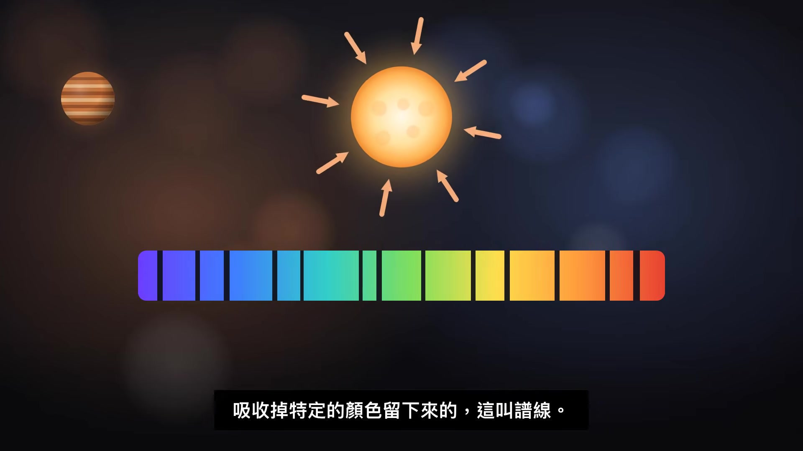

**逐字稿片段：** 這叫譜線 如果是整顆恆星在軌道上移動 譜線只會整條平移 形狀不變 如果是恆星在脹縮 譜線的形狀會跟著改變

**話題推測：** 解釋光譜中的「譜線」及其意義

---

## 00:19:44

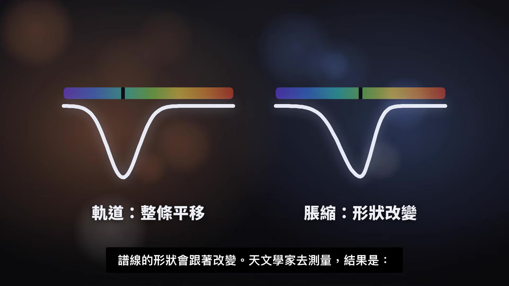

**逐字稿片段：** 天文學家去測量 結果是 譜線只平移 不變形 是軌道 所以是行星 貝林說 課本上寫的那種科學方法 在天文學裡很少真的照著發生 可是這一次 科學真的照著科學的樣子在走 排除了替代解釋 熱木星就一顆接一顆被找到 幾年之內有好幾十顆 這是不是代表 宇宙裡的行星系統大多長這樣 跟我們的太陽系不一樣 貝林在這裡打了一個問號

**話題推測：** 展示測量結果：譜線平移而非變形，確認是行星軌道

---

## 00:20:11

**逐字稿片段：** 他講了一個概念叫選擇效應 你用什麼方法找 就會先找到那個方法最容易看到的東西

**話題推測：** 介紹「選擇效應」概念，解釋為何熱木星易被發現

---

## 00:20:17

**逐字稿片段：** 可以想成一張魚網 網孔很大 撈上來的都是大魚 可是你不能因此說海里只有大魚 鏡像速度法偏好又重又靠近恆星的行星 因為它讓恆星晃得最快 而且四天就晃一輪 觀測幾個禮拜就能確認 像木星那樣將近12年一圈的行星 你得連續觀測十幾年 才看得到完整的一輪 貝林開玩笑說 沒有一個研究計劃 撐得比研究生唸完博士學位還久

**話題推測：** 用漁網比喻偵測方法的偏好性

---

## 00:20:41

**逐字稿片段：** 今天的數字 替他的問號給了答案 熱木星其實很少見 大約100顆像太陽的恆星裡 才有一顆左右 它們只是最好撈的那種魚

**話題推測：** 更新熱木星在宇宙中實際稀有度的數據

---

## 00:20:51

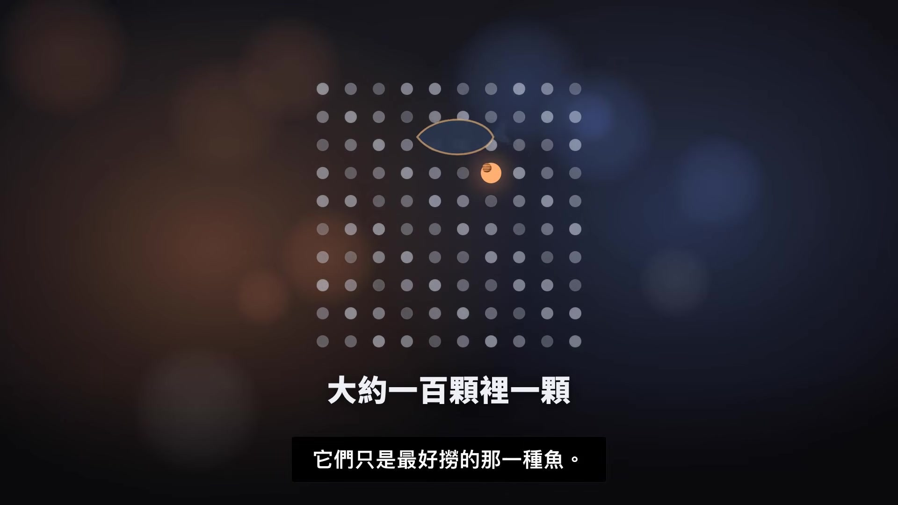

**逐字稿片段：** 我們先整理一下 行星看不到 但它會拉著恆星繞圈 恆星的晃動 可以從星光的紅移藍移測量出來 再拿克普勒第三定律 就能算出行星離恆星多遠 大概有多重 第一批系外行星 就是這樣被證明存在的

**話題推測：** 總結鏡像速度法的原理與成果

---

## 00:21:05

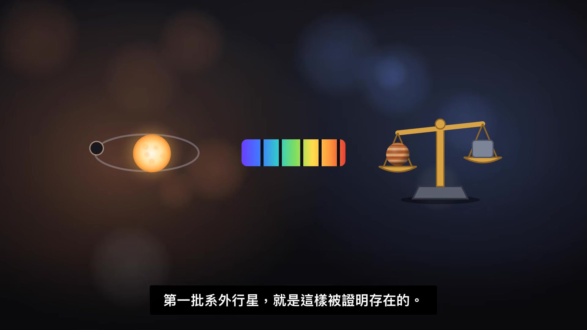

**逐字稿片段：** 可是這個方法留下兩個缺口 一個缺口是 它只測量得到朝著我們那個方向的速度 如果軌道面是斜的 我們會低估晃動 算出來的質量只是最少有這麼重 另一個缺口是 它只告訴你行星多重 沒告訴你行星多大 一顆三分之一個木星重的東西 是一大團氣體 還是一顆很密的大石頭 光靠晃動回答不了 要補上這兩個缺口 得換一種證據

**話題推測：** 指出徑向速度法在質量和大小測量上的兩個限制

---

## 00:21:30

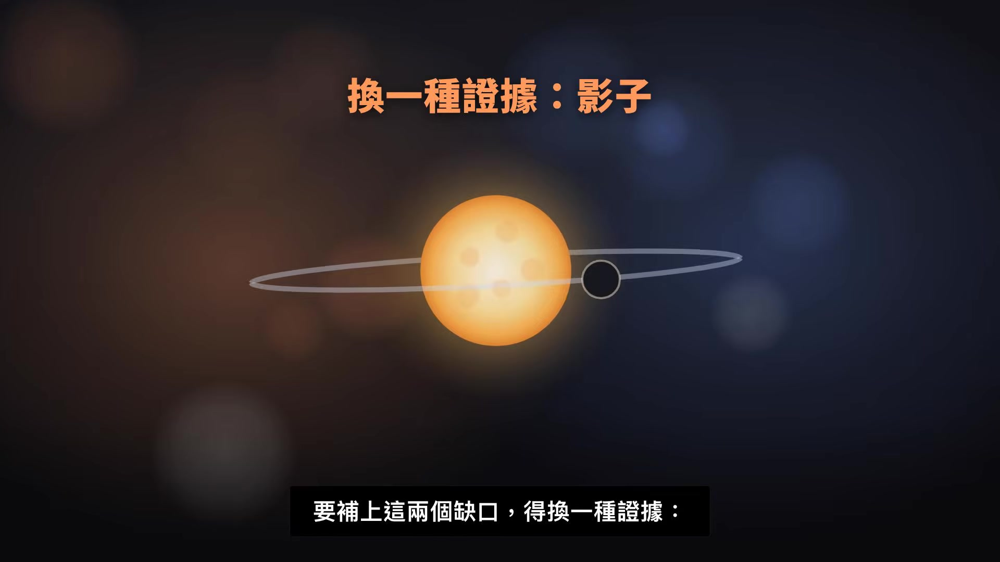

**逐字稿片段：** 行星擋住星光的影 1999年9月 天文學家盯著一顆恆星 編號HD209458 這顆星已經用鏡像速度法 找到一顆熱木星 三天半繞一圈 他們想知道 這顆行星會不會剛好從恆星前面經過 9月9日和9月16日 這顆恆星的亮度掉了大約2% 過一陣子又恢復 中間應該還有一次 剛好在白天 沒觀測到 算一算正好是三天半一次 行星從恆星前面經過 擋住一部分星光

**話題推測：** 引入「行星擋住星光」的現象作為新的偵測證據

---

## 00:21:59

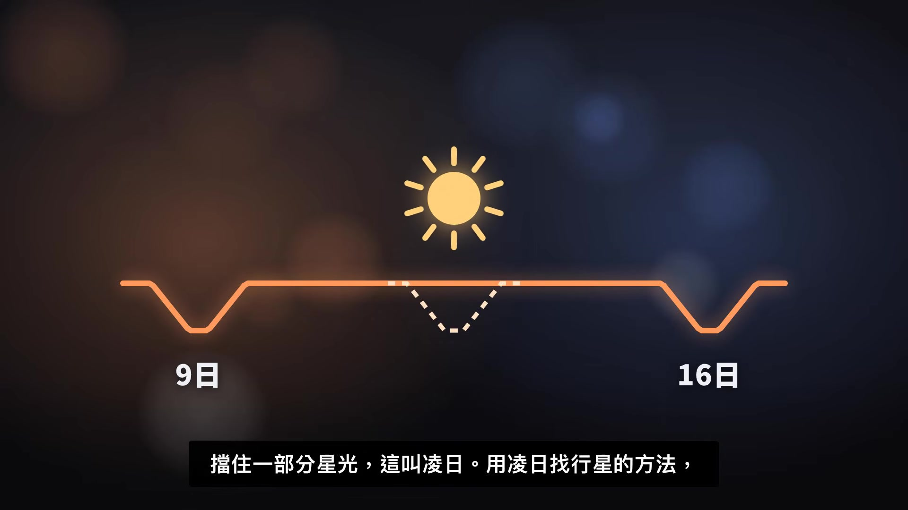

**逐字稿片段：** 這叫零日 用零日找行星的方法叫零日法 後來哈勃太空望遠鏡測量出來的亮度曲線 跟一個不透明的圓盤 從發光的球前面滑過去 完全對得起來 關鍵在這裡 零日的時候 行星正好在恆星和我們中間 照鏡像速度的曲線 那一刻恆星朝著我們的速度 必須剛好是零 兩種完全不同的測量 在同一個時間點咬在一起 貝林說 科學的證明不是數學那種百分之百 是電視上法庭劇常講的那個標準 超越合理懷疑

**話題推測：** 解釋「凌日」現象，並介紹「凌日法」

---

## 00:22:28

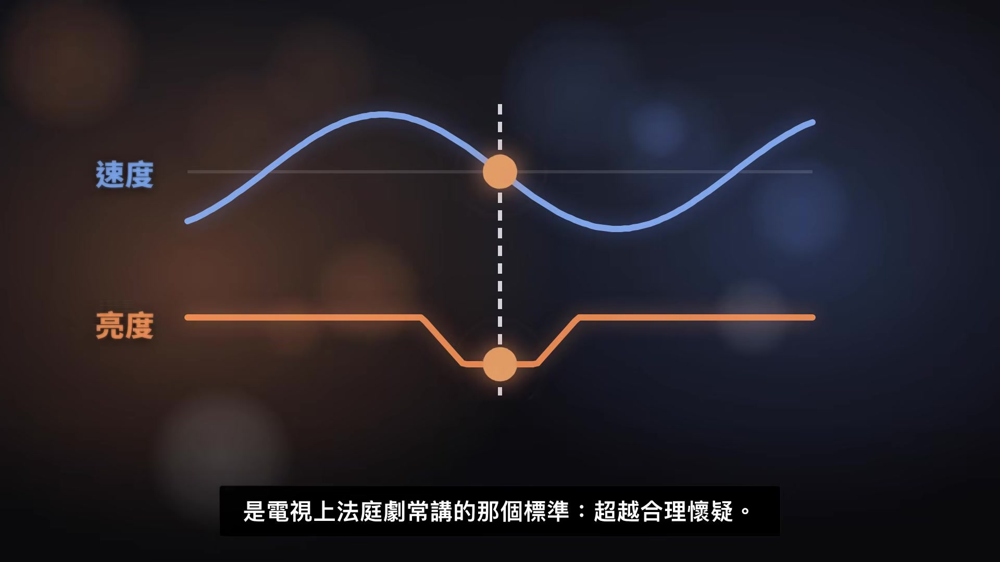

**逐字稿片段：** 兩種獨立的證據互相咬合 就是超越合理懷疑 而且看得到零日,代表我們是從軌道的側邊看過去的 上一部分說的那個質量下限,也變成了真正的質量

**話題推測：** 貝林闡釋科學證明「超越合理懷疑」的標準

---

## 00:22:39

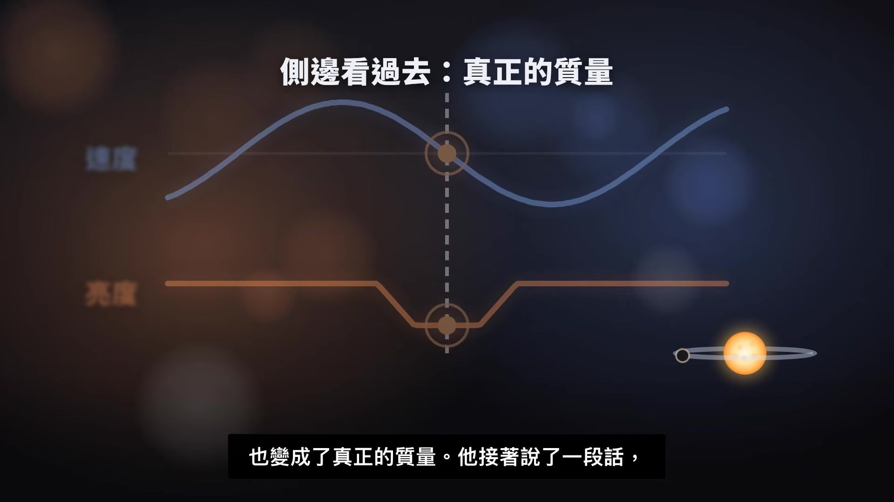

**逐字稿片段：** 他接著說了一段話,讓當時很多天文學家都想自己試試看 非常簡潔的測量 去測量一個星球的亮度有2%的差別 如果你有2000塊錢的裝備 你可以到你家裡去做這個測驗 測量2%的亮度變化很容易 難的是要剛好對準 軌道面的正好側對著我們 行星才會擋到恆星 大部分有行星的恆星都不會出現靈日 所以要用這個方法找新行星

**話題推測：** 教授貝林鼓勵大家嘗試觀測凌日現象

---

## 00:23:26

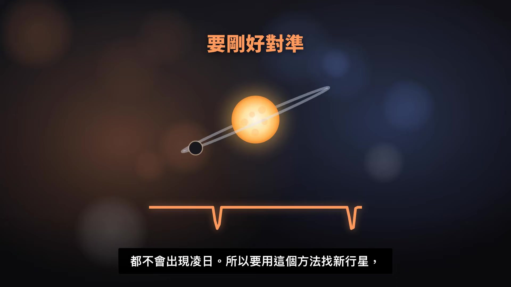

**逐字稿片段：** 得一次盯很多很多顆星 一個團隊用哈勃太空望遠鏡 連續8天盯著一個叫杜鵑座47的 球狀星團 是非常多恆星擠在一起的一大團星 他們一次看了三萬多顆星 結果在2000年發表

**話題推測：** 解釋凌日法需要同時觀測大量恆星的策略

---

## 00:23:41

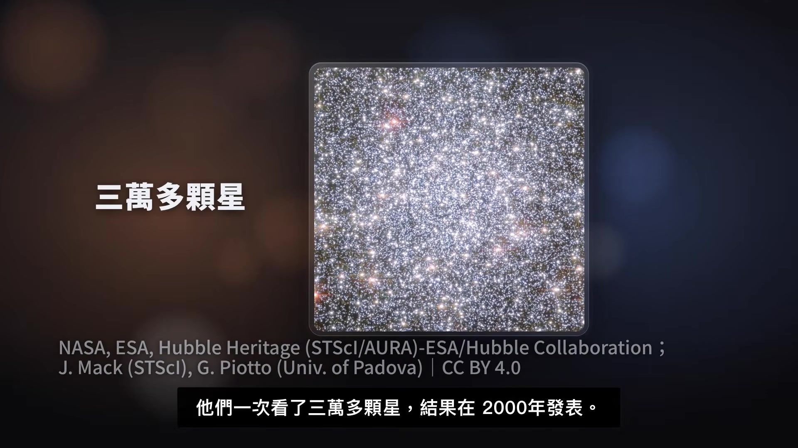

**逐字稿片段：** 貝林在課堂上粗算了一次 十顆像太陽的恆星 有一顆熱木星 一百顆熱木星裡 有一顆剛好對準 三萬顆星 應該看到三十次靈日

**話題推測：** 貝林粗略估計杜鵑座47星團中預期發現的凌日次數

---

## 00:23:51

**逐字稿片段：** 這裡要先更正 十顆裡有一顆 高估了大約十倍 前面說過 真正的比例是一百顆裡一顆左右 那篇論文里正式的預測 是大約十七次 可是不管預測是三十次 還是十七次 結果都一樣 聽他宣佈結果 零次 這個結果 事後想起來其實有跡可循

**話題推測：** 更正貝林對熱木星比例的估計

---

## 00:24:34

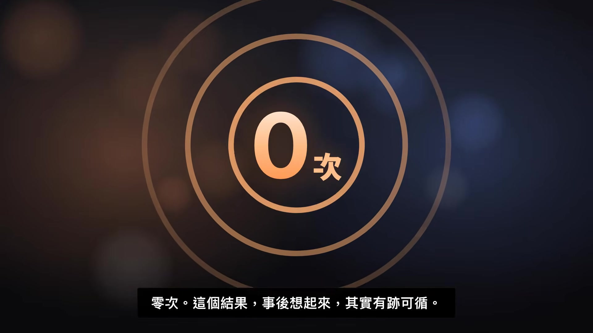

**逐字稿片段：** 事後的解釋有兩個 一個是 星團太擠了 貝林說 在這種星團的中心 一小塊空間裡擠了上百萬顆星 而在我們太陽附近 同樣大小的空間裡只有一顆 恆星常常從別的恆星旁邊擦身而過 它的重力會把行星的軌道打亂 甚至把行星整顆拉走 另一個解釋跟一個名詞有關 叫金屬量 天文學家有一個很奇怪的習慣 把氫和氦以外的所有元素都叫做金屬 連碳、氧都算 金屬量就是一顆恆星裡 這些比較重的元素佔多少 觀測發現 金屬量高的恆星比較容易有行星 這很合理 因為造行星的材料 正是氫和氦以外的那些東西 而杜鵑座47 是一個金屬量很低的星團 這次失敗之後 同一套方法換了一個方向 2006年

**話題推測：** 解釋杜鵑座47星團未發現凌日行星的兩個原因

---

## 00:25:20

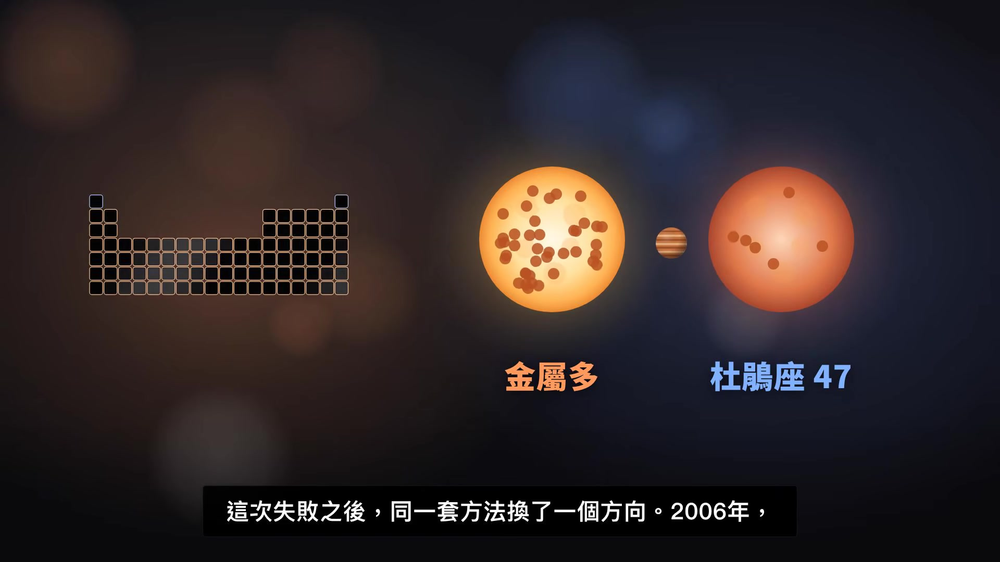

**逐字稿片段：** 哈勃改成盯著銀河系中心的方向 找到了16個零日的行星候選 這是最早一批 先由零日法發現 而不是先用鏡像速度找到的行星候選

**話題推測：** 哈勃望遠鏡轉向觀測銀河系中心，尋找凌日候選行星

---

## 00:25:29

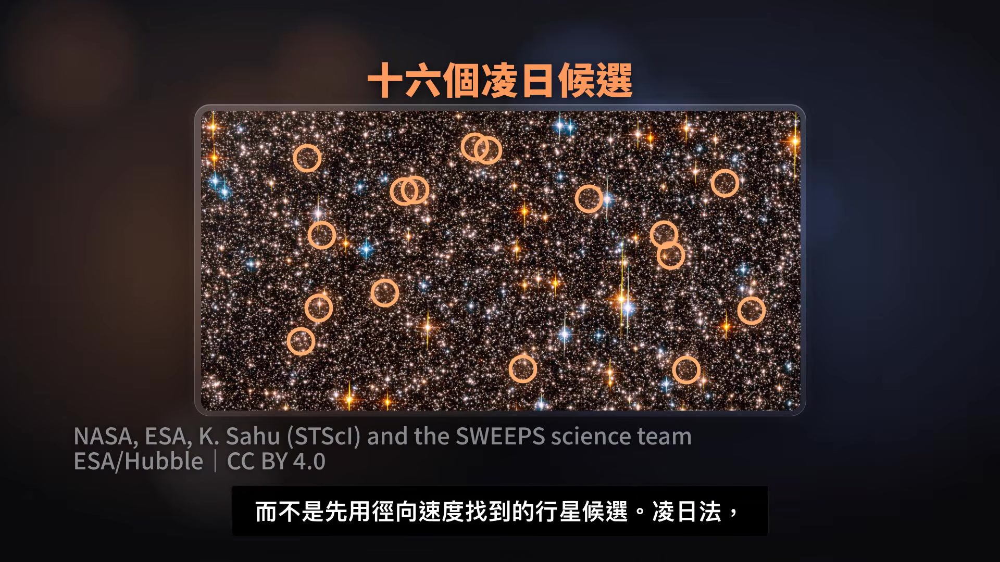

**逐字稿片段：** 零日法從確認行星的工具 開始變成發現行星的工具

**話題推測：** 凌日法從確認工具轉變為發現行星的工具

---

## 00:25:33

**逐字稿片段：** 零日除了證明行星存在 還多給了一樣東西 大小 行星擋住多少光 取決於它的截面 跟恆星的截面比例 也就是半徑比例的平方 木星大小的行星 大約擋住1%的光 地球大小的 只擋住萬分之一 貝林在課堂上

**話題推測：** 指出凌日法除了證明存在還能測量行星大小

---

## 00:25:49

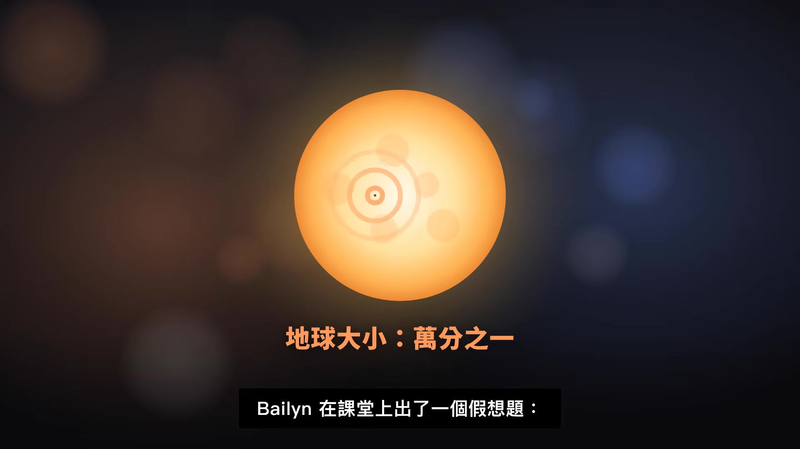

**逐字稿片段：** 出了一個假想題 如果有外星天文學家 從遠方看地球臨日 同時用鏡像速度 測量出地球的質量 他們能知道什麼 他們可以把質量 除以體積

**話題推測：** 貝林提出假想題：外星天文學家如何觀測地球

---

## 00:25:59

**逐字稿片段：** 算出地球的密度 算出來 是水的好幾倍 比任何冰或氣體都密 所以地球是岩石做的 這就是兩種方法合起來的力量 鏡像速度給質量 靈日給半徑 合起來是密度 密度告訴你這顆行星是什麼做的 拿這一招去測量熱木星 密度很低

**話題推測：** 解釋結合徑向速度與凌日法可算出地球密度

---

## 00:26:16

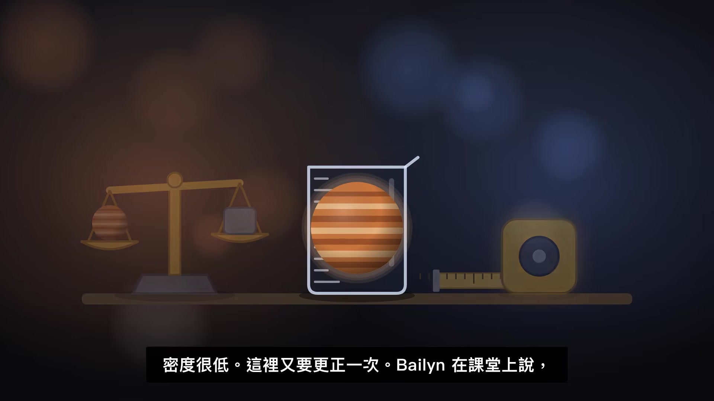

**逐字稿片段：** 這裡又要更正一次 北林在課堂上說熱木星真的是冰球 這句話不精確 熱木星是以氫和氦為主的氣體巨行星 而且很多都脹得比模型預期的還大 不管是冰還是氣體 結論一樣 這麼氫這麼大的東西 不可能在那麼熱的地方長出來

**話題推測：** 更正貝林對熱木星組成（冰球）的說法

---

## 00:26:32

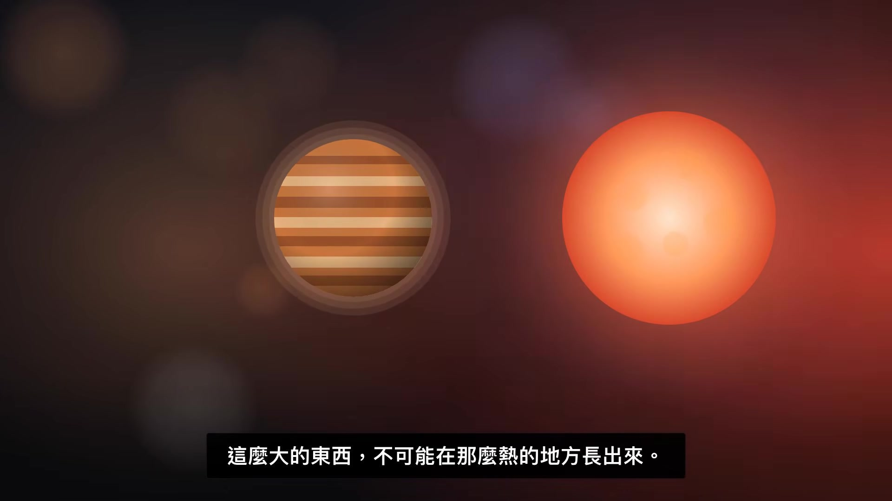

**逐字稿片段：** 那熱木星是怎麼來的

**話題推測：** 探討熱木星形成的原因

---

## 00:26:34

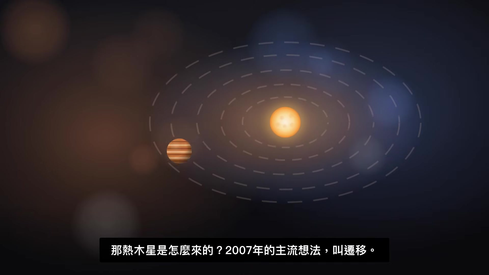

**逐字稿片段：** 2007年的主流想法叫遷移 意思是大行星照著理論 在外面冷的地方形成 形成之後因為某種原因 一路往恆星搬進來 為什麼要這樣繞一大圈 因為大的東西融化和蒸發得比較慢 體積跟半徑的三次方程正比 表面積只跟半徑的平方程正比 越大的東西表面積相對越小 吸熱散熱都慢 一顆木星大小的行星 就算搬到很熱的地方 也要很久很久才會被蒸發掉 貝林在課堂上說 搬家的原因可能是這樣 行星剛形成的時候,周圍還有殘留的氣體盤 行星在裡面穿過,摩擦讓它慢下來 軌道就一點一點往內縮

**話題推測：** 介紹2007年熱木星形成的「遷移理論」

---

## 00:27:11

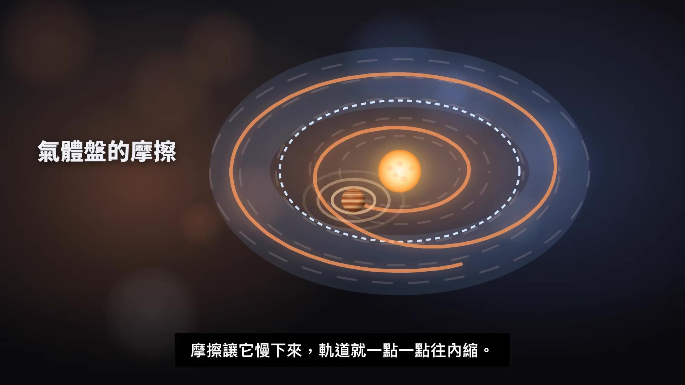

**逐字稿片段：** 可是遷移理論有一個麻煩 它得常常有效,因為熱木星確實存在 又不能每次都有效,因為我們的木星還在外面 也不能太有效,不然行星會一路掉進恆星裡 要把這個機制調整到剛好在對的地方停下來,很難 他說三年後再回來看 現在過了19年 我們來看 熱木星是怎麼來的 到今天還沒有單一的答案

**話題推測：** 指出遷移理論在調整機制上的困難

---

## 00:28:03

**逐字稿片段：** 天文學家目前大致有三種想法 一種是貝倫講的 在氣體盤裡慢慢往內移 一種是被別的天體擾動 軌道變得很扁 再被恆星的潮汐力 慢慢拉成貼近恆星的圓軌道 還有一種乾脆就在原地形成 現在比較多人認為 熱木星可能不止一種來歷 還有一個更有意思的轉折 貝倫在課堂上說 我們太陽系的木星沒有遷移 2011年 有一組研究提出一個假說 叫大轉向 他說 年輕的木星 可能曾經往太陽移動 一路移到差不多 現在火星軌道的距離 再往外退回去 這個假說 順便解釋了火星 為什麼長得這麼小 因為木星經過的時候 把那一代的材料 掃走了不少 他還是一個假說 還有爭論 但至少說明了一件事 我們的木星 可能也搬過家

**話題推測：** 介紹目前熱木星形成的三種主流假說

---

## 00:28:49

**逐字稿片段：** 另外 貝倫說 有熱木星的系統 就不會有地球那樣的 岩石行星 因為搬進來的木星 會把他們撞散 大部分的熱木星 確實很孤單

**話題推測：** 貝林對有熱木星系統無岩石行星說法的更新

---

## 00:28:58

**逐字稿片段：** 可是2015年 天文學家找到一個例外 一顆熱木星的內側 還有一顆比地球大的岩石行星 到這裡 我們看過兩種方法 貝林還講了第三種 叫天體測量 就是直接測量恆星在天空中的位置 看它有沒有畫出一個小圈 這個方法偏好離恆星遠 質量大的行星 因為那樣恆星畫的圈最大 從離我們最近的恆星系統看太陽 木星讓太陽畫的圈 勉強看得出來 地球讓太陽畫的圈 小了一千多倍 看不到 到2007年 天體測量還沒有找到任何一顆行星

**話題推測：** 2015年發現有熱木星系統同時存在岩石行星的案例

---

## 00:29:30

**逐字稿片段：** 三種方法就像三張網孔不同的魚網 鏡像速度偏好又近又重的 零日要剛好對準 偏好靠近恆星個頭大的 天體測量偏好離得遠又重的 每一張網都有它撈不到的魚 也就是說到2007年為止 我們知道的系外行星 是被這幾張網篩過以後的樣子 這時候有個學生問了一個很好的問題

**話題推測：** 再次用漁網比喻三種偵測方法的選擇效應

---

## 00:29:52

**逐字稿片段：** 如果外面有外星人 技術跟我們一樣 他們看得到地球嗎 在我們科技的其他地方,它們無法偵測地球 這就像是說我們無法偵測地球周圍的其他星星 這就是現在的情況 但科技一直在發展 如我所見,在10、15年內,這不再是真相 技術往前走10到15年

**話題推測：** 學生提問外星人能否偵測到地球

---

## 00:30:19

**逐字稿片段：** 我們來對答案 貝林在同一堂課提到 一兩年內會有一具太空望遠鏡發射,叫Kepler 專門用零日法找行星 它在2009年3月發射 連續好幾年盯著同一片天空裡大約15萬顆星 等著看哪一顆的亮度會規律地按下一小格 到2018年底燃料用完,他才退役

**話題推測：** 回應貝林對未來10-15年技術發展的預測

---

## 00:30:37

**逐字稿片段：** 同一年,另一具太空望遠鏡TES發射 換成一塊一塊掃描幾乎整片天空 專找離我們比較近比較亮的恆星 他到今天還在工作

**話題推測：** 介紹凌日系外行星巡天衛星（TESS）的發射及任務

---

## 00:30:46

**逐字稿片段：** 結果是,林日法從配角變成主角 依今天的資料庫回推 2007年以前發現的行星 大約八成是用鏡像速度找到的 用林日法找到的只有一成左右 截至2026年10月 6400多顆確認的行星裡 大約4顆裡有3顆是用零日法找到的

**話題推測：** 說明凌日法從配角轉變為系外行星發現的主角

---

## 00:31:05

**逐字稿片段：** NASA在Kepler退役的時候做了一個總結 天上的行星可能比恆星還多 那地球呢? 外星人看不看得到地球 就等於我們看不看得到別的地球 2014年

**話題推測：** 引用NASA對克卜勒任務的總結，行星可能比恆星多

---

## 00:31:17

**逐字稿片段：** Kepler找到一顆叫Kepler-186f的行星 這是第一顆在別的恆星的視距帶裡 大小跟地球差不多的行星

**話題推測：** 克卜勒望遠鏡首次發現類地行星Kepler-186f

---

## 00:31:24

**逐字稿片段：** 視距帶是離恆星不遠不近 溫度可能剛好讓水保持一體的那一圈範圍 2016年 天文學家用鏡像速度法 在比林星旁邊 找到一顆至少比地球重三成左右的行星 也在市居帶裡 2017年

**話題推測：** 解釋「適居帶」的定義與重要性

---

## 00:31:38

**逐字稿片段：** 一顆很小很冷的恆星Trappist-1旁邊 排了七顆地球大小的行星 其中三顆在市居帶 可是注意這幾顆行星繞的恆星 都比太陽小得多暗得多 一顆地球大小的行星 繞著一顆像太陽的恆星 大約一年轉一圈

**話題推測：** 發現Trappist-1系統，有七顆地球大小的行星

---

## 00:31:54

**逐字稿片段：** 也就是真正的地球雙胞胎 到2026年10月還沒有被確認 貝林說10到15年 到了2022年 剛好15年 他的預言做到了一半 地球大小的行星找到了 可是繞著像太陽這種恆星的還沒有 順帶一提 這門課快結束的時候

**話題推測：** 定義「地球雙胞胎」為繞太陽大小恆星的地球大小行星

---

## 00:32:09

**逐字稿片段：** 貝林拿著報紙進教室 說每次發現新行星 報紙都說它像地球 可是這一次也許是真的 那顆行星叫Gleese 581c 後來的氣候模型認為 它太熱 我們再對一個答案 第一部分的結尾 貝林說 抬頭直接看到行星 註定失敗 2008年11月

**話題推測：** 貝林談論媒體報導新行星像地球的現象

---

## 00:32:28

**逐字稿片段：** 一個團隊用地面上的大型望遠鏡 發表了一張照片 一顆叫HR8799的恆星 旁邊有三個小光點 是三顆比木星重好幾倍的行星 後來又找到第四顆 這裡要講公平 在2007年以前 其實已經有人拍到一顆行星質量的天體

**話題推測：** 2008年地面望遠鏡首次直接拍到HR8799行星系統

---

## 00:32:44

**逐字稿片段：** 可是它繞的是一顆鍾矮星 鍾矮星比恆星小 不夠重 沒辦法像恆星一樣 靠合融合穩定發光 所以比較準確的說法是 2007年的時候 還沒有人拍到一顆正常恆星旁邊的行星系統

**話題推測：** 解釋之前拍到的行星級天體是繞褐矮星而非恆星

---

## 00:32:56

**逐字稿片段：** 這些照片是用特殊的遮罩擋掉恆星的光 加上修正大氣模糊的技術拍到的 而且比較容易拍到的是年輕 還在發熱 離恆星很遠的大行星 2025年

**話題推測：** 說明直接成像技術如遮罩、大氣修正等

---

## 00:33:07

**逐字稿片段：** 韋伯太空望遠鏡直接拍到HR8799的行星 還在他們的大氣裡看到二氧化碳 截至2026年10月 直接拍到的確認行星將近100顆 可是貝林的推理沒有錯 小角度 大氣模糊 亮度差太多 這些限制都還在 所以直接拍到的 到今天也只佔全部的不到2% 他錯的地方是把話說滿 貝林講的最後一個未來任務

**話題推測：** 韋伯太空望遠鏡直接拍到HR8799行星並偵測大氣

---

## 00:33:30

**逐字稿片段：** 叫類地行星搜尋者 他的目標是直接拍下地球大小的行星 再分析它的大氣 他說地球上最強的生命跡象

**話題推測：** 介紹未來的「類地行星搜尋者」任務目標

---

## 00:33:39

**逐字稿片段：** 是大氣裡同時有氧氣和甲烷 甲烷碰到氧氣很快就會反應掉 所以兩樣東西同時存在 代表有東西一直在補充甲烷 在地球上那就是生物 包括牛的消化 可是他也說 這個任務已經被取消了 錢要拿去送人上火星 他的想法沒有消失 2021年 美國天文學界的十年規劃 把一個新任務列為最優先

**話題推測：** 闡釋地球上氧氣和甲烷共存的生命跡象

---

## 00:34:00

**逐字稿片段：** 叫市居世界天文臺 目標是在2040年代發射 同一堂課 他還提到下一代的太空望遠鏡

**話題推測：** 介紹美國天文學界新的「宜居世界天文台」計畫

---

## 00:34:07

**逐字稿片段：** 韋伯 預定2012年發射 對答案 韋伯在2021年12月25日才發射 晚了將近十年 可是他一上去 就做到了一件2007年很難想象的事

**話題推測：** 貝林提及下一代太空望遠鏡韋伯

---

## 00:34:18

**逐字稿片段：** 用零日分析行星的大氣 行星從恆星前面經過的時候 有一小部分星光會穿過行星的大氣層 大氣裡的分子會吸收特定顏色的光 2022年

**話題推測：** 韋伯望遠鏡用凌日法分析行星大氣的成果

---

## 00:34:29

**逐字稿片段：** 韋伯在一顆叫WASP39B的熱氣體巨行星大氣裡 第一次清楚偵測到二氧化碳 後來又看到二氧化硫 那是恆星的光在別的星球的大氣裡 引發化學反應的產物 至於生命跡象 2025年有一個團隊宣稱 在K2-18b這顆比地球大很多的行星上 看到可能跟生命有關的分子 可是大多數重新分析認為證據不夠 到2026年還在爭論 零日法從證明一顆行星存在 進一步變成分析它的大氣 最後還剩下兩個要對的答案 天體測量那邊 貝林提到一個任務叫SIM 他說它永遠是五年後發射 技術上、經費上都有問題

**話題推測：** 韋伯在WASP39B大氣中首次清楚偵測到二氧化碳

---

## 00:35:07

**逐字稿片段：** 結果SIM在2010年被取消 一直沒有發射 接手天體測量的是 歐洲太空總署2013年發射的Gaia衛星 2025年

**話題推測：** SIM任務取消，由歐洲太空總署的Gaia衛星接手

---

## 00:35:16

**逐字稿片段：** 天文學家用Gaia的天體測量 找到一顆行星 再用鏡像速度確認 這是Gaia用天體測量找到的第一顆 另一個是一個課堂上沒講完的方法 貝林列偵測方法的時候

**話題推測：** 2025年Gaia衛星首次用天體測量法找到行星

---

## 00:35:27

**逐字稿片段：** 提到一種叫微重力透鏡 說之後講相對論時再回來講 可是整個學期 他沒有再回到行星這一部分

**話題推測：** 介紹第四種偵測方法：「微重力透鏡」

---

## 00:35:33

**逐字稿片段：** 微重力透鏡是這樣運作的 重力會讓光線轉彎 當一顆前景恆星 剛好從一顆背景恆星的前面經過 前景恆星的重力就像一片放大鏡 把背景恆星的光聚起來 背景恆星會亮起來一段時間 再按回去 如果前景恆星旁邊有行星 亮度區限上會多出一個短短的小尖峰 行星本身完全不用被看見 連它的恆星都可以很暗 截至2026年10月 用這個方法確認的行星有290多顆 2026年8月30日 NASA的Roman太空望遠鏡剛剛發射 它的任務之一是盯著銀河系中心的方向 預計再用微重力透鏡找到上千顆行星 重力為什麼會讓光轉彎 那是愛因斯坦的廣義相對論 也是我們終極要講的事 回到這一集的問題 一顆你看不見的行星怎麼證明它存在? 2007年,貝林給的答案是 不要看行星,看它對恆星做了什麼 恆星被拉著晃,光譜就一下偏紅,一下偏藍 行星擋在前面,星光就暗下一小格 兩種證據在同一刻咬在一起,就超越了合理懷疑 19年後,這套推理沒有過時,是工具變強了 清單從200多顆變成6400多顆 我們甚至開始分析那些行星的大氣 可是真正的地球雙胞胎 也就是繞著像太陽這樣的恆星 一年轉一圈的地球大小行星 到今天還沒有被確認

**話題推測：** 解釋微重力透鏡的運作原理

---

## 00:36:50

**逐字稿片段：** 下一集 看不見的東西換成黑洞 牛頓的重力不夠用了 要請出愛因斯坦 最後問你一個問題 你覺得 我們會先找到另一個地球 還是先證明別的星球上有生命 留言告訴我 喜歡的話 訂閱AI Notebook 開啟通知 我們下次見

**話題推測：** 預告下一集主題：黑洞與愛因斯坦廣義相對論

---
