# jimainotebook_RZ8TpuaLYUo — 關鍵畫面索引

- 來源逐字稿：[jimainotebook_RZ8TpuaLYUo_FIN.srt](jimainotebook_RZ8TpuaLYUo_FIN.srt)
- 影片：https://www.youtube.com/watch?v=RZ8TpuaLYUo
- 截圖數：118

## 00:00:11

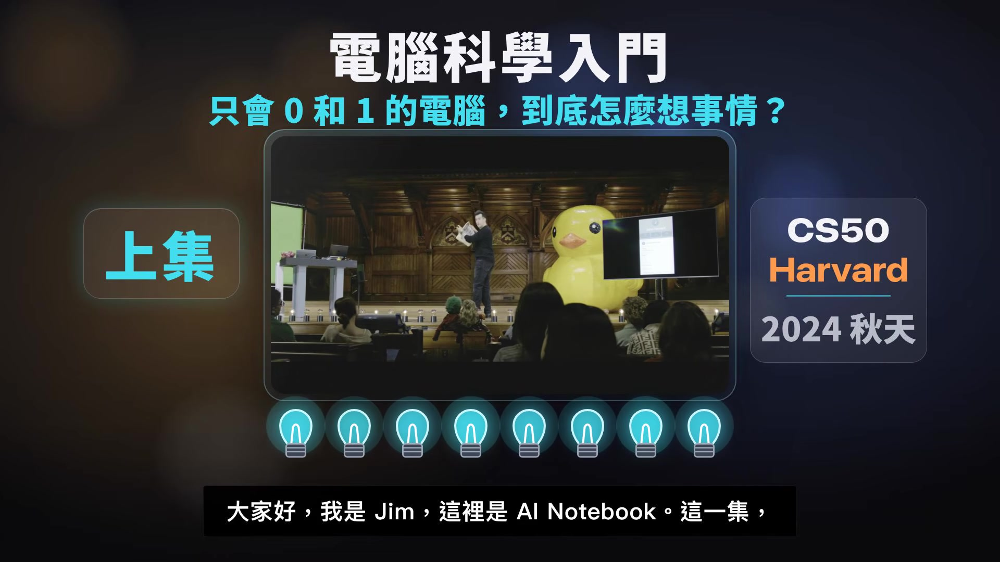

**逐字稿片段：** 我們來上哈佛大學的CS50一門電腦科學的入門課。 這是上集,上它的課程介紹,加上前四堂課。 整集只問一個問題,電腦只認得開和關,它到底怎麼想事情。

**話題推測：** 介紹哈佛大學CS50課程。

---

## 00:00:23

**逐字稿片段：** 先講清楚這是哪一份課。 這是2024年秋天 在哈佛的桑德斯劇院 現場錄的課 後來放上網路 成為免費的CS50X 2025年版本

**話題推測：** 說明CS50課程錄製與發行資訊。

---

## 00:00:32

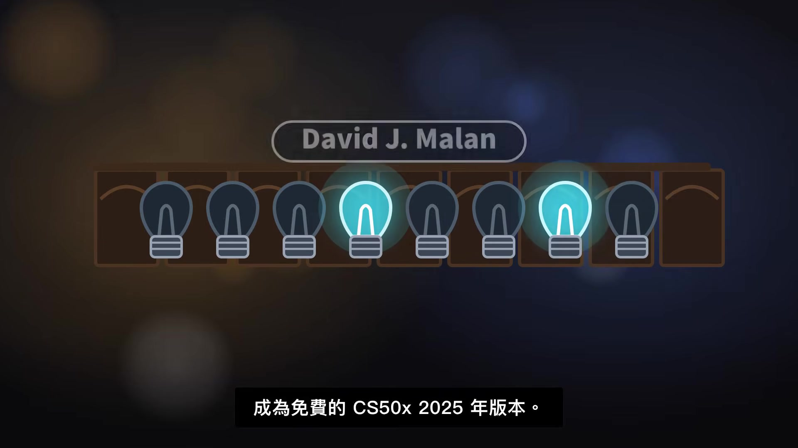

**逐字稿片段：** 講臺上的老師 叫David J. Mallon 他自己在1996年 也坐在臺下 上過這門課 那一年教他的老師 就是C語言 那本經典教科書的 作者之一 Brian Kernighan 這門課的學生 很多人從來沒寫過程式 所以Mallon 不從程式講起 他從一隻手 三顆燈泡 一本電話簿講起 我們也照著他上課的順序 走三段路

**話題推測：** 介紹課程講師David J. Mallon。

---

## 00:00:52

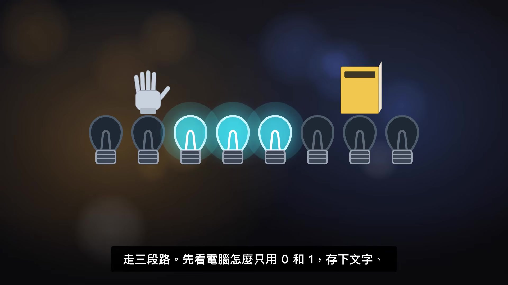

**逐字稿片段：** 先看電腦 怎麼只用0和1 存下文字 顏色和聲音

**話題推測：** 闡述電腦如何儲存文字、顏色和聲音。

---

## 00:00:56

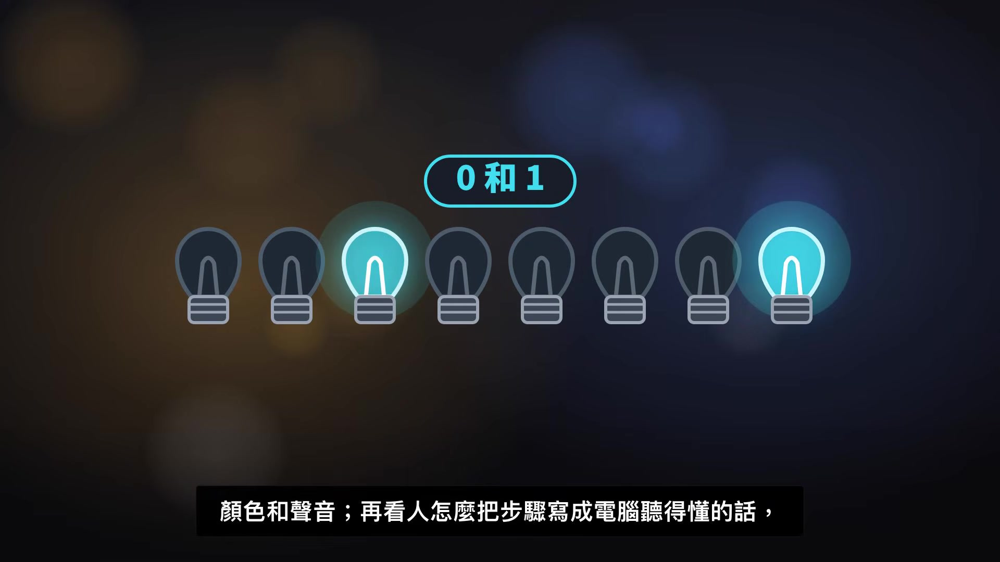

**逐字稿片段：** 再看人怎麼把步驟寫成電腦 聽得懂的話 又為什麼會出錯

**話題推測：** 闡述演算法與程式碼出錯的原因。

---

## 00:00:59

**逐字稿片段：** 最後看資料一多 電腦怎麼找東西 怎麼排東西 三段走完 我們再回來回答這個問題 我們先從課程介紹開始 CS50X 2025年版的網路課程

**話題推測：** 闡述電腦如何處理大量資料的搜尋與排序。

---

## 00:01:10

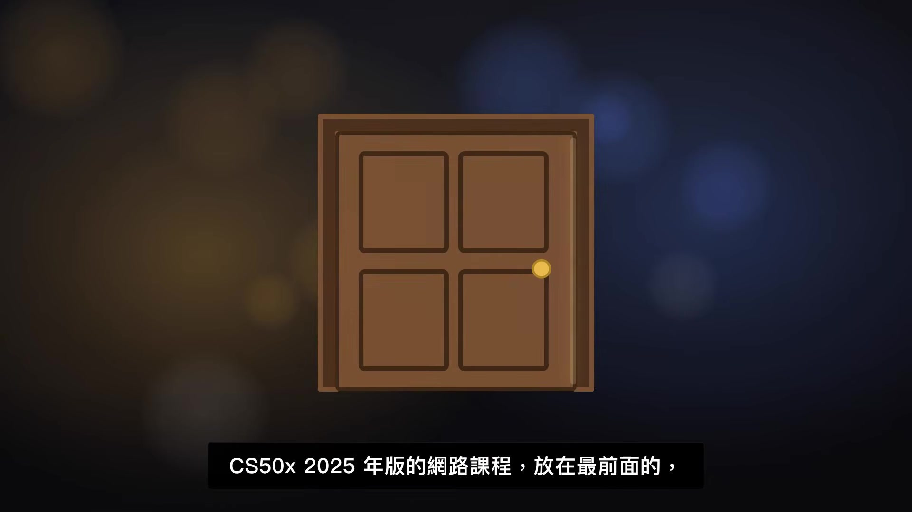

**逐字稿片段：** 放在最前面的是一支 一分多鐘的介紹影片 影片裡 Mallon站在一面木頭牆前面

**話題推測：** 提及CS50X 2025年版的介紹影片。

---

## 00:01:16

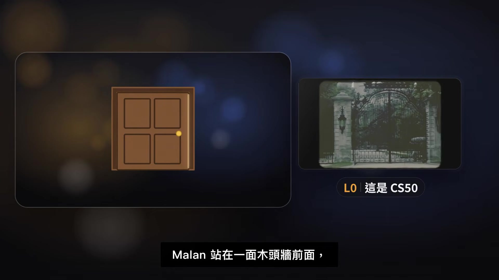

**逐字稿片段：** 第一句話是Hello World 這兩個英文字 是很多人學寫成事實 讓電腦印出來的第一句話 後面我們還會遇到他 接著他說

**話題推測：** 螢幕上顯示「Hello World」。

---

## 00:01:24

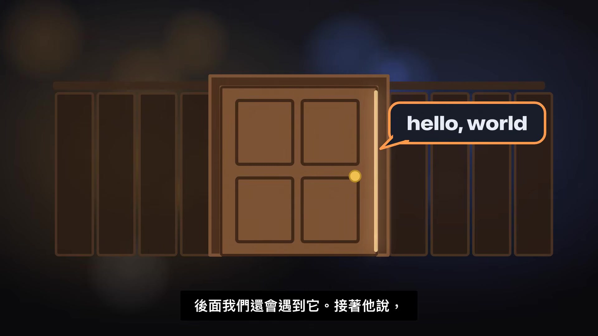

**逐字稿片段：** 這門課是給主修電腦的人 也給不主修的人 不管你對科技熟不熟 這門課都是為你開的 他也講了這門課要走到哪裡

**話題推測：** 說明CS50課程的適用對象。

---

## 00:01:32

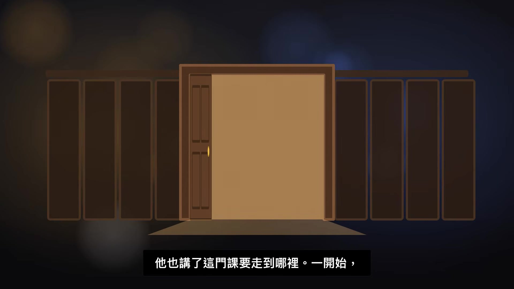

**逐字稿片段：** 一開始用一種拼積木的工具 叫Scratch 然後學C語言 看電腦最底層怎麼運作 之後換到Python學資料庫 最後做網頁和手機上的應用程式 我們這一集 只走前面那一小段 從積木走到C語言 再走到怎麼找東西 怎麼排東西 他在影片裡說 這門課想教的是三件事 想事情更有條理 說話更精準 用程式更有效率地解決問題 你會發現 這三件事都跟寫程式的工具無關 它們其實是同一件事 把一件事情想清楚 再一步一步說清楚 我們聽他自己怎麼開場

**話題推測：** 介紹課程學習路徑：從Scratch到C語言、Python、網頁與手機應用。

---

## 00:02:04

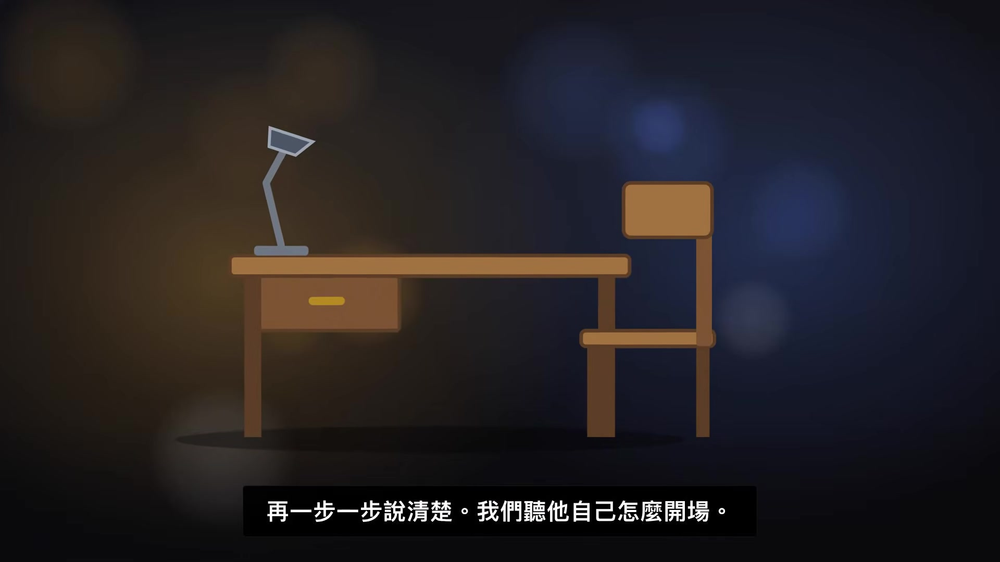

**逐字稿片段：** Hello world My name is David Malin and this is CS50 Harvard University's introduction 到了第一堂課 and the art of programming for majors and non-majors alike or more comfortable with technology 這個課程和電腦科學的課程 都實際上是適合你的 到了第一堂課 Melon先講自己的故事 她大一的時候其實很怕這門課 她覺得CS50是一門要小心的課 自己對電腦只是還算熟 所以大一選了政治系 到了隔年 她跟著朋友去上了這門課 那時候的老師就是Cunningham 她說她一踏進教室就迷上了 每個星期五晚上作業一公佈 她七八點就坐下來開始寫 她還放了一張照片 1996年她的第一份作業 那是一支最短最簡單的程式 結果還是被扣了兩分 他想說的是 每個人一路上都會犯錯 重要的不是跟同學比 是跟一開始的自己比

**話題推測：** 播放Mallon的課程開場白影片片段。

---

## 00:02:55

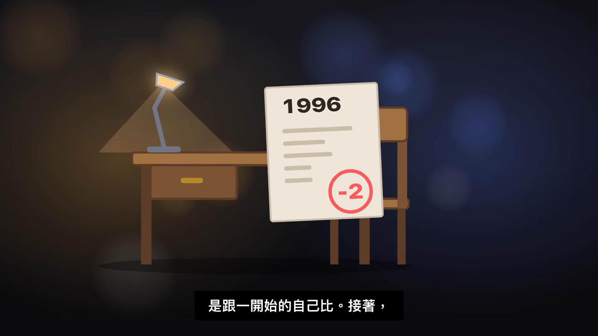

**逐字稿片段：** 接著他在大螢幕上畫了一張很簡單的圖 這張圖整門課都會一直回來 左邊一個箭頭叫輸入 右邊一個箭頭叫輸出 中間是一個黑盒子 輸入是你的問題 輸出是你要的答案 中間那個黑盒子 就是解決問題的過程 他說電腦科學說穿了 就是在研究這個黑盒子 可是在打開盒子之前 有一件事要先講好

**話題推測：** 繪製輸入、黑盒子、輸出的基本電腦運作圖。

---

## 00:03:15

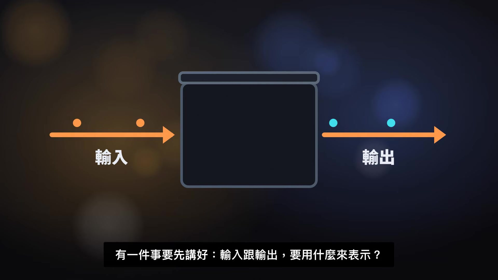

**逐字稿片段：** 輸入跟輸出要用什麼來表示 電腦裡面沒有字 開跟關 他的第一個答案 是從一隻手開始 他問全場 一隻手能數到幾 大部分人會說5 可是Mallon換了一種數法 每根手指不是算一個 而是隻看它舉起來 還是放下來 只舉食指算一種 舉食指和中指 又是另一種 每一種組合 都代表一個數字 這樣換下去 一隻手可以從0數到31 這種只用兩種狀態

**話題推測：** 提出問題：輸入與輸出如何表示？

---

## 00:03:41

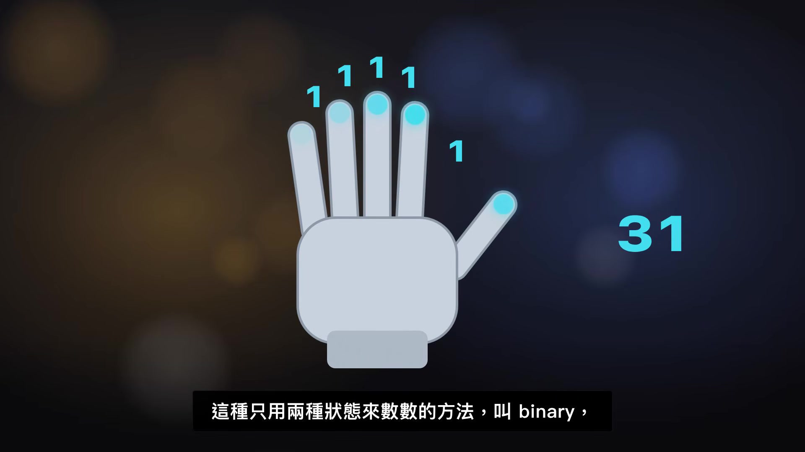

**逐字稿片段：** 來數數的方法 叫Binary 二進位 意思是每一格 只有兩種可能 0或1 一格叫一個Bit 中文叫位元 然後他從舞臺邊 拿起三顆真的燈泡 放在講座上 燈泡關的是0 開的是1 他說你的筆電和手機裡面 有很多很多這種小開關

**話題推測：** 介紹「Binary」二進位概念。

---

## 00:03:58

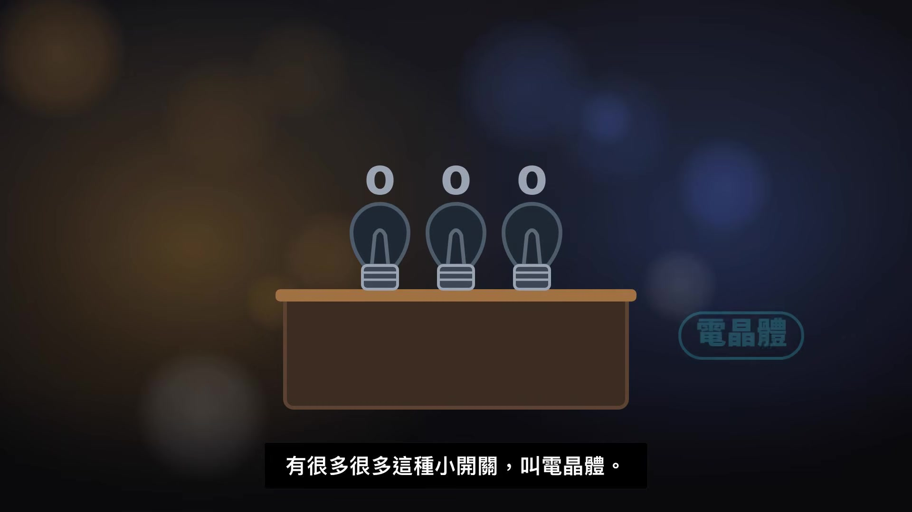

**逐字稿片段：** 叫電晶體 現在一顆晶片裡 有幾十億到上百億個 三顆燈泡 如果一顆量算一個 最多隻能數到3 可是用二進位的排法

**話題推測：** 提及晶片中的電晶體數量達數十億。

---

## 00:04:07

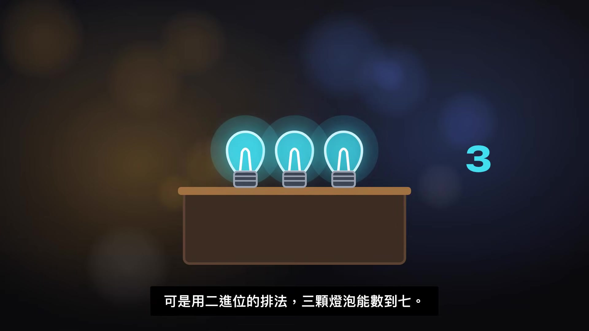

**逐字稿片段：** 三顆燈泡能數到7 他一顆一顆扭開燈泡 從0開始往上數 我們聽他數到最後那幾個 I would represent the number 4 This is how I would represent 5 This is how I would represent 6 And this as per the spoiler 剛才那幾下開關看起來像魔術 其實就是你小學學過的東西 123為什麼是123 因為最右邊是個位 中間是十位 左邊是百位 眉王左一格 那一格的分量就乘以10

**話題推測：** 解釋三顆燈泡以二進位方式可數到7。

---

## 00:04:46

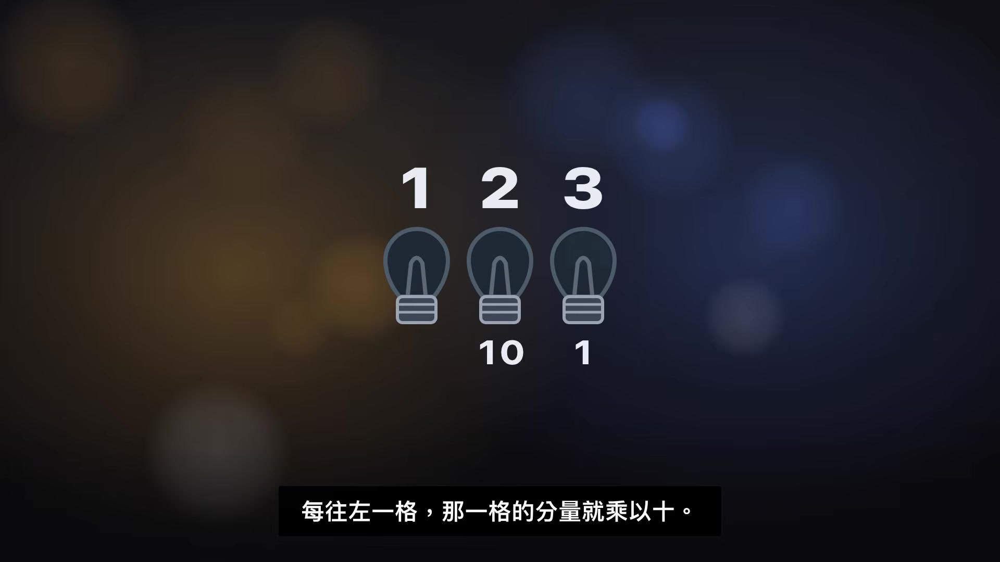

**逐字稿片段：** 電腦用的是同一套規則 只是它只有0和1兩個數字 所以每往左一格 分量是乘以2 1248 一路往上 三顆燈泡的分量是124 全部打開加起來 就是7相數到8 就要多一顆燈泡 也就是多一點記憶體 電腦習慣把 八個位元綁成一組 叫byte 中文叫位元組 八顆燈泡全部打開 加起來是255

**話題推測：** 說明二進位系統的位值概念（乘以2）。

---

## 00:05:08

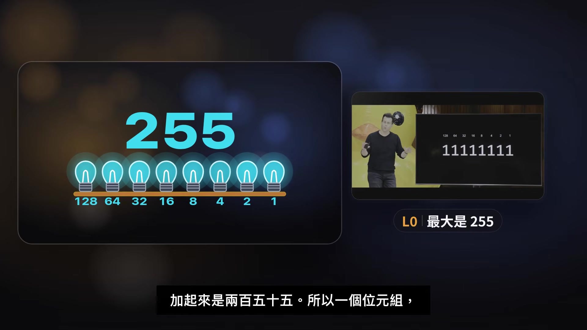

**逐字稿片段：** 所以一個位元組 可以表示從0到255 一共256種 你在電腦世界裡 常看到這兩個數字 就是從這裡來的 這一步很重要 後面會一直用到 一排燈泡能表示多少 是被燈泡的數量決定的 燈泡不夠多 數字就會不夠用 這句話 我們在後半段 會在一架飛機上再看到一次 數字有了

**話題推測：** 說明一個位元組可表示0到255共256種值。

---

## 00:05:29

**逐字稿片段：** 那文字呢 媽人問全場 要怎麼用零和一存下一個字母 有學生回答 給每個字母一個號碼 他說 這不只是正確答案 也是唯一的辦法 因為你手上只有零和一 大家約好 大寫的A是65 B是66 C是67 一路排下去 這張約定好的對照表

**話題推測：** 提出問題：電腦如何儲存文字？

---

## 00:05:46

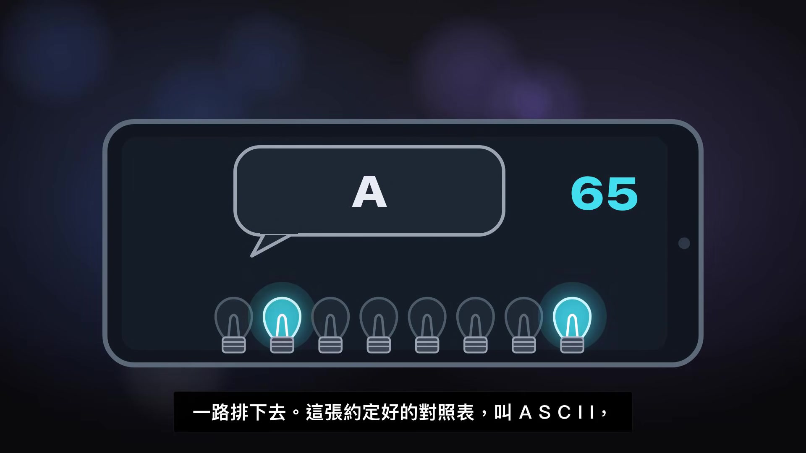

**逐字稿片段：** 叫ASCII 美國資訊交換標準碼 他在1963年定下來 每個字給7個位元 一共128個位置 剛好夠放英文字母 數字跟標點符號 然後他出了一題

**話題推測：** 介紹ASCII（美國資訊交換標準碼）對照表。

---

## 00:05:58

**逐字稿片段：** 如果你收到一則簡訊 裡面是三個數字 72 73 33 那是什麼 對照那張表 72是H 73是I 33是金碳號

**話題推測：** 提出解碼簡訊數字72 73 33的挑戰。

---

## 00:06:08

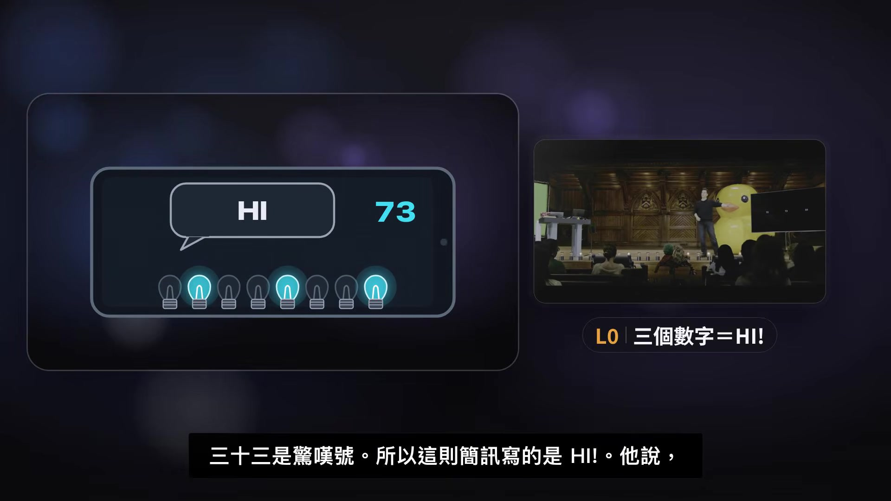

**逐字稿片段：** 所以這一則簡訊寫的是HI 他說你今天收到一則 全大寫的HI 手機背後真正收到的 就是三個位元組 手機很快把他們換成數字 再去那張表裡找 決定螢幕上要顯示哪個字 這裡有一個關鍵詞

**話題推測：** 螢幕顯示解碼後的文字「HI!」。

---

## 00:06:21

**逐字稿片段：** 叫約定 0和1本身沒有意思 是大家約好了 它才變成字 接下來 他把這個想法搬到舞臺上

**話題推測：** 強調電腦資料儲存中的「約定」概念。

---

## 00:06:28

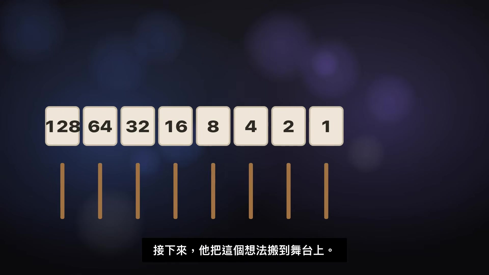

**逐字稿片段：** 他請八位學生上臺 站成一排 每個人手上拿一張紙 紙上寫著一個份量 從右到左 是1248 一直到128 手放下是0 舉起來是1 八個人合起來 就是一個未圓組 這個畫面很適合記住一件事 一個未圓組 不是什麼神秘的東西 它就是八個開關排在一起 每個人只負責一件事 舉手或不舉手 Mallon在熒幕上出題 臺上的人決定要不要舉手 臺下的同學負責把數字加起來 第一輪舉手的分量加起來是66 對照那張表是B 再一輪加起來是79 是O 最後一輪臺出來的是01 01 01 11 臺下開始算 這是多少 拼出來又是哪一個英文字 我們聽現場怎麼喊 請給我們一個掌聲 給我們的參賽者一個掌聲 臺上那個鞠躬 拼出來的是英文 可是全世界不只有英文 8個位元只有256種排法 放不下中文日文 也放不下各種帶重音的字母

**話題推測：** 邀請八位學生上臺，以舉手示範位元組表示文字。

---

## 00:07:37

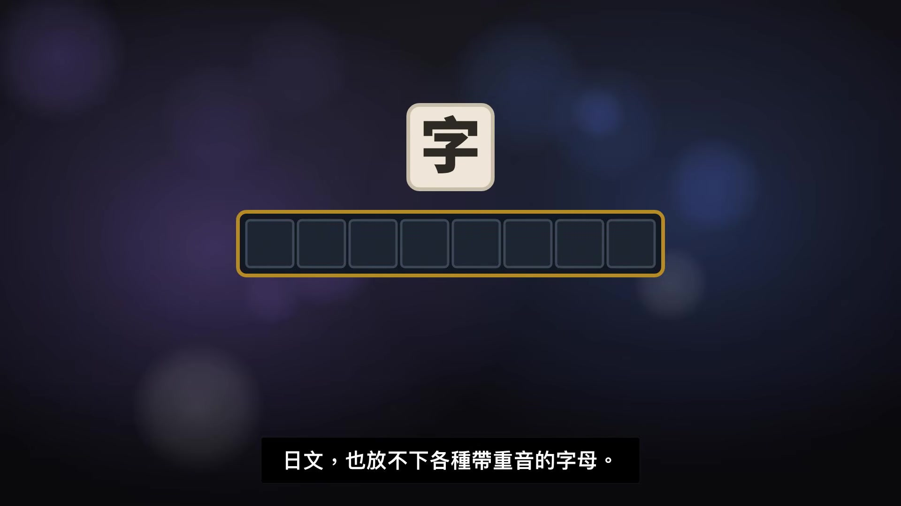

**逐字稿片段：** 所以後來有了新的約定叫Unicode 它跟ASCII相容 65還是A 但它給每個字更多位元

**話題推測：** 介紹Unicode標準碼，解決多國語言表示問題。

---

## 00:07:43

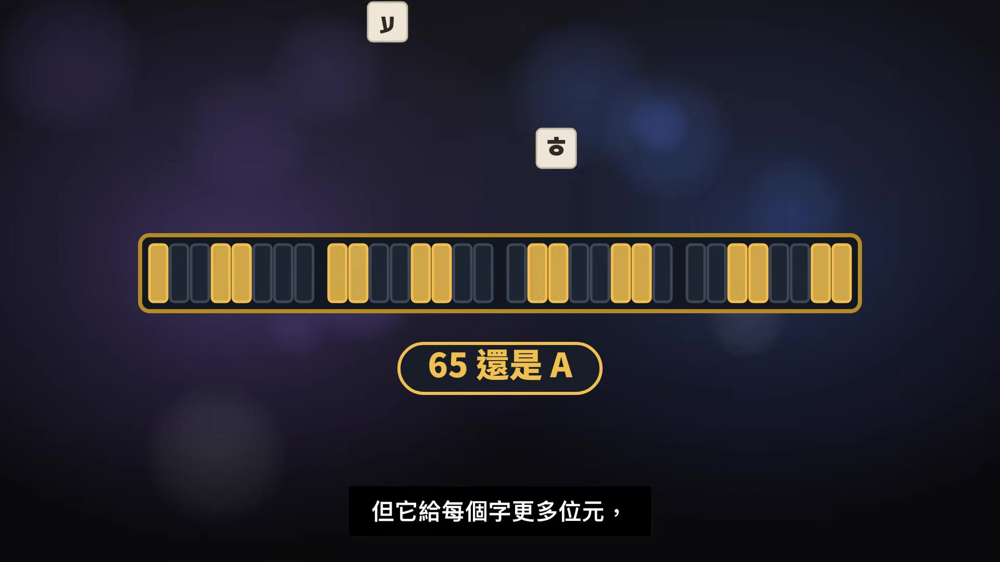

**逐字稿片段：** 最多可以用到32個位元 Unicode的目標 是把過去現在未來所有人類的文字 都收進來

**話題推測：** 說明Unicode最多可使用32個位元。

---

## 00:07:50

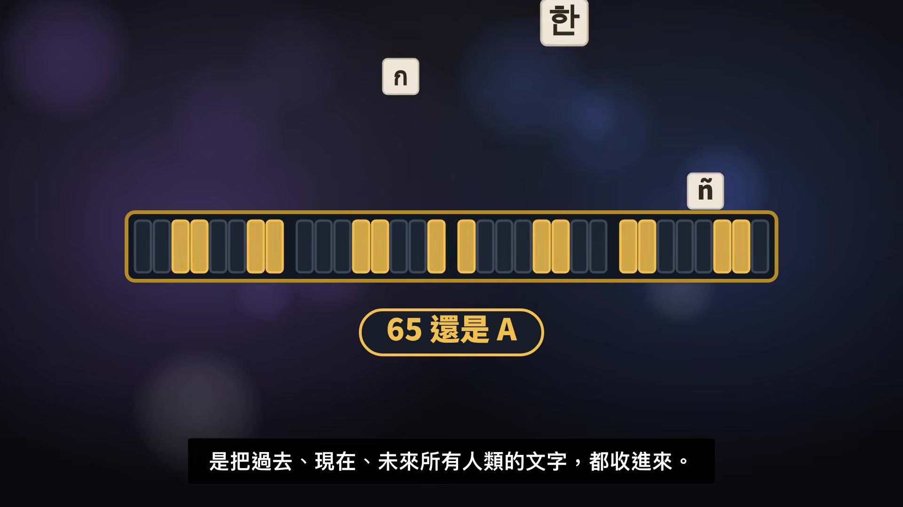

**逐字稿片段：** 現在它已經收了大約17萬個字 Marlon說emoji也在這張表裡 你傳出去的那張笑臉 對電腦來說 跟鍵盤上的一個字母 沒有兩樣 都是一個號碼 他問全場 全世界最常用的Emoji 是哪一個

**話題推測：** 提及Unicode已收錄約17萬個字元，包含Emoji。

---

## 00:08:02

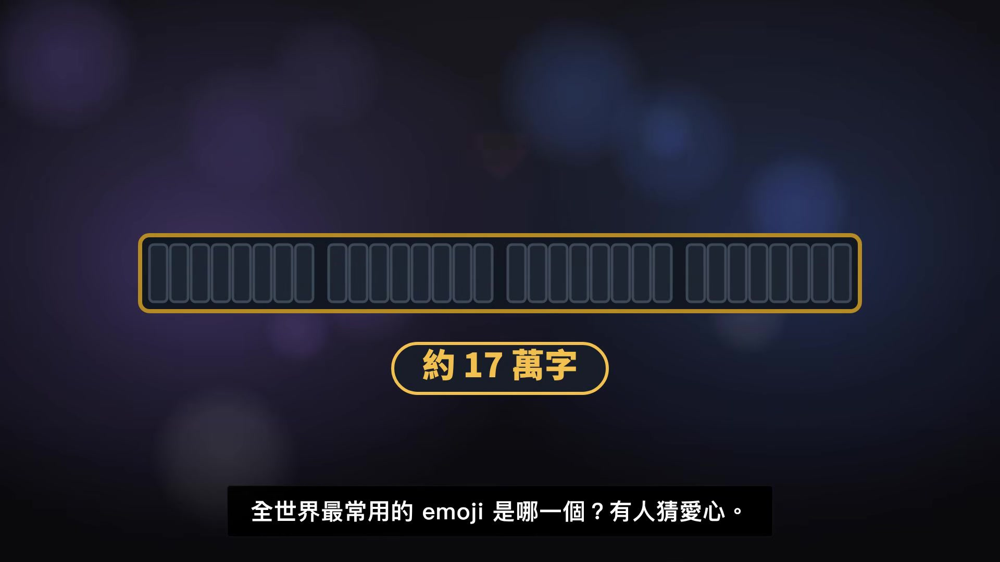

**逐字稿片段：** 有人猜愛心 答案是笑到流淚的那一張 Unicode聯盟統計過 2021年最常用的 就是他愛心牌在後面 還有一件事

**話題推測：** 揭示全球最常用Emoji為「笑到流淚」那張。

---

## 00:08:10

**逐字稿片段：** 你可能遇過 同一張笑臉 在朋友的手機上 長得不一樣 那是因為Unicode 只規定號碼 每家公司各自請人畫圖 號碼是約定 長相是各家的字型 文字講完

**話題推測：** 解釋Emoji在不同手機上顯示差異的原因。

---

## 00:08:22

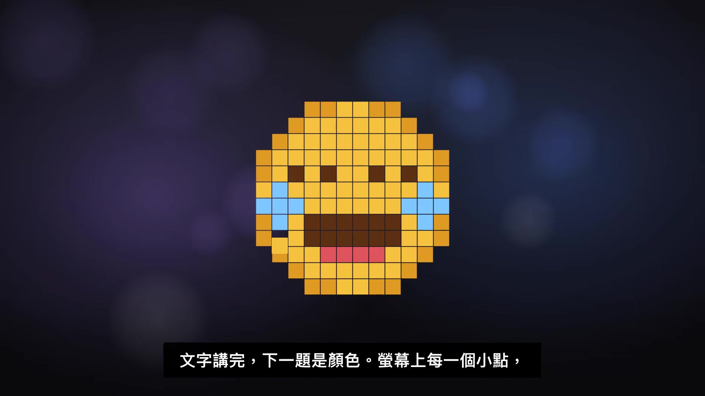

**逐字稿片段：** 下一題是顏色 螢幕上每一個小點叫像素

**話題推測：** 提出問題：電腦如何儲存顏色？

---

## 00:08:25

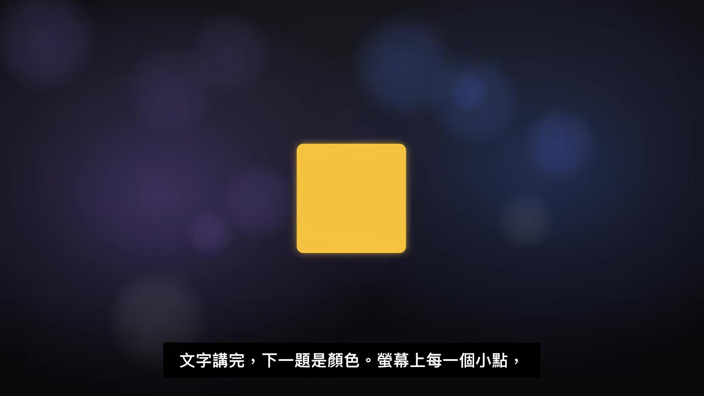

**逐字稿片段：** 你把臉貼進舊螢幕 就看得到一格一格的小方塊 每個像素通常用三個位元組 分別代表紅綠藍三種光有多亮 這叫RGB

**話題推測：** 介紹像素（Pixel）與RGB三原色模型。

---

## 00:08:35

**逐字稿片段：** 每一種光都是0到255 然後Mullen拿出剛才那三個數字

**話題推測：** 說明每種光顏色值為0到255。

---

## 00:08:39

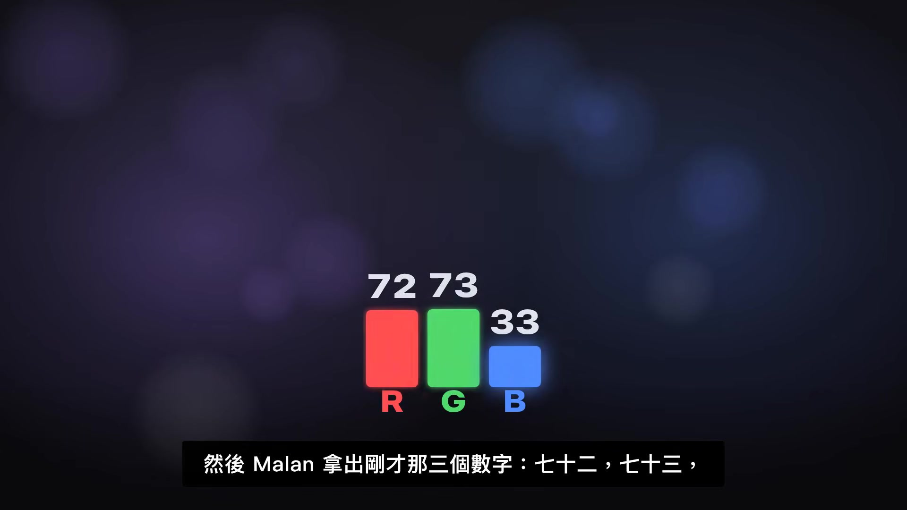

**逐字稿片段：** 72 73 33 如果把它們當成紅綠藍 會是什麼顏色 臺下有人猜白色紫色咖啡色

**話題推測：** 提出問題：數字72 73 33作為RGB會是什麼顏色？

---

## 00:08:47

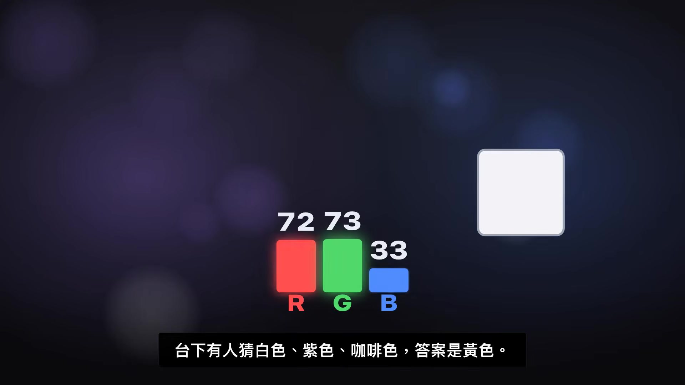

**逐字稿片段：** 答案是黃色 他把那張笑到流淚的emoji放大

**話題推測：** 螢幕顯示由72 73 33組成的黃色。

---

## 00:08:50

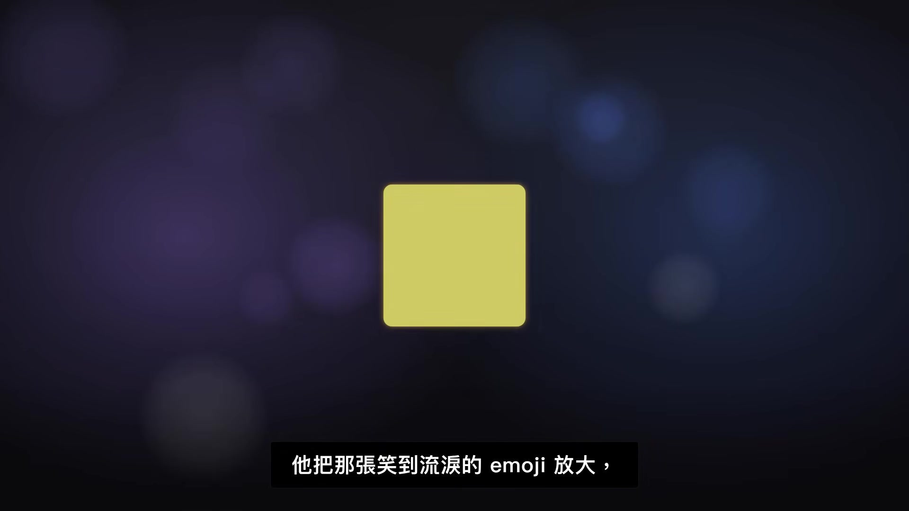

**逐字稿片段：** 一格一格的黃色 就是一組一組這樣的數字 照片懂了

**話題推測：** 放大哭笑Emoji，展示其像素由RGB數字組成。

---

## 00:08:54

**逐字稿片段：** 影片也就懂了 影片就像小時候玩的翻頁書 一張一張圖翻得夠快 眼睛就看成動作 聲音也可以約好 哪個數字代表哪個音 多大聲 持續多久 真正的錄音更細 是每秒記錄好幾萬次聲音的高低 最後他問

**話題推測：** 簡要說明影片與聲音的儲存原理。

---

## 00:09:09

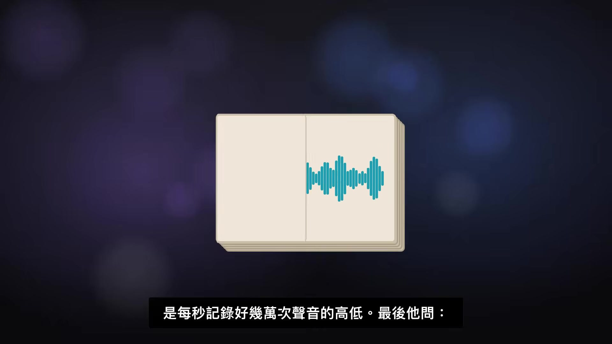

**逐字稿片段：** 同樣是72 73 33 電腦怎麼知道它是HI 是黃色 還是三個數字 答案是看情景 也就是看你用什麼程式打開它 用文字軟體打開 它是字 用修圖軟體打開 它是一個黃點 這是第一部分最重要的一句話 東西怎麼存 講完了 接下來 Mallon要問另一半的問題

**話題推測：** 提出問題：電腦如何判斷一串數字是文字、顏色還是純數字？

---

## 00:09:28

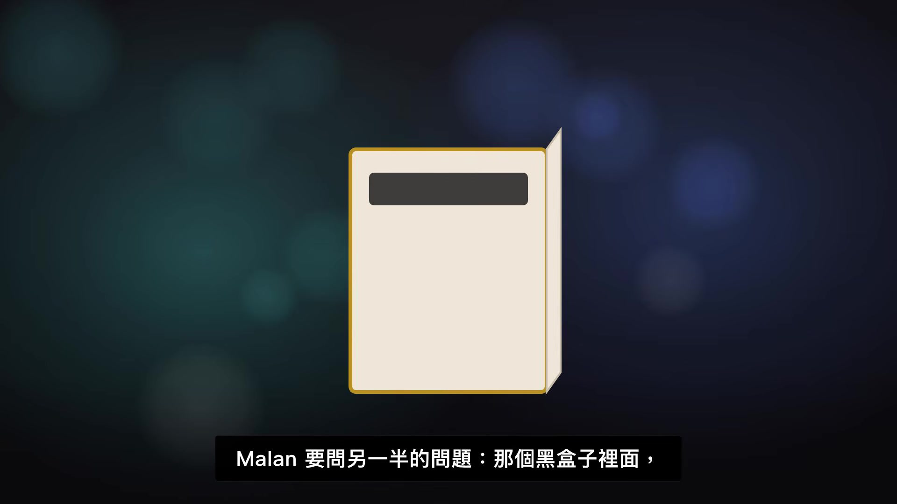

**逐字稿片段：** 那個黑盒子裡面 要怎麼解決問題 他先放了一段 1996年的上課錄影 畫面裡的老師是 Kernigan 他說演算法就是對 怎麼做一件事 非常精確的描述 關鍵知識精確 這個詞叫algorithm 演算法 說穿了 就是一份一步一步的做法 然後Mallon拿起一本 很厚的電話簿 電話簿是紙本的通訊錄 所有名字造字母排好 他要找一個叫 John Harvard的人 第一種找法 一頁一頁翻 這樣找得到 但很慢 一千頁最多要翻一千次 再來一種 兩頁 兩頁翻 快了一倍 可是有可能剛好跳過他那一頁 要記得翻過頭 就退回一頁 第三種找法 他直接翻到中間 看到的是M開頭的名字 J在M前面 所以John在左半本 接下來他做的是 就是這一講 最有名的畫面 我們聽他自己說 我們聽他自己說 Is he to the left or to the right? So what I can do literally 他把一千頁的電話簿,

**話題推測：** 進入第二部分核心問題：黑盒子內如何解決問題？

---

## 00:10:34

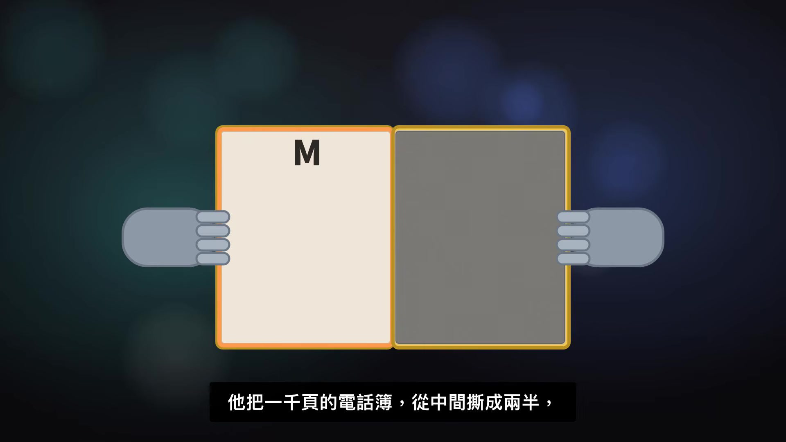

**逐字稿片段：** 從中間撕成兩半, 把右半本丟掉, 剩下的五百頁還是同一個問題, 只是小了一半, 他再翻到中間, 再判斷, 再撕一次, 一直撕下去, 最後只剩一頁, 要嘛John就在這頁, 要嘛他根本不在這本電話簿裡, 那一千頁要撕幾次?大約十次。 接著他問

**話題推測：** Mallon示範將電話簿撕成兩半的二分搜尋法。

---

## 00:10:52

**逐字稿片段：** 如果明年隔壁鎮的電話部 也合並進來 變成2000頁呢 一頁一頁翻 時間也跟著變兩倍 兩頁兩頁翻 一樣變兩倍 撕兩半的方法 只多一次 因為第一刀撕下去 2000頁就變回1000頁 接下來就是原本的故事

**話題推測：** 假設電話簿頁數增加到2000頁，比較三種搜尋法的效率。

---

## 00:11:06

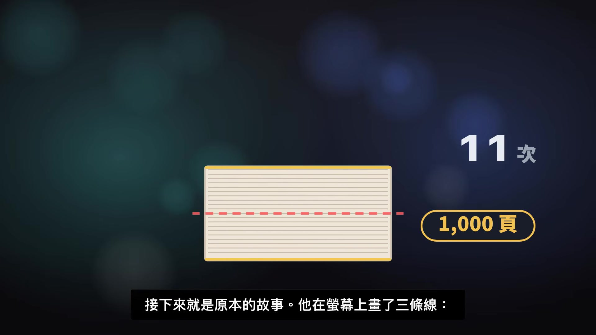

**逐字稿片段：** 他在熒幕上畫了三條線 一頁一頁翻 是一條很陡的直線 兩頁兩頁翻 是比較平的直線 撕兩半 則是一條越走越平的彎線 資料越多 差距越大 所以一個好的做法

**話題推測：** 繪製圖表比較不同搜尋方法的效率曲線。

---

## 00:11:18

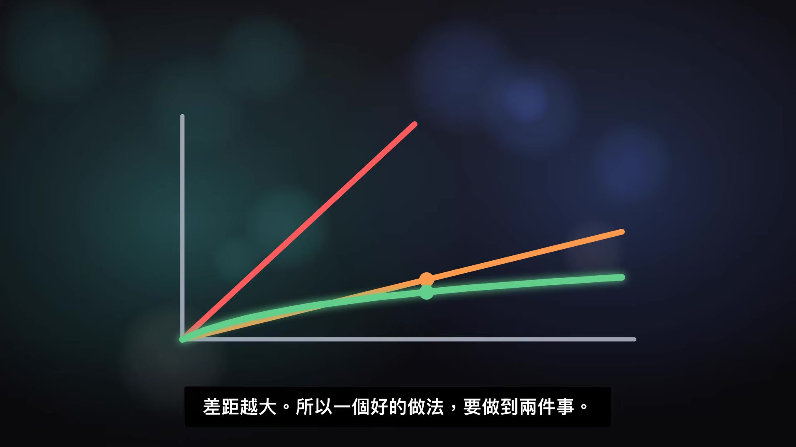

**逐字稿片段：** 要做到兩件事 一是要對 也就是正確 再來是要快 也就是設計得好 兩頁翻 快是快 可是如果不記得 退回一頁就不正確 這兩個標準 整門課都會一直拿出來用 撕電話簿的方法 沒有人接著把它寫成 一張步驟清單 這種用自己的畫 簡短又精確地 寫下步驟的東西

**話題推測：** 定義「好的演算法」需具備「正確」與「有效率」兩大原則。

---

## 00:11:36

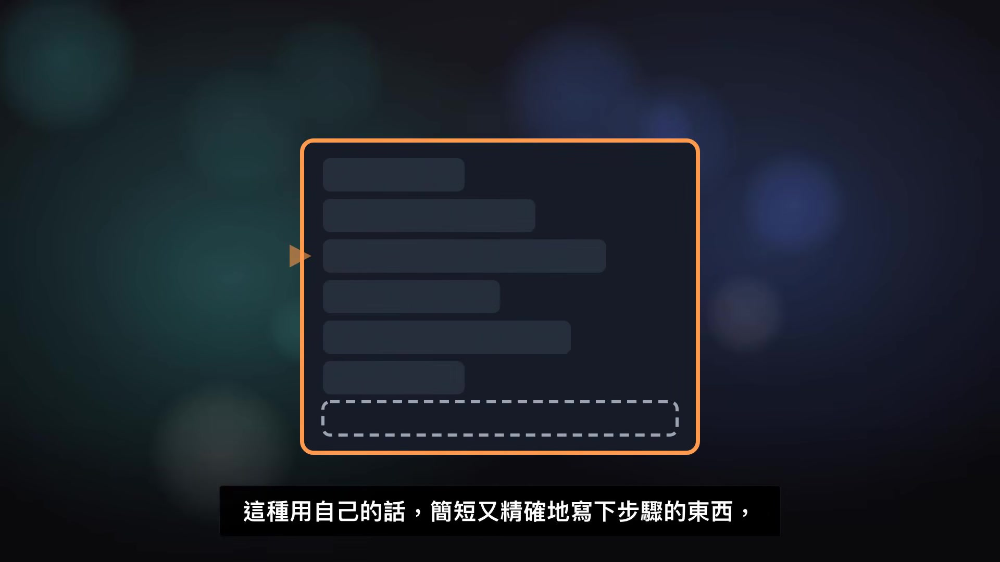

**逐字稿片段：** 叫虛擬碼 它不是真的程式 但已經長得很像了 清單大概是這樣 拿起電話簿 翻到中間 看這一頁 如果人在這頁 就打電話給他 如果他在前面 就翻到左半本的中間 回到看這一頁那一部 如果他在後面 就翻到右半本的中間 一樣回去 不然就停下來 他特別問 為什麼要寫最後那個不然 因為還有一種情況 他不在這一頁 不在前面 也不在後面 他根本不在電話簿裡 Manon說 你的手機或電腦 突然當機 常常就是寫程式的人 沒想到某一種情況 從這張清單 他整理出幾種 最基本的零件 像拿起 翻開 打電話

**話題推測：** 介紹「Pseudocode」（虛擬碼）概念與電話簿搜尋範例。

---

## 00:12:12

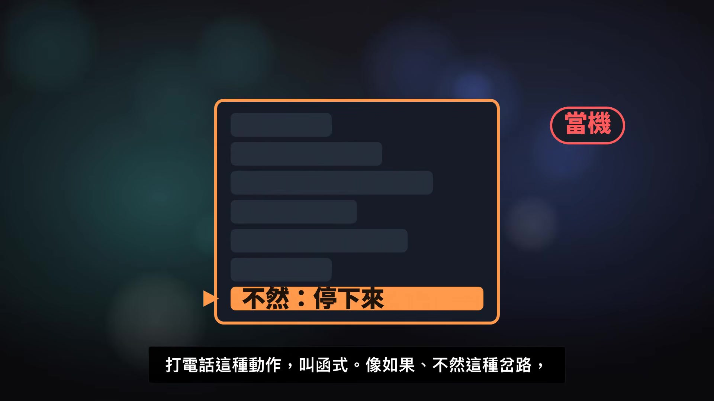

**逐字稿片段：** 這種動作 叫含釋 像如果不然這種插入

**話題推測：** 解釋「Function」（函式）為基本動作零件。

---

## 00:12:15

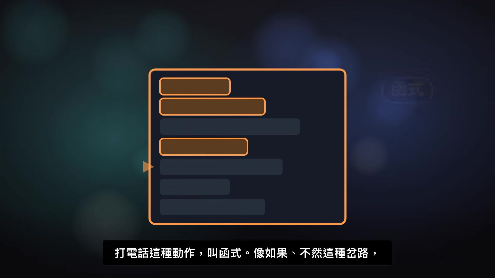

**逐字稿片段：** 叫條件 條件裡那個是或不是的問題 答案只有真或假

**話題推測：** 解釋「Conditional」（條件）為程式邏輯判斷零件。

---

## 00:12:19

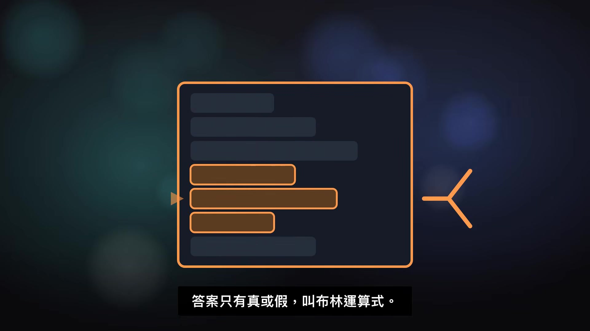

**逐字稿片段：** 叫布林運算式 至於回到前面那一步 一直重複 叫回圈 之後不管學哪一種程式語言 都是這幾種零件在排列組合 這幾種零件用文字寫 對初學者來說 很容易被標點符號絆倒 所以第一週

**話題推測：** 解釋「Boolean Expression」（布林運算式）為真假判斷零件。

---

## 00:12:31

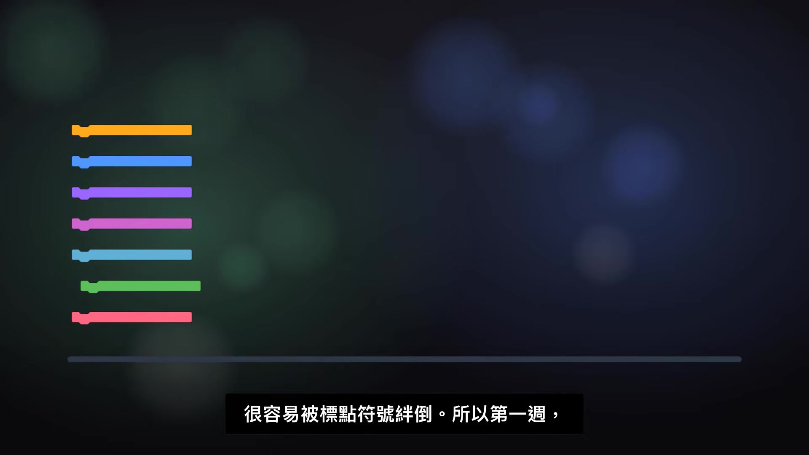

**逐字稿片段：** Melon先用Scratch Scratch是麻省理工學院媒體實驗室 在2007年推出的工具 寫程式的方式是拖拉一塊 一塊的拼圖積木 只有合邏輯的積木才拼得上 畫面右上角有一隻貓 他拖了兩塊積木 當綠色旗子被點下去

**話題推測：** 介紹Scratch視覺化程式設計工具。

---

## 00:12:47

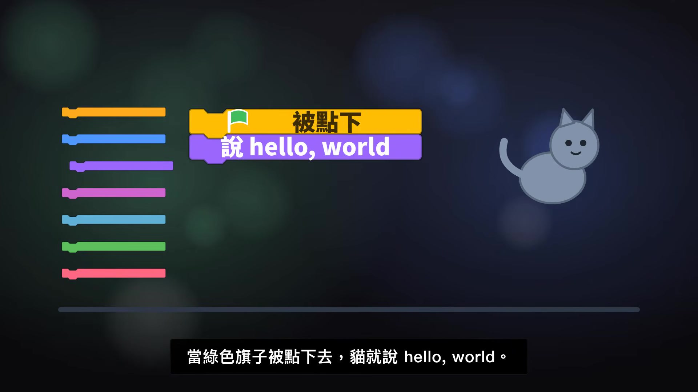

**逐字稿片段：** 貓就說Hello World 按下旗子 貓真的冒出一個對話框 接著他要貓叫三聲 他先把喵的積木拖三次 疊在一起 貓確實叫了三聲 答案是對的 可是Melon說 這個設計不好 只要你在城市裡一直複製貼上 你很可能再做一件笨事 因為修改了一處 就會忘了修改另一處 比較好的做法

**話題推測：** 示範Scratch積木程式「Hello World」。

---

## 00:13:07

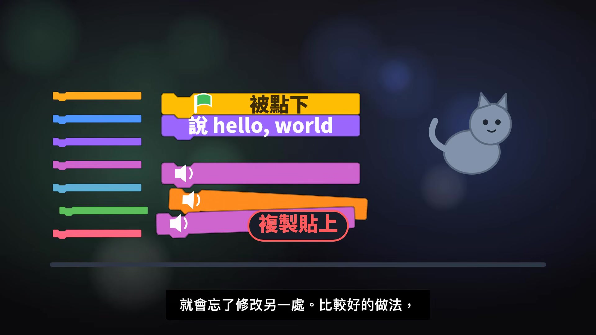

**逐字稿片段：** 是用重複三次的積木 把它包起來 這就是迴圈 再進一步 他自己做了一塊新積木 名字就叫喵 之後只要用這一塊 不用再管它裡面怎麼做 這種把細節包起來 只叫它名字的做法

**話題推測：** 示範使用Scratch迴圈積木優化「喵」三次的程式碼。

---

## 00:13:19

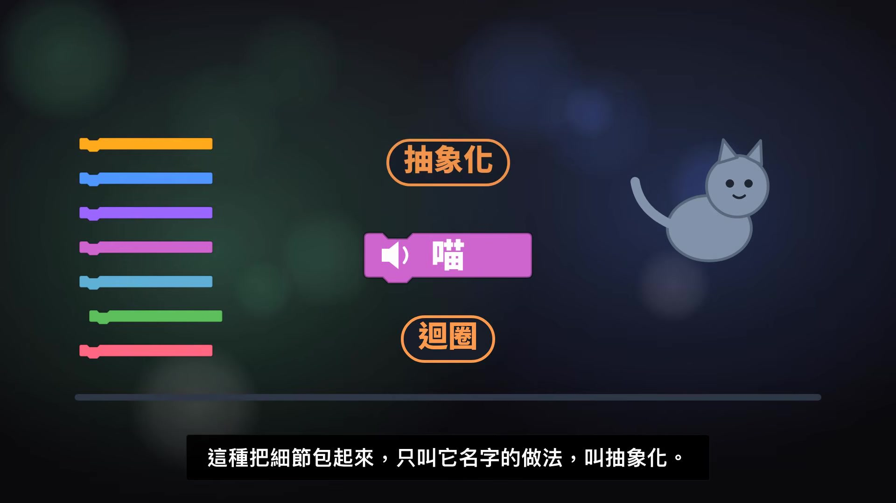

**逐字稿片段：** 叫抽象化 課堂 最後兩位學生上臺

**話題推測：** 介紹「Abstraction」（抽象化）概念，將細節打包成積木。

---

## 00:13:22

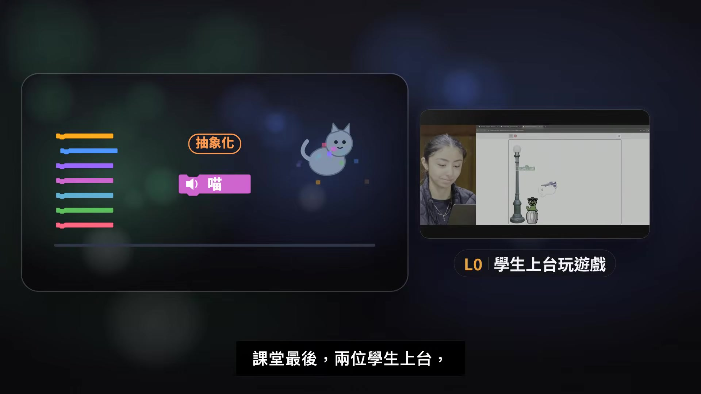

**逐字稿片段：** 玩了用Scratch 做出來的小遊戲 現場一陣歡呼 第一堂課到這裡 我們先停下來

**話題推測：** 兩位學生上臺示範玩Scratch遊戲。

---

## 00:13:27

**逐字稿片段：** 把答案收起來 電腦裡面只有開根關 也就是0和1 一個0或1叫位元 八個位元叫位元組 光靠這些 電腦存不了任何有意思的東西 要靠人跟人之間的約定 約好65是A 它就是文字 約好三個數字是紅綠藍 它就是顏色 約好一秒翻幾十張圖 它就是影片 同一串零和一 意思看你用什麼程式打開 這是第一部分的前半句 後半句是 要解決問題靠的是一步一步 而且精確的步驟也就是演算法 好的演算法要正確也要有效率 像失電話簿那樣 資料多一倍 只多一步 如果只能記一句 就記這句 電腦不懂意思 它只認得零和一 是人的約定和步驟 讓它看起來像在想事情 可是這裡馬上冒出下一個問題 失電話簿的步驟是用英文寫在頭影片上的 電腦看不懂英文 它只看得懂0和1 那這些步驟要怎麼寫給電腦聽 這就是下一堂課的開場

**話題推測：** 第一堂課內容總結。

---

## 00:14:18

**逐字稿片段：** 到了下一堂課 Melon一開場就說 上週用積木學到的想法 今天全部換成文字

**話題推測：** 第二堂課開場，介紹從Scratch積木到C語言文字程式碼。

---

## 00:14:24

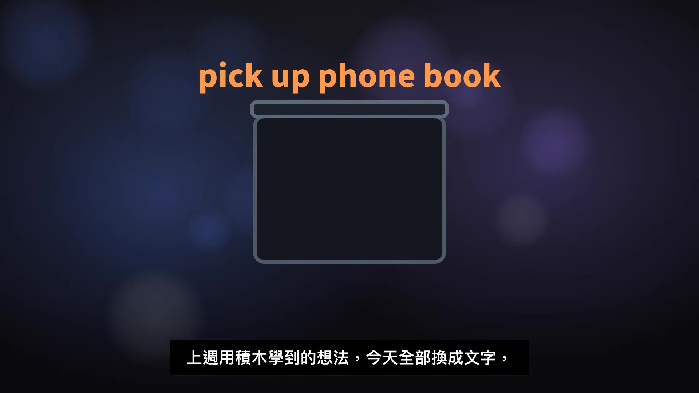

**逐字稿片段：** 語言是C 人寫的這種文字 叫原始碼 它有點像英文 但不是英文 問題是 電腦看不懂原始碼 它只看得懂0和1

**話題推測：** 介紹「Source Code」（原始碼）概念，以C語言為例。

---

## 00:14:32

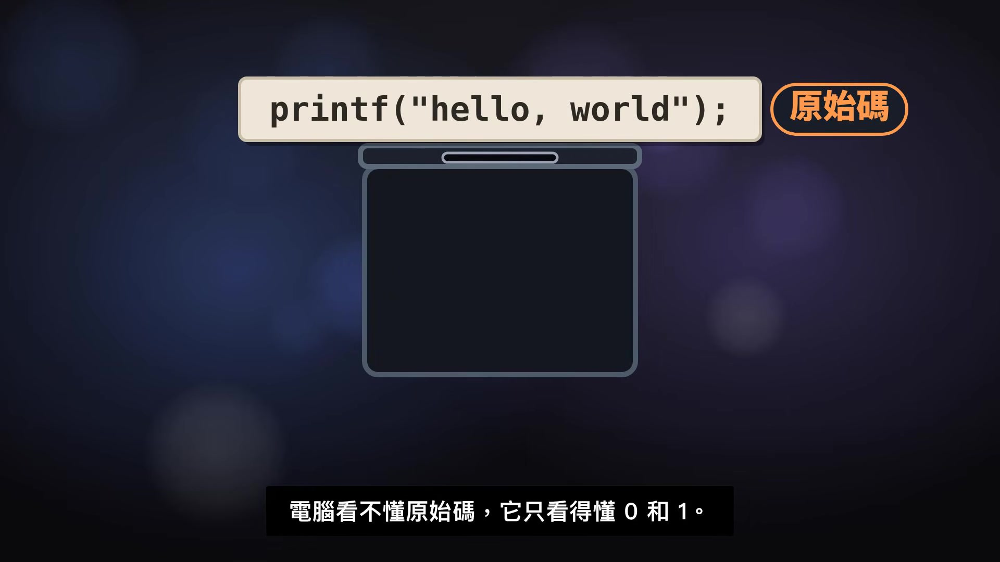

**逐字稿片段：** 這種給電腦看的0和1 叫機器碼 中間總得有人翻譯

**話題推測：** 介紹「Machine Code」（機器碼）概念。

---

## 00:14:37

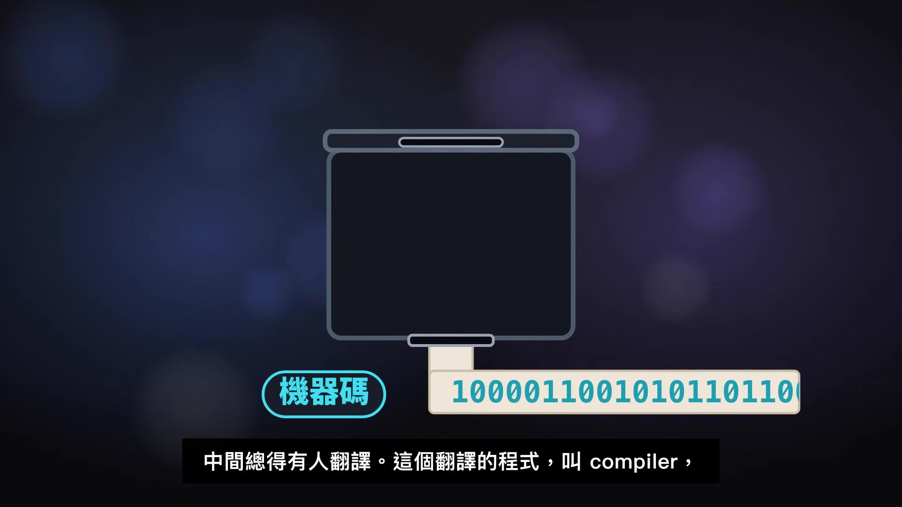

**逐字稿片段：** 這個翻譯的程式叫Compiler 編譯器 你可以把它想成一位翻譯官 你用中文寫好一份合約 翻譯官把它整份翻成對方看得懂的語言 合約只要有修改 就要再送去翻譯一次 程式也一樣 原始碼有修改 就要重新編譯 第一堂課那張圖

**話題推測：** 介紹「Compiler」（編譯器）作為原始碼到機器碼的翻譯官。

---

## 00:14:53

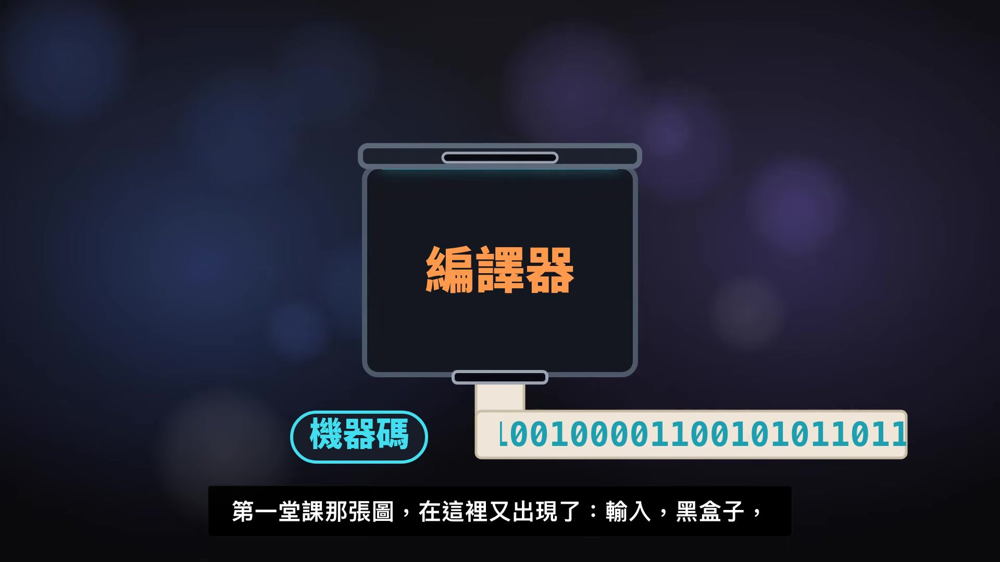

**逐字稿片段：** 在這裡又出現了 輸入 黑盒子 輸出 這裡的輸入是原始碼 輸出是機器碼 黑盒子就是編譯器 他寫的第一支C程式 只做一件事

**話題推測：** 重新展示輸入、黑盒子、輸出的圖，並將原始碼與機器碼代入。

---

## 00:15:03

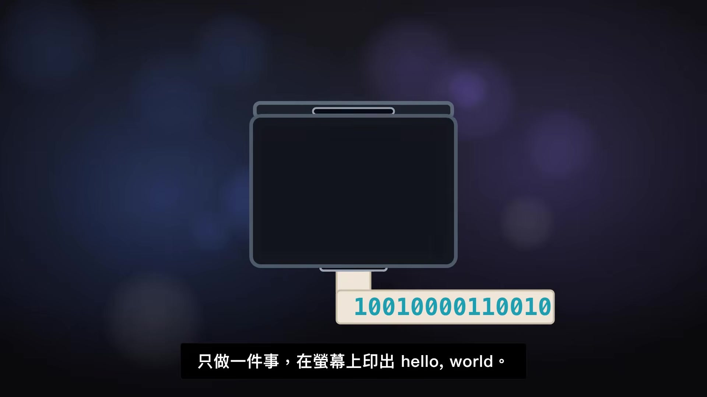

**逐字稿片段：** 在熒幕上印出Hello World

**話題推測：** 展示第一支C語言程式「Hello World」的程式碼。

---

## 00:15:04

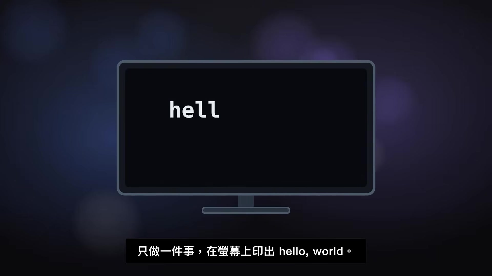

**逐字稿片段：** 印東西用的指令叫Printf C語言 大約1972年在貝爾實驗室誕生 Hello World最早出現在克尼肯寫的教學裡 後來他和Richie在1978年出了那本 C語言的書 從此很多人學程式的第一行都是他 Mullen 1996年被扣兩分的 就是這樣一支程式 印出Hello World之後

**話題推測：** 介紹C語言的「Printf」指令。

---

## 00:15:23

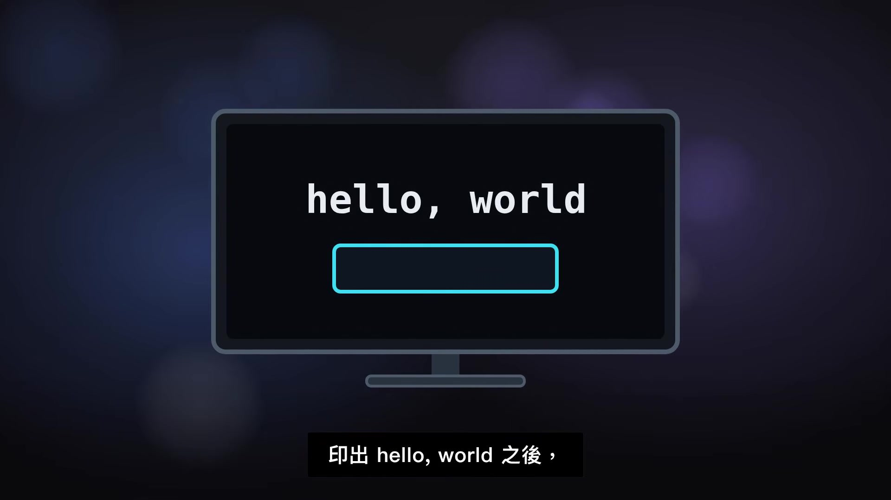

**逐字稿片段：** Mullen讓程式開口問你的名字 再跟你打招呼 這裡出現兩個新東西

**話題推測：** 展示C程式碼如何詢問並回應使用者姓名。

---

## 00:15:27

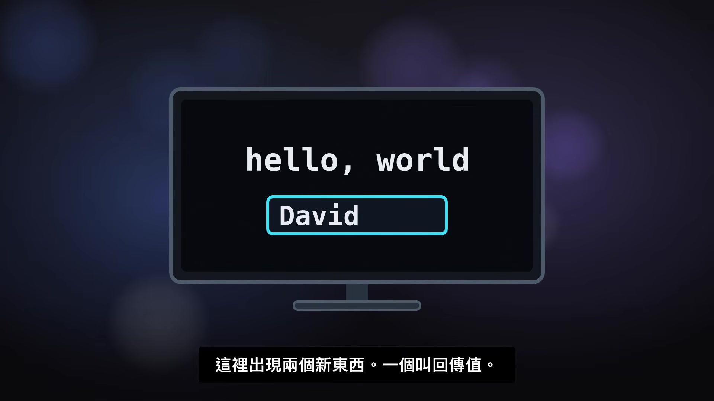

**逐字稿片段：** 一個叫回傳值 有些指令不是在熒幕上做事 而是做完之後第一個結果給你 像問名字啊 這個指令會把你打的名字交回來 另一個叫Variable變數

**話題推測：** 介紹「Return Value」（回傳值）概念。

---

## 00:15:37

**逐字稿片段：** 要接住那個名字 得先準備一個地方放它 這個地方就是變數 C語言比Scratch挑剔 它要你先講清楚 這個變數裝的是文字還是整數 因為對電腦來說 那一串零和一本身分不出是字還是數字 這是第一堂課講過的約定 接著它講條件 跟Scratch的 如果積木是同一件事 只是改成文字寫 這裡有一個小地方 很多人會被絆倒 在C語言裡

**話題推測：** 介紹「Variable」（變數）概念，用於儲存資料。

---

## 00:16:00

**逐字稿片段：** 一個等號的意思 是把右邊的值放進左邊 所以要問兩個值是不是相等 得寫成兩個等號 馬冷說 這是幾十年前的人 把自己逼到牆角的結果 到了講迴圈的時候

**話題推測：** 解釋C語言中單等號「=」（賦值）與雙等號「==」（相等判斷）的差異。

---

## 00:16:10

**逐字稿片段：** 他拿出一個透明的塑膠碗 裡面裝著三顆紅色的紓壓球 我們聽他怎麼介紹這個碗 碗是變數 碗裡的球數 就是它的值 現在是3 Melon要讓程式喵三聲 做法是這樣 先看碗裡還有沒有球 如果有就喵一聲

**話題推測：** Mallon拿出一個裝有三顆紓壓球的碗，示範迴圈概念。

---

## 00:16:46

**逐字稿片段：** 然後拿出一顆 再看一次 還有再喵一聲 再拿一顆 拿到碗空了 條件不成立 迴圈就停下來 這個每一圈都回頭 檢查一次的動作 就是迴圈真正在做的事 他自己也笑說 不知道這有沒有比 用手指倒數好 但至少有碗也有球 迴圈寫錯也會出事 如果那個條件永遠成立 貓就會一直喵下去 停不下來

**話題推測：** Mallon示範如何用碗和球來模擬迴圈的執行過程。

---

## 00:17:08

**逐字稿片段：** 這叫無限迴圈 這時候 鍵盤上的Ctrl加C 可以把失控的程式強制停下來 到這裡 C語言跟Scratch 已經用了同一套零件 函式啊 條件啊 迴圈啊 變數啊 Mallon說 新的只是寫法 想法都一樣 後來他用迴圈 在熒幕上畫出

**話題推測：** 介紹「Infinite Loop」（無限迴圈）的錯誤情況。

---

## 00:17:24

**逐字稿片段：** 超級瑪利歐遊戲裡的磚塊 一列一列 一格一格印出來 他還留下一句很實在的話 寫程式很大一部分 就是不要相信隔天早上的自己 所以要把重要的數字 取個名字固定下來 也要寫註解提醒自己 可是寫得再小心 有一種錯 跟寫法沒有關係

**話題推測：** 展示如何使用迴圈在螢幕上繪製超級瑪利歐的磚塊。

---

## 00:17:40

**逐字稿片段：** 他藏在格子的大小裡 那一堂課快結束的時候 馬蘭寫了一個小計算機

**話題推測：** 提出問題：程式錯誤可能與資料儲存格大小有關。

---

## 00:17:45

**逐字稿片段：** 順便玩了一個 網路上的流行梗 梗是這樣的 給你一筆錢 你可以直接拿走 也可以把它翻倍 交給下一個人 馬蘭把它寫成程式 從一塊錢開始 每按一次Y 錢就翻一倍 12 48 16 一直按下去 很快就上千上百萬 最後到了十億多 他一邊按 一邊問臺下 換成是你 翻到多少錢會停下來 把錢拿走 這是一個很有意思的社會問題 這一段沒有任何新指令 用的全是前面學過的東西 一個變數裝錢 一個迴圈一直問一個條件判斷 你按的是不是Y 程式本身沒有寫錯 每一步都是乘以2 照理說 數字應該會一直變大 可是按到某一下 螢幕上的數字突然變成負的 再按變成0 我們聽現場那一刻 越來越大 在這個C系列上 都看起來是非常大 但是我的天啊 好像 社群網站的故事 太短了 因為後來 它變成是零 然後變成零 這裡到底 怎麼回事 錢為什麼會變成 負的 臺下有學生答對了 位元不夠用 第一部分那句話 在這裡拍上用場 一排燈泡能表示多少 是被燈泡的數量決定的 C 語言的整數 通常只給32個位元 32個位元

**話題推測：** Mallon示範一個網路流行梗：錢財翻倍遊戲，以計算機顯示數字。

---

## 00:19:07

**逐字稿片段：** 最多隻能數到正的21億多 再加上去 就沒有下一個位元可以進位了 數字整個繞回去 這叫integer overflow

**話題推測：** 說明32位元整數最大值為21億多。

---

## 00:19:14

**逐字稿片段：** 整數意味

**話題推測：** 介紹「Integer Overflow」（整數溢位）概念。

---

## 00:19:16

**逐字稿片段：** 你可以想象一臺機車的里程錶 只有5格 騎到99999公里 再騎1公里 它不會變成10萬 它會跳回0 格子的數量固定 滿了就繞回原點 至於為什麼先變負的 是因為整數里有一個位元 被拿來表示正負號 繞過頭就落到負的那一邊 Mullen換成更大的整數

**話題推測：** 以機車里程錶歸零類比整數溢位現象。

---

## 00:19:34

**逐字稿片段：** 給它64個位元 心想這下世界上沒有這麼多錢了 他說我可以按一整天 結果沒按多久 又意味了 他小聲說 我沒想到這麼快啊 換大一點的格子 只是把出事的那一天往後延 如果這件事只發生在一個玩笑城市裡 倒還好 可是Mallon接下來唸了一份真實的文件

**話題推測：** Mallon嘗試使用64位元整數，但仍發生溢位。

---

## 00:19:51

**逐字稿片段：** 主角是一架飛機 這份文件來自美國聯邦航空總署 2015年 他們發出一份指令 波音787

**話題推測：** 引用一份真實文件，講述波音787因溢位問題需定期重開機。

---

## 00:20:00

**逐字稿片段：** 如果連續通電248天 四個發電機控制單元可能同時進入保護模式 整架飛機會失去全部的交流點 不管它在地面還是在空中 原因跟剛才的前一模一樣 控制單元裡有一個軟體計數器 數到248天 就會意味官方文件沒寫 它怎麼數 用算的 剛好對得上一個32位元的整數 每1%秒加1

**話題推測：** 提及波音787連續通電248天會失去交流電。

---

## 00:20:20

**逐字稿片段：** 可以數248天多一點 Mallon在課堂上說是1%秒 推算起來應該是1%秒 那軟體還沒更新之前 要怎麼辦 Mallon問臺下 有人答出來了 重開飛機 規定是航空公司每120天以內 要把整架飛機斷電 再重新開機 他說 這就跟我們這些年被教的一樣 電腦或手機怪怪的 就關機重開 重開機 會把所有技術器歸回原點 等於讓里程錶重新重臨開始 後來在2018年 新的指令改成 要航空公司更新控制單元的軟體 你會發現 這不是誰算錯了 是當初給的格子 沒有想到要用這麼久 同一堂課 Melon又舉了一個比較輕鬆的例子 來自很多人小時候玩過的遊戲

**話題推測：** 說明飛機計數器每百分之一秒加1。

---

## 00:21:01

**逐字稿片段：** 1980年 南夢宮推出街機遊戲小精靈 英文叫Pegman 你操縱一個黃色的圓臉 在迷宮裡吃豆子 躲開四隻鬼 每吃完一關 就進到下一關 這個遊戲 把關卡數存在一個位元組裡 一個位元組是八個位元 第一部分算過 最多表示到255 做遊戲的人大概覺得 這已經非常多了 不會有人玩到那麼後面 可是真的有人玩到了 那些玩家 一關一關塔上去 打到了連做遊戲的人 都沒想到的地方 這跟波音飛機是同一件事 只是格子更小 這次不是32個位元

**話題推測：** 引用1980年小精靈（Pegman）遊戲作為溢位案例。

---

## 00:21:32

**逐字稿片段：** 是8個 到了第256關 數字意味 畫底部水果的那段城市 就一路畫過了頭 我們聽馬蘭怎麼說 那些玩到這一關的人 Equals equals 255 You win 你就贏了

**話題推測：** 說明小精靈遊戲在第256關因溢位導致畫面亂碼。

---

## 00:22:09

**逐字稿片段：** 畫面的右半邊變成一堆亂碼和水果 豆子永遠吃不完 這一關就永遠過不去 整數有意味的問題

**話題推測：** 展示小精靈遊戲第256關的「殺戮畫面」（kill screen）。

---

## 00:22:17

**逐字稿片段：** 那小數呢 Marlan要電腦算1除以3 第一次螢幕印出來是0 因為整數除以整數 結果還是整數 小數點後面直接丟掉 不是四捨五入 他告訴電腦 把他當成小數來算

**話題推測：** 提出問題：小數在電腦中如何運作？

---

## 00:22:29

**逐字稿片段：** 這次印出0.33333 看起來沒問題 接著他用電腦

**話題推測：** 電腦以小數計算1除以3，印出0.33333。

---

## 00:22:33

**逐字稿片段：** 印到小數點後面50位 照小學數學 應該是一整排的3 結果熒幕上 前面幾位是3 後面卻冒出一串奇怪的數字 他笑說 教你小學數學的老師 好像說了一個善意的謊言 到底誰對 這種純小數的方式 叫浮點數 問題出在浮點數一樣 只有32個或64個位元 能排出來的組合是有限的 可是世界上的小數 有無限多個 就像一臺 只能顯示8位數的計算機 算1除以3 後面的位數一定會被砍掉一截 有限的格子 裝不下無限的東西 只能存一個最接近的值 這堂課的最後 Mallon講了兩個跟時間有關的故事 第一個 他說在我那個年代 大家都很擔心Y2K 也就是遷徙年問題 很多老系統為了省空間 年份只存後面兩位數 1999年之後 下一年存成0 電腦可能把它當成1900年 當年沒有人想到 這些電腦會一直用到幾十年後 全世界花了很多人力和錢去修改 2000年來的時候 世界並沒有出大事 另一個故事還沒有發生 很多電腦計時間的方式 是數從1970年1月1號起 已經過了幾秒 而且用的是32位元的整數 這個數字會在2038年1月19號 臺灣時間上午11點14分 數到最大 再過一秒 它就意味日期會突然跳回 1901年 Mallon在課堂上說會跳到零年 其實是跳回1901年 好消息是 現在大部分的系統 都已經換成64位元 只是一些很舊的設備 還有風險 Mallen說解決的辦法其實一模一樣 別再用那麼少的位元 以前位元很貴 現在便宜多了 他半開玩笑的說 大家可以先在行事例上 設一個2038年1月19號的提醒 第三堂課

**話題推測：** 電腦印出1除以3到小數點後50位，出現奇怪數字（浮點數精度問題）。

---

## 00:24:14

**逐字稿片段：** Mallen說今天要把上週的魔法拿掉 上週你打一個指令 按下Enter程式就被做出來了 今天他要掀開引擎蓋 看看裡面發生什麼事 原來大家口中的編譯

**話題推測：** 第三堂課開場，揭示編譯過程的「魔法」。

---

## 00:24:23

**逐字稿片段：** 其實是四個步驟 第一步 把你引用的別人寫好的程式說明 整份複製貼上到你的檔案最上面 再來把C語言翻成一種很接近機器的指令

**話題推測：** 說明編譯實際分為四個步驟。

---

## 00:24:33

**逐字稿片段：** 叫組合語言 接著 把組合語言轉成真正的零和一 最後 把你寫的和別人寫的好幾包零和一 黏在一起 變成一支完整的程式 這四步只要知道有就好 大家習慣把它們合起來 通通叫做編譯 翻譯官的工作 其實是一整條流水線 掀開引擎蓋子後 這堂課的重點是另一件事

**話題推測：** 介紹「Assembly Language」（組合語言）作為C語言翻譯後的近似機器碼。

---

## 00:24:52

**逐字稿片段：** 程式出錯了怎麼辦 程式裡的錯 英文叫bug 找出錯誤再修正叫出錯 Mallon在投影片上 放了一位海軍少將的照片 他叫Grace Hopper 是耶魯大學的數學博士 1947年9月9號 他所在的哈佛Mk2電腦團隊 在機器裡抓到一隻飛蛾

**話題推測：** 進入本堂課重點：程式出錯「Debugging」（除錯）。

---

## 00:25:09

**逐字稿片段：** 把它貼進工作日誌 我們聽Mullen怎麼說這頁日誌 他特別補了一句 這件事讓BUG這個說法流行起來 但它不是這個詞的起源

**話題推測：** 展示1947年哈佛Mk2電腦團隊在工作日誌中貼上飛蛾的照片。

---

## 00:25:44

**逐字稿片段：** 早在1870年代 愛迪生就用BUG來說機器的小毛病 這頁貼著飛蛾的日誌 現在收在美國的史密森尼博物館 接著他手上拿著一隻黃色的小橡皮鴨 城市設計師之間流傳一個除錯的辦法 叫橡皮鴨除錯法 卡住的時候 把你的問題一句一句 講給桌上的鴨子聽 你想做什麼 實際做了什麼 錯在哪裡 講著講著 常常就自己聽出 哪裡不合邏輯 要找錯 先要知道資料放在哪裡

**話題推測：** 提及愛迪生在1870年代就曾使用「Bug」一詞。

---

## 00:26:10

**逐字稿片段：** 所以他接著 打開記憶體來看 他放了一張 記憶體的照片 綠色的電路板上 一顆一顆黑色的晶片 他說 不管晶片多大 都可以把裡面的 每個位元主 編上號碼 就像真實世界的 每棟房子 都有一個 獨一無二的門牌地址 他們上課的劇場 門牌是昆西街45號 記憶體理就簡單一點 從零開始

**話題推測：** 講解電腦記憶體（Memory）的運作方式。

---

## 00:26:30

**逐字稿片段：** 1號2號3號一路編下去 一個位元主住一格 一個整數要用四格 而且這四格一定是連號的 不能這裡一格那裡一格 記憶體就是一排有門牌的格子 有了一排格子 下一個工具就出來了 Mallon舉了一個例子 三次考試分數是72 73 33 如果每個分數都開一個變數 100個分數就要取100個名字 太麻煩 比較好的做法 是把他們排在一起 放進一排連號的格子 共用一個名字 再用編號一格一格拿

**話題推測：** 說明記憶體中每個位元組都有一個獨一無二的「門牌地址」。

---

## 00:26:58

**逐字稿片段：** 這叫array 陣列 陣列就是記憶體裡一個接一個 連續排號 而且種類都一樣的 一串值 要注意 程式設計師習慣從0開始編號

**話題推測：** 介紹「Array」（陣列）是記憶體中連續且同類型的一串值。

---

## 00:27:06

**逐字稿片段：** 第一格的編號是0 下課休息回來 他把三個分數換成三個字元 hi和驚歎號 他說這不是巧合 他們在記憶體裡 就是72 73 33 跟第一堂課內者的簡訊一模一樣 一串字元連在一起 叫string 字串 所以字串 其實就是裝著字元的陣列 Mallon說 從上週開始 大家其實就一直在用陣列 只是沒這樣叫它 可是這裡有一個問題 電腦只記得字串 從哪一格開始 人眼一看就知道HI 在驚嘆號那裡結束 那電腦怎麼知道 我們聽它的答案 And so technically S is yes, length 3, H I exclamation point, But it uses 4 bytes this sentinel value, This sentinel value Hey, the string stops there. 每個字串的最後,

**話題推測：** 說明程式設計師習慣從0開始編號陣列。

---

## 00:28:09

**逐字稿片段：** 電腦都會偷偷多放一格, 裡面全是0, H I, 只有三個字, 卻用了四格, 這一格叫結尾字源, 它的意思就是到這裡結束, 就像你在店裡點晚餐, 最後補一句這樣就好, 店員才知道可以開始做了, Mallon當場讓電腦把那一格印出來 熒幕上真的是0 上週不知道 休息前也不知道 但它一直都在那裡 既然字就是數字 就可以對字做算術 他打開那張對照表 大寫A是65 小寫A是97 差32 B跟BC跟C 也都差32 所以要把小寫變大寫 減32就好 這堂課 最後他回到開場時 熒幕上的一串怪字

**話題推測：** 解釋字串結尾會多放一格「Null Terminator」（結尾字元），值為0。

---

## 00:28:45

**逐字稿片段：** UIJTJTDT50 每個字母往前退一格 就變成This is CS50 這種把每個字母挪幾格的方法

**話題推測：** 螢幕顯示一串怪字「UIJTJTDT50」，作為加密範例。

---

## 00:28:53

**逐字稿片段：** 叫凱撒密碼 羅馬史家記載 凱撒寫密信時 每個字母都往後移三格 A寫成D 挪幾格 就是這把鎖的鑰匙

**話題推測：** 介紹「Caesar Cipher」（凱撒密碼）概念。

---

## 00:29:00

**逐字稿片段：** 叫金鑰 馬倫舉了一個 比較貼近生活的例子 我們聽他說 But they could 如果我們只使用 Of 1 or 13 or 14 or 15 They could, if they really cared Just brute force their way through it 金鑰只有1到25這麼少 老師如果真的在乎 一個一個式就解開了 這叫暴力破解 所以真正的加密 要選一把又大又隨機的金鑰 Mullen收尾時在熒幕上 放了另一串密文 全場一起把每個字母簡易念出來 是This was CS50 開場是This is 結尾是This was 這堂課就這樣收起來 這一部分到這裡

**話題推測：** 介紹密碼中的「Key」（金鑰）概念。

---

## 00:29:55

**逐字稿片段：** 我們也收一下程式 就是寫給電腦的步驟 人用接近英文的文字寫 編譯器把它翻成0和1 步驟裡的零件跟scratch一樣 函式 條件 迴圈 變數 只是寫法更挑剔 所有資料都住在記憶體裡 一排有門牌的格子 文字是一排字源 最後多一格零 數字被裝在固定大小的格子裡 格子不夠大 錢會變負的 飛機要定期重開 小精靈的第256關會壞掉 如果只能記一句 就記這句 電腦照步驟做事 資料住在一排有限的格子裡 可是格子一多 新的問題就來了

**話題推測：** 第三堂課內容總結。

---

## 00:30:31

**逐字稿片段：** 一排有幾百萬格的資料裡 要找一個東西 要怎麼找才快 要先排好 又要怎麼排 我們回到第一堂課那本電話簿 第四堂課

**話題推測：** 進入第四堂課開場，提出大量資料的搜尋與排序問題。

---

## 00:30:40

**逐字稿片段：** Mallon說 這周幾乎全是演算法 正好回到第一堂課開始的地方 可是這次 他把電話簿換成一排關著的門 你看投影片上一排數字 一眼就看到50在哪裡 電腦沒有這種鳥看 他一次只能看一格記憶體 那些數字就像鎖在一扇一扇關著的門後面 要一扇一扇打開才看得到 舞臺上真的擺了七個紅色的置物櫃 門後各藏著一張大富翁的紙鈔 他請一位學生上臺 要找到50元那一張 學生從最左邊開始開門 20 515 110 一路錯下去打開最後一扇才是50 全場鼓掌 這種從頭一個一個看下去的找法 叫線性搜尋 Mallon說 剛才那樣其實蠻糟的 但他沒有錯 那位同學只是運氣不好 資料沒有排好 你不知道他在頭還是在尾 只能從頭看到尾 他找得到 只是門越多 要開的就越多 一千扇門 墜壞要開一千次 這就是電話簿的 第一種找法 一頁一頁翻 接著上臺的 是另一位學生 這次助教已經在幕後 悄悄把門後的紙鈔 從小到大排好了 Mallon請他別從左邊開始 直接開中間那一扇 這就是電話簿的 第三種找法 翻到中間 這個方法叫 Binary Search 二分搜尋 意思是每看一次 就把剩下的範圍 切成兩半 丟掉不可能的那一半 中間那扇門打開 如果數字太小 50就在右邊 如果太大就在左邊 看一次門就少一半 七扇門剛好可以這樣切 看中間那一扇 剩三扇 再看那三扇的中間 就剩一扇 他也提醒 還有一種情況要處理 門都看完了 50根本不在裡面 這時候要乾脆地回答 找不到 不然電腦可能會卡住 或當機 這跟第一堂課 那張步驟清單裡的 不然是同一件事 我們聽這位同學怎麼開門 - 然後我們有... - 呃,是20 - 20,所以不正確,但是我們現在知道50在哪個方向? - 呃,在右邊 - 哦,所以在右邊,所以去中間的右邊 - 所以這就讓你用這三個鎖匙 - 在現在中間的門口 - 是100 - 100,所以太大了,所以你現在知道什麼? - 呃,它會在左邊 - 必須是,如果它在那裡的話 - 在那兩個之間 - 現在我們得到你的掌聲,比之前更快 七扇門,一扇一扇開,最多七次 從中間開三次就找到 Melon說比較這兩種方法

**話題推測：** 第四堂課開場，本周主題為演算法。

---

## 00:32:54

**逐字稿片段：** 不看花了幾秒 要看花了幾步 因為秒數會被電腦快慢影響 同一個方法 換一臺更快的電腦就變快了 他要的比較是 不管你用哪一臺電腦都成立的 所以電腦科學家看的是 資料變多的時候 步驟數長得多快

**話題推測：** 比較兩種搜尋方法，強調應看「步驟數」而非「秒數」。

---

## 00:33:08

**逐字稿片段：** 這種寫法叫大O符號 一頁一頁翻 資料多一倍 步驟就多一倍 寫成大O的N 就是資料的數量 兩頁兩頁翻 雖然快一倍 大O還是N 因為快兩倍這種差距 換一臺新電腦就趕得上 撕電話簿 資料多一倍 只多一部 寫成大歐的login 意思就是要對半 切幾次 你可以這樣想 從臺北到高雄 把機車換成一臺 快一點的機車 只是省一點時間 換成搭高鐵 是另一個等級的差距 換電腦是換機車 換演算法是換成搭高鐵 大歐看的

**話題推測：** 介紹「Big O Notation」（大O符號），評估演算法效率的寫法。

---

## 00:33:37

**逐字稿片段：** 也是最壞的情況 Mallon說在Google 你不能說偶爾有人運氣好 第一扇門就中了 你要的是一般情況也夠快 二分搜尋這麼快 可是它有一個前提 臺下有學生問 如果門後的錢是亂的呢

**話題推測：** 說明大O符號通常評估「最壞情況」。

---

## 00:33:50

**逐字稿片段：** 答案是根本不能用 你打開中間那扇看到20 要靠這個數字決定 往左還往右 前提是左邊都比它小 右邊都比它大 沒軟說 這就是剛才那兩個示範的隱藏成本 助教在幕後先幫忙排好了序 後面那次示範 才能用二分搜尋 那值不值得先花力氣排好 看你要找幾次 如果只找一次 一張一張翻就好 先排序反而浪費 可是你的手機通訊錄 你會用它找人找上好幾年 Melon說Apple和Google大概會一直讓你的通訊錄保持排好 每次找人都很快 排序花的力氣 分攤到這份資料用到的每一天 寫程式的時候 他還順口留了一個小伏筆 兩個字串 要比較是不是一樣 不能直接用兩個等號 為什麼 下週再說 我們先把這個問題放著 眼前的問題是

**話題推測：** 強調二分搜尋的前提是資料必須預先「排好序」。

---

## 00:34:34

**逐字稿片段：** 排序本身要花多少步 Melon請了八位學生上臺 每人拿一張大號碼牌

**話題推測：** 進入排序演算法的討論，提出排序需要多少步驟的問題。

---

## 00:34:40

**逐字稿片段：** 從0到7亂序站成一排 他先說 開始自己排好 幾秒鐘 大家就排好了 他總結學生的方法 拿小數字的往這邊走 拿大數字的往那邊走 然後大家大概就搞定了 答案是對的 可是電腦沒辦法照著做 因為那不是一步一步 可以重複的方法 所以他示範第一種 從頭走過去 腦子裡只記一個 目前最小的數字 走完一輪 找到最小的是0 他沒有叫大家往旁邊擠 而是讓0跟站在最前面的人 直接交換 這樣 問題就小了一格 剩下7個人 再走一輪 找出剩下最小的 跟下一個位置交換 一輪一輪做下去 最後全部排好 這叫selection sort

**話題推測：** 邀請八位學生上臺，手持亂序號碼牌。

---

## 00:35:16

**逐字稿片段：** 選擇排序 每一輪選出最小的那一個 臺下的人一眼就看到誰最小 可是電腦沒有鳥看 他每一輪都得從頭看到尾 就像體育課排身高 老師每次從隊伍裡 把最矮的那一個叫到前面 選擇排序之後 Mallon換一種想法 他不再來回找最小的 只看站在隔壁的兩個人 順序錯了 就交換7跟2比交換 7跟5比再交換 就這樣 最大的7一路被換到最右邊 Mallon說 最大的數字就像泡泡一樣浮到最上面 所以它叫Bubble Sort 泡沫排序 每一輪結束 就有一個大的數字站到正確的位置 下一輪就可以少看一個 等到某一輪一次交換都沒有 才確定全部排好了 那這兩種排序要花多少步 選擇排序 第一輪要看7個人 下一輪6個 再下一輪5個 一路加起來 人數是N的時候 加起來大約是N乘以N的一半 大O只看最大的那一項

**話題推測：** 介紹「Selection Sort」（選擇排序）概念。

---

## 00:36:09

**逐字稿片段：** 所以是N平方 泡沫排序也差不多 一樣是N平方 N平方是什麼感覺 人數多十倍 步驟多一百倍 他用一個排序動畫給大家看

**話題推測：** 說明選擇排序和泡沫排序的效率為「O(N^2)」。

---

## 00:36:19

**逐字稿片段：** 一百根長條 泡沫排序 花了好久 他說 天啊 這才一百個左右 如果資料是一百萬筆 N平方就太慢了 有沒有更好的辦法 梅蘭先繞回第一堂課的電話簿 換一個角度看他 回到那本電話簿 第一堂課寫的步驟清單裡 有一句是 翻到左半本的中間 回到看這一頁那一部 馬冷把這句換了一個寫法 搜尋左半本 他說 我不用再教你怎麼搜尋半本書 我已經教過你怎麼搜尋一整本了 用同一套方法 去搜尋一半再一半再一半就好 一個方法在做事的時候 又叫自己去處理一個比較小的問題

**話題推測：** 播放泡沫排序動畫，展示100個長條排序所需時間。

---

## 00:36:52

**逐字稿片段：** 是叫recursion遞迴 遞迴有一個條件 一定要有一個小到不用再分的情況 直接就有答案 電話簿只剩一頁 看這一頁就好

**話題推測：** 介紹「Recursion」（遞迴）概念，方法呼叫自身解決較小問題。

---

## 00:37:00

**逐字稿片段：** 這叫基本情況 沒有它 方法就會一直叫自己 永遠停不下來 Mallon在課堂上示範了Google的一個玩笑

**話題推測：** 介紹遞迴中的「Base Case」（基本情況）。

---

## 00:37:07

**逐字稿片段：** 你搜尋recursion他會問你 你是不是要找recursion點下去 又是同一頁 他請出舞臺上的一樣東西 超級瑪利歐遊戲裡 用磚塊疊起來的金字塔 我們聽他怎麼說這座金字塔 高度四的金字塔 這是高度三 再加一層 高度四的金字塔 就是高度三再加一層 一路下去 高度一就是一塊磚 這一塊磚就是基本情況 有了遞迴 Maren介紹今天第三種排序

**話題推測：** 展示Google搜尋「recursion」的遞迴彩蛋。

---

## 00:37:49

**逐字稿片段：** 叫Merge Salt合併排序 它的步驟只有三行 排好左半 排好右半 再把兩個排好的半邊合起來 聽起來像在推卸責任 叫你排八個數 你說那你去排這一半 再排那一半 魔法在最後那一步 合併 它在舞臺上換了一座鐵架 上面是會亮燈的大數字 下層是兩組已經排好的數字 他左手指著左邊那組的第一個 右手指著右邊那組的第一個 比一比 小的那個拿到上層放好 那隻手往下一個移 這就像把兩疊 已經照日期排好的單據 合成一疊 每次只比最上面那兩張 日期早的先放 每個數字只碰一次 合併N個數 就是N步 為什麼要用鐵架 臺下有學生答對了 合併排序 沒有在原地交換

**話題推測：** 介紹今天第三種排序「Merge Sort」（合併排序）。

---

## 00:38:30

**逐字稿片段：** 他多用了一倍的空間 Mellon說這是電腦裡 一直會遇到的取捨 想要更快 幾乎都得付出別的東西 可能是空間 可能是錢 也可能是寫程式的人自己的時間 那合併排序要花多少步 8個數字對半切 切3次 就切到一個一個的數字 這就是失電化步那種對半切的次數寫成log n 每一層合起來都要把n個數字碰一遍 所以全部加起來是n乘以log n

**話題推測：** 解釋合併排序需額外空間，引入「Space-time tradeoff」（空間換時間）概念。

---

## 00:38:52

**逐字稿片段：** 寫成大歐的n log n 資料越多 它跟n平方的差距就越大 很多實際在用的排序函式都在這個等級 這堂課的最後 Melon把燈調暗在大熒幕上

**話題推測：** 說明合併排序的效率為「O(N log N)」。

---

## 00:39:03

**逐字稿片段：** 讓三種排序同時開始 選擇排序 合併排序 泡沫排序 合併排序很快就排完了 選擇排序隔了一陣子才到泡沫排序 最後才慢慢排完 他說這就是你多花一點時間 多想一點 把程式設計的不只正確 而且有效率的差別 第三部分我們也收起來

**話題推測：** 大螢幕同時播放三種排序演算法（選擇、合併、泡沫）的動畫比較。

---

## 00:39:20

**逐字稿片段：** 電腦一次只能開一扇門 所以怎麼找決定的快慢 資料排好就能用二分搜尋 一次丟掉一半 排序本身也有快慢選擇排序 和泡沫排序是n平方 合併排序是n log n用空間換時間 比的不是秒數 是資料變多時 步驟長得多快 如果只能記一句 就記這句 步驟跟爛步驟 資料一多 差的可能是幾秒跟幾個月 我們回到開場那個問題

**話題推測：** 第四堂課內容總結。

---

## 00:39:44

**逐字稿片段：** 電腦只認得開和關 它到底怎麼想事情 上完這四堂課 答案是 電腦不會想 它只會照步驟做事 一開始 我們看到一切都可以寫成 0和1 靠人跟人之間的約定 才變成文字 顏色和聲音 接著 我們看到步驟要經過翻譯 才變成電腦看得懂的0和1 所有資料都住在一排有限的格子裡 格子不夠大 就會出事 最後我們看到資料一多 找跟牌的方法決定的快慢 好的步驟跟爛的步驟 差的可能是幾秒跟幾個月 所以電腦看起來像在想事情 其實是有人先替他把事情想清楚 再寫成一步一步的做法 還記得Mullen在第四堂課留下的 那個小符筆嗎

**話題推測：** 回顧開場問題：電腦如何思考？並提供答案。

---

## 00:40:22

**逐字稿片段：** 兩個一模一樣的字串 不能直接用兩個等號筆 為什麼 答案藏在記憶體那一排格子的門牌裡 下一集我們就從這裡開始 走進記憶體 再往後還有Python和網頁 最後問你一個問題 看完這一集 你覺得電腦算是在想事情嗎 留言告訴我 喜歡的話訂閱AI Notebook 開啟通知 我們下次見

**話題推測：** 重提懸念：為何兩個字串不能直接用「==」比較，並預告下一集主題。

---
