# jimainotebook_Rm8NByUNEMk — 關鍵畫面索引

- 來源逐字稿：[jimainotebook_Rm8NByUNEMk_FIN.srt](jimainotebook_Rm8NByUNEMk_FIN.srt)
- 影片：https://www.youtube.com/watch?v=Rm8NByUNEMk
- 截圖數：67

## 00:00:34

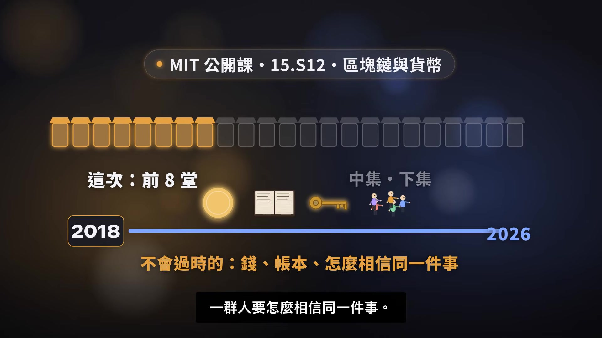

**逐字稿片段：** 講臺上的老師叫Gary Gensler 他在投資銀行高深工作過 18年 也當過美國商品期貨交易委員會的主席 上完這門課兩年多 他從2021年4月到2025年1月 擔任美國證券交易委員會的主席 那幾年美國對加密貨幣的監管 他站在最中間的位置 所以這門課 等於是後來那位監管者 在上任之前 把自己怎麼看這件事 一堂一堂講給學生聽 這八把課 其實都繞著同一句話打轉

**話題推測：** 介紹老師Gary Gensler的姓名與照片

---

## 00:01:00

**逐字稿片段：** 錢說穿了是一本大家都相信的賬本

**話題推測：** 展示課程主軸「錢說穿了是一本大家都相信的賬本」

---

## 00:01:02

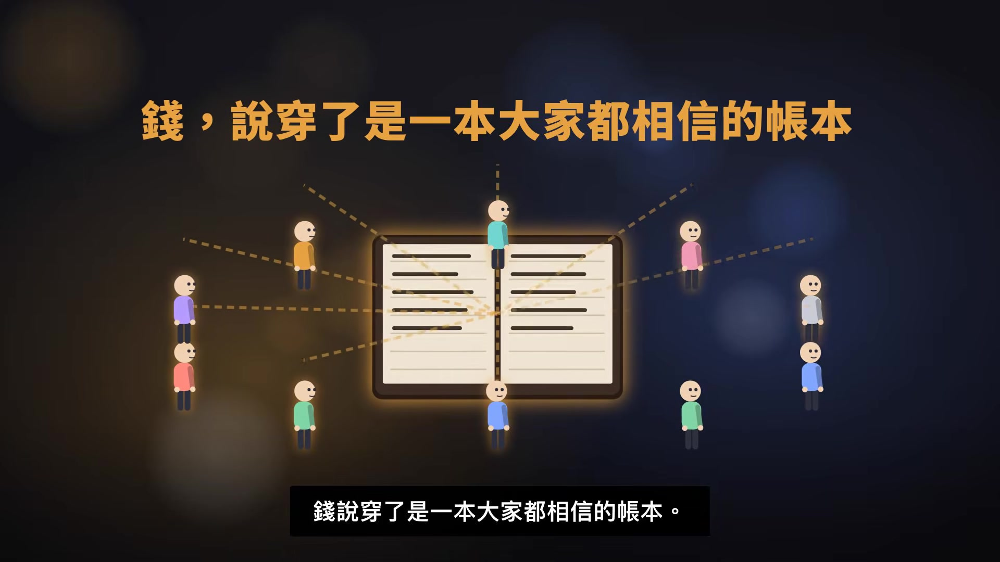

**逐字稿片段：** 這句話會帶出三個問題 我們分三步走 我們先看 為什麼錢就是一本賬本 過去這份相信 又是交給誰保管的 接著看 比特幣怎麼做出一本 沒有人能控制的賬本 又怎麼讓一群戶不認識的人 願意相信它 最後看 這份相信 在現實裡 最後還是得放在哪些地方 像是交易所 規則 還有法律 我先把答案放在前面 這份相信沒有消失 它只是換了地方放

**話題推測：** 展示課程分為三大部分的架構圖

---

## 00:01:23

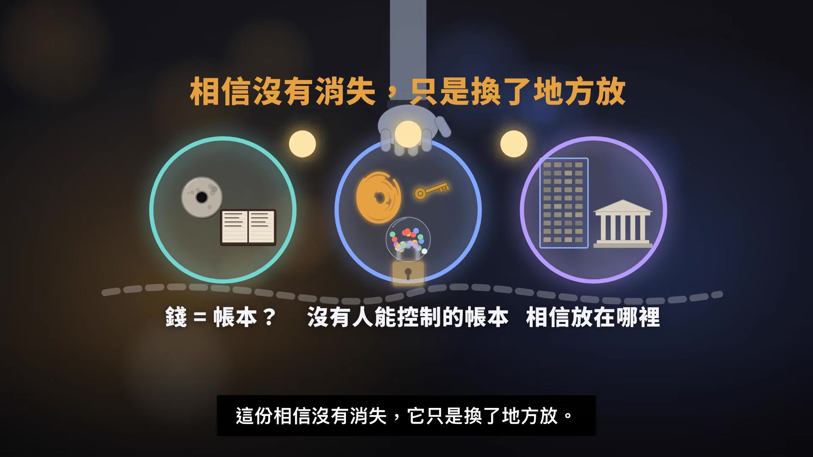

**逐字稿片段：** 我們從2010年的一則留言開始 有人想用一萬枚比特幣 換兩個披薩 2010年5月 美國佛羅里達州有一位城市設計師 叫拉斯洛海尼亞 他在一個討論比特幣的網絡論壇上留言 說他願意付一萬枚比特幣 請人幫他送兩個披薩來 那時候比特幣已經誕生一年多 可是還沒有人真的拿他去買過東西 Jensler在第一堂課 特別把這則留言放上投影片 他的重點是 這是比特幣第一次被當成交易媒介 也就是拿來換東西的錢 留言貼出去 三天過去沒有人理他 後來終於有人接了 5月22號 兩個披薩送到他家 一萬枚比特幣從他的名下 移到了對方的名下 你想想看這件事有多奇怪 對方交出去的 是兩個熱騰騰的披薩收到的 是一份檔案裡的一行紀錄 他為什麼願意 因為他相信 這行紀錄會被一大群 數不相識的人承認 換句話說 他相信的是一本帳本 這一集要講的就是這件事 錢說穿了是一本 大家都相信的帳本 我們先聽Gastner 自己怎麼講這個故事 16 months into his existence nobody had used it to buy something 拉斯洛是一名科學家在佛羅裡 was just kind of interested and he put this out on an email list three days later he still doesn't have his two pizzas 披薩的事 要講得通 得先回答一個更老的問題

**話題推測：** 展示2010年比特幣披薩交易的論壇留言截圖

---

## 00:02:48

**逐字稿片段：** 錢到底是什麼 Jensler在第二堂課給的答案是 錢是一種社會共識 大家同意它有用 它就有用

**話題推測：** 展示「錢到底是什麼？」的投影片

---

## 00:02:54

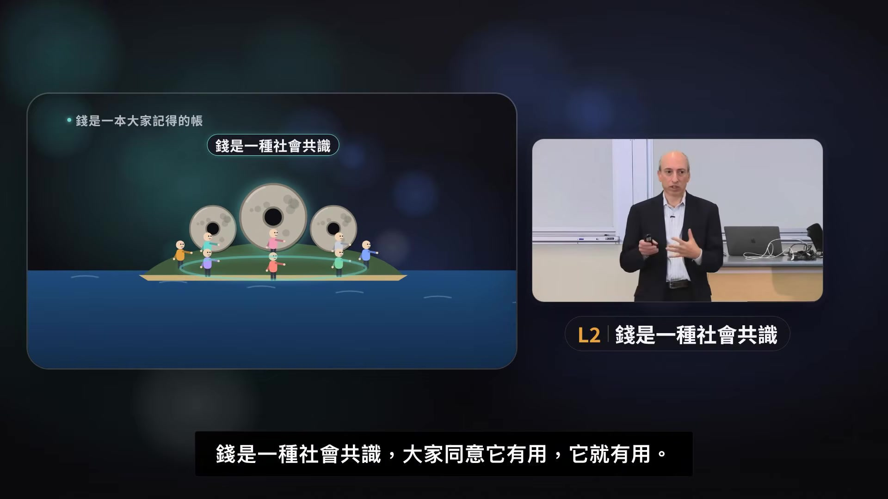

**逐字稿片段：** 他做三件事 拿來交換東西 叫交易媒介 放著保存價值 叫價值儲存 拿來比較貴不貴 叫計價單位 他舉了一個例子 太平洋上有一座小島

**話題推測：** 展示錢的三個功能：交易媒介、價值儲存、計價單位

---

## 00:03:03

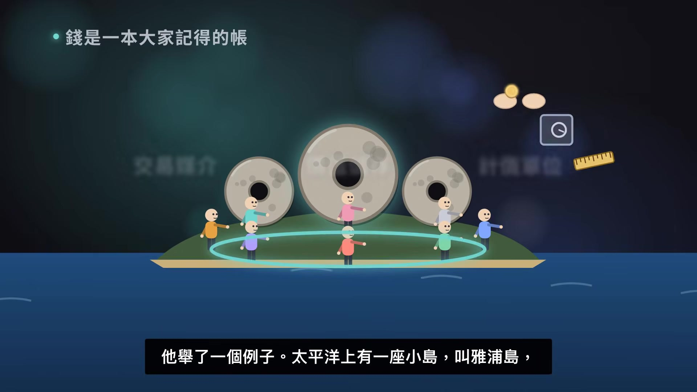

**逐字稿片段：** 叫鴨撲島 島上的人用一種巨大的石頭當錢 叫Rice 這些石頭是從大約 400公里外的帛琉 划船運回來的 大的那幾顆比人還高 幾乎搬不動 所以石頭不用移動 大家就記得 這顆石頭現在屬於誰 有一次 一顆石頭在運送途中沉浸了海里 再也沒有人見過它 可是全島的人都同意 它還在海底 它的主人照樣可以拿它來付錢 你看這裡的錢 說穿了不是那顆石頭 是全島的人腦袋裡 同一本大家都相信的賬本 這一集接下來的每一段 我都在講這本賬本 亞普島的那本賬本 放在每個人的記憶裡 社會變大以後 記憶不夠用 賬就被寫了下來

**話題推測：** 展示雅浦島的地理位置或賴石照片

---

## 00:03:39

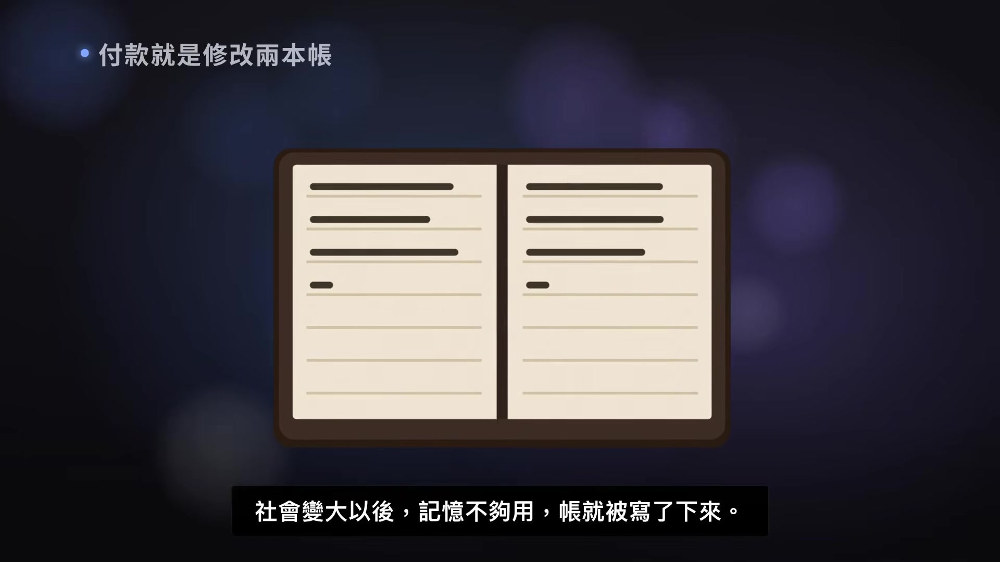

**逐字稿片段：** 這東西叫賬本 英文是ledger 它做的事是記一下 誰有什麼 誰欠誰多少 Anceler說 人類最早的文字 有一部分可能就是 用來記數字跟記賬的 到了中世紀晚期 意大利的商人 把富士記賬 整理成一套方法 他說某種意義上 富士記帳是資本主義的核心 帳本很重要 然後他講了一句很生活的話 你在咖啡店用手機付一杯咖啡 你以為發生了什麼 其實沒有任何東西被搬動 是兩本帳被修改了 店家那本加了一點 你那本少了一點 付款 說穿了就是修改帳本 這一句是整門客的低級 我們聽他自己說 但如果你去星巴克買一杯咖啡 and use your cell phone 你不是在編輯交易嗎 Starbucks' ledger goes up and yup, your ledger goes down

**話題推測：** 展示「賬本 (ledger)」的定義

---

## 00:04:45

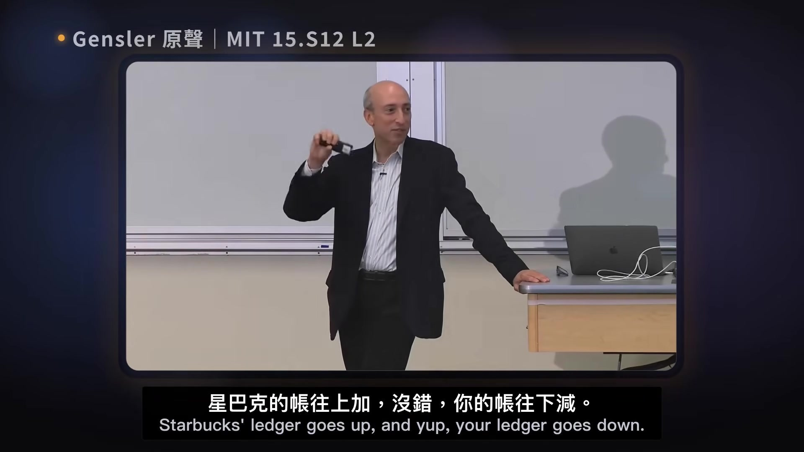

**逐字稿片段：** 那今天是誰在幫我們修改帳本 Janster畫了一張圖 最上面是中央銀行 他那本帳記得是每一家銀行有多少錢 下面一層是商業銀行 每一家都有自己的帳 記得是你我的戶頭裡有多少 再下面咖啡店的會員卡 支付軟體裡的餘額又是一層 假設Alice在假銀行 Bob在乙銀行 Alice轉100塊給Bob 甲銀行的賬上 Alice找了100塊 乙銀行的賬上 Bob多了100塊 兩家銀行之間的差額 再到中央銀行那本賬上調整一次 我們每天的付款 就是這樣一層一層修改賬本 這些替大家記賬的機構 英文叫intermediary 中文叫中間人 這套系統很好用 可是它有一個前提 每一層都要有一個 大家信得過的人在記賬 大家相信這本賬本 其實是相信記賬的人 Jensler在投資銀行高盛待過

**話題推測：** 展示「誰在修改帳本」的金融體系分層圖

---

## 00:05:28

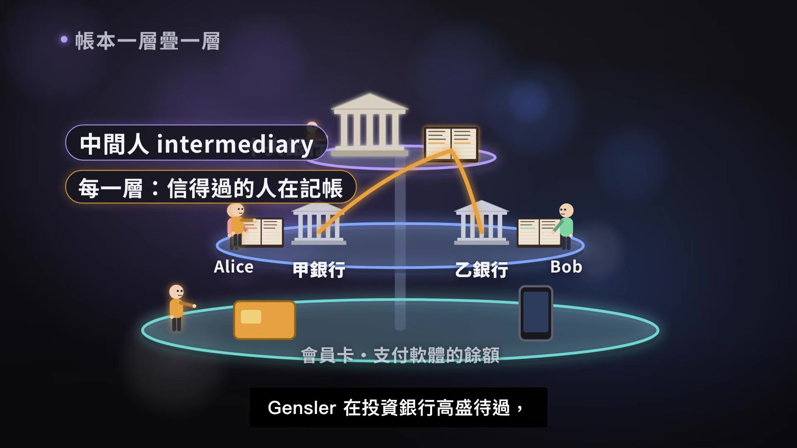

**逐字稿片段：** 他形容金融業坐在沙漏的瓶頸上 全世界的錢像沙子一樣從這裡流過 每一粒抽走一點點 加起來就是很大的財富

**話題推測：** 展示沙漏圖，說明金融業作為中間人的角色

---

## 00:05:36

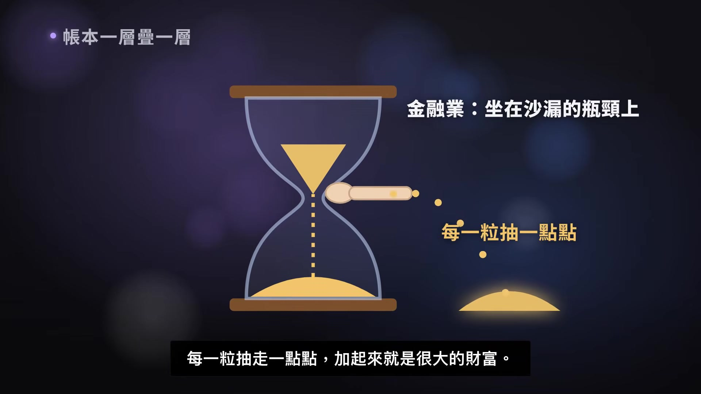

**逐字稿片段：** 那為什麼不乾脆拿掉中間人 大家自己在網路上記賬就好 因為網路上的東西 複製幾乎不用成本 一張照片你可以傳給100個人 每個人手上都是一模一樣的一份 錢如果也是一份檔案 你就可以把同一筆錢 同時付給兩個人 這個問題有個名字

**話題推測：** 展示「為什麼不拿掉中間人？」的疑問

---

## 00:05:51

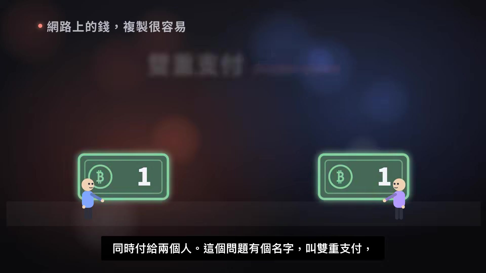

**逐字稿片段：** 叫雙重支付 英文是double spend 他做的是很簡單 同一筆錢花兩次 銀行解決他的方法 是自己握著唯一的那本賬 你付給第一個人 賬上就少了 你沒辦法再付給第二個人 1990年代

**話題推測：** 展示「雙重支付 (double spend)」的定義和示意圖

---

## 00:06:04

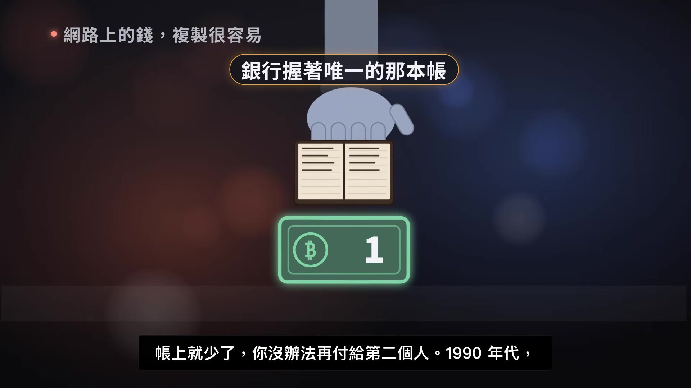

**逐字稿片段：** 有人做過好幾種電子陷阱 像密碼學家David Trump做的那一套 最後都沒有普及 Gensler 在課堂上整理過他們卡住的地方 有的系統要靠一家中心機構 有的系統店家不肯收 有的系統沒有人有動機幫忙記賬 他們還有一個共同的難題 就是雙重支付

**話題推測：** 展示1990年代電子支付系統的列表或圖示 (如David Chaum的嘗試)

---

## 00:06:19

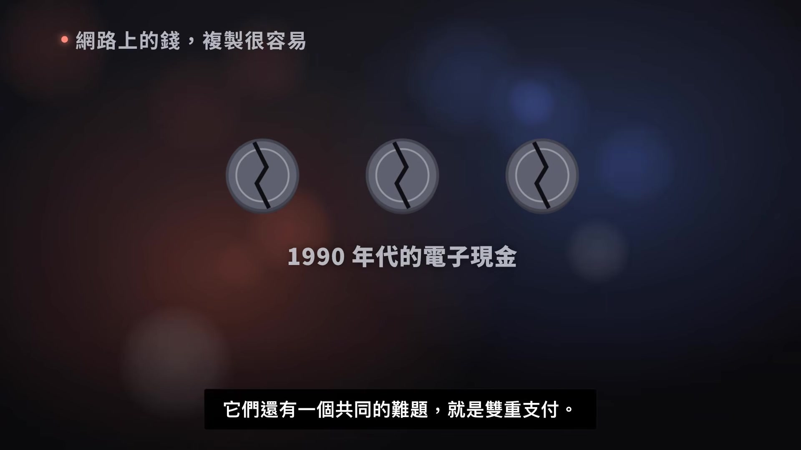

**逐字稿片段：** 後來真正普及的PayPal支付寶 還有肯亞的手機支付M-Pesa 都是靠一家公司握著那本賬本 來比較我們聽他講 Gensler說的很輕鬆 訊寄給兩個人只是有點尷尬 可是錢花兩次 整個系統就站不住了 他在第一堂課 還講了另一個披薩故事

**話題推測：** 展示PayPal、支付寶、M-Pesa等成功支付系統的Logo

---

## 00:07:08

**逐字稿片段：** 1990年代中 連鎖披薩店必勝客 英文Pizza Hut 推出了網路訂披薩的服務 叫PizzaNet 你可以在網頁上點餐 可是付錢 要等披薩送到門口 拿現金給外送員 網路那時候已經能把一封信 幾秒鐘傳到地球另一邊 卻還沒辦法安全地付一筆錢 後來有了加密連線 有了信用卡線上付款 網路購物才真正開始 可是每一筆付款 背後還是要經過銀行或發卡公司的那本帳 訊息可以點對點 錢卻一直要繞過中間人 Jensler把這件事叫做一個謎題 他用一句話把它講完 聽他自己說 解開這個謎題的 是一個到今天還沒有人能證明他是誰的人 2008年10月31號 漫盛節

**話題推測：** 展示必勝客PizzaNet網路訂餐服務的截圖或Logo

---

## 00:08:00

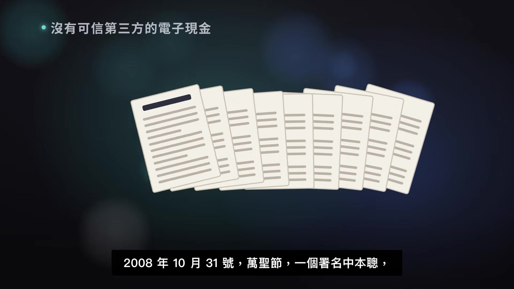

**逐字稿片段：** 一個署名鍾本聰 英文Satoshi Nakamoto的人 在一個密碼學的郵件清單上 貼出一篇9頁的論文 標題是 比特幣一種點對點的 電子現金系統 點對點 意思是你跟我直接交易 中間沒有人 他的信 第一句話是 我一直在做一個 新的電子現金系統 全程點對點 沒有可信的第三方 Jansler說 這是一句很低調的話 兩個月後 2009年1月3號 比特幣的第一個區塊誕生 鍾本聰在裡面放了一行字

**話題推測：** 展示中本聰的姓名與相關圖示

---

## 00:08:27

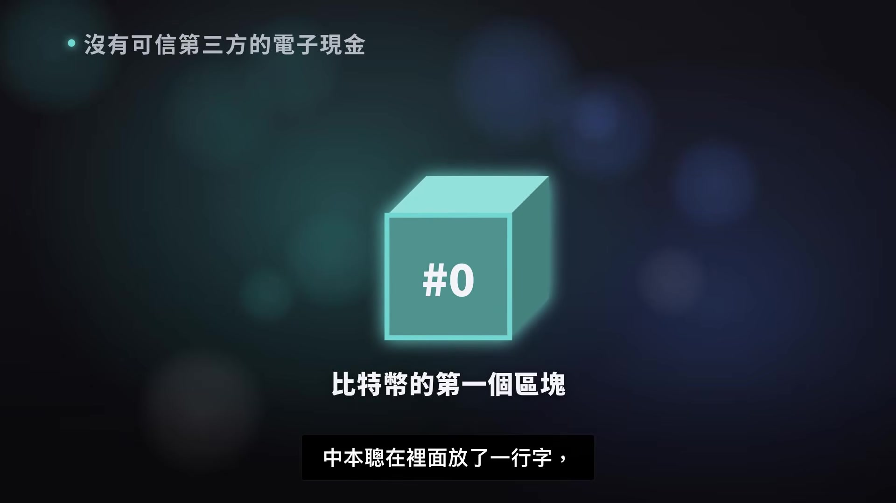

**逐字稿片段：** 是那天倫敦泰晤士報的頭條 財政大臣即將對銀行進行第二次紓困 這行字放在那裡 一來證明這一頁不會早於那一天 第二 很多人把它讀成中本聰對銀行體系的看法 在第五堂課上 Jansler還讓全班分組投票 猜中本聰是誰 答案五花八門 他的結論是 這間教室裡真正知道的那個人

**話題推測：** 展示倫敦泰晤士報頭條「財政大臣即將對銀行進行第二次紓困」的截圖

---

## 00:08:45

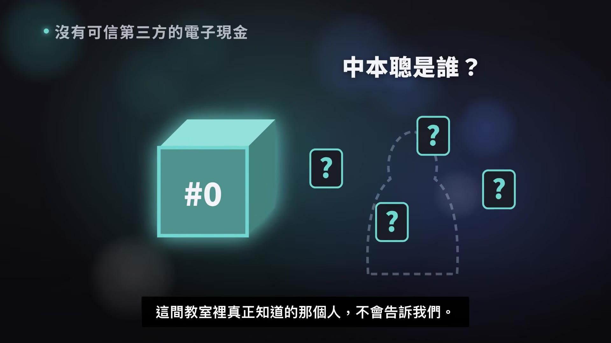

**逐字稿片段：** 不會告訴我們 我們把第一部分收一下 錢這件事 說穿了是一本大家都相信的賬本 亞普島的石頭沉在海底 大家還認這本賬本錢就還在 今天這本賬本一層疊一層 大家之所以相信它 是因為每一層 都有一箇中間人在記賬 有商業銀行 也有中央銀行 網路上的東西太容易複製 同一筆錢可能被花兩次 所以一直需要有人 握著唯一的那本賬本 中本聰要做的 是拿掉這些中間人 可是賬本原本靠中間人 做到的是一件都不能少

**話題推測：** 展示第一部分重點總結投影片

---

## 00:09:12

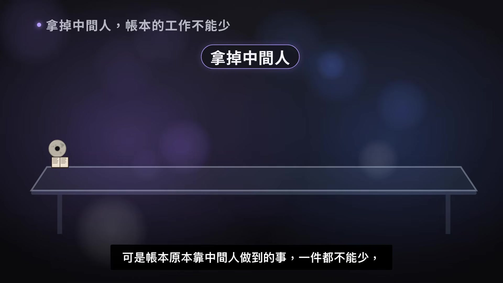

**逐字稿片段：** 這件事可以整理成四件 第一件事 寫進賬本的記錄無法修改 第二件事 一筆錢只有他的主人動得了 第三件事 全世界每一個人手上 都是同一個版本的帳本 第四件事 同一筆錢不能花兩次 銀行能做到這四件事 靠的是大家對銀行的信任 中本聰手上沒有這份信任 他得讓一本沒有人控制的帳本 自己贏得大家的相信

**話題推測：** 展示帳本需要實現的四個特點

---

## 00:09:33

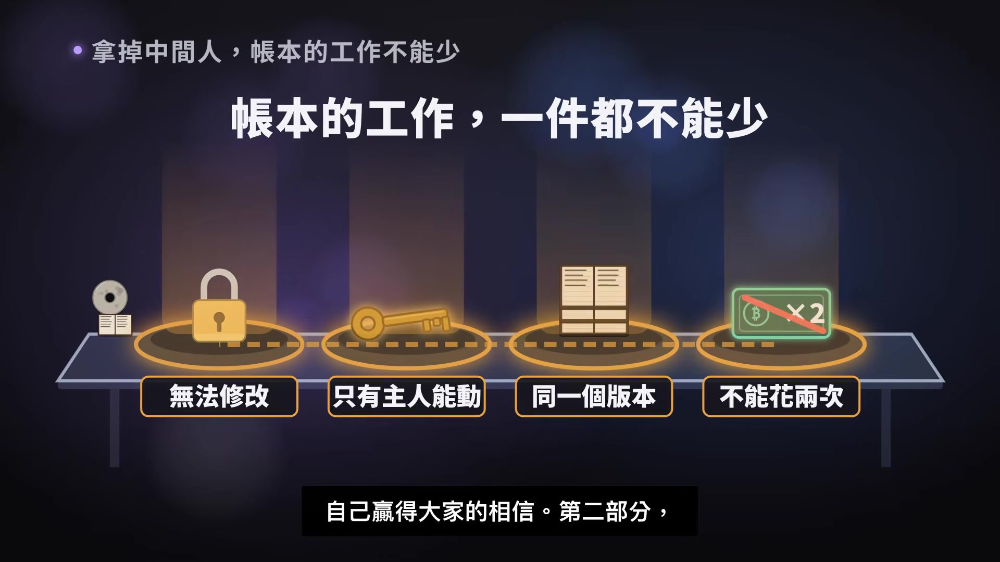

**逐字稿片段：** 第二部分我們就看他怎麼做到 第三堂課一開始 Jansler先跟學生打了一劑預防針 他說你不用會寫演算法 可是你要知道裡面的零件是什麼 就像你不用會修理汽車的滑油漆 但你要知道滑油漆是什麼 他說 這是看清楚區塊鏈的唯一辦法 才能把真正做得到的事 跟只是喊出來的口號分開

**話題推測：** 第二部分開頭，說明比特幣如何贏得信任的標題頁

---

## 00:09:51

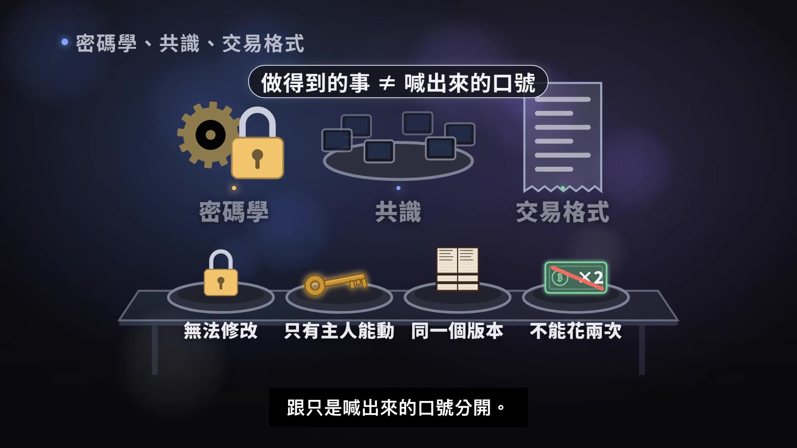

**逐字稿片段：** 他把比特幣分成三個零件 密碼學 負責讓記錄無法修改 讓錢只有主人動得了 共識 負責讓大家手上是同一個版本 交易的格式 負責讓同一筆錢不能花兩次 你會發現 這三個零件 剛好對上第一部分 最後那四件事 他也提醒 這些零件幾乎都不是中本聰發明的 有的在1970年代就有了 有的在1990年代就有人做過 中本聰厲害的地方 是把他們組在一起 再加上一個讓大家願意參與的獎勵 讓一本沒有人控制的賬本 也能被大家相信 我們一個一個來 先從密碼學裡最常用的工具開始 這個工具叫雜臭函數 英文是Hash Function 後面我就叫它雜臭 它做的是 是把任何一段資料丟進去 不管是一個字還是一整本書 都吐出一串固定長度的亂碼 Jensler說 他把它想成資料的指紋 指紋有幾個特性 雜臭都有 同一段資料 算出來的指紋 每次都一樣 你只要修改一個字 指紋就整個變掉 不是差一點點 是看起來毫無關係 光看指紋 你沒辦法倒過來算出原本的資料 還有要找到兩段不同的資料 指紋剛好一樣 在現實上做不到

**話題推測：** 展示比特幣的三個構成零件：密碼學、共識、交易格式

---

## 00:10:52

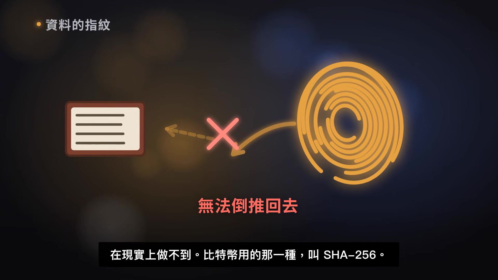

**逐字稿片段：** 比特幣用的那一種叫SHA256 Jinsler在課堂上還拿美國的郵遞區號來比 不管你住多大的房子 地址都會被壓成五個數字 可是他也馬上補一句 郵遞區號不安全 很多人共用同一個 雜臭不會這樣 這一段聽他自己怎麼說 It has certain properties One that you'll see throughout Is that it takes inputs of Input X It maps that input of any size To a fixed size So one that we use here in the US 一個Hash的功能 In a way, it's five digits It's a fixed size 指紋有了,帳本要怎麼變得無法修改 做法是每一頁帳的最上面 抄上前一頁的指紋 第二頁抄第一頁的,第三頁抄第二頁的 一頁接一頁扣在一起 這樣的結構

**話題推測：** 展示比特幣使用的雜湊演算法SHA256

---

## 00:11:51

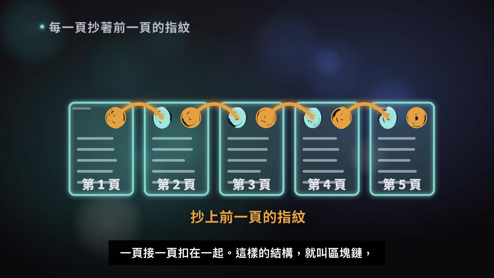

**逐字稿片段：** 就叫區塊鏈 英文是blockchain 每一頁叫一個區塊 一頁上面有上千筆交易 比特幣會把他們兩兩配對算指紋 一路往上 最後壓成一個指紋放在頁首 如果有人偷偷修改了舊的一頁 那一頁的指紋就變了 跟下一頁抄的那個對不起來 大家一眼就看得出來 這個點子不是中本聰發明的 1991年 貝爾通訊研究所的兩位研究員 Stuart Haber和Scott Stonetta 就提出用這種方法 遞文件 留下一份可以證明時間的記錄 他們後來開的公司 從1995年開始 每個禮拜把一串雜臭 登在紐約時報上 Jensler說 這可能是運作的最久的區塊鏈 而且它跟錢沒有關係 中本聰的論文裡 其實一次都沒有用到區塊鏈這個詞 Jensler也提醒大家說 區塊鏈無法修改 比較精確的說法是 以今天的計算能力修改不了 而不是不可能修改 無法修改的賬本有了 下一件事 是隻有錢的主人動得了 銀行靠的是你的身份證件跟密碼

**話題推測：** 展示區塊鏈的結構示意圖，說明區塊如何連結

---

## 00:12:43

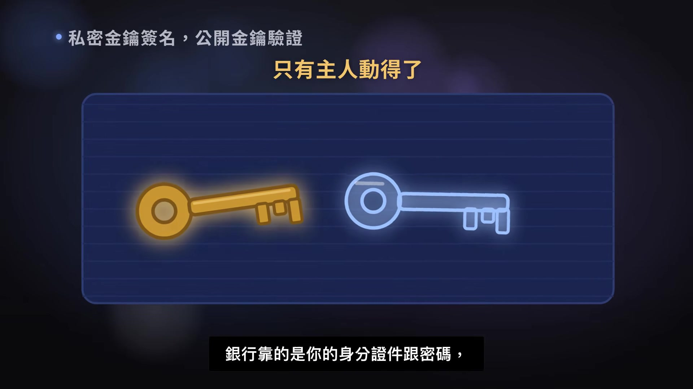

**逐字稿片段：** 比特幣靠的是數位簽章 英文是Digital Signature 數位簽章用的是一堆鑰匙 一把叫私密金鑰 英文是Private Key 你自己這藏好 誰都不給 另一把叫公開金鑰 英文是Public Key 可以公開給全世界 你要動一筆錢 就用私密金鑰在這筆交易上簽名 別人拿你的公開金鑰 就能驗證這個簽名是你籤的 而且交易內容一個字都沒有被修改過 可是他們從頭到尾 都看不到你的私密金鑰 Jensler在課堂上找了兩個學生示範 Kelly用他的私密金鑰籤一段訊息 Isabella用公開金鑰驗證 她說這看起來像魔法 可是它是真的數學 這套公開金鑰的方法 1970年代就出現了 麻省理工學院的研究員 也是開路的人之一 中本聰沒有發明它 他是把它拿來用在賬本上

**話題推測：** 展示「數位簽章 (Digital Signature)」的定義與運作原理

---

## 00:13:26

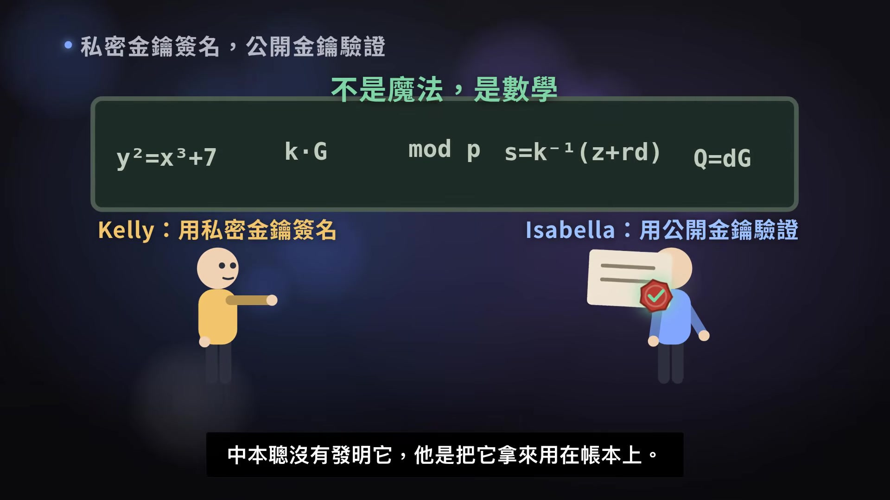

**逐字稿片段：** 那比特幣的地址又是什麼 地址是把你的公開金鑰 再算一次雜籌 壓短 變成一串可以給別人的號碼 用起來有點像賬號

**話題推測：** 展示比特幣地址的產生方式和圖示

---

## 00:13:33

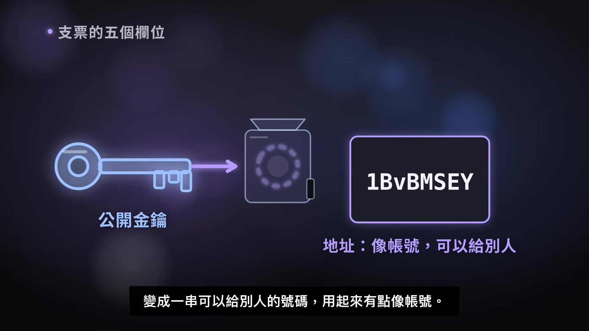

**逐字稿片段：** Jensler拿一張資本支票來對照 金額還有最下面的簽名 比特幣的一筆交易 裝的幾乎是同樣的五樣東西 只是賬號換成了地址 清筆簽名換成了數位簽章 差別在於支票開出去 要交給銀行去核對比特幣的交易 是丟到網路上 讓每一臺電腦自己驗證 然後他給學生一句最實在的提醒

**話題推測：** 展示一張銀行支票的範例

---

## 00:13:57

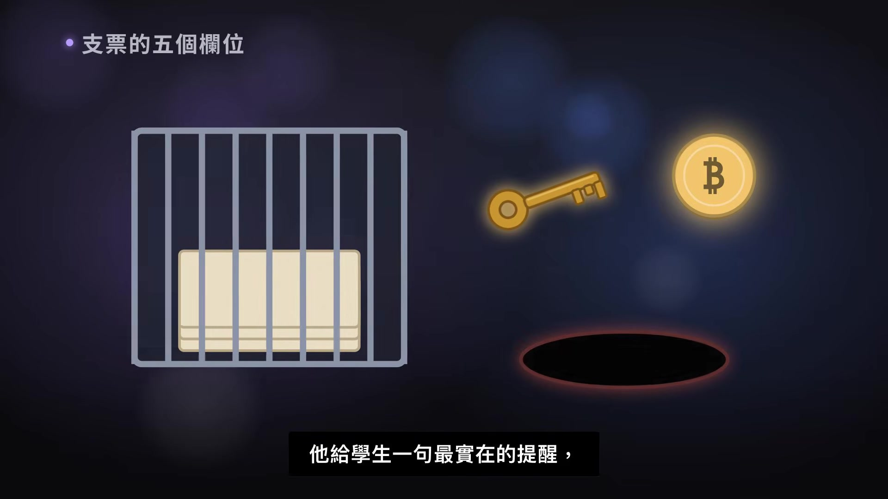

**逐字稿片段：** 千萬不要弄丟你的私密金要 以前華爾街的股票是 紙本證書鎖在大鐵籠里弄丟了 還可以回去找發行的公司 花點時間補發一張 私密金要弄丟了 動不了 現在帳本無法修改 錢也只有主人動得了 可是還剩一個大問題 這本帳在全世界3萬臺電腦裡都有一份 下一頁要由誰來寫 大家怎麼確定手上是同一個版本

**話題推測：** 強調「千萬不要弄丟私密金鑰」的警語

---

## 00:14:19

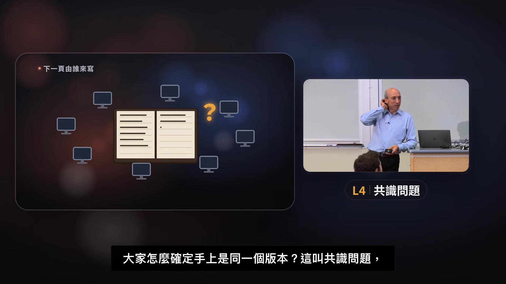

**逐字稿片段：** 這叫共識問題 英文是consensus 電腦科學家在1982年給了他一個有名的故事

**話題推測：** 展示「共識問題 (Consensus)」的定義

---

## 00:14:24

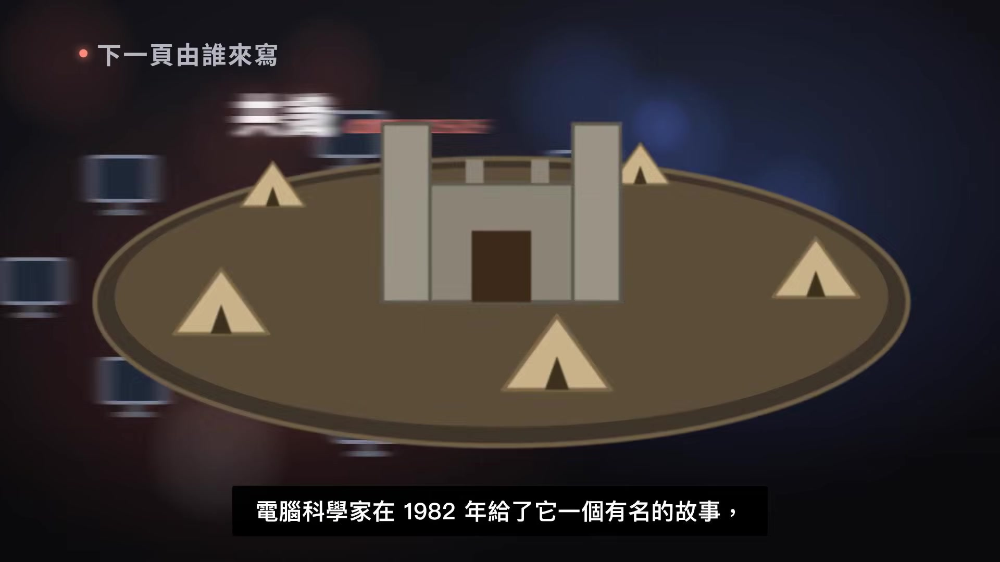

**逐字稿片段：** 叫拜占庭將軍問題 幾位將軍帶兵圍著一座繩 彼此只能靠傳令兵通信 他們要嘛一起進攻要嘛一起撤退 只要行動不一致就會輸 麻煩的是 裡面可能有叛徒 也可能有人根本沒收到命令 Jensler補了一句 出錯的那個不見得是壞人 可能只是訊息沒有送到 銀行的做法很簡單 只定一個人說了算 其他人照著他這樣走 中本聰的難題是 沒有這個人 沒權互不認識 甚至彼此不信任的電腦 要怎麼對下頁取得一致 他的答案 借用了一個 原本拿來對付拉傑郵件的點 這個答案叫工作量證明 英文是proof of work 他最早不是為了錢設計的 1997年

**話題推測：** 展示拜占庭將軍問題的示意圖

---

## 00:14:58

**逐字稿片段：** 英國的密碼學家Adam Beck 想對付拉傑郵件 他設計了一種方法 每寄一封信 電腦都要先解一道小題目 大概花幾秒鐘 寄一封信幾秒鐘不痛不癢 要寄幾百萬封拉扎訊 就划不來了 而收信的人要確認你有沒有解題 只要一瞬間 這就是工作量證明的關鍵 解題很難 驗算很簡單 你可以想成一道很難的速讀 要填出來的花很久 可是別人拿到填好的那一張 對一下就知道了對不對 Jensler說 Adenbeck當時要處理的不是雙重支付 而且這個方法在電子郵件上 也沒有真的流行起來 中本聰的厲害是把他搬到帳本上 用來決定誰寫下一頁 至於為什麼非要這種不對稱 Janciler講得很清楚 我們聽他說 它是正確的答案 如果不是正確的答案 它就不會有效 與何必 把這道題目放進帳本裡 每一臺想寫下一頁的電腦 要不斷換一個數字 這個數字叫nouns 意思是隻用一次的數字 跟這一頁的內容一起丟進雜湊 直到算出來的指紋 開頭剛好有夠多個0 這沒有捷徑 只能一直試 就像一直買彩券 買得越多越容易中 誰先算出來 誰就可以寫下一頁 請他電腦拿那個數字算一次 馬上就能驗證是真的 這些一直在算題的電腦

**話題推測：** 展示密碼學家Adam Back的照片

---

## 00:16:28

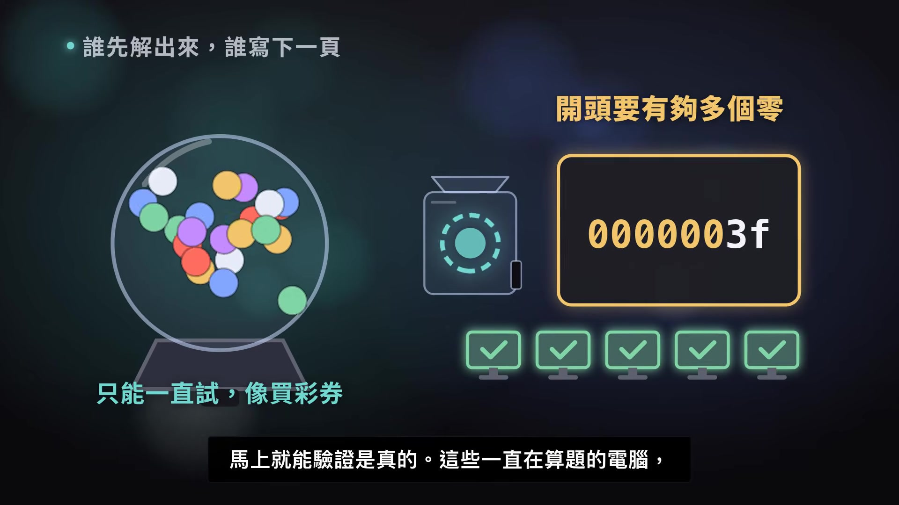

**逐字稿片段：** 叫礦工 這個過程叫挖礦 為什麼有人願意花電費做這件事 因為寫下一頁的人 可以在那一頁裡 發給自己一筆新的比特幣當獎勵 Jensler說 不管中本聰是誰 他很懂經濟學 他把一個獎勵制度 直接寫進了賬本 新的比特幣就是這樣來的

**話題推測：** 展示比特幣礦工和挖礦過程的示意圖

---

## 00:16:43

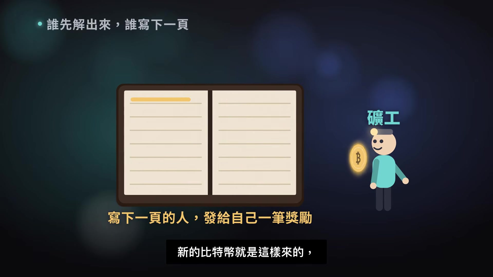

**逐字稿片段：** 而且獎勵每過大約4年減半一次 上課的2018年已經減半兩次 2020年跟2024年又各減一次 為了讓大約每10分鐘出一頁 題目的難度 每兩個禮拜會自動調整一次 參與的人越多 題目就越難 現在我們回頭看 為什麼這本賬無法修改 假設有人想修改 十頁以前的一筆交易 把收款人改成自己 今天指的在課堂上 真的示範了一次 他把一筆記錄 改成付給自己100美元 畫面上那頁立刻對不起來 後面每一頁跟著全部失效 他要讓賬重新成立 就得把那一頁 跟後面每一頁的題目 全部重新算一遍 而且要算的比 全世界其他礦工加起來還快 比特幣的規則是 大家照著最長的那條鏈繼續寫 所以要修改歷史 你得掌握整個網絡一半以上的計算能力

**話題推測：** 展示比特幣獎勵減半的時間表或圖示

---

## 00:17:24

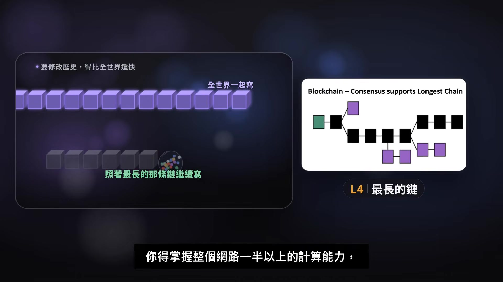

**逐字稿片段：** 這叫51%攻擊 就公開記錄來看 比特幣本身還沒有被這樣攻擊成功過 可是一些規模比較小的區塊鏈 2018年前後就發生過 也因為有這個可能 大家習慣等後面再多疊幾頁 大約一個小時 才把一筆交易當成定案 比特幣的確定是幾率上的確定 等越久越穩 這套方法有一個很明顯的代價 就是很耗電 題目難度跟著參與的人一起往上調整 礦工從家裡的電腦換成顯示卡 最後變成一整座一整座的礦場 Gensler在2018年引用的估計

**話題推測：** 展示「51%攻擊」的定義與原理

---

## 00:17:55

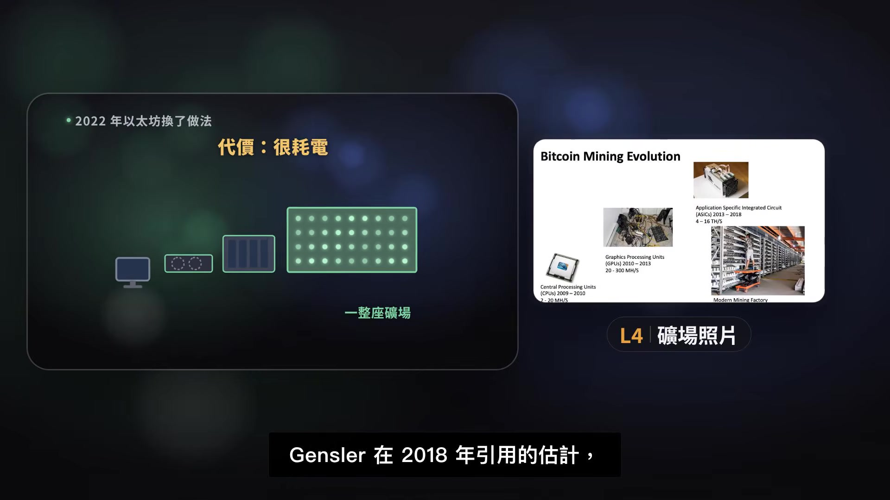

**逐字稿片段：** 比特幣一年用的電 大概落在愛爾蘭跟丹麥這兩個國家之間 他沒有直接說這是浪費 他說幾百年來 強勢的貨幣 都需要某種東西來限制供給 黃金要從地底挖出來 銀行要有金庫大門跟拿槍的警衛 這些都要花錢 這不代表挖礦是最好的用法 他說 他只是另一種方式

**話題推測：** 展示比特幣年耗電量與愛爾蘭、丹麥耗電量的比較圖

---

## 00:18:14

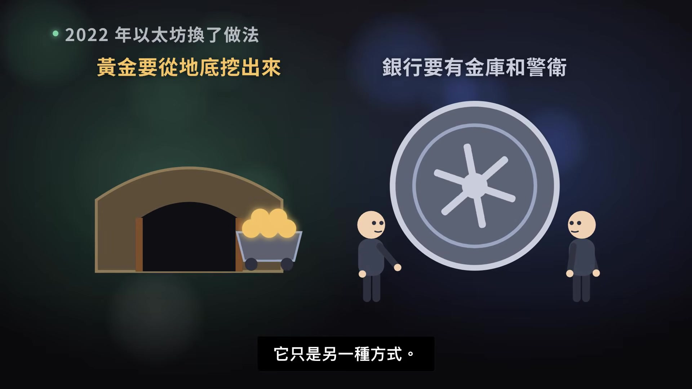

**逐字稿片段：** 這裡要補一個2018年之後的變化 那時候Gensler說 另一條很大的區塊鏈 以太坊英文Ethereum也用工作量證明 雖然他說要換 2022年9月15號 以太坊真的換了 換成權益證明 英文是Proof of Stake 權益證明不靠算題 靠的是驗證者壓上一筆自己的以太幣當保證金 驗證者作弊保證金就會被沒收 以太坊官方的估計 這次轉換讓他的用電量少了超過99% 比特幣到今天還是用工作量證明 如果大家對規則意見不合會怎樣 2017年比特幣社群為了每一頁該裝多少交易 吵了很久 最後一部分人修改了規則

**話題推測：** 更新以太坊從PoW轉為PoS的圖示或時間軸

---

## 00:18:48

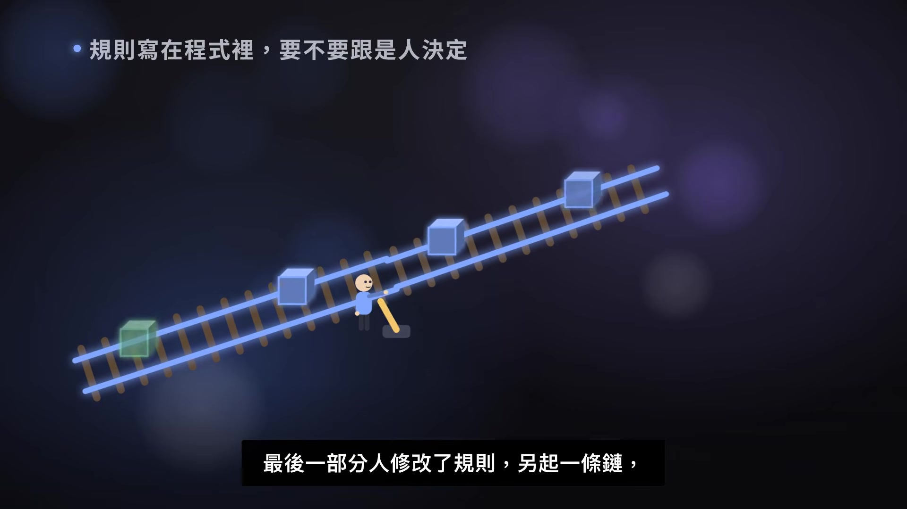

**逐字稿片段：** 另起一條鏈 叫比特幣現金 英文是Bitcoin Cash 這種修改的規則 新舊不相容的分裂 叫硬分叉 英文Halforg 從那一刻起 同一段歷史 長出了兩條各走各的帳本 也長出了兩種加密貨幣 各有各的價格 Jensler在課堂上問學生 如果兩邊的人都繼續認自己的帳 哪一條才是真的比特幣 他自己回答又繞回了第二堂課 前部就是一種社會共識嘛 規則寫在程式碼裡 可是大家要不要跟著那套程式碼走 這是人決定的 比特幣的貨幣政策也是這樣

**話題推測：** 展示比特幣硬分叉（Hard Fork）產生比特幣現金的示意圖

---

## 00:19:15

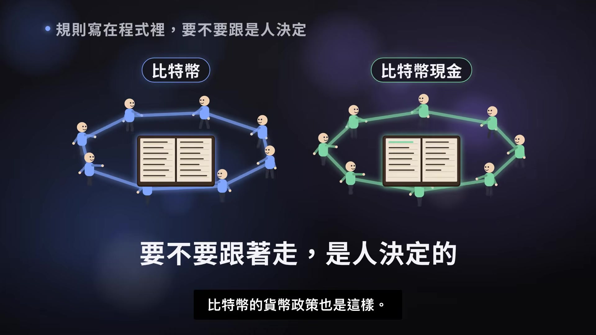

**逐字稿片段：** 總量的上限是2100萬枚 中本聰在2008年就寫進了城市碼 最後一枚大約要到2140年才會挖出來 要修改這條規則 不是哪一個人說了算 得讓整個網路的人都願意跟著換 這一點 第三部分我們會再碰到 最後一件事 同一筆錢不能花兩次 只要看比特幣的賬到底記的是什麼 你的銀行戶頭記的是餘額 假設你有1000塊 要轉出100塊 銀行只要看餘額夠不夠就好 比特幣不記餘額

**話題推測：** 展示比特幣總量上限為2100萬枚的數字

---

## 00:19:40

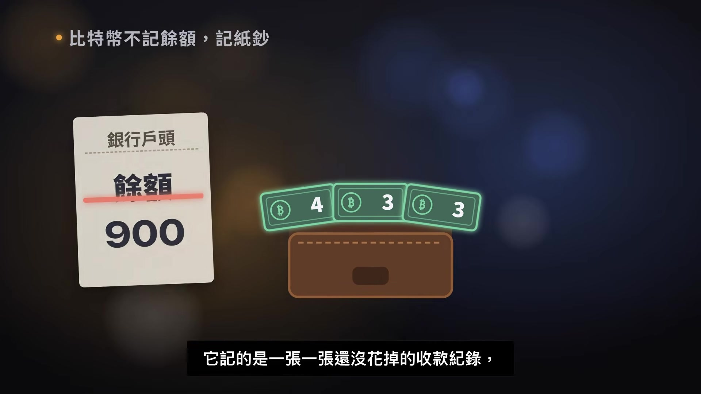

**逐字稿片段：** 他記的是一張一張還沒花掉的收款記錄 英文叫Unspent Transaction Output 沒花費的交易輸出 大家叫它UTXO 你可以把它想成錢包裡的紙鈔 你手上不是一個數字 是幾張不同面額的鈔票 要付錢就得挑出幾張加起來夠的 整張交出去 多的再找回來 這跟銀行戶頭的差別 Jensler在第二堂課也提過 記賬有兩種 一種記每日交易 一種記每個人的餘額 比特幣選的是前一種 後面要講的以太坊選的是後一種 第五堂課

**話題推測：** 展示「未花費交易輸出 (UTXO)」的定義與示意圖

---

## 00:20:08

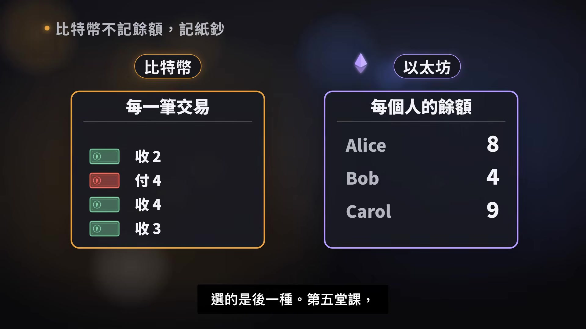

**逐字稿片段：** 他在白板上用兩位同學的名字 示範了一筆交易 我們聽他說 他手上三張紙鈔 加起來死撥比特幣 U10給Amanda 3狗給James 剩下的E狗 大部分要寫成一張新的紙鈔 找回給自己 留下一小點不寫 那一小點 就是給礦工的手續費 Janster還開玩笑說 課本例子留的手續費太多了 真的這樣付礦工會很開心 這筆交易一被寫進帳本 原本那三張紙鈔就作廢了 再也不能拿來付錢 換成三張新的 Amanda的 James的 還有找回自己的那張 那一小點手續費 有寫這一頁的礦工手肘 雙重支付 在這裡怎麼被擋下來 每一臺電腦驗證一筆交易都會檢查三件事 他用的那幾張紙鈔是不是還沒被花過 上面的簽名對不對 還有付出去的錢 有沒有超過收進來的錢 同一張紙鈔被拿去付兩次 第二次就會被退回 而每一張紙鈔往回追溯 最後都追溯得到某一頁礦工的獎勵 那是他出身的地方 Jensler在這一講他講了兩個很有意思的細節 第一個細節是 比特幣的交易裡 可以寫一小段條件 像是這筆錢要到某個時間以後才能動 或是三個人裡要有兩個人簽名才能動 這種寫在交易裡的條件

**話題推測：** 白板示範比特幣交易流程

---

## 00:21:36

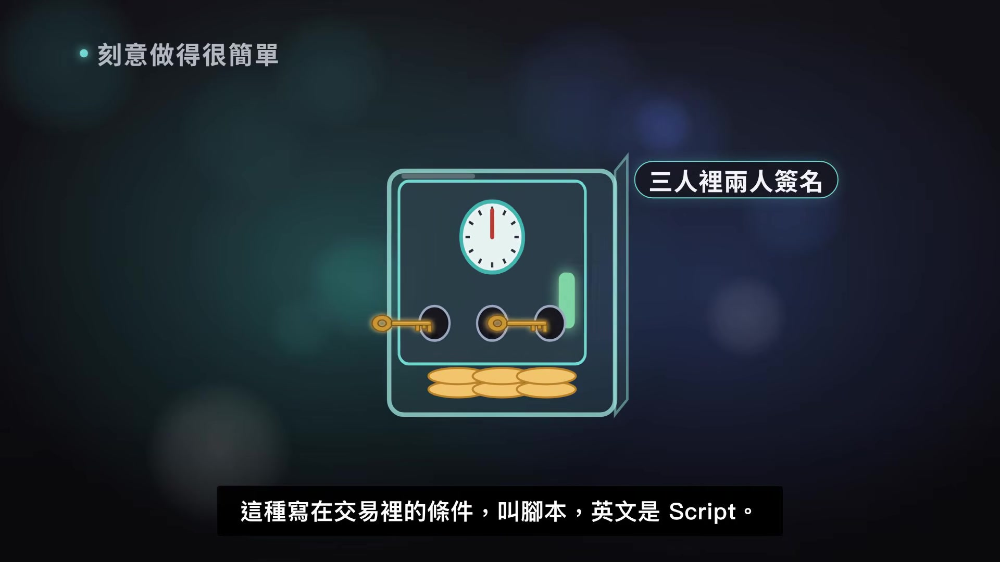

**逐字稿片段：** 叫腳本 英文是Script 中本聰刻意讓他很簡單 不能寫回圈 不能做太複雜的事 Jensler說 他選了一箇中間的位置 有一點彈性 可是不給攻擊的人太大的空間 第二個細節是一個小小的諷刺 這些還沒花掉的紙鈔清單 在比特幣的軟體裡 其實是存在一個普通的資料庫 不是存在區塊鏈上 Jensler說 這也說明了 中本聰想做的是一套貨幣系統 不是要把所有資料都塞進區塊鏈 記住這個簡單的腳本 因為第三部分一開始 就有人問能不能把它寫得更復雜 複雜到可以寫成一份合約

**話題推測：** 展示比特幣「腳本 (Script)」的定義與範例

---

## 00:22:06

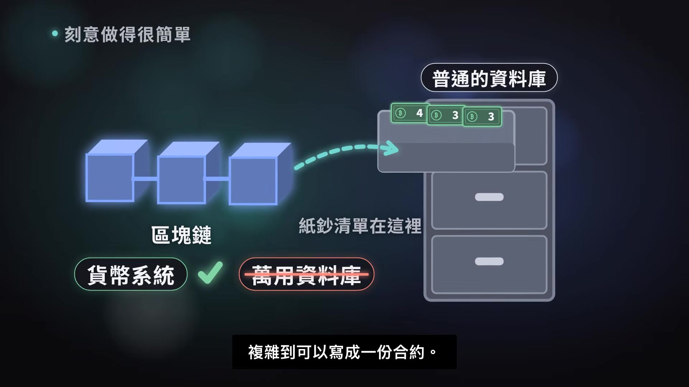

**逐字稿片段：** 我們把第二部分收一下 第一部分最後列了四件事 現在一件一件懟回去 寫進賬本的記錄 無法修改 靠的是雜臭這個指紋 每一頁都抄著前一頁的指紋 修改了一頁 整條鏈就對不上 錢只有主人動得了 靠的是數位簽章 主人用私密金鑰簽名 別人用公開金鑰驗證 大家手上是同一個版本 靠的是工作量證明 礦工花電費算題 誰先算出來誰寫下一頁 大家都照著最長的那條鏈接去寫 同一筆錢不能花兩次 靠的是媚花費的交易輸出 每一張紙超花掉就作廢 這四件事以前都是銀行在做 大家相信的是銀行 現在大家相信的變成了數學 電力 還有一大群陌生人的多數學 一本沒有人控制的賬本 就這樣也能贏得大家的相信 可是這份相信在現實世界裡能走多遠 最後又得放在哪裡 第三部分要問的是 這份相信在現實世界裡能走多遠 最後又得放在哪裡 我們先從一個更大的野心開始 如果比特幣的賬本能寫簡單的條件 那能不能寫得更復雜

**話題推測：** 展示第二部分重點總結投影片

---

## 00:23:00

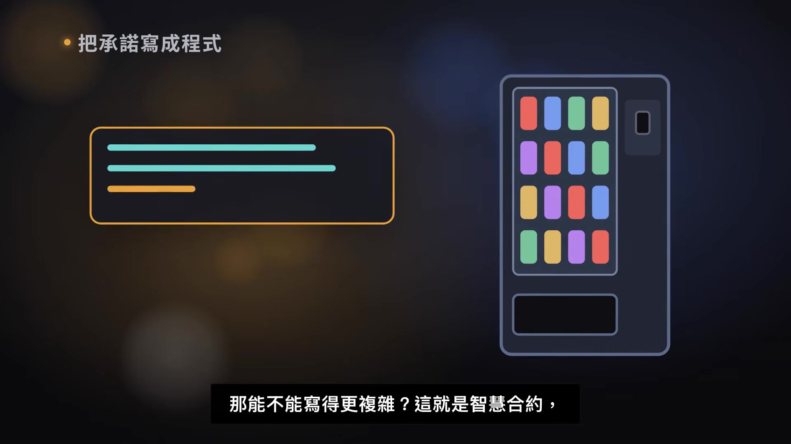

**逐字稿片段：** 這就是智慧合約 英文是smart contract 這個詞在1990年代 由電腦科學家Nick Sable提出 現實地說 到今天他還是覺得Sable的定義最好 一組用數位形式寫下來的承諾 參與的人照著這些承諾去執行 那漢克的客座講者

**話題推測：** 展示「智慧合約 (Smart Contract)」的定義

---

## 00:23:15

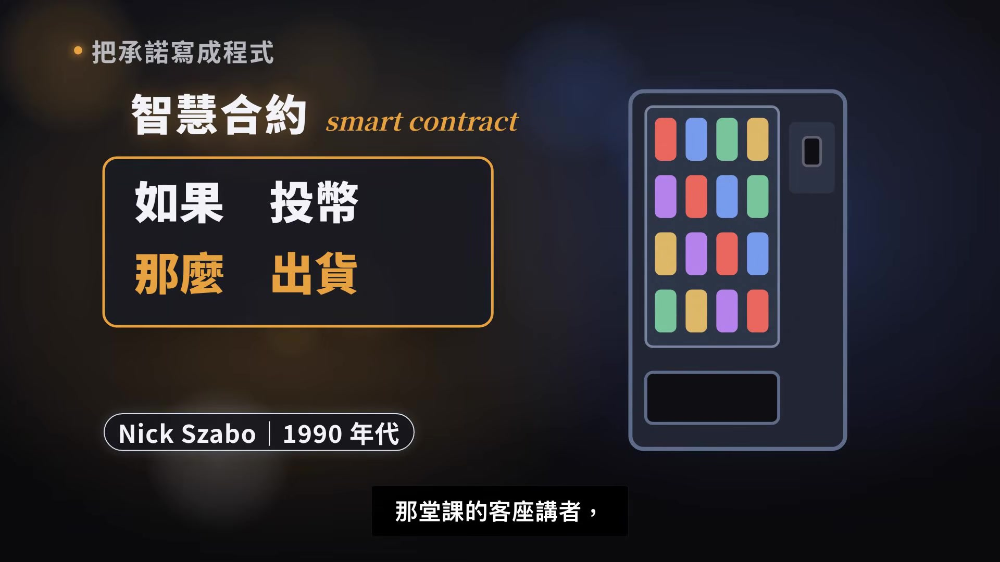

**逐字稿片段：** 哈佛法學院的教授Lawrence Lessig 拿自動販賣機來講 你投錢 他掉一罐飲料出來沒有電源 沒有人需要相信誰 機器本身就是那份交易 把這個想法做到最大的是以太坊 2013年 一位19歲的年輕人Vitalik Buterin 寫了他的白皮書 2015年上線 跟比特幣比 以太坊寄的是餘額 像銀行戶頭 而且他的程式語言 可以寫任何程式 可是Anzler提醒學生 名字叫智慧合約 不代表他真的有智慧 也不代表他真的是合約 我們聽他說 And that's why Larry's gonna speak to it So I just remember So a little bit about the 為什麼不見得是合約 那堂課的後半交給了Lasik 他講了兩件事 第一件事 合約的目的不是消除風險 而是分配風險 誰要承擔哪一種風險 雙方先講好 第二件事更有意思 很多合約是故意寫的模糊的

**話題推測：** 展示哈佛法學院教授Lawrence Lessig的照片

---

## 00:24:21

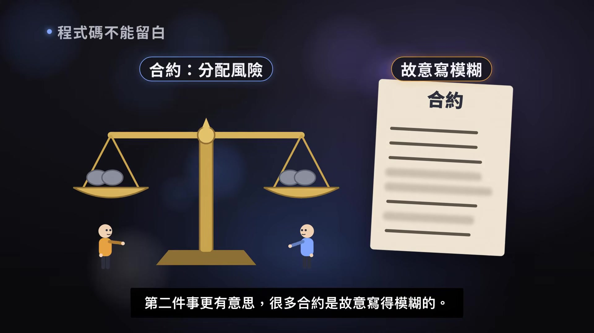

**逐字稿片段：** 他畫了一顆決策書 一份真正的合約 可能碰到幾千種情況 有些情況發生的幾率非常小 雙方不想現在就花時間談清楚 就先留白 真的發生了 再交給法官去判斷 城市碼不能留白 每一個分支都得事先寫死 所以他覺得 自衛合約最適合的 是很單純 很少有爭議的交易 像是航班延誤超過一個小時 就自動賠你一筆錢 他還提醒學生 每一份合約的背後 國家都在場 法律決定了什麼東西可以買賣 什麼合約根本不算數 城市碼能幫你執行承諾 可是他沒辦法替你決定 哪些承諾是可以做的 有一句話叫城市碼 就是法律 這句話在2016年 被真正測試過一次 那一年 以太坊上有一個 用智慧合約寫成的

**話題推測：** 展示決策樹的圖示，說明合約的複雜性

---

## 00:25:01

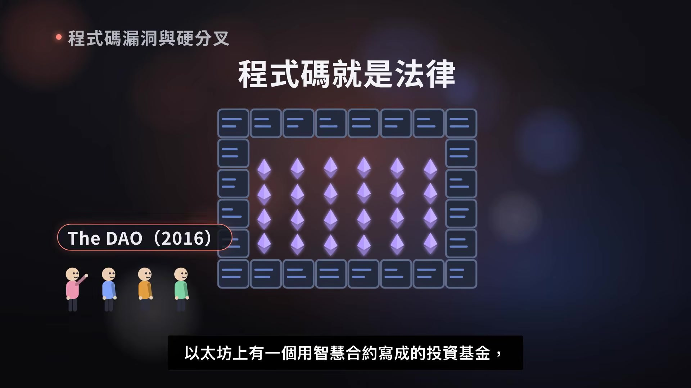

**逐字稿片段：** 投資基金叫DAO DAO是去中心化 自治組織的英文所寫 意思是一個沒有老闆 由城市跟投票來管理的組織 大家把以太幣投進去 由此有的人投票 決定要投資什麼 有人找到城市裡的漏洞 抽走了大約三分之一的資金 造城市碼的規則 這幾筆轉賬是有效的 以太坊社群炒了一個月 7月做了硬分叉 把那段歷史恢復成被投資錢的樣子 把錢退給投資的人 不同意的人繼續留在原本那條鏈上

**話題推測：** 展示去中心化自治組織（DAO）的定義與案例

---

## 00:25:26

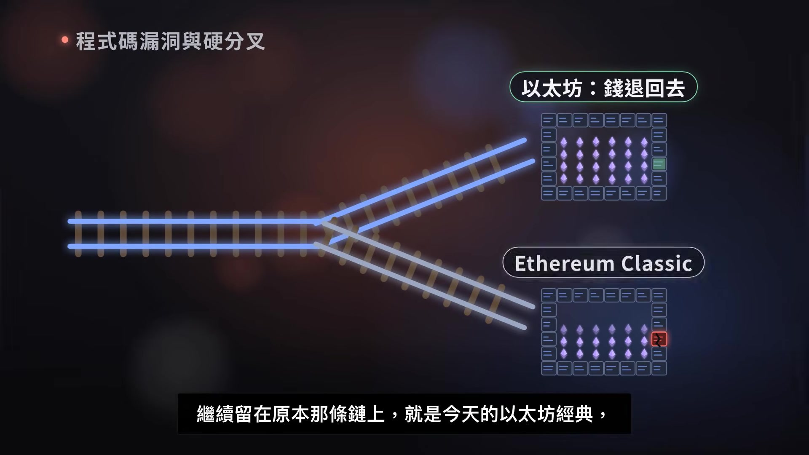

**逐字稿片段：** 就是今天的以太坊經典 Ethereum Classic Jansler在課堂上提到 以太坊經典就是這樣來的 他也指出另一件事 以太坊在2018年以前 已經降低過挖礦獎勵 號稱寫死的規則 只要大家同意就可以修改 你會發現 這又回到第二部分的那一句 規則寫在城市碼裡 做錯的時候誰說了算

**話題推測：** 展示以太坊經典 (Ethereum Classic) 的Logo或分叉示意圖

---

## 00:25:47

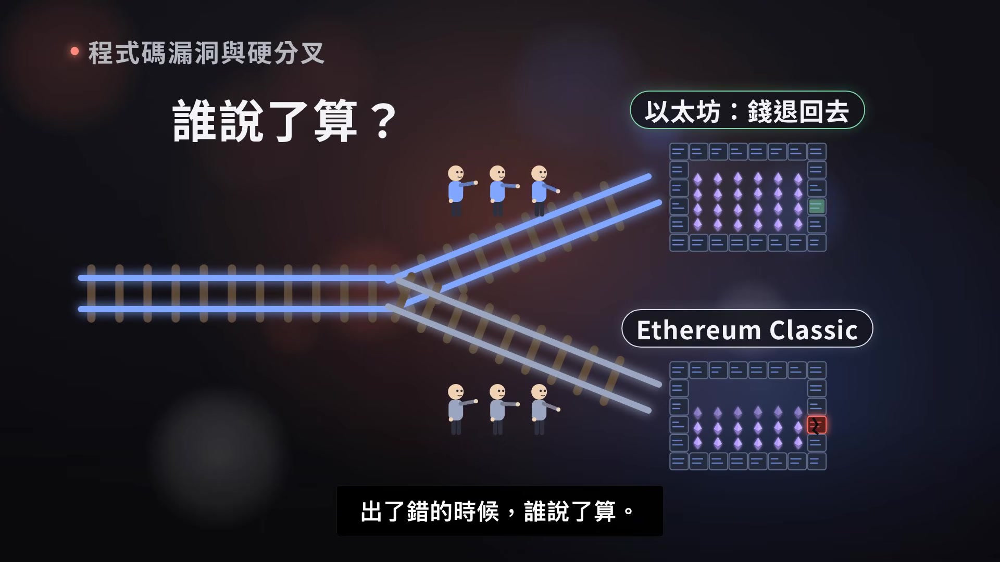

**逐字稿片段：** 智慧合約還帶來一種新東西叫代幣 英文是Token 一個專案還沒做出來 就先在以太坊上 發行自己的代幣賣給大家籌錢 這叫首次代幣發行英文是ICO Gentsler舉了一個洗衣店的例子 如果洗衣店已經開了 一枚代幣可以洗一次衣服 他的價值就是一次洗衣的錢 如果還沒開你相信他會開你會打個折買 可是如果你覺得 這家店會變成全校最熱門的地方 代幣以後值好幾倍 那你買的就不再是洗衣服 你是在押注一個社群的前景 2018年正好是首次代幣發行最熱的時候 Jensler引用的研究說

**話題推測：** 展示「代幣 (Token)」和「首次代幣發行 (ICO)」的定義

---

## 00:26:20

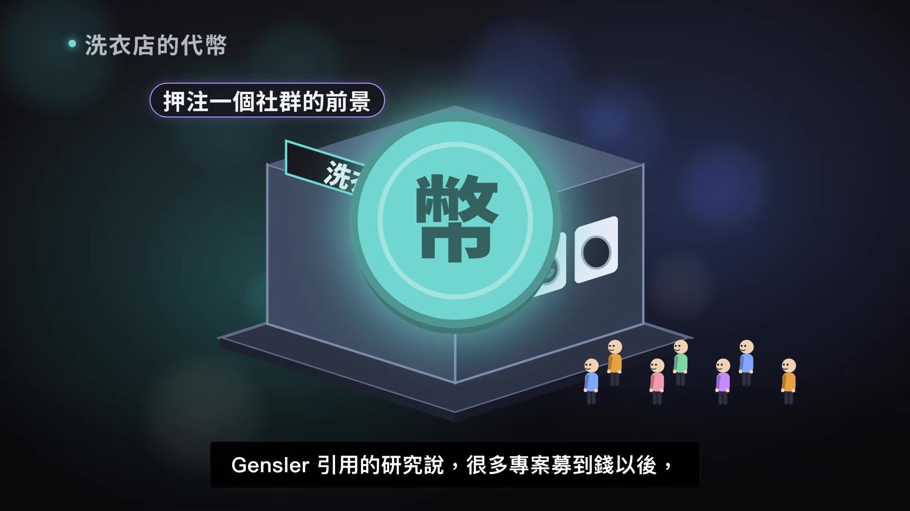

**逐字稿片段：** 很多專案募到錢以後沒多久就失敗了 有的連網站都找不到 拿了錢就跑 這不是在說區塊鏈不行 是在說同一枚代幣 可能是一張洗衣券 也可能是一張投資憑證 看你為什麼買它 這個分別到第八堂課 會變成一個法律問題 第七堂課 Jensler換了一個角度 這本賬的代價是什麼 以太坊的共同創辦人 Vitali Buterin提過一個說法

**話題推測：** 展示ICO專案失敗率的統計圖表

---

## 00:26:40

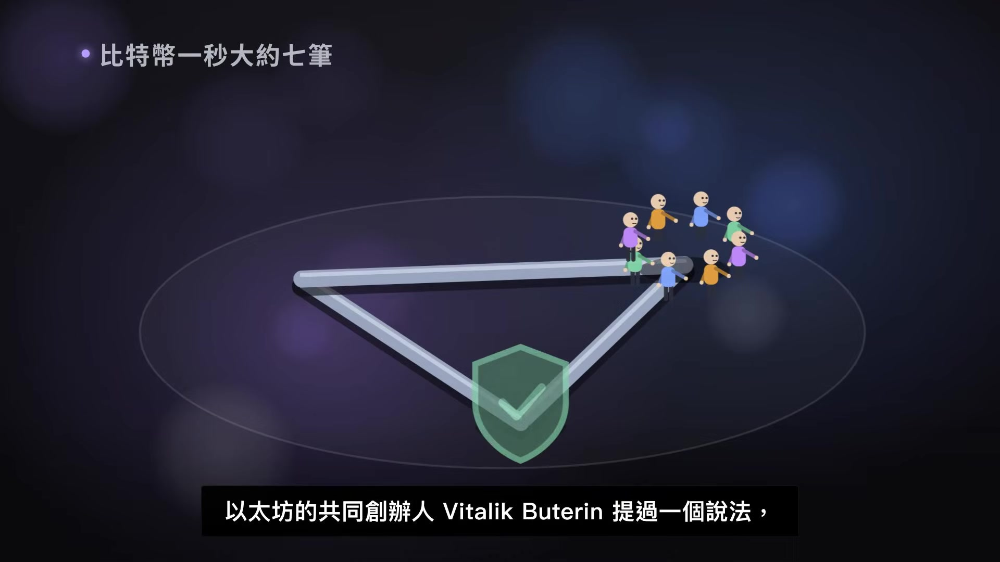

**逐字稿片段：** 叫區塊鏈不可能三角 這三樣東西是去中心化安全 還有可擴展 他們很難同時拿到 可擴展的意思是 用的人變多以後系統還能順利運作 Jansler拿裝修廚房來比 品質好 速度快 價格便宜 包商說你只能挑兩樣 比特幣挑了去中心化跟安全 代價是慢

**話題推測：** 展示區塊鏈不可能三角圖示（去中心化、安全、可擴展性）

---

## 00:26:57

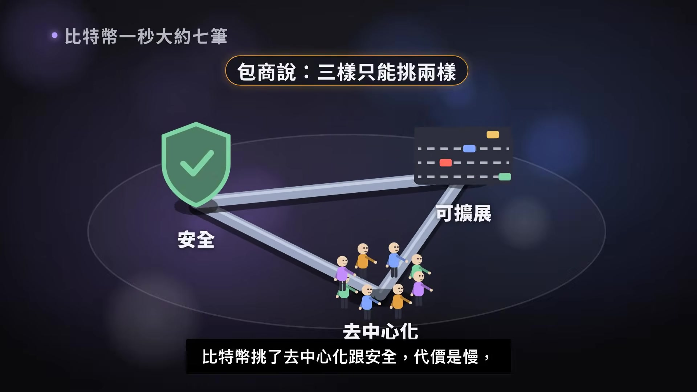

**逐字稿片段：** 一秒大約只能處理7筆交易 光是一個大城市的刷卡 就遠遠不止這個量 Jansler自己的看法是 他不需要一秒處理幾百萬筆 可是得比7筆快 解法之一 是在主要的那條鏈 旁邊再蓋一層

**話題推測：** 展示比特幣每秒交易處理量（約7筆）的數字

---

## 00:27:09

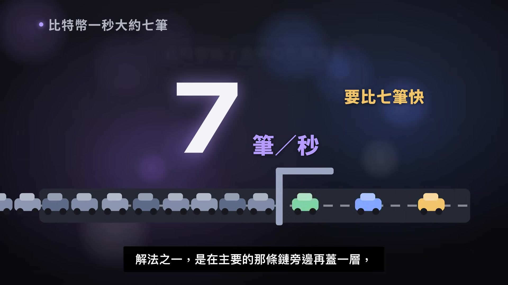

**逐字稿片段：** 叫第二層 英文是Layer 2 兩個人之間先開個通道 來來回回遞寄很多筆 最後只把結算的金額 寫回主要的那條鏈 比特幣的閃電網路

**話題推測：** 展示區塊鏈第二層（Layer 2）解決方案的示意圖

---

## 00:27:18

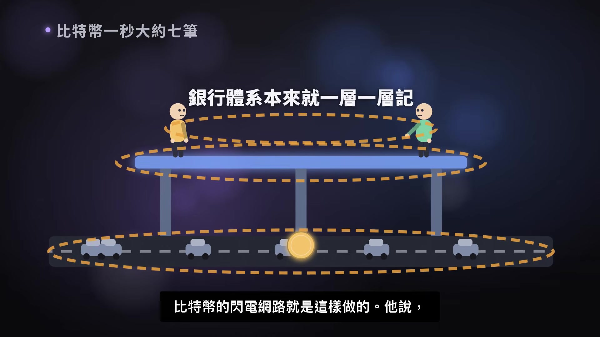

**逐字稿片段：** 就是這樣做的 他說這其實不行 今天的銀行體系 本來就是這樣一層一層寄 最後才到中央銀行結算 就跟第一部分 那張三層的圖一樣 那什麼時候該用這本賬本 什麼時候不該 Chancellor借用了1991年 諾貝爾經濟學獎得主

**話題推測：** 展示比特幣閃電網路的運作原理圖

---

## 00:27:31

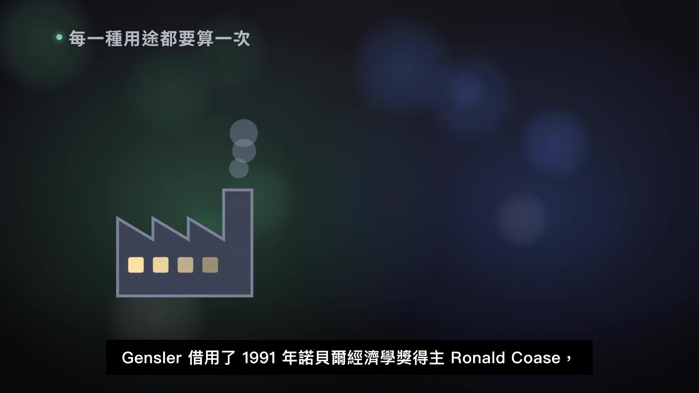

**逐字稿片段：** Ronald Coase 在1930年代提出的問題 為什麼經濟活動會聚集成公司 而不是每個人都自己接案子

**話題推測：** 展示諾貝爾經濟學獎得主Ronald Coase的照片

---

## 00:27:37

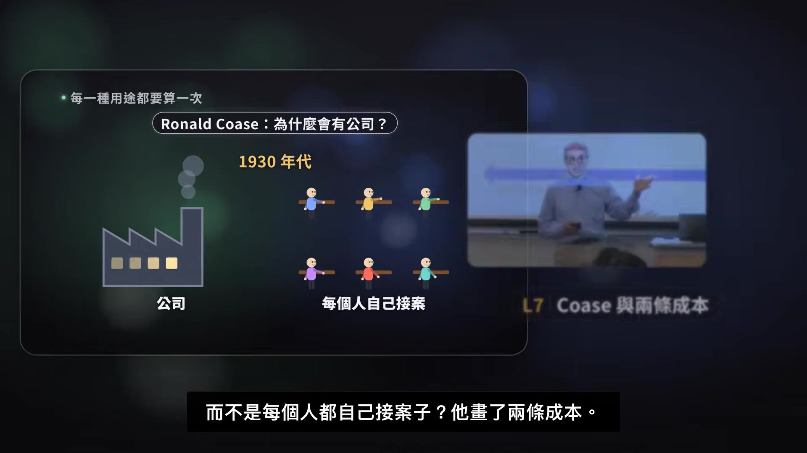

**逐字稿片段：** 他畫了兩條成本 一條是集中的成本 把帳交給一個中間人 你要付他抽的錢 要擔心他被收買 要擔心他一倒下來 大家一起停擺 另一條是分散的成本 大家一起記帳 彼此要協調 要花電費 要等待確認 規則也很難修改 每一種用途 這兩條成本的高低都不一樣 所以Gensler說 要一件一件算 不能依據區塊鏈會改變一切就帶果 他在第一堂課就說過 這門課要做的 是分清楚哪些是地面上的真實狀況 哪些只是口號 這也是第一部分那個沙漏的另一面 中間人收的錢 是分散系統的機會 分散也有他自己的帳單 兩邊都要放上秤

**話題推測：** 展示集中化與分散化成本曲線圖

---

## 00:28:12

**逐字稿片段：** 另一個代價是隱私 比特幣的帳本是公開的 任何人都可以下載 看到每一筆交易 從哪個地址轉到哪個地址 地址不是你的名字 可是一旦某個地址被認出來是你 你過去的每一筆交易都攤在那裡 大堂課上坐著一位 麻省理工學院的研究生

**話題推測：** 展示「隱私」議題的投影片

---

## 00:28:26

**逐字稿片段：** Matas Viza 他是隱私加密貨幣Zcash 背後的研究者之一 他說 隱私是一種基本人權 我買一杯咖啡 不想讓對方看到我所有其他的交易 可是監管機關擔心的正好是同一件事 洗錢的人也想要隱私 Gianceler覺得兩邊有機會同時被滿足 關鍵是一種技術

**話題推測：** 展示麻省理工學院研究生Matas Viza的照片

---

## 00:28:43

**逐字稿片段：** 叫零知識證明 英文是Zero Knowledge Proof 他做的是 只證明一件事是真的 卻不透露其他的資訊 他的例子是去酒吧 店員要知道你滿21歲 你只要證明你是在某一天以前出生的 不需要把名字地址 整張身份證都給他看 第七堂課有一個場面 很能說明這份相信 最後放在哪裡 Jancellor問全班 誰擁有過比特幣 大約一半的人舉手 他再問 誰自己執行過 一個完整的比特幣節點 也就是在自己的電腦上 下載整本賬 自己驗證每筆交易 結果只剩三個人 都是博士班的學生 那剩下的人 私密金要放在哪裡

**話題推測：** 展示「零知識證明 (Zero Knowledge Proof)」的定義

---

## 00:29:14

**逐字稿片段：** 多半放在交易所 交易所 英文是Exchange 是讓你用美元 換比特幣的公司 你在交易所賬戶裡 看到的比特幣 很多是交易所 我替你保管私密金要在他們手上 Jensler也提到 有些加密貨幣大部分的交易 其實是發生在這種集中的交易所裡 一套為了拿掉中間人而發明的帳本 到最後很多人又把鑰匙 連同那份相信交還給了一個中間人 他沒有說這樣做是對是錯 我們聽他怎麼說 Jensler說他沒有要評斷對錯 可是把鑰匙交給別人 風險在哪 他在第八堂課 講了日本的例子 2014年2月

**話題推測：** 展示「交易所 (Exchange)」的定義與功能

---

## 00:30:01

**逐字稿片段：** 東京的交易所Metagox 停止交易 接著申請破產 他一度處理全世界 大部分的比特幣交易 最後客戶的比特幣大量不見 日本因此在2017年修改法律 交易所要登記 要接受檢查 可是2018年1月 另一家日本交易所Coincheck 被駭客入侵 被偷走了價值超過 5億美元的數位貨幣 連日本首相都在記者會上被問到 Jensler說 對監管的人來說 你的老闆在記者會上被問 為什麼沒有管好 這就是失敗 這裡要補上2018年之後的事 2022年11月 當時全球最大的加密貨幣交易所之一 總部設在巴哈馬的FTX申請破產 客戶的錢被挪去做別的用途 創辦人後來被判詐欺罪成內 這些事發生的地方 都不是區塊鏈本身 是區塊鏈旁邊那個 替大家保管鑰匙的中間人 賬本沒有壞掉的 是大家放在中間人身上的那份相信 Jensler在第七堂課的結論 速度效率隱私這些技術問題 電腦科學家大概三到十年會有辦法

**話題推測：** 展示Mt. Gox交易所破產的新聞畫面或圖示

---

## 00:30:57

**逐字稿片段：** 真正難的是治理 英文是governance 意思是 誰來決定規則要不要修改怎麼修改 你的手機公司半夜就幫你更新了軟體 你可能根本不知道里面修改了什麼 可是比特幣沒有這樣一家公司 要更新 就得讓成千上萬個互不認識的人同意 不同意的人就分叉出去 Jensler說 回頭看 中本聰能讓這麼多人走在同一條路上 是一件很了不起的集體行動 可是走上去以後 要轉彎就很難 從2026年回頭看 他說了三到十年 有一部分應驗了 以太坊換成了權益證明 越來越多交易 搬到第二層去處理 至於治理 到今天還是最常起爭議的地方 我們聽他在2018年怎麼說 我認為更艱難的挑戰 與政府有關係 這八爬柯的最後一堂 講的是公共政策 Jensler說今天講政策 他特地把西裝外套穿回來 要看起來正式一點 他給了一個架構 政府管金融

**話題推測：** 展示「治理 (governance)」問題的投影片

---

## 00:32:09

**逐字稿片段：** 大致守三條線 第一條線是防止非法活動 像是逃稅 洗錢 資助恐怖活動 還有規避制裁 第二條線是維持金融穩定 不要讓一個市場出事 拖垮整個金融體系 第三條線是保護投資大眾 讓買的人拿得到真實的資訊 不被詐騙 也看得到透明的價格 那法律要怎麼管 一個沒有中間人的系統 堅持了說 法律一向是掛在中間人身上的 因為中間人是最好施力的地方 比特幣拿掉了很多中間人 可是錢要進出這個世界 大多還是得經過交易所 把美元換成比特幣再換回來 這些進出口 就是大家又把它相信 放回中間人身上的地方 也是法律重新抓得住的地方 他也說 犯罪不是新的 新的只是工具 以前是一箱一箱的現金 現在可能是一個隨身疊禮的私密金要 這三條線 他說的很直接 我們聽他說

**話題推測：** 展示政府金融監管的三條防線

---

## 00:33:09

**逐字稿片段：** 那一枚代幣到底算什麼 是貨幣是商品還是證券 在美國判斷的工具是 1946年最高法院的一個判例

**話題推測：** 展示「代幣究竟算什麼？」的分類問題

---

## 00:33:22

**逐字稿片段：** 叫Howey案 Howie公司在佛羅里達州賣柑橘園 買的人大多住在外地 根本不會種果樹 公司 另外跟他們簽約 幫忙照顧 採收 賣出去 再把利潤分給他們 法院說 這不是單純買土地 是一種投資合約

**話題推測：** 展示美國最高法院Howey案判例的資訊

---

## 00:33:35

**逐字稿片段：** 判斷的標準有四個 你拿出了錢 錢投進了一個共同的事業 你期待能賺錢 而且賺不賺錢 要靠別人的努力 把Jansler拿著四點 一條一條對照首次代幣發行 一個團隊還沒把東西做出來 就先賣代幣給大家 買的人期待它漲 漲不漲要看團隊做的怎麼樣 這就是第六堂課 那家洗衣店買的人如果壓的是社群的前景 那張代幣看起來就比較像投資憑證 除了這四點 他在第一堂課還講過一個更簡單的方法 叫壓值測試 我們聽他說 這段話在2018年聽是一位教授的看法 三年後他成了美國證券交易委員會的主席 這套看法 很大程度影響了那幾年 美國怎麼監管加密貨幣 支持跟反對他的人都很多 我們把2018年之後 基建跟這門課有關的事補上 不評論只講發生了什麼 2022年5月 Terraform Labs這家公司

**話題推測：** 展示Howey測試的四個判斷標準列表

---

## 00:34:51

**逐字稿片段：** 推出的穩定幣TerraUSD奔盤 穩定幣是一種號稱跟美元一比一掛鉤的代幣 Terra靠的是一套演算法 不是真的放著美元 一個禮拜之內就崩了 2024年1月 美國證券交易委員會核准了比特幣現貨的指數股票型基金 英文是ETF 讓一般人可以透過證券賬戶 買到跟比特幣價格聯動的基金 Jensler當天的聲明說 核准的是這種基金上市交易 不代表核准或背書比特幣 2025年7月 美國通過了Gingrich法案 他專門管理穩定幣 規定支付用的穩定幣 要用美元或低風險的資產 一比一準備 Jansler在2018年的第二堂課說過 信用卡出現以後 花了15到20年才有專門的法律 加密貨幣可能也要等15年 結果美國的穩定幣法律 7年就來了 這份相信 最後還是得靠規則跟法律來守住 我們回到開場那句話

**話題推測：** 展示TerraUSD穩定幣崩盤的新聞畫面或圖表

---

## 00:35:39

**逐字稿片段：** 錢說穿了 是一本大家都相信的賬本 這八炮客 一步一步把這句話講完 第一部分告訴我們 錢就是一本賬本 雅浦島那顆沉在海底的石頭 只要全島的人都認帳 他就還是錢 到了今天 這份相信大多交給銀行跟中央銀行保管 第二部分告訴我們 比特幣做出了一本沒有人能控制的帳本 他用雜湊讓篡改看得見 用數位簽章讓別人動不了你的錢 用工作量證明決定誰寫下一頁 用媚花費的交易輸出擋住同一筆錢花兩次 一群陌生人就這樣願意相信同一本帳本 第三部分告訴我們 這份相信沒有消失 他有一部分放到了數學跟電力上 也有很大一部分 又放回了交易所 放回了規則 放回了法律 2018年Jensler在課堂上說 沒有中央機構的數位貨幣是有可能的 後來這幾年比特幣還在運作 以太坊換了共識的方法 有交易所倒閉法律也開始跟上 技術一直在變 可是錢是一本大家都相信的賬本 這件事沒有變

**話題推測：** 回顧課程主軸「錢說穿了是一本大家都相信的賬本」

---

## 00:36:31

**逐字稿片段：** 下一集我們會看銀行 中央銀行跟支付系統 要怎麼面對這本新的賬本 最後問你一個問題 如果有一天你的錢不放在銀行 你最願意把這份相信交給誰 數學 城市碼 交易所 還是政府 留言告訴我 喜歡的話訂閱AINobob開啟通知 我們下次見

**話題推測：** 預告下一集內容的畫面

---
