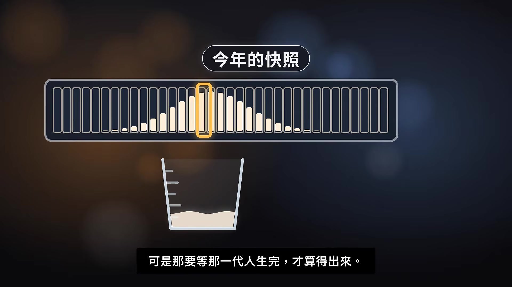
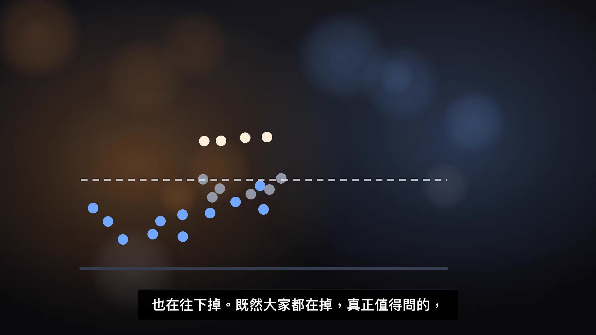
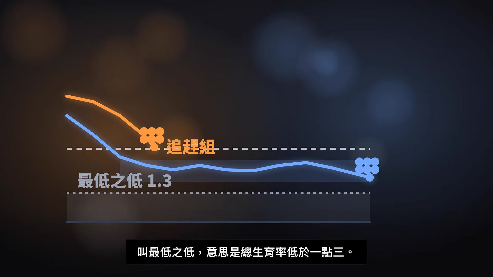
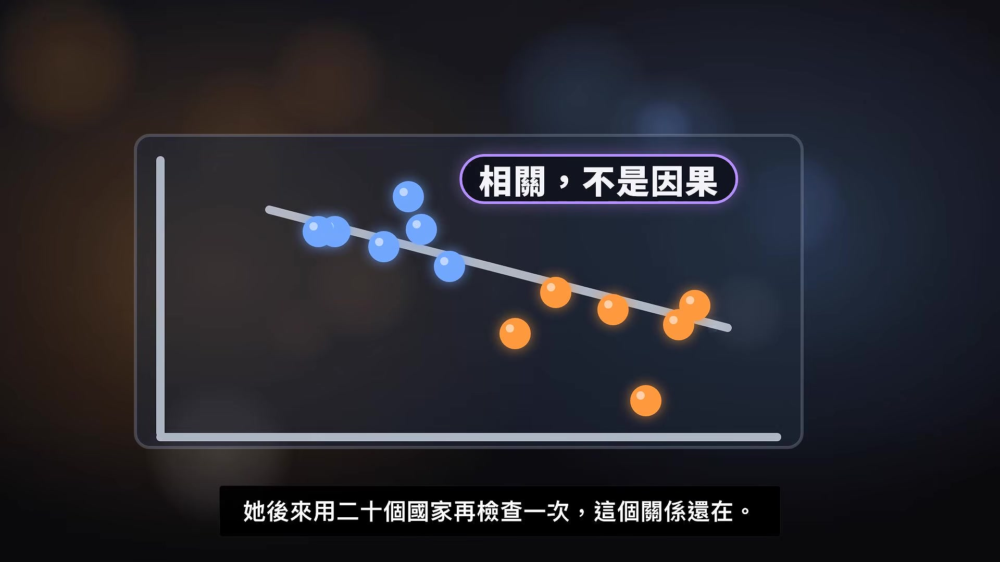
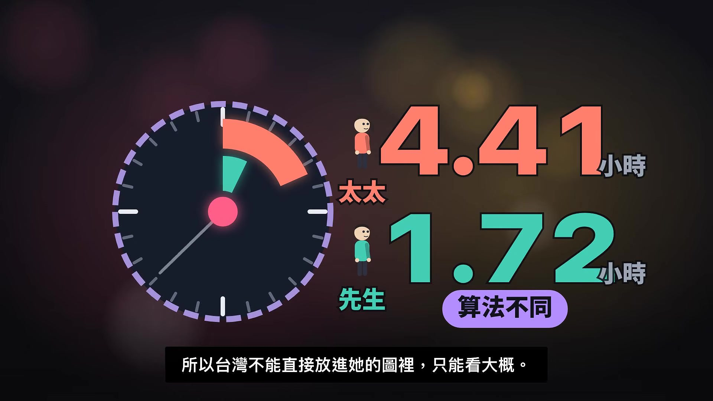

# jimainotebook_SsDxBajxwVg — 關鍵畫面索引

- 來源逐字稿：[jimainotebook_SsDxBajxwVg_FIN.srt](jimainotebook_SsDxBajxwVg_FIN.srt)
- 影片：https://www.youtube.com/watch?v=SsDxBajxwVg
- 截圖數：46

## 00:00:11

**逐字稿片段：** 這一集是演講訪談系列,主角是哈佛大學的經濟學家Claudia Golden。 她是2023年諾貝爾經濟學獎的得主。

**話題推測：** 介紹本集主題人物哈佛經濟學家Claudia Golden。

---

## 00:00:18

**逐字稿片段：** 我們要問的是,臺灣生得這麼少,問題真的出在錢嗎?

**話題推測：** 提出影片核心問題：臺灣生育率低迷是否僅因金錢問題？

---

## 00:00:22

**逐字稿片段：** 先看一個數字。

**話題推測：** 引導觀眾查看新的統計數字。

---

## 00:00:23

**逐字稿片段：** 依內政部護政司的統計,臺灣去年的總生育率是0.695。 依各地政府自己公佈的數字,這比南韓的0.8還低。 已經公佈的地方裡,只有澳門更低。 每次新聞講到孩子越生越少,最常聽到的一句話是,養不起。 政府這幾年也一直加碼

**話題推測：** 顯示臺灣去年的總生育率0.695。

---

## 00:00:40

**逐字稿片段：** 生一個孩子發十萬元 未滿兩歲 每個月還有育兒津貼

**話題推測：** 介紹政府發放生育獎勵金十萬元的政策。

---

## 00:00:43

**逐字稿片段：** 上一集 人口學家Paul Moreland談的是 小孩變少以後 退休金誰來付 那是後果 這一集我們回頭問原因 Golden研究女性的工作和家庭 研究了大半輩子 他的答案跟錢有關 可是不是你想的那種錢

**話題推測：** 提及上一集探討人口減少的後果。

---

## 00:00:58

**逐字稿片段：** 先認識這一集的兩個人 Claudia Golden 是哈佛大學的經濟學教授 她一輩子研究的 是女性怎麼工作 怎麼成家 2023年 她因為這些研究 拿到諾貝爾經濟學獎 他也當過美國經濟學會的會長

**話題推測：** 介紹本集內容相關的兩位重要人物。

---

## 00:01:11

**逐字稿片段：** 主要的畫面是2025年8月 美國懷俄明州山邊的一間度假旅館 堪薩斯城聯邦準備銀行 每年在這裡辦一場經濟研討會 各國中央銀行的官員都會來 Golden那天發表的論文 標題叫《生育的壞處》

**話題推測：** 說明訪談影片的拍攝地點與時間背景。

---

## 00:01:25

**逐字稿片段：** 訪問他的人是Steven Davis 他是史丹佛大學胡佛研究所的資深研究員 他的太太在韓國長大 他每年夏天都待在韓國 所以整場訪談他一直追問韓國的情況

**話題推測：** 介紹訪談Golden的Steven Davis。

---

## 00:01:35

**逐字稿片段：** 另一支影片是同一年11月 他在德國經濟研究所的演講 臺上放著他論文裡的圖 我們會穿插使用

**話題推測：** 說明另一段影片來源是Golden在德國的演講。

---

## 00:01:42

**逐字稿片段：** 開場那個0.695到底是什麼意思 這個數字叫總生育率 他的意思是 假設一個女生 照著今年各個年齡女性的生育情況 走完一生 平均會生幾個孩子 你可以想象一排格子 從15歲排到49歲 每一格放的是那個年齡的女性 今年平均生了多少 把這一排格子全部加起來 就是總生育率 所以他像一張今年拍的照片 不是追蹤同一群人一輩子 Golden自己也說 他比較想用追蹤同一代人的算法 可是那要等那一代人生完才算得出來

**話題推測：** 解釋開場提到的0.695「總生育率」的定義。

---

## 00:02:14

**逐字稿片段：** 還有一條線要先認識 叫替代水準 他的意思是 要讓人口長期不減少 平均每個女生大約要生兩個多一點 生兩個剛好補上爸爸媽媽 多出來的那一點 是因為有些孩子沒能長大 臺灣的0.695 連替代水準的三分之一都不到 臺灣掉得很低

**話題推測：** 介紹「替代水準」這個重要概念。

---

## 00:02:32

**逐字稿片段：** 可是這不是臺灣自己的事 Golden說 美國在戰後的嬰兒潮以後 總生育率就掉到兩個左右 現在大約1.6 比較富有的國家 幾乎全部都低於替代水準 只有以色列是例外 主要是因為國內有一群 生很多孩子的極端正統派猶太社群 聯合國的會員國裡 已經有超過一半低於替代水準 全世界每三個人 就有兩個住在這些國家 有錢的國家很早就開始少生 你可能會想 那是有錢國家的事 窮一點的國家 應該還是生很多吧 Davis一開始也請他把全世界的整體情況講一遍 他講完美國和富有國家 接著補了一句 不只是有錢的國家

**話題推測：** 將討論範圍擴展到全球生育率趨勢，指出這不只臺灣的問題。

---

## 00:03:09

**逐字稿片段：** 後面那一串國家聽他自己講 巴西和美國一樣低,連撒哈拉沙漠以南的非洲也在往下掉

**話題推測：** 播放Golden本人談論全球生育率下降情況的片段。

---

## 00:03:44

**逐字稿片段：** 既然大家都在掉,真正值得問的是誰掉得最快? Golden挑了12個國家,照經濟成長的方式分成兩組 我們叫他們穩定組和追趕組 穩定組是美國、英國、法國、瑞典、丹麥、德國 這些國家的經濟很早就一步一步慢慢長大 他們的生育率在1970年代就掉到兩個左右 之後50年大致停在1.5到1.9之間 追趕組是韓國、日本、意大利、西班牙、葡萄牙、希臘 這些國家的經濟停滯了很久 後來才一口氣追上來 他們在1970年代反而生得比較多 後來一路往下掉 人口學家給這種情況一個名字 叫最低之低 意思是總生育率低於1.3

**話題推測：** 提出新的問題：哪些國家的生育率下降最快。

---

## 00:04:25

**逐字稿片段：** 把兩組的線畫在同一張圖上 1980年代中期兩條線交叉 原本生的多的 變成生的最少 這張圖上沒有臺灣 Golden的論文沒有放臺灣 下面這條線 是我們自己加上去的 用的是聯合國和兩邊政府公佈的資料 1960年 臺灣的女生 一輩子平均生將近6個孩子 韓國也差不多是6個 臺灣在1984年掉到替代水準以下 韓國早了一年 臺灣在2003年掉進最低之低 韓國又是早了一年 兩條線幾乎黏在一起往下走 到了今天 臺灣是0.695 韓國是0.8 兩個還是並排在最底下 所以如果把臺灣放進Golden的土裡 它很可能不會在穩定組 而是會跟著韓國 走在追趕組那條掉得最深的線上 這是我們的對照 不是它的分類 這一部分的答案是這樣 生的少是全世界的事 有錢的國家早就開始 窮一點的國家這幾十年也在掉 所以臺灣生的少 不能只拿臺灣自己的理由來解釋

**話題推測：** 說明將兩組國家的生育率趨勢繪製在同一張圖表上。

---

## 00:05:23

**逐字稿片段：** 真正的問題在後面 有一群國家掉得特別快 特別深 而臺灣就跟在這群國家裡面 如果原因只是養小孩很貴 美國和瑞典養小孩一樣不便宜 為什麼他們停在1.6到1.7之間 追趕組卻一路掉到1.3以下 韓國甚至掉到1以下 更何況追趕組裡的日本和意大利 也都是有錢的國家 如果問題只是錢夠不夠 很難解釋為什麼偏偏是他們掉得最深 兩組國家到底差在哪裡 這就是Golden想回答的問題 也是我們接下來要用來對照臺灣的工具

**話題推測：** 引導至討論更深層次、更根本的問題。

---

## 00:05:55

**逐字稿片段：** Golden的答案 起點不在男人身上 而是在女人身上

**話題推測：** 介紹Golden對生育率問題提出的核心答案。

---

## 00:05:59

**逐字稿片段：** 他用的詞叫女性自主權 他的意思是 女性可以自己決定什麼時候生小孩 可以念更多書 可以有自己的事業 也能給孩子最好的東西

**話題推測：** 解釋Golden提出的關鍵詞「女性自主權」。

---

## 00:06:09

**逐字稿片段：** 這件事是從避孕變得可靠開始的 美國在1960年核准避孕藥 女生第一次幾乎可以確定 自己什麼時候懷孕 結婚可以晚一點 研究所可以唸完 事業可以先站穩 可是他馬上補了一句 這些事一個人沒辦法同時做到 唸書 充事業 生小孩 全部擠在二十幾歲到三十出頭的那幾年 她舉了一個例子 一個住在首爾的韓國女生 她的爸爸媽媽和爺爺奶奶都在鄉下長大 沒得選 到了她這一代 終於可以選了 這個女生心裡怎麼想

**話題推測：** 追溯女性自主權的興起與避孕藥的關係。

---

## 00:06:40

**逐字稿片段：** 聽Golden替她說 他可以生小孩 前提是有一個肯一起帶的先生 問題是 結婚之前他沒辦法知道 這就像抽籤 女生在決定念多少書 還有要不要衝事業的時候 還不知道未來的另一半 生了小孩以後會不會一起帶

**話題推測：** 播放Golden講述韓國女性面臨困境的片段。

---

## 00:07:25

**逐字稿片段：** Golden的模型裡 抽中會一起帶的幾率叫做P P很高 女生可以放心念書 也放心生 批很低 他就只能挑一條路 要麼唸書 顧事業 要麼生小孩 Golden說 韓國可能就是變成這種 只能挑一條路的地方

**話題推測：** 介紹Golden模型中，伴侶共同承擔育兒責任的機率「P」。

---

## 00:07:40

**逐字稿片段：** 這裡要講全片最重要的一個詞 叫錯配 他的意思是 女生需要的 是生了以後 還能保住事業的保證 男生在現在的安排裡 能給的承諾 跟這個對不上 有人會問 那請保姆送託嬰中心不就好了 他說 帶小孩沒辦法全部外包 如果全部外包 你會問自己 那我為什麼要生 所以托育補助 只能補上一部分 錯配說明了 女生為什麼猶豫 可是 穩定組國家的女生 一樣有自主權 為什麼追趕組掉得特別深

**話題推測：** 提出本片最關鍵的詞彙「錯配」。

---

## 00:08:09

**逐字稿片段：** Davis在這裡提出質疑 他引用Golden的論文說 男人維持傳統 得到的好處比較多 可是太太賺得越多 結婚對男人 應該也越划算才對 Golden回答 只有在傳統還很近的地方 才會這樣

**話題推測：** 引述Steven Davis對男性不願改變傳統角色提出的質疑。

---

## 00:08:22

**逐字稿片段：** 什麼叫傳統還很近 意思是 上一代的生活方式 還活生生地留在家裡 爺爺奶奶在鄉下種田 爸爸媽媽搬進城市工作 到了孫子這一代 已經念大學 住在高樓裡 整個國家在一兩代之內 從鄉下變成城市 她說 在經濟成長非常快的國家 這種是最明顯 她接著把條件一條一條講出來

**話題推測：** 解釋「傳統還很近」這個概念的意義。

---

## 00:08:43

**逐字稿片段：** 聽她怎麼說 傳統改變的速度比科技和經濟慢得多

**話題推測：** 播放Golden本人闡述經濟快速增長與傳統觀念脫節的片段。

---

## 00:09:13

**逐字稿片段：** 這句話用一個韓國家庭來看最清楚 這個例子出自Golden前一篇論文 一個男孩在1980年左右出生 家裡大約三個小孩 他的爸爸媽媽各自是在大約六個孩子的大家庭長大的

**話題推測：** 用一個韓國家庭的世代變遷例子，具體說明傳統與現代的衝突。

---

## 00:09:26

**逐字稿片段：** 那時候韓國大部分的人住在鄉下 從1960年到1980年 住在鄉下的人從七成多掉到四成多

**話題推測：** 呈現1960年至1980年韓國鄉村人口變化的數據。

---

## 00:09:33

**逐字稿片段：** 在1970年代和80年代 韓國的經濟差不多每十年就翻一倍 爸爸媽媽教給兒子的 是他們自己長大時的那一套 男人在外面賺錢 女人顧家 可是他的姐妹 在2005年左右結婚的時候 同一個年紀的女生 已經有一半受過高等教育 同一個家裡 兒子帶著上一代的分工長大 女兒卻已經活在另一個世界 兩個人各自去找對象 雙方的期待就對不上 講到這裡

**話題推測：** 說明1970和1980年代韓國經濟每十年翻一倍的成長速度。

---

## 00:10:00

**逐字稿片段：** 這裡很容易被聽成問題都出在男生身上 Golden不是這個意思 他的論文寫得很清楚 生得少最主要的推理是女性多了選擇 男性沒有跟著改變讓這件事更嚴重 主角是前面那一半 後面那一半是放大器 那男性為什麼沒有改變 他在正式版的論文裡特別加了幾個字 叫在現有制度下 意思是在現在的工作和家庭安排裡 維持舊的分工對男人比較划算

**話題推測：** 澄清Golden的研究並非只歸咎於男性。

---

## 00:10:26

**逐字稿片段：** 他還有一個詞叫貪婪工作 她指的是要長時間加班 隨時待命 可是薪水很高的工作 傳統上 貪婪工作由男人去做 家裡的事就落到女人身上 所以她說的 不是哪一種人比較落後 而是一套安排 讓兩邊算出來的帳不一樣 這一段 她在柏林講得最完整

**話題推測：** 介紹「貪婪工作」這個詞彙。

---

## 00:10:44

**逐字稿片段：** 聽她親口說 從他們成長的傳統 我們可以稱之為 嚴格的傳統 但是女性 經歷了更多的增長 以更加平等的性格角色 男人從舊傳統得到比較多 女人從平等的分工得到比較多 這個說法有沒有證據? Golden 拿出一張圖 圖的橫軸是一個國家的女性 平均每天比男性多做幾個小時的家務和照顧 縱軸是總生育率 每個國家是圖上的一個點 在這張圖上 日本和意大利的女性 每天比男性多做大約三個小時 總生育率大約1.3 瑞典和丹麥差距不到一個小時 總生育率大約1.7 韓國落在差距很大 生育率最低的那個角落 要提醒一句 這是12個國家放在一起看出來的相關 不是實驗 不能說多做家務就直接讓人不想生 他後來用20個國家再檢查一次 這個關係還在

**話題推測：** 播放Golden本人解釋傳統分工對男女利益影響的片段。

---

## 00:11:53

**逐字稿片段：** 他在臺上是怎麼讀這張圖的 聽他說 兩組國家在圖上分得很開

**話題推測：** 播放Golden本人在台上解讀圖表的片段。

---

## 00:12:27

**逐字稿片段：** 這一部分的答案是這樣 Golden的解釋 可以分成三層 最底下一層 是女性多了選擇 這是主因 中間一層是錯配 女生需要確定有人一起帶 男生在現有的工作 和家庭安排裡 很難給出這個承諾 最上面一層是速度 經濟漲得越快 上一代的分工 就越來不及改變 錯配也就越大 用抽籤來想 選擇變多 是女生開始要抽籤了 錯配 是籤筒裡會一起帶的籤太少 速度決定了籤筒裡的籤 換得有多慢 所以穩定組和追趕組的差別 不在哪一邊比較窮 也不在哪一邊比較愛小孩 而在經濟長大的速度 跟家裡分工改變的速度 中間差了多遠 接下來 我們把這三層放回臺灣 先說清楚 Golden的兩篇論文 都沒有提到臺灣 下面這一部分 是我們拿臺灣的官方資料 用他的框架去對照 是我們的延伸推論 不是他說的

**話題推測：** 總結Golden對生育率問題的三層解釋。

---

## 00:13:18

**逐字稿片段：** 先看速度 Golden用的經濟資料 叫Madison長期所得資料庫 他整理了各國幾百年來 每個人平均的所得 同一份資料、同一種算法,算了臺灣 臺灣在1970年代,每個人平均的所得 10年之內差不多翻一倍 80年代也接近翻一倍,跟韓國非常像 同一段時間,瑞典10年只成長了一成多 如果照他的分法,臺灣很可能會落在追趕組 這個分組也不是嚴格的規則 德國在1950年代也成長得很快,卻被放在穩定組 所以比較保留的說法是 臺灣經濟長大的方式,比較像韓國 再看家裡的分工 衛生福利部在2024年做了一份婦女生活狀況調查 有先生或同居伴侶的女性 每天花在家務和照顧家人的時間 平均大約4小時25分鐘 她們的先生平均大約1小時43分鐘 女生的時間大約是先生的兩倍半 五年前那一次調查是三倍 所以差距有在縮小 家裡主要做家務的人是先生的不到一成 如果只看大概 這個差距跟Golden圖上的日本和意大利是同一個等級 比瑞典和丹麥大很多 可是有兩件事要先講清楚 先生的時間是太太回答的 不是先生自己記錄的 另外這份調查的算法 跟Golden用的國際資料不一樣 所以臺灣不能直接放進他的圖裡 只能看大概

**話題推測：** 分析臺灣經濟成長的速度數據。

---

## 00:14:35

**逐字稿片段：** 可是臺灣的女生自己怎麼說 這一點不能只聽Golden的 同一份調查問了 不想要小孩的女性原因是什麼 第一名是經濟負擔太重 大約六成的人這樣回答 說擔心照顧責任對女性不公平的 不到一成 想要小孩的女性 五年前大約八成 這次掉到七成多 所以錢確實是大家最先說出口的答案

**話題推測：** 呈現臺灣女性對不想生育原因的調查結果。

---

## 00:14:58

**逐字稿片段：** 立法院預算中心在評估政府預算的時候 也寫到房屋貸款的負擔沉重 社會住宅也不夠 是生育率偏低的原因之一 不過排在後面的答案也值得看 缺乏照顧孩子的時間 大約四個人裡有一個 擔心有小孩會影響工作 也有將近兩成 這兩個答案正好是Golden說的那一塊 時間跟事業 錢和時間可能不是互相排斥的兩個答案 而是同一件事的兩面 那政府家的錢呢? 從2026年開始 生一個孩子 補助加上生育給付 一共10萬元 未滿兩歲的孩子 每個月有5000到7000元的育兒津貼 根據立法院預算中心的資料 少子女化對策計劃一年的預算 從200多億元增加到1200億元 同一段時間 總生育率從1.06掉到0.695 這能不能說 補助沒有效果? 不能 我們不知道 如果沒有這些錢 會不會掉得更低 沒有對照組可以比 比較公平的說法是 錢一直加 生育率還是一直掉 至少可以說 光靠錢不夠 Golden對日本也有類似的評語 日本補助不孕治療 給很長的有薪賠產假 補助新婚夫妻的住房 他寫說 到目前為止 看起來效果不大 他也說 這些政策對孩子和父母有好處 只是沒有處理他指出的那個障礙 那他認為什麼才有用 他先講了一個條件

**話題推測：** 引述立法院預算中心報告中提到房屋貸款負擔的問題。

---

## 00:16:15

**逐字稿片段：** 聽他怎麼講 提供的時間和資源 缺乏的可能會失去 但承諾是難以確保的 爸爸能可信的承諾 錯配就會消失 可是承諾很難保證 結婚前說好的 生了以後不見得做得到

**話題推測：** 播放Golden本人說明解決生育困境所需條件的片段。

---

## 00:16:39

**逐字稿片段：** 所以他提了兩條路 讓承諾不必只靠一個人的良心 一條是錢 可是不是發給家長的錢 他說 社會可以像辦國民教育一樣 出錢辦托育 孩子白天有地方去 媽媽的事業就不用全靠先生來保住 另一條是住在一個社會期待男人付出時間的地方 這條路比較抽象

**話題推測：** 介紹Golden提出的兩種解決「錯配」的路徑。

---

## 00:16:58

**逐字稿片段：** Golden用了一個洗碗的比喻來說明 水槽裡有一堆碗 大部分的人經過了也不會主動去洗 有少數人因為家教或個性就是會洗 可是如果整個社區的人都會洗 事情就不一樣了

**話題推測：** 用「洗碗的比喻」說明社會習慣對分工的影響。

---

## 00:17:10

**逐字稿片段：** 接下來這一句聽他自己說 大家都洗,你經過也會想洗,這就是社會習慣的力量 瑞典花了很長的時間讓男人也去洗碗 Golden說,在瑞典的託兒所,來接小孩的爸爸媽媽都有 他住的麻州劍橋現在也是這樣 他說,他們是自己的小瑞典

**話題推測：** 播放Golden本人講述社會習慣如何影響個人行為的片段。

---

## 00:17:47

**逐字稿片段：** 講到這裡,要避免一個誤會 Golden不是在說大家都應該多生 在柏林 現場一位觀眾追問他 他說 應該 這兩個字 不會出現在他的研究裡 他也說 就算錯配全部解決 還是會有人選擇不生 總生育率也不會回到替代水準 美國有些人覺得 性別平等推得太過頭了 想要往回拉 他的看法是 往回拉 生育率大概會更低 這是他對美國現況的看法 那他自己的立場到底是什麼 在柏林 他用很短的一句話回答 聽他親口講 And if there are impediments that we can figure out how to get around then we should get around them 她反對的是 擋在想生的人前面的障礙 不是哪一個數字 我們把這一部分收起來

**話題推測：** 澄清Golden研究的立場，並非主張應多生。

---

## 00:18:37

**逐字稿片段：** 這一部分的答案是三句話 第一句 錢有關係 臺灣的女生自己說 不想生的第一個原因 就是經濟負擔 這要認真對待 再來 Golden提醒我們 看另一種成本 女生生小孩 壓上的是自己的時間和事業 而這場抽籤 抽中有人一起帶的幾率還太低 補助買得到奶粉 買得到保姆的幾個小時 可是買不到確定有人跟你一起扛 這要靠家裡的分工 職場的工時 社會的習慣慢慢改變 最後是臺灣 如果照他的框架 我們的經濟長得跟韓國一樣快 生育率也掉得跟韓國一樣深 這可能不是巧合 這是我們的推論 不是他的結論 他自己的結論 是一句比較樂觀的話

**話題推測：** 總結本影片對臺灣生育率問題的三個主要觀點。

---

## 00:19:16

**逐字稿片段：** 聽他怎麼形容 從歷史的角度 我從讀很多國家的學術 或是嘗試讀到最多的學術 我會感覺到 在某種程度上 是一個錯誤 我們看到錯誤的地方 我們會看到更多的空間

**話題推測：** 播放Golden本人對解決生育問題展現樂觀態度的片段。

---

## 00:19:42

**逐字稿片段：** 我們回到開場那個問題 臺灣生得這麼少 問題真的出在錢嗎 答案是 錢有關係 可是光靠錢還不夠 Golden說 主因是女性多了選擇 經濟漲得越快 家裡的分工越跟不上 女生需要的那個承諾 在現在的安排裡 男生很難給得出來 補助可以減輕負擔 可是讓人感生的 是確定有人跟你一起扛

**話題推測：** 回歸開場問題，總結臺灣生育率低的成因。

---

## 00:20:04

**逐字稿片段：** 最後問你一個問題 如果政府每個月多給你一筆錢 或是另一半每天多分擔兩個小時 哪一個比較會讓你想生小孩 留言告訴我 喜歡的話訂閱AINOTGOOK 開啟通知 我們下次見

**話題推測：** 向觀眾提出一個思考題，鼓勵互動。

---
