# jimainotebook_WU6MhO9cC_I — 關鍵畫面索引

- 來源逐字稿：[jimainotebook_WU6MhO9cC_I_FIN.srt](jimainotebook_WU6MhO9cC_I_FIN.srt)
- 影片：https://www.youtube.com/watch?v=WU6MhO9cC_I
- 截圖數：54

## 00:00:19

**逐字稿片段：** 10月18號星期天, AI公司Anthropic公告, 要拿出公司5%的股份放進一個做公益的基金, 大約兩個小時後,

**話題推測：** 提及具體日期，開始闡述新聞事件。

---

## 00:00:27

**逐字稿片段：** Elon Musk在X上回了一句, 建議直接把股份發給大眾, 隔天凌晨他又另外發文,

**話題推測：** 轉向Elon Musk在X上的回應。

---

## 00:00:32

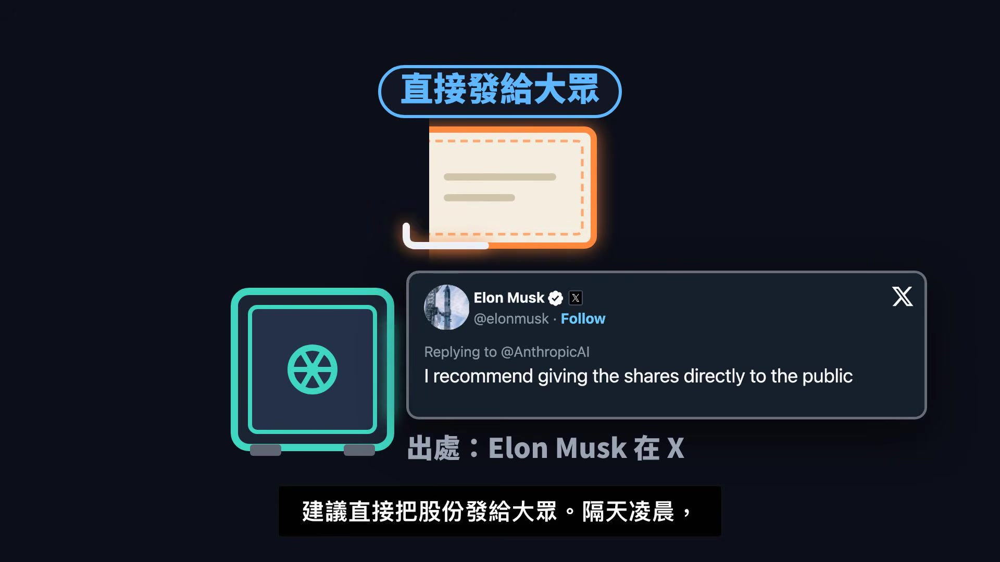

**逐字稿片段：** 說明年要送美國每一個小孩一股SpaceX,

**話題推測：** 提及Elon Musk將贈送SpaceX股份給美國小孩。

---

## 00:00:35

**逐字稿片段：** 一邊是交給基金, 一邊是交給公司, 一邊是交給基金, 一邊是直接發到手上 之後有人叫好 有人懷疑 也有人說與其捐 不如繳稅 最後會走到一個老問題

**話題推測：** 開始比較兩種送股方案。

---

## 00:00:44

**逐字稿片段：** 要不要定期發錢給每個人 臺灣也發過兩次現金 那算不算 先說清楚 這集不是投資建議 我們只整理公開資料 先從名詞開始 一家公司可以分成很多等份 每一份叫股份 你可以把公司想成一整個披薩 你手上有幾片 就代表你擁有這家公司多少 手上有股份的人叫股東 公司越賺錢 披薩就越大 你那一片也跟著更值錢 股東還能投票 公司的大事 照手上的股份多少來決定 還有一個名詞 叫董事會 是股東選出來 替大家管理公司的一小群人 Anthropic的公司形式叫公益公司 它還是要賺錢的盈利公司 可是法律要求董事會 除了股東的利益 也要兼顧張成禮寫下的公益目的 投票這件事先記著

**話題推測：** 引入「定期發錢給每個人」的議題。

---

## 00:01:26

**逐字稿片段：** 等一下會用到 先看Anthropic 它在官網公告 要把一部分股份 放進一個新成立的基金

**話題推測：** 詳細說明Anthropic的送股計畫。

---

## 00:01:32

**逐字稿片段：** 叫Anthropic Public Benefit Fund 中文可以叫公益基金 一開始放進去的是公司5%的股份 用披薩來說 就是20片裡拿出一片 這5%還要股東同意才會生效 公告接著寫

**話題推測：** 介紹Anthropic成立的「公益基金」名稱。

---

## 00:01:46

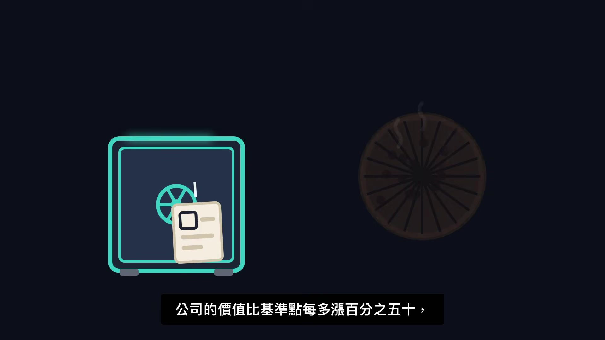

**逐字稿片段：** 公司的價值比基準點每多漲50% 董事會可以決定再多放兩個百分點 這要看董事會 不是自動加 基準點是多少 最多加到多少 公告都沒有公佈

**話題推測：** 說明公司價值增長時，董事會可決定增加股份的條件。

---

## 00:01:56

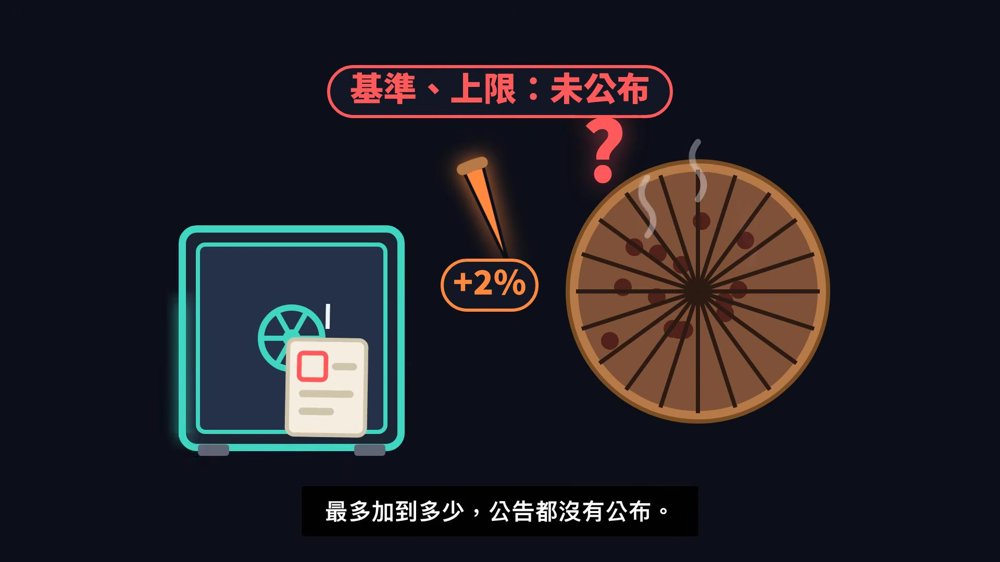

**逐字稿片段：** 這個基金的法律形式叫有限責任公司 英文縮寫是AOLC 公告還用了一個詞叫權支 意思是這家有限責任公司 百分之百由Anthropic自己擁有

**話題推測：** 說明基金的法律形式為「有限責任公司」。

---

## 00:02:06

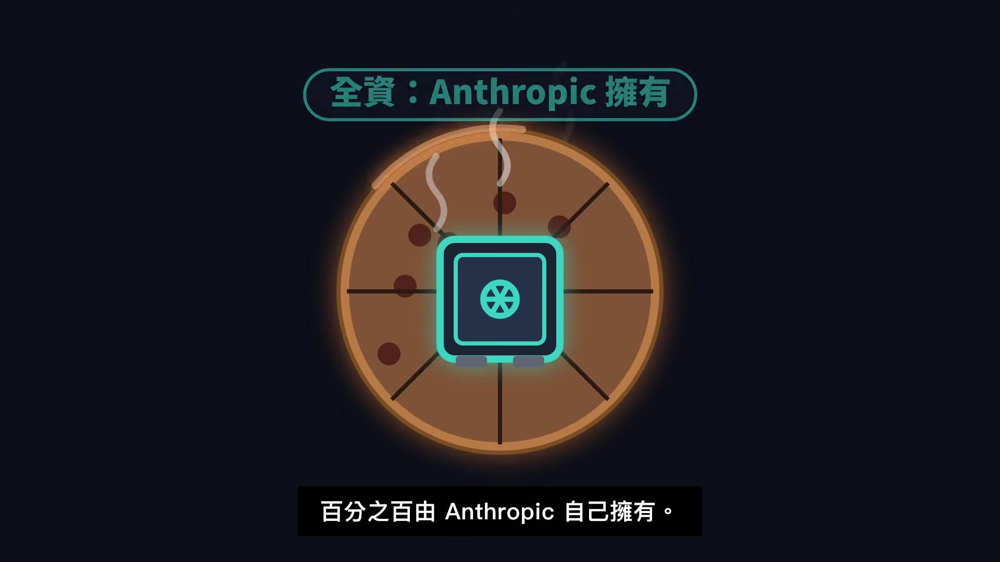

**逐字稿片段：** 可是新聞常寫的卻是大約兩成 這個數字來自共同創辦人Jack Clark 他現在是公司的公益負責人 他在X上寫 加上之前的承諾 大約兩成股份會用在公共利益上

**話題推測：** 提出新聞報導中「大約兩成」的股份數字，與公告的5%不同。

---

## 00:02:17

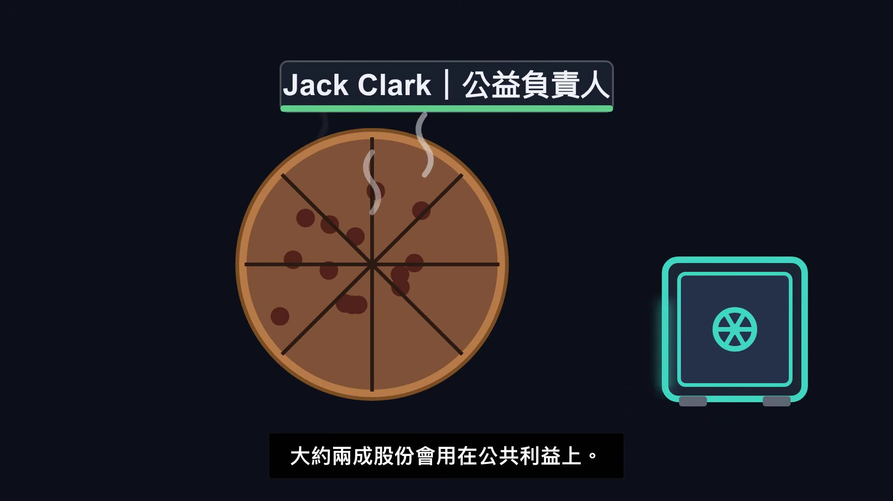

**逐字稿片段：** 這兩成是三樣東西加起來的 一樣是基金 另一樣是共同創辦人當初承諾 要捐出自己手上八成的股份 最後一樣是員工承諾捐股 公司在跟著配對 配對的比例 公告沒有寫 後面兩樣是個人的承諾 公告沒有說他們會放進這個基金 真正放進基金的 只有百分之五 基金的股份怎麼用 公告舉了兩條路 大筆捐給傳統的非盈利組織 或直接發給特定的族群 而且這些股份不準用在遊說和政治現金 還記得投票嗎 這些股份投票時聽誰的 誰來管理 公告沒有說明 只說未來幾個月會公佈 你可以把基金想成一位管家 他決定股份怎麼用 只是工作規則還沒有公佈

**話題推測：** 解釋「兩成股份」是由哪三部分組成。

---

## 00:02:56

**逐字稿片段：** 另一邊是Mask 他回覆Anthropic的那一句是 我建議直接把股份發給大眾 幾個小時後 他又在底下補一句 這就是我要做的 隔天凌晨 他另外發了一則貼文 沒有回覆任何人 他寫

**話題推測：** 轉向闡述Elon Musk的送股方案。

---

## 00:03:09

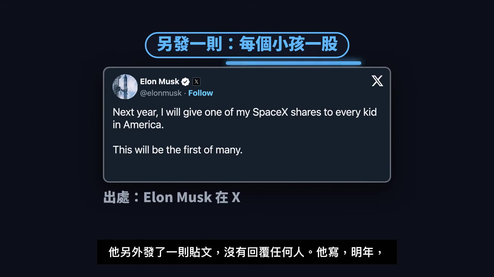

**逐字稿片段：** 明年我會把我的一股 SpaceX股份 送給美國每一個小孩

**話題推測：** 說明Elon Musk承諾明年送出SpaceX一股。

---

## 00:03:13

**逐字稿片段：** SpaceX是Mask的太空公司 今年6月走了一步叫上市 意思是股份開放給一般人買賣 每天都有價格 用披薩來說 Mask是從他自己那一盤裡 每個小孩分一片

**話題推測：** 介紹SpaceX是Elon Musk的太空公司。

---

## 00:03:24

**逐字稿片段：** 大約7000多萬個小孩 總共大約100億美元 這是媒體用人口普查和股價算的 不是Mask說的 小孩怎麼算 要不要是公民 股份怎麼轉過去 他都還沒有公佈 SpaceX也沒有遞交任何正式文件

**話題推測：** 提及大約7000多萬個小孩將是股份受贈者。

---

## 00:03:35

**逐字稿片段：** 那政府的賬戶又怎麼遷進來 先講名詞 美國有一種賬戶

**話題推測：** 引入政府賬戶與股份轉移的議題。

---

## 00:03:40

**逐字稿片段：** 叫川普賬戶 是聯邦政府替小孩開的投資賬戶 Mask的貼文 沒有寫川普賬戶這幾個字 他只在回覆投資人時 標記了川普賬戶的官方賬號 說謝謝幫忙讓這件事成真 根據Bloomberg報導 一位匿名的知情人士說 Mask原則上同意走川普賬戶

**話題推測：** 介紹「川普賬戶」這個名詞。

---

## 00:03:56

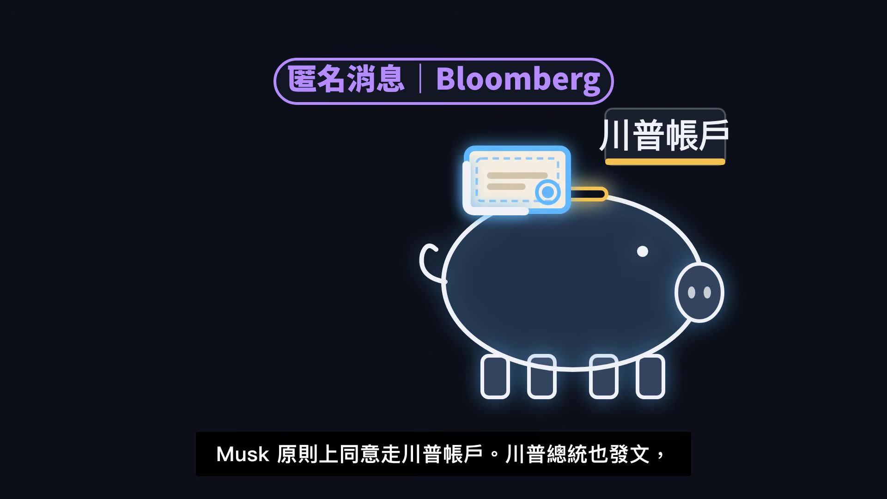

**逐字稿片段：** 川普總統也發文 謝謝Mask 透過川普賬戶送股給好幾百萬個小孩 這是川普而匿名消息的說法 Mask本人還沒有講明 如果真的走這條路

**話題推測：** 提及川普總統對此事的發文。

---

## 00:04:06

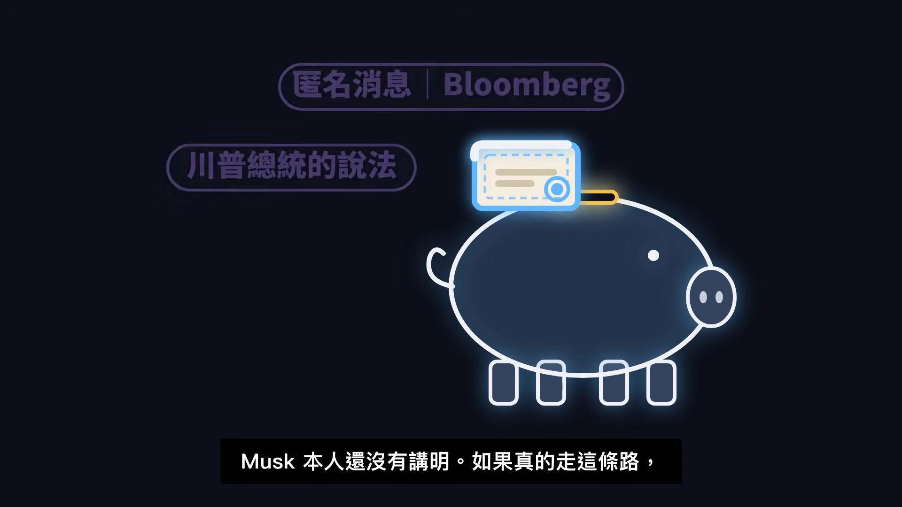

**逐字稿片段：** 財政部9月底公佈的規則 就會管到他 個人不能直接捐股票 要透過合格的慈善組織 而且要給一整群小孩捐進去的股票 5年內不能賣 除非賬戶先到期 賬戶到小孩17歲 那年年底就到期 這些是規則 Mask實際會怎麼做 還沒有證據

**話題推測：** 引入財政部9月底公佈的相關規則。

---

## 00:04:22

**逐字稿片段：** 兩個方案擺在一起 一個像管家 一個像口袋

**話題推測：** 開始比較Anthropic和Elon Musk的兩個送股方案。

---

## 00:04:25

**逐字稿片段：** 我們用三個問題來比 誰控制 誰受益 什麼時候兌現 誰控制 基金的股份還在 Anthropic自己的有限責任公司裡 投票聽誰的也沒說 啊Mask那一股 如果真的送到小孩手上 就變成小孩自己的 誰受益 基金可以挑對象 Mask是每個美國小孩各一股 人人一樣 但只限美國也只限小孩 什麼時候兌現 基金要等股東同意和治理細節 Mask說明年 如果走川普賬戶 股票還要放好幾年才能賣 整理一下 第一部分的答案是 基金是把股份交給規則 還沒公佈的管家 直接發是放進每個人的口袋 兩邊都還有很多細節沒寫清楚 這三個問題 我們接下來一路帶著走 帶著這三個問題

**話題推測：** 提出三個比較方案的問題：誰控制、誰受益、什麼時候兌現。

---

## 00:05:04

**逐字稿片段：** 再來看大家怎麼說 這幾天的意見分得很開 也跟政治立場有關 所以我們兩邊都放 也不替任何人貼標籤

**話題推測：** 轉向整理社會各界對送股方案的意見。

---

## 00:05:11

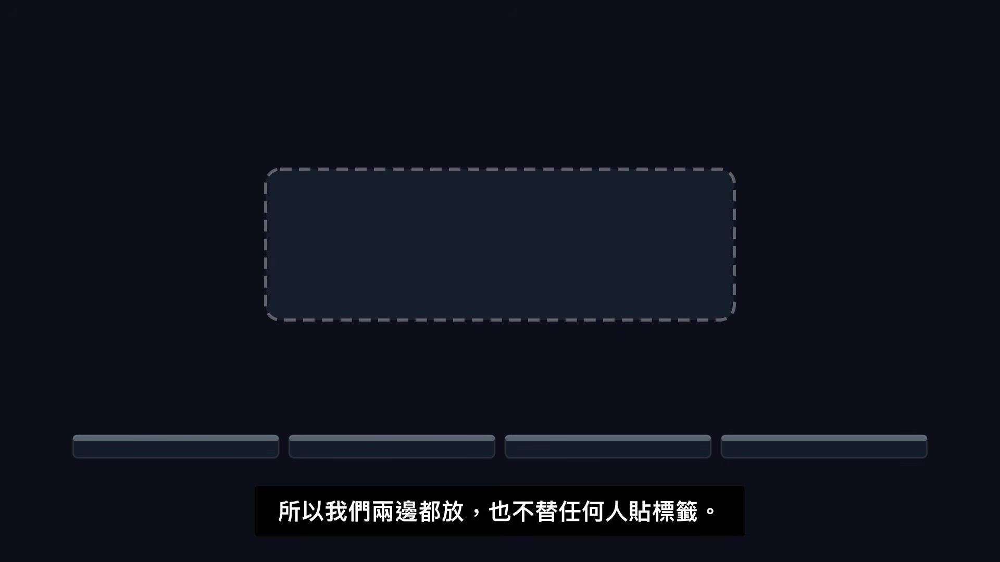

**逐字稿片段：** 我們把意見分成四組 支持的 懷疑的 反對的 還有提出別的辦法的 先看支持的 紐約時報的科技記者Kevin Rose在X上寫 這可能是史上最大的一筆公益資本承諾 他用的詞是可能 前提是真的兌現 戴爾電腦的創辦人 Michael Dell 回應 Musk 說 一整個世代的小孩會長大成為 SpaceX 的股東 Anthropic 的副資訊安全長 Jason Clinton 說 員工捐股的計畫早就有了 這名公司不是說說而已 不過他是公司裡的人

**話題推測：** 將意見分為支持、懷疑、反對和提出替代方案四組。

---

## 00:05:39

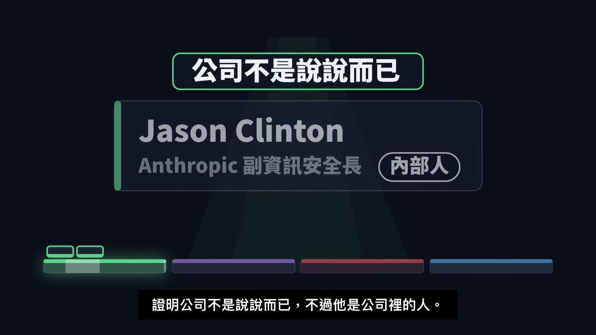

**逐字稿片段：** 懷疑的人 問的多半是細節 總統科技顧問委員會的共同主席 David Sachs 引用 Jack Clark 那則貼文說 你們把兩成股權放進一個有限責任公司 是不是真的對公眾好 還要再看 後半句是合理的問題 前半句跟公告原文不一樣 放進去的只有5% 根據Marketplace的報導 稅法教授Steven Ding說 基金會每年都被要求捐出一部分資產 這個有限責任公司連這條規定都沒有 同一篇報導裡 慈善法教授Ray Madoff問

**話題推測：** 轉向討論懷疑者的觀點。

---

## 00:06:06

**逐字稿片段：** 一股大約150美元的SpaceX 到底能幫上誰什麼嗎 電動車媒體Electric的主編 Fred Lambert 則懷疑Mask會不會真的做到 懷疑的人不一定反對分錢 他們要的是看得見的規則

**話題推測：** 提及一股SpaceX約150美元的價值。

---

## 00:06:17

**逐字稿片段：** 反對的人不滿的是方向 國防科技公司 安杜瑞爾的創辦人 Palmer Luckey回覆Mask時說 他們說的公共利益是在幫其他所有人 不是幫美國民眾 投資人Jason Clark Ennis用的是諷刺 他說Anthropic應該辦一個計劃

**話題推測：** 轉向討論反對者的觀點。

---

## 00:06:32

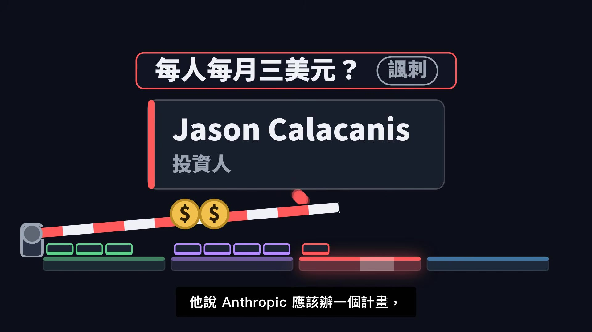

**逐字稿片段：** 每個月發給每個美國人三美元 另一邊的批評對著Mask 根據SF Standard的報道 慈善資料網站Guided Star的前執行長 Jacob Harrod認為Mask 這一筆比較像是在買好感 反對的人有的覺得錢留錯了地方 有的覺得這只是姿態

**話題推測：** 諷刺性地提出每月發給每個美國人三美元的方案。

---

## 00:06:47

**逐字稿片段：** 最後一組說換個做法 伯克萊的經濟學家Gabriel Zuckman回覆Mask 說他們的研究發現 Mask跟其他億萬富翁一樣

**話題推測：** 轉向討論提出替代方案者的觀點。

---

## 00:06:56

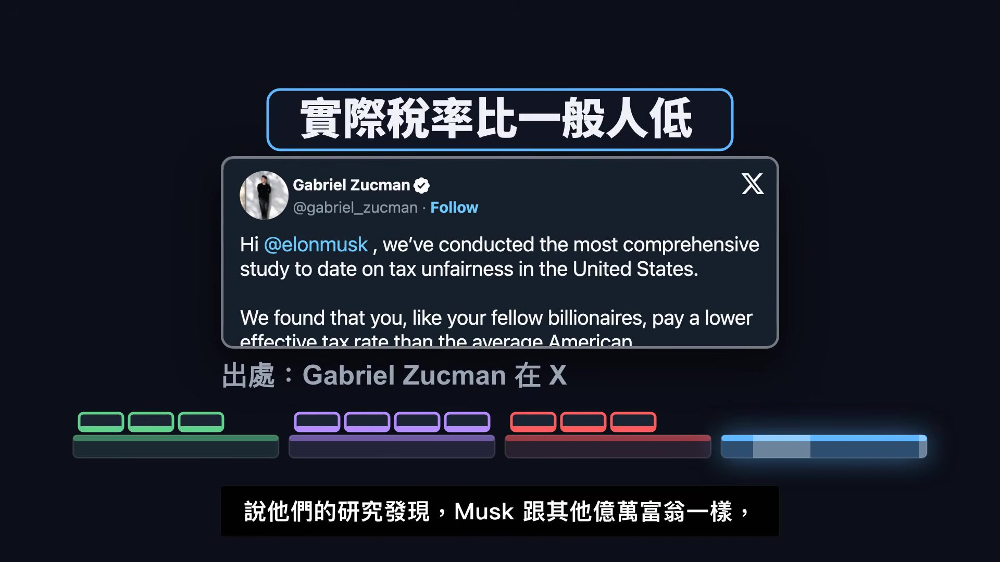

**逐字稿片段：** 實際繳的稅率比一般美國人還低 根據媒體轉述 他接下來的建議是 與其做慈善不如多繳稅 根據SF Standard的報道 史丹佛慈善與公民社會中心的執行主任 Priya Shankar說 Anthropic的基金應該有獨立的董事會 才有公信力 這種想法不新

**話題推測：** 提及Mask及其他億萬富翁的實際稅率比一般美國人低。

---

## 00:07:14

**逐字稿片段：** 2017年 比爾蓋茨就說過 機器人做了工人的工作 也應該繳差不多的稅 諾貝爾經濟學獎得主 愛塞默魯和同事的研究發現 美國的稅法 讓情人比買機器貴很多 他們主張 把勞動的稅降下來 把機器設備的稅提高 整理一下這四組 支持的人 看到有人願意拿出股份 懷疑的人 問誰控制 什麼時候兌現 反對的人 在意誰受益 提出別的辦法的人 多問了一個問題

**話題推測：** 引用2017年比爾蓋茲關於機器人稅的說法。

---

## 00:07:41

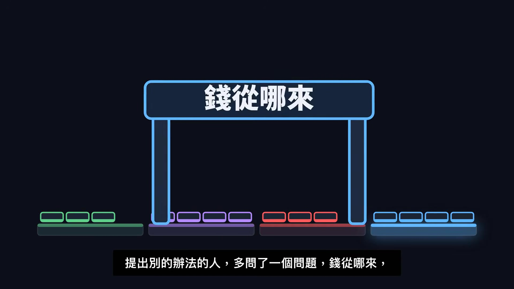

**逐字稿片段：** 錢從哪來 是靠公司自願捐 還是靠稅 自願捐 公司可以決定給多少 也可以不給 靠稅比較固定 可是要經過立法 所以這一部分的答案是 大家真的是同樣三個問題 再加上第四個 錢從哪來 很多人一講到AI的錢 就會走到一個老辦法 定期發錢給每個人 我們就用這四個問題 看看他做過的結果

**話題推測：** 引入第四個關鍵問題：「錢從哪來」。

---

## 00:08:01

**逐字稿片段：** 這個老辦法叫 全民基本收入 英文說寫UBI 意思是不看你有沒有工作 也不看你窮不窮 定期發一筆錢給每一個人 講得最大聲的是Mask

**話題推測：** 正式介紹「全民基本收入」（UBI）的名稱。

---

## 00:08:12

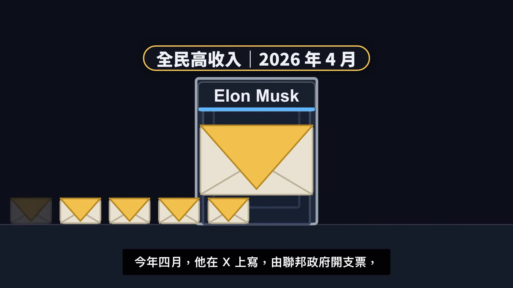

**逐字稿片段：** 今年4月他在X上寫 由聯邦政府開支票 發全民高收入 是處理AI造成失業最好的辦法 而且東西會多到 不會通貨膨脹 也就是物價不會一直漲 根據報道 有經濟學者質疑這一點 這周有網友說 他送股是全民基本收入的開始 他還特別更正是高收入 錢從哪來 要發多少 他沒有說 Anthropic的執行長Dario

**話題推測：** 引用Elon Musk今年4月在X上關於全民基本收入的貼文。

---

## 00:08:33

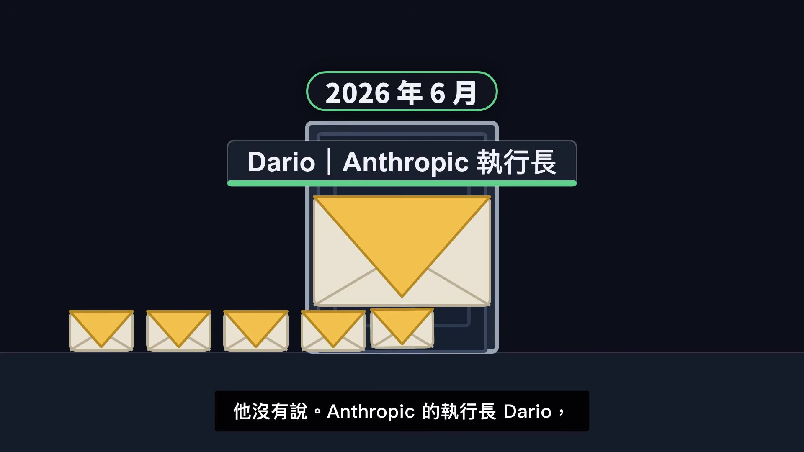

**逐字稿片段：** 今年6月發了一篇政策文章 他寫全民基本收入這類做法 可以向相關的公司課稅 或是提高一種稅來支應 叫資本利得稅 就是賣股票 賣資產賺到的錢 要繳的稅 哪些算相關的公司

**話題推測：** 引用Anthropic執行長Dario今年6月政策文章中關於UBI資金來源的建議。

---

## 00:08:46

**逐字稿片段：** 他沒有寫 另一派不發錢 要讓大家持有股份

**話題推測：** 轉向討論不發錢，而是讓大眾持有股份的替代方案。

---

## 00:08:50

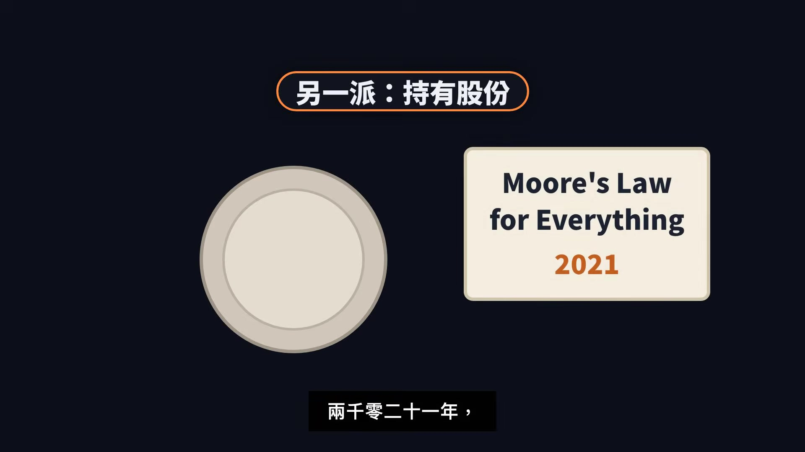

**逐字稿片段：** 2021年OpenAI的Sam Altman提出美國股權基金 大公司每年用股份交出一小部分市值 分給每個成年公民 用披薩來說 就是每家大公司每年切一小片 放進大家共有的盤子 根據媒體轉述 他今年說不再那麼相信全民基本收入 轉而講集體持有運算能力或股份

**話題推測：** 提及2021年OpenAI的Sam Altman提出的「美國股權基金」。

---

## 00:09:08

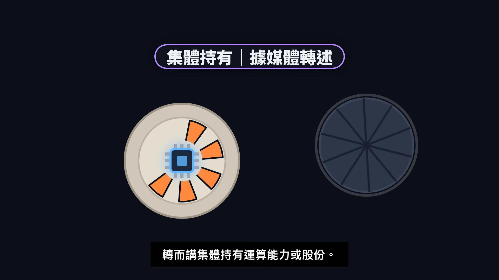

**逐字稿片段：** OpenAI今年4月的白皮書 也提出全民財富基金 讓沒買股票的人也有一份 Anthropic 6月的經濟政策框架 把失業衝擊分成三級 最輕的一集就主張現在開始做 叫全民資本賬戶 幫每個美國人開投資賬戶 放進AI公司的股份 越早放 增值滾得越久 起點就是川普賬戶 這一類的新生兒賬戶 全民基本收入 只放在最嚴重的那一級當候選 寫明還不準備主張

**話題推測：** 引用OpenAI今年4月白皮書中提出的「全民財富基金」。

---

## 00:09:33

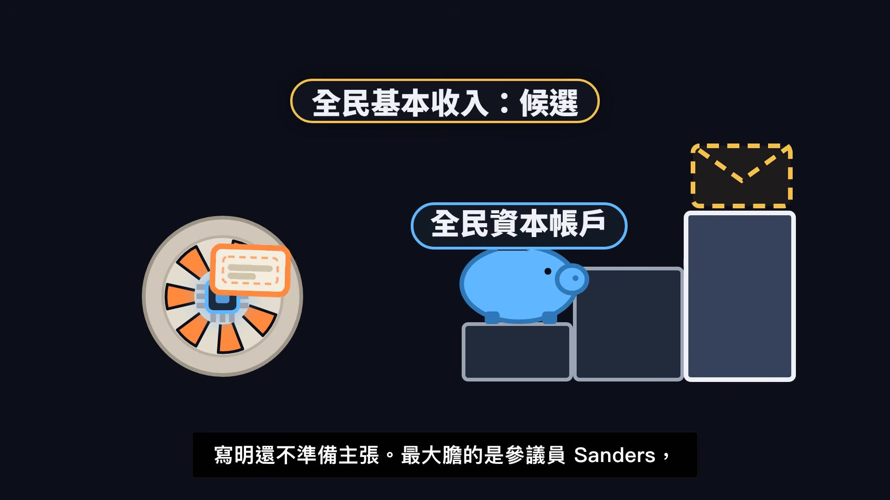

**逐字稿片段：** 最大膽的是參議員Sanders 根據報導 他提大型AI公司 一次交出一半股份 放進全民的基金 這些都還是提案

**話題推測：** 介紹參議員Sanders關於大型AI公司股份分發的更大膽提案。

---

## 00:09:41

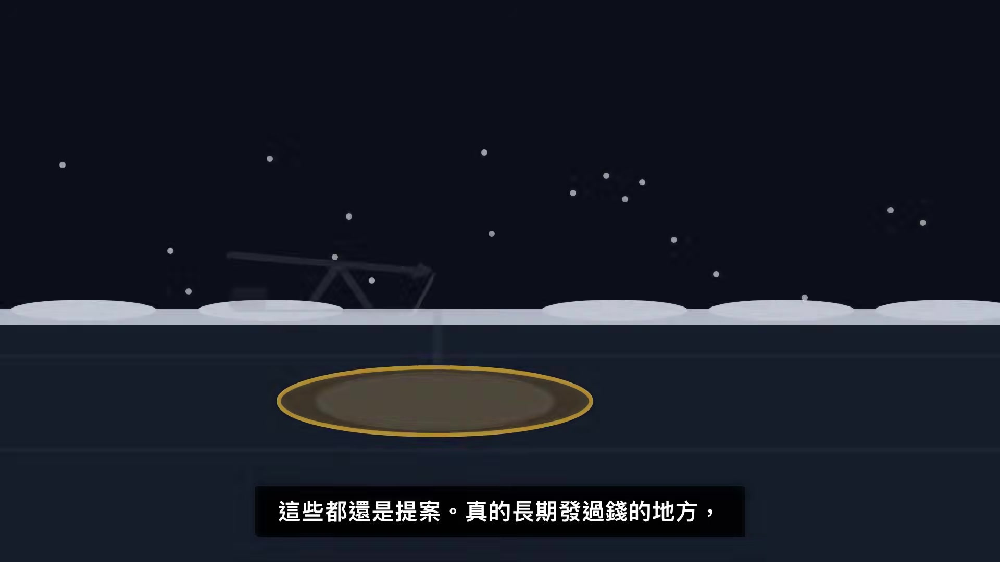

**逐字稿片段：** 真的長期發過錢的地方 最常被提的是阿拉斯加

**話題推測：** 轉向討論真實世界中長期發錢的案例。

---

## 00:09:45

**逐字稿片段：** 1976年 阿拉斯加修改州憲法 把一部分石油收入存進一個基金 叫永久基金 1982年開始 每年發錢給每個居民 你可以把它想成一口油井的分紅 油井是大家賺到的錢 每年分一點到每個人手上 2026年 每個居民拿到1200美元 其中200美元是能源補助 經濟學家Damon Jones和Joanna Marinsko

**話題推測：** 提及1976年阿拉斯加修改憲法，建立永久基金。

---

## 00:10:07

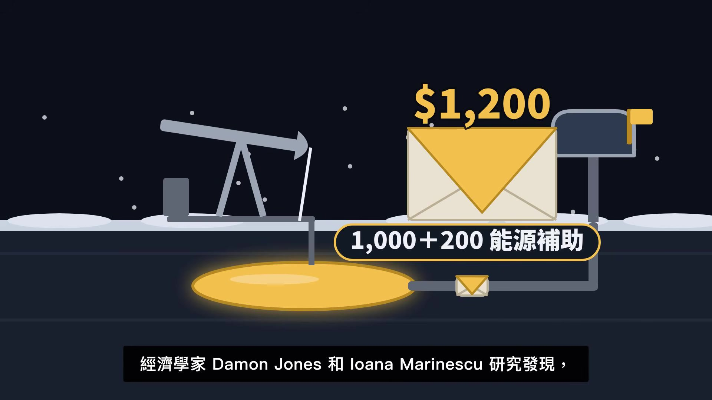

**逐字稿片段：** 研究發現 整體就業沒有變少 兼職多了一點 可能是大家拿錢去消費 餐廳和商店需要更多人手 不過一年1000多美元不夠生活 比較像分紅 不是能靠它過日子的收入 那發到夠用的錢會怎樣 這就要看實驗

**話題推測：** 提及Damon Jones和Joanna Marinsko研究的發現。

---

## 00:10:21

**逐字稿片段：** 美國有一個研究機構叫Open Research Sam Altman是他的董事

**話題推測：** 介紹美國Open Research機構進行的UBI實驗。

---

## 00:10:25

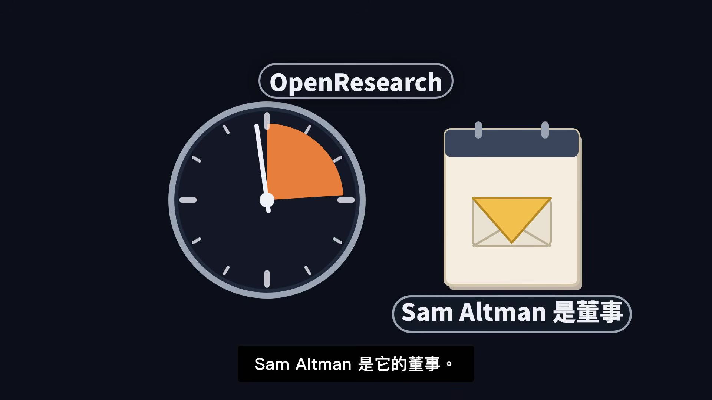

**逐字稿片段：** 他們找了3000個21歲到40歲的低收入 美國人抽1000人每個月拿1000美元 連續三年 另外2000人每個月只拿50美元 這一群叫對照組 就是拿來比較的那一群 結果拿1000美元的人 平均每週少工作一個多小時 自己賺的也少一點 多出來的時間主要花在休閒上 壓力和吃不飽的情況 一開始明顯改善 可是很快就消退了 要記得 這是低收入的年輕人 不是全民 而且那三年剛好碰上疫情

**話題推測：** 說明Open Research實驗對象的數量、年齡和收入水平。

---

## 00:10:51

**逐字稿片段：** 芬蘭換個方向 2017年到2018年 芬蘭政府隨機抽了2000個 領失業給付的人 每月無條件發560歐元 結果工作只多了一點點 他們說對生活比較滿意 可是問卷回覆的人不多 官方也說 不能確定就是基本收入造成的

**話題推測：** 轉向介紹芬蘭的UBI實驗。

---

## 00:11:07

**逐字稿片段：** 肯亞的實驗最出人意料 一個叫GiveDirectly的慈善組織 把村子隨機分組 有的一次給一大筆 有的每月只給兩年 有的每月給承諾連續給12年 發了兩年的時候看 一次給一大筆和承諾給12年的 效果差不多大 村裡做小生意的變多 只給兩年的效果最小 工作量沒有減少 只是從替人打工 轉成自己做生意 研究作者裡有兩位是 Give directly的董事 那為什麼不全國直接發

**話題推測：** 轉向介紹肯亞的UBI實驗。

---

## 00:11:35

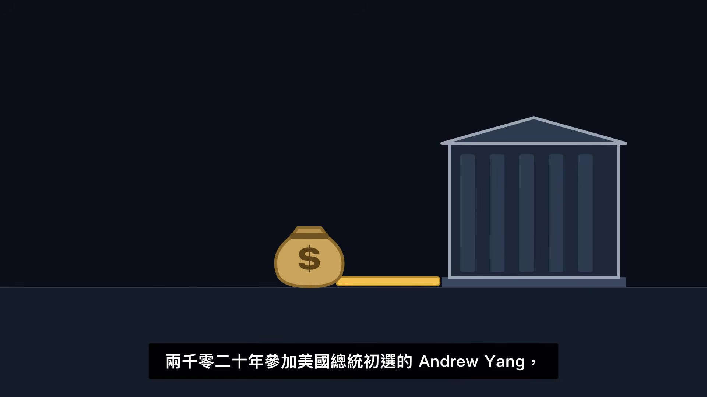

**逐字稿片段：** 2020年參加美國總統初選的 Andrew Young 主張每個18歲以上的公民 每月1000美元 叫自由紅利 錢主要靠一種稅 叫加值稅 就是在每個生產環節 都刻一點的消費稅 已經在領福利的人 兩個只能選一個

**話題推測：** 提及2020年美國總統初選參選人Andrew Yang的UBI提案。

---

## 00:11:48

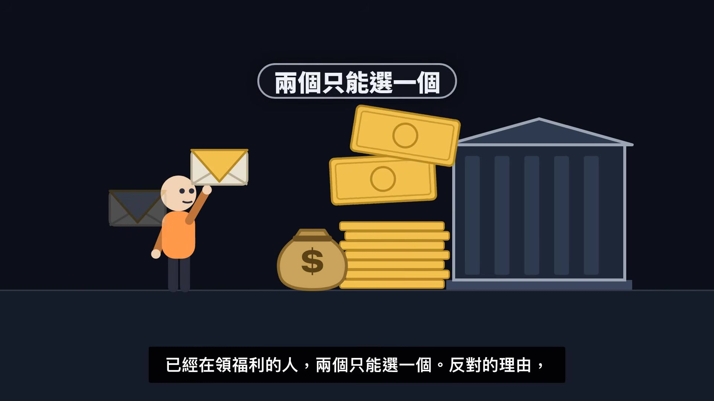

**逐字稿片段：** 反對的理由先是成本 經濟學家Hoynes和Rostin算過 每個美國成年人一年一萬兩千美元

**話題推測：** 開始討論反對全民基本收入的理由，首先是成本。

---

## 00:11:55

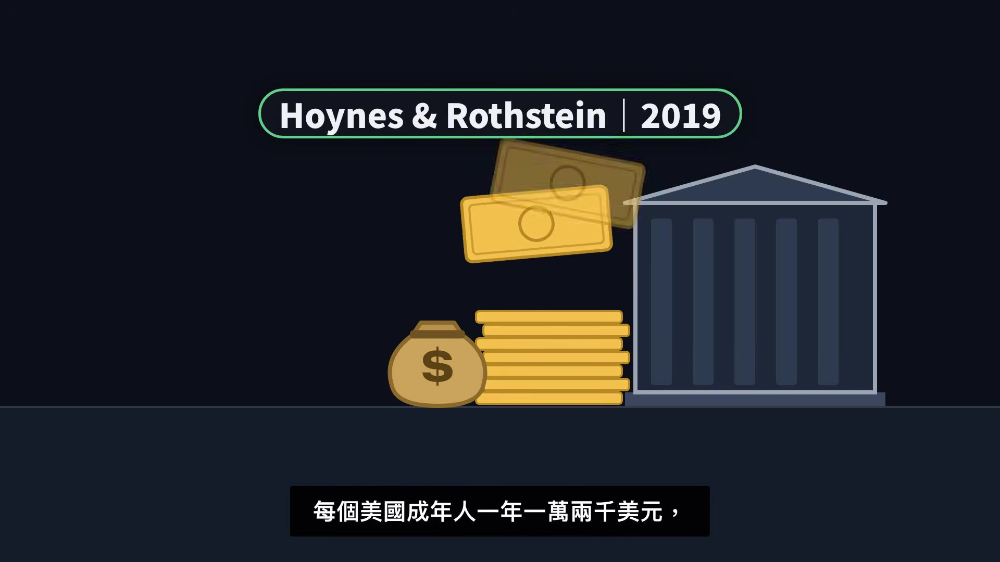

**逐字稿片段：** 一年大約要三兆美元 差不多是聯邦政府總支出的四分之三 再來是公平 如果把專門給窮人的補助 拿去平均發給每個人 錢反而從窮人流向中產階級 智庫預算與政策優先中心認為 這可能讓窮人更窮 最後是物價 我們找不到專門證明 全民基本收入會造成通貨膨脹的一手研究 舊金山聯邦準備銀行的研究認為 疫情時的整體紓困支出 可能把美國物價推高一些 另一個肯亞研究則發現 大筆現金進到貧窮的村子 物價幾乎沒動 但不能直接掏到別的地方 整理一下這些實驗 拿到錢的人 工作沒有大幅減少 有的少一點 有的不變 有的轉成自己做生意 好處常常有 但有些很快就消退 限制也很清楚 規模都很小 時間都不長 對象常常只限窮人或失業的人 Hoynes和Rostin也寫過 小規模的事辦 很難回答 全國長期實施會怎樣 用四個問題看 實驗回答了誰受益的一部分 卻沒有回答錢從哪來 所以這一部分的答案是 發錢 不會讓大家都不工作 但真正難的是錢從哪來

**話題推測：** 提及實施全民基本收入一年約需三兆美元的巨額成本。

---

## 00:12:55

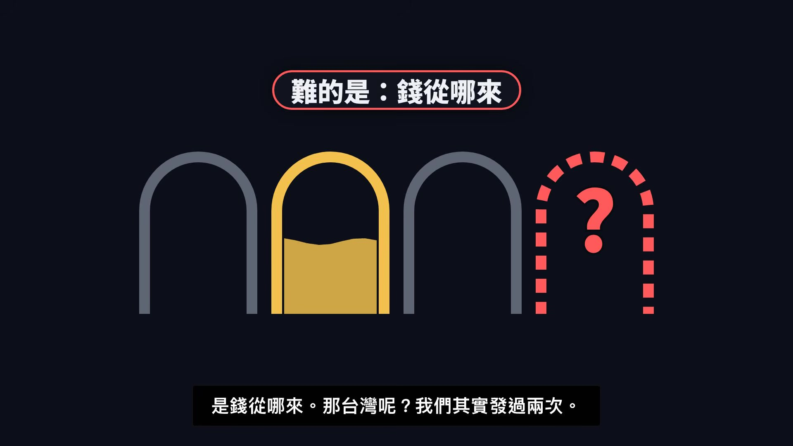

**逐字稿片段：** 那臺灣呢 我們其實發過兩次

**話題推測：** 轉向討論臺灣發放現金的案例。

---

## 00:12:58

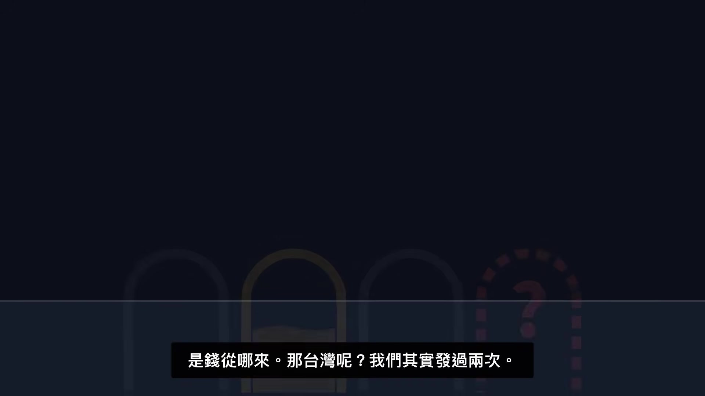

**逐字稿片段：** 2023年 臺灣每個人可以領6000元 法源是一部特別條例 名字最後幾個字是 全民共享經濟成果 理由是前一年的稅收比預算多 大約2350萬人領了超過9成9

**話題推測：** 提及2023年臺灣普發6000元的案例。

---

## 00:13:10

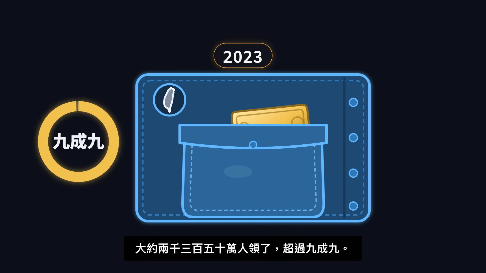

**逐字稿片段：** 2025年底到今年4月 又發了一次每人一萬元 特別條例寫的是 強化民眾消費韌性 擴大內需 根據中央社報導 行政院原本的版本沒有這一項 是立法院三讀室加進來的 兩次都像我們講的口袋 錢直接放進每個人手上 可是要說清楚 這是一次性的 是特別條例裡的單次發放 不是全民基本收入 全民基本收入要定期 一直發下去 用四個問題看 誰控制 是立法院和政府 誰受益啊 是每個人 什麼時候兌現 幾個月內就領到 錢從哪來 一次是多收的稅 一次是特別預算

**話題推測：** 提及臺灣又發放一次每人1萬元的案例。

---

## 00:13:45

**逐字稿片段：** 如果臺灣要做真的全民基本收入 每月1萬元 要多少錢 我們推算一下 大約2350萬人 乘上1萬元 再乘上12個月

**話題推測：** 進入假設臺灣實施全民基本收入的成本估算。

---

## 00:13:54

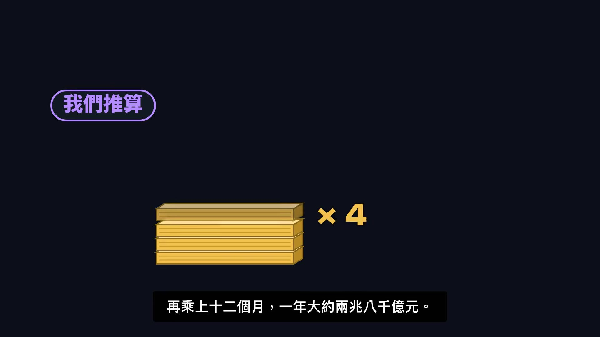

**逐字稿片段：** 一年大約2兆8千億元 這是我們推算的 不是官方數字 對照一下 普發1萬那一次的預算 大約只夠發一個月

**話題推測：** 推算出臺灣實施UBI每年約需2兆8千億元的成本。

---

## 00:14:01

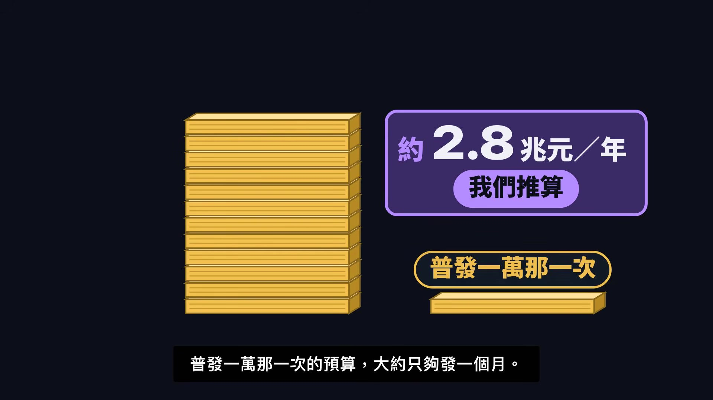

**逐字稿片段：** 臺灣的法律 怎麼說 今年1月公佈的人工智慧基本法 第15條寫 政府要彌平AI造成的技能落差 對 因為AI失業的人 依照工作能力輔導就業 他寫的是補技能和找工作 沒有寫發錢 我們也找了臺灣有沒有政黨 正式提出全民基本收入 查不到 官方的成本估算 我們也沒有找到 我們把這四個問題 帶回到你自己身上 下次聽到有人說要分AI的錢 可以先問誰控制誰受益 什麼時候兌現 錢從哪來 回頭看 Anthropic的基金規則還沒公佈 Mask的一股是直接發 方法還沒說 全民基本收入的實驗 效果比很多人想的溫和 錢從哪來還沒能回答 臺灣發過兩次口袋 都是一次性的 所以最後這一部分的答案是 不管哪一種分法 能不能長久 都看這四個問題有沒有寫清楚 哪一種比較好 判斷留給你 我們頻道之前 Jack Clark那一集講過 AI可能讓經濟變大 勞動拿到的那一份卻可能變小 發出那則兩層貼文的 就是他本人連結放在說明欄 我們回到開場那個問題 AI賺的錢 該怎麼分給所有人 這一週的兩個方案 一個像把股份交給 還沒公佈規則的管家 一個像直接放進每個人的口袋 有人叫好 有人懷疑 也有人說該靠稅不該靠捐 做過的實驗告訴我們 發錢不會讓大家都不工作 可是錢從哪來 還沒有人回答 也再提醒一次 這集不是投資建議 最後問你一個問題 如果AI賺的錢真的要分給每個人 你希望靠公司自己捐出來 還是靠政府課稅再發下去 留言告訴我 喜歡的話訂閱AI Notebook

**話題推測：** 轉向討論臺灣相關法律對AI衝擊的應對。

---
