# jimainotebook_dgrSyztWz1w — 關鍵畫面索引

- 來源逐字稿：[jimainotebook_dgrSyztWz1w_FIN.srt](jimainotebook_dgrSyztWz1w_FIN.srt)
- 影片：https://www.youtube.com/watch?v=dgrSyztWz1w
- 截圖數：47

## 00:00:13

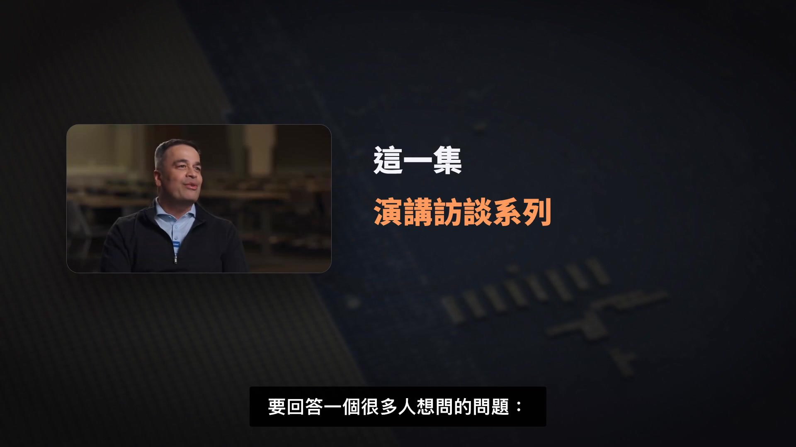

**逐字稿片段：** AI公司搶晶片搶到缺貨,為什麼晶片廠不能多蓋幾間,把晶片做出來就好?

**話題推測：** 提出本集核心問題：AI晶片為何缺貨？

---

## 00:00:19

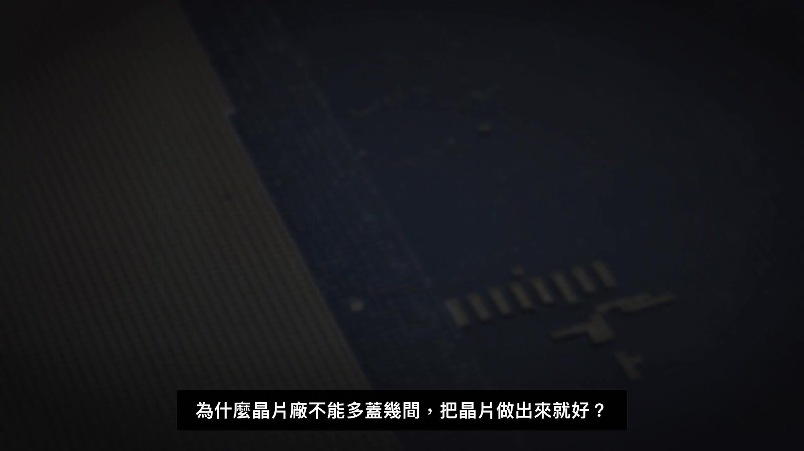

**逐字稿片段：** 今年10月中,臺積電董事長魏哲嘉在財報說明會上說, AI晶片的供給跟需求,差距還是很大。

**話題推測：** 引用台積電董事長魏哲家在財報說明會的發言與數據

---

## 00:00:26

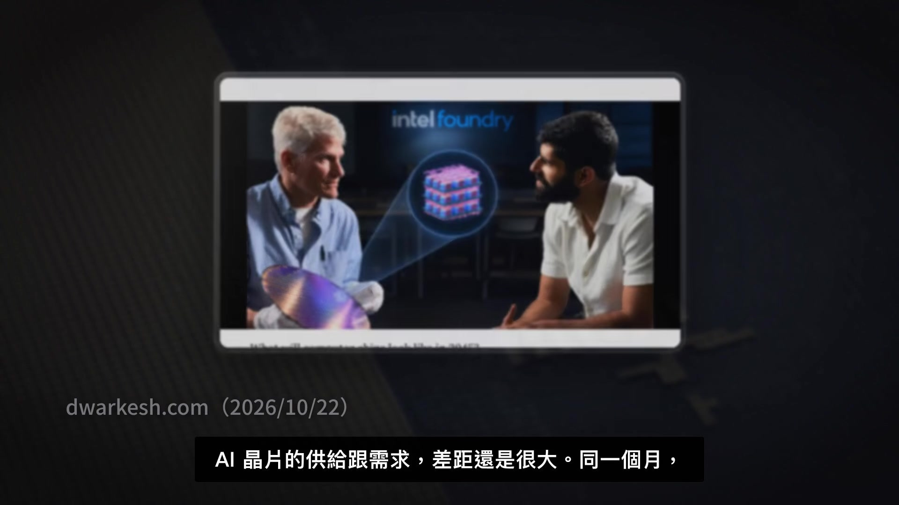

**逐字稿片段：** 同一個月,美國一位很有名的Podcast主持人發了一集特別的節目。 他到Intel最先進的晶片廠待了兩天,然後問Intel的技術長, 如果錢不是問題 全世界的設備夠不夠讓你們最先進的晶片產量變成十倍 技術長的回答是 不到十倍 大概兩倍

**話題推測：** 介紹美國Podcast主持人訪談Intel的故事背景

---

## 00:00:42

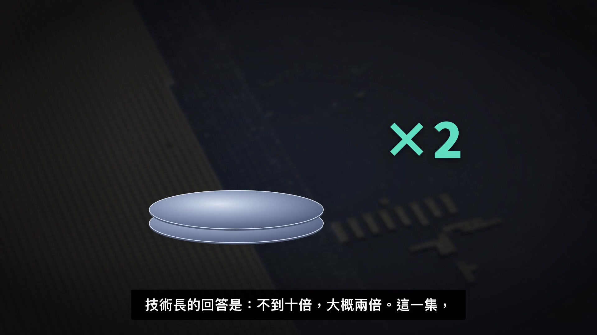

**逐字稿片段：** 這一集我們分三步 先看一顆最先進的晶片是怎麼做出來的 再看為什麼產量不能說加就加 最後看這件事對臺灣 對我們每一個人代表什麼

**話題推測：** 概述本集影片的三個主要分析步驟

---

## 00:00:52

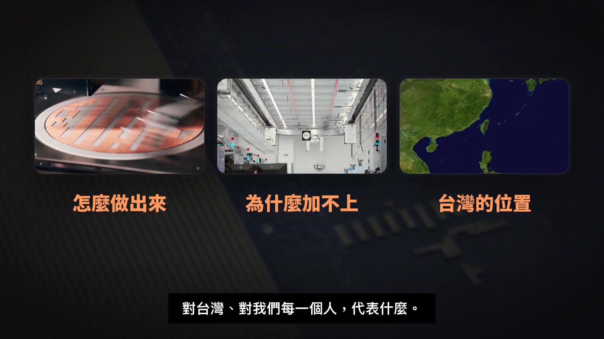

**逐字稿片段：** 先認識節目裡的三個人 主持人叫Dwarkesh Patel 他的podcast以長時間很技術的AI訪談出名 很多AI公司的負責人都上過他的節目 這一次他換了做法 先到工廠看兩天,再坐下來問 他訪問了兩個人 第一位是Chris Oth,Intel製程開發的副總裁 他負責的是把每一代新的製造方法帶進工廠 第二位是Pushkar Renade,Intel的技術長 他要回答的是更大的問題 全世界做得出多少晶片

**話題推測：** 介紹節目中提及的三位關鍵人物

---

## 00:01:19

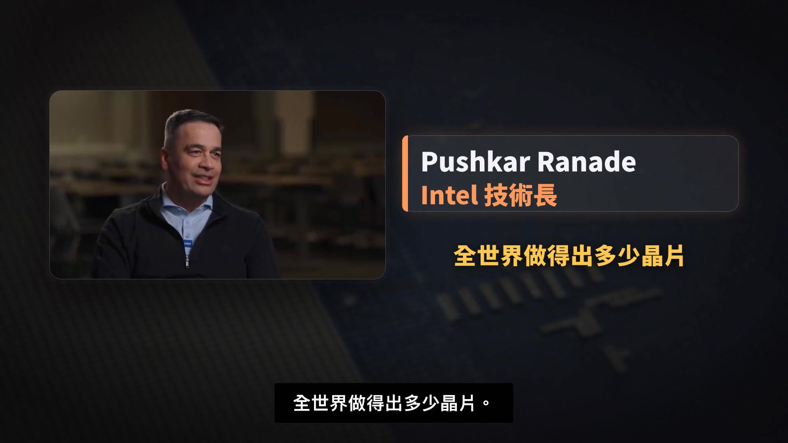

**逐字稿片段：** Intel是美國最老牌的晶片公司之一 過去幾十年自己設計晶片,自己製造 這幾年開始替別的公司製造晶片 跟臺積電、三星搶生意 要回答產量為什麼加不上去 得先知道一顆晶片是怎麼做出來

**話題推測：** 介紹Intel作為老牌晶片公司的背景與現況

---

## 00:01:33

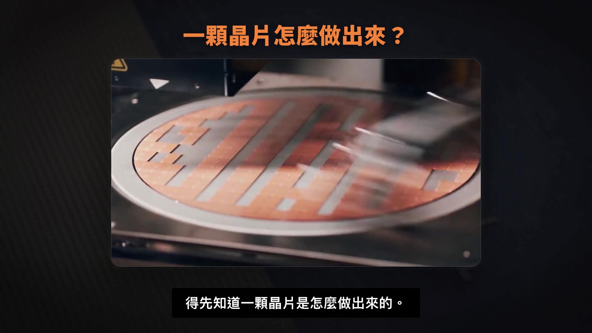

**逐字稿片段：** 先講兩個名詞 第一個叫晶圓 晶圓是一片圓形的薄片 晶片就是在它上面 一層一層做出來的 做好以後再切成一小塊一小塊

**話題推測：** 解釋第一個關鍵名詞「晶圓」

---

## 00:01:43

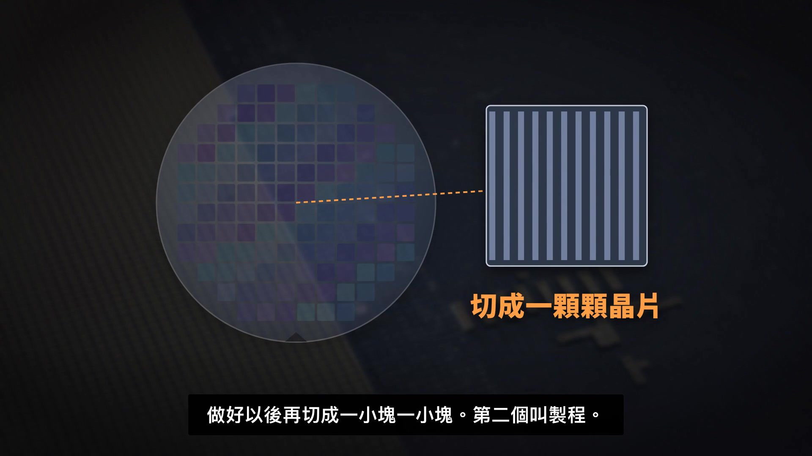

**逐字稿片段：** 第二個叫製成 製成是把一片晶圓變成晶片的整套做法 每一代新的製成都能把電路做得更小更省電 Intel正在準備的下一代製成 名字叫14A 主持人說預計2028年推出 Oth說 這一代已經開發了三年多 現在在做的事是把工廠裡每一臺設備 每一個步驟調到最穩

**話題推測：** 解釋第二個關鍵名詞「製程」

---

## 00:02:28

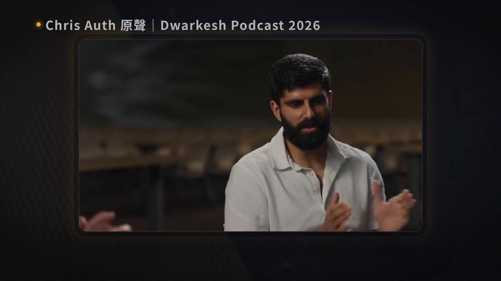

**逐字稿片段：** 2000個步驟 只要有一步出錯 那顆晶片就壞了 一片晶圓上做出來的晶片 有多少是好的

**話題推測：** 提及晶片製造的「2000個步驟」

---

## 00:02:34

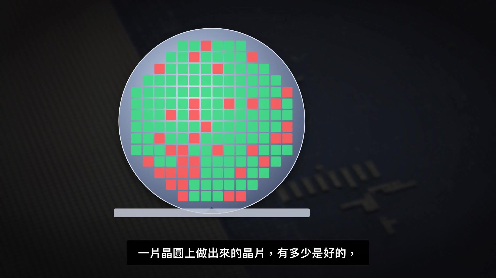

**逐字稿片段：** 這個比例叫良率 Oth說 他們找壞掉的地方 有兩種方法 一種是生產線上的檢查機器 一路掃過去 看哪裡有瑕疵 另一種是做完以後通電測試 再把壞掉的晶片切開 用電子顯微鏡看 問題在哪一層 就回頭找哪一段步驟

**話題推測：** 解釋「良率」的定義

---

## 00:02:50

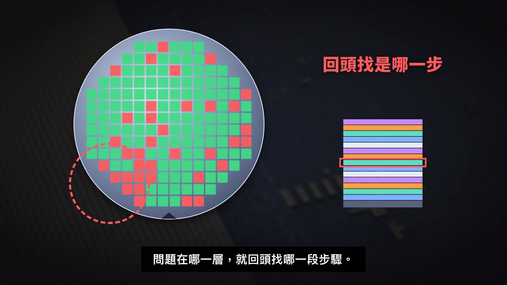

**逐字稿片段：** 技術長Renade 後來也舉了一個例子 同一間工廠 良率從6成拉到6成5 7成 做出來的晶片就多了一截 所以晶片廠 會為每一個百分點拼命 Oth也說 他們學到一件事 一代製程不要一次塞太多新發明 因為改得越多越難準時 而客戶要的是一個說到做到的時間表

**話題推測：** Intel技術長Renade舉例說明良率對產量的影響

---

## 00:03:10

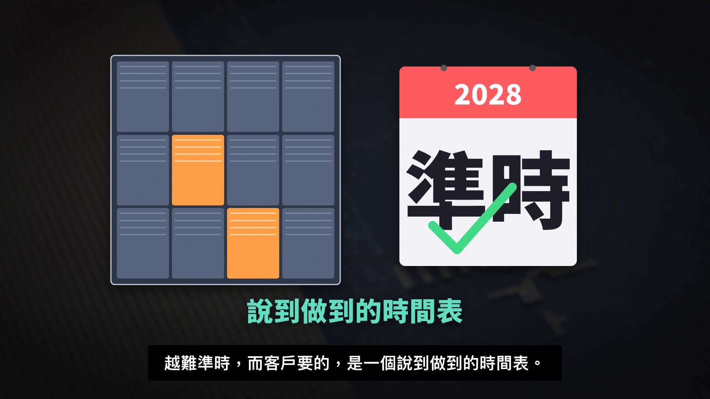

**逐字稿片段：** 2000個步驟裡 最關鍵的一種叫微影 微影是用光把電路的圖案印到晶圓上 有點像用投影機 把圖案投在一張感光的底片上 圖案越細 光的波長就要越短 今天最先進的微影機 用的是極紫外光

**話題推測：** 介紹晶片製造中最關鍵的步驟「微影」

---

## 00:03:25

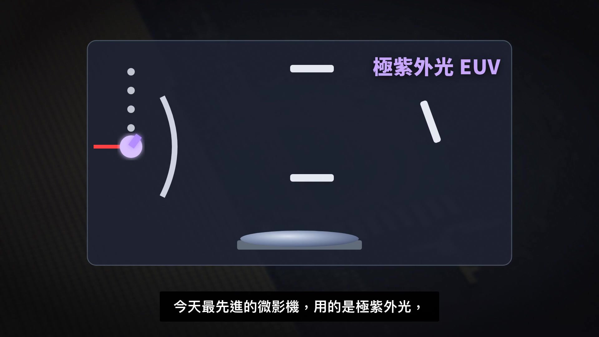

**逐字稿片段：** 英文簡稱EUV 全世界只有一家公司做得出這種機器 是荷蘭的ASML 它一年能出貨的臺數 到現在都還不到100臺 2025年整年是48臺 這些機器要分給臺積電 三星 Intel 還有這兩年拼命擴產的記憶體廠 而且一條生產線一旦定下來 每一個步驟就綁定特定型號的設備 不能臨時換別家的機器來做 Renedi也說 不只是極紫外光微影機 現在幾乎每一種晶片設備都缺貨

**話題推測：** 介紹最先進的微影技術「極紫外光」（EUV）

---

## 00:03:52

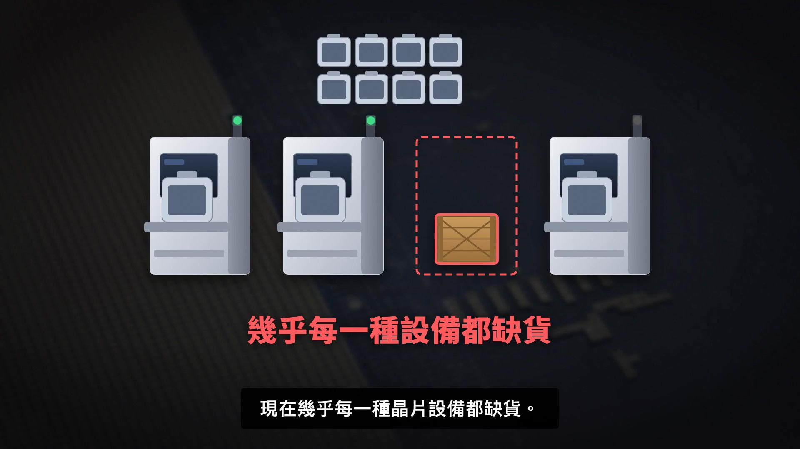

**逐字稿片段：** 這一部分的答案是 一顆最先進的晶片 要經過大約2000個步驟 每一步都靠特定的設備 其中最關鍵的微影機 全世界只有一家公司做得出來 一年不到一百臺 所以晶片廠能做多少晶片 不只看廠房有多大 更看裡面放了多少臺設備 還有每一臺設備能做出多少好的晶片 記住這件事 再來看AI到底要多少

**話題推測：** 總結晶片產量難以提升的原因

---

## 00:04:14

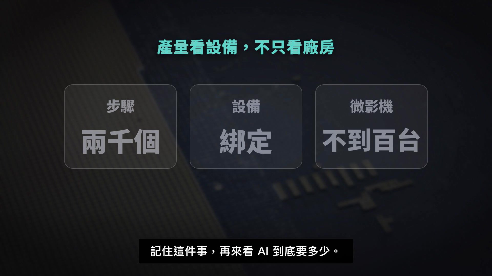

**逐字稿片段：** 先看需求

**話題推測：** 切換至AI晶片需求的主題

---

## 00:04:16

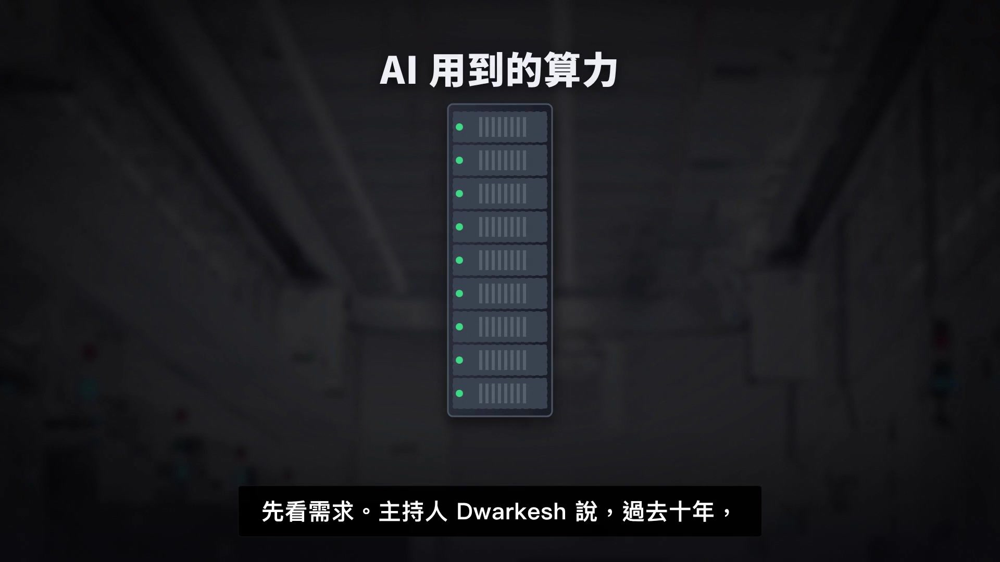

**逐字稿片段：** 主持人Dwarkish說 過去十年 AI用到的算力 大約每年變成原來的三倍

**話題推測：** 說明過去十年AI算力每年成長三倍的趨勢

---

## 00:04:22

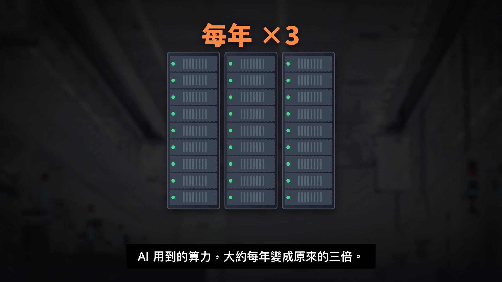

**逐字稿片段：** 這個說法有根據 研究機構Epoch AI估計 2022年以來 全世界AI晶片的總算力 大約每七個月就翻一倍 算起來每年三倍多 每年三倍是什麼概念 兩年就是九倍 五年是兩百多倍 AI公司不只想要更好的晶片 也想要多很多的晶片

**話題推測：** 引用研究機構Epoch AI的估計數據

---

## 00:04:39

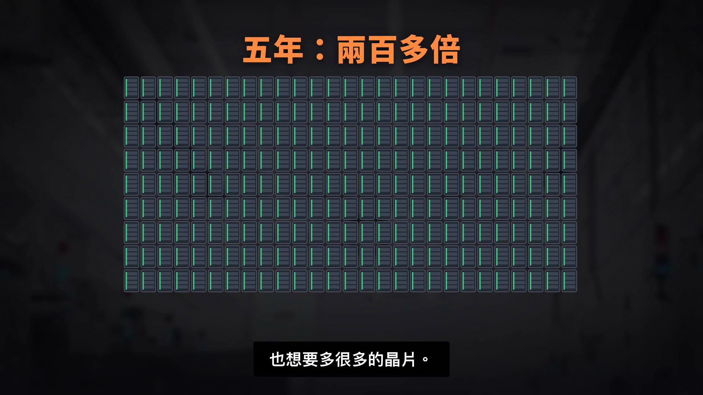

**逐字稿片段：** 臺積電今年十月的財報說明會說 今年的資本支出 也就是買設備蓋廠房的錢 會在600億到640億美元之間 董事長魏哲佳說 AI的需求非常強 而且越來越高 所以Dwarkish想問的就是一句話 照這個速度 晶片廠跟得上嗎

**話題推測：** 引用台積電財報，說明其今年的資本支出金額

---

## 00:04:56

**逐字稿片段：** 他把這個問題丟給了Intel的技術長 先介紹技術長Pushkar Ranade 他負責Intel長期的技術方向 包括晶片要怎麼做 還有工廠要怎麼擴大 Dwarkish先問他 設備這麼強會不會卡住你們 Renade說 會 他們只能想辦法 讓已經裝好的設備做出更多東西 然後Dwarkish問了全集最關鍵的問題 假設錢不是問題 全世界的設備 夠不夠讓你們最先進的晶片產量 變成十倍 因為AI業務行業在一年之內 有3X的計算 是的 一年之內 是的 你說這也不能繼續 除非整個供應鏈 從裝備供應商 到他們的供應商 他們的組織供應商 除非每個人都生產更多 是的 你組織不能增加出口

**話題推測：** 向Intel技術長提出關鍵問題：晶片廠能否跟上AI需求？

---

## 00:05:53

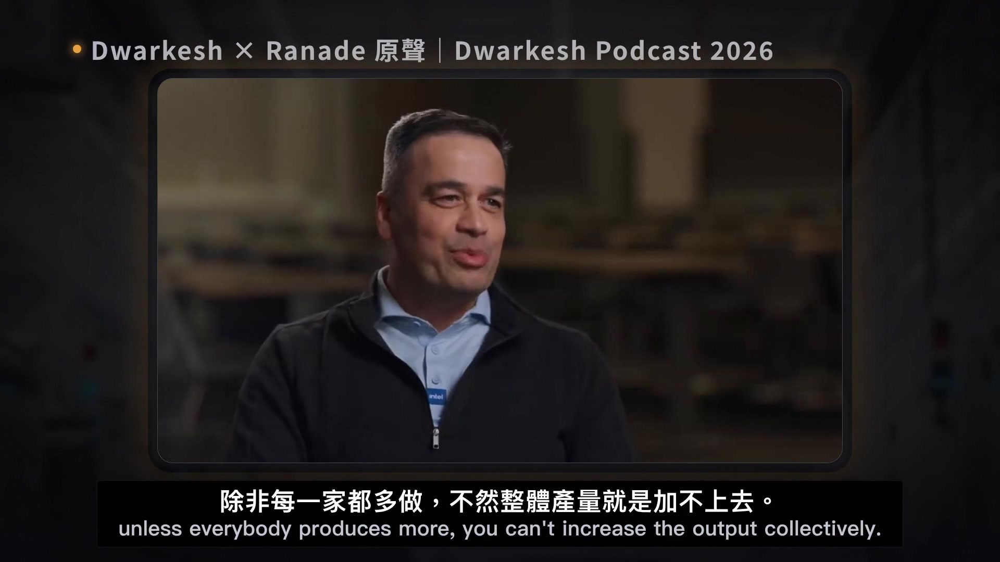

**逐字稿片段：** 要說清楚 Renady說的兩倍 不是每年兩倍 是用全世界現有的設備 Intel最先進的產量 大概最多隻能做到原本的2倍 而AI要的是每年3倍

**話題推測：** 澄清Renade對現有設備產能極限「兩倍」的說明

---

## 00:06:05

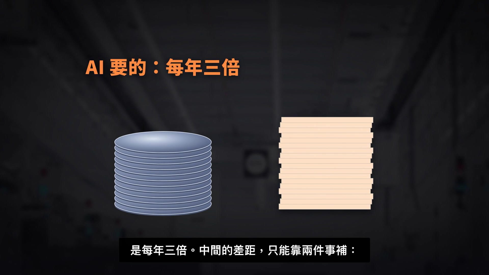

**逐字稿片段：** 中間的差距只能靠兩件事補 一是每顆晶片做得更強 二是整條供應鏈一起擴散 可是第二件事牽涉的公司太多了 René裡說 一臺設備背後有設備廠 設備廠背後有它的供應商 供應商背後還有更多供應商 只要其中一家跟不上 整條線就卡住

**話題推測：** 說明彌補AI需求與晶片產能差距的兩種方法

---

## 00:06:24

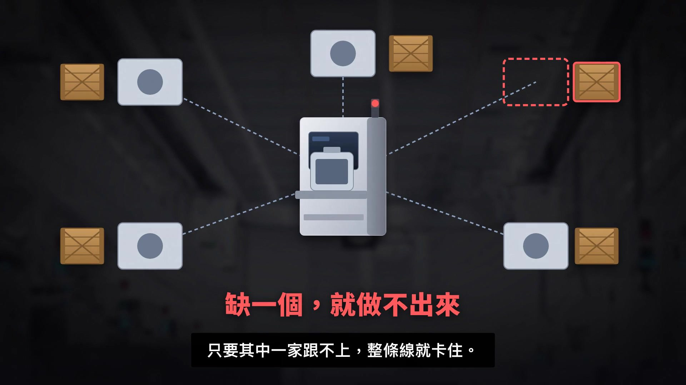

**逐字稿片段：** 那現有的機器還能擠出多少? Dwarkesh問 假設Intel願意花無限多的錢 每個月最多能做出多少片晶圓 Renate說 如果只能用現有的設備 那隻能一點一點往上加 因為現在的良率已經很高了 越往上越難 每多一個百分點都要花很大的力氣

**話題推測：** 探討現有設備能擠出多少產能的問題

---

## 00:06:41

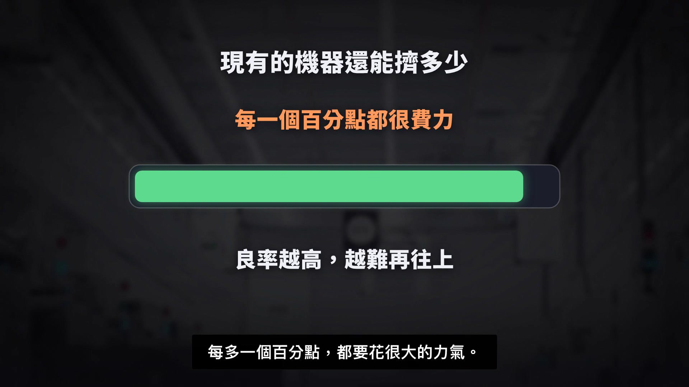

**逐字稿片段：** 他還說了Intel的另一個做法 讓新舊兩代製程儘量用同一批設備 從現在的18A換到下一代的14A 大約八成的設備可以沿用 只有兩成要買新的 這樣做是為了在設備買不到的時候 還有一點轉環的空間 可是不管怎麼擠 現有的設備就是那麼多 要多做很多晶片 還是得買新的設備

**話題推測：** 說明Intel在製程轉換中重複使用設備的策略與比例

---

## 00:07:01

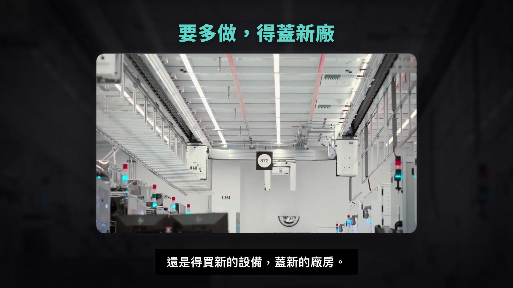

**逐字稿片段：** 蓋新的廠房 那錢夠不夠

**話題推測：** 切換至資金是否為問題的主題

---

## 00:07:03

**逐字稿片段：** Dwarkish在訪談裡算了一個數字 他自己也說是粗估 Intel只要花幾十億美元買設備 做出來的晶片 就夠AI公司一年賺上千億美元 當然中間還有記憶體 還有很多其他公司要分 可是這個比例說明了一件事 AI公司其實付得起 他們甚至可以直接跟晶片廠說 你能做多少我們全包 未來的錢我們先保證

**話題推測：** 引用Dwarkish粗估的投資報酬率數字

---

## 00:07:24

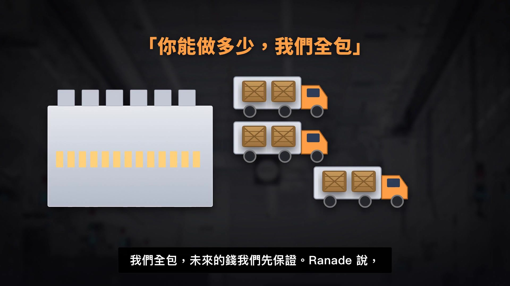

**逐字稿片段：** Renati說 已經開始看到這種跡象了 需求的訊號就是這麼強 所以錢不是最大的問題

**話題推測：** 說明AI公司已開始預付費用以綁定產能

---

## 00:07:31

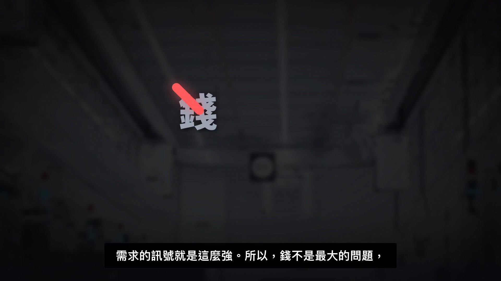

**逐字稿片段：** 時間才是

**話題推測：** 點出「時間」而非「金錢」是最大問題的結論

---

## 00:07:32

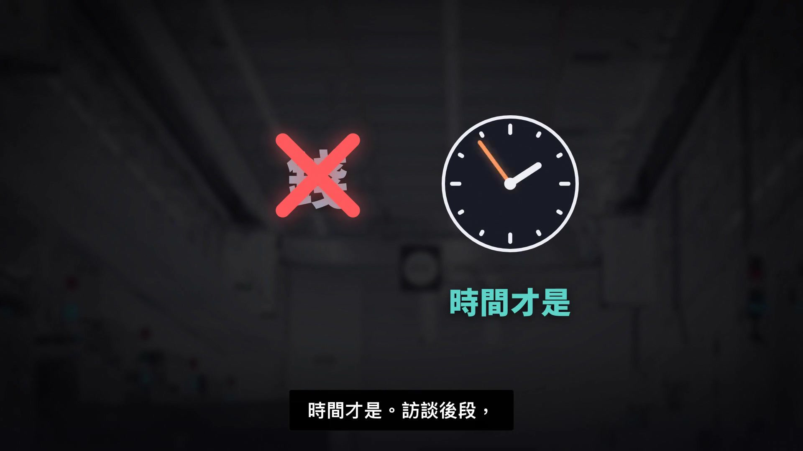

**逐字稿片段：** 訪談後段 Dwarkish替整段對話做了一個總結 請Renati確認 明年的產量可能比大家預測的還高 因為工廠可以把現有的設備擠到極限 可是到了2030年 產量不會比預測高多少 Renati說 對 除非整條供應鏈很快一起擴產

**話題推測：** 總結未來幾年晶片產量預測的趨勢（短期高，長期難以顯著提高）

---

## 00:07:49

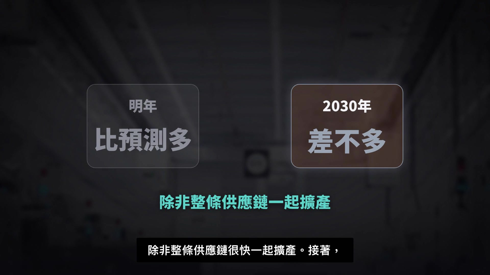

**逐字稿片段：** 接著他把時間一步一步講出來 Renati說 我們已經在2026年年終了 離這個十年結束沒剩幾年 假設今天下一張很大的設備訂單 大概要等18個月才拿得到 那時候已經是2028年 拿到設備以後 如果還要蓋新的廠房 基本上就到這個10年的尾聲了 換句話說 今天才決定擴產 新的產能要到2030年前後才真的出得來

**話題推測：** 闡述晶片供應鏈擴產所需的時間表

---

## 00:08:12

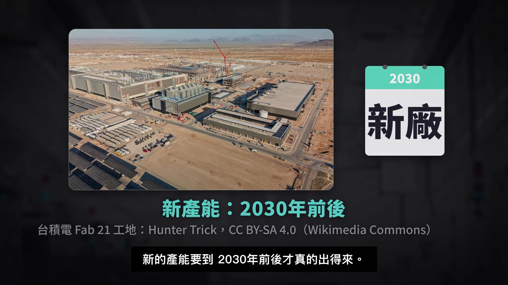

**逐字稿片段：** 這一部分的答案是 晶片廠不是不想多蓋 而是蓋了也要有設備 設備又只有少數幾家公司做得出來 今天下單要一年半以後才拿得到 所以短期內 晶片廠能做的 是把現有的設備用到極限 明年的產量也許會比大家想得多一點 可是要到2030年產量大幅增加 得整條供應鏈一起擴產 這需要時間 也需要有人先願意花錢 AI的需求每年三倍 設備卻大概只夠兩倍 這個落差就是AI晶片一直不夠的原因之一

**話題推測：** 總結為何晶片產量難以快速增加的答案

---

## 00:08:42

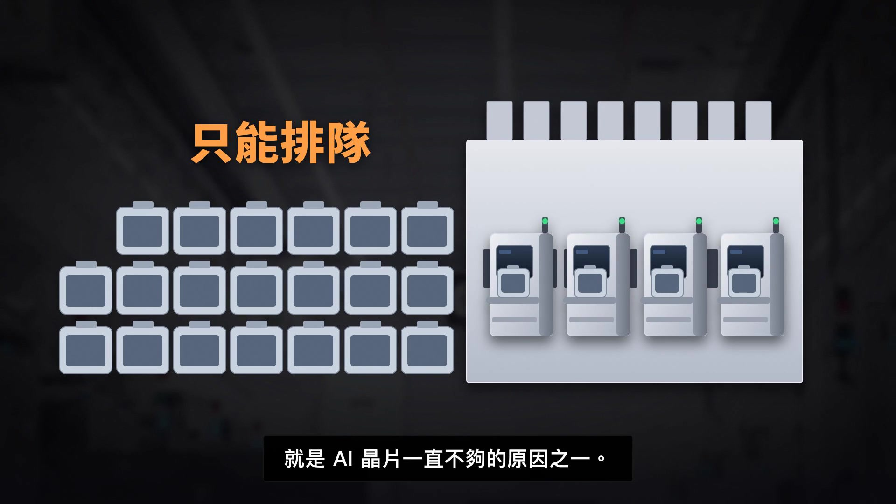

**逐字稿片段：** 那誰在花這筆錢 這件事又為什麼跟臺灣這麼有關係

**話題推測：** 切換至誰在投資以及台灣的角色主題

---

## 00:08:45

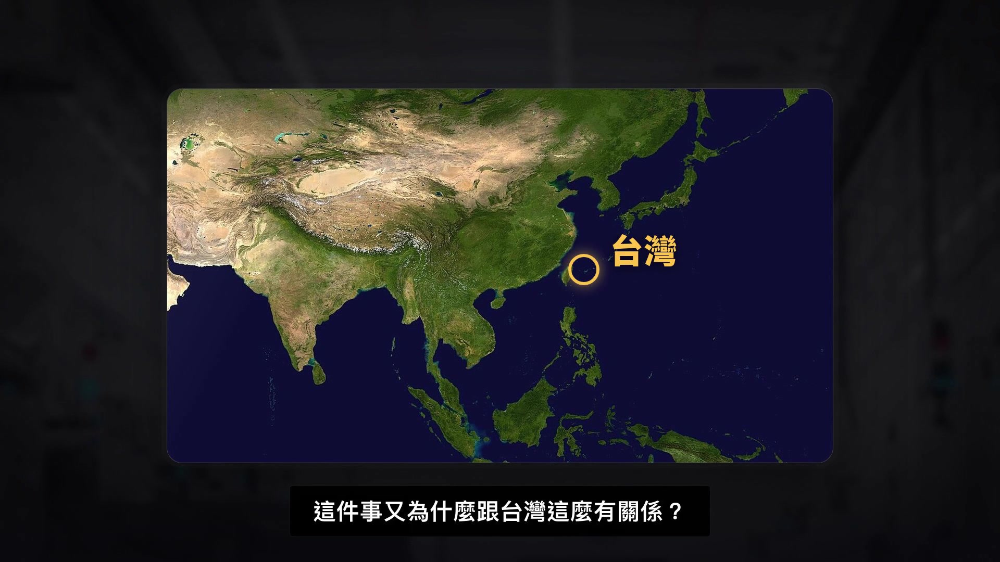

**逐字稿片段：** 要看懂臺灣的位置 先看Intel怎麼從第一名掉到後面 很長一段時間 Intel是最會做晶片的公司 大約每兩年就推出新一代製程

**話題推測：** 探討Intel如何從業界龍頭地位下滑的原因

---

## 00:08:55

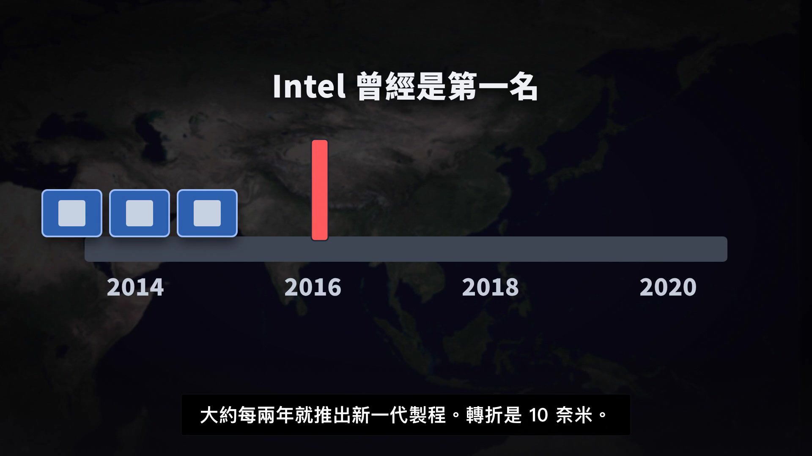

**逐字稿片段：** 轉折是10奈米 這一代原本預計2016年推出 結果拖到2018年才開始生產 後面的產品也跟著延誤 Oth說 那時候他們想一次跨很大一步 可是需要的新設備還沒準備好 只好用很多複雜的方法硬做 工程師的負擔非常重 另一個原因 是Intel的工廠幾十年來 只做Intel自己的晶片

**話題推測：** 分析Intel 10奈米製程延遲的轉折點

---

## 00:09:15

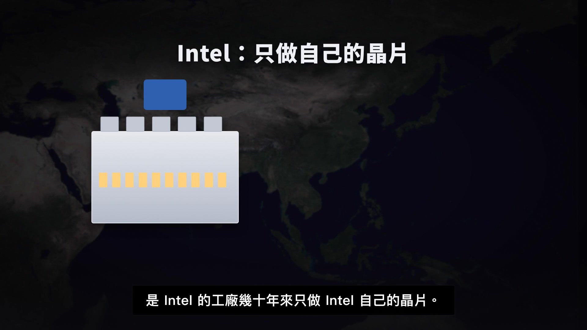

**逐字稿片段：** 臺積電替很多公司製造晶片 所以做的晶圓更多 學得更快 賺的錢也能再投資回去 Intel這幾年開始接外面的訂單 也承認 要學會當一家替別人製造晶片的公司 有一段學習的過程 這個差距在晶片廠這門生意裡會被放大

**話題推測：** 比較Intel與台積電在客戶服務模式上的差異

---

## 00:09:30

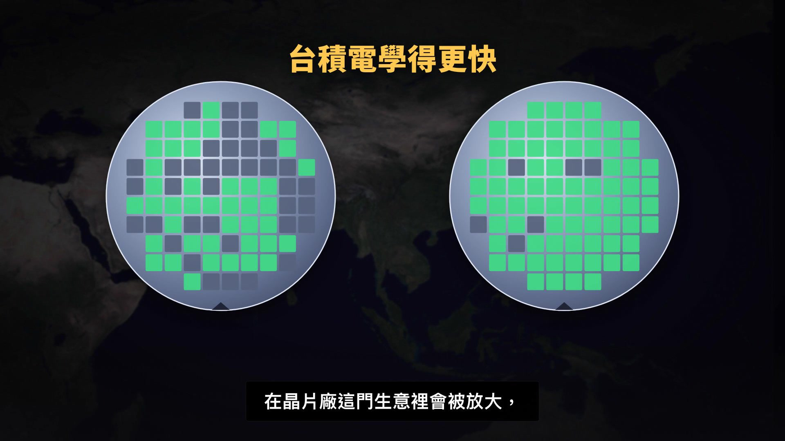

**逐字稿片段：** 因為它是一門越大越划算的生意 先看晶片廠這門生意 Renade說 晶片廠是規模效益最明顯的產業 規模效益 意思是做得越多 平均每顆的成本越低 原因是一間工廠蓋好以後 大約八成的成本是固定的 不管有沒有在生產 錢都要花 所以工廠一定要滿載 每多用一個百分點的產能 賺的錢都多很多 這也造成了一個結果

**話題推測：** 介紹晶片製造業「規模效益」的商業模式

---

## 00:10:25

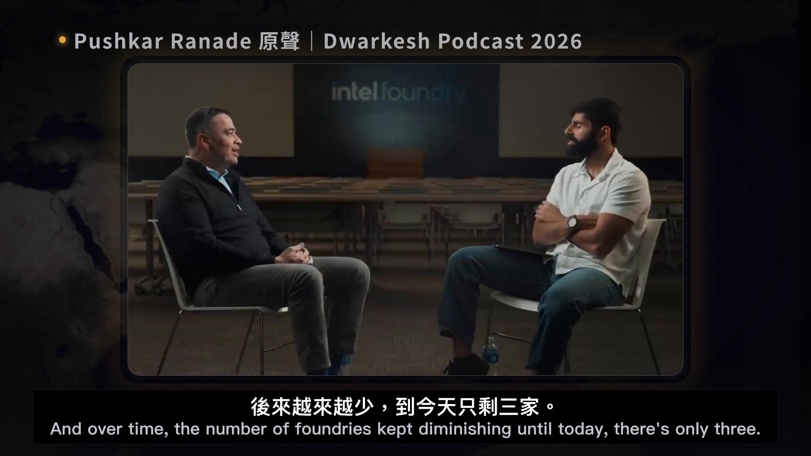

**逐字稿片段：** 這三家裡面做得最多的是臺積電 Dwarkesh在訪談裡估計 臺積電最先進製程的晶圓出貨 是Intel的三倍以上

**話題推測：** 比較台積電與Intel在最先進製程晶圓出貨量的差距

---

## 00:10:33

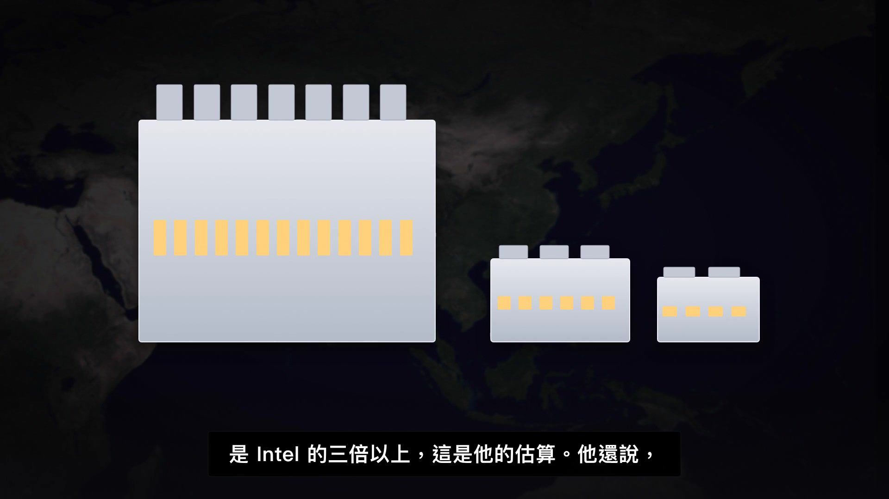

**逐字稿片段：** 這是他的估算 他還說臺積電3奈米的產能 現在多半拿去做AI晶片 Renade怎麼看追趕臺積電 他說要分兩件事 技術上他認為Intel已經追上了 差距只有幾個百分點 這是Intel的說法

**話題推測：** 提及台積電3奈米產能多數用於AI晶片

---

## 00:10:47

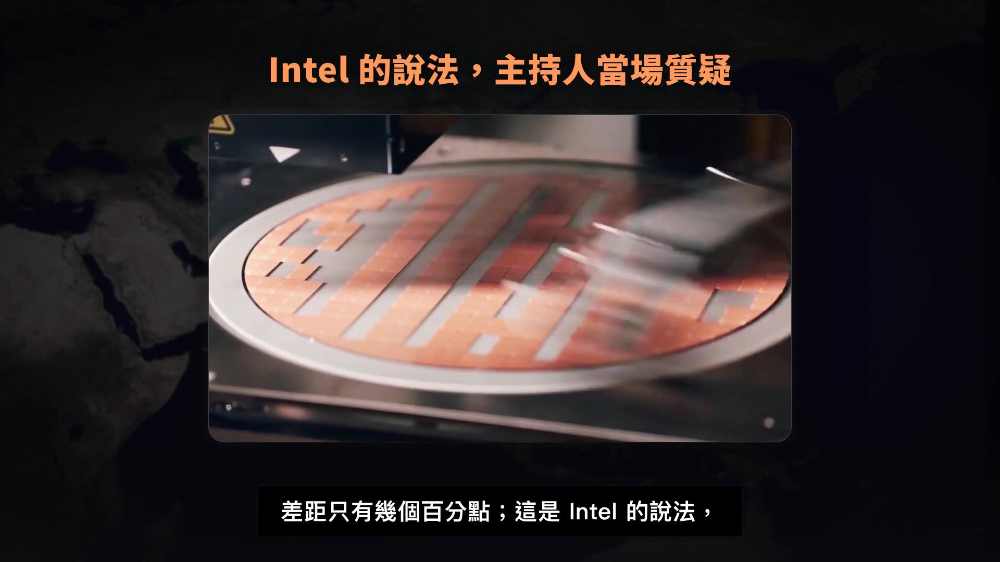

**逐字稿片段：** Dwarkesh當場就引用了 半導體研究公司的估算提出質疑 Renade不同意那個比較 可是規模上他承認臺積電大得多 追上要慢慢來

**話題推測：** Dwarkish引用半導體研究公司數據質疑Intel技術領先的說法

---

## 00:10:57

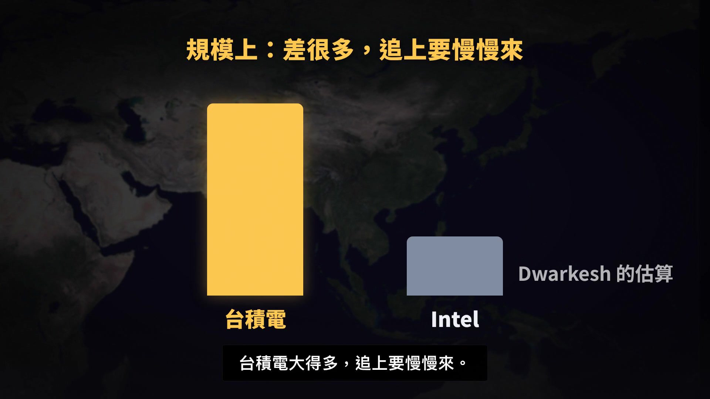

**逐字稿片段：** Dwarkish也點出一個數字 臺積電今年買設備 蓋廠房的錢是Intel的兩倍以上 如果現在買到的設備 決定了未來誰接得到AI的訂單 那今天的投資差距 就會變成以後的產量差距

**話題推測：** 指出台積電資本支出是Intel兩倍以上的事實

---

## 00:11:10

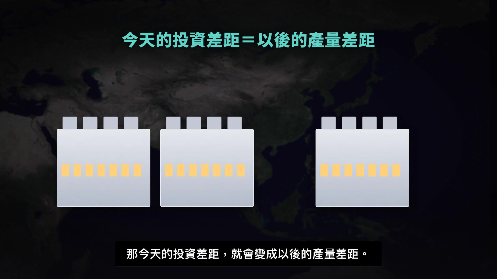

**逐字稿片段：** Renady還說了一個趨勢 幾十年前 一家公司從設計到製造 全部自己來 後來整個產業分工 有人只設計 有人只製造 有人只做設備 現在AI公司的需求大到 一家公司就能吃掉一整間 甚至好幾間工廠的產量 而且他們拿得出錢 所以他說 產業又在往回走 變成一種看起來像自己來的樣子 AI公司出錢 綁定產能

**話題推測：** 說明AI時代下產業重回垂直整合的趨勢

---

## 00:11:33

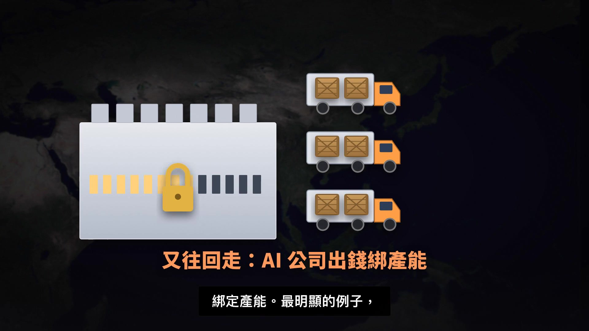

**逐字稿片段：** 最明顯的例子 是馬斯克今年3月 宣佈要自己蓋晶片廠 叫Terrafab 4月 Intel宣佈加入 馬斯克之後 說會用Intel的14A製程 可是Dwarkish也提醒 如果卡住的是設備 新蓋一間工廠 世界上的晶片總數 不會因此變多 只是誰先拿到保證的產量 除了運算用的晶片 AI還要大量的記憶體 用來放模型和資料

**話題推測：** 以馬斯克的Terrafab為例，說明AI公司自行建廠或綁定產能的趨勢

---

## 00:11:54

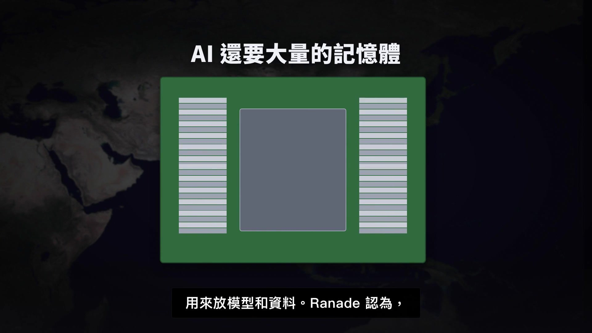

**逐字稿片段：** Renade認為 現在記憶體缺得比運算晶片還兇 這裡還有一段Intel的往事 Intel最早是做記憶體起家的 後來把這門生意放掉 前幾年又把快閃記憶體的事業賣掉

**話題推測：** 說明記憶體晶片比運算晶片更為短缺的現況

---

## 00:12:06

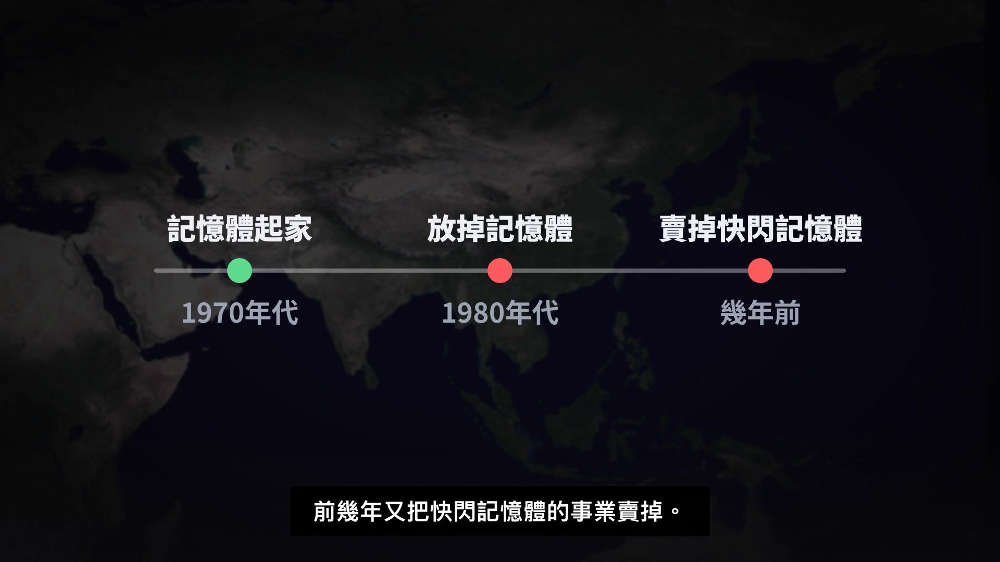

**逐字稿片段：** Dwarkish問他 現在回頭看怎麼想 Renade很坦白 回頭看 那大概不是賣掉快閃記憶體最好的時機 當時有當時的理由 只是沒有人看得到今天這麼大的需求 他說 今天這個世界 運算晶片做多少都會被用掉 記憶體也是 訪談的最後 Dwarkish問Intel該怎麼辦

**話題推測：** Dwarkish提問Renade回看出售記憶體業務的決策

---

## 00:12:26

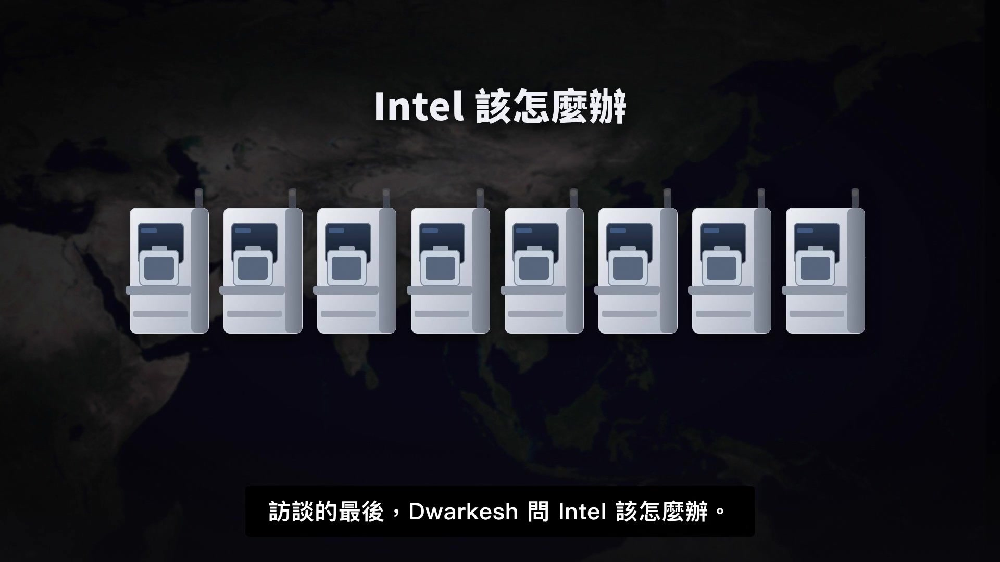

**逐字稿片段：** 他的建議很直接 趁現在多買設備 不然再過幾年 美國可能會發現自己錯過了大生意 我們在前一年有更多的投資 我們現在知道的東西 我覺得我們會更多的投資

**話題推測：** Dwarkish建議Intel應趁現在多買設備

---

## 00:12:56

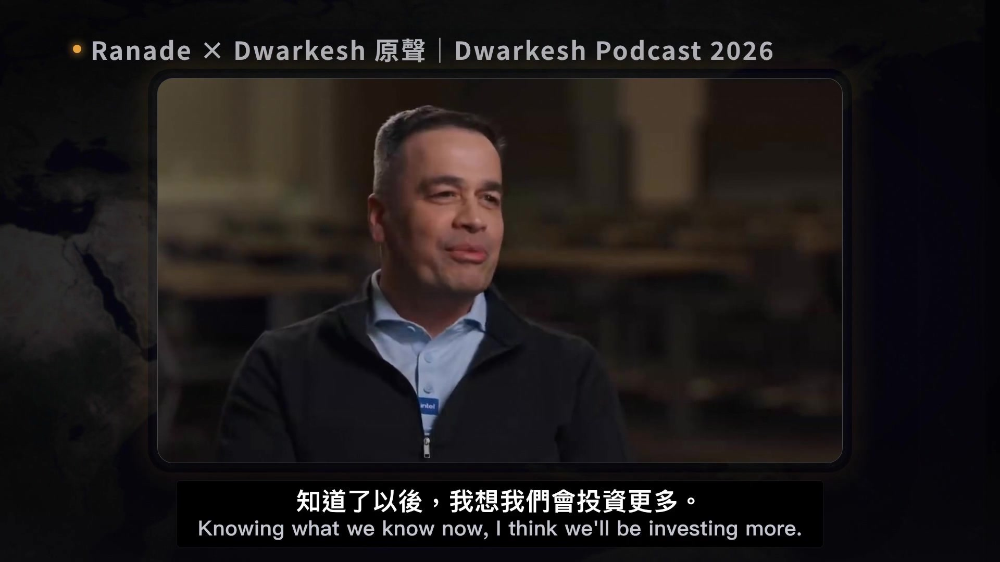

**逐字稿片段：** 設備全在臺灣 是主持人的誇示 設備其實多半是荷蘭、日本、美國做的 他想說的 是最先進的晶片產能 大部分集中在臺灣的臺積電

**話題推測：** 澄清晶片設備主要生產國並非僅限台灣

---

## 00:13:06

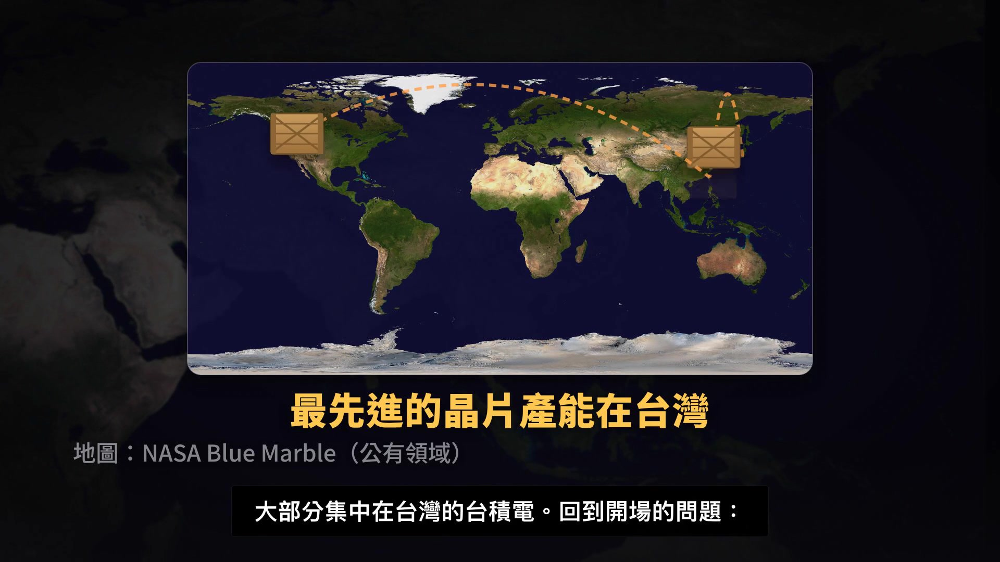

**逐字稿片段：** 回到開場的問題 AI公司搶晶片搶到缺貨 為什麼晶片廠不能多蓋幾間就好 這一集兩位Intel主管給的答案是 一顆最先進的晶片要經過2000個步驟 每一步都靠特定的設備 這些設備只有少數公司做得出來 今天下單要等一年半 全世界現有的設備 只夠Intel最先進的產量翻兩倍 AI要的卻是每年三倍 所以短期內 晶片廠只能把現有的機器用到極限 長期要多做 得整條供應鏈一起擴產 而且越早下決定越好

**話題推測：** 回顧並總結本集影片對開場問題的答案

---

## 00:13:36

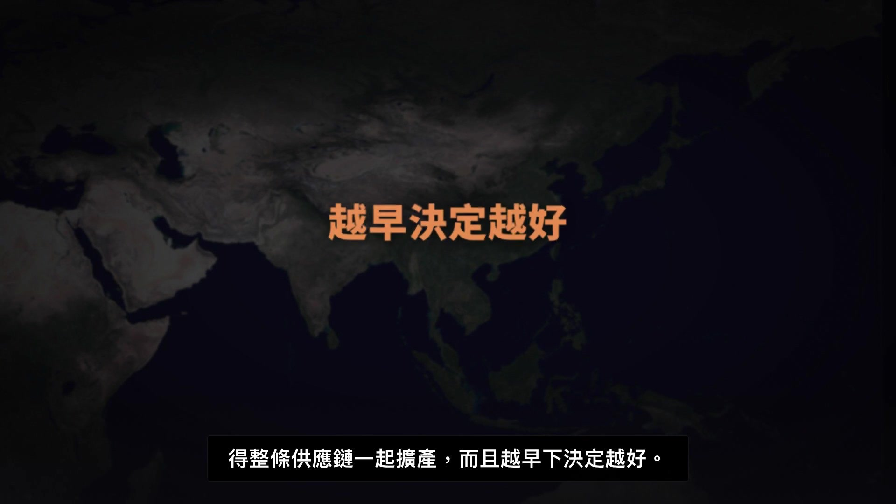

**逐字稿片段：** 對臺灣來說 這代表臺積電接下來幾年的位置 很可能比過去更關鍵 這一集整理的 是Intel兩位主管的看法和我們的查證 Intel對自家技術的說法 屬於公司自述 最後問你一個問題 如果AI晶片一直不夠 你覺得最先感受到的會是什麼 留言告訴我 喜歡的話訂閱AI Notebook 開啟通知 我們下次見

**話題推測：** 分析AI晶片短缺對台灣與台積電的關鍵影響

---
