# jimainotebook_ecbpLSIB0GY — 關鍵畫面索引

- 來源逐字稿：[jimainotebook_ecbpLSIB0GY_FIN.srt](jimainotebook_ecbpLSIB0GY_FIN.srt)
- 影片：https://www.youtube.com/watch?v=ecbpLSIB0GY
- 截圖數：57

## 00:00:12

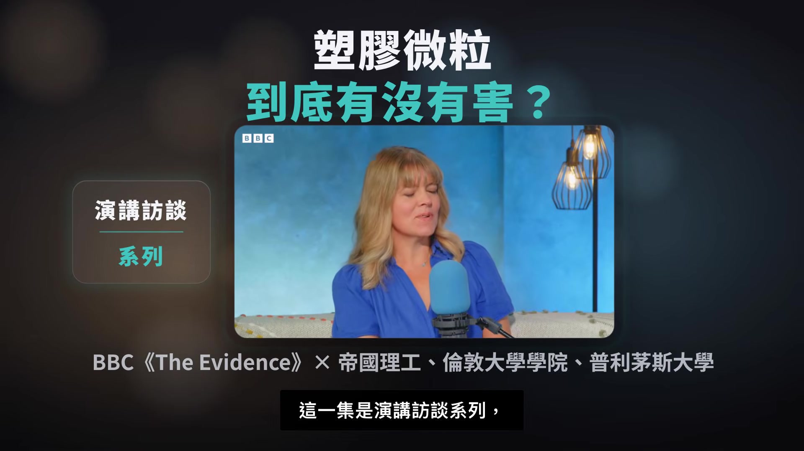

**逐字稿片段：** 主角是BBC健康節目的一場專家座談, 三位研究塑膠威力的科學家一起回答一個問題,

**話題推測：** 介紹影片主要內容：BBC健康節目專家座談。

---

## 00:00:18

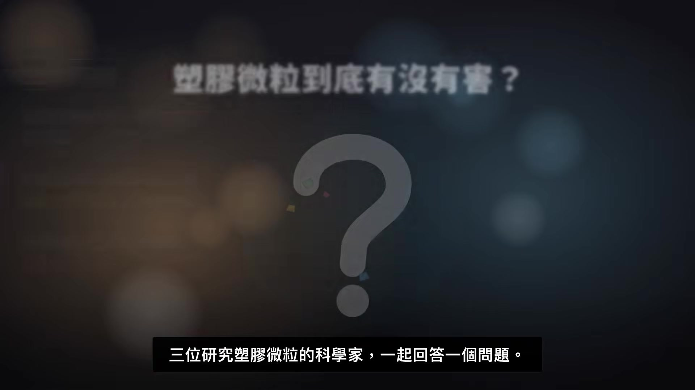

**逐字稿片段：** 塑膠威力到底有沒有害, 節目一開場, 主持人Claudia Hammond說, 她有時候會帶便當到公司用微波爐加熱, 三位來賓馬上接話, 一個說我已經不用塑膠盒了, 另外兩個也說我也是, 三個人都換成了玻璃便當盒, 研究塑膠的人自己先換掉了, 那證據到底走到哪裡,

**話題推測：** 提出本集核心問題：塑膠微粒到底有沒有害？

---

## 00:00:34

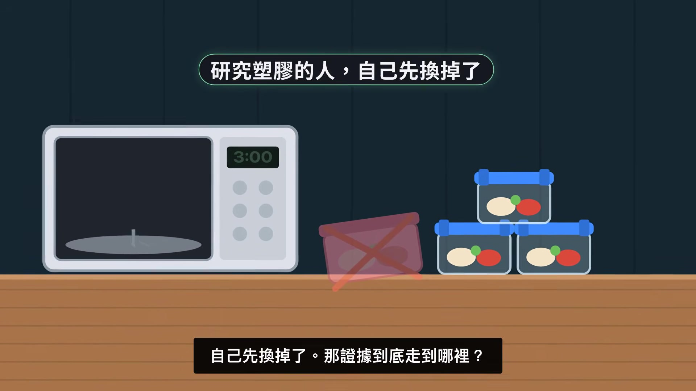

**逐字稿片段：** 你可能也看過這種新聞標題, 人的大腦裡有一支湯匙那麼多的塑膠

**話題推測：** 引用一則常見的新聞標題作為引子。

---

## 00:00:38

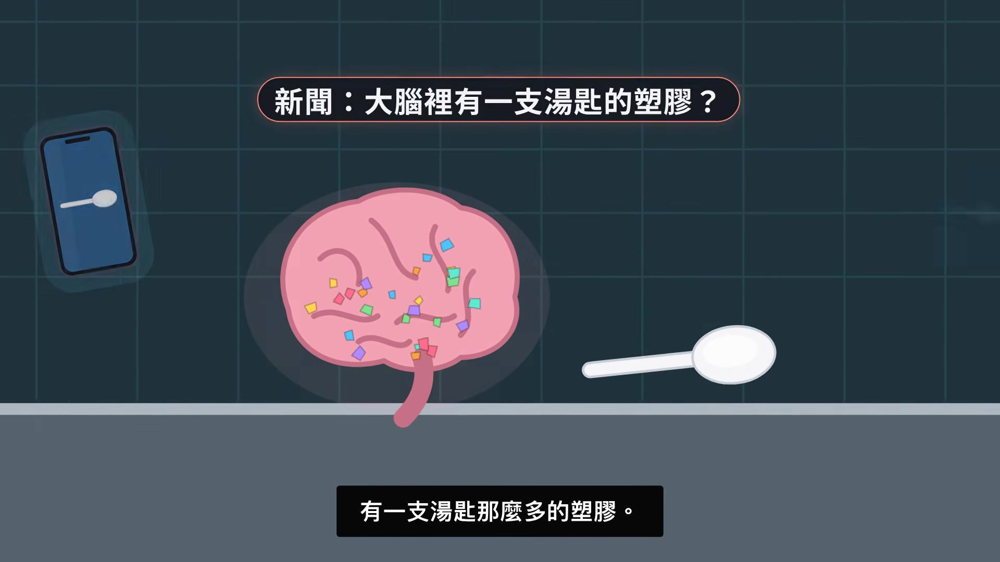

**逐字稿片段：** 這一集我們會一路標清楚 哪些是研究量到的 哪些是專家自己的判斷和做法 我們分三步看 先看身體裡到底有多少 再看它到底有沒有害 最後看答案還沒出來的時候 我們可以怎麼做

**話題推測：** 概述本集影片的討論架構或三步驟。

---

## 00:00:50

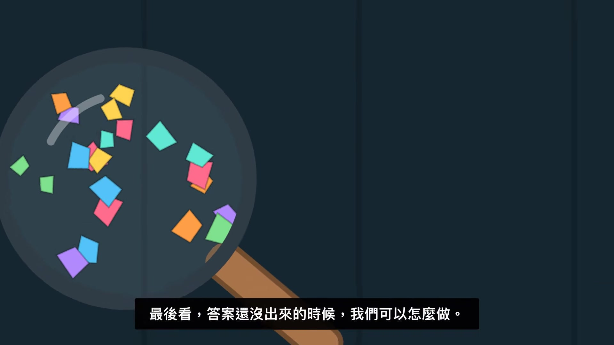

**逐字稿片段：** 先把名字講清楚 這種東西叫塑膠微粒 英文是microplastics 它的定義很簡單 只要是塑膠碎到小於5毫米 就叫塑膠微粒

**話題推測：** 開始解釋「塑膠微粒」的定義。

---

## 00:00:58

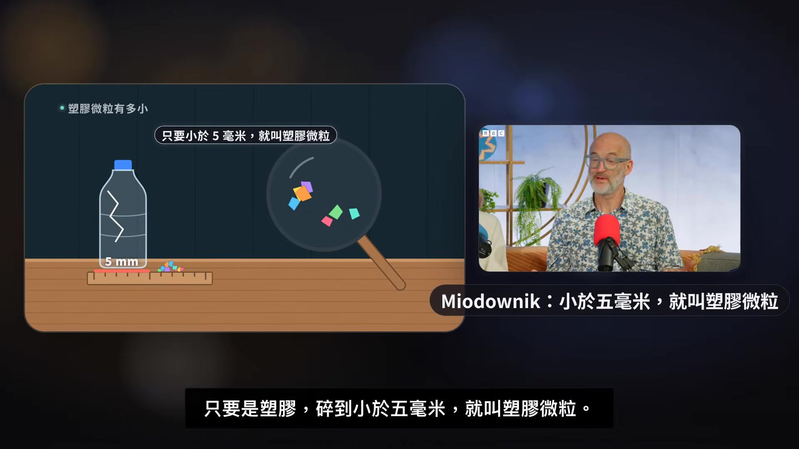

**逐字稿片段：** 5毫米大概是一顆綠豆那麼大 這種你還看得到 可是它會一直碎下去 碎到小於一微米

**話題推測：** 說明5毫米塑膠微粒的大小比喻（綠豆）。

---

## 00:01:04

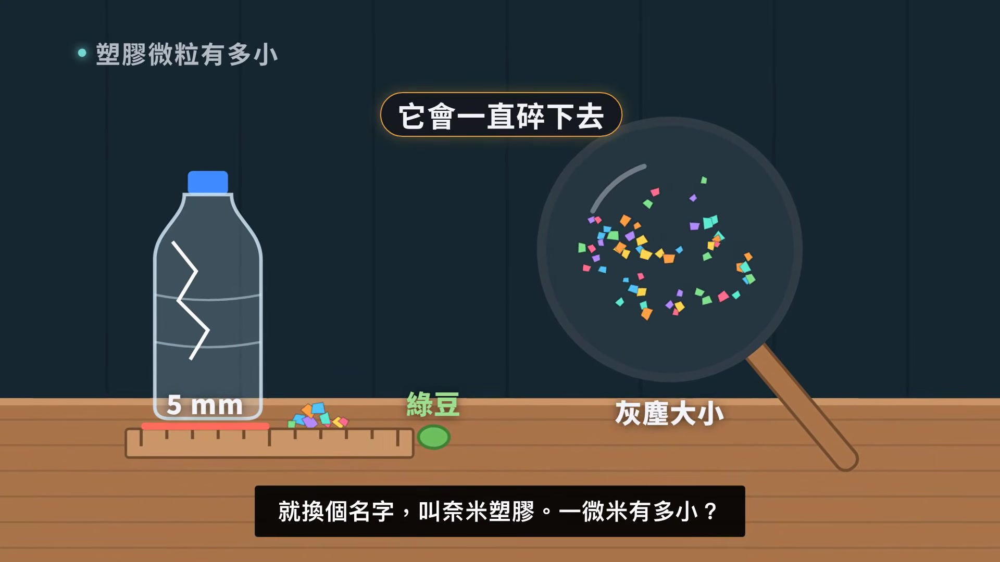

**逐字稿片段：** 換個名字叫奈米塑膠 一微米有多小

**話題推測：** 介紹新名詞「奈米塑膠」。

---

## 00:01:06

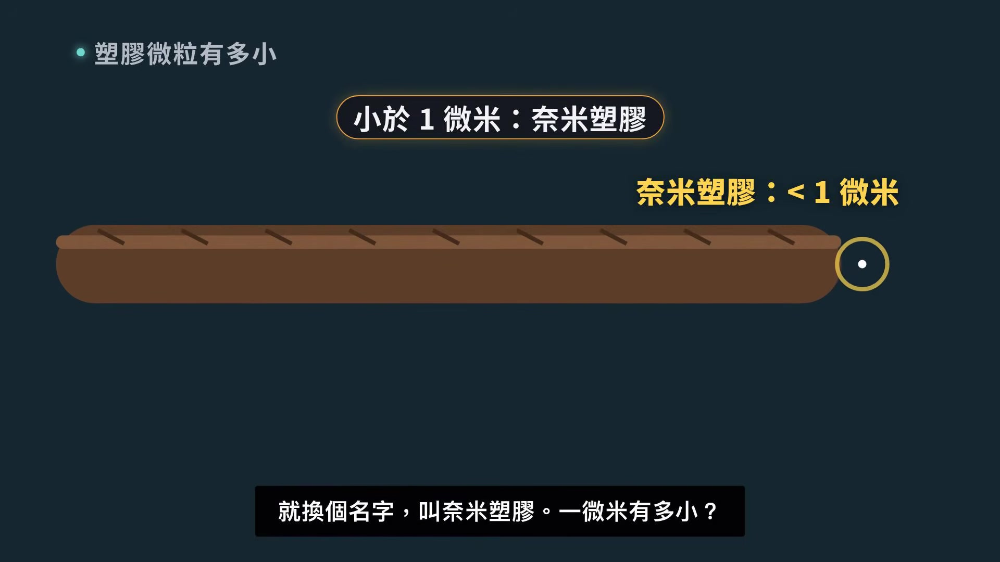

**逐字稿片段：** 一根頭髮大約50微米粗 所以奈米塑膠 比頭髮還細50倍以上 眼鏡已經看不到了 塑膠威力這個詞 是英國海洋學家Richard Thompson 在2004年提出來的 他當時研究的是海力的塑膠 20年後大家開始問的是 另一件事

**話題推測：** 說明奈米塑膠的大小比喻（頭髮）。

---

## 00:01:21

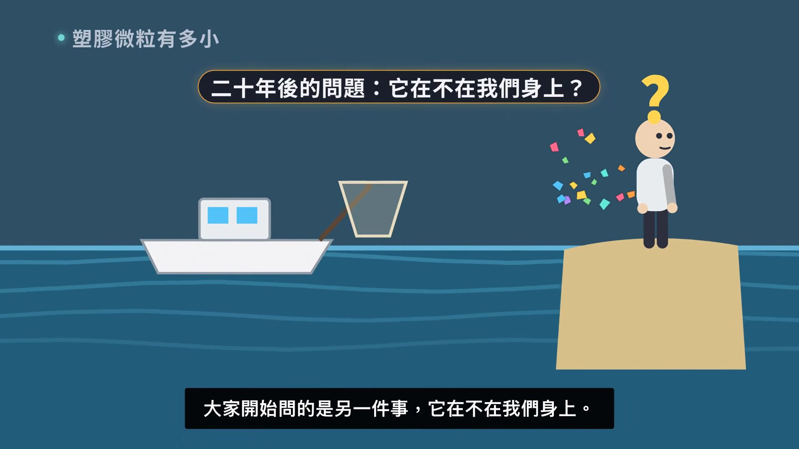

**逐字稿片段：** 它在不在我們身上 那它怎麼進到身體裡 節目裡 普利茅斯大學的 Shopachokshi說 主要有三條路 用鼻子吸進來 用嘴巴吃下肚 還有經過皮膚 皮膚這條到底吸收了多少 他說目前還不知道

**話題推測：** 轉向討論塑膠微粒進入人體的三條主要途徑。

---

## 00:01:33

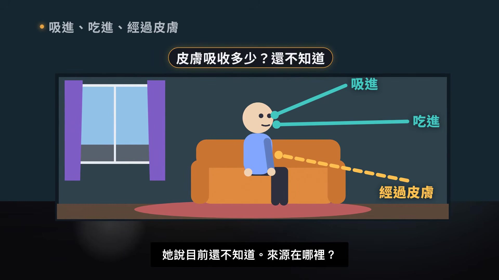

**逐字稿片段：** 來源在哪裡 畢國理工學院的Stephanie Wright說 在家裡 最多的是合成纖維 地毯 沙發 衣服 窗簾 只要標籤上寫著聚酯纖維這類材質 都會掉 到了戶外 大眾是輪胎跟路面摩擦掉下來的粉塵 你可能也聽過另一個說法 每個人每週會吃下一張信用卡 那麼重的塑膠 主持人在節目裡直接說 這個說法已經被推翻了 後來好幾篇研究重新計算 發現它高估了非常多倍 所以塑膠威力到處都有 這點沒有爭議

**話題推測：** 探討塑膠微粒的主要來源（居家與戶外）。

---

## 00:01:58

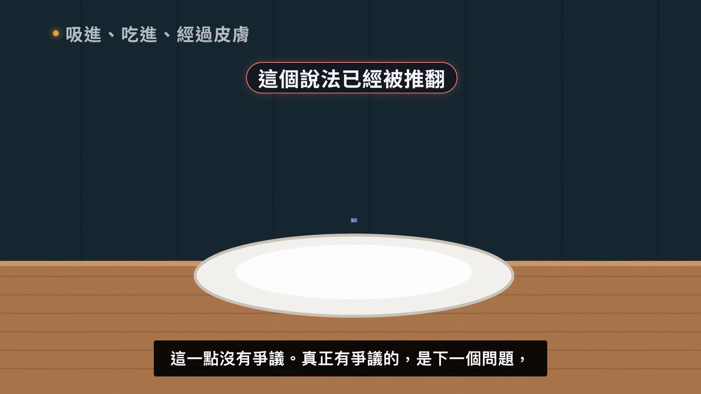

**逐字稿片段：** 真正有爭議的是下一個問題 它進到我們身體以後 到底累積了多少

**話題推測：** 轉向第二個主要問題：塑膠微粒在體內的累積量。

---

## 00:02:02

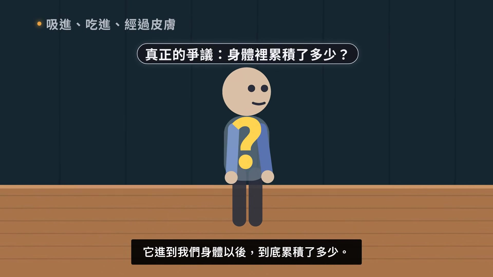

**逐字稿片段：** 這個問題最有名的答案是 2025年2月的一篇研究 美國新墨西哥大學 Matthew Campen的團隊 分析了過世的人捐出來的器官 有大腦肝臟和腎臟 發表在醫學期刊Nature Medicine

**話題推測：** 介紹一篇關於器官中塑膠微粒累積的關鍵研究（新墨西哥大學）。

---

## 00:02:14

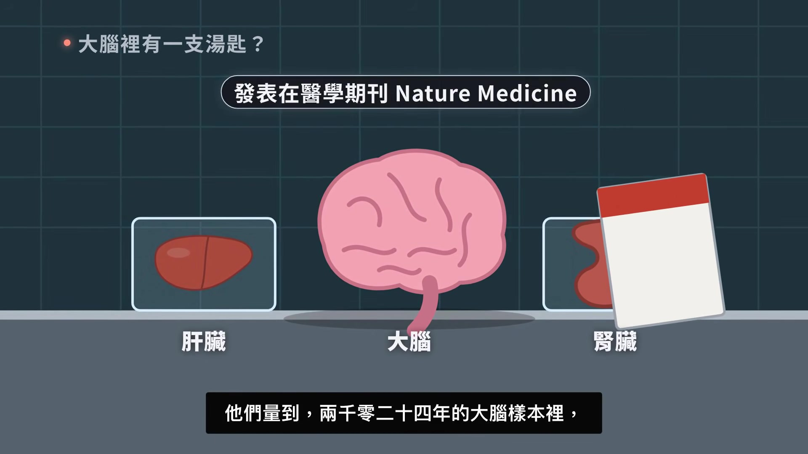

**逐字稿片段：** 他們量到2024年的大腦樣本里 塑膠大約佔重量的千分之五 而且比2016年的樣本多了快一半

**話題推測：** 說明該研究量測到大腦樣本中的塑膠含量及增長。

---

## 00:02:21

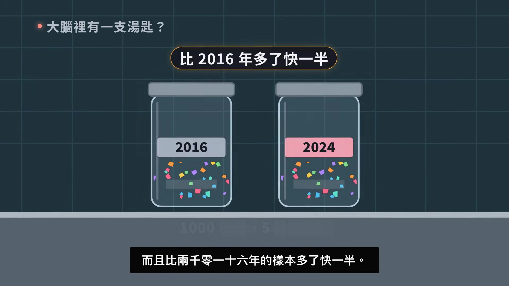

**逐字稿片段：** 研究者把這個量換算成 差不多一支塑膠湯匙 新聞就這樣傳開了

**話題推測：** 解釋研究者將測量結果換算成「一支塑膠湯匙」的比喻。

---

## 00:02:25

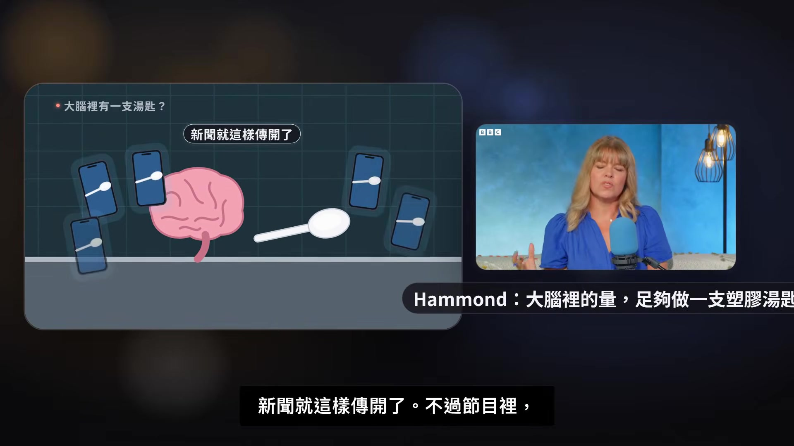

**逐字稿片段：** 不過節目裡 所以Chokshi一邊說這是一篇好研究 一邊也提醒了一件事 聽她怎麼說

**話題推測：** 引入專家對該研究結論的質疑與提醒。

---

## 00:02:50

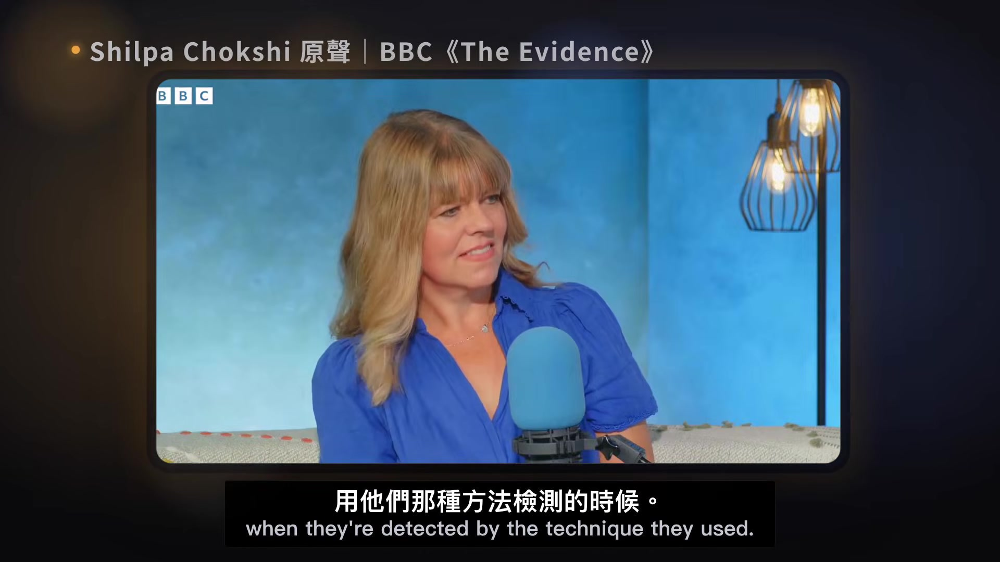

**逐字稿片段：** 她說的假陽性意思是 明明沒有 卻被量成有

**話題推測：** 解釋「假陽性」的含義。

---

## 00:02:53

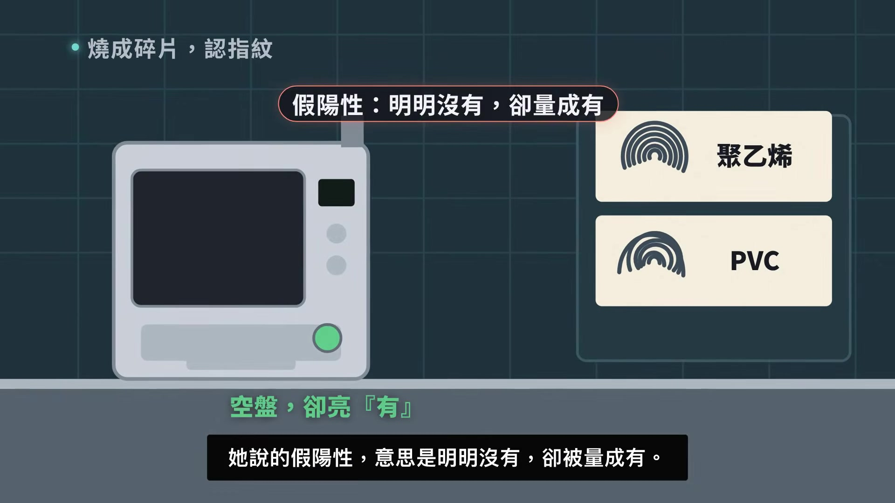

**逐字稿片段：** 這要從怎麼量講起 這個方法叫熱烈解枝譜分析 他的做法是 把樣本加熱到幾百度 燒成一堆小碎片 再去認這些碎片長什麼樣子 你可以把它想成認指紋 每一種塑膠燒出來的碎片 都有自己的指紋 機器看到那個指紋 就說這裡有這種塑膠

**話題推測：** 介紹用於測量塑膠微粒的「熱烈解枝譜分析」方法。

---

## 00:03:10

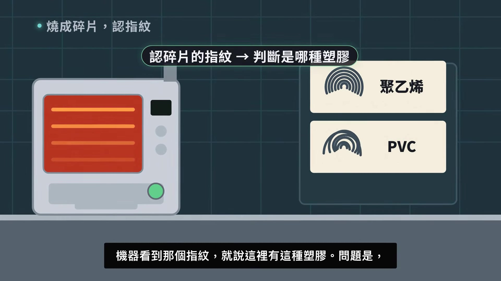

**逐字稿片段：** 問題是塑膠的結構很簡單 就是一長串碳合金 身體裡也有很多東西 同樣是碳合金組成的 最常見的就是脂肪 脂肪燒出來的碎片 有一部分跟聚乙烯 也就是最常見的塑膠帶材質 指紋很像

**話題推測：** 說明測量方法可能存在的干擾問題，特別是與脂肪的相似性。

---

## 00:03:21

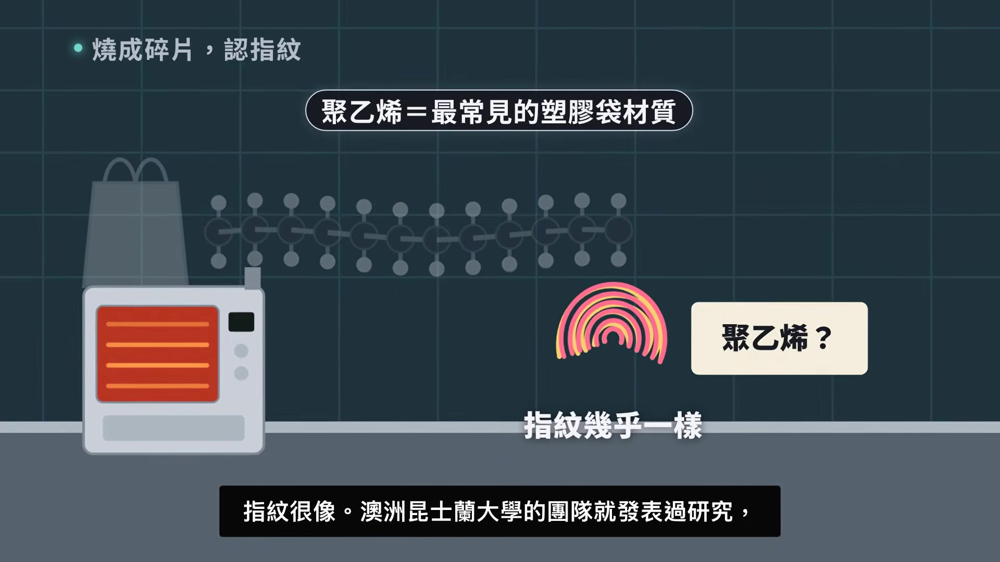

**逐字稿片段：** 澳洲昆士蘭大學的團隊就發表過研究 說這個方法單獨用來量聚乙烯和PVC 會被幹擾,不夠可靠

**話題推測：** 引用澳洲研究指出該測量方法在特定塑膠上的可靠性問題。

---

## 00:03:28

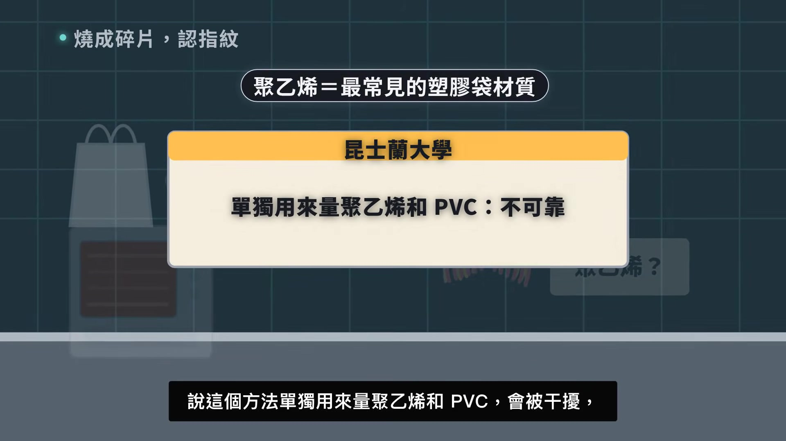

**逐字稿片段：** 那大腦裡有多少脂肪呢? 聽White怎麼說

**話題推測：** 提出大腦中脂肪含量的問題。

---

## 00:03:32

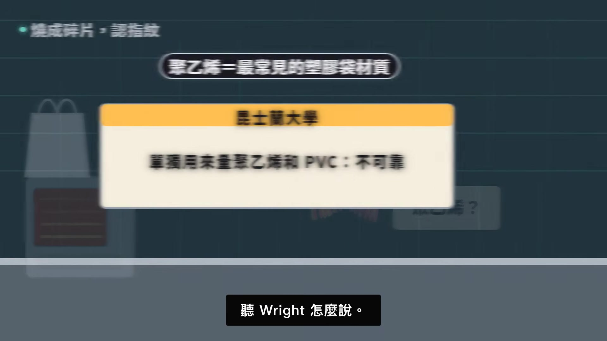

**逐字稿片段：** 大腦大約六成是脂肪 所以這個質疑達到了要害

**話題推測：** 揭示大腦約六成是脂肪的數字。

---

## 00:03:52

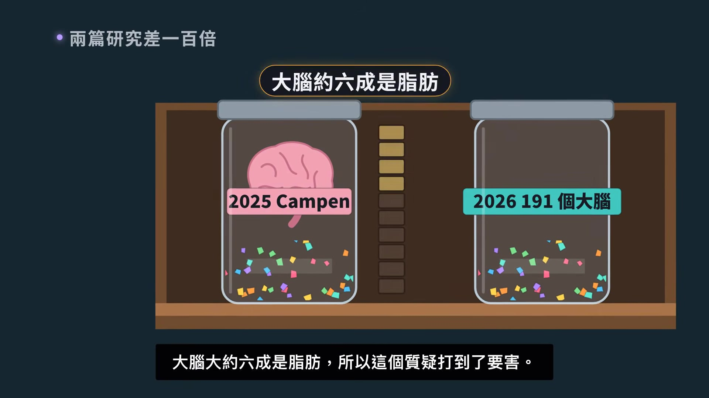

**逐字稿片段：** 2025年11月 同一本期刊 刊出其他研究者的正式質疑 說對照組不夠 脂肪可能被當成了塑膠 原作者同時回覆 他們沒有撤回結論 到我們製作這一集的時候 這篇研究也沒有被撤稿 再看另一篇 2026年4月 一箇中國團隊 在Nature Health發表研究 分析了191個大腦樣本 用兩種方法互相核對 結果一樣 幾乎每個樣本都有塑膠

**話題推測：** 提及對原始研究的正式質疑發表在同一期刊上。

---

## 00:04:15

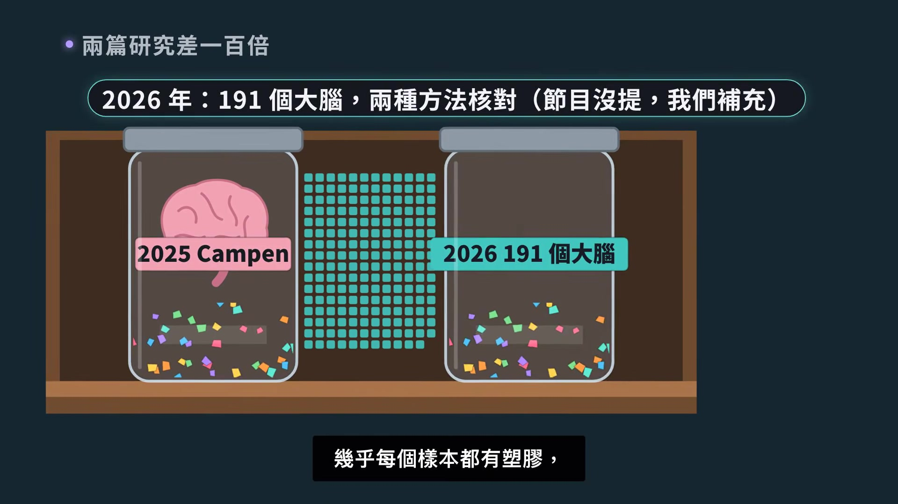

**逐字稿片段：** 可是濃度比前一篇低了 大約100倍 同一個問題 問有沒有 兩篇都說有 問有多少 兩篇查了100倍 這一篇節目裡沒有提到 是我們補充的 Chokshi的看法 剛好落在這兩者中間 他說現在不管哪個器官 塑膠都還量不準 那篇研究的數字 他認為也不對 至於差多少 聽他怎麼說 所以這部分的答案是這樣 塑膠威力進到身體裡 大概是真的 很多器官都有研究報告找到 可是有多少 現在的方法量不準 兩篇研究可以差到100倍 記住這一句 有沒有 跟有多少 是兩個問題 下次看到一支湯匙這種新聞 先問一句 是用什麼方法量的 可是量不準

**話題推測：** 指出兩篇研究在測量濃度上存在的100倍差異。

---

## 00:05:03

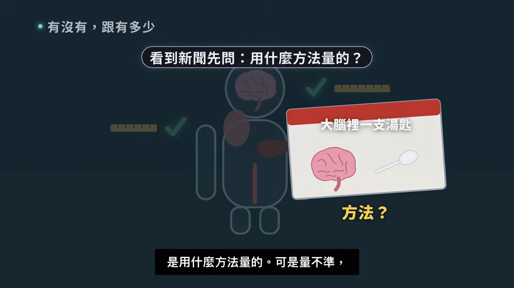

**逐字稿片段：** 就帶出一個更麻煩的問題 如果連有多少都不知道 要怎麼判斷它有沒有害

**話題推測：** 轉向第三個主要問題：塑膠微粒到底有沒有害？

---

## 00:05:07

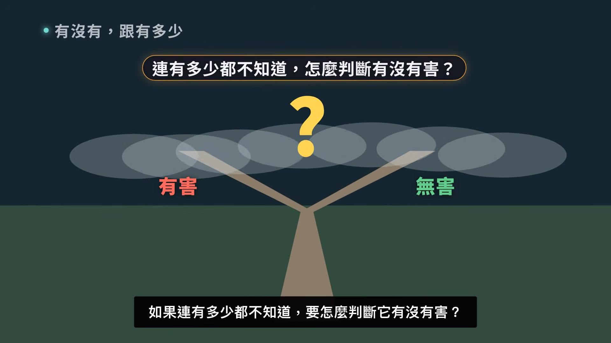

**逐字稿片段：** 要回答有沒有害 最直接的辦法 是找一群人 隨機分成兩組 一組照常生活 一組一輩子不碰塑膠 幾十年後看誰比較常生病 這種研究叫隨機對照實驗 可是這個實驗做不到 主持人自己在節目裡也說 你找不到一群一輩子不碰塑膠的人

**話題推測：** 描述理想但不可行的「隨機對照實驗」研究方法。

---

## 00:05:22

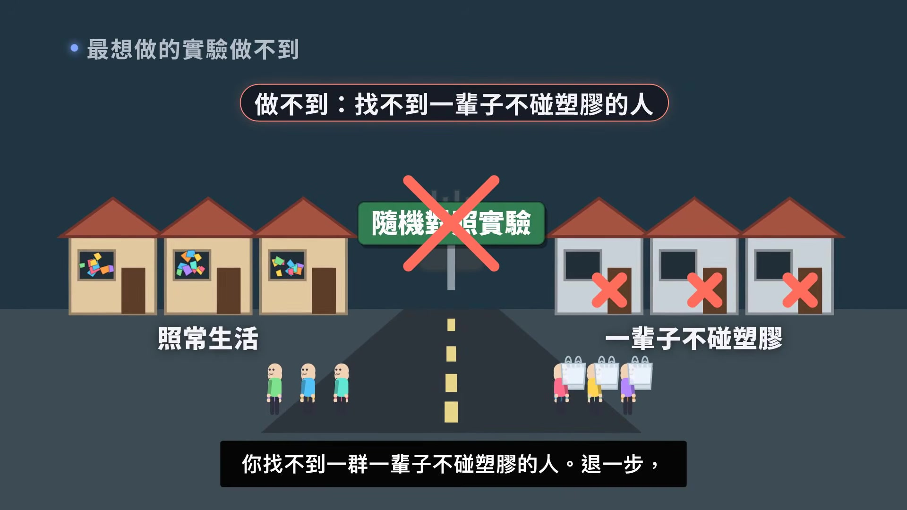

**逐字稿片段：** 退一步就只能靠觀察 看身上塑膠多的人是不是比較常生病 這又回到第一部分的問題 身上有多少都量不準 這種比較就很難做

**話題推測：** 說明退而求其次的「觀察性研究」方法。

---

## 00:05:31

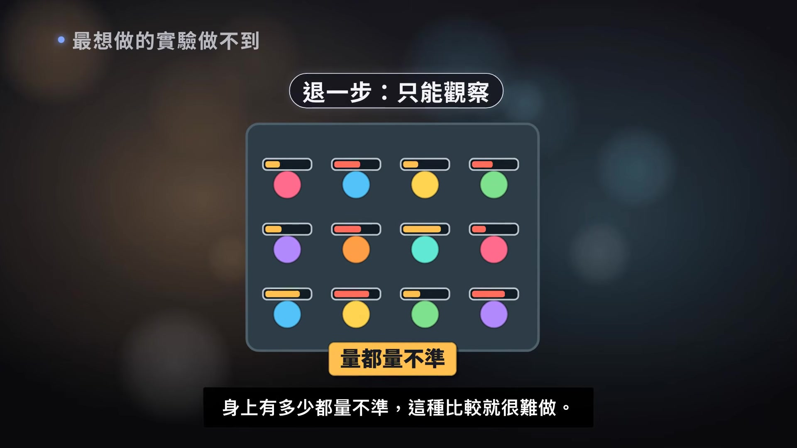

**逐字稿片段：** Ride說 現在量一個樣本 大概要花一整天 大型研究要量幾千幾萬個樣本 根本做不起來

**話題推測：** 指出目前量測塑膠微粒樣本所需的時間和對大型研究的挑戰。

---

## 00:05:37

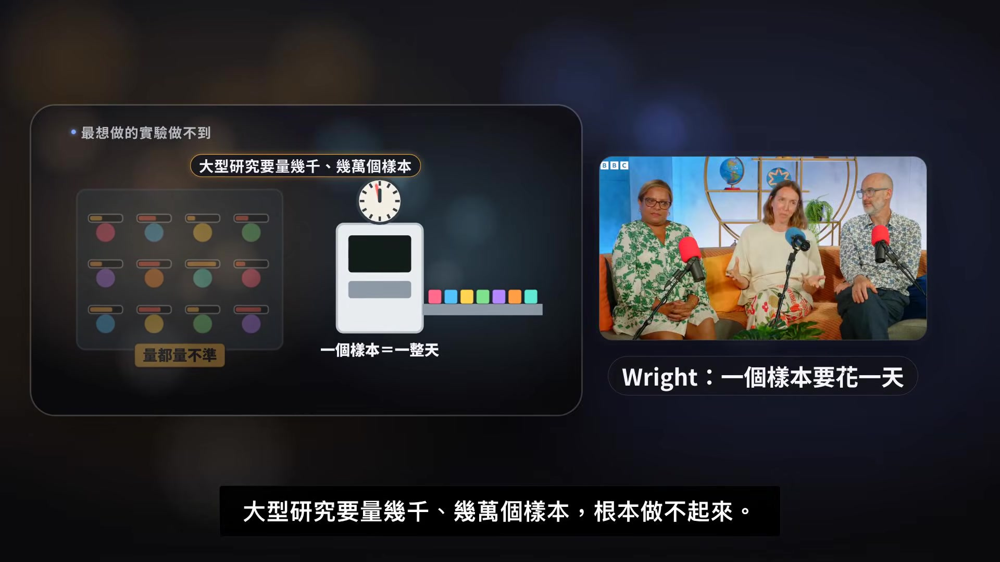

**逐字稿片段：** 他還說了一句 人類70多年前就開始接觸塑膠 可是把它當成健康問題來研究 大概只有6年 那目前確定的是什麼Ride

**話題推測：** 介紹塑膠作為健康問題研究的短暫歷史。

---

## 00:05:45

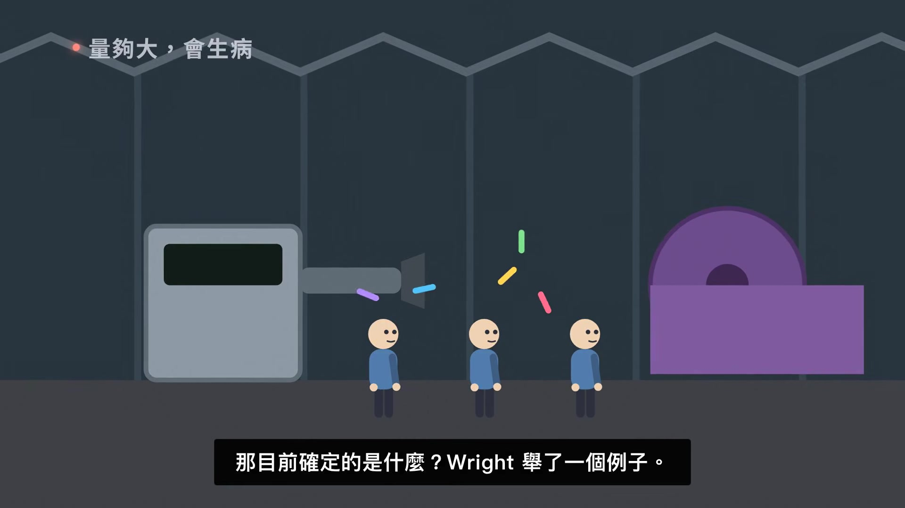

**逐字稿片段：** 舉了一個例子 30多年前 美國羅德島有一間工廠 做的是植絨 就是把切得很短的尼龍纖維 噴在布上 做出像麂皮那樣的觸感 工廠裡的工人 一個接一個得了肺病 後來被叫做植絨工人肺病 調查人員懷疑 原因就是他們每天 迄進大量的尼龍碎纖維 不過當年也沒有百分之百確定 在那種工廠裡 空氣中的塑膠粉塵 比我們平常高非常多 所以這個例子能說明的是 量夠大 塑膠可以讓人生病 它不能說明的是 我們每天這種低積量會怎樣 聽Wright怎麼講

**話題推測：** 舉例說明高劑量塑膠粉塵可能導致的「植絨工人肺病」。

---

## 00:06:32

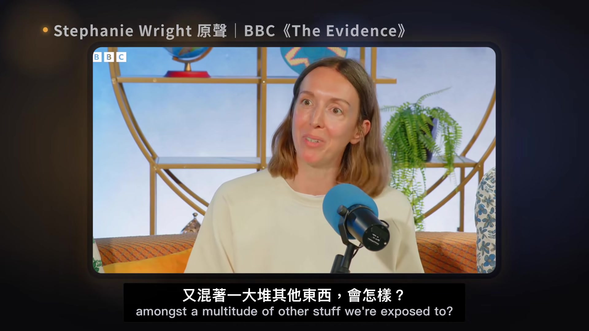

**逐字稿片段：** 那人身上有沒有線索

**話題推測：** 轉向討論從人體中尋找塑膠微粒影響的線索。

---

## 00:06:34

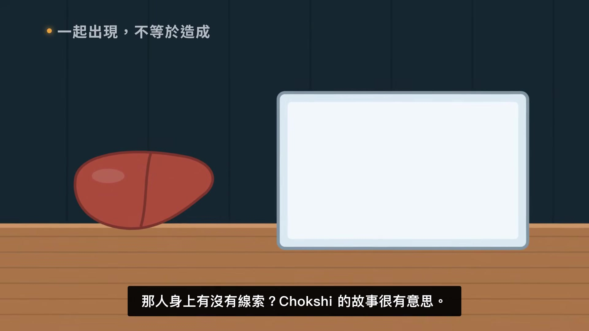

**逐字稿片段：** Chuckie的故事很有意思 他研究肝病研究了30年 發現有件事對不上 在英國肝病的死亡率 50年變成大約4倍 可是喝酒和肥胖 解釋不了全部 後來他在普利茅時遇到提出塑膠威力這個詞的Thomson 看了很多魚的照片 魚的肝泥都是塑膠 他就開始想 人的肝會不會也是這樣 目前人身上的研究 大多是這種線索

**話題推測：** 講述專家Chokshi從肝病研究中聯想到塑膠微粒的故事。

---

## 00:06:56

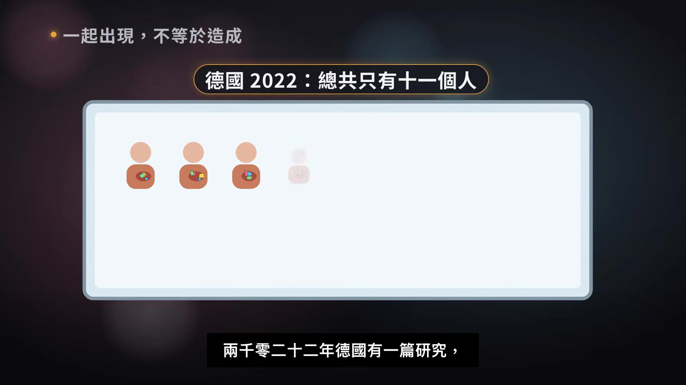

**逐字稿片段：** 2022年德國有一篇研究 在肝硬化病人的肝泥找到塑膠威力 沒有肝病的人身上找不到 可是總共只有11個人 作者自己也說 分不出是塑膠造成肝硬化 還是肝硬化以後塑膠才比較容易堆積 另一篇常被引用的是 是2000年24年新英格蘭醫學期刊的研究 節目裡沒提我們補充 257個病人 經動脈斑塊裡檢驗出塑膠的人之後 心肌梗塞中風或死亡的風險

**話題推測：** 引用2022年德國一項關於肝硬化病人肝臟中塑膠微粒的研究。

---

## 00:07:18

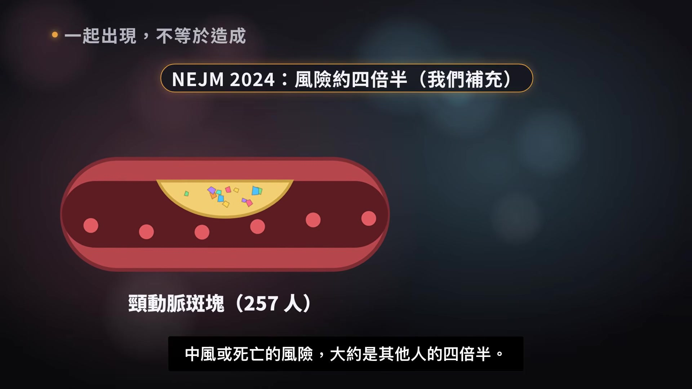

**逐字稿片段：** 大約是其他人的四倍半 這叫相關兩件事一起出現 不代表就是塑膠造成的 例如本來就比較不健康的人 身上也可能累積比較多塑膠 這裡講的都是塑膠顆粒本身

**話題推測：** 指出該研究發現檢測出塑膠的患者心肌梗塞中風或死亡風險約是其他人的四倍半。

---

## 00:07:28

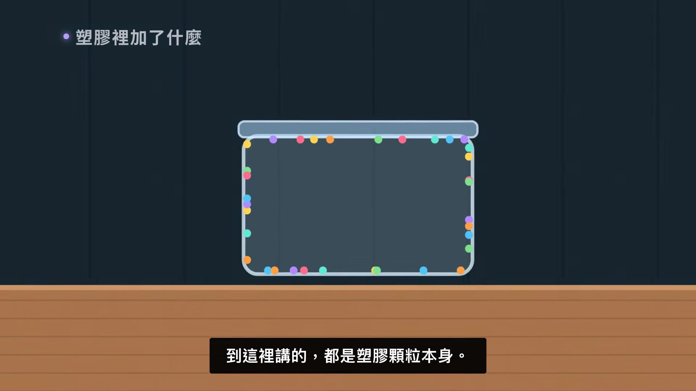

**逐字稿片段：** 可是塑膠還有另一面 Mark Miodonic是倫敦大學學院的材料科學家 他提醒 塑膠不是單一材料裡面加了很多東西 讓它更軟更亮顏色更好看 配方常常是廠商的商業機密

**話題推測：** 引入塑膠的另一個面向：其中添加的化學物質。

---

## 00:07:41

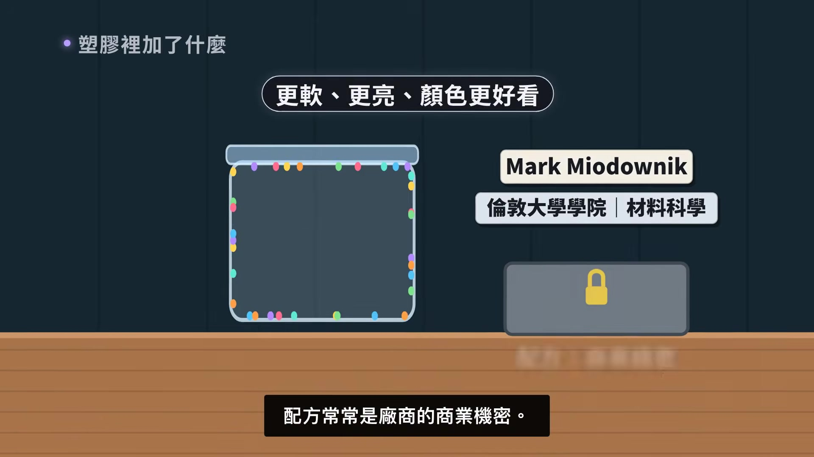

**逐字稿片段：** 有一個研究計劃整理過 塑膠裡可能用到或出現的化學物 超過一萬六千種 其中一部分被認為對健康有疑慮

**話題推測：** 提及塑膠中可能使用的化學物質超過一萬六千種的統計數據。

---

## 00:07:47

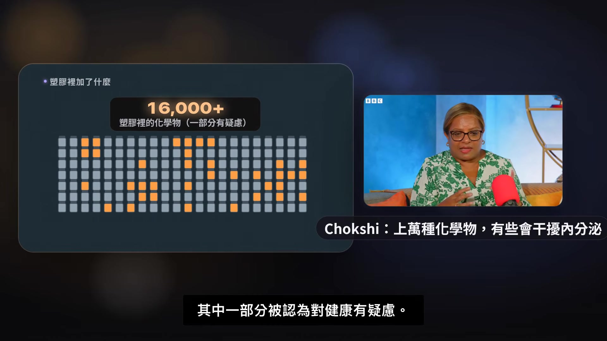

**逐字稿片段：** 最常聽到的兩類 一類就是臺灣常說的塑化劑 另一類叫雙分 例如雙分A 這些化學物會從塑膠移到食物裡 溫度越高食物越油越酸 移過去的越多

**話題推測：** 列舉兩種常見且對健康有疑慮的化學物質：塑化劑和雙酚A。

---

## 00:07:59

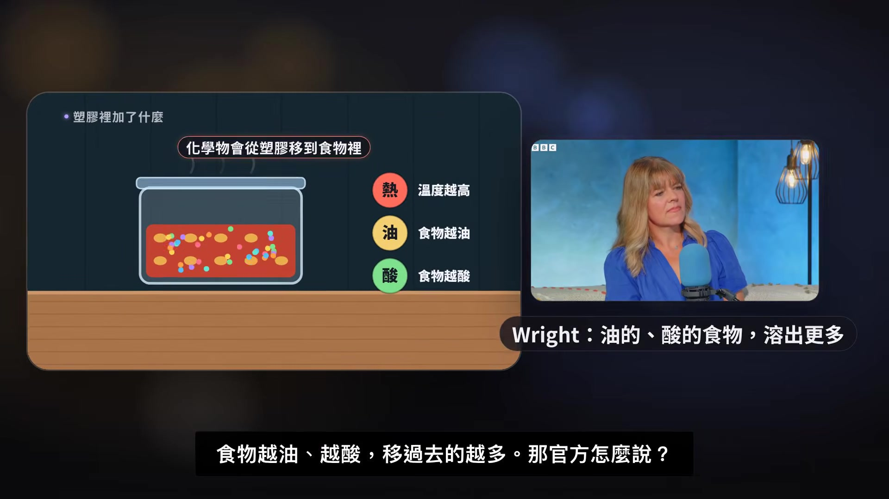

**逐字稿片段：** 那官方怎麼說 世界衛生組織2019年 和2022年的報告都說 現有的資料 還不足以判斷塑膠威力 對人體的風險 不足以判斷 不是說安全 也不是說危險 是還不知道

**話題推測：** 說明世界衛生組織對於塑膠微粒對人體風險的官方立場。

---

## 00:08:11

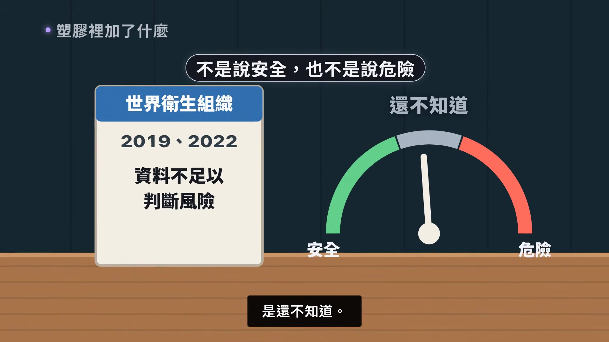

**逐字稿片段：** 所以這個問題的答案 分成三層 工廠那種高濃度 會讓人生病 這一層比較確定 人身上的研究 看到塑膠多的人 比較常生病 可是隻是相關 分不出因果 我們每天這種低劑量 每劑一輩子會不會怎樣 現在沒有人知道 記住這一句 高劑量會 低劑量還不知道 不過剛剛講的化學物 有一個好處 它比塑膠顆粒好量很多 檢驗尿液就量得到

**話題推測：** 總結第二部分關於塑膠微粒危害性的結論。

---

## 00:08:33

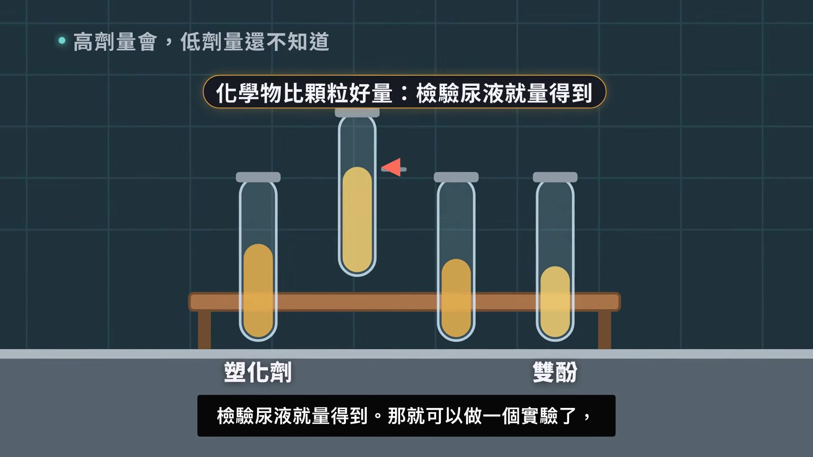

**逐字稿片段：** 那就可以做一個實驗了 如果我們少碰塑膠 身體裡的這些化學物 會不會真的降下來 這個實驗真的有人做了 它叫PERS實驗 由西藥大學主持 2026年4月發表在Nature Medicine

**話題推測：** 轉向第三個主要問題：在答案未明朗時我們可以怎麼做？

---

## 00:08:45

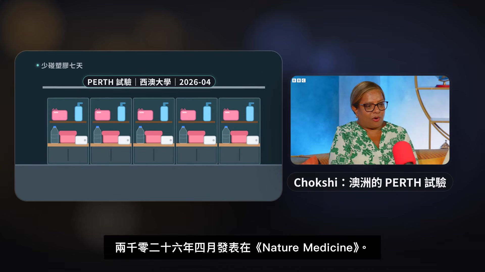

**逐字稿片段：** 做法是這樣 先找60個成年人 隨機分成幾組 對照組照常生活 其他組一程度不同 把食物換成沒有接觸塑膠包裝的 把廚房裡的塑膠換掉 改用木頭砧板玻璃保鮮盒 換得最徹底的那組 連洗髮精這類個人用品 都換成沒有塑膠的 這種隨機分組的實驗 在塑膠研究裡很少見 所以Truxy在節目裡 特別提到她 聽她怎麼說 其田

**話題推測：** 描述PERS實驗的具體做法和分組策略。

---

## 00:09:28

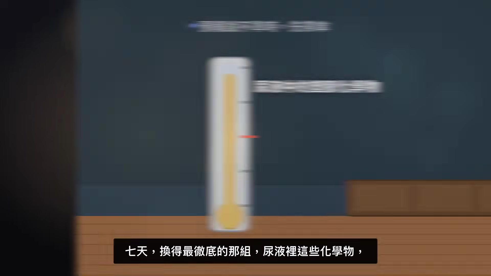

**逐字稿片段：** 換的最徹底的那組 尿液裡這些化學物 最多降了大約一半 不過有三件事要講清楚 第一 它兩的是塑膠帶進來的化學物 不是塑膠微粒 另外 它只證明降得下來 沒有證明健康會變好 還有 人數只有60個 是先導試驗 這就回到前一部分的答案 敵劑量有沒有害還不知道 那要不要先做點什麼

**話題推測：** 展示PERS實驗中尿液化學物濃度下降的結果（最多約一半）。

---

## 00:09:46

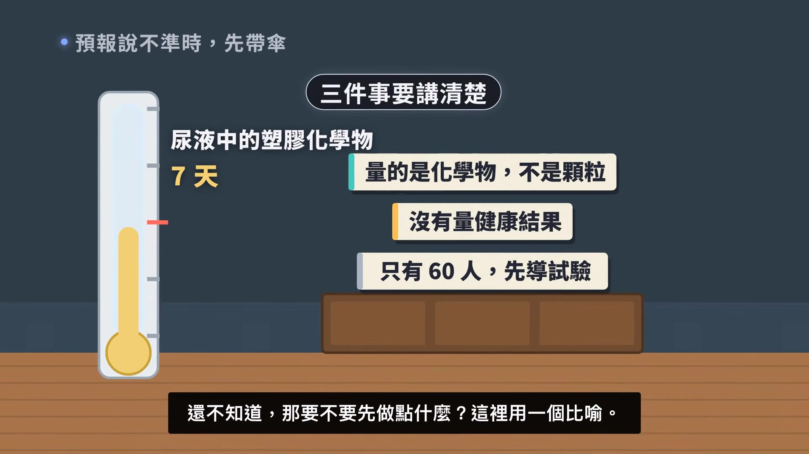

**逐字稿片段：** 這裡用個比喻 氣象預報說 下午可能下雨 可是幾率說不準 如果帶傘很麻煩 你可能就賭一把 如果傘就掛在門口 順手拿一下而已 大部分人會帶 沒有到那個的想法

**話題推測：** 使用「下雨帶傘」的比喻來解釋不確定性下的行為選擇。

---

## 00:09:57

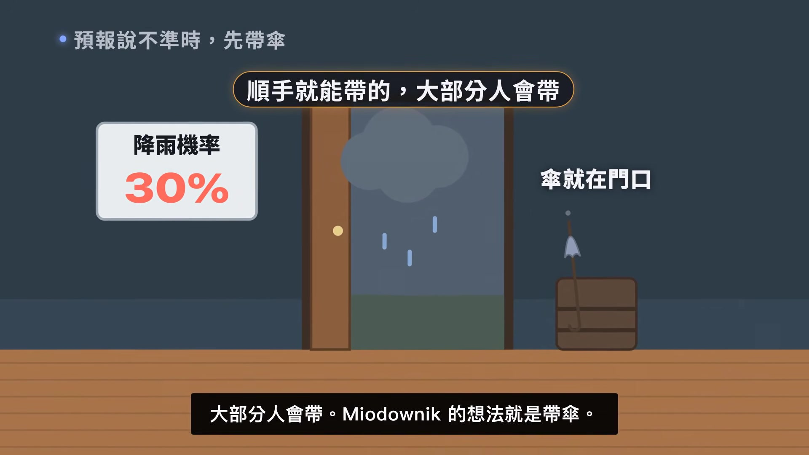

**逐字稿片段：** 就是帶傘 他還舉了十棉當例子 說十棉當年有了健康證據 還是過了很久才被禁止 這是他的類比 有一個差別要講 十二棉當年已經有大量病人 塑膠威力到目前還沒有 聽他怎麼說

**話題推測：** 引用石棉作為一個有健康證據但延遲被禁止的歷史案例。

---

## 00:10:13

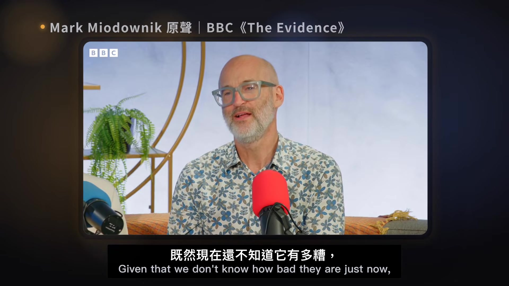

**逐字稿片段：** 那哪一把傘最順手 節目裡三位專家 講的最一致的

**話題推測：** 提出哪個「傘」最順手，引導至實際建議。

---

## 00:10:30

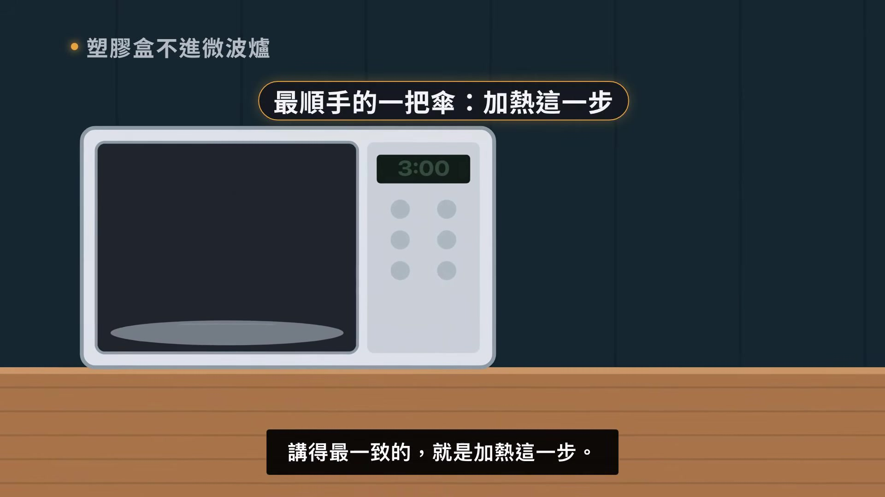

**逐字稿片段：** 就是加熱這一步 美國內部拉斯加大學 2023年做過實驗 把塑膠的嬰兒食品盒 放進微波爐 加熱三分鐘

**話題推測：** 強調專家們最一致的建議：避免加熱塑膠。

---

## 00:10:38

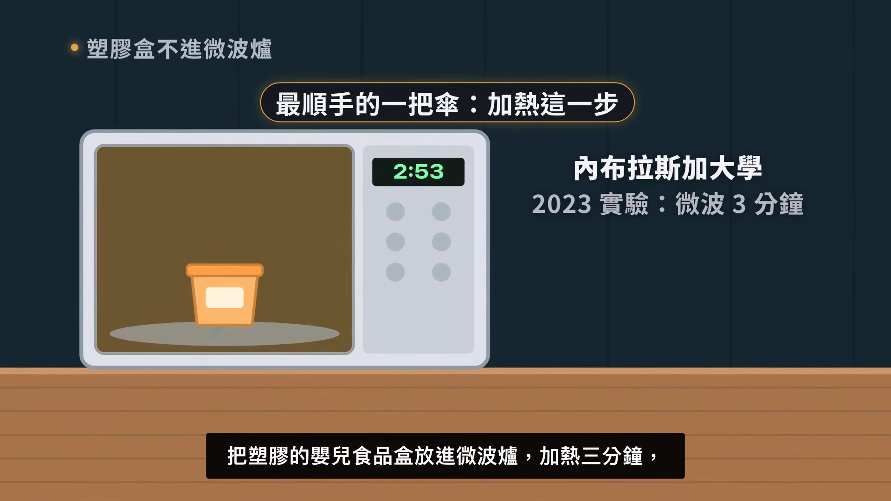

**逐字稿片段：** 在某些條件下 每平方公分的塑膠 會釋出幾十一顆 奈米級的顆粒 這是實驗室裡的條件 不代表你每次微波 都是這個量 可是方向很清楚 溫度越高 釋出越多 再加上剛剛講的 有的酸的食物 像番茄醬汁 會讓化學物移得更多 所以三個人的做法都一樣 塑膠盒不進微波爐 這是他們自己的做法 不是官方規定 開場提過的那一段 聽他們自己怎麼說

**話題推測：** 說明微波加熱實驗中塑膠釋出奈米顆粒的量。

---

## 00:11:16

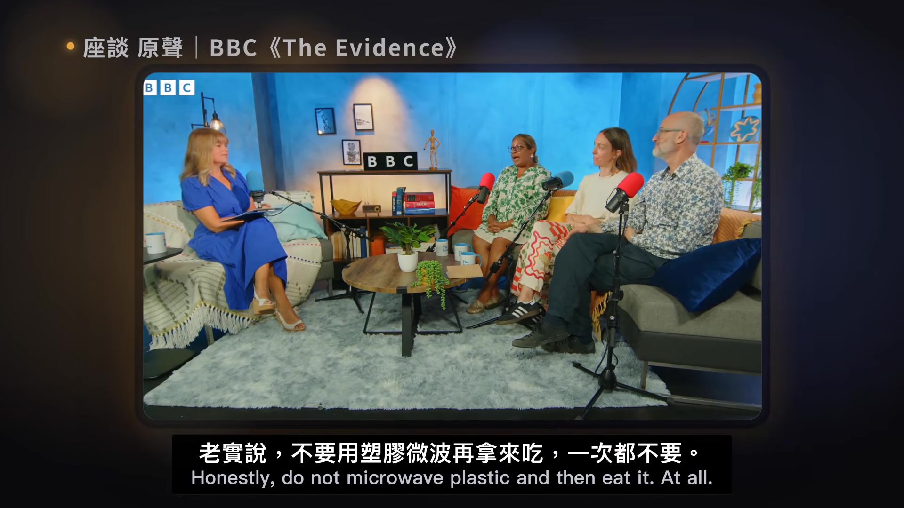

**逐字稿片段：** 另外兩個常見的來源是水和茶 喝水這部分

**話題推測：** 討論另外兩個常見的塑膠微粒來源：水和茶。

---

## 00:11:20

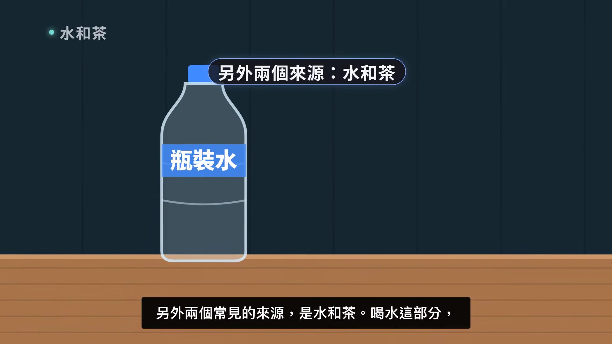

**逐字稿片段：** 哥倫比亞大學2024年的研究 檢驗了三個牌子的瓶裝水 每公升平均大約24萬顆塑膠顆粒 9成左右是奈米級的 Miodonic的建議是 喝自來水或濾過的水比瓶裝水好

**話題推測：** 引用2024年哥倫比亞大學關於瓶裝水中塑膠顆粒的研究。

---

## 00:11:32

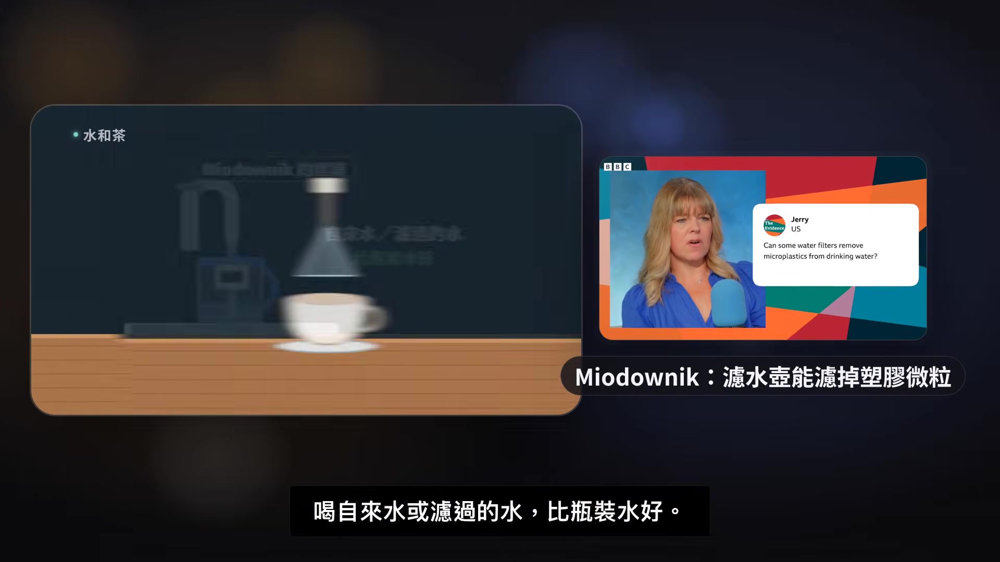

**逐字稿片段：** 茶包就要小心解讀 網路上常看到 一個茶包會放出100多億顆塑膠 那個數字來自尼龍這類塑膠材質的金字塔茶包 而且是倒掉茶葉只泡空袋子的實驗 也有其他研究者質疑他的算法 一般的紙茶包通常只有封口用到一點塑膠 Miodonic自己的做法是換成喝散茶 你可能會覺得到處都要換 節目最後

**話題推測：** 分析茶包釋出塑膠微粒的問題及相關爭議。

---

## 00:12:09

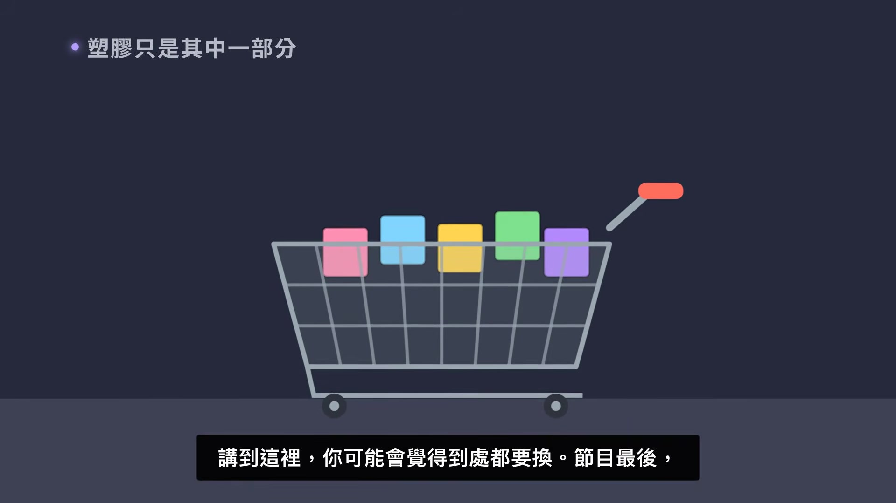

**逐字稿片段：** 主持人問了一個很實際的問題 跟運動次的健康比起來 塑膠威力要擺在多前面 Ryder回答很平衡 他研究空氣汙染10年以上 他說塑膠威力的毒性

**話題推測：** 提出一個實際的問題：塑膠微粒在健康優先級中的位置。

---

## 00:12:19

**逐字稿片段：** 大概比不上重金屬 真正麻煩的 是我們同時暴露在一大堆東西里 塑膠只是其中一部分 而且很多做法是一起的 你少吃微波即止餐 換成吃比較新鮮 比較少加工的食物 塑膠少碰了 營養本身也比較好 聽她怎麼說

**話題推測：** 將塑膠微粒的毒性與重金屬進行比較。

---

## 00:12:41

**逐字稿片段：** 最後這個問題的答案是 答案還沒出來 不代表什麼都不能做 但也不用每樣東西都換掉

**話題推測：** 總結影片所有問題的答案和三件可以帶走的建議。

---

## 00:12:55

**逐字稿片段：** 整理成三件可以帶走的事 看到新聞先分兩個問題 有沒有跟有多少 一起出現跟造成

**話題推測：** 列出第一點建議：區分新聞中的「有沒有」與「有多少」。

---

## 00:13:01

**逐字稿片段：** 也不一樣 在家裡先換掉加熱這一步 塑膠盒不進微波爐 熱的油的酸的食物 用玻璃或陶瓷裝

**話題推測：** 列出第二點建議：從家中加熱塑膠這一步開始改變。

---

## 00:13:07

**逐字稿片段：** 最後挑便宜的做 少買瓶裝水 砧板換成木頭的 不用花大錢去做 號稱能清掉體內塑膠的療程 那些目前沒有證據 記住這一句 不確定的時候 先帶最便宜的那把傘

**話題推測：** 列出第三點建議：從便宜且順手的改變做起，例如少買瓶裝水、換木頭砧板。

---

## 00:13:20

**逐字稿片段：** 我們回到開場那個問題 塑膠威力到底有沒有害 老實的答案是 工廠那種高濃度 會讓人生病 我們每天的滴劑量 現在也不知道 身體裡有沒有 大概有 有多少還量不準 三位專家都說 這個領域還很年輕 接下來幾年會有更多研究 在那之前 他們自己的選擇 是先換掉便宜 順手的幾樣東西 這一集不是醫療建議 如果你有健康上的擔心 還是要問醫師

**話題推測：** 再次總結塑膠微粒是否有害的核心問題與目前的理解。

---

## 00:13:42

**逐字稿片段：** 最後問你一個問題 你家裡最常碰到塑膠的地方是哪裡 看完這集 你會先換掉哪一樣 留言告訴我 喜歡的話訂閱AI Notebook 開啟通知 我們下次見

**話題推測：** 向觀眾提出互動問題，詢問他們會先換掉哪一樣塑膠製品。

---
