# jimainotebook_gNpqvQX_3qA — 關鍵畫面索引

- 來源逐字稿：[jimainotebook_gNpqvQX_3qA_FIN.srt](jimainotebook_gNpqvQX_3qA_FIN.srt)
- 影片：https://www.youtube.com/watch?v=gNpqvQX_3qA
- 截圖數：51

## 00:00:10

**逐字稿片段：** 這一集是麻省理工學院MIT的公開課區快鏈與貨幣的終極, 這次上第九到第十六堂, 上一集我們講到錢說穿了, 是一本大家都相信的帳本,

**話題推測：** 介紹本集主題：MIT公開課區塊鏈與貨幣，可能搭配課程標題畫面。

---

## 00:00:21

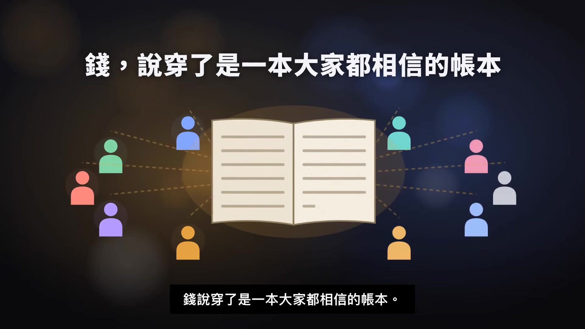

**逐字稿片段：** 這一集要問下一個問題, 這本帳到底該交給誰來記?我先講清楚, 這是2018年秋天的課, 這幾年區快鏈跟付款的世界變了很多, 課堂上有些數字跟預測, 今天看已經過時, 遇到這種地方我會停下來, 補一句後來發生了什麼。 可是這門課還是經典 因為他問的事情不太會過時 誰來記賬啊 誰收著筆記賬的錢 出了事又由誰來負責

**話題推測：** 提出本集核心問題：這本帳到底該交給誰來記？

---

## 00:00:43

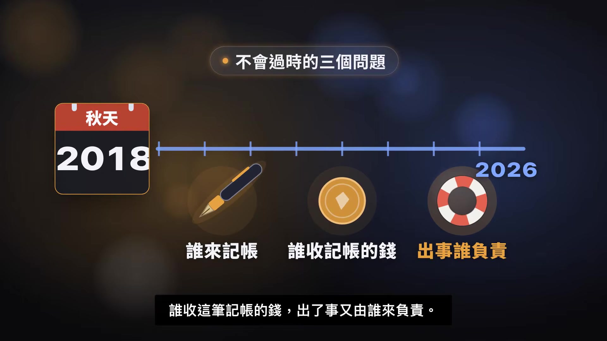

**逐字稿片段：** 講臺上的老師叫Gary Gensler 他在投資銀行高盛工作過18年 也當過美國商品期貨交易委員會的主席 上完這門課兩年多 他從2021年4月到2025年1月 擔任美國證券交易委員會的主席 這八堂課還有一件很特別的事 Gensler在課堂上做了好幾個預測 有一次他還笑著說 這堂課有錄影

**話題推測：** 介紹主講者Gary Gensler的背景和現職，可能顯示其照片或履歷。

---

## 00:01:07

**逐字稿片段：** 這本賬可以交給誰? 候選人有四個 銀行自己記 幾家大機構組隊一起記 誰都可以來記 還有最上面的中央銀行 直接幫每個人記

**話題推測：** 列出記帳人的四位候選，可能以條列式呈現。

---

## 00:01:16

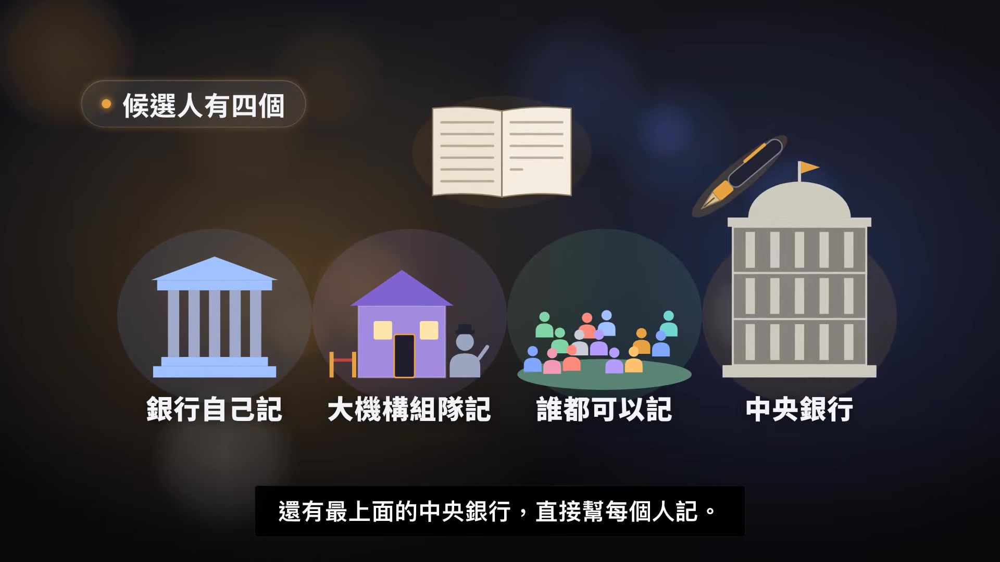

**逐字稿片段：** 我們分三步走 先看為什麼會有人想換掉現在的記賬人 再拿一張判斷清單 檢查我們每天都在用的付款 最後看中央銀行 要不要自己發數位的錢 2018年10月 麻省理工學院的一間教室裡 有個學生問了一個很難回答的問題 他問銀行在做的那種 只讓會員加入的區塊鏈 跟比特幣那種誰都能加入的區塊鏈 以後會是什麼關係 哪一邊會勝出 這種問題 沒有人能給標準答案 Gensler想了一下說 他願意給一個2018年的看法 然後他補了一句 這堂課有錄影 以後我們就看看 他說得準不準 這句話很適合當這一集的開頭 因為這八堂課講的 都是正在發生 還沒有結果的事 銀行在做實驗 中央銀行在寫報告 手機付款在別的國家長大 每一件都還在半路上 Gensler一邊教一邊下注 我們今天站在八年後 手上剛好有答案卷

**話題推測：** 說明本集的三個主要討論步驟，可能顯示流程圖或章節概覽。

---

## 00:02:06

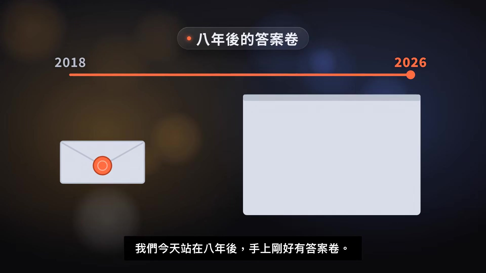

**逐字稿片段：** 這一集我會挑出他三個最重要的預測 放在三個地方 一個在銀行組隊記賬的部分 一個在付款的部分 一個在中央銀行的部分 每一講到一個 我們就停下來對一次答案 我們先聽他自己怎麼說 要對答案得先把題目弄清楚 上一集我們說 錢說穿的是一本大家都相信的賬本 賬本的英文叫ledger 就是一筆筆記下誰有多少錢的記錄 Gensler在第十堂課說 如果期末要考20個名詞 賬本一定是其中一個

**話題推測：** 說明本集將回顧Gensler的三個重要預測，可能顯示章節預告。

---

## 00:02:51

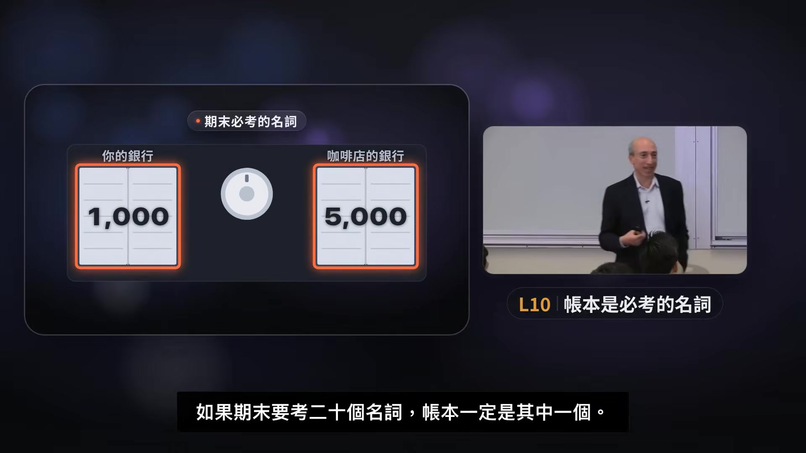

**逐字稿片段：** 那付款是什麼 假設你在咖啡店 用手機付了一杯咖啡的錢 你的感覺是錢從手機飛出去了 可是真正發生的事 是兩本賬同時被修改 你那家銀行的賬上 你的數字往下 咖啡店那家銀行的賬上 咖啡店的數字往上付款 就是同時修改兩本賬 那兩家銀行之間又是怎麼結親的 他們上面還有一本更大的賬 記在中央銀行 每一家銀行都在中央銀行開了一個戶頭 戶頭裡的錢有一個名字叫準備金 意思是銀行放在中央銀行的錢 你付咖啡錢的那一刻 最後是兩家銀行在中央銀行那本賬上 一邊減一邊加 所以今天的賬本是一層疊一層的 最下面是你跟銀行 先是中央銀行 這一集的問題 就是在問這幾層裡 哪一層的記賬人可以換掉 又該換成誰 這幾層記賬人

**話題推測：** 解釋「付款」的定義及兩本帳修改的過程，可能輔以圖示。

---

## 00:03:40

**逐字稿片段：** Gensler用一張圖來看 他在高盛待了18年 又在美國政府管過金融市場 他說自己想了40年的金融 腦中一直是一個沙漏 沙漏的上面那一半 是有錢想放的人 存錢的人買保險的人 替退休存錢的人 下面那一半 是需要錢的人 買房子的家庭 要蓋工廠的公司 要發債的政府 中間那個很細的地方啊 是金融業 Gensler說 華爾街就坐在沙漏的瓶頸上 錢要從上面流到下面 大多得經過那裡 坐在瓶頸的人 做三件事 他替錢和風險定價 決定借錢要付多少利息 他分配決定錢給誰 他搬動 把錢從一本賬移到另一本賬 這三件事 每一件都要記賬 所以沙漏的瓶頸 就是我們這一集在問的記賬人 如果有一種新技術 能讓瓶頸變寬一點 或是讓錢不用全部擠過同一個窄口 那就是區塊鏈想做的事 可是在換掉瓶頸之前 得先知道瓶頸上的人在收什麼錢 我們先聽Gensler自己怎麼形容這個沙漏

**話題推測：** 介紹金融業的「沙漏」模型，這是一個核心視覺比喻。

---

## 00:05:04

**逐字稿片段：** 瓶頸上的人靠什麼賺錢 Gensler先講銀行最核心的一招 叫期限轉換 意思是銀行拿你隨時可以領走的短期存款 去借給要20年到30年 才還得清的房屋貸款 這是好事 社會上長期的計劃才借得到錢 可是它有一個天生的弱點 如果很多存款人 同一時間要把錢領回去 銀行手上的錢 大部分已經借出去了 拿不出來 這種事叫擠兌 這個弱點 在這一集最後一部分會再出現 再來是錢 Gensler在第十堂課 最後算了一筆賬

**話題推測：** 探討金融業者賺錢的方式，開始介紹「期限轉換」。

---

## 00:05:33

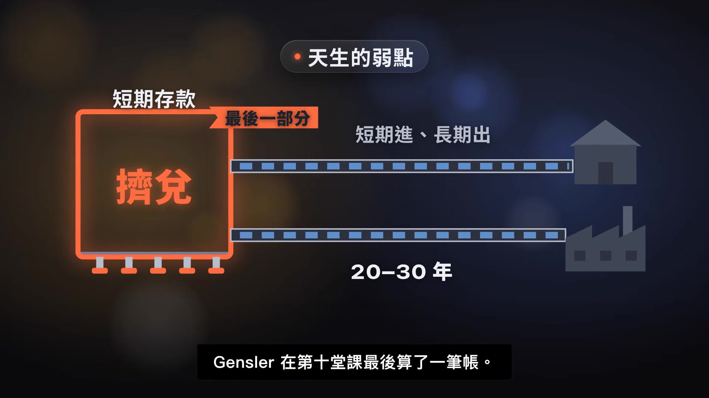

**逐字稿片段：** 他把美國的股市跟債市 這些資本市場加起來 再看金融業每年賺走多少 粗估下來 金融業大約從整個經濟 抽走1.5% 他用了一個賭場的老字眼 叫抽頭 就是莊家從每一局抽走的那一份 這是他2018年的粗估 不是精確的統計 他真正想說的是另一個名詞

**話題推測：** 引用美國股市、債市數據，計算金融業的「抽頭」比例，可能顯示圖表。

---

## 00:05:51

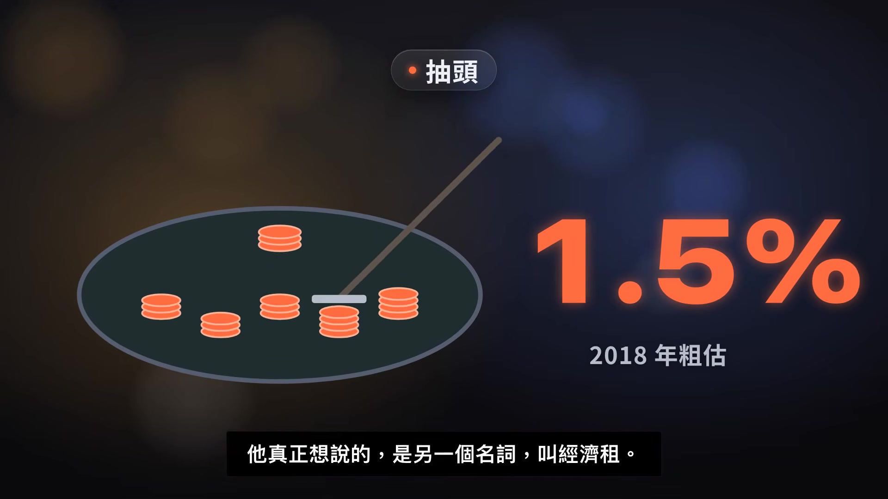

**逐字稿片段：** 叫經濟租 經濟租指的是 不是因為你做得比別人好 而是因為你站在 別人繞不過去的位置 所以多收到了那一份錢 沙漏的瓶頸 就是一個繞不過去的位置 Gensler說系統老舊 資料很多 又有經濟租的地方 就是區塊鏈可能切進去的地方

**話題推測：** 引入「經濟租」概念，解釋金融業的壟斷優勢。

---

## 00:06:07

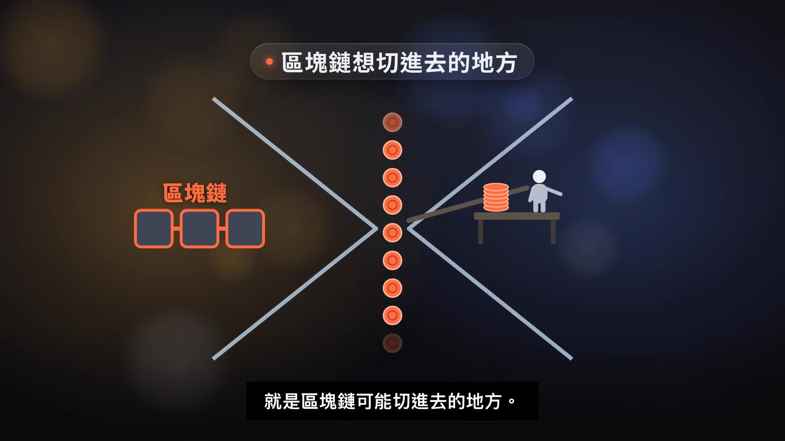

**逐字稿片段：** 那區塊鏈到底能省什麼 第11堂課 Gensler用了麻省理工學院

**話題推測：** 探討區塊鏈能節省的成本，開始介紹兩種成本。

---

## 00:06:12

**逐字稿片段：** Christian Catalini的一篇論文 答案是兩種成本 第一種叫驗證成本 驗證 就是確認一件事是真的 這筆錢真的存在 真的是你的 真的已經付過了 今天每一家銀行各記一本賬 所以銀行的後臺 要花很多人力 把自己的賬跟別人的賬 一筆一筆對起來 如果大家寫的是同一本帳 這個對帳的成本 就有機會省下來

**話題推測：** 引用Christian Catalini的論文，可能顯示論文標題或作者資訊。

---

## 00:06:32

**逐字稿片段：** 另一種叫建網路的成本 任何網路剛開始都很難 因為大家都在等別人先加入 Gantzler舉了聯邦快遞的例子 創辦人想讓包裹隔天送到 第一天就得有一整對飛機 可是第一天根本還沒有客戶 區塊鏈上的代幣 可以拿來獎勵早期加入的人 幫一個新網路跨過這一關 這兩種成本 等一下會變成判斷清單的一部分 可是講到這裡 Gantzler馬上加了一句提醒

**話題推測：** 解釋第二種成本：建網路的成本，並以聯邦快遞為例說明。

---

## 00:06:56

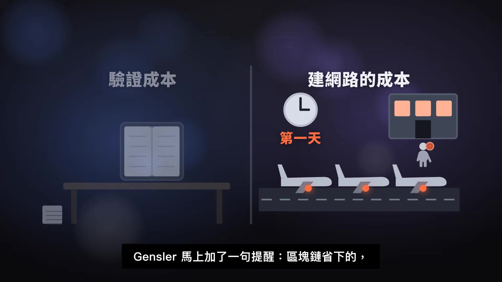

**逐字稿片段：** 區塊鏈省下的不是信任本身 很多人說區塊鏈是免信任的 意思是你不用相信任何人 Gensler不同意這個說法 他說信任還是有成本 只是你相信的對象換了 以前你相信的是中間人 例如銀行 在比特幣裡 你相信的是兩樣東西 一樣是城市碼 也就是那套軟體寫得沒有問題 維護它的開發者也沒有任意修改 另一樣是共識協議 也就是一群互不認識的電腦 用來決定哪一頁賬本 算數的那套規則 他還舉了自己的例子 他開車的時候 也在相信車子裡的化油器 可是他根本不知道化油器怎麼運作 我們每天都在相信很多看不見的東西 信任是一層一層疊起來的 區塊鏈沒有把信任拿掉 他是把一部分信任 從中間人身上 搬到城市碼跟共識上 這句話值得多想一下 因為這一集接下來的每一個選擇 說穿了都是在決定 要把信任放在哪裡 我們聽他怎麼講 Bitcoin core developer so to speak and the consensus protocol so when some people say it's trustless it's not truly trustless you still have to trust the code you have to trust the consensus protocol 信任搬到城市馬上 聽起來很漂亮 可是Gensler接著講了一個現場觀察 上課前一天 他到紐約 在大型資產管理公司

**話題推測：** 提出區塊鏈省下的不是信任本身，而是轉移了信任的對象。

---

## 00:08:20

**逐字稿片段：** 復達的一場活動上演講 臺下坐的 都是很懂投資的人 他問誰買過或交易過比特幣 大約100個人舉手 他再問 這100個人裡面 有誰是直接在區塊鏈上持有 自己下載軟體 自己保管 結果舉手的只有三個 這個數字很值得停下來想一下 比特幣設計出來 是為了讓人不用把錢交給中間人 可是一屋子最懂投資的人 絕大多數還是把比特幣放在交易所 交易所就是一家替你買賣 也替你保管的公司 換句話說 信任繞了一圈 又回到了一箇中間人身上 上一集最後講過 後來幾家大交易所出事 受傷最重的 就是這些把幣放在別人那裡的人 所以光說用的區塊鏈還不夠 要問的是信任最後落在誰的手上 如果連買比特幣的人 最後都把幣交給中間人 那銀行會怎麼想 銀行很早就看上去快鏈的一個好處 大家寫同一本賬 可以省下對賬的錢 可是比特幣處理交易的速度太慢 銀行沒辦法拿來用 所以銀行做了一件事 Gensler的說法很生動 把東西丟下船 他們把代幣丟掉 把挖礦丟掉 把那套讓陌生人互相競爭的規則也丟掉 只留下大家共用一本賬的那個部分 剩下的是一個俱樂部

**話題推測：** Gensler分享在復達活動上的問卷調查結果，可能顯示統計數字或圖表。

---

## 00:09:58

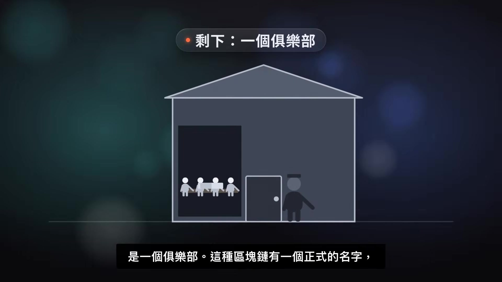

**逐字稿片段：** 這種區塊鏈有一個正式的名字叫有門禁的區塊鏈 英文是permission the blockchain 意思是誰可以參加記賬要先經過同意 就像一個會員制的俱樂部 門口有人看門會員才能進去 會員彼此都認識 那幾年銀行界做了好幾套這樣的系統

**話題推測：** 引入「有門禁的區塊鏈」（permissioned blockchain）概念，可能顯示相關圖示或名稱。

---

## 00:10:15

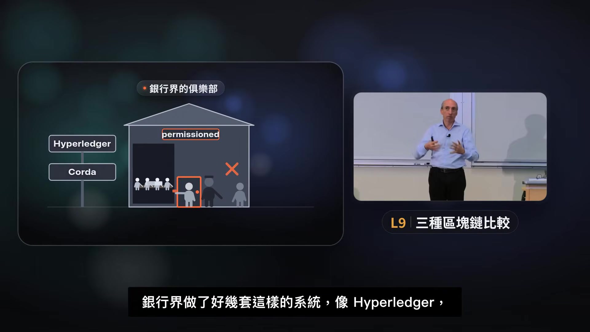

**逐字稿片段：** 像Hyperledger還有銀行出資的R3公司做的Corder 俱樂部的好處很直接記賬的電腦少 彼此又認識所以快得多 資料也不會公開給所有人看 可是代價是什麼 Gensler用了一句很重的話 和比較有效的共識計劃 但是交易的缺點是 你現在更好地相信那15-20個軟件 當我們談論51%的攻擊 你如果想要那15個軟件 你就可以修改整個區塊鏈 代價就是 你得真的相信那15-20個會員 如果他們聯手 整本賬可以被重新改寫 在比特幣那邊 你要防的是不認識的人 在俱樂部這邊 你要相信的是認識的人 信任沒有消失 他又換了一個地方放 Gensler還把一件常被混在一起的事 分開來講

**話題推測：** 舉例Hyperledger和R3 Corda等銀行區塊鏈系統，可能顯示其標誌。

---

## 00:11:05

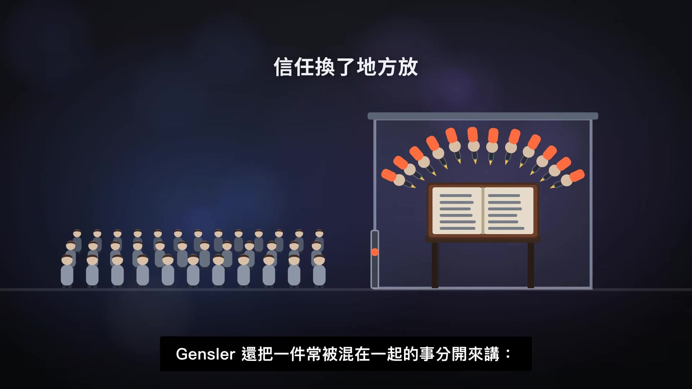

**逐字稿片段：** 誰能讀誰能寫 讀的意思是看賬本 寫的意思是在賬本上記一筆 一個有門禁的區塊鏈 可以讓幾百萬人用他的服務 看自己的記錄 可是真正能寫進賬本的 可能只有十幾個節點 節點就是參與記賬的那幾臺電腦 第九堂課 他把三種賬本並排放在一起 比特幣那種公開的區塊鏈 誰都能寫 俱樂部那種有門禁的區塊鏈 會員才能寫 還有一種最老的 傳統資料庫 一家說了算 三種賬本用的密碼學 其實差不多 差別在一件事 誰說了算 他給的判斷方法也很直接 如果你需要誰都能參加 需要點對點交易 或者需要代筆 就走公開的區塊鏈 如果很多方都要寫 又不想讓外人看見 就走有門禁的區塊鏈 如果只有一個 大家都信任的記賬人 傳統資料庫就夠了 三種賬本的分法 回答的是要用哪一種 可是在那之前 還有一個更早的問題 你到底需不需要 在評估用途的那一堂課

**話題推測：** 區分「讀」與「寫」賬本的權限。

---

## 00:12:00

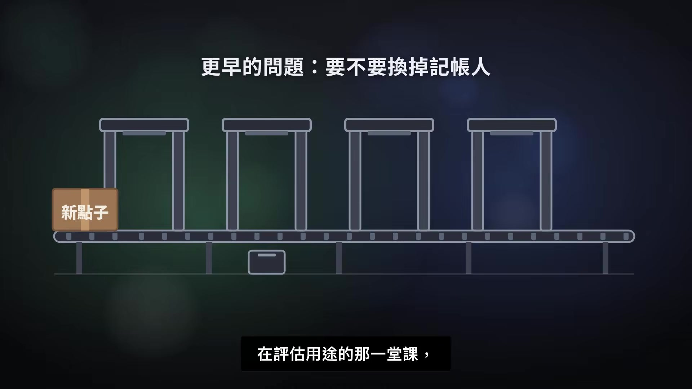

**逐字稿片段：** Gensler給學生一張判斷清單 一共四個問題 他要每一組期末專題都回答 他先問痛點 現在的做法 讓誰不舒服 是太貴 太慢 還是有人被擋在外面 再問價值 就算你解決了痛點 你要怎麼從裡面收到錢 通常就是從別人的經濟租賃 分走一小份 接著問對手 現在的業者 就算繼續用傳統資料庫 能不能把同一個痛點解決掉 如果他們稍微調整一下就能做到 你的優勢就不見了 最後才問技術 你為什麼需要一本 只能往後加 不能修改的賬本 為什麼需要一群人 一起決定的共識 又為什麼需要代幣 有個學生聽完說 他很喜歡這十個問題 希望老師每次都這樣講 這張清單我們先收著 等一下進到付款 會一題一題拿出來用 至於Gangster 自己2018年 他壓的是哪一邊 Gangster在2018年壓的是 俱樂部那一邊 他說因為公開的區塊鏈 還太慢 隱私跟安全也還有問題 投資的主力 會在有門禁的區塊鏈 特別是銀行和大機構的企業應用 他還說5到7年後 兩邊的差距會縮小

**話題推測：** Gensler提出一張四個問題的判斷清單（痛點、價值、對手、技術）。

---

## 00:13:00

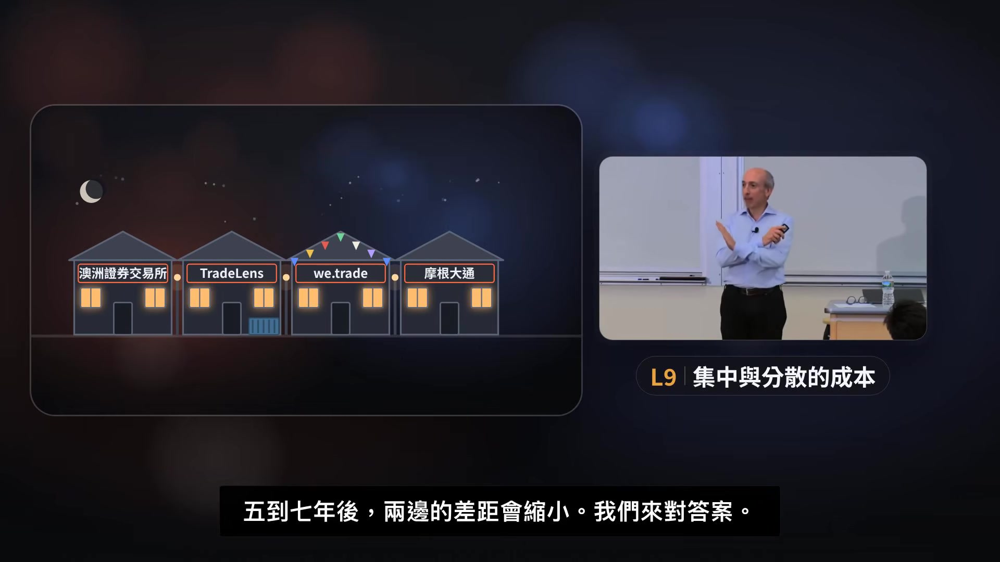

**逐字稿片段：** 我們來對答案 他在課堂上舉過的例子裡

**話題推測：** 回顧Gensler對俱樂部型區塊鏈的預測，可能顯示預測成果圖表。

---

## 00:13:02

**逐字稿片段：** 有一個是澳洲證券交易所 他打算用有門禁的區塊鏈 換掉舊的清算交割系統 結果2020年11月 交易所宣佈暫停 獨立審查發現設計有重大問題 交易所認列了大約2億5千萬澳幣的費用 澳洲的證券主管機關跟中央銀行 一起把這件事稱為重大挫敗 同一年

**話題推測：** 舉例澳洲證券交易所（ASX）區塊鏈專案的失敗，可能顯示相關新聞或時間軸。

---

## 00:13:22

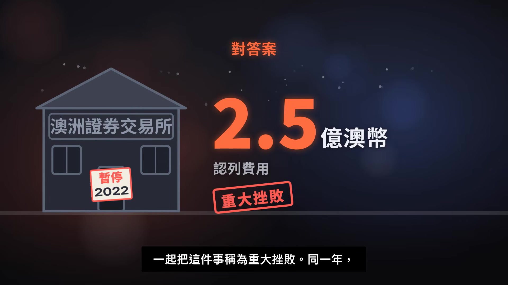

**逐字稿片段：** 航運公司快委跟IBM合作的貿易平臺TraderLens宣佈收掉 歐洲幾家銀行合組的貿易融資平臺WeChat也關了 可是也不是全部失敗

**話題推測：** 舉例航運公司快委與IBM合作的TradeLens平台收掉。

---

## 00:13:31

**逐字稿片段：** 摩根大通的區塊鏈部門還在 2024年改名叫Kinexus 2025年還把美元存款做成數位代幣 放到公開的區塊鏈上試行 所以這一題的答案是一半一半 俱樂部確實拿到了很多投資 可是很多俱樂部沒有活下來 原因也不是技術做不到 TraderLens說得很直白 產業沒有全面參與 俱樂部要成立 得先有夠多的會員願意走進來 我們把這一部分收一下 我們問的是 為什麼有人想換掉現在的記賬人 答案是 記賬人坐在沙漏的瓶頸上 收著經濟租 而且每一家各記一本賬 對賬又貴又慢 區塊鏈想省的是兩種成本 確認事情是真的得驗證成本 還有讓大家一起加入的建網路成本 可是我們也看到了兩件事 第一件 信任沒有消失 只是換了地方放 另一件 信任換過去之後 常常又集中回少數人手上 例如交易所 例如俱樂部的會員 所以這一部分的答案 可以用一句話講完 區塊鏈值得用的時候 是很多方都要寫同一本賬 又不想全部相信某一家的時候 如果只有一個大家都信任的記賬人 傳統資料庫就夠了 我們手上也多了一個工具 就是那張判斷清單 痛點 價值 對手 技術 接下來我們要拿它去檢查一本 每個人每天都在用的賬 也就是付款

**話題推測：** 舉例摩根大通區塊鏈部門Kinexus的發展，可能顯示其標誌或新聞。

---

## 00:14:46

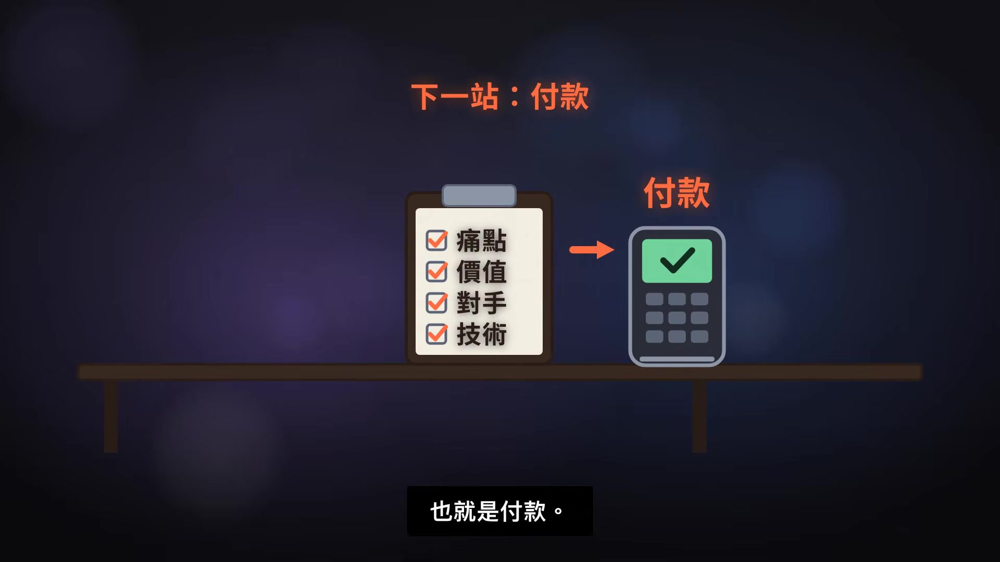

**逐字稿片段：** 拿判斷清單來檢查付款 先問痛點在哪裡 要找痛點 得先知道付款裡面有幾個步驟 第十三堂課 Gensler說付款當然是在搬錢 可是說穿了 它是在修改賬本上的記錄

**話題推測：** 進入付款部分，用判斷清單檢視付款痛點。

---

## 00:14:57

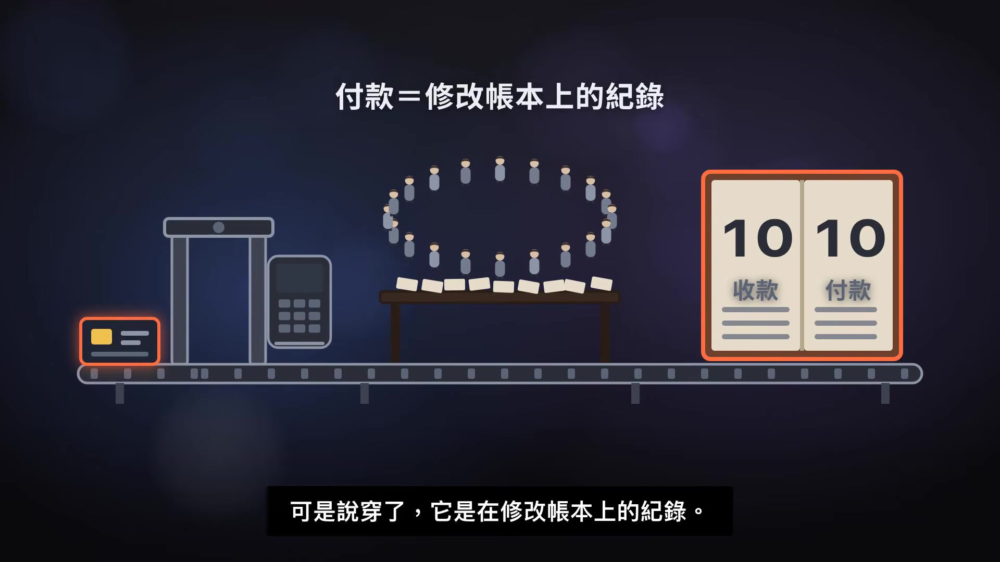

**逐字稿片段：** 而這個修改分成三段 第一段叫授權 授權就是確認 你是你的賬上有錢 你有權利動這筆錢 你在店裡刷卡 機器逼一聲說交易成功 那只是授權通過 下一段叫清算 清算就是交割之前的整理 最重要的動作叫扎插 也就是互相抵消 假設一間教室有一百個人 一天裡互相賺了一萬筆錢 到了晚上 大部分的錢都會互相抵掉 真正需要搬的 只剩下少數幾筆 最後一段叫交割 交割就是賬本上 最後的那一下修改 Gensler的說法是 把餘額從10改成11 或者從10改成9 記上去就不再回頭 這三段 在你手上只花了一秒 在銀行之間 可能要走好幾天 這時候有個學生舉手 問了一個很好的問題 都已經是電腦時代了 為什麼還要分成三段 這個學生問得很直接 在電腦裡 A 轉一筆錢給B 一個步驟就能完成 為什麼還要分三段

**話題推測：** 介紹付款的三個步驟：授權、清算、交割，可能以流程圖說明。

---

## 00:15:47

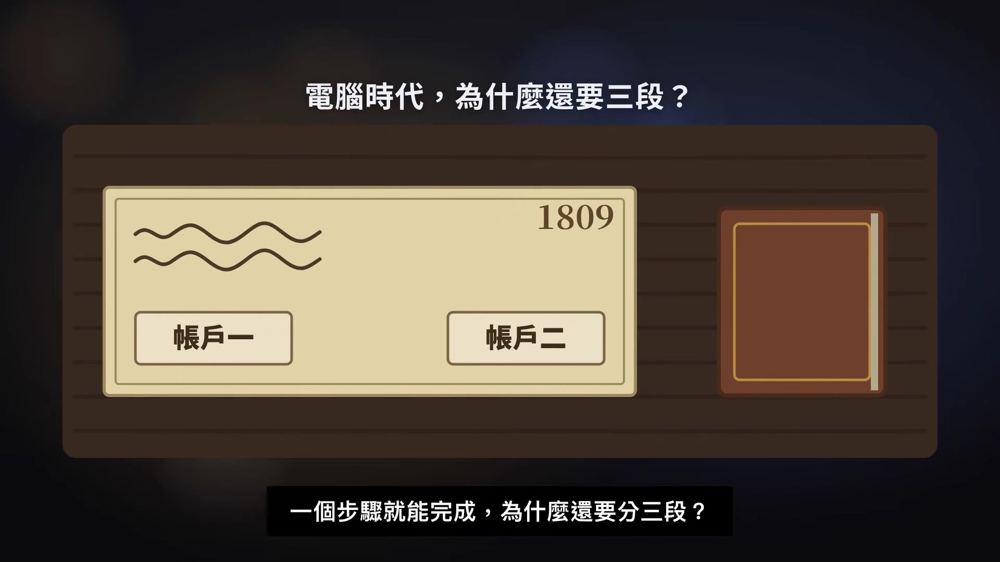

**逐字稿片段：** 那天的來賓叫Elin Dragos 他在麻省理工學院的數位貨幣計畫工作 以前在大型支付公司帶過200人的團隊 他說這套系統是幾十年慢慢長出來的 如果今天從零開始設計 會長得很不一樣 Gensler拿出一張很老的東西來回答 是美國第三任總統傑佛遜 在1809年寫給自己的一張支票 從自己的一個戶頭 付到自己的另一個戶頭 這張支票本身沒有搬動任何錢 它只是一張付款的指令 指令先寄出去 錢後來才在帳上動 後來的歷史 就是指令傳得越來越快 賬本就一直慢慢跟在後面 先是電報 再來是T-Lex這種電傳 打字機 Gensler 1979年進高盛的時候 公司裡還在用 到了1960年代末 華爾街的資本股票憑證 多到處理不過來 業界後來才把清算跟交割 集中交給專門的機構來做 所以分成三段 不是因為有人覺得這樣最好 而是一路疊上來的歷史 我們聽他講這張支票 But that is a payment instruction From one Thomas Jefferson account To another Thomas Jefferson account But it's a payment instruction It didn't actually move the money It's just a payment instruction 指令跟賬本是分開的 那現金呢 現金總不是賬本了吧 那天也有學生這樣問 Gensler從口袋拿出一張美鈔 交給前排的學生 他說你看上面寫的字 Federal Reserve Note 中文叫聯邦準備券 意思就是 這張只是美國的中央銀行 欠你的一筆賬 寄在中央銀行負債的那一邊 它背後沒有一物質的黃金 它就是一筆賬 而且每一張美鈔 都有一個獨一無二的序號 Gansler說 這張鈔票就像一張 綁在中央銀行賬本上的收據 拿在手上的人 就是這張收據的主人 現金跟銀行轉賬最大的不同 是現金交給別人的時候 不需要任何人幫你寄一筆 所以它是匿名的 他一說完 又笑著補了一句 好吧 這一幕被攝影機拍下來了 這件事的意思是 連現金都是那本賬的一部分 要不要發數位的錢 問的其實就是 這張收據 能不能變成數位的 我們回到判斷清單 看痛點的答案 付款最明顯的痛點

**話題推測：** 介紹來賓Elin Dragos，可能顯示其照片或職稱。

---

## 00:18:00

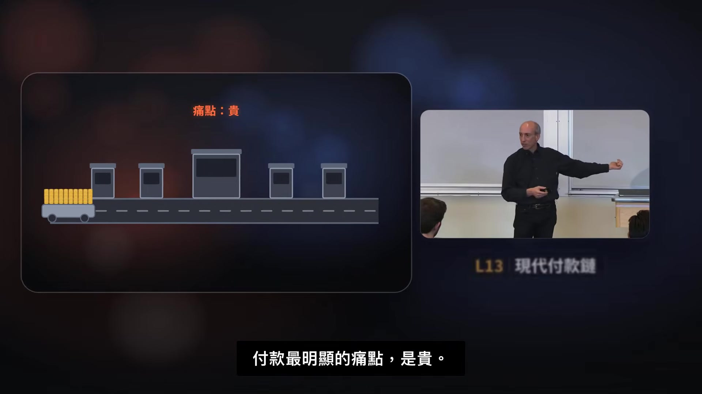

**逐字稿片段：** 是貴 Gensler引用了財經媒體 Bloomberg的一篇文章 在美國 每100美元的刷卡消費 平均大約有2.75美元 會被付款鏈上的各家公司抽走 其中大約2.2美元 回到髮卡的銀行 銀行再拿一部分出來 變成你的點數回饋 真正拿去彌補詐騙損失的 只佔很小一部分 這是2018年的美國數字 Gensler的結論很簡單 這裡面有很大一部分是經濟租 照清單上關於價值的那一題 有經濟租就有機會 那為什麼這麼多年沒有人把它拿下來 來賓A0的回答很實在 他說這是一套銀行為銀行設計的系統 技術很老可是生意好得不得了 消費者喜歡因為到處都能刷 銀行喜歡因為賺很多 一大群供應商也靠它過活 最難的地方叫入口 也就是結賬那一刻 熒幕上出現哪些付款選項 由誰決定 你的方案再好 進不了結賬畫面 就等於不存在 Gensler補了一個名詞

**話題推測：** 討論付款的「痛點」之一是成本，引用彭博社數據，可能顯示圖表。

---

## 00:18:55

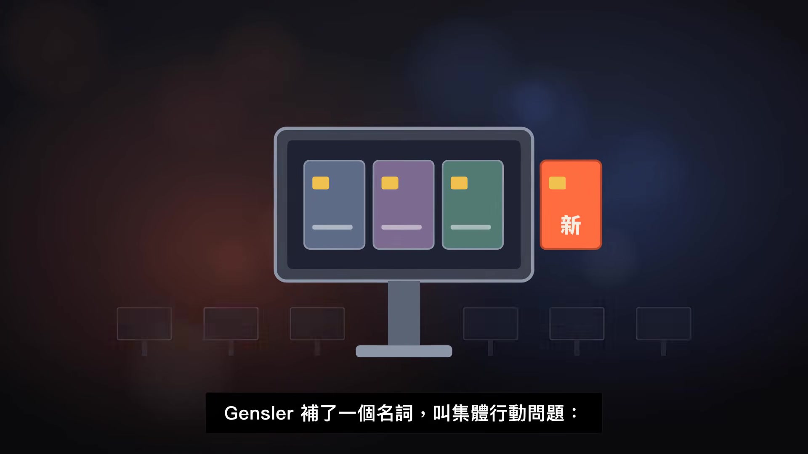

**逐字稿片段：** 叫集體行動問題 幾百萬家商店 幾十家處理付款的公司 每個國家兩三家卡片組 直接大家一起換 非常難 我們聽他講這個數字 國內付款已經這麼貴

**話題推測：** 引入「集體行動問題」概念，解釋付款系統難以改變的原因。

---

## 00:19:25

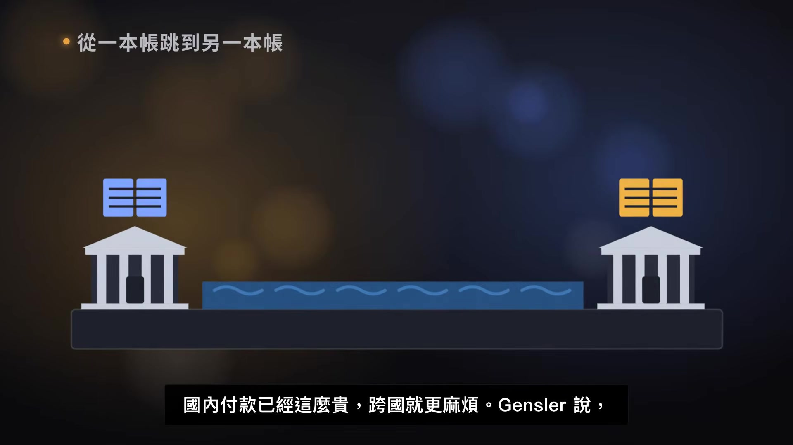

**逐字稿片段：** 跨國就更麻煩 Gensler說 跨境付款難 是因為你要從一種錢 跳到另一種錢 也就是從一套賬本 跳到另一套賬本 他舉的例子是 美國堪薩斯州的一家小銀行 要匯一筆錢到菲律賓 菲律賓那邊的銀行 根本不認識這家小銀行 所以中間要找一家 兩邊都信任的 大型國際銀行來轉手 這種中間的銀行 有一個名字

**話題推測：** 轉向討論跨境付款的痛點，可能顯示國際匯款流程圖。

---

## 00:19:45

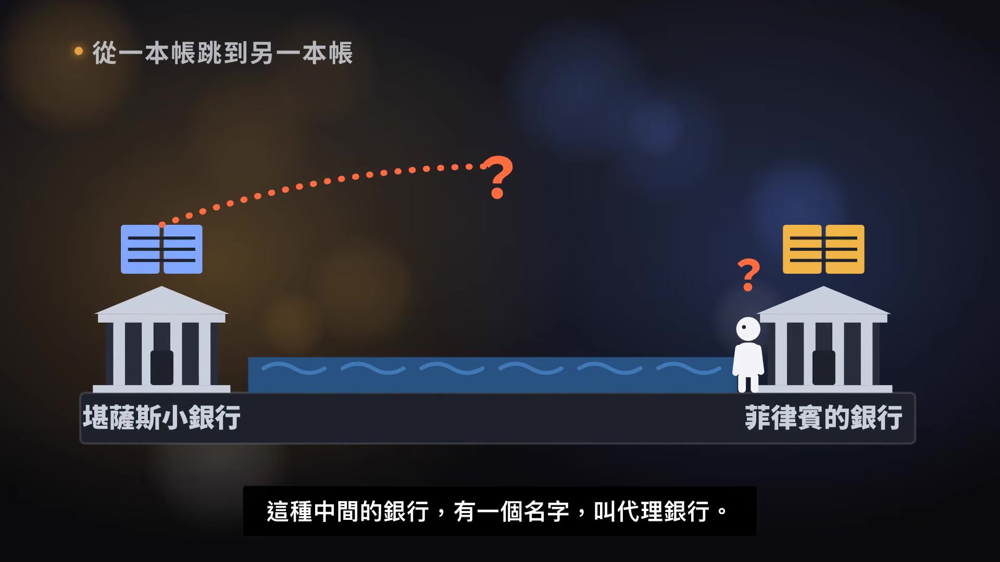

**逐字稿片段：** 叫代理銀行 Gensler說 代理銀行收的錢 就是信任的成本 這個成本 常常落在最負擔不起的人身上 在國外工作的人 寄一兩百美元回家 每一層中間人都要收一點 到了2025年

**話題推測：** 引入「代理銀行」概念，解釋跨境付款中間人的角色。

---

## 00:19:59

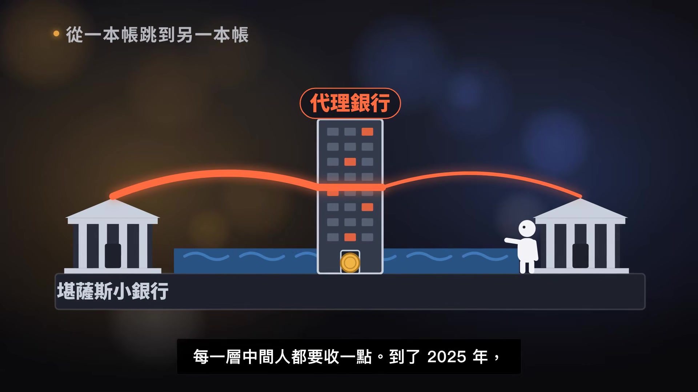

**逐字稿片段：** 世界銀行的統計 寄兩百美元回家的 全球平均成本 還在6%以上 用判斷清單來看 跨境付款的痛點最清楚 中間人多 每一層都要信任 每一層都收錢 Gensler在2018年就說 這裡可能是區塊鏈 最好的機會之一 他心裡想的機會是這樣的 美元要換成墨西哥批鎖 走代理銀行 可能要兩到四天 如果中間改用一種加密貨幣當橋 美元 先換成加密貨幣 在區塊鏈上送過去 再換成批鎖 有機會從幾天縮短到幾秒 可是比特幣的價格每天都在跳 當橋太晃了 所以Gensler在2018年說了一句話

**話題推測：** 引用世界銀行統計的跨境匯款成本，可能顯示數據圖表。

---

## 00:20:36

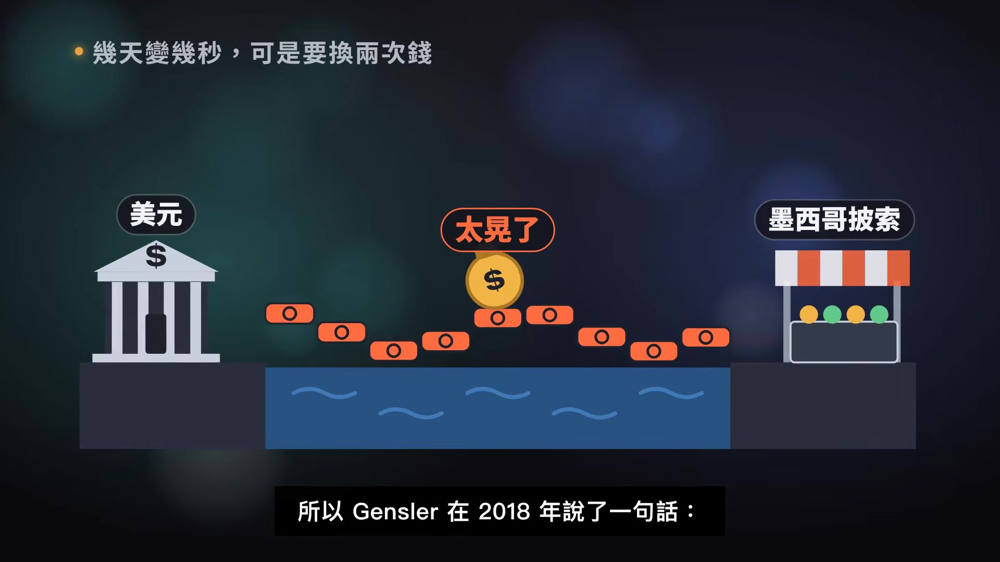

**逐字稿片段：** 穩定幣最大的機會之一 可能就是當跨境付款的橋 穩定幣是一種 把價值綁在法定貨幣上的加密貨幣 例如一枚對一美元 他也講得很清楚 這座橋有代價 錢要換兩次 要付兩次買賣的價差 兩頭一的有人願意收啊 來賓Elin 說他媽媽在韓國 沒有銀行賬戶 如果寄加密貨幣給他 他只會問 那我拿這個要做什麼 後來穩定幣真的長大了 比2018年大了很多 他是怎麼長大的 又被誰管起來 我們留到最後一部分再講 在付款這一邊 Gensler的判斷是 付款用的就是賬本 本來是區塊鏈 最該發揮的地方 可是比特幣都十週年了 還沒有走到那一步 那十年裡 真正改變付款的是誰 大多不是區塊鏈

**話題推測：** Gensler預測穩定幣可能成為跨境付款的橋樑。

---

## 00:21:18

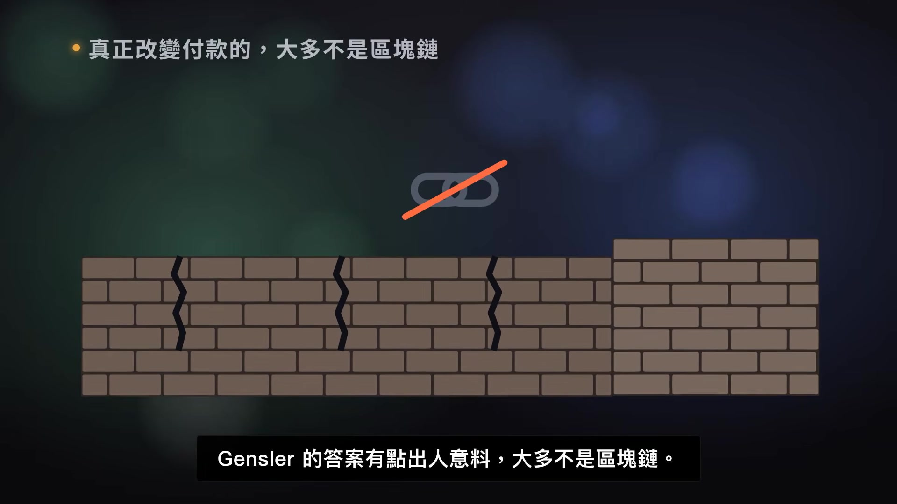

**逐字稿片段：** 在肯亞 很多人沒有銀行賬戶 可是有手機 電信公司做的M-Pesa 讓大家用手機裡的儲值 互相轉錢 街角的小店 就是存錢領錢的地方 在中國 信用卡一直不普及 支付寶從網絡購物漲出來 微信支付從聊天軟體漲出來 用手機掃碼就能付錢 這兩個地方的共同點 是舊系統留下了一個缺口 新的賬本就從缺口漲出來

**話題推測：** 舉例肯亞的M-Pesa手機付款系統，可能顯示其介面或地圖。

---

## 00:21:40

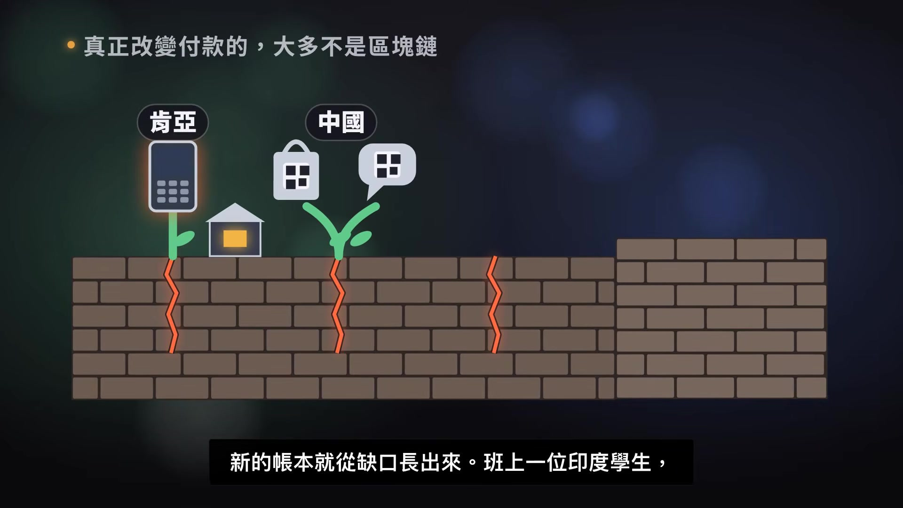

**逐字稿片段：** 班上一位印度學生 又補了另一條路 印度政府先發了 全國的數位身份證 再推出一套手機即時付款系統 叫UPI 成本很低 也沒有用到區塊鏈 反過來看 Gensler說 美國跟歐洲因為舊系統太好用 也綁得太緊 已經不在付款的最前線 所以他問了自己一個很誠實的問題 你真的需要區塊鏈嗎 還是它只是一個催化劑 用力踢舊系統一腳 逼他們做出本來就做得到的改進 來賓舉了檔案 分享軟體BitTorrent的例子 他自己沒有變成大生意 卻逼著音樂產業走向線上販售 也有學生說 銀行之間傳送匯款訊息的網路 Swift就是被Ripple這類新公司刺激 才推出了更快的服務 我們聽Gensler自己問這個問題 這一題

**話題推測：** 舉例印度的UPI即時付款系統，可能顯示其標誌或數據。

---

## 00:22:38

**逐字稿片段：** 我們也來對答案 2018年11月 Gensler在課堂上說 美國的中央銀行正在推動即時付款 目標大約是2020年 實際上美國聯邦準備理事會的 即時付款系統FedNow 是在2023年7月20號才上線 比他說的晚了大約三年 這不是他看錯的方向 而是要換掉舊系統 常常比計劃慢 反而是沒有用區塊鏈 由政府或中央銀行帶頭的即時付款 在別的國家漲得很快 巴西的中央銀行在2020年11月

**話題推測：** 回顧Gensler對即時付款的預測及FedNow的發展，可能顯示時間軸。

---

## 00:23:04

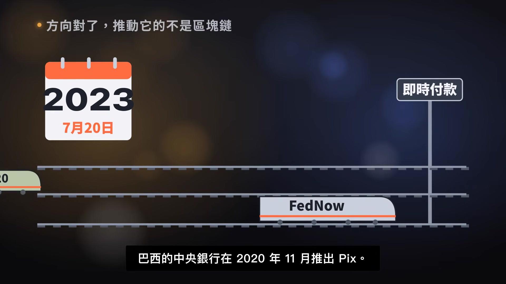

**逐字稿片段：** 推出PIX 印度的UPI 到了2026年9月 一個月處理的付款超過240億筆 所以這一題的答案又是一半一半 他說付款會往即時走 這個方向說對了 可是推動他的多半不是區塊鏈 而是國家自己蓋的新系統 這正好接上他自己那個問題 區塊鏈也許只是那一角 接下來 Gensler注意到一件中央銀行非常在意的事 在肯亞在中國甚至在美國的星巴克 Gensler看到同一件事 銀行原本有兩個工作 一個是幫你付款 一個是幫你存錢 現在這兩個工作都有非銀行在做了

**話題推測：** 舉例巴西PIX即時付款系統上線，可能顯示其標誌。

---

## 00:23:37

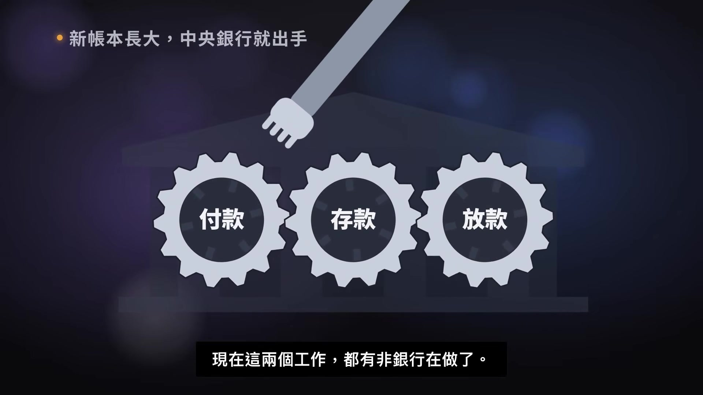

**逐字稿片段：** 星巴克的手機程式 讓你先存20美元進去 用掉了再自動加值 Gensler說 如果有一天 星巴克手上放著 幾千萬人存進去的錢 美國的中央銀行 可能就會來敲門 要他登記成銀行來管 肯亞的中央銀行 則是真的出手了 他要求MPSA收到的錢 要放心信託 而且要百分之百存在銀行體系裡 官方的理由是保護消費者 可是Gensler說 結果是保住了商業銀行 讓他們沒有被繞過去 這件事點出了 付款背後真正的問題 付款不只是搬錢 它跟存款連在一起 存款又跟放款連在一起 誰拿走了付款 誰就可能拿走存款 銀行如果沒有存款 就沒辦法放款 所以幾乎每一次 新的賬本長大 中央銀行都會出手 我們聽他講肯亞的例子 在消費保障上 但真正的結果是 他們將他們的銀行銀行系統保留著 我們把付款這一部分收一下 我們拿判斷清單去問付款 痛點很清楚 三段式的流程是歷史疊出來的 刷卡要被抽走一筆經濟豬 跨境還要層層找代理銀行 價值也很清楚了 經濟豬就在那裡 可是清單上關於對手的那一題 答案最難對付 現在的業者手上有入口有規模 大家又都習慣了要所有人一起換 是一個集體行動的難題 所以這一部分的答案是 付款最難換記賬人 真正動搖他的 不是銀行的俱樂部 而是在舊系統的缺口 長出來的新賬本 像手機付款 像穩定幣 還有國家自己蓋的 即時付款系統 而新賬本長大以後 常常會碰到同一個角色 站在沙漏最上面 替所有銀行記賬的中央銀行 所以下一個問題是 這本最上面的賬 它的主人會怎麼做 沙漏的最上面 是中央銀行 第15堂課

**話題推測：** 舉例星巴克手機應用程式中的儲值功能，可能顯示App介面。

---

## 00:25:33

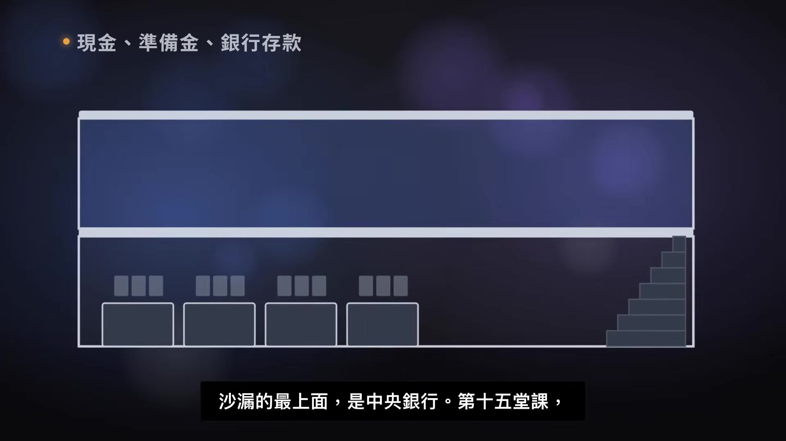

**逐字稿片段：** Gensler請來兩位來賓 一位是前英格蘭銀行的 Robes Alley 一位是前國際貨幣基金組織的 首席經濟學家 Simon Johnson 他們一起把中央銀行的賬本 攤開來看 這本賬本里 有三種錢 第一種叫現金 就是中央銀行發的紙鈔 再來一種叫準備金 就是前面講過的 銀行放在中央銀行戶頭裡的錢 最後一種叫銀行存款 就是你我放在商業銀行的錢 這三種錢 放在兩層賬本上 上面那一層 是中央銀行寄的賬 寄的現金跟準備金 下面那一層 是各家商業銀行寄的賬 寄著每個人的存款 Gensler拿出一張20美元的鈔票 問學生 為什麼它只20塊 學生回答 因為中央銀行說的 Gensler接著說 那你把它遞給旁邊的Rob 他會收下 這就是你知道它有價值的方式 這裡有一件很容易忽略的事 一般人手上 能直接拿到的中央銀行的錢 其實只有一種 就是現金 另外兩種 一種是銀行之間的事 一種是銀行欠你的賬 你在星巴克用手機付咖啡錢 感覺上付出去的是錢 可是Gensler說 你花掉的其實是銀行存款 你的存款少一點 星巴克的存款多一點 兩家銀行再到中央銀行那本賬上結親 所以你的存款 說穿的是銀行欠你的一筆賬 銀行答應你 你要領的時候 他會拿中央銀行的錢給你 也就是現金 或是透過準備金轉給別家銀行 在美國 大家放在銀行的存款 比市面上的現金多出好幾倍 Gensler給了一個說法 還特別強調這是他自己的話 銀行存款 就是隔了一層的中央銀行數位貨幣 你手機裡看到的數字是數位的 背後連著的是中央銀行的錢 只是中間隔著一家商業銀行 這就帶出這一部分最重要的名詞

**話題推測：** 介紹本集最後部分，探討中央銀行的角色，邀請兩位來賓，可能顯示其照片和職稱。

---

## 00:27:09

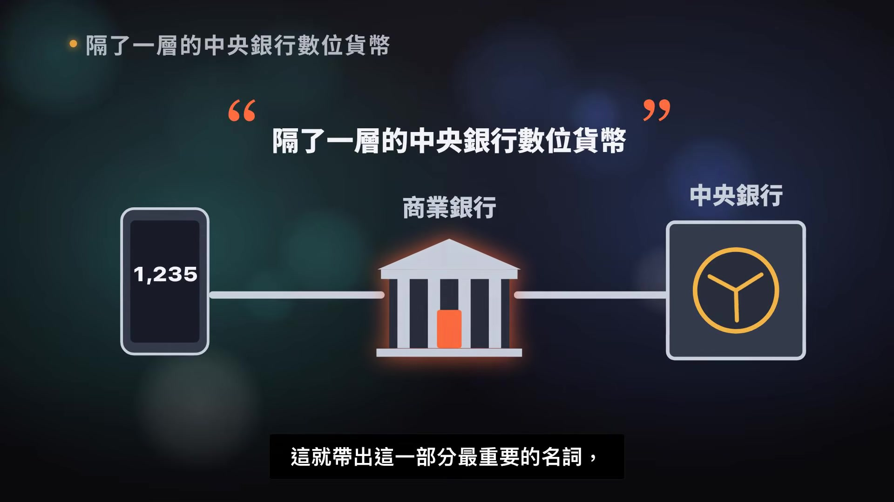

**逐字稿片段：** 叫中央銀行數位貨幣 意思是由中央銀行直接發給一般人 直接寄在中央銀行帳上的數位的錢 前面那張美鈔帳的序號收據 如果變成數位的 就是這個樣子 Gensler說這是中央銀行最難的策略問題 要不要讓一般人直接拿到數位的中央銀行的錢 就像現金一樣 是你跟中央銀行之間直接的關係 要回答這個問題 得先知道中央銀行為什麼存在 Gensler說

**話題推測：** 引入「中央銀行數位貨幣」（CBDC）概念，可能顯示示意圖。

---

## 00:27:36

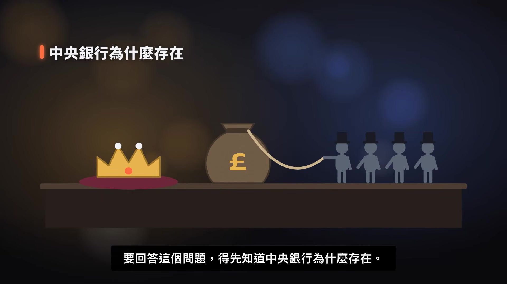

**逐字稿片段：** 中央銀行一開始是用來看住國王的 國王要打仗 要借錢 一群有錢人成立一家銀行 借給他 順便看住他 不要亂花 英格蘭銀行就是這樣來的 到了美國 故事又不一樣 1907年 紐約爆發金融恐慌 銀行一家接一家被擠兌 那時候美國沒有中央銀行出來救市的 不是政府

**話題推測：** 解釋中央銀行的歷史起源，從看住國王到美國金融恐慌。

---

## 00:27:56

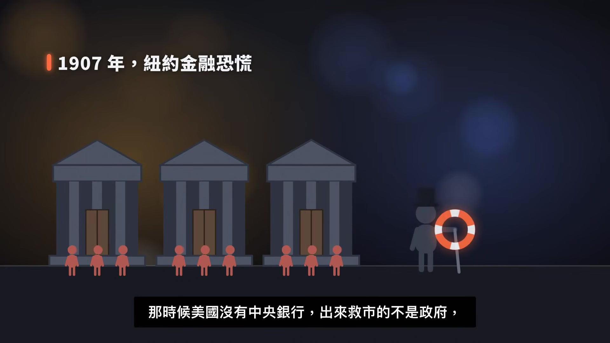

**逐字稿片段：** 是銀行家JP Morgan Gensler特別強調不是那家銀行 是那個人 幾年後 美國在1913年成立了聯邦準備系統 這個角色有一個名字 叫最後貸款人 意思是 出事的時候 所有人都不肯借錢了 還有一個機構會借 Gensler講2008年金融危機的時候 提到了自己父親的故事 他父親在巴爾蒂摩做小生意 員工不到30個人 如果哪個星期五發不出薪水 市政府星期一不會來救他 可是大銀行不一樣 他們跟整個經濟綁得太緊 出了事 政府最後通常會出手 所以中央銀行在意的 不只是賬記的 對不對 還有出事的時候 誰來負責 瑞典是最早認真面對

**話題推測：** 介紹銀行家J.P. Morgan在1907年金融恐慌中的角色，可能顯示其肖像。

---

## 00:28:31

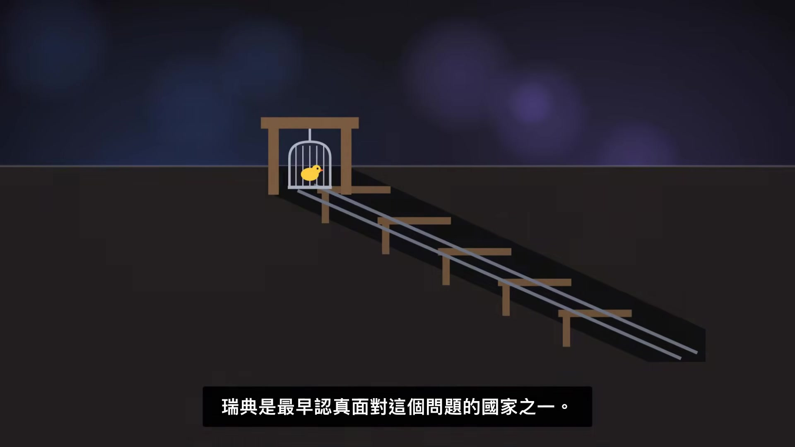

**逐字稿片段：** 這個問題的國家之一 來賓RobloxAlly說 瑞典就像礦坑裡的金絲雀 以前礦工會帶一隻金絲雀 下礦坑 空氣一變壞 它會先出事 提醒大家趕快出來 瑞典的現金用得越來越少 少到很多商店乾脆不收現金 這代表一般人手上 能直接拿到的中央銀行的錢 快要消失了 瑞典的中央銀行擔心的是 如果哪天大家只剩下銀行存款 一般人就不再有一種沒有風險 由國家保證的付款工具 所以他們研究要不要發 數位的瑞典克朗 叫E-Krona 設計起來 每一個選擇都很難 要不要付利息 羅布雷說 紙鈔不付利息 只是因為紙沒辦法付利息 數位的就沒有這個限制 要不要設上限 每個人最多隻能放多少 要做成像現金那樣的代幣 還是像銀行那樣的賬戶 要不要能追蹤每一筆 瑞典當時的報告說 要能追蹤不做全部匿名 可是這些選擇 最後都會碰到同一個擔心 這個擔心有兩層 平常的時候擔心的是放款 你的存款是銀行放款的來源 銀行拿你的存款 去借給買房子的人 開公司的人 如果大家把錢 從銀行搬到中央銀行 銀行就沒有錢可以借出去 那誰來借錢給這些人 難道要中央銀行自己去挑 要借給哪一家公司 哪一個家庭嗎 這件事有一個名字

**話題推測：** 介紹瑞典作為「礦坑裡的金絲雀」，討論其央行數位貨幣E-Krona的研究，可能顯示瑞典地圖或相關圖示。

---

## 00:29:43

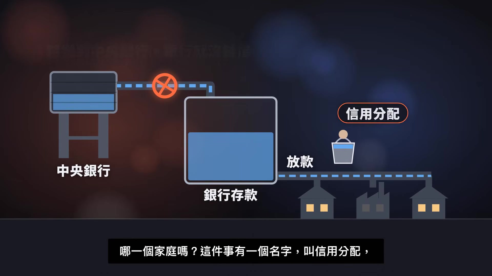

**逐字稿片段：** 叫信用分配 也就是社會上的錢 要借給誰 Gensler說 他這幾個月跟各國中央銀行的人聊 大家平常最擔心的就是 信用分配被改變 出事的時候 擔心的就是擠兌 第一部分講過 期限轉換 銀行把短期存款借成長期貸款 所以最怕大家同時來領錢 以前要擠兌 你得親自到銀行門口排隊 如果中央銀行的數位錢 就在你手機裡 一有風吹草動 你只要按一下 就能把錢從銀行搬到中央銀行 那天在場的Simon Johnson 把這個擔心講得最清楚 他說這段話的時候是 2018年 聽起來像一個假設 五年後 類似的是真的發生了 只是主角不是中央銀行數位貨幣 而是手機上的銀行 2023年3月9號

**話題推測：** 引入「信用分配」概念，討論央行發行數位貨幣對銀行放款的影響。

---

## 00:30:44

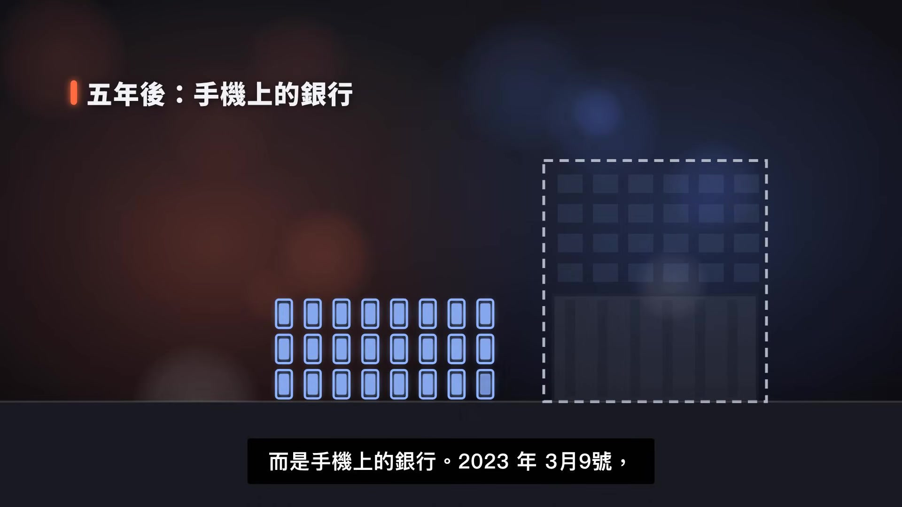

**逐字稿片段：** 美國的矽谷銀行 一天之內被提走了超過400億美元的存款 根據美國聯邦準備理事會後來的檢討報告 銀行還預期隔天會再流出更多 3月10號 矽谷銀行被關閉 矽谷銀行出事的原因之一 正是期限轉換 他拿存款去買了很多長期債券 利率一上升 這些債券就賠了錢 消息一傳開 存戶在網路上互相轉告 再用手機一按 錢就走了 以前要好幾天才會發生的擠兌 這次一天就到了 接下來的那個星期天 美國財政部 中央銀行和聯邦存款保險公司 宣佈動用一條叫 系統性風險例外的規定 所有存款人的錢全額保障 Gensler在第16堂課說過 下一次危機來的時候 總會有人去測試 法律授權的極限 這一次的做法 正好可以拿來對照 所以Simon Johnson的問題 不是空想 中央銀行在決定 中央銀行在猶豫的時候 民間已經先做了 穩定幣 就是民間版本的數位美元 要看懂穩定幣

**話題推測：** 舉例2023年美國矽谷銀行擠兌事件，可能顯示新聞標題或時間軸。

---

## 00:31:41

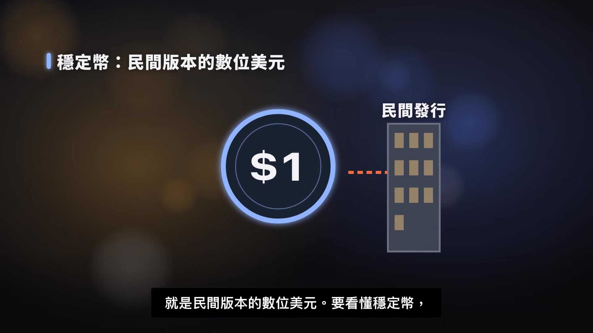

**逐字稿片段：** 跟死了帶學生回到19世紀的美國 那時候美國有一段時間沒有中央銀行 很多商業銀行可以自己印鈔票 這種鈔票叫私人銀行券 每一張紙代表你在那家銀行的一筆存款 你拿著它 可以回去那家銀行換成金幣或銀幣 問題是每家銀行的信用不一樣 離發行的銀行越遠 越沒人知道它可不可靠 這張鈔票就得打個折 別人才肯收 後來好幾百家銀行倒閉 手上拿著他們鈔票的人 損失就自己吞下 到了南北戰爭的時候 1863年 美國國會通過法律設了一個機構

**話題推測：** 比較穩定幣與19世紀美國的「私人銀行券」，可能顯示舊鈔票圖片。

---

## 00:32:13

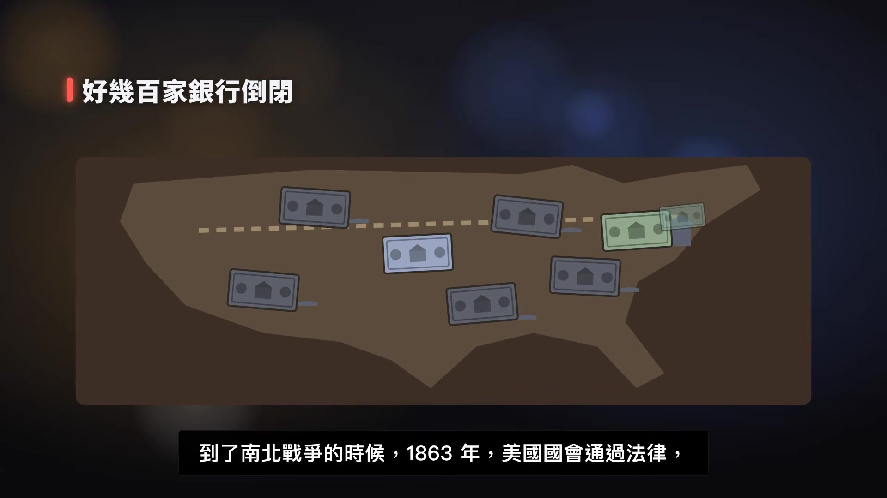

**逐字稿片段：** 叫貨幣監理署 他當年要管的 就是這些滿街流通的銀行鈔票 Gensler說 有人認為今天的加密貨幣世界 有點像那個私人銀行券的時期 很多家各自發行 各自說自己值一美元 到底值不值 要看背後的那家公司 我們聽他講 交易在不同的價值 互相提供折扣 之類的 有些人說 我們現在生活的世界 與加密貨幣 這個新市場 有點像是個私人評價 穩定幣說自己一枚紙一美元 靠的是背後放的一美元 可是那一美元要放在哪裡 班上一位學生想得很清楚 如果穩定幣有一天 大到上兆美元 背後的錢只有三個地方可以放 一大疊現金 銀行存款 或是中央銀行的戶頭 後面兩個 正好就是穩定幣想要繞開的銀行跟中央銀行 Gensler舉了一個例子 最大的穩定幣Tether 在2017年就曾經被好幾家銀行拒絕開戶 因為銀行沒辦法確認它的錢從哪裡來 還有一些穩定幣 在城市裡寫了凍結的功能 發行的公司可以把某些人的幣凍結起來 他問學生 這符合中本聰當初的精神嗎 所以穩定幣跟私人銀行卻很像 它離不開銀行 最後也離不開管它的人 8年後 這一步真的來了 2000年25年7月18號 美國總統川普簽署了Genius法案 這是美國第一部 專門管穩定幣的聯邦法律 他要求發行的公司 每一枚都要有一比一的準備 放在美元或短期美國公債這類 很容易變現的資產上 每個月公開準備放了什麼 也不能宣稱有政府擔保 19世紀用一個機構管銀行鈔票 21世紀用一部法律管穩定幣 故事又繞了回來 那中央銀行自己呢 2018年 Gensler在課堂上 的電子貨幣 Gensler直接說 這是一個失敗的故事 政府的信用不夠 用的人很少 而且他根本沒有用區塊鏈 菲律賓跟塞內加爾 新聞稿上 常常出現區塊鏈這個詞 可是Gensler讀了 他找得到的資料 認為他們其實 沒有用到區塊鏈 只是借用了 這個名詞的光環 最認真的是瑞典 可是瑞典的設計 據他所知 也沒有用區塊鏈 所以他在課堂上問全班 中央銀行數位貨幣 比特幣啟發 也被穩定幣刺激 可是他不一定要用區塊鏈來做 他還說各國中央銀行面對區塊鏈 脖子後面都感覺到有點熱 意思是壓力已經到了 回到判斷清單的最後一題 為什麼需要區塊鏈 在中央銀行這裡 答案常常是不需要 可是區塊鏈逼著他們重新想自己的帳本 這件事已經發生了 最後他做了一個預測

**話題推測：** 引入「貨幣監理署」概念，解釋早期銀行券的監管。

---

## 00:35:07

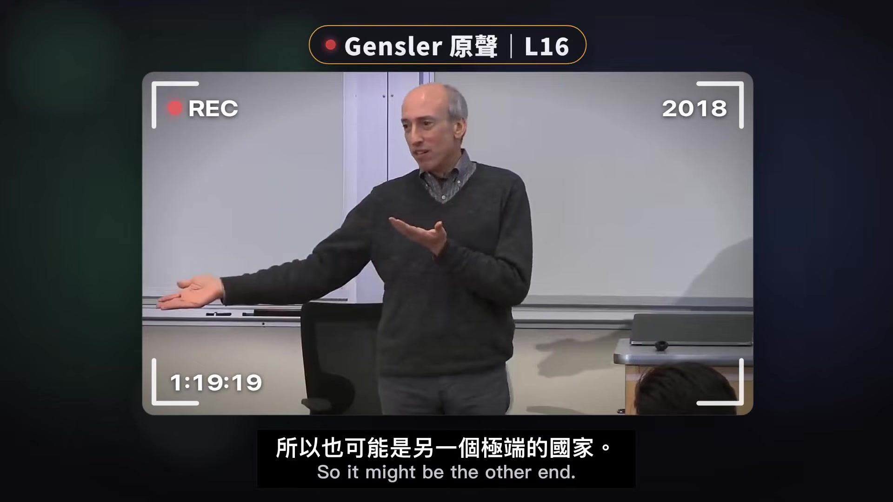

**逐字稿片段：** 這是這一集最後一次對答案 Gensler說180個國家裡總會有人做 也許是瑞典 前一堂課的來賓Roblox Eli更大膽 他說兩年內就會有國家 讓一般人直接持有中央銀行的數位錢 答案是Roblox幾乎說中了 2020年10月20號

**話題推測：** Gensler對央行數位貨幣發行的最後預測及結果回顧。

---

## 00:35:22

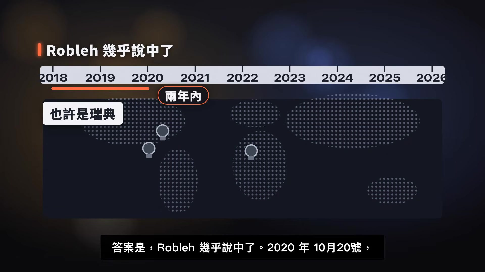

**逐字稿片段：** 加勒比海的巴哈馬推出Sand Dollar 常被稱為第一個正式上線的中央銀行數位貨幣 接著是2021年的奈及利亞 2022年的亞買加 可是Gensler押的瑞典到現在都沒有發 瑞典的技術專案在2023年結束 沒有決定發行 歐洲中央銀行在2025年10月 決定進入下一個階段 如果立法順利 最快2029年發行 美國則走了另一個方向 2025年1月 一道行政命令 禁止聯邦機關推動中央銀行數位貨幣 最有意思的是中國 數位人民幣從2026年1月起 改成了銀行的負債 錢包裡的錢開始付利息 還記得Roblox那句話嗎 紙沒辦法複利息 數位的可以 到了2026年 全世界大部分國家都在研究 正式上線的卻只有三個 所以這一題 Gensler說對了一半 真的有人做了 可是做的是小國 大國大多選擇慢慢來 在這八堂課裡 有一位來賓的話 現在聽起來特別有意思

**話題推測：** 舉例巴哈馬推出Sand Dollar，被稱為第一個正式上線的央行數位貨幣。

---

## 00:36:19

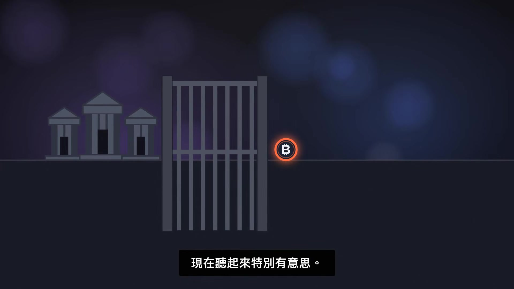

**逐字稿片段：** 他是Gensler的雙胞胎哥哥Rob 以前是基金經理人 Rob說比特幣說 穿的是一場大規模的監管套利 監管套利就是故意 待在規則管不到的地方 然後他問全班 人類歷史上 有哪一次官方部門沒有回來 拿走他應得的那一份 Gensler自己在第九堂課 也說過類似的話 任何規模變大的經濟活動 都不會一直待在公共政策之外 八年後回頭看 這兩句話都應驗了一部分 穩定幣被收進了法律 銀行開始把存款做成數位代幣 中央銀行雖然大多沒有發數位貨幣 卻都在重新想自己的賬本 Gensler本人 後來也坐上了 美國證券交易委員會主席的位置 那幾年他怎麼管加密貨幣 各方的評價很不一樣 Rob還講過一句 他從貝爾實驗室一位主管那裡學來的話 重大的改變 總是比你想的晚來 可是等他真的來了 會比你想象的快得多 付款跟中央銀行的賬本 現在大概就站在這兩句話的中間 我們回到開場那個問題 這本賬到底該交給誰來記 這八堂課給我們三層答案 先看記賬的人 他們坐在沙漏的瓶頸上 收的經濟租 區塊鏈想省的 是驗證的成本跟建網路的成本 可是信任沒有消失 只是換了地方放 再看付款 他最難換記賬的人 真正改變他的 是在舊系統的缺口 長出來的新賬本 還有國家自己蓋的 及時付款系統 最後看中央銀行 他在意的不只是技術 而是出事的時候 誰來負責 錢又由誰來借出去 所以大多數國家 選擇慢慢來 民間的穩定幣 則像19世紀的 私人銀行券一樣 被收進了法律 所以賬本交給誰記 換到的是一組取捨 速度 成本 還有出事的時候 誰來負責 Gensler在2018年的判斷是 區塊鏈是改變的催化劑 他不一定自己取代誰 可是會逼著銀行跟中央銀行 重新想自己的賬本 三個預測對完答案 方向大多說對了 只是說對的方式 跟他當年想的不太一樣

**話題推測：** 介紹Gensler的雙胞胎哥哥Rob，並引用他的觀點，可能顯示其照片。

---

## 00:38:04

**逐字稿片段：** 下一集 我們會看這本賬上的另一群人 交易所 發行代幣的公司 還有想把證券交割 貿易跟身份搬上區塊鏈的人 最後問你一個問題 如果中央銀行明天 讓你直接開一個數位賬戶 你會把錢從銀行搬過去嗎 留言告訴我 喜歡的話訂閱AI Notebook 開啟通知 我們下次見

**話題推測：** 預告下一集主題：交易所、代幣發行公司等，可能顯示結尾畫面或下一集預告。

---
