# jimainotebook_huZUk89wkHY — 關鍵畫面索引

- 來源逐字稿：[jimainotebook_huZUk89wkHY_FIN.srt](jimainotebook_huZUk89wkHY_FIN.srt)
- 影片：https://www.youtube.com/watch?v=huZUk89wkHY
- 截圖數：75

## 00:00:11

**逐字稿片段：** 這一集是演講訪談系列,主角是史丹佛大學的精神科醫師Anna Lembke。

**話題推測：** 介紹影片主角史丹佛大學的Anna Lembke醫師

---

## 00:00:16

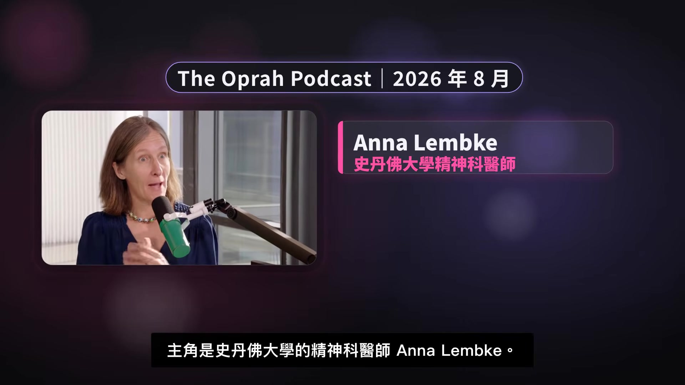

**逐字稿片段：** 我們要問的是,手機越滑越空虛,為什麼還是停不下來?

**話題推測：** 提出影片核心問題：「手機越滑越空虛，為什麼還是停不下來？」

---

## 00:00:20

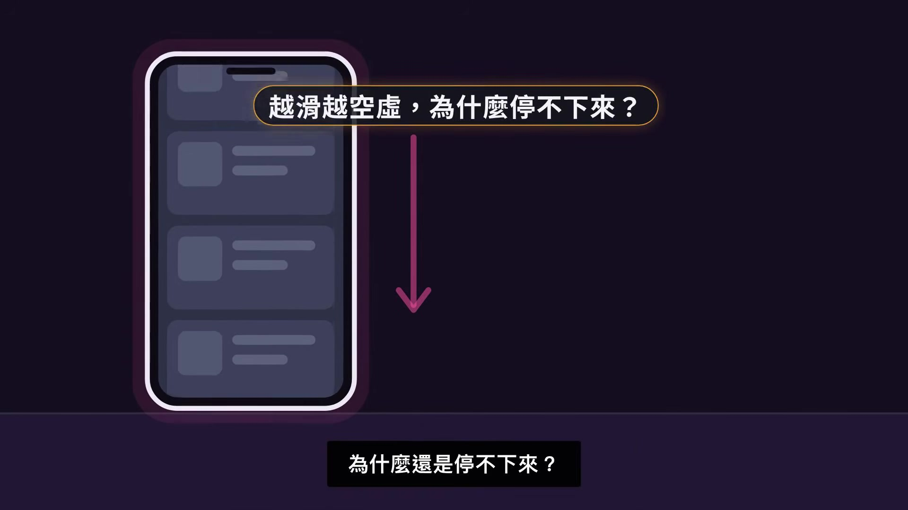

**逐字稿片段：** Lembke是史丹佛大學精神醫學的教授,負責史丹佛的成癮醫學門診,也寫了暢銷書《多巴胺國度》。

**話題推測：** 補充Anna Lembke的專業背景，可能會搭配她的著作《多巴胺國度》封面

---

## 00:00:26

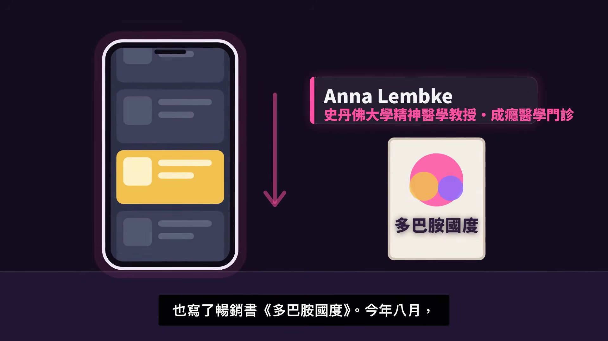

**逐字稿片段：** 今年8月,她上了歐普拉的節目,現場連線三位來賓,各自講自己停不下來的經驗。

**話題推測：** 提到她上歐普拉的節目，可能搭配節目畫面或相關圖示

---

## 00:00:32

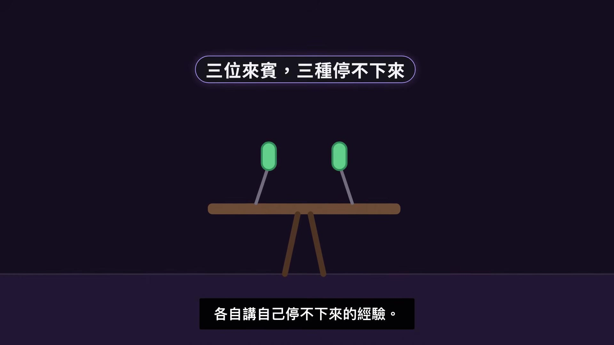

**逐字稿片段：** 一位在網路購物刷出3萬美元的信用卡債,一位一天打電動打到7個小時, 還有一位在運動彩券上輸掉超過10萬美元

**話題推測：** 介紹三位來賓的成癮案例：網路購物刷卡債、打電動、運動彩券

---

## 00:00:40

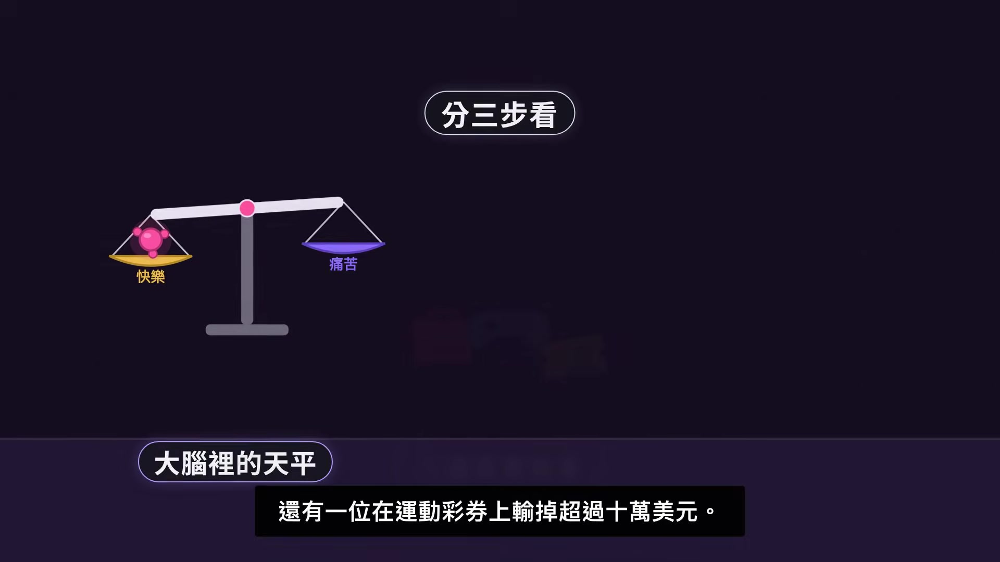

**逐字稿片段：** 我們分三部看 先看大腦裡發生了什麼事 再用這三個真實故事 看同一套機制怎麼勾住不同的人 最後看為什麼明知道有害還是停不下來 先說清楚 這一集只講機制和研究 不是醫療建議 先講清楚

**話題推測：** 概述影片的三個主要部分

---

## 00:00:53

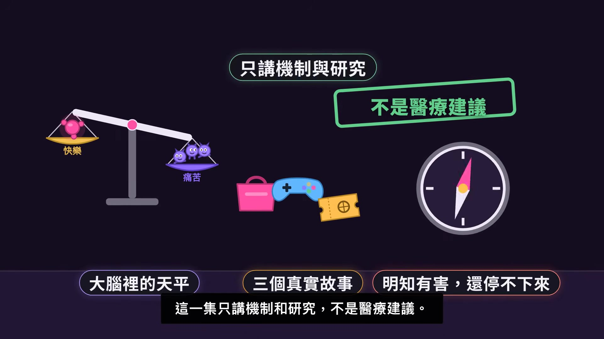

**逐字稿片段：** 什麼叫成癮 Lamper說成癮是一個光譜 有輕度中度重度 前面還有一段比較像壞習慣的階段 他說的成癮是已經越過一條線 從壞習慣變成一種精神疾病

**話題推測：** 引入「成癮」的定義

---

## 00:01:05

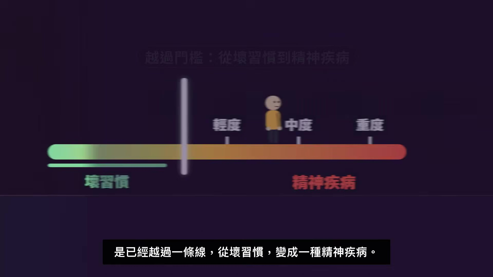

**逐字稿片段：** 他用四個特徵來判斷 控制不了自己用多少 很想要 明明不想用還是會去用 還有已經造成後果了

**話題推測：** 介紹判斷成癮的四個特徵

---

## 00:01:11

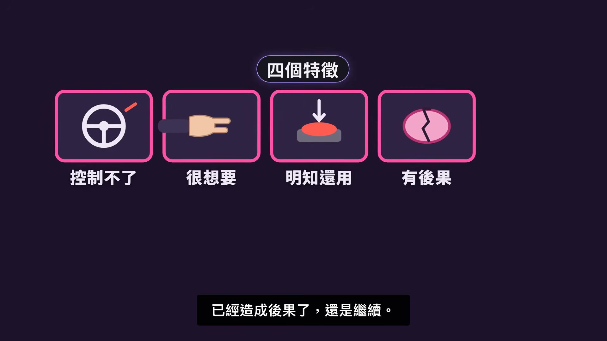

**逐字稿片段：** 還是繼續 再加上兩個身體的反應 一個叫耐受 同樣的量 效果越來越弱 另一個叫戒斷 一停下來就很難受

**話題推測：** 介紹成癮帶來的兩個身體反應：耐受與戒斷

---

## 00:01:18

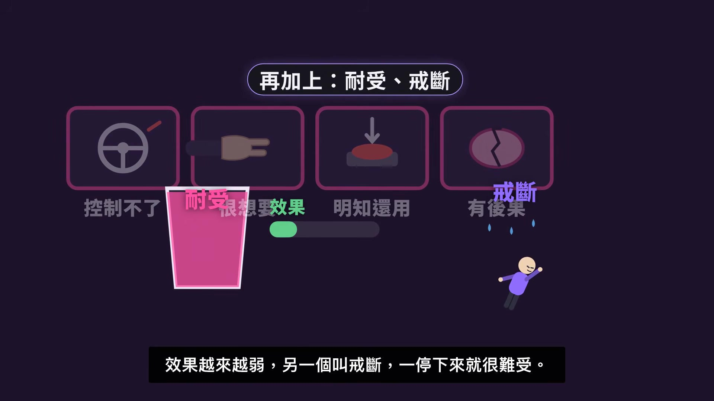

**逐字稿片段：** 那有多少人符合 節目的說明寫 全球大約27%的人 有科技成癮 我們找到的出處

**話題推測：** 提出全球科技成癮人數的統計數據

---

## 00:01:24

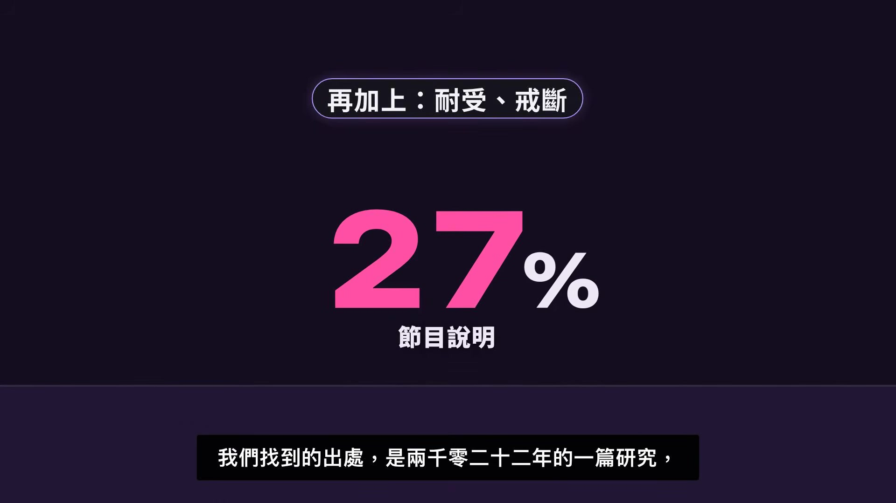

**逐字稿片段：** 是2022年的一篇研究 整合了64個國家 200多萬人 他的意思是 大約每4個人就有一個人 在問卷上符合 手機成癮的標準 這是問卷篩檢 不是醫生診斷

**話題推測：** 提及2022年整合64個國家200萬人的研究作為數據來源

---

## 00:01:35

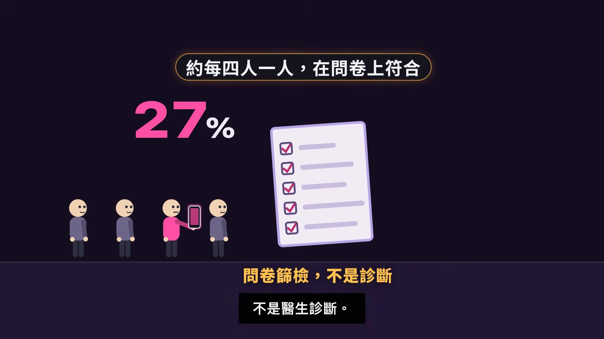

**逐字稿片段：** 目前世界衛生組織 正式列為疾病的 只有遊戲障礙和賭博障礙 手機成癮還不是正式的病名

**話題推測：** 說明世界衛生組織目前正式列為疾病的只有遊戲障礙和賭博障礙

---

## 00:01:41

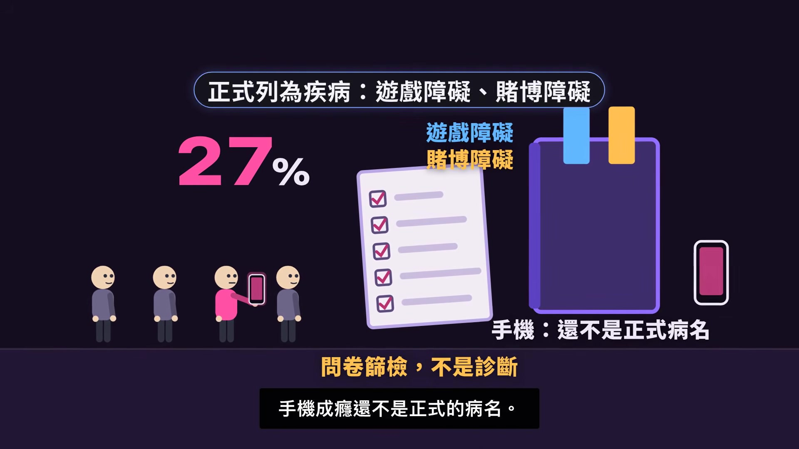

**逐字稿片段：** 為什麼是手機 先看你每天在滑的東西 你往下滑 不知道下一則會不會好看 大部分普普通通 偶爾來一個很好笑的

**話題推測：** 探討「為什麼是手機」這個主題，可能搭配手機滑動畫面

---

## 00:01:49

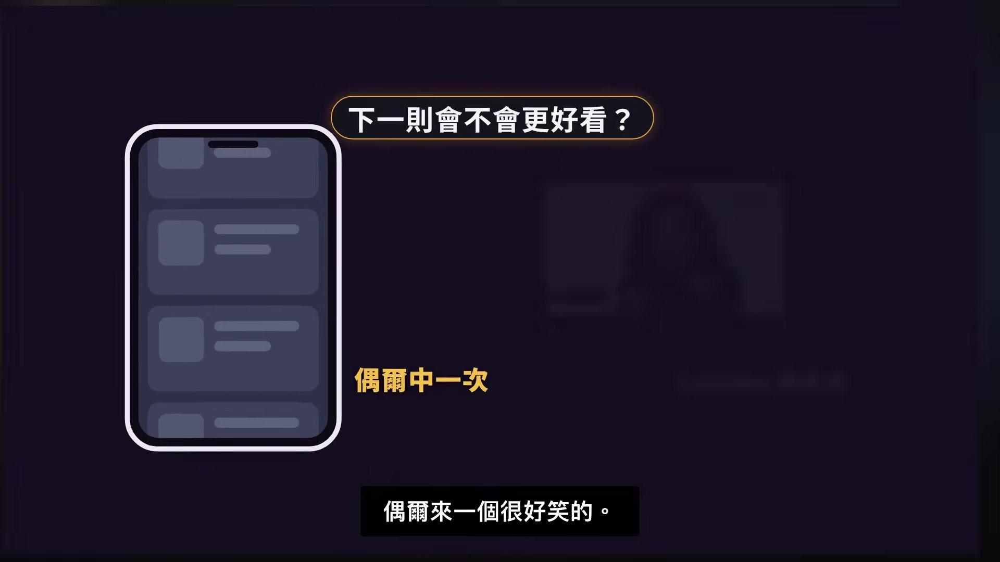

**逐字稿片段：** 心理學家史金納 很早就發現 獎勵出現的次數不固定 動物最停不下來 吃餃子老虎 就是這個原理

**話題推測：** 引入心理學家史金納的「不固定獎勵」原理，可能搭配史金納的照片

---

## 00:01:56

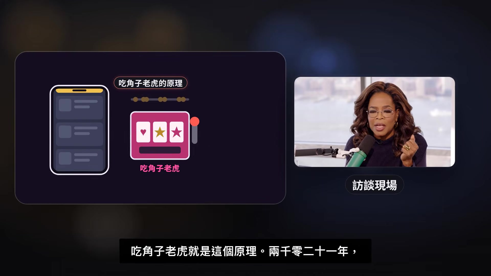

**逐字稿片段：** 2021年 自然通訊 一篇研究 分析了100多萬則社群貼文 發現大家發文的節奏

**話題推測：** 提及2021年《自然通訊》分析百萬社群貼文的研究

---

## 00:02:05

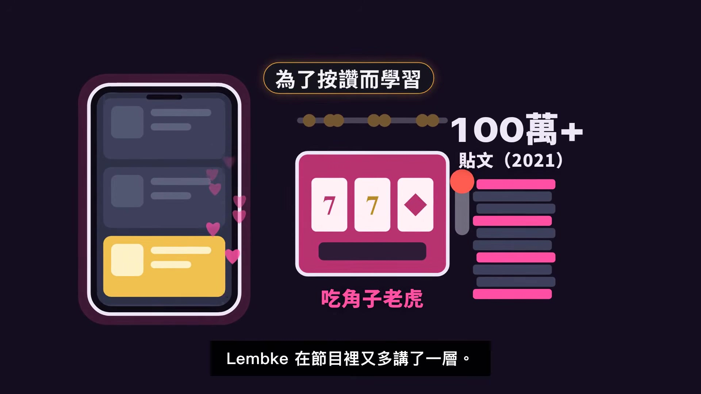

**逐字稿片段：** 在節目裡又多講了一層演算法 除了推你搜尋過的東西 還會塞給你 你根本沒去找的新東西

**話題推測：** 引入社群演算法在推薦內容上的作用

---

## 00:02:11

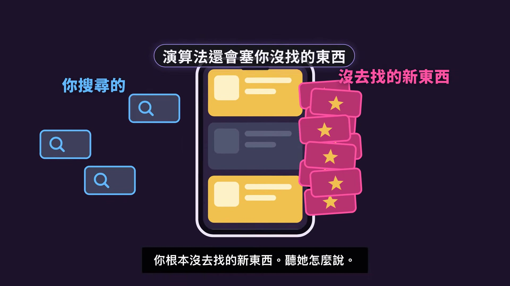

**逐字稿片段：** 聽他怎麼說 他說這是刻意的 目的是讓你不無聊 多看一點 這是他的看法 那新東西 為什麼這麼吸引大腦

**話題推測：** 轉場播放Anna Lembke的訪談片段

---

## 00:02:30

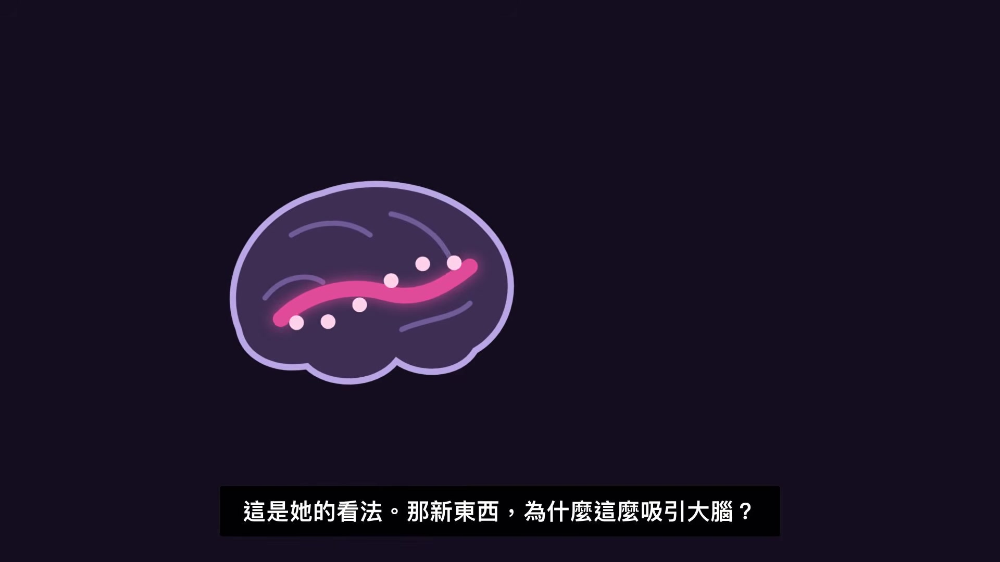

**逐字稿片段：** 要從一種叫多巴胺的物質講起 多巴胺是大腦裡 傳遞訊息的化學物質 很多人叫它快樂荷爾蒙 其實不太準確 它比較像是在說 這個東西我想要快去拿

**話題推測：** 引入核心生理物質「多巴胺」

---

## 00:02:41

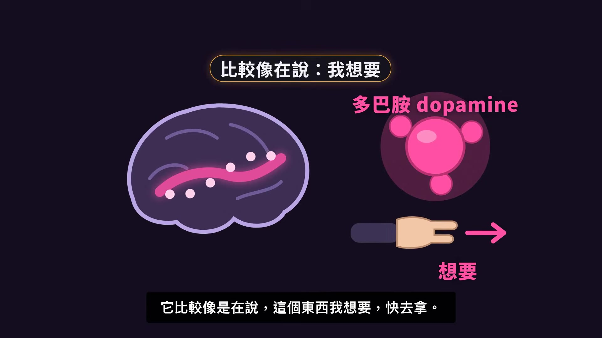

**逐字稿片段：** 科學家在大鼠的大腦裡 放了很細的探針 直接量多巴胺 吃巧克力 多巴胺比平常多一半左右 膠配大約多一倍 尼古丁再高一點 安非他命 可以衝到平常的十倍 這是大鼠實驗 數字是大概 但差距很清楚

**話題推測：** 介紹大鼠多巴胺測量實驗的數據

---

## 00:02:56

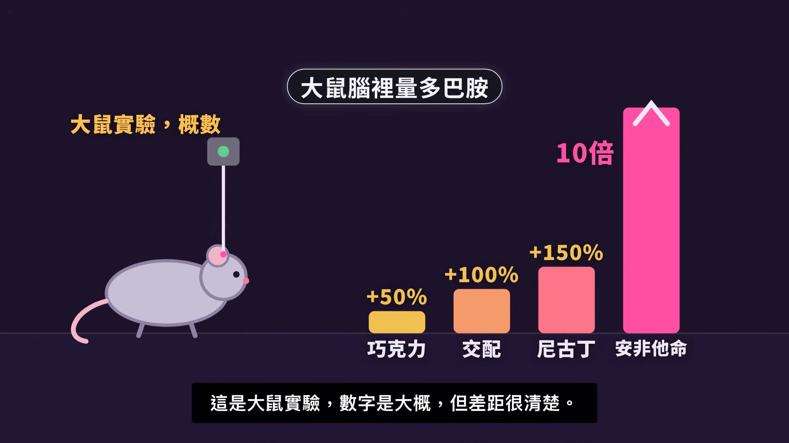

**逐字稿片段：** Lampic用一個比喻來講 接下來發生的事 他說大腦裡處理快樂和痛苦的 是同一個地方 像一個天平 天平最想做的 是保持水平

**話題推測：** 引入快樂與痛苦「天平」的比喻

---

## 00:03:06

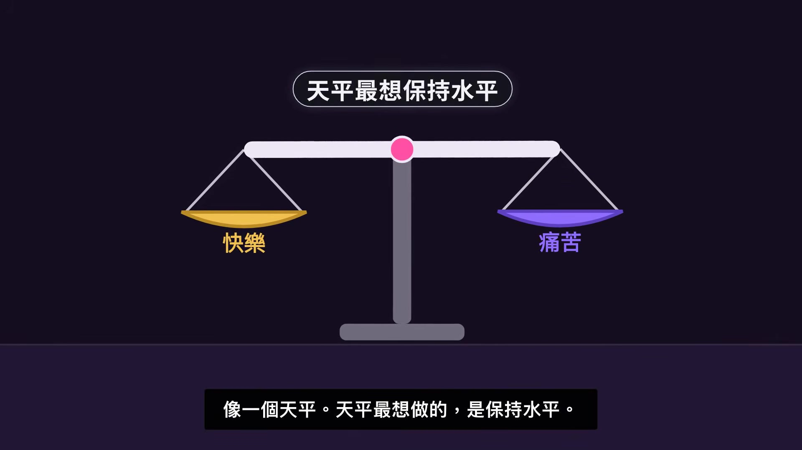

**逐字稿片段：** 聽他怎麼說 天平往快樂那邊一倒 大腦馬上把它往回拉 而且拉過頭 拉到比原本更低的地方

**話題推測：** 轉場播放Anna Lembke解釋天平機制的訪談片段

---

## 00:03:33

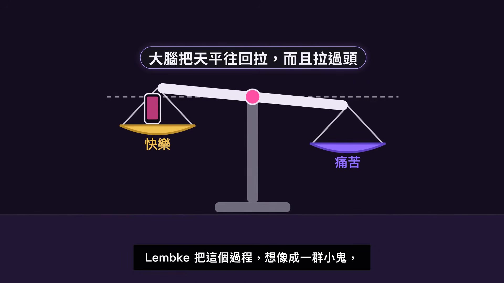

**逐字稿片段：** 把這個過程想象成一群小鬼 跳到天平痛苦的那一邊 小鬼不會在天平 剛好水平的時候就下來 他們會一直待著 待到天平往痛苦那邊 倒得跟剛剛一樣多 這就是那種空空的感覺 剛滑完一輪 有點煩 有點不夠 想再來一點 最快把天平拉平的方法 就是再滑一下 這個想法有科學根據

**話題推測：** 用「小鬼」跳到天平痛苦端來比喻大腦的平衡機制

---

## 00:03:53

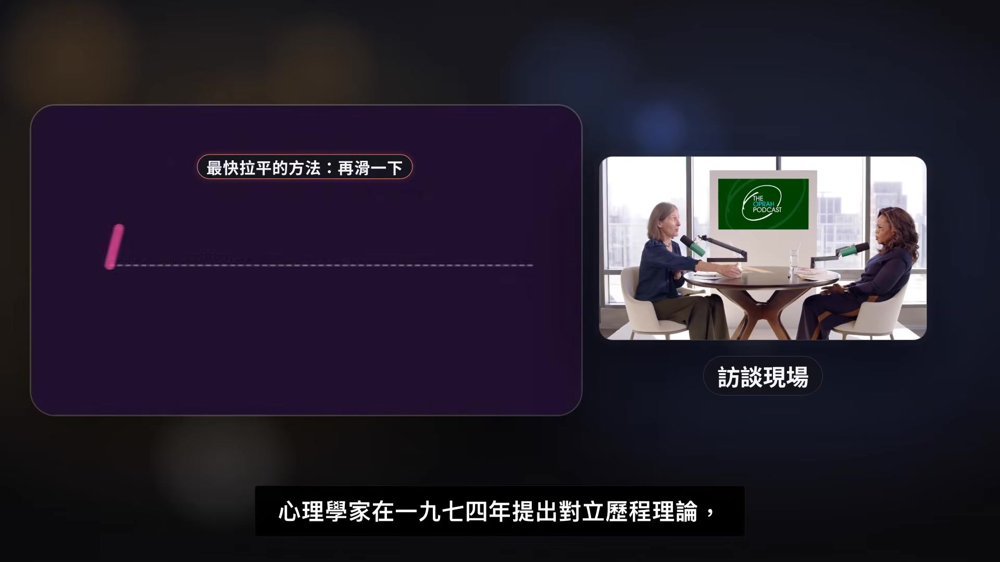

**逐字稿片段：** 心理學家在1974年 提出對立歷程理論 說大腦對每一種強烈的感覺 都會產生一個 方向相反的反應 而且重複越多次 反方向的反應越強

**話題推測：** 提及1974年提出的「對立歷程理論」

---

## 00:04:02

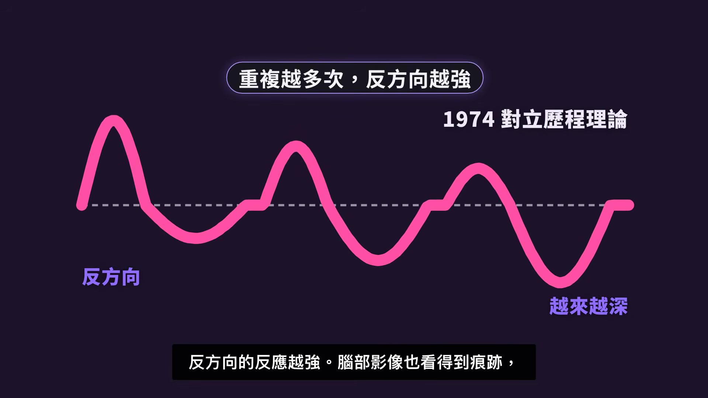

**逐字稿片段：** 腦部影像也看得到痕跡 1993年就有研究拍到 長期用骨科檢的人 大腦裡接收多巴胺的受體變少了 如果天天這樣 會變成什麼樣子

**話題推測：** 提及1993年腦部影像研究發現長期吸食古柯鹼者多巴胺受體減少

---

## 00:04:11

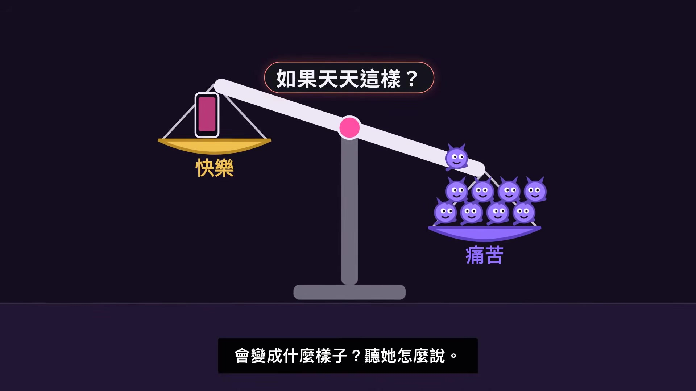

**逐字稿片段：** 聽他怎麼說

**話題推測：** 轉場播放Anna Lembke解釋長期影響的訪談片段

---

## 00:04:32

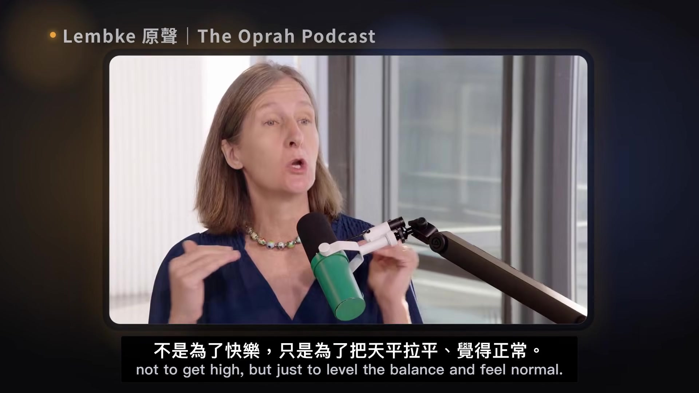

**逐字稿片段：** 他說的叫慢性多巴胺 安不足的狀態 這是他在臨床上用的說法 不是正式的診斷名稱 意思是 小鬼已經多到天平 回不了水平 你平常的狀態 就比以前低一截 這時候再去用 不是為了快樂 只是為了回到正常 他還補了一句 這也是為什麼 你把孩子的手機拿走 他會那麼難受

**話題推測：** 介紹「慢性多巴胺不足」的臨床說法

---

## 00:04:51

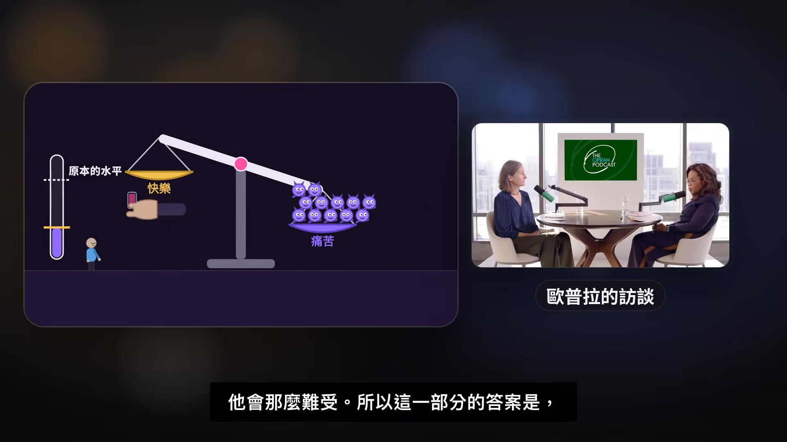

**逐字稿片段：** 所以這一部分的答案是 越滑越空虛 不是錯覺 空虛 就是天平往痛苦那邊倒的感覺 而最快能把他拉回來的 剛好就是手機 接下來 我們看節目上的三個人 三種很不一樣的東西 背後是同一個天平

**話題推測：** 總結第一部分的答案

---

## 00:05:05

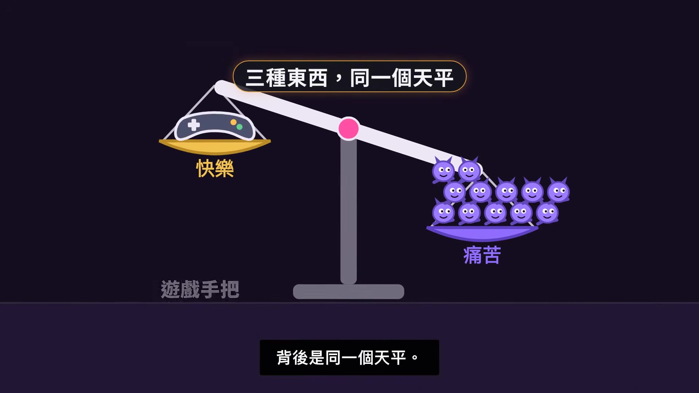

**逐字稿片段：** 第一位是一個30多歲的女生 住在紐約 三年下來

**話題推測：** 介紹第一位網路購物刷出3萬美元債務的來賓

---

## 00:05:10

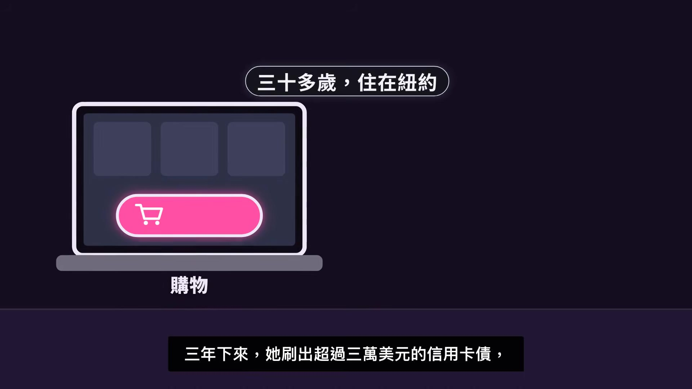

**逐字稿片段：** 她刷出超過3萬美元的信用卡債 幾乎都是網路購物 她說她有一份不錯的工作 卻常常付不出房租 她講得很清楚 小時候家裡剛搬到美國 看到別的孩子都有禮物 她只有別人用過的東西 長大以後 買東西變成她告訴自己 我做到了的方式 可是每次一按下購買 開心沒有出現 先出現的是羞恥和罪惡感 她把包裹藏起來 不讓伴侶看到 然後為了不去面對這種感覺 又去買下一樣東西 Lampk的回應有點出乎意料 他說想清楚童年很重要 但不要花太多時間找根本原因 我們活在一個 很容易讓人上癮的世界 購物已經被做成像毒品一樣

**話題推測：** 強調3萬美元的信用卡債務數字

---

## 00:05:47

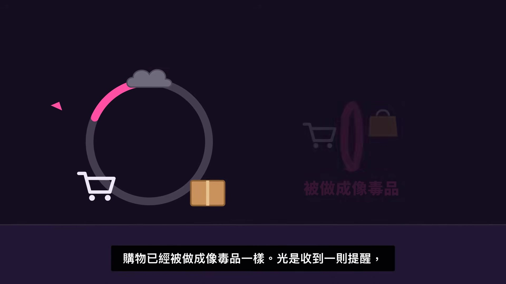

**逐字稿片段：** 光是收到一則提醒 告訴你可能可以去買東西 大腦的獎賞迴路就會亮起來 讓你開始想要

**話題推測：** 說明收到購物提醒會啟動大腦獎賞迴路

---

## 00:05:52

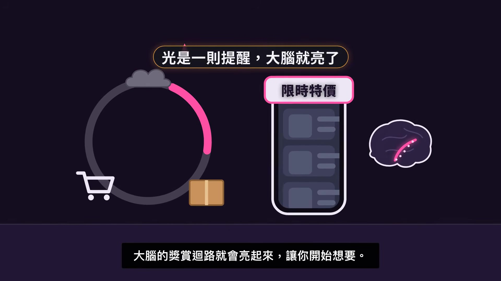

**逐字稿片段：** 一篇2016年的研究 估計大約每20個成年人 就有一個有強迫購物的傾向

**話題推測：** 提及2016年研究估計每20個成年人就有一個有強迫購物傾向

---

## 00:05:58

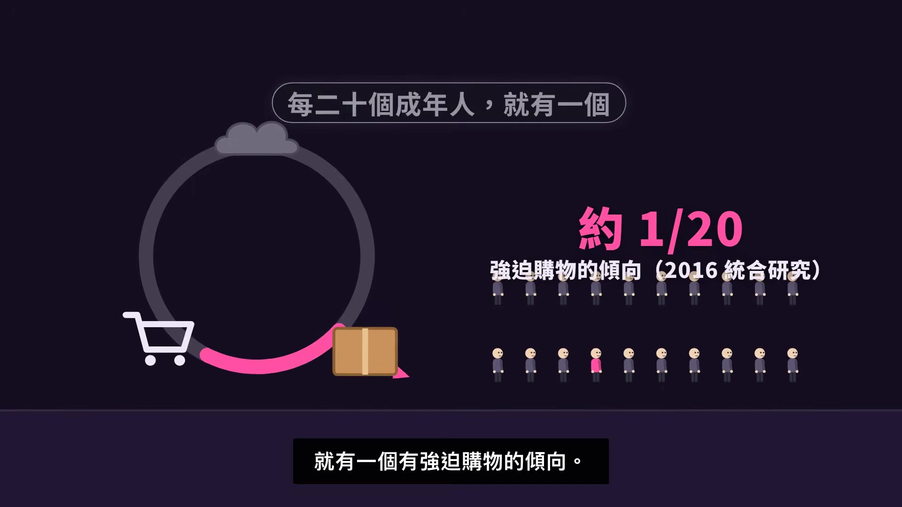

**逐字稿片段：** 他接著講了一個概念

**話題推測：** 引入「自我綁定」的概念

---

## 00:05:59

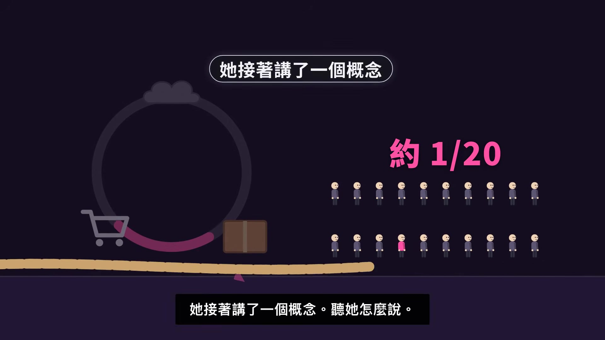

**逐字稿片段：** 聽他怎麼說 自我綁定這個概念

**話題推測：** 轉場播放Anna Lembke解釋自我綁定的訪談片段

---

## 00:06:17

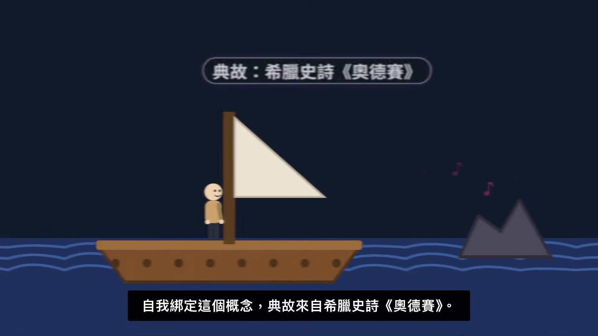

**逐字稿片段：** 典故來自希臘史詩奧德賽 英雄奧德修時想聽海妖唱歌 又知道自己聽了會被迷住 把船開去撞礁石 所以他先叫水手 把他綁在船尾上 意思是趁你清醒的時候 先替等一下那個不清醒的你 把路擋起來 Lampk在書裡

**話題推測：** 說明「自我綁定」概念源自希臘史詩奧德賽

---

## 00:06:33

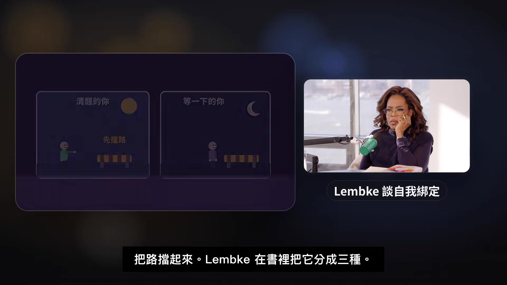

**逐字稿片段：** 把它分成三種 一種是空間上的距離 讓那樣東西不在手邊 一種是時間 只在某些時段才碰 還有一種是類別 整類東西都不碰 放到這位來賓身上 他給的方向是 把購物APP刪掉 讓付款不要那麼方便 來賓說 他撿過信用卡 可是一焦慮 就又去辦新卡 Lampk說 那種狀態下 人好像不在自己的腦袋裡 只是一直在做那個動作 這也是自我綁定的用處 多一道麻煩 就多一點時間 讓你醒過來 他的重點是 與其每天靠意志力 跟一直在誘惑你的環境硬碰硬 不如先把環境換掉 這是他在整間的做法 不是給每個人的處方

**話題推測：** 介紹Lembke將自我綁定分成三種：空間、時間、類別

---

## 00:07:09

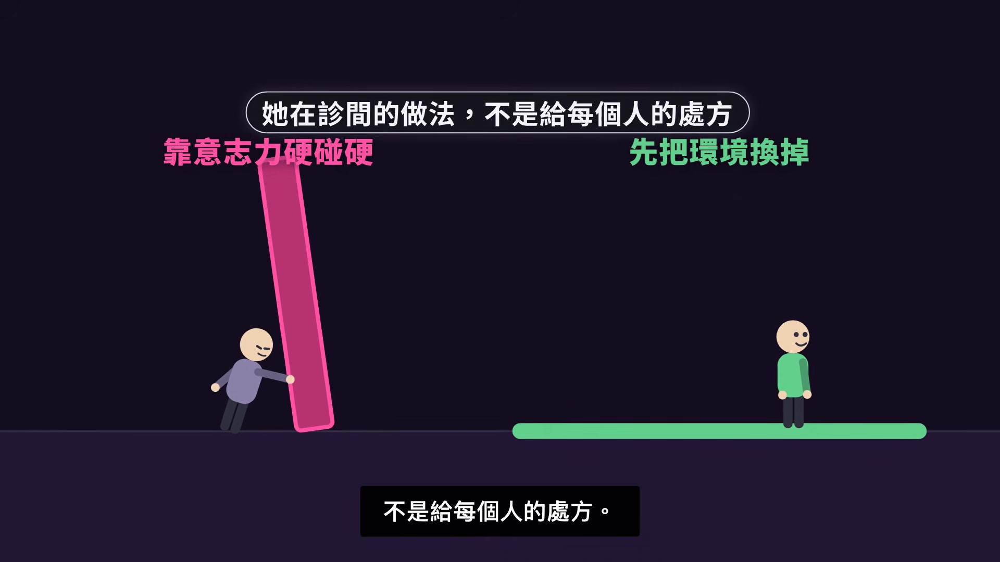

**逐字稿片段：** 另一位是一個在芝加哥的女生 她玩電動才一年左右 現在一天可以玩到七個小時

**話題推測：** 介紹第二位一天玩7小時電動的芝加哥來賓

---

## 00:07:16

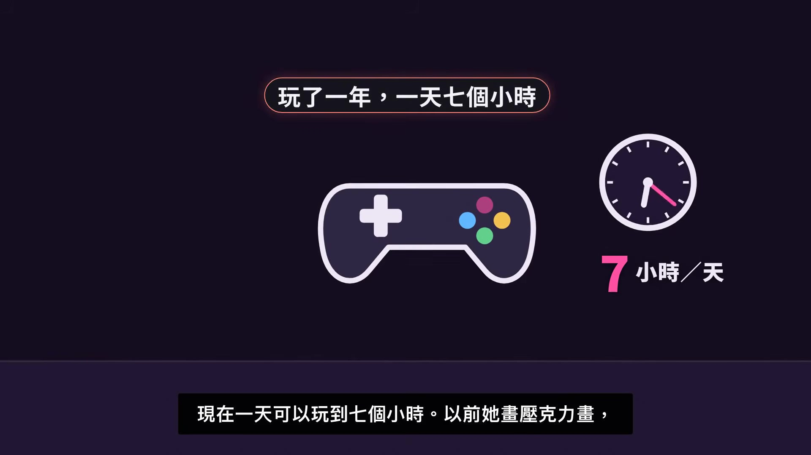

**逐字稿片段：** 以前她畫壓克力 畫縫衣服 做烘焙 她自己分析得很好 縫衣服要買布 要準備工具 烤蛋糕要先去買材料 要預熱烤箱 打電動 只要按一個開關 而且遊戲裡有一群朋友 只要有人上線 就會傳訊息 叫他一起玩 他問的是 遊戲裡20分鐘內 又有很高的高點 又有很低的低點 長期下來 對身體會有什麼影響 Lemke先講了一個 很容易被忽略的代價

**話題推測：** 提及她以前的興趣（壓克力、縫衣服、烘焙）與打電動的對比

---

## 00:07:40

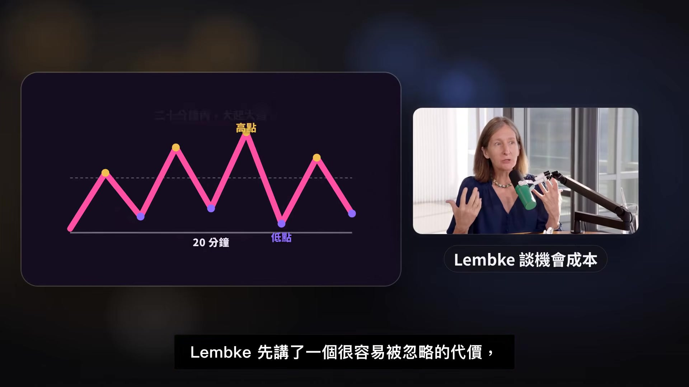

**逐字稿片段：** 叫機會成本 意思是 你花在遊戲上的時間 就是沒有拿去做手工 沒有去認識 住在附近的人的時間

**話題推測：** 引入「機會成本」的概念

---

## 00:07:47

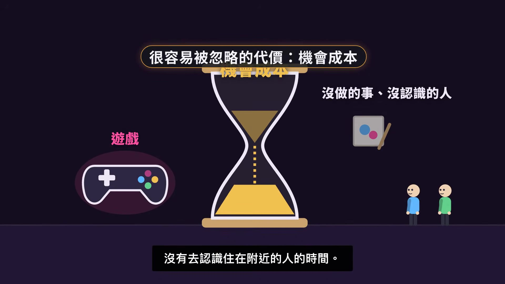

**逐字稿片段：** 世界衛生組織 在2019年 通過新版的 國際疾病分類 2022年生效 裡面把遊戲障礙 列成一種病 判斷的重點有三個 控制不了 通常要持續一年

**話題推測：** 再次提到世界衛生組織在2019年將「遊戲障礙」列為疾病

---

## 00:08:00

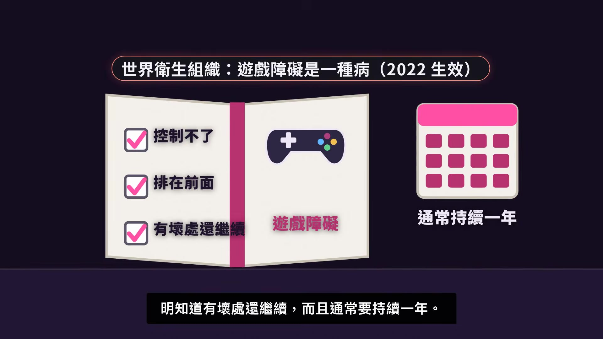

**逐字稿片段：** 臺灣的國家衛生研究院 用比較嚴格的標準調查 8000多位 有在玩網絡遊戲的中小學生 大約3%符合 那長期下來 大腦會發生什麼

**話題推測：** 提及臺灣國家衛生研究院對中小學生網路遊戲成癮的調查數據（約3%）

---

## 00:08:09

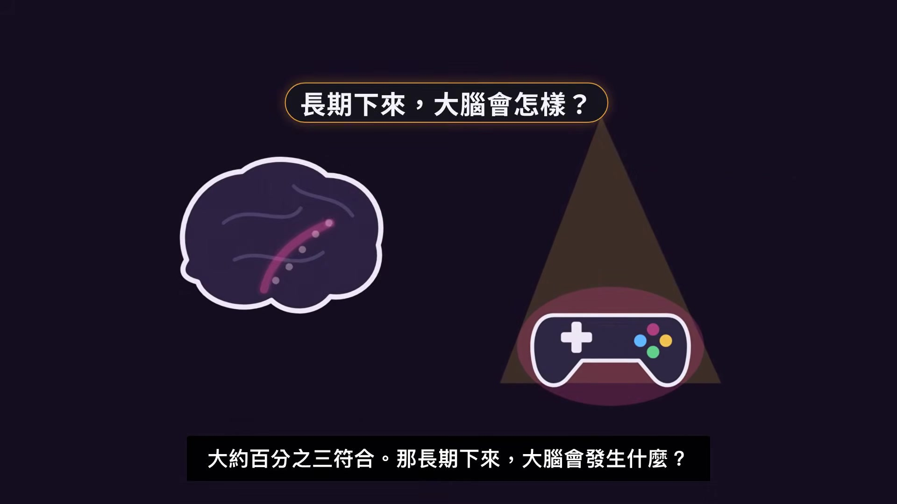

**逐字稿片段：** 聽他怎麼說

**話題推測：** 轉場播放Anna Lembke解釋長期對大腦影響的訪談片段

---

## 00:08:26

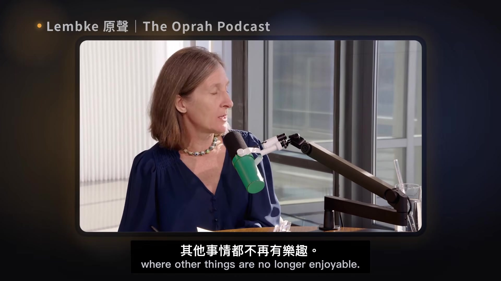

**逐字稿片段：** 他說的吸引力 英文叫salience 指的是一件事 讓你想靠近的力量 遊戲的獎勵又快又密 大腦習慣了以後 畫畫縫衣服這種 要慢慢等的獎勵 就顯得很無聊 很挫折 不是那些事情變差了 是天平的位置變了

**話題推測：** 引入「吸引力 (salience)」這個概念

---

## 00:08:42

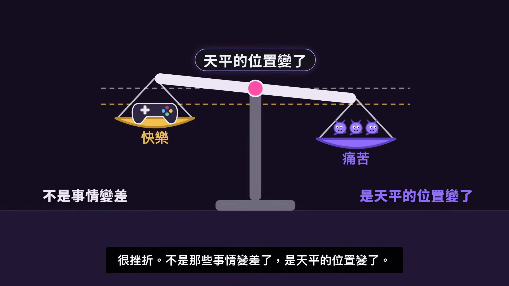

**逐字稿片段：** 那停下來會怎樣 Lampk說 他在診間觀察到 剛停下來的頭兩個星期 通常會先變得更難受 焦慮 睡不好 很想要 那是天平痛苦 那邊的小鬼 還沒下來 他說大約四個星期 大腦的獎賞系統 才會慢慢回到原本的位置 這是她的臨床經驗 不是研究證明的固定天數 要不要停 怎麼停 請跟專業的人討論 她還點出一個很多人沒發現的事

**話題推測：** 探討停止成癮行為後會發生的狀況

---

## 00:09:04

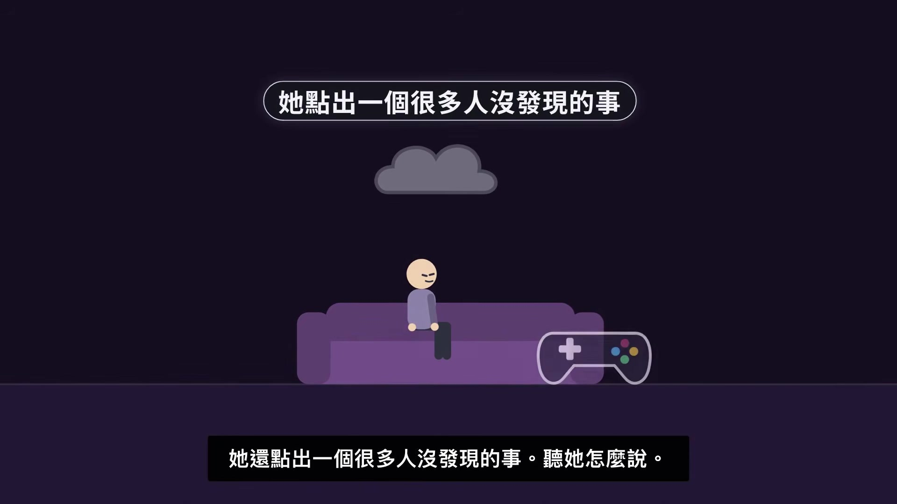

**逐字稿片段：** 聽她怎麼說

**話題推測：** 轉場播放Anna Lembke解釋很多人沒發現的事的訪談片段

---

## 00:09:24

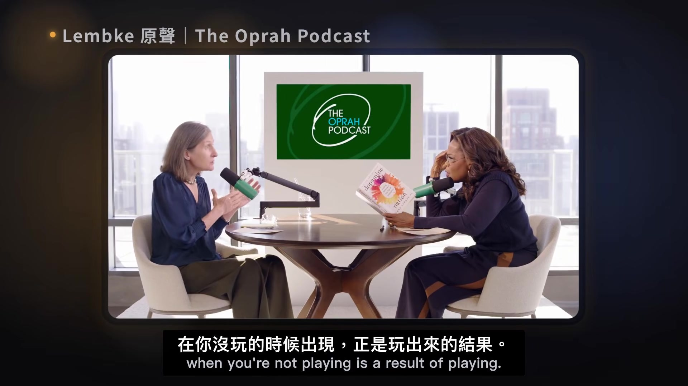

**逐字稿片段：** 最後一位是一個26歲的男生 住在美國東北部

**話題推測：** 介紹第三位輸掉10萬美元運動彩券的來賓

---

## 00:09:28

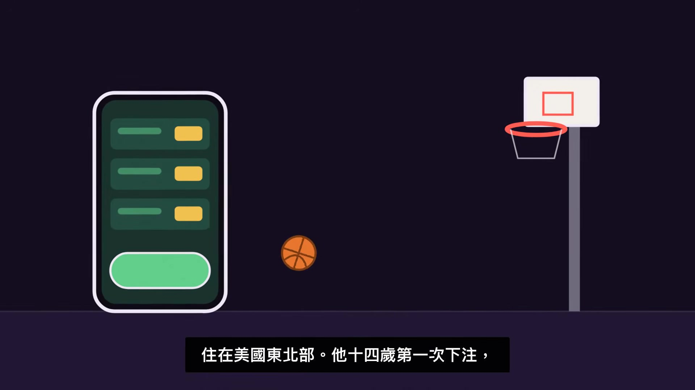

**逐字稿片段：** 他14歲第一次下注 是爸爸給他錢賭超級盃 結果贏了 他說那種感覺 就像在籃球比賽 最後一秒投進制勝球 19歲上大學 他受傷不打球了 突然多出很多時間 也第一次手上有錢 他開始在下課的時候賭 上課也賭 最後一天賭8個小時

**話題推測：** 提及他14歲第一次下注超級盃就贏錢的經驗

---

## 00:09:44

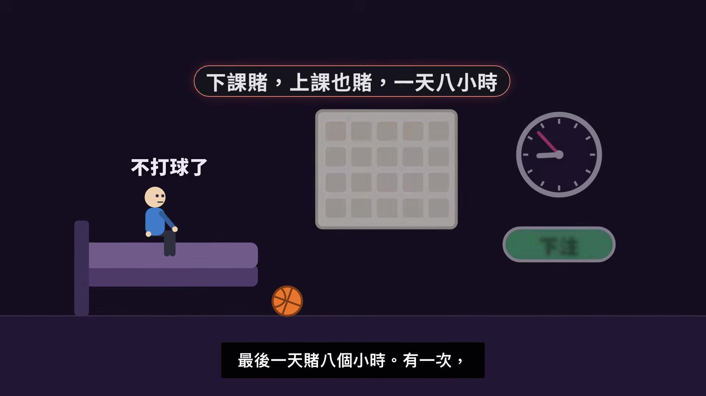

**逐字稿片段：** 有一次他放了100美元進賬戶 兩天內滾到了2萬美元 再過兩天全部輸光 一毛都沒領出來 他說之後他一直想要再贏一次那麼大的 可是再也沒有 前後加起來

**話題推測：** 描述他賭博經歷中，100美元滾到2萬美元又輸光的過程

---

## 00:09:56

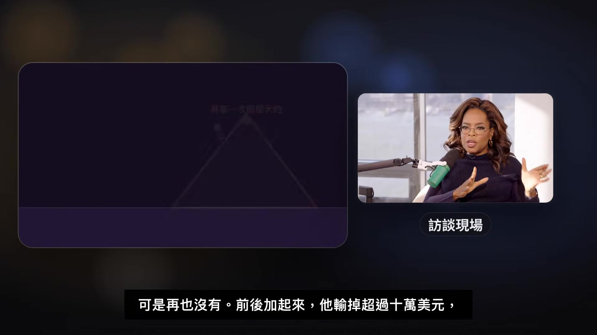

**逐字稿片段：** 他輸掉超過10萬美元 三次休學 最後偷家裡的錢 偽造爸媽的支票付房租

**話題推測：** 強調他總共輸掉超過10萬美元的金額

---

## 00:10:01

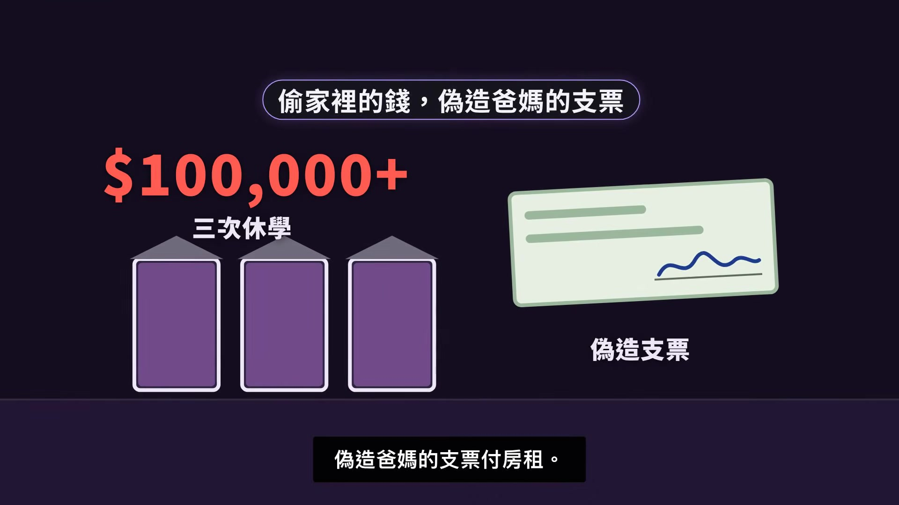

**逐字稿片段：** 美國精神醫學會在2013年 把賭博障礙放進 跟物質成癮同一張 這是第一個被正式承認的行為成癮 診斷的標準裡 有一條就是 輸了以後常常回去 想把錢贏回來

**話題推測：** 提及美國精神醫學會2013年將「賭博障礙」列入物質成癮類別

---

## 00:10:13

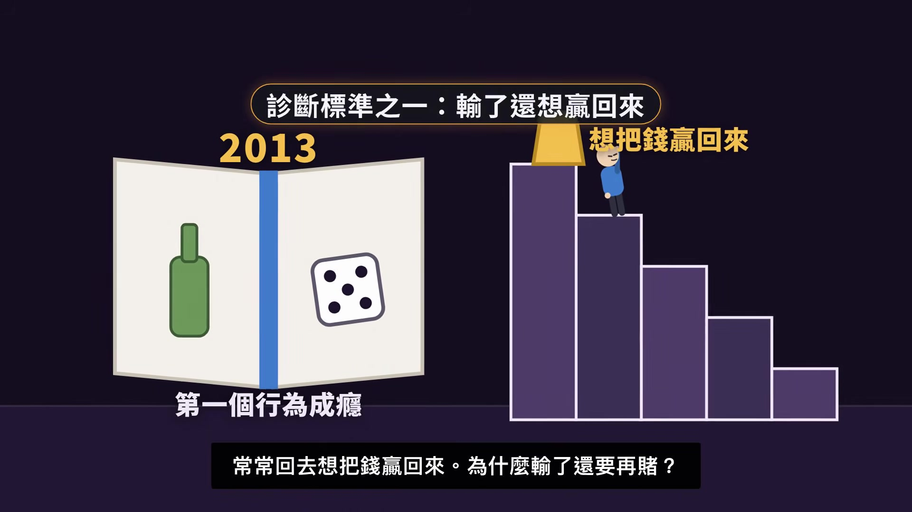

**逐字稿片段：** 為什麼輸了還要再賭 Lemke提到一個腦部研究

**話題推測：** 探討「為什麼輸了還要再賭」

---

## 00:10:17

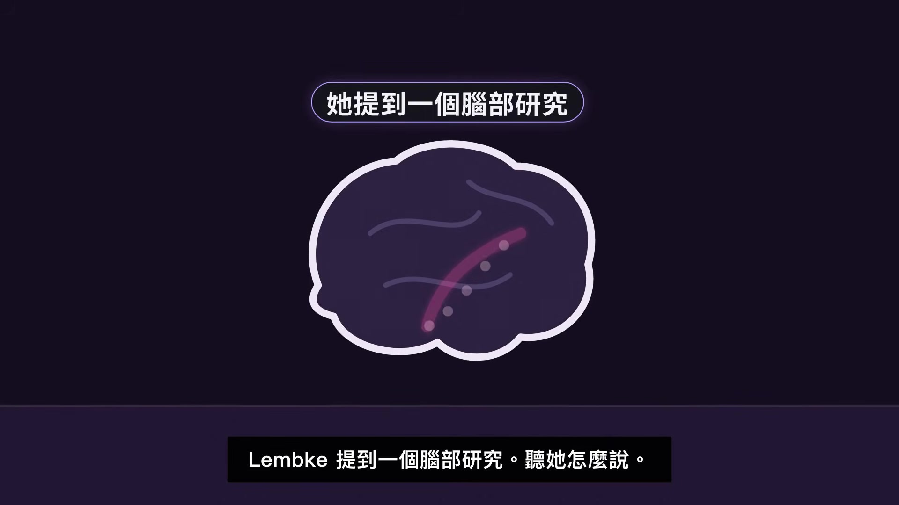

**逐字稿片段：** 聽他怎麼說 他提到的研究是

**話題推測：** 轉場播放Anna Lembke解釋腦部研究的訪談片段

---

## 00:10:39

**逐字稿片段：** 2010年丹麥一個團隊 用腦部掃描 比較16位病態賭徒和15位一般人 輸錢的時候 賭徒大腦裡釋放的多巴胺比一般人多 這是小型研究 其他團隊的結果也不一致 所以只能說 他可能解釋了為什麼輸了還想再賭 Lampy還說 到後來賭徒要的已經不是錢 而是待在一個自己創造的世界裡 其他煩惱都不見了 賭場裡沒有時鐘 也沒有窗戶

**話題推測：** 提及2010年丹麥團隊的腦部掃描研究，發現賭徒輸錢時多巴胺釋放更多

---

## 00:11:01

**逐字稿片段：** 再來是環境 2018年 美國最高法院一個判決 讓各州可以自己開放運動博彩

**話題推測：** 討論環境對賭博的影響，特別是美國開放運動博彩的政策

---

## 00:11:07

**逐字稿片段：** 現在將近40個州合法 大部分可以直接用手機下注 這位來賓也說 他住的州開放以後 他賭得更兇 加州大學洛杉磯分校的研究者 追蹤了400多萬人的信用記錄 發現開放手機下注的州 之後個人破產的幾率 高了大約四分之一 這篇論文還沒正式發表 Lemke把這件事講得很直接

**話題推測：** 提到美國將近40個州運動博彩合法，且可手機下注

---

## 00:11:26

**逐字稿片段：** 聽他怎麼說 and you know lack of willpower it's simple access to our drug of choice

**話題推測：** 轉場播放Anna Lembke直接點出問題的訪談片段

---

## 00:11:40

**逐字稿片段：** 這句話把三個故事串在一起 網路購物遊戲運動彩券 三種東西都是越來越容易拿到 一個APP一個按鈕 一支手機就到手了

**話題推測：** 總結三個案例的共通點是成癮物越來越容易取得

---

## 00:11:49

**逐字稿片段：** 臺灣也一樣 運動彩券在臺灣是合法的 據業者公佈

**話題推測：** 提及臺灣運動彩券合法且線上投注比例高的現況

---

## 00:11:53

**逐字稿片段：** 去年一年賣了大約710億元 其中四成都是線上下注

**話題推測：** 強調去年臺灣運動彩券銷售額約710億元

---

## 00:11:58

**逐字稿片段：** 所以這部分的答案是 三個人上癮的東西不一樣 背後是同一個天秤 而把天秤推過頭的 常常不是他們的意志力特別差 是那樣東西太容易拿到

**話題推測：** 總結第二部分的答案

---

## 00:12:06

**逐字稿片段：** 可是還有一個問題沒回答 這三個人都知道這樣不好 為什麼還是停不下來 那位買運動彩券的來賓 偷了家裡的錢

**話題推測：** 進入第三部分，探討為何明知有害卻停不下來

---

## 00:12:14

**逐字稿片段：** Lam特別回頭講了這件事 他說人陷在沉淫裡的時候 常常會做出違背自己良心的事 很多人能理解 家人吸毒以後 好像變了一個人 可是換成購物啊 賭博啊 我們就比較難這樣想 他給瞭解釋 要回到多巴胺最原始的工作

**話題推測：** 提及Lembke解釋成癮者會做出違背良心的事

---

## 00:12:29

**逐字稿片段：** 聽他怎麼說 多巴胺原本的工作 是叫我們去找食物 找伴侶這些活下去需要的東西

**話題推測：** 轉場播放Anna Lembke解釋多巴胺原始工作的訪談片段

---

## 00:12:51

**逐字稿片段：** 成癮的時候 大腦把那樣東西也排進了必需品 所以良心被擠到了後面 那為什麼有些人特別容易上癮 他說家族和雙胞胎的研究都顯示 有些人天生就比較容易 例如親生父母或祖父母有酒癮 就算不在那個家長大 也比較容易有酒癮 那位來賓問 他戒毒的時候 也把酒戒了 這樣對嗎

**話題推測：** 解釋成癮時大腦會將成癮物誤認為「必需品」

---

## 00:13:11

**逐字稿片段：** Lampk說 所有讓人上癮的東西 都會碰到同一條獎賞迴路 用其他的東西 也可能把人拉回原本那一個 這是他的臨床看法

**話題推測：** 提及Lembke解釋所有成癮物都觸發同一獎賞迴路

---

## 00:13:19

**逐字稿片段：** 還有一個力量 會讓人越陷越深 叫羞恥 三位來賓都提到很羞恥 藏包裹說謊偷錢 羞恥的感覺 太難受 人就會再去用 好讓自己不要去感覺他

**話題推測：** 引入「羞恥」是讓人越陷越深的力量

---

## 00:13:30

**逐字稿片段：** Lampk給的出路 叫徹底誠實 意思是 對每一件事都說真話 連為什麼遲到五分鐘這種小事 也不找藉口 他說在他的經驗裡 能夠走出來 又一直維持的病人 通常是願意說真話的人 因為說真話 你就得看清楚自己在做什麼 而且把真話說給另一個人聽 會讓人跟人靠近這種連結 本身就是一種健康的多巴胺來源

**話題推測：** 提出解決之道：「徹底誠實」

---

## 00:13:52

**逐字稿片段：** 那位買運動彩券的來賓 從2024年10月開始戒毒 他在戒治中心待了好幾個月 將近兩個月沒有手機 他說他正在變回 開始賭博以前的那個人 可以當一個好兒子 好哥哥 好朋友

**話題推測：** 提及那位運動彩券來賓從2024年10月開始戒毒的進展

---

## 00:14:05

**逐字稿片段：** 所以這一部分的答案是 明知道有害 還停不下來 是因為大腦 把他誤認成活下去的必需品 羞恥又把人往回推 而走出來的第一步 往往是先對一個人說實話

**話題推測：** 總結第三部分的答案

---

## 00:14:15

**逐字稿片段：** 我們回到開場那個問題 手機越滑越空虛 為什麼還是停不下來

**話題推測：** 回顧影片開場的核心問題「手機越滑越空虛，為什麼還是停不下來？」

---

## 00:14:19

**逐字稿片段：** Lemke的答案 有三層 第一層 空虛不是錯覺 快樂那邊壓得越多 大腦就在痛苦那邊 加越多小鬼 到最後 滑手機只是為了 把天平拉平 再來 停不下來 不只是意志力的問題 那樣東西隨手就拿得到 又一直塞新東西給你 最後一層 大腦會把它誤認成 活下去需要的東西 羞恥 又讓人更想躲回去

**話題推測：** 總結Anna Lembke對此問題的三層答案

---

## 00:14:40

**逐字稿片段：** 要記得 天平和小鬼 是他的教學比喻 四個星期 是他在診間的經驗 賭徒的腦部掃描 也只是小型研究 手機成癮到現在 也還不是正式的診斷

**話題推測：** 強調比喻、臨床經驗和研究的限制

---

## 00:14:50

**逐字稿片段：** 整理一下 停不下來 不代表你是壞人 也不代表你特別軟弱 它是一套大腦機制 加上一個太容易拿到的環境

**話題推測：** 總結關於成癮的幾個重點

---

## 00:14:57

**逐字稿片段：** 如果你或身邊的人 已經停不下來 影響到工作金錢或家人 請找專業的人幫忙 可以打衛福部的安心專線 1925 24小時免付費 也可以找各縣市的社區心理衛生中心

**話題推測：** 提供衛福部安心專線等求助資源

---

## 00:15:10

**逐字稿片段：** 最後問你一個問題 你手機裡最停不下來的是哪一個APP 留言告訴我

**話題推測：** 提出一個互動問題，鼓勵觀眾留言

---

## 00:15:15

**逐字稿片段：** 喜歡的話訂閱AI Notebook 開啟通知 我們下次見

**話題推測：** 結尾，頻道訂閱和通知呼籲

---
