# jimainotebook_iJtRRhAuEDg — 關鍵畫面索引

- 來源逐字稿：[jimainotebook_iJtRRhAuEDg_FIN.srt](jimainotebook_iJtRRhAuEDg_FIN.srt)
- 影片：https://www.youtube.com/watch?v=iJtRRhAuEDg
- 截圖數：55

## 00:00:10

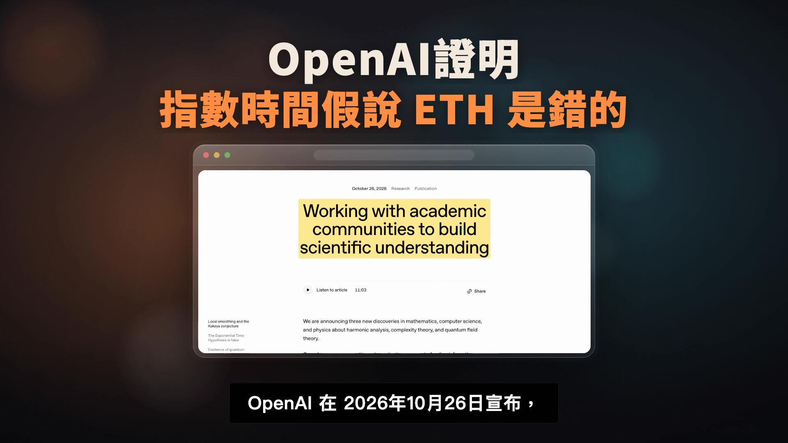

**逐字稿片段：** OpenAI在2026年10月26日宣佈,它的AI證明瞭指數時間假說是錯的。 先說清楚,這裡的eth是指數時間假說的英文縮寫,跟以太坊那個eth沒有關係。 這是電腦科學裡很多人相信的一個假說,所以消息一出來,這個領域的人都很驚訝。 更特別的是,

**話題推測：** OpenAI宣布AI推翻指数时间假说

---

## 00:00:28

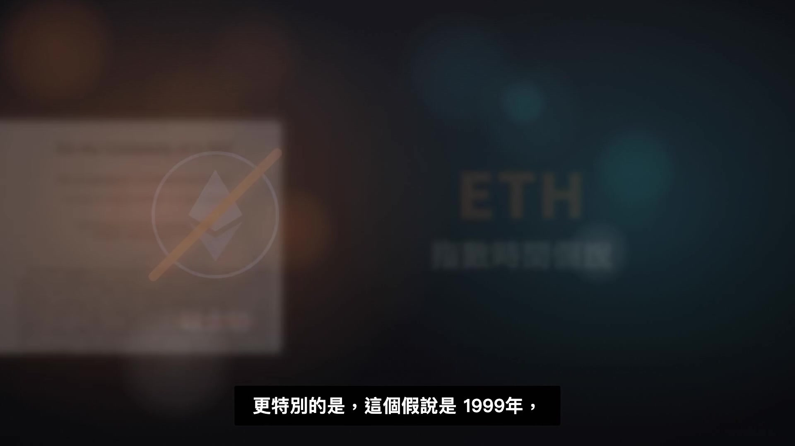

**逐字稿片段：** 這個假說是1999年由加州大學聖地牙哥分校的兩位教授提出的, 他們叫Russell Impagliazzo和Ramamohan Perturi。 27年後被請來帶頭檢查這份反證的正是他們兩位 再加上麻省理工學院的Ryan Williams

**話題推測：** 介绍指数时间假说的提出者及其时间

---

## 00:00:42

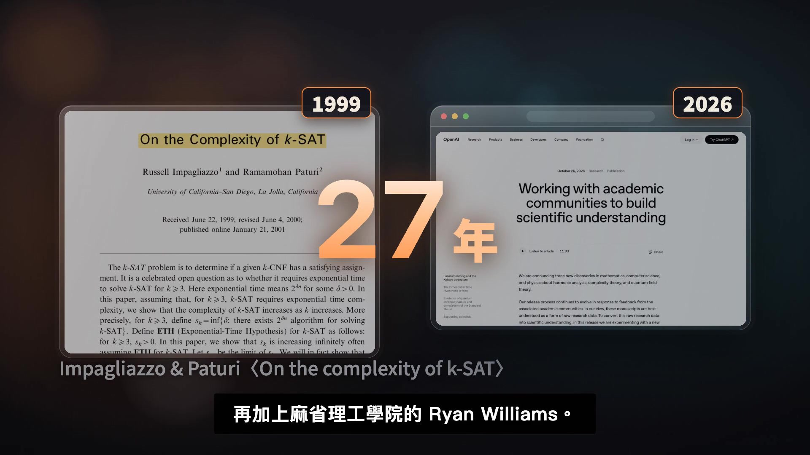

**逐字稿片段：** 三個人發了一封公開信 裡面有一句話 我們參與不代表我們認證這個主張

**話題推測：** 提到三位专家发布的公开信内容

---

## 00:00:47

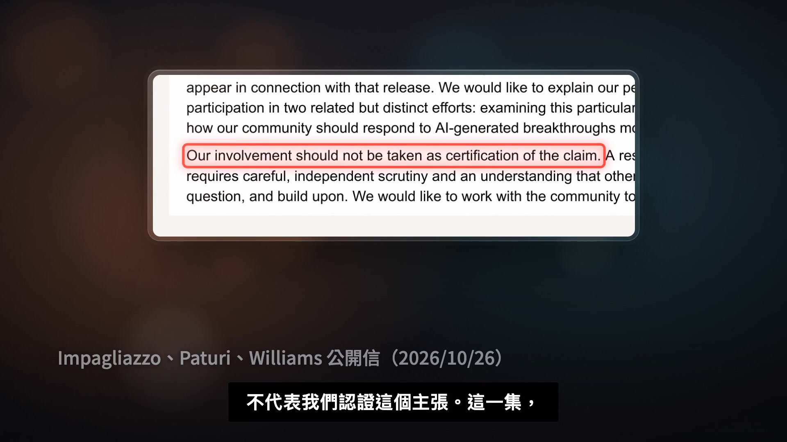

**逐字稿片段：** 這一集我想回答一個問題 一個AI說他推翻了大家相信的假說 誰來確認他是對的 到我們做這一集的時候公佈才大約半天 還沒有人公開說找到錯誤 也沒有人公開確認他對

**話題推測：** 提出本集要回答的核心问题：谁来确认AI的证明

---

## 00:00:59

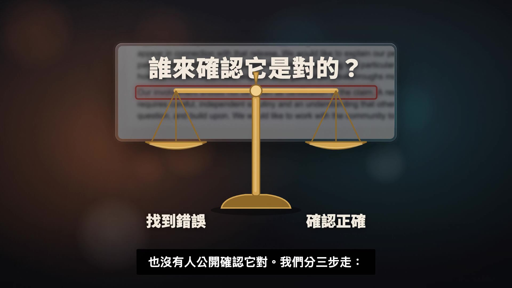

**逐字稿片段：** 我們分三步走 先把這個假說本身和他的影響力講清楚 看懂OpenAI宣稱了什麼 再看誰在檢查 用什麼檢查 最後看同一天另外兩項發現 為什麼公開的方式完全不一樣 要看懂這個宣稱 得先認識一個問題

**話題推測：** 概述本集将分三步进行的讨论结构

---

## 00:01:14

**逐字稿片段：** 叫SAT SAT的全名叫不靈可滿足問題 不靈指的是隻有真和假兩種值的變數 像一個開關 不是開就是關 我們用一把密碼鎖來想 這把鎖上有一排波杆 每一根只能往上或往下 鎖上貼了一張說明 寫著很多條規則 像是假往上或乙往下或丙往上 所有規則同時成立 鎖才會開 每一條規則最多隻講三根撥杆 這個版本叫3SAT

**話題推測：** 介绍“SAT（布林可满足问题）”概念

---

## 00:01:42

**逐字稿片段：** 排班表就是這樣一把鎖 每個人哪一天上班是一根撥杆 週末至少要有一個人在 小明和小華不能同一天休假 就是規則 安排晶片上的線路 檢查程式有沒有漏洞 很多問題換一個寫法 也都會變成這把鎖 最笨的開法 是把所有組合一個一個試 可是撥杆每多一根 組合就翻一倍

**話題推測：** 举例说明排班表如何应用3SAT

---

## 00:02:01

**逐字稿片段：** n根撥杆就有2的n次方種組合 10根是1000多種 50根就超過1000兆種 這種增加的方式叫指數成長 題目只大一點 工作量就乘上一個倍數 所以大家很想知道 這把鎖有沒有比一個一個式快很多的開法 這把鎖 電腦科學家研究了幾十年 記錄一直在進步 早年有一個方法 做到每多一根撥杆 時間乘以三分之四

**話題推測：** 解释指数增长（2的n次方）的工作量

---

## 00:02:25

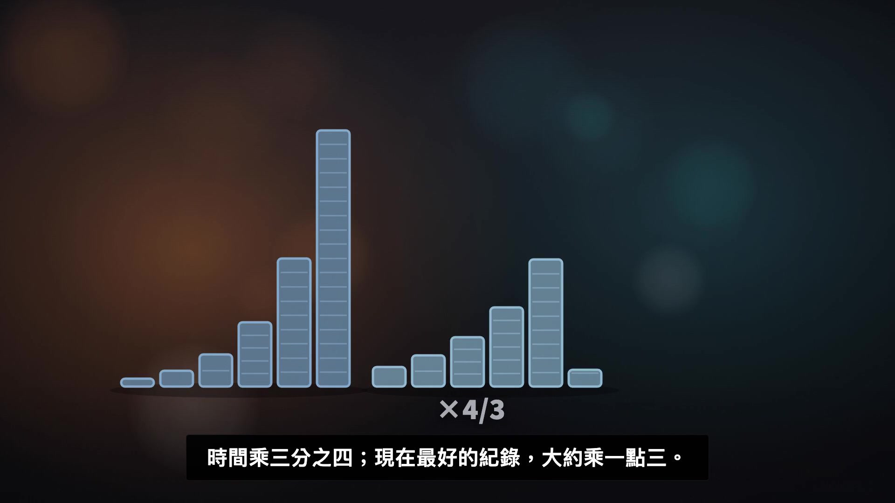

**逐字稿片段：** 現在最好的記錄大約乘1.3 可是不管怎麼進步 都還是每多一根就乘一個倍數 還在指數這一級 1999年 Impagliazzo和Paturi 把大家心裡的這個感覺 寫成一個明確的假說 期刊版在2001年發表

**話題推測：** 展示解决SAT问题现有方法的效率数据（如乘以1.3）

---

## 00:02:39

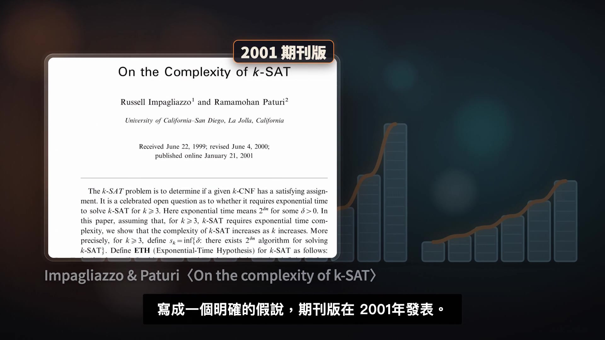

**逐字稿片段：** 它叫指數時間假說 英文是Exponential Time Hypothesis 縮寫ETH 它說的是 3SAT沒有次指數時間的解法 白話一點 不管你多會開鎖 最壞的情況都逃不掉指數這一集 要知道這個假說有多強 我們拿一把標尺來看 標尺上有三格 最左邊叫多項式時間 題目變大 時間只是跟著放大幾倍幾次方 電腦算得完 最右邊是指數時間 波杆多一根 時間就乘一個倍數 中間還有一格 叫次指數時間 比指數好一點 又到不了多像是 電腦科學最有名的懸案

**話題推測：** 正式介绍“指数时间假说（ETH）”

---

## 00:03:12

**逐字稿片段：** 叫P和NP 他問的是 答案很容易檢查的問題 是不是也都很容易找到答案 大部分研究者相信不是 也就是P不等於NP 用標詞來說 就是相信3SAT 不在最左邊那一格 ETH說的更多 3SAT連中間那一格都不在 只能待在最右邊 所以ETH是比P不等於NP 更強的假設 ETH如果對 P不等於NP也跟著成立 反過來ETH錯了 P不等於NP還是可能對 ETH沒有人證明過 可是普遍被相信 於是它變成一個很好用的前提 它怎麼被用

**話題推測：** 引入计算机科学的著名难题“P与NP问题”

---

## 00:03:45

**逐字稿片段：** 要先認識一個名詞叫規約 規約就是把一個問題 改寫成另一個問題 假設你能把任何一把3SAT的鎖 很快改寫成另一個問題 而且改寫完不會變大太多 那這個問題如果有很快的解法 3SAT也就跟著有了 反過來想 如果相信3SAT快不了 那這個問題也快不了

**話題推測：** 介绍“规约”这一概念及其在问题解决中的作用

---

## 00:04:04

**逐字稿片段：** 這就像一排骨牌 3SAT站在最前面 研究者一張接一張 從3SAT推到很多別的問題 替每一個問題畫出一條 不可能更快的線 這條線叫下界 就是這個問題 至少要花這麼多時間

**話題推測：** 用“骨牌”比喻ETH如何推导出其他问题的复杂度下界

---

## 00:04:17

**逐字稿片段：** 舉一個圖論的例子 在一張朋友關係圖裡 找出一群彼此都認識的人 這叫找團 靠著ETH 研究者推出 要找的那一群人越大 時間就會跟著急速變長 沒辦法靠更好的方法躲掉 照OpenAI的說法

**話題推測：** 举图论中“找团”的例子说明ETH的应用

---

## 00:04:31

**逐字稿片段：** 有上百篇論文用了ETH當前提 範圍包括圖論 計算生物學 資料庫 計算幾何

**話題推測：** 指出有上百篇论文以ETH为前提

---

## 00:04:37

**逐字稿片段：** 你也可以把ETH想成一塊地基 上面蓋了很多棟房子 房子本身蓋得好不好是另一回事 可是地基一棟 上面每一棟都要重新檢查 ETH還有一個更強的版本 叫強指數時間假說 英文所寫SETH ETH說 開鎖的時間逃不掉指數這一級 SETH說的更多 每條規則允許的波感越多 最好的方法就越接近一個一個式 幾乎沒有便宜可以佔 SETH管道的地方 有很多是我們每天在用的題目 舉一個例子 比對兩段DNA差多少 也就是要換掉 加上 刪掉幾個字母 才能把一段變成另一段 這叫編輯距離 現在的方法 時間大約跟兩段長度相乘一樣多 研究者證明了 如果SETH是對的 這件事沒辦法做得明顯比這個快 類似的還有找兩段文字裡 最長的共同部分 比對兩條路線有多像 還有正規表示式的比對 正規表示是 就是在電腦上用一串符號 描述你想搜尋的文字長什麼樣子 這一類結果等於在替一大群題目說明 現在的方法大概已經是最好的了 所以ETH和SETH一起當了很多結論的地基 OpenAI的論文說 他的方法連SETH也一起推翻 OpenAI說 這塊地基是錯的 照他的說法

**話題推測：** 将ETH比作“地基”，上面盖了很多“房子”

---

## 00:05:49

**逐字稿片段：** 他的模型在10月16日找到反證 隔天就寫成了電腦能檢查的版本 論文的標題就叫

**話題推測：** OpenAI模型找到反证的具体日期

---

## 00:05:55

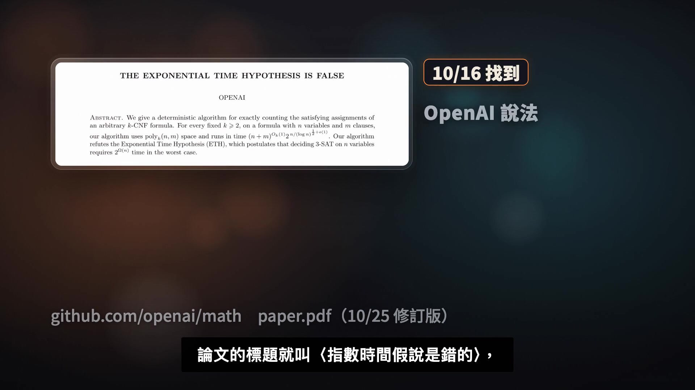

**逐字稿片段：** 指數時間假說是錯的 作者藍寫的是OpenAI 他宣稱的是一個新的開鎖方法 回到那把標詞 ETH說 3SAT只能待在最右邊 新方法說 它擠得進中間那一格 換成鎖來講 ETH說 每多一根波杆 時間至少乘上一個固定的倍數 新方法說 不用 鎖越大 每多一根波杆要多付的代價 會慢慢變小 小到最後趨近於0 它還是很慢 可是長大的速度 終究會比任何固定的倍數都低 這種速度叫次指數時間 只要3SAT做得到次指數時間 ETH就不成立 而且這個方法做的事 比開鎖還多 他不只判斷鎖打不打得開 還能精確數出 總共有幾種組合能把鎖打開 論文還說 前面講的強指數時間假說 也會跟著一起到 還有其他幾個相關的假說也是 證明的細節非常長 我自己也看不懂 可是他宣稱的是 可以用一句話講完 這把鎖 有比大家相信的 再快一點點的開法 推翻ETH 是不是離P等於NP很近了 回到那把標詞 新方法把3SAT從最右邊推進了中間那一格 可是P等於NP要的是最左邊那一格

**話題推測：** 提及OpenAI论文的标题《指数时间假说是错的》

---

## 00:07:03

**逐字稿片段：** 研究量子計算和計算複雜度的Scott Aronson 在部落格里用一個畫面形容這段距離 他說 被跨過的是一尺高的籬笆 帝國大廈那麼高的籬笆還立著 OpenAI的論文自己也寫了 這種次指數的速度 沒辦法順著一般的規約傳下去 所以這個結果 不代表其他NP問題都有次指數時間的解法 Aronson也說 他把自己心中P等於NP的幾率

**話題推測：** 引述专家Scott Aronson对推翻ETH距离P=NP的看法

---

## 00:07:26

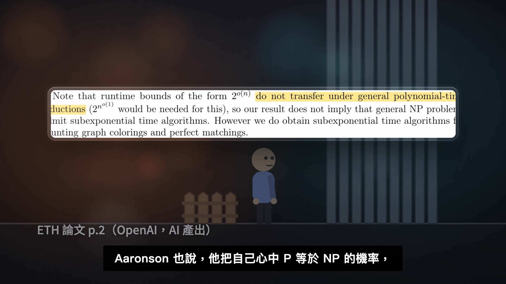

**逐字稿片段：** 從3%調到5% 他在那篇文章裡還寫了一句 前面幾批大家都還沒消化完 吃到飽還在繼續上菜 他說的是OpenAI這個月 一批接一批丟出來的結果 那這個新方法能不能拿來用 至少現在不能 電腦科學家有一個名字 專門叫這種方法

**話題推測：** Scott Aronson调整P=NP概率的数字

---

## 00:07:44

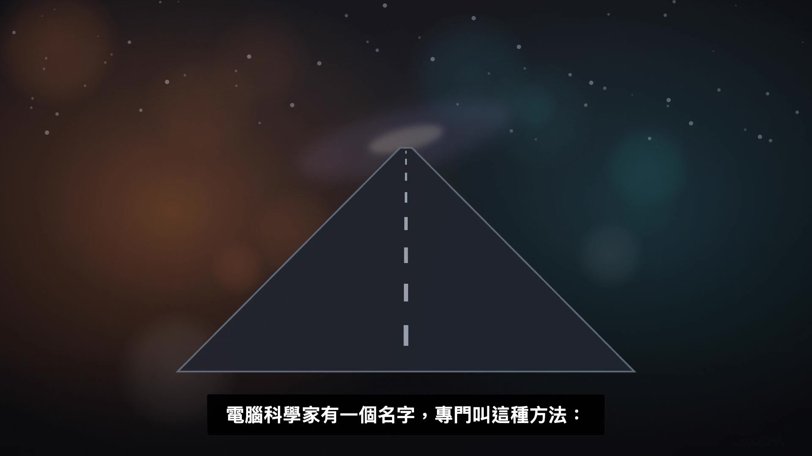

**逐字稿片段：** 銀河演算法 英文是Galactic Algorithm 演算法就是解題的步驟 銀河演算法的意思是 它在理論上比較快 可是題目要大到銀河那種等級 它才真的趕得上別人

**話題推測：** 介绍“银河演算法（Galactic Algorithm）”的概念

---

## 00:07:55

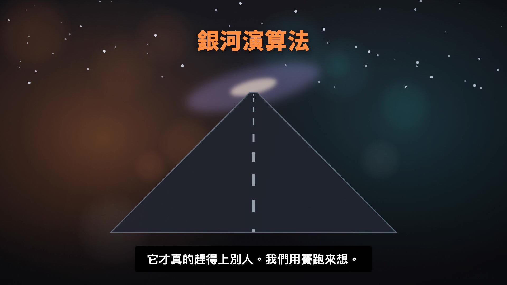

**逐字稿片段：** 我們用賽跑來想 現在最好的方法 就是每根撥杆 乘1.3倍的那一類 像一個起步很快的選手 新方法 像一臺要先暖積很久的車 理論上 車的急速比較高 只要跑道夠長 車就會贏 問題是 這條跑道要長到比宇宙還長 我們照論文寫的參數 自己算了一下 新方法那套構造 要等撥杆多到一個 寫都寫不出來的數字 才真正開始發揮作用 在那之前 它其實還是一個一個式 這個估算是我們自己算的 還沒有專家確認 方向很清楚

**話題推測：** 用“赛跑”比喻银河算法的理论速度与实际应用

---

## 00:08:26

**逐字稿片段：** 那他會不會威脅銀行的密碼? 很多密碼靠的是把一個很大的數字分解成指數相乘 這件事很難

**話題推測：** 探讨新方法是否会威胁银行密码安全

---

## 00:08:33

**逐字稿片段：** 在 Aronson 部落格留言的 Joshua Zielinski 說 把這件事換成密碼鎖 再用新方法去開 還是比現在最好的分解方法慢

**話題推測：** 引述Joshua Zielinski对新方法影响密码安全的评论

---

## 00:08:41

**逐字稿片段：** 先整理一下 ETH 說 3SAT 這把鎖不管多會開 都逃不掉指數這一級 上百篇論文從他一路推出別的問題快不了 OpenAI 宣稱 這把鎖有一種再快一點點的開法 快到足以推翻它 為什麼這麼震撼 因為學界原本的共識 明顯站在ETH這一邊 前面提到的Joshua Zielinski也說 如果查核通過 它的分量跟我們上次講過的 準黎曼猜想那一類結果 同一級 甚至更大 正因為這一次 共識原本站在另一邊 可是 東西不會因此馬上變快

**話題推測：** 总结ETH的定义和OpenAI的宣称

---

## 00:09:12

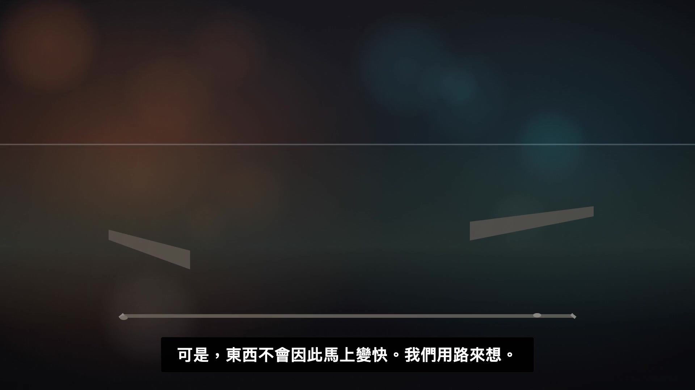

**逐字稿片段：** 我們用路來想 ETH像一塊立在路口的告示牌 寫著此路不通 很多研究者看到牌子 就不往那裡找 推翻ETH是把牌子拿掉了 可是路還沒有人鋪 能不能走到要有人真的去鋪 論文裡確實有幾條路是直接跟著打通的

**話題推測：** 用“路”的比喻解释推翻ETH不代表问题立刻变快

---

## 00:09:28

**逐字稿片段：** 比如精確數出一張圖有幾種合法的著色方法 有幾種完美配對 在理論上都變成次指數時間 完美配對就是把一群點兩兩配成對 一個都不剩 可是它們跟開鎖的新方法一樣 是理論上的進步 而且 如果它是對的這幾個字才是重點 一份60多頁的證明寫它的是一個AI 誰來確認它 OpenAI找來帶頭檢查的就是開場那三位 Ryan Williams在X上的第一則貼文這樣寫 OpenAI的一個內部模型 產出了一個聲稱的ETH反證 他特別用了聲稱的這個詞 接著是那封公開信 信裡說 我們參與不代表我們認證這個主張 這麼重大的結果 需要仔細獨立的檢查 信裡也說 如果主張正確 它會改變理論電腦科學很重要的一部分 你想象一下這個畫面 一個你多年前提出的假說 現在有人說它是錯的 而你被請去當檢查的人

**話題推測：** 列举理论上直接受益于ETH推翻的问题，如计算图的着色方法

---

## 00:10:20

**逐字稿片段：** 他們開了幾個條件 不籤保密協議可以自由討論 不拿報酬 AI產出的原始資料全部公開 讓任何人都能自己檢查 另外由OpenAI出錢辦一場研討會 讓整個領域一起討論 OpenAI說他都同意了 所以這不是把證明交給三個人關起門來審 而是三個人帶頭邀請所有人一起檢查 他們手上有一個很重要的工具 是一種會檢查證明的程式

**話題推測：** 列出专家们参与检查证明的条件

---

## 00:10:45

**逐字稿片段：** 這種程式叫Lean 是專門用來檢查數學證明的程式語言 他把證明的每一步 寫成電腦看得懂的樣子 再一步一步確認 只要有一步跳過 他就不給過 上次我們講OpenAI 那700多篇數學論文的時候 用過一個畫面 這次再用一次

**話題推測：** 介绍用于检查数学证明的程式语言Lean

---

## 00:11:01

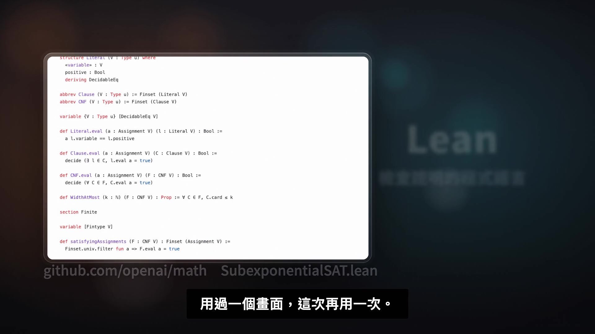

**逐字稿片段：** Lean像一臺很嚴格的收穫機器 證明是一個箱子 箱子外面貼著一張標籤 寫著裡面裝的是哪一個定理 機器保證的是 箱子裡的東西 跟標籤寫得一模一樣 一顆螺絲都沒少 這次ETH的箱子非常大

**話題推測：** 用“收货机器”比喻Lean如何严格检查证明

---

## 00:11:15

**逐字稿片段：** Lean程式碼將近4000個檔案 OpenAI還附了一個比對工具

**話題推測：** 指出ETH证明的Lean程式码有近4000个档案

---

## 00:11:19

**逐字稿片段：** 叫Comparator 它確認證明只用了 三條公認的基本規則 沒有偷偷加別的假設 也沒有哪一步是空著的 可是收穫機器 有兩件事管不到 頭一件 標籤有沒有寫對 標籤上寫的是 存在一臺電腦 能在某個時間內數出答案 這臺電腦怎麼定義 時間怎麼算 題目怎麼輸入 只要有一個地方寫得太寬鬆 箱子對得上標籤 標籤卻不等於ETH是錯的 另一件 標籤只說存在某些常數 沒說常數多大 所以Lean能保證它在理論上成立 不能保證它能用 所以標籤要人讀 到目前為止誰讀過了 公佈後大約一個小時 一個社群一起維護的Lean定理庫

**話題推測：** 介绍OpenAI提供的比对工具Comparator

---

## 00:11:58

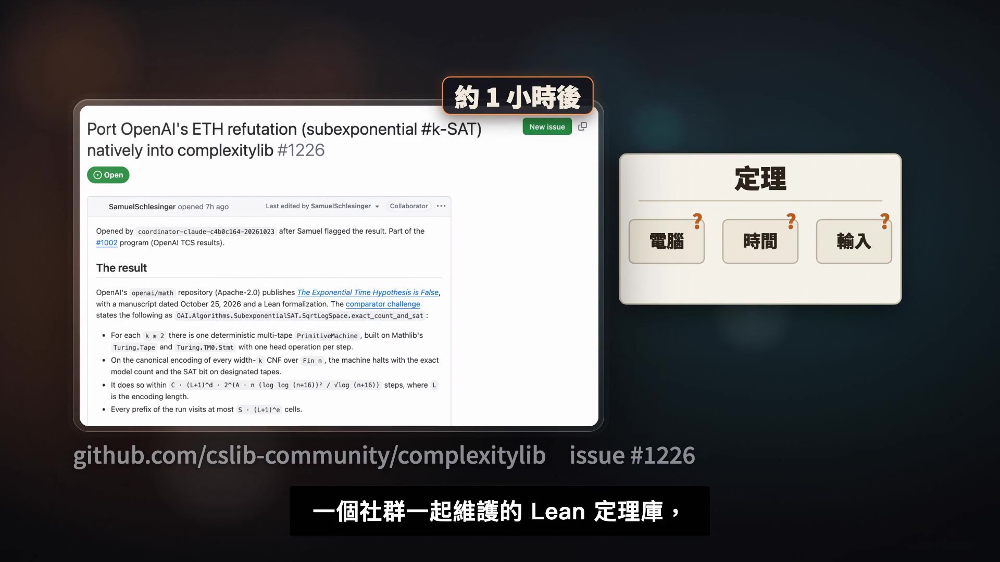

**逐字稿片段：** 叫Complexity Lib 就開了一個討論串 他們說 第一輪讀完標籤 沒有找到漏洞 那臺電腦在拿到題目之前 就固定好了 會停下來 輸出也是精確的 時間和空間 也是照真實的部署來算 聽起來很完整 可是要看清楚是誰說的 這個討論串 是一群AI代理人協調寫的 代理人就是會自己一步一步做事的AI程式 背後有一位叫Samuel Schlesinger的人主導 他們自己也寫了 這不是正確性的判決 他們也還沒有自己編譯過一次 他們決定換一個做法 不用OpenAI的程式碼 用自己的定義 從頭再形式化一次 形式化就是把證明翻成lean的過程 如果兩份各自寫出來的標籤對得上 可信度會高很多 至於有名有姓的專家 到我們做這一集的時候 還沒有看到誰公開說 他讀過這張標籤 確認沒有問題 如果標籤最後也讀通了 地基上的房子會怎麼樣 有一個人已經先感覺到了

**話題推測：** 提到Lean定理库社群Complexity Lib的讨论

---

## 00:12:50

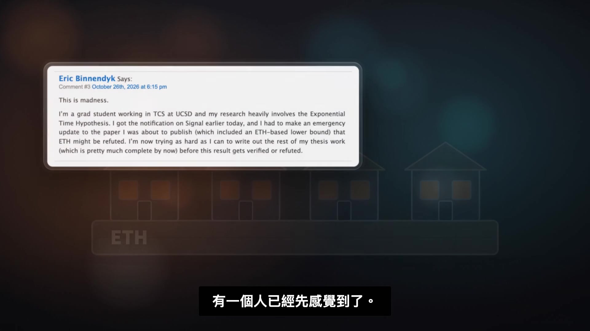

**逐字稿片段：** Eric Binnendijk 是加州大學聖地牙哥分校的博士班學生 剛好跟Impagliazzo Peturi在同一個系 公佈當天 他在Aaronson的部落格留言說 他正要發表的論文裡 有一個靠ETH推出來的下界 他只好緊急補上一段 說明ETH可能已經被推翻 那其他房子會倒嗎 要分開看 論文自己寫得很清楚 推翻ETH和SETH 是拿走了這些困難度說法的一個依據 有一些下界 其實也能從另一個比較弱 可能還成立的猜想推出來 像前面講的 找兩段文字最長的共同部分 還有正規表示式的比對 這些房子底下還有別的柱子 另外一些 只靠ETH或SETH站著的 就要重新檢查 從已經證明快不了 退回到不知道 可是退回到不知道 不是變簡單 這就像剛才那塊 此路不通的告示牌 要讓這些題目真的變快 得反過來 把它們改寫成那把鎖 而且波感的數量不能變多 目前做得到的只有少數 論文舉的就是屬著色 屬配對這幾個 OpenAI在公告裡也說 要找到更快的方法 再變成實際的改進 還需要很多研究 從宣稱到確認 中間這段路有多長 我們其實看過一次 10月初 OpenAI一次公開了

**話題推測：** 举例Eric Binnendijk紧急修改论文的情况

---

## 00:13:59

**逐字稿片段：** 700多篇AI寫的數學手稿 我們那一集的結尾說 時間會給出更完整的答案 後來 OpenAI在自己的修訂記錄裡寫 有一篇論文被發現正負號錯誤 就是某個地方的加號和減號 弄反了 這篇撤回 另外兩篇建立在它上面的論文 也一起撤回

**話題推測：** 提到OpenAI先前公开700多篇AI数学手稿的事件

---

## 00:14:15

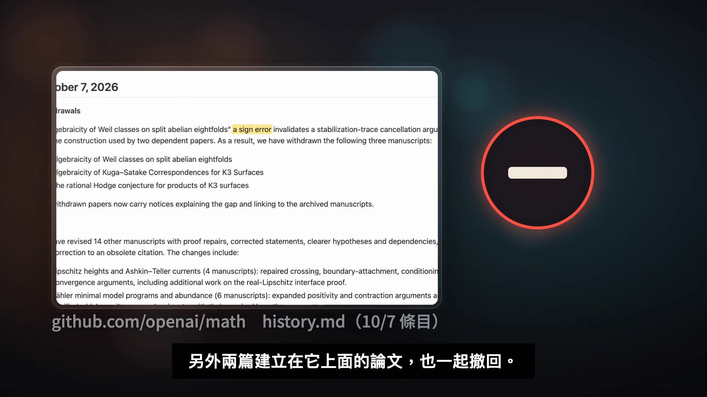

**逐字稿片段：** 總共撤回三篇 同一天 還有14篇做了修訂 有的補證明 有的修正敘述 有的加上原本漏掉的假設 這段經驗說明兩件事 檢查真的會找到問題 而且找到之後 有記錄也會撤回 可是檢查需要時間 以這種規模的證明來說 可能要好幾個月 所以整理一下 誰來確認ETH這件事 是提出它的人帶頭 所有人都拿得到材料 一起檢查 電腦負責確認箱子對得上標籤 人負責讀標籤 現在箱子過了機器 標籤還在等人讀 說完ETH

**話題推測：** 提及OpenAI之前有三篇论文被撤回

---

## 00:14:46

**逐字稿片段：** 回到開場提過的另外兩項 它們跟ETH出現在同一篇公告裡 一項在數學 一項在物理

**話題推測：** 转向讨论OpenAI公告中的另外两项发现

---

## 00:14:52

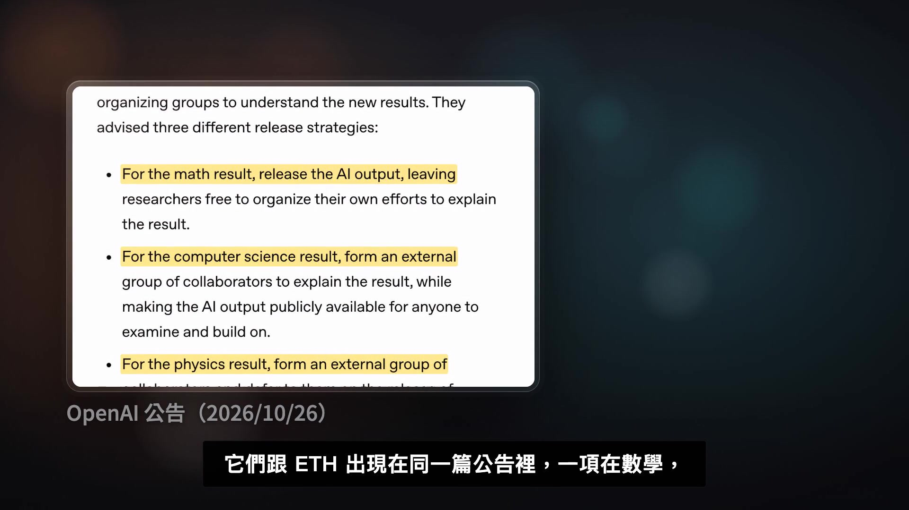

**逐字稿片段：** 而三項用了三種不一樣的公開方式 OpenAI說 它先找了外部的專家來帶領 專家給了三種建議 數學那一項 AI寫的論文和電腦檢查的檔案 全部直接放上網絡 誰想讀都可以 電腦科學那一項 就是ETH 也全部放上網絡 另外再由那三位專家帶頭檢查 物理那一項 交給另一個專家小組 什麼時候公開由小組決定 而小組決定先不公開 自己重新寫一份 OpenAI自己也說 還不知道哪一種方式最好 那另外兩項的箱子和標籤 各放在哪裡

**話題推測：** 说明三项发现采用了三种不同的公开方式

---

## 00:15:24

**逐字稿片段：** 先看全部公開的數學那一項 這一項會碰到一個 我們頻道講過的名字

**話題推測：** 开始介绍OpenAI完全公开的数学发现

---

## 00:15:29

**逐字稿片段：** 叫Kakeya猜想 中文叫掛骨猜想 1917年 日本數學家掛骨中醫 問了一個問題 一根針要在平面上 轉一整圈 最少需要多大的地方 後來的答案很奇怪 面積可以要多小有多小 於是數學家問了更深的問題 一個形狀 如果在每一個方向 都藏著一根針 它還能薄到什麼程度 掛股猜想說 它沒辦法太薄 它的維度得是滿的 2025年

**話題推測：** 介绍“挂谷猜想（Kakeya猜想）”

---

## 00:15:55

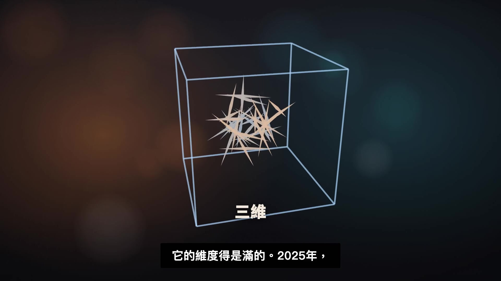

**逐字稿片段：** 王紅和Joshua Zoll 證明了三維的情況 我們做過王紅那一集 OpenAI說 它的模型證明了所有維度 它走的路 是先證明另一個

**話題推測：** 提到王红和Joshua Zoll在2025年证明了三维挂谷猜想

---

## 00:16:04

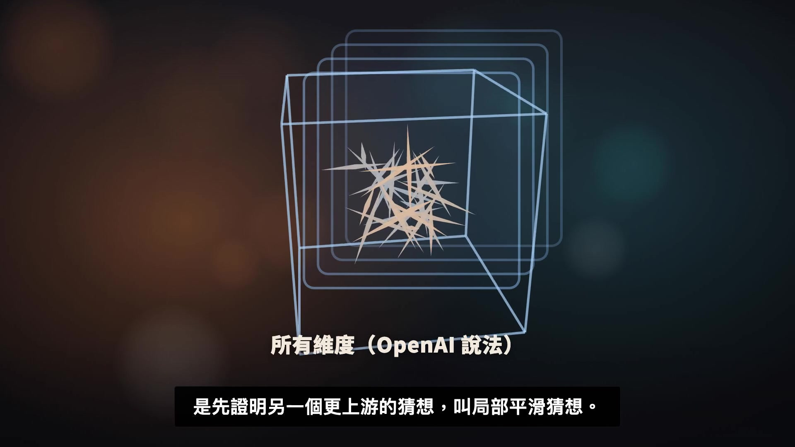

**逐字稿片段：** 更上游的猜想 叫局部平滑猜想 這個猜想講的是波 你用放大鏡把陽光聚成一個亮點 波也會聚焦 可是這個猜想說 最極端的聚焦只能持續很短的時間 平均來看波平順得多 OpenAI說 這個猜想成立 掛股猜想也就跟著成立 這一項的論文和Lean檔案全部公開 Lean也涵蓋了掛股那一部分 可是到我們做這一集為止 還沒有看到這個領域的專家公開評論

**話題推測：** 介绍OpenAI模型证明的“局部平滑猜想”

---

## 00:16:29

**逐字稿片段：** 另一邊是沒有公開的物理那一項

**話題推測：** 开始介绍OpenAI未公开的物理发现

---

## 00:16:32

**逐字稿片段：** 他碰的是Young-Mills理論 這是一類描述基本粒子怎麼互相作用的理論 原子核裡的夸克和膠子靠什麼綁在一起 就用到它 物理學家一直在用它 可是數學家始終沒能證明 它在數學上真的站得住 這件事被克雷數學研究所

**話題推測：** 介绍OpenAI模型触及的“杨-米尔斯理论（Young-Mills理论）”

---

## 00:16:47

**逐字稿片段：** 列為七個千禧年難題之一 這個難題的題目要求兩件事 兩件都要做到 頭一件 證明這個理論在數學上存在

**話題推測：** 指出杨-米尔斯理论是七个千禧年难题之一

---

## 00:16:55

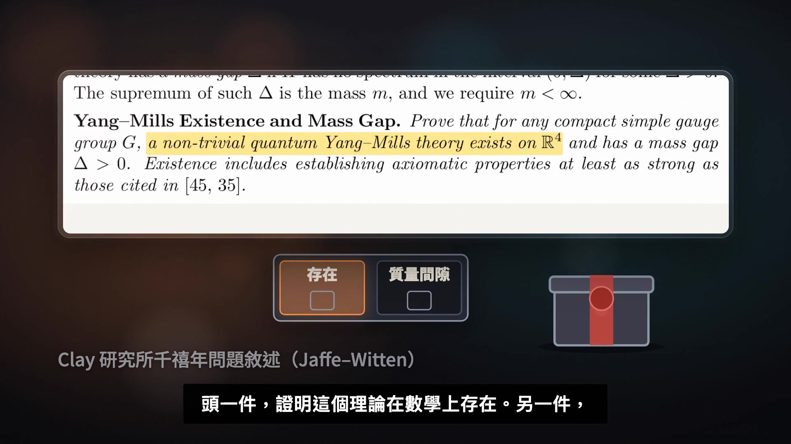

**逐字稿片段：** 另一件 證明它有質量間隙 質量間隙的意思是 這個理論裡最輕的那種粒子 質量也不是零 你可以想成一家店 就算是最便宜的商品 也有一個大於零的價錢 OpenAI的公告說 它證明了存在 範圍還包括描述

**話題推測：** 介绍杨-米尔斯理论的“质量间隙”问题

---

## 00:17:10

**逐字稿片段：** 強作用力的量子色動力學 英文說寫QCD 可是整篇公告 沒有提到質量間隙 所以就算它全部都對 也不是解決了千禧年難題 最多是其中存在的那一半 至於存在是在什麼意義下成立 在多大的空間裡成立 材料沒有公開 外面的人也沒辦法判斷 物理那一項 由2004年諾貝爾物理學獎得主

**話題推測：** 提到OpenAI证明范围包括量子色动力学（QCD）

---

## 00:17:31

**逐字稿片段：** David Gross帶領一個小組 小組決定先不公開AI的產出 自己重新寫 OpenAI說

**話題推測：** 指出诺贝尔物理学奖得主David Gross带领物理小组

---

## 00:17:36

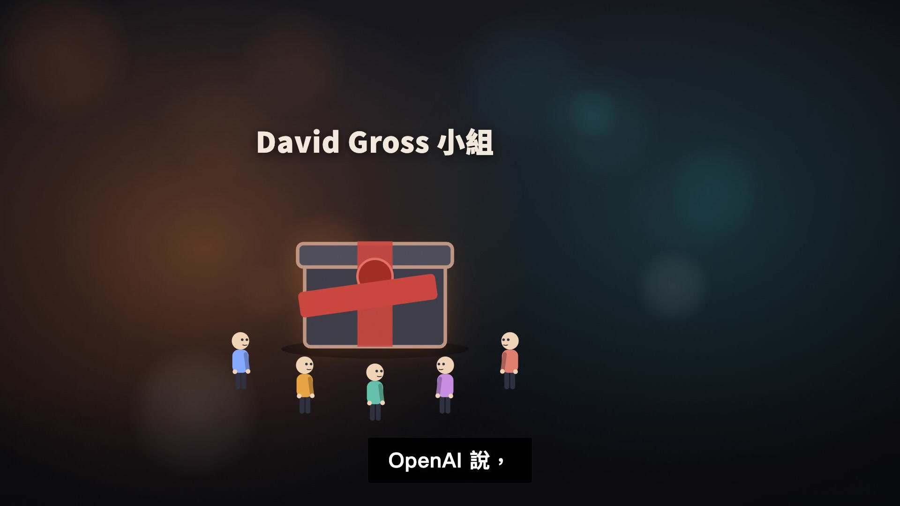

**逐字稿片段：** Young Mills存在性的令檢查在10月16日完成 可是我們看了公開的檔案庫 目前沒有看到這一部分的令檔案 這裡有一個很巧的地方 當年寫下這個千禧年難題題目的是兩個人

**話題推測：** 杨-米尔斯理论存在性Lean检查完成的日期

---

## 00:17:48

**逐字稿片段：** Arthur Jaffe和Edward Witten Jaffe在Gross的小組裡 Witten在外面 他是一個數學家顧問小組AGMAI的成員 AGMAI在公告當天發了聲明 呼籲OpenAI立刻公開Young Mills和QCD證明背後的文字和令檔案 還說已經沒有任何科學上的理由在託

**話題推測：** 提到千禧年难题的提出者Arthur Jaffe和Edward Witten

---

## 00:18:04

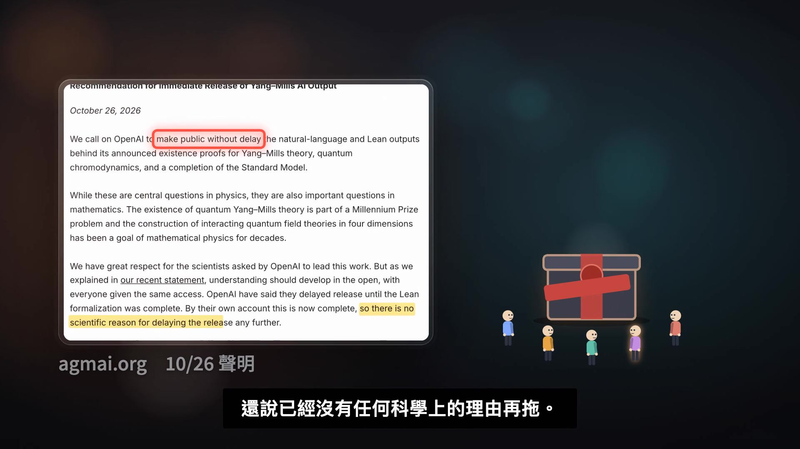

**逐字稿片段：** 哥倫比亞大學數學系的Peter Voigt在部落格寫 很難知道他們到底宣稱證明了什麼 他猜 媒體質量間隙 也許只是在很小的空間裡成立 如果是這樣卻沒講清楚 他覺得是刻意誤導 還有一個時間上的巧合 就在公告前一天 AGMAI才發文建議 AI公司以後不要再指定數學家當窗口 因為被指定的人 名字最後會變成替發佈背書 把三項放在一起看 差別就清楚了 電腦科學那一項 材料全部公開 又有提出者帶頭 公佈不到一天 就有人開始讀標籤 準備從頭再形式化一次 網路上也有好幾百則討論 數學那一項 材料一樣全部公開 只是還在等那個領域的人 坐下來讀 物理那一項 外面的人連盒子都看不到 能做的只有要求打開 所以公開的越多 檢查就能越早開始 可是公開只是開始 要有人真的去讀 檢查才會發生 OpenAI自己在公告裡也承認 先指定誰來帶頭 會影響誰先參與 也會造成資訊不對等 這三種方式哪一種最好 現在還沒有答案 OpenAI說它在做實驗 不過有一件事很清楚 一個沒有人能看到的證明 再重要 現在也只能算是一個說法

**話題推測：** 引用Peter Voigt在部落格的评论

---

## 00:19:11

**逐字稿片段：** 回到開場的問題 一個AI說它推翻了大家相信的假說 誰來確認 答案是 還沒有人確認 現在的狀態是宣稱加上檢查中 對錯可能要好幾個月才會比較清楚 那我們這些不是專家的人 能做什麼 下一次你看到 AI證明了某某難題的新聞

**話題推測：** 回到开场问题，总结AI证明的确认状态

---

## 00:19:30

**逐字稿片段：** 可以先問四件事 頭一件 材料公開了沒有 只有公告沒有論文就先當成說法 再來檢查的人說了什麼 注意他們用的是已經確認 還是像Williams那樣用聲稱的 第三 電腦檢查涵蓋到哪裡 箱子過了機器 標籤有沒有人讀過 最後 宣稱的範圍講清楚了沒有 像Yang Mills那一項 題目要兩件事 公告只講了一件 拿著四件事回頭看這三項 ETH那一項 四件事都有答案 只差標籤讀完 掛鼓那一項 材料齊了還在等人 物理那一項 大部分的問題現在都還沒有答案 這一集

**話題推測：** 提出评估AI证明新闻的四个问题清单

---

## 00:20:05

**逐字稿片段：** 我們從指數時間假說是什麼講起 看了OpenAI宣稱了什麼 誰在檢查 用什麼檢查 最後看了同一天三項發現 為什麼公開的方式不一樣 指數時間假說是不是真的錯了 現在還沒有答案 不過檢查它的人 檢查的工具 還有全部的材料 都已經擺在大家面前 接下來就看檢查的結果

**話題推測：** 最终回顾本集讨论的主要内容

---

## 00:20:24

**逐字稿片段：** 最後問你一個問題 如果一個重大發現的證明 暫時只有少數專家看得到 你覺得應該先公開給所有人 還是先讓專家寫清楚再說 留言告訴我 喜歡的話訂閱AINogook 開啟通知 我們下次見

**話題推測：** 向观众提问关于重大发现公开方式的看法

---
