# jimainotebook_isg7QLLNxt4 — 關鍵畫面索引

- 來源逐字稿：[jimainotebook_isg7QLLNxt4_FIN.srt](jimainotebook_isg7QLLNxt4_FIN.srt)
- 影片：https://www.youtube.com/watch?v=isg7QLLNxt4
- 截圖數：57

## 00:00:54

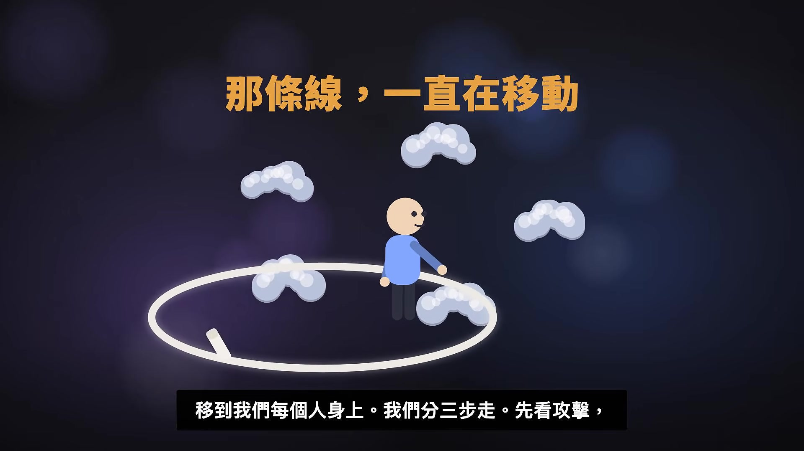

**逐字稿片段：** 我們分三步走 先看攻擊 一個人為什麼會出手 再問 如果把身體的零件 都研究清楚 能不能算出一個人 會怎麼做 最後看語言 看思覺失調症 看人跟人之間的不一樣 問正常跟不正常的線 到底畫在哪裡

**話題推測：** 介紹本集的三個主要討論部分。

---

## 00:01:08

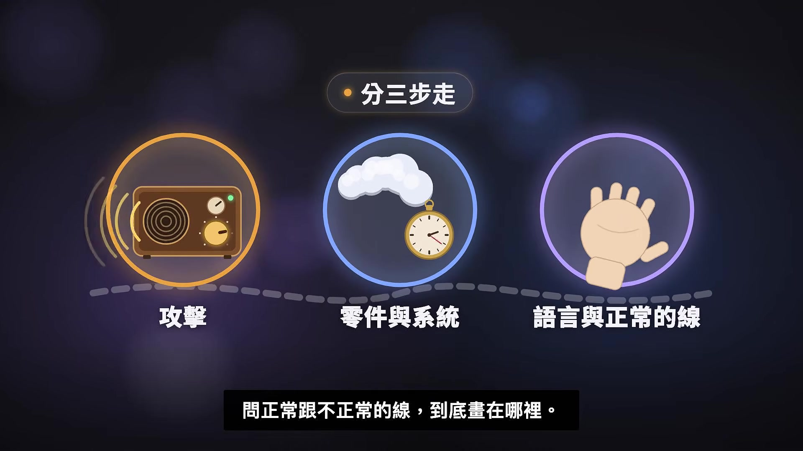

**逐字稿片段：** 還記得上集開場 那個40歲的男人嗎 他打了同事 接著外遇 接著捲款消失 上甲子說 這可能是某一種神經疾病的樣子 名字一直沒講 最後一堂課 Saposky說出了那個名字 我們留到最後

**話題推測：** 回顧上集提到的案例，可能顯示相關圖片或文字。

---

## 00:01:20

**逐字稿片段：** 先從兩堆巧克力開始 這是一個很簡單的測驗 你一隻手放五顆巧克力 另一隻手放一顆 規則是 對方伸手拿五顆的那一邊 你就把手縮回去 只給他一顆 他要是伸手拿一顆的那一邊 你就給他五顆 所以划算的做法是去拿那一顆 大部分的大人試幾次就懂了 可是有一種病人 怎麼試都學不會 他們是大腦前面受過傷的人

**話題推測：** 引入新的實驗案例，可能伴隨巧克力圖示或實驗流程圖。

---

## 00:01:40

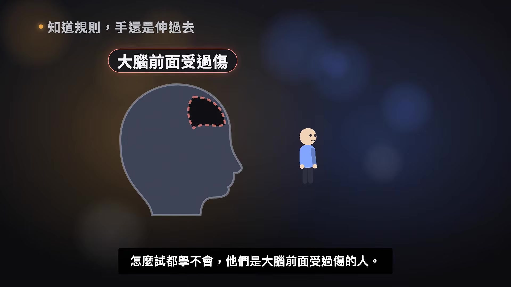

**逐字稿片段：** 大腦最前面這一塊 叫前額葉皮質 英文是prefrontal cortex 後面我就叫他額葉 他在做什麼 Sapolsky用一句話形容 當你面前有一件比較容易的事 跟一件比較難 可是比較對的事 額葉就是讓你去做 比較難的那一件的區域 這裡最讓人意外的是 是這些額葉受傷的病人 能把規則講給你聽 他們會說 我知道你想做什麼 我要是拿五顆 就只會拿到一顆 所以我應該去拿 然後手就伸向五顆 知道規則 跟照著規則做 在大腦裡是兩件事

**話題推測：** 介紹「前額葉皮質」這一大腦區域，可能顯示大腦解剖圖。

---

## 00:02:08

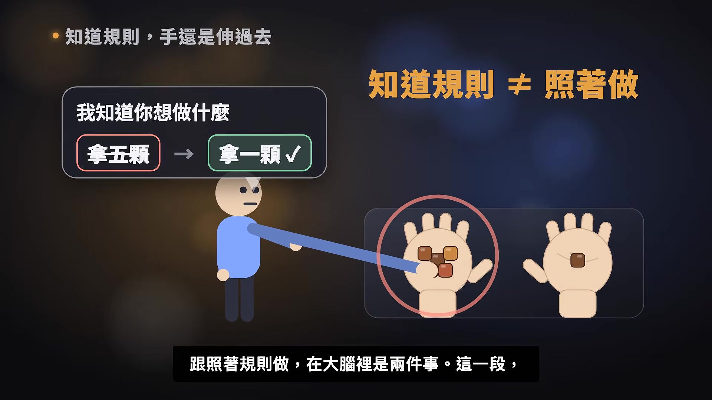

**逐字稿片段：** 這一段聽Sapolsky 自己怎麼說 They can verbalize the rule right there 他們知道對與錯的差別 這不是知道規則的有機的障礙 這是有機的障礙 知道跟做到是兩件事

**話題推測：** 影片切換到Sapolsky教授的授課片段。

---

## 00:02:40

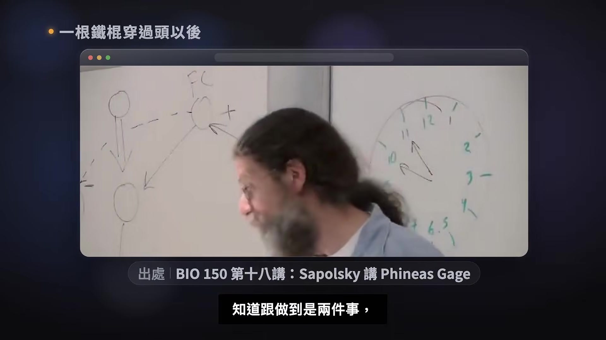

**逐字稿片段：** 神經科學最有名的一位病人 常常被拿來講這件事 他叫Phineas Gage 1848年 他在美國馮蒙特州帶主工人蓋鐵路 他們要用炸藥炸開岩石 炸藥意外點燃 一公尺多長的鐵棍 從他的左臉頰穿進去 從頭頂飛出來 帶走了一大塊左邊的額葉 他沒有死 還能說話 當時照顧他的醫生寫下 他的個性變了 以前很可靠 後來變得反覆無常 滿口髒話 朋友說 他不再是原來那個Gage Sepolsky 在課堂上 就是照這個版本講的 不過這裡要補一句 後來的研究者回頭查資料 認為這些改變 被講得太誇張了

**話題推測：** 介紹著名病人Phineas Gage的案例，可能顯示其照片或腦部受損圖。

---

## 00:03:15

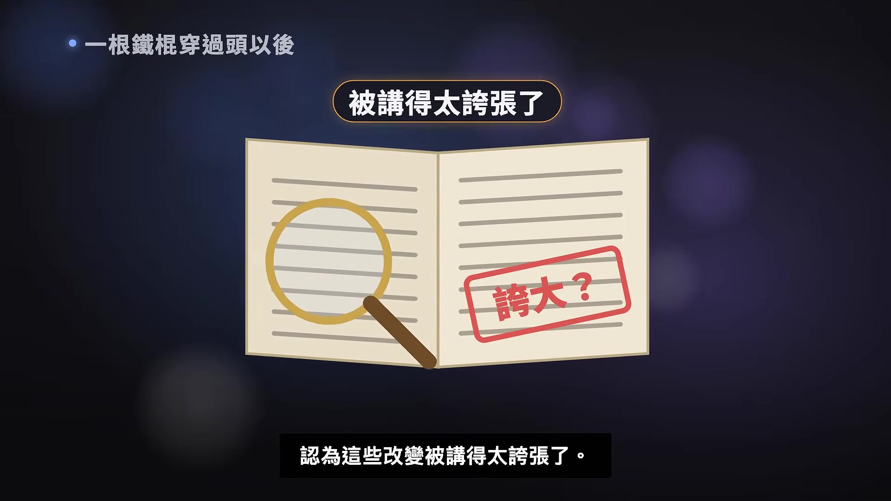

**逐字稿片段：** Gage後來到南美洲的智利 當了好幾年 驛馬車的車伕 那是一份需要可靠 也要會跟乘客 打交道的工作 這反而讓故事更有意思 大腦受了重傷 人會變 可是人也可能慢慢找回一部分的自己 他找回多少 跟他後來過的什麼樣的生活有關 這又是一個如果怎樣就怎樣 等一下還會再出現一次 知道跟做到的差別

**話題推測：** 補充Phineas Gage的後續生活，可能顯示智利地圖或相關歷史圖片。

---

## 00:03:35

**逐字稿片段：** 直接撞上了法律 1843年英國有一個案子 一個叫Daniel Narkin的人想刺殺首相 結果誤殺了首相的秘書 法庭判他因為精神失常無罪 之後英國定下了一套規則 就叫Norton的規則 他問的是 這個人在做的時候 知不知道自己在做什麼 知不知道那是錯的 Sepolsky說 美國大多數的州用的還是這一類的詞

**話題推測：** 將前述神經科學概念與法律問題連結，可能顯示法庭相關圖片或「M'Naghten Rules」文字。

---

## 00:03:55

**逐字稿片段：** 1981年 John Hinckley開槍行刺雷根總統 第二年因為精神失常被判無罪 全國一片譁然 1984年 美國國會通過法律 讓這種抗辯在聯邦法院更難成立 可是你想一下剛才那兩堆巧克力 額葉受傷的人 知道對錯 講得出規則 只是管不住自己 法律的那把尺 量的是知道 量不到做到 Sapolsky再往前推一步 一個人的額葉剩一點點 跟剩很多 中間沒有一條清楚的線 坐在你旁邊的人 惡業裡的廉潔可能就比你多一點或少一點 他認為這是法律最需要改的地方之一 這是他的立場 法律界也有很多不同的聲音 可是他提出的問題是真的要怪一個人 要先問他做不做得到

**話題推測：** 提到John Hinckley刺殺雷根總統案，可能顯示雷根或Hinckley的照片、新聞畫面。

---

## 00:04:31

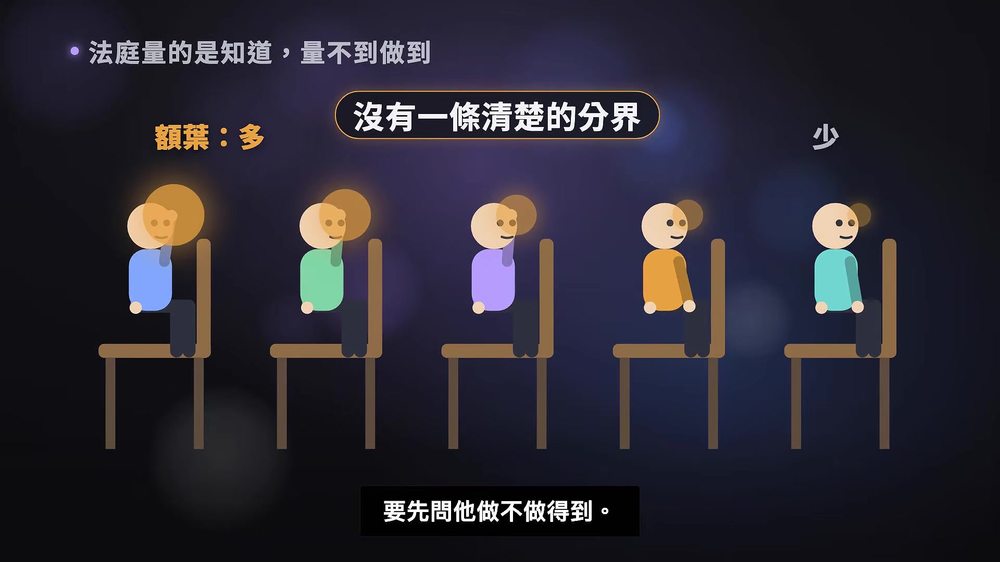

**逐字稿片段：** Sepolsky在課堂上講了兩個 額葉受過傷的人 一個是他自己出庭作證過的案子 這個人六歲出了一場嚴重的車禍 額葉受到很大的損傷 車禍以前沒有任何異常 車禍以後越來越管不住自己 長大以後犯下好幾起殺人案 細節我不多說 那是非常沉重的案子 另一個是他朋友的親戚 他出生的時候難產 醫生用產前一滑 傷到了額葉 他長大以後也一樣管不住自己 他做了什麼呢 每次家族聚會 他就坐到鋼琴前面一直彈 彈到所有人都想吃飯了 他還在彈 損傷差不多 人生差很遠 他在哪裡 Sapolsky的推測是 後面這一位 身在一個很支持他的家庭 有資源 有人照顧 前面那一位幾乎什麼都沒有 這就是上集講的那一句 如果怎樣就怎樣 同一種損傷 放進不同的家庭 長出不一樣的人 這也提醒我們 看到一個額夜受傷的人做了可怕的事 不能反過來說額夜受傷的人都會這樣

**話題推測：** 引入兩個額葉受傷的真實案例，可能以文字或示意圖呈現。

---

## 00:05:20

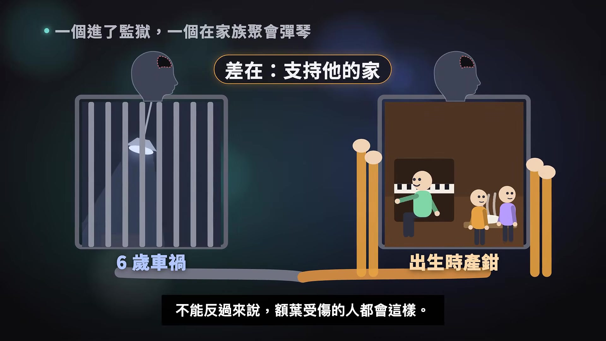

**逐字稿片段：** 聽他自己講鋼琴這一段 這兩個人提醒我們 而也特別吃環境 為什麼 因為它是大腦裡最晚長好的區域

**話題推測：** 影片切換到Sapolsky教授的授課片段。

---

## 00:05:52

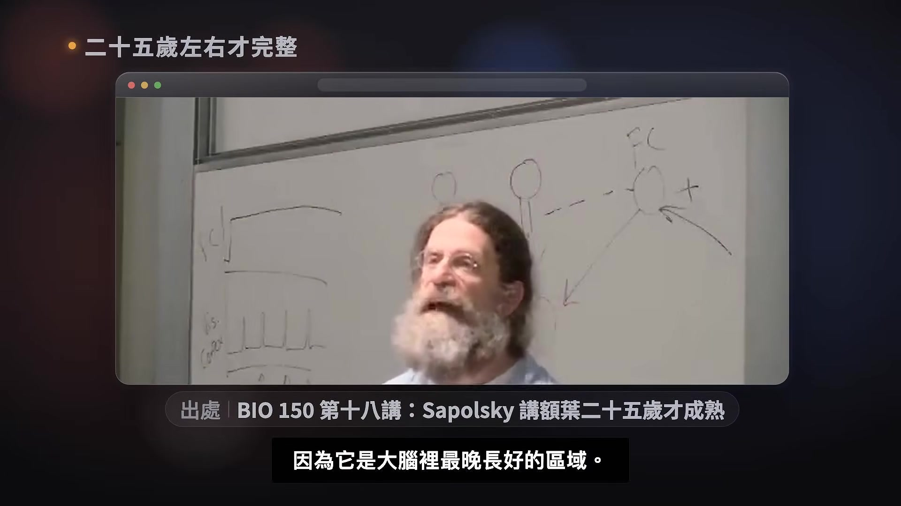

**逐字稿片段：** 神經細胞的長線外面 包著一層像電線外皮的東西 叫髓殼 裂的髓殼 要到25歲左右才算包得差不多 Sapolsky從這裡推出一句很重要的話 一個區域越晚長好 出生的時候基因能替它決定的就越少 它被經驗塑造的時間就越長 而它偏偏是我們最引以為傲 最像人的那一塊

**話題推測：** 介紹「髓殼」這一神經結構，可能顯示神經細胞的顯微圖。

---

## 00:06:10

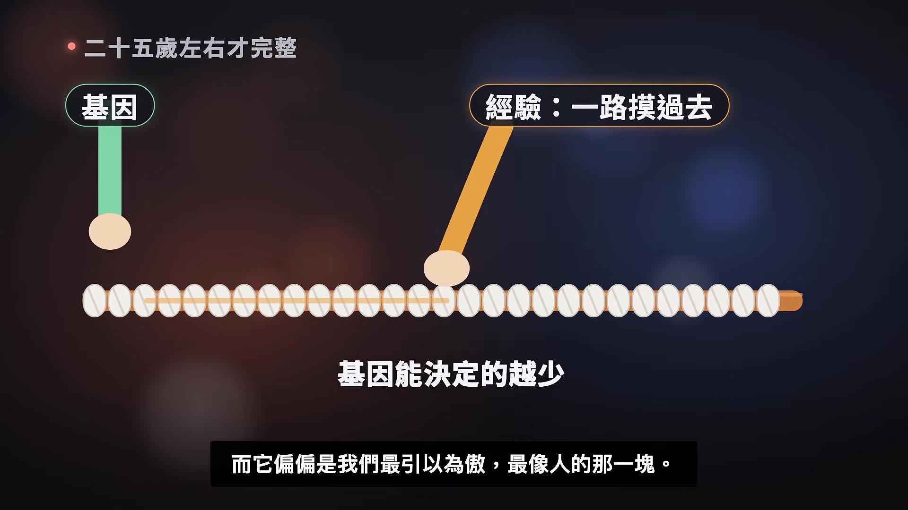

**逐字稿片段：** 青少年的大腦就看得到這件事 他引用的研究發現 同樣拿到比預期大的獎勵 青少年大腦裡靠多巴胺推動的獎勵區 反應比大人大很多 Sapolsky說 這是一個起伏還很大的系統

**話題推測：** 討論青少年大腦的發展特點，可能顯示腦部發展示意圖。

---

## 00:06:22

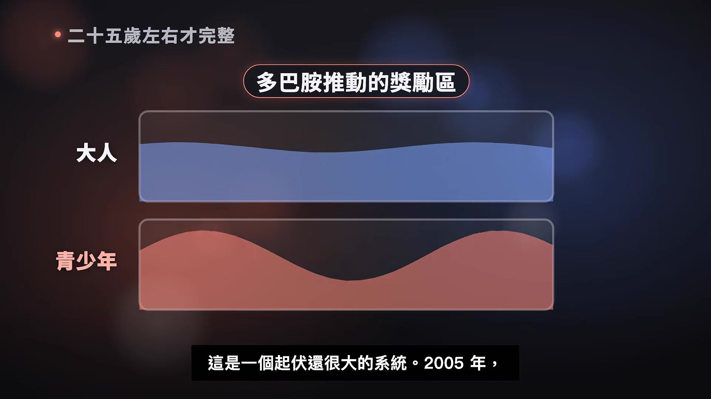

**逐字稿片段：** 2005年 美國最高法院判決 媚滿18歲犯下的罪不能判死刑 理由之一就是青少年還不夠成熟 Sapolsky還提到一件比較沉重的事 有研究發現 5歲左右的孩子 家庭經濟條件不同 額葉的發展就已經看得出差別 研究者懷疑原因之一是壓力荷爾蒙 在動物身上 它會讓額葉神經細胞的分支萎縮 一個最需要經驗去塑造的區域 有些孩子最早碰到的經驗 是窮跟壓力 額葉在前面拉住你 後面有另一個區域在推你

**話題推測：** 提到美國最高法院關於青少年犯罪的判決，可能顯示相關法律條文或新聞畫面。

---

## 00:06:50

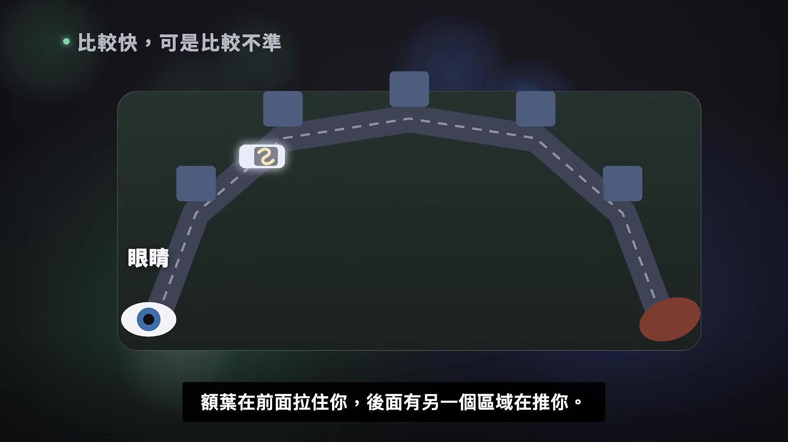

**逐字稿片段：** 中甲講過性人核 大腦裡跟害怕 跟攻擊最有關係的地方 下集多了一個細節 眼睛看到的東西 正常會一層一層送到大腦皮質去處理 最後才判斷 這是一張生氣的臉 在通知性人核 可是還有一條捷徑 從半路分出來 少經過好幾站 就到了性人核 這條捷徑的好處是 快 代價是不準 皮子還在想 這是一個真的東西 還是一張紙 杏仁河已經叫你出手了 Zaposki提到 有證據顯示 創傷後壓力症候群的人 這條捷徑可能特別敏感 一點點相似的聲音畫面 就把人拉回當時的現場 杏仁河跟鵝夜之間 還會互相壓制 一邊活躍 另一邊就比較安靜 人在非常激動的時候 杏仁河可以把鵝夜壓下去 那就是很多人 事後後悔很久的決定 反過來 一個人要學會 不再害怕某個東西 也需要鵝夜幫忙 所以出手的那一秒 常常是這兩個區域在拔河

**話題推測：** 介紹「杏仁核」這一大腦區域及其功能，可能顯示大腦解剖圖。

---

## 00:07:38

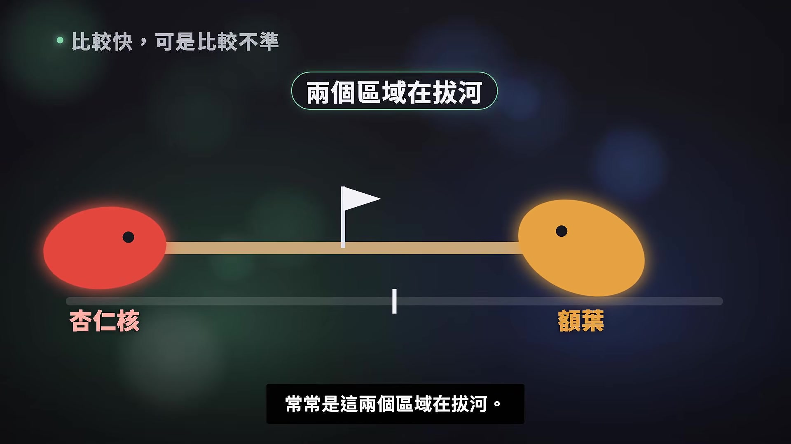

**逐字稿片段：** 那膽固酮呢 很多人以為膽固酮就是攻擊的開關

**話題推測：** 討論睪固酮與攻擊行為的關係，可能顯示化學式或相關圖表。

---

## 00:07:42

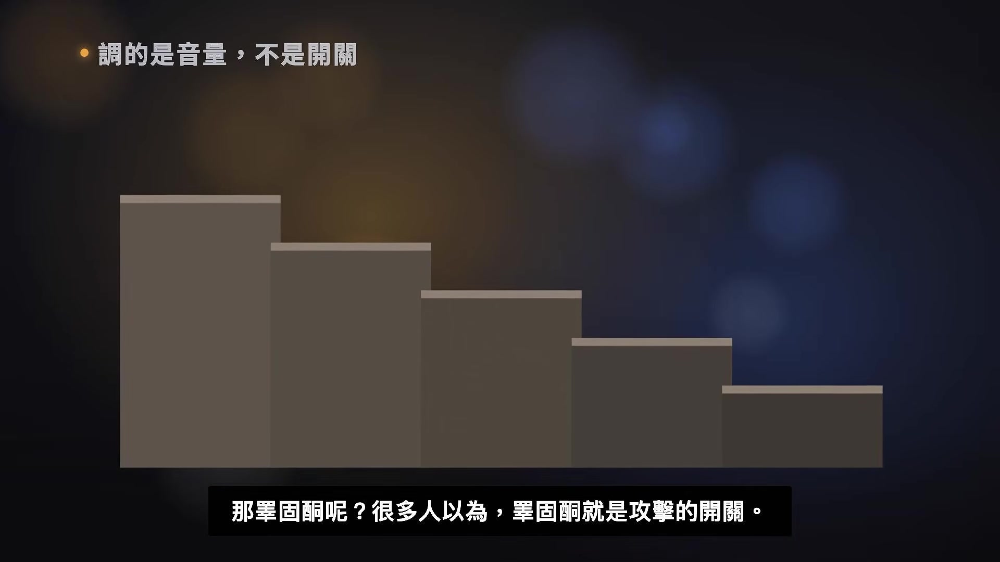

**逐字稿片段：** Seposki講了一個經典的猴子實驗 五隻熊猴關在一起 很快排出地位 一號打得贏其他四隻 二號打得贏三號以下 依此類推 研究的人給三號打大量的寒固酮 三號打架變多了 可是他去打誰 他沒有去挑戰一號跟二號 他是一直去欺負四號跟五號 固固酮沒有改變這群猴子的秩序 它放大了原本就有的秩序 拉到細胞裡看也一樣 團固酮 讓性人核的神經細胞 放電之後需要休息的時間變短 可是有一個前提 這個細胞本來就在放電 它本來安靜 固固酮就沒事做 中甲用過音量旋鈕的比喻 Sapolsky在這裡也用收音機來講 這個比喻的意思是 團固酮不負責打開收音機 也不負責選歌 它只把正在播的那首歌調大聲 比喻的界限也要說清楚 正常範圍裡的高高低低 大腦分不太出來 濫用類固醇高到遠超過正常的量 又是另一回事

**話題推測：** 介紹關於猴子睪固酮實驗，可能顯示猴子的圖片或社會階級示意圖。

---

## 00:08:32

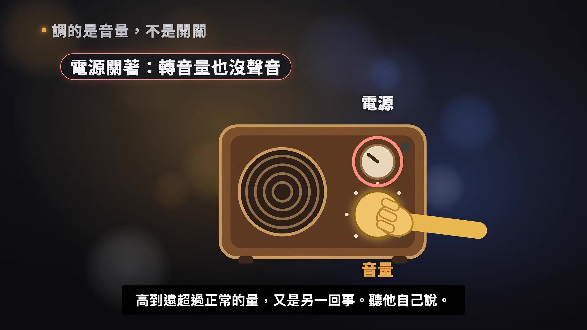

**逐字稿片段：** 聽他自己說 Sapolsky接著說 這臺收音機的規則 在攻擊這個題目裡會一直出現

**話題推測：** 影片切換到Sapolsky教授的授課片段。

---

## 00:08:59

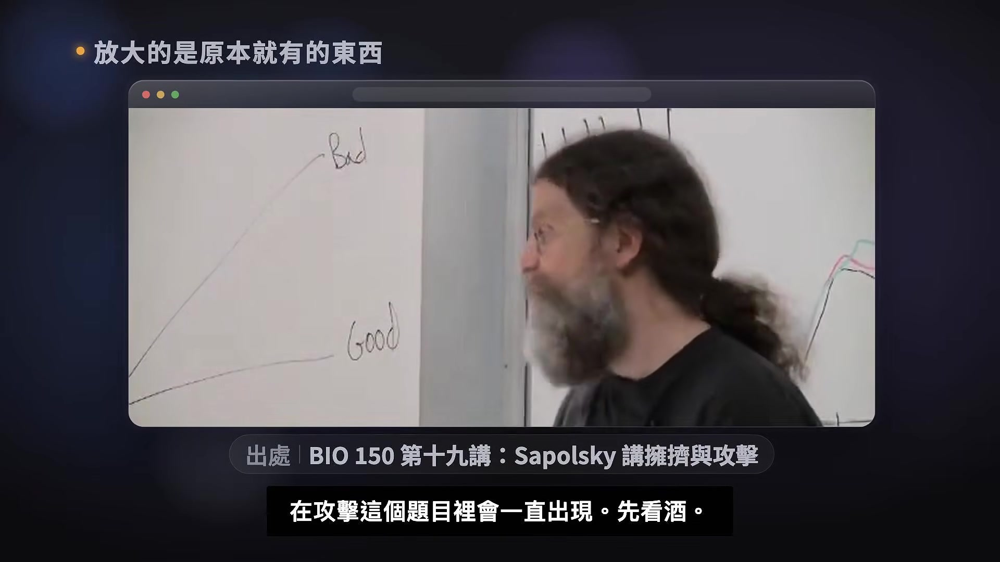

**逐字稿片段：** 先看酒 大家都覺得喝了酒 人會變兇 把很多實驗放在一起看 酒確實會讓人比較容易動手 可是效果很看人 也看情境 原本就容易動手的人 或是被激怒的時候 效果最大 塞波斯基亞提到 有實驗告訴受試者 他已經喝了酒 其實沒有 這些人也變得比較衝 不過後來的整理發現 光是以為自己喝了 效果並不穩定 酒比較像是 把本來就有的東西放出來

**話題推測：** 討論酒精對攻擊性的影響，可能顯示酒瓶或相關數據圖表。

---

## 00:09:23

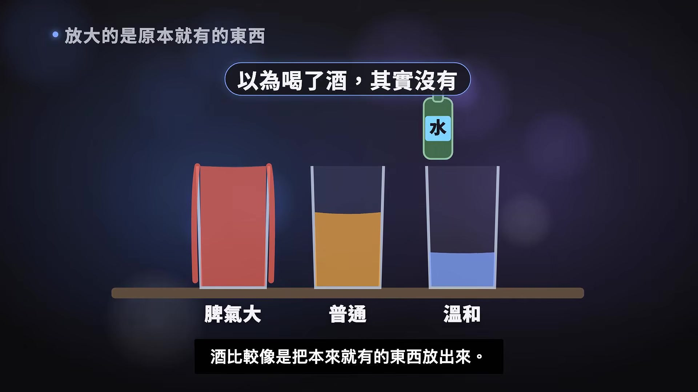

**逐字稿片段：** 再看疼痛跟挫折 一隻老鼠被電到 或是按了14桿子 卻沒拿到食物 很容易轉身去咬旁邊的老鼠 這叫轉架的攻擊 更讓人難過的是 咬完以後 他的壓力荷爾蒙會下降 把氣除在別人身上 對自己真的有用 這在很多物種身上都看得到

**話題推測：** 討論疼痛和挫折與攻擊性的關係，可能顯示動物實驗圖。

---

## 00:09:39

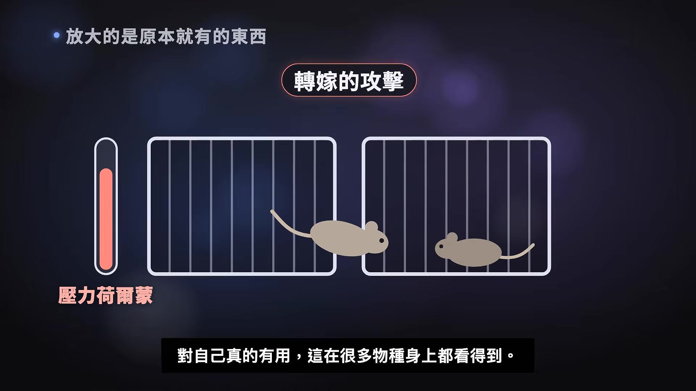

**逐字稿片段：** 最後是擁擠 1960年代初 心理學家John Calhoun 讓老鼠在一個圍起來的空間裡 越深越多 擠到很密 報告說攻擊暴增 很多年都被拿來警告 都市的擁擠 Zaposki說 後來的人仔細算 平均的攻擊次數沒有增加 增加的是 本來就兇得更兇 本來弱勢得更退縮 酒 疼痛 擁擠 三件事的答案一樣 他們很少憑空製造攻擊 他們把原本就在的那個傾向跳大聲

**話題推測：** 討論擁擠對攻擊性的影響，可能顯示密閉空間中的動物群體。

---

## 00:10:05

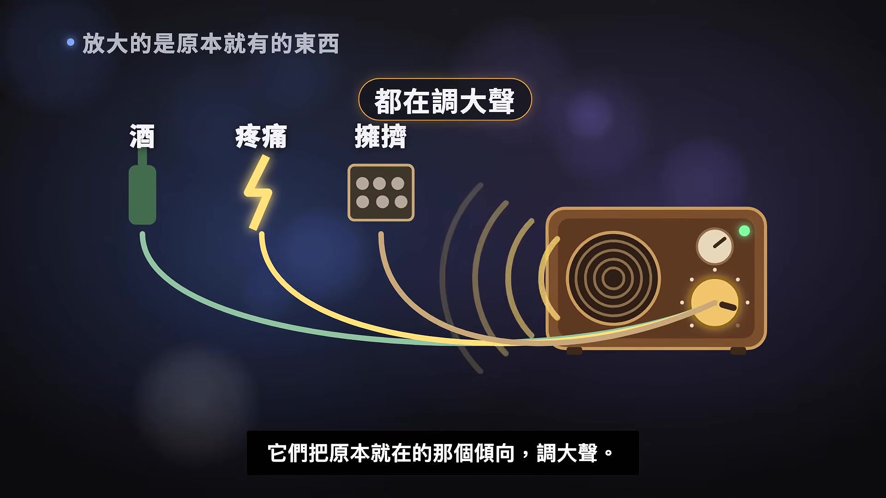

**逐字稿片段：** 有一個人的看法 剛好跟這臺收音機相反 Conrad Lorenz 動物行為學的三位主師也之一 終甲提過他 1960年代他寫了一本很暢銷的書 叫《論攻擊》 他用一個有名的模型來講攻擊 畫出來很像一個馬桶水箱 他說 攻擊的衝動 像水箱裡的水 灰質慢慢漲 水越高 越小的刺激就能讓他流出來 水滿了 就會自己溢出來 打一架你把水放掉之後會平靜一陣子 照這個模型 攻擊是天生的 每個人都有 始早要發洩 Sapolsky只用了幾句話回應 他問全班 你們有多少人殺過人 大部分的人 國中以後就沒跟人打過架了 所以攻擊不是每個人身上都有的一匙水 而且攻擊不會越打越少 他常常越打越多 球場上有人開始打架 整個看臺會跟著打起來 打過一次下一次更容易 Sapolsky也提醒大家 Lorenz在1938年加入過納粹黨 他對這段歷史很不客氣 不管怎麼評價這個人 這個水箱模型畫錯了 供給不像一池需要放掉的水 它比較像一條越走越順的路 如果供給不是天生的一池水 那環境怎麼調它

**話題推測：** 介紹動物行為學家Conrad Lorenz及其攻擊模型，可能顯示水箱模型圖。

---

## 00:11:02

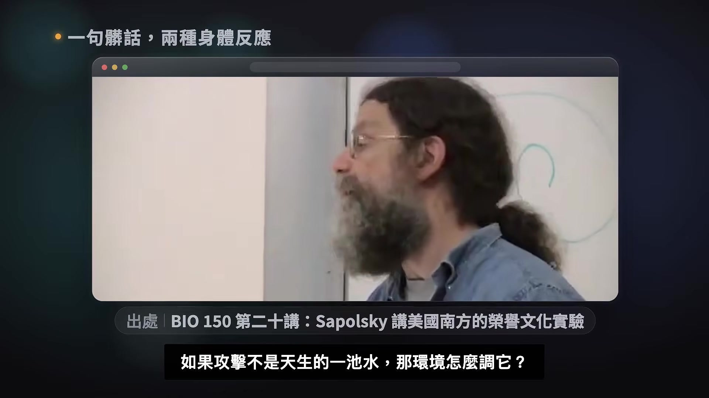

**逐字稿片段：** Zaposki講了一個很有名的實驗 1996年 密西根大學的心理學家Richard Nisbet 跟同事找來一群男大學生 有的在美國南方長大 有的在北方長大 受試者走在一條窄窄的走廊上 一位研究人員迎面撞了他的肩膀 罵他一句髒話 然後走開 接著研究人量了他們的身體 北方長大的人有點不高興 很快就過去了 南方長大的人 牙利荷爾蒙跟幹固酮都生得比較多 在後面的測驗裡也比較有攻擊性 同一句髒話 身體的反應差很多 研究者把這叫做榮譽文化 意思是在一個很重視民生的地方 被羞辱了不回應 民生就會受損 研究者的解釋是 美國南方早期的移民 很多來自以放牧為生的地區 放牧的人財產會走路 一個晚上就可能被偷光 所以要讓人知道 惹我要付代價 這個來源的解釋 到現在還有爭論 可是這個實驗讓你看到 文化可以一路走進身體 改變一個人的壓力荷爾蒙 跟膽固酮 文化怎麼叫進一個人身上

**話題推測：** 介紹Richard Nisbet的文化與攻擊性實驗，可能顯示美國南北地圖或實驗情境圖。

---

## 00:11:57

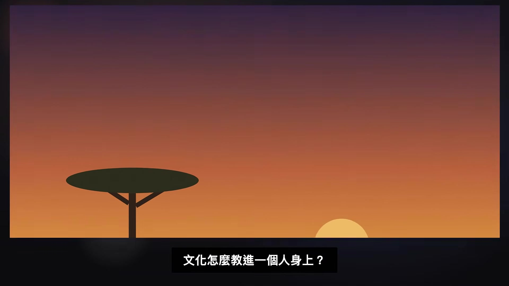

**逐字稿片段：** Zaposki講了一個 他在肯亞親眼看到的畫面 母沸沸之間有地位高低 而且地位是從媽媽那裡繼承的 有一年他觀察的那群沸沸裡 地位最高的一隻母沸沸生了女兒 隔一天 一隻地位很低的母沸沸也生了女兒 兩個寶寶大概一個禮拜大的時候 第一次看到彼此 地位低的那個寶寶很開心 搖搖晃晃走過去 走到只差三步的地方 他媽媽一把抓住他的尾巴 把他拉回來 這個寶寶上了這輩子的第一堂課 那一個你不能隨便靠近 終極講過 童年調的常常不是怎麼做 是什麼時候做 對誰做

**話題推測：** 描述狒狒社群行為觀察，可能顯示狒狒圖片或社群互動示意圖。

---

## 00:12:29

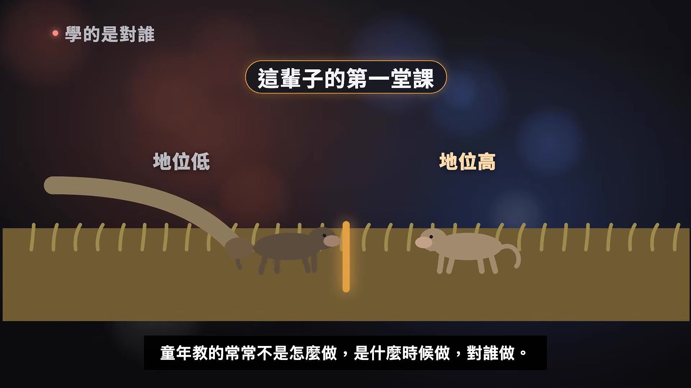

**逐字稿片段：** 心理學家Harry Harlow 把恆河猴隔離養大 這些猴子威脅跟屈服的動作都正常 就是不知道對誰做 他們會去挑釁體型大得多的成年公猴 對其他猴子的反應 也常常找錯對象 動作是天生的 對象是學來的 下面這段

**話題推測：** 提到Harry Harlow的恆河猴實驗，可能顯示小猴與代理母猴的經典圖片。

---

## 00:12:43

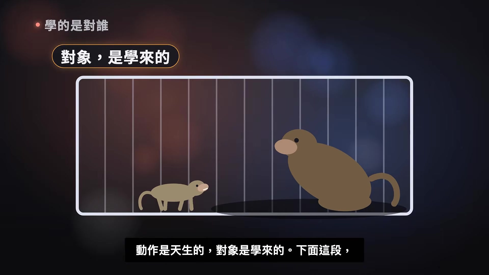

**逐字稿片段：** 是Sepolsky講的那條尾巴 孩子還會學到另一種東西 對錯

**話題推測：** 影片切換到Sapolsky教授的授課片段。

---

## 00:13:10

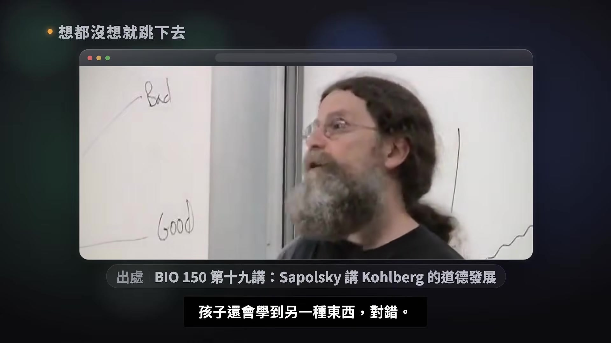

**逐字稿片段：** 心理學家Lawrence Kohlberg 把孩子的道德推理分成三個層次 一開始 做好事是因為怕被罰 或是想拿獎勵 後來是因為大家都這樣 規則就是這樣 再往上 有些人會為了自己相信的原則 去違反規則 這套理論影響很大 也被批評很多 例如早期的研究對象 大多是男生 換到別的文化順序 也不一定一樣 不過Sapolsky想講的是另一件事 一個人在紙上推理得多漂亮 跟他在現場會不會挺身而出 關係並不大 美國有一個專門表揚 建議勇為的基金會 每年頒獎給那些衝進火場 跳進河裡救陌生人的人 有人問他們 你當時在想什麼 Szpulski說 最常聽到的回答是 我沒有想 回過神來 我已經跳下去了 後來有研究分析 這些得獎者的說法 結論也是 大多靠直覺 2009年 哈佛大學的Joshua Green 讓受試者在大腦掃描儀裡 玩一個有機會偷偷作弊的遊戲 會作弊的人 有機會的時候 鵝夜活動得很明顯 像在掙扎 從頭到尾都誠實的人 鵝夜沒有特別的反應 研究者的解讀是 他們不是在抵抗誘惑 那個誘惑對他們來說不太存在 最好的品格 看起來不像額葉在用力 比較像小時候練到 變成習慣的反射 品格可以練成反射

**話題推測：** 介紹Lawrence Kohlberg的道德推理層次理論，可能顯示圖表。

---

## 00:14:16

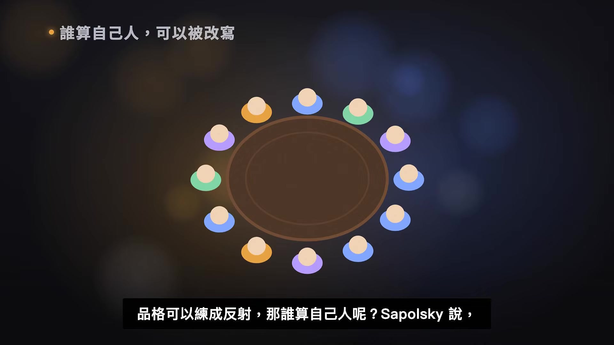

**逐字稿片段：** 那誰算自己人呢 Sapolsky說 人很會把不是親戚的人 當成親戚 軍隊的訓練 有的一大部分就在做這件事 讓一群陌生人 變成願意為彼此犧牲的兄弟 這叫擬親屬 意思是像親屬一樣的關係 反過來也有 叫擬物種 把另一群人說成不太算人 1994年 盧安達的種族屠殺 廣播裡把被殺的那一群人叫做蟑螂 好消息是 這條線也可以往另一邊推 2005年 普林斯頓大學的Mary Wheeler 跟Susan Fisk 做了一個實驗 受試者在掃描儀裡很快地看人臉 研究的人如果要他們把臉分類 例如判斷這個人 有沒有超過某個年紀 看到另一個族群的臉 性人和比較容易活躍 可是如果先請他們 把這張臉當成一個人來想 例如猜這個人喜歡吃哪一種蔬菜 這個差別就沒有出現 改變的不是社會 只是看照片之前的一個小問題 塞斯波斯基也提到 在多元的社區長大的人 這個反應本來就比較小 所以誰算我們 誰算他們可以被改寫 有時候不需要很大的力氣 更讓人意外的是

**話題推測：** 討論群體認同和「擬親屬」、「擬物種」的概念，可能顯示軍人、人群分類或歷史事件圖片。

---

## 00:15:13

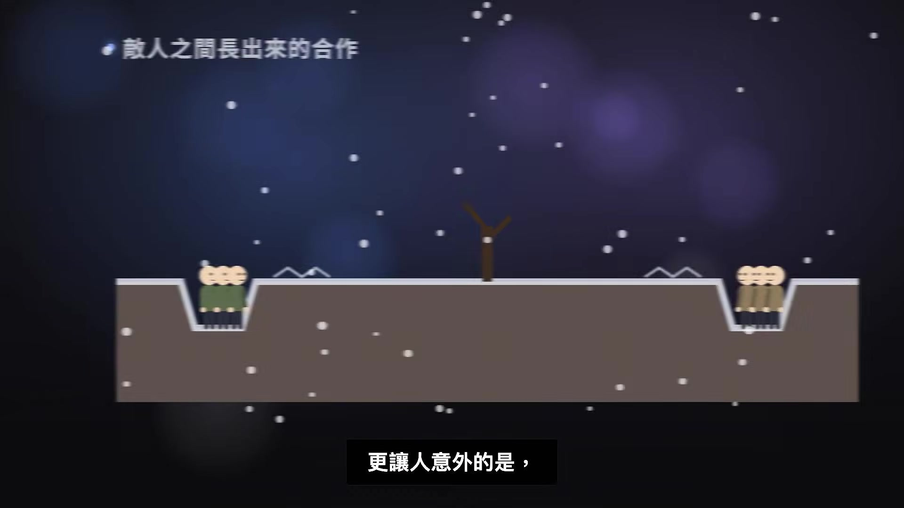

**逐字稿片段：** 合作可以在敵人之間自己長出來 1914年的聖誕節 第一次世界大戰的西線 很多段戰壕自己停火 英國跟德國的士兵走出戰壕 交換香菸 一起埋葬陣亡的戰友 有些地方還踢了足球 這件事很多人聽過 塞斯波斯基更想講的是 是另一件比較少人知道的事 在整場戰爭裡 戰壕兩邊常常長出一種不說破的默契 歷史學家叫他自己活 也讓別人活 沒有將軍 沒有談判 雙方的士兵卻慢慢學會 吃飯的時間不開火 炮彈落在固定的地方 讓對方知道 我打得到你 可是我選擇不打 政治學家Robert Axelrod 把這件事當成一個例子 說明會一直見面的對手之間 合作可以從他面自己長出來 也有學者認為這樣套用不太準確 後來的高層發現了 就一再下令突起對面的戰壕 把這種默契打斷 所以攻擊跟合作 用的常常是同一群人 同一套大腦 差別在他們處在什麼樣的關係裡

**話題推測：** 講述第一次世界大戰聖誕停火的歷史事件，可能顯示戰爭場景或士兵交換禮物的圖片。

---

## 00:16:05

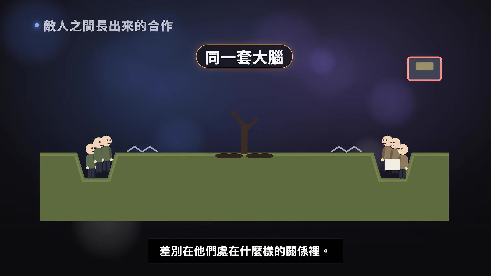

**逐字稿片段：** 聽 Sapolsky 講炮兵怎麼傳話 你對另一邊的溝通如何 這傢伙真是好人 我們選擇不把飛彈放在你身上 你會做什麼

**話題推測：** 影片切換到Sapolsky教授的授課片段。

---

## 00:16:37

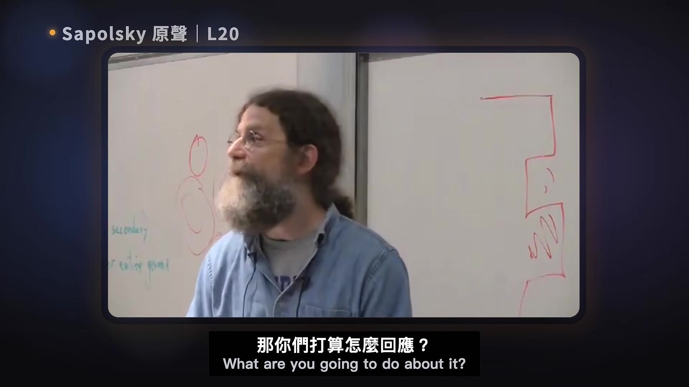

**逐字稿片段：** 講完攻擊的最後 塞波斯基講了一件很私人的事 1979年春天 坦桑尼亞的軍隊 推翻了烏幹達的獨裁者艾迪阿敏 那一年他20歲出頭 在肯尼亞做研究 跑進烏幹達想親眼看看歷史 回程前他到了尼羅河的源頭 從橋上往下看 看到一個烏幹達士兵的遺體 被綁在水邊 已經在那裡好幾天了 他站在那裡一個多小時 他一下想他活該 他替他命做事 一下又想他可能只是被逼的 一下想靠近看清楚 一下又想逃得越遠越好 30多年後 他在課堂上說 他覺得自己每年 把攻擊講得越來越長 就是因為那個人 他說有很多事 大家都同意是壞事 攻擊不一樣 同一個動作 換一個情境 可能讓人拿到勳章 可能讓人被選上 也可能是最可怕的事 這也是為什麼 是他這個人 還是他身上發生的事 這個問題在攻擊 這裡最難回答

**話題推測：** Sapolsky分享個人在烏干達的經歷，可能顯示烏干達地圖或當時的歷史照片。

---

## 00:17:23

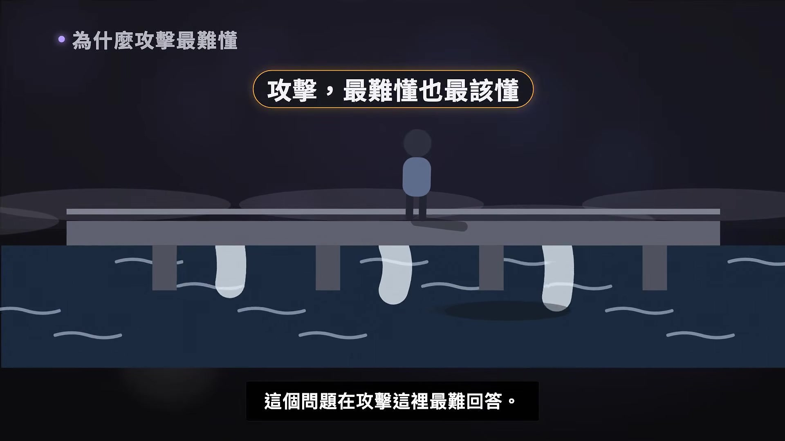

**逐字稿片段：** 下面是他講完這段之後說的話 但攻擊是比較複雜的 因為我們開始的時候 是同樣的行為 而根據途徑 它可以是某個人的獎項 某個人你想與他合作 投票 獎勵 歡迎 加入 而在另一個情況下 是我們最可怕的事情 它是同樣的行為 在所有這些情況下 而是因為這種原因

**話題推測：** 影片切換到Sapolsky教授的授課片段。

---

## 00:18:03

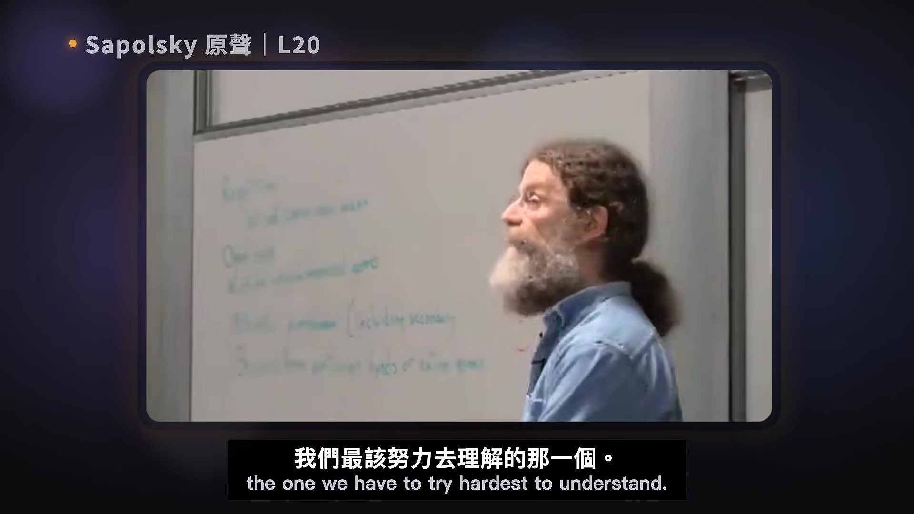

**逐字稿片段：** 我們停一下把攻擊收起來 這部分問的是 一個人為什麼會出手 答案是 很少有一個單獨的開關 三固銅 酒 疼痛 擁擠 大多像收音機的音量 把原本就在的東西調大聲 原本在的是什麼 是童年學到的對象跟時機 是文化教你被羞辱了 要不要回應 是你把誰當成自己人 而真正負責踩剎車的額葉 偏偏是大腦裡最晚長好的區域 最受經驗塑造 也最容易被貧窮跟壓力拖慢 所以回到這一集的問題是 他這個人還是他身上發生的事 在攻擊這裡兩者很難分開 而且分界常常不在你以為的地方 可是這裡冒出一個新的問題 如果我們每一層都是看情況 看原本有什麼 那我們有沒有可能 把每一個零件都研究清楚 最後算出一個人會怎麼做

**話題推測：** 總結第一部分的內容，可能顯示重點整理的文字圖表。

---

## 00:18:45

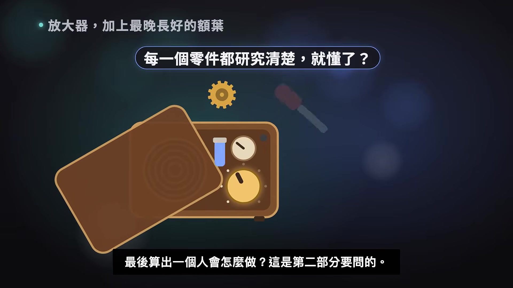

**逐字稿片段：** 這是第二部分要問的 第二部分 Zaposki換了一種很不一樣的課 他自己說 這是整門課最難的幾堂 因為連他也不確定自己全部懂了

**話題推測：** 開始介紹第二部分主題：化約論與複雜系統。

---

## 00:18:53

**逐字稿片段：** 先講一個名詞 化約論 英文是reductionism 它的意思是 想懂一個複雜的東西 就把它分成小零件 把每個零件弄懂再加回去 就懂了整體 過去幾百年的科學 大多是這樣做的 而且非常成功 一個時鐘壞了 你把它打開 找到那顆缺了齒的齒輪 換掉裝回去 時鐘就好了 可是Sapolsky問 如果是一朵雲 乾旱的時候不下雨呢 你把雲分成兩半再分兩半 一路分到一個水分子 把每個分子都弄懂了 加回去 你還是不知道他為什麼不下雲 時鐘跟雲 是Sapolsky自己用的比喻 他的意思是 有些系統可以靠零件解釋 有些系統的行為是零件之間的關係長出來的 他的主張是 生物裡最有意思的那些系統 比較像雲

**話題推測：** 介紹「化約論」這一科學概念，可能顯示文字定義。

---

## 00:19:32

**逐字稿片段：** 不像時鐘 聽他自己講 divide the cloud in half and then get better tools so we can divide each half into half and each half into half and each half into half verse worth of cloud and a gazillion of them we understand how each one of them works and put it together and put it together it doesn't work that way

**話題推測：** 影片切換到Sapolsky教授的授課片段。

---

## 00:20:08

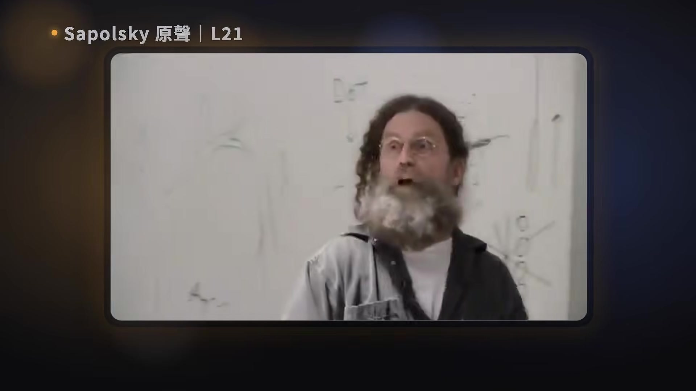

**逐字稿片段：** 華曰論在神經科學有過一次很漂亮的成功 1950到60年代 David Hubel跟Toast and Fizzle 研究貓跟猴子的視覺 他們發現從眼睛進來的訊號 在最早幾站 細胞認的是一個小光點 到了大腦皮質的第一站 有些細胞只認某個角度的一條線 再往後細胞把幾條線組合起來 認更複雜的形狀 一層一層往上 像一座金字塔 他們後來拿了1981年的諾貝爾獎 大家很自然的想 再往上幾層 總會有一個細胞 只認你祖母的臉 旁邊一個 認祖母側臉 這個想法叫祖母細胞 Sepolsky 說問題是 數一下就不對了 每往上一層 需要的細胞數量就多好幾倍 還沒爬到任人臉那一層 大腦的細胞就不夠用了 2005年 研究者在癲癇病人手術前 插的電極裡 確實找到一些很挑的細胞 例如只對某一位 女演員的照片有反應 可是這種細胞很少 大部分複雜的東西 例如一張臉 是很多細胞一起亮出來的 一個圖案 叫神經網絡 答案不在一個零件裡 在零件之間 零件不夠用 在基因上也發生 你身上有很多會分叉的東西 血管從主動脈 一路分叉到眉血管 氣管分成支氣管 再分成更細的小管子 一個神經細胞的束腿 也一直分叉 從整個身體的血管 到血黴鏡下的一個細胞 分叉的樣子看起來很像 這種不管放大縮小 看起來都差不多的形狀

**話題推測：** 介紹Hubel和Wiesel的視覺皮質研究，可能顯示視覺皮層細胞反應示意圖。

---

## 00:21:23

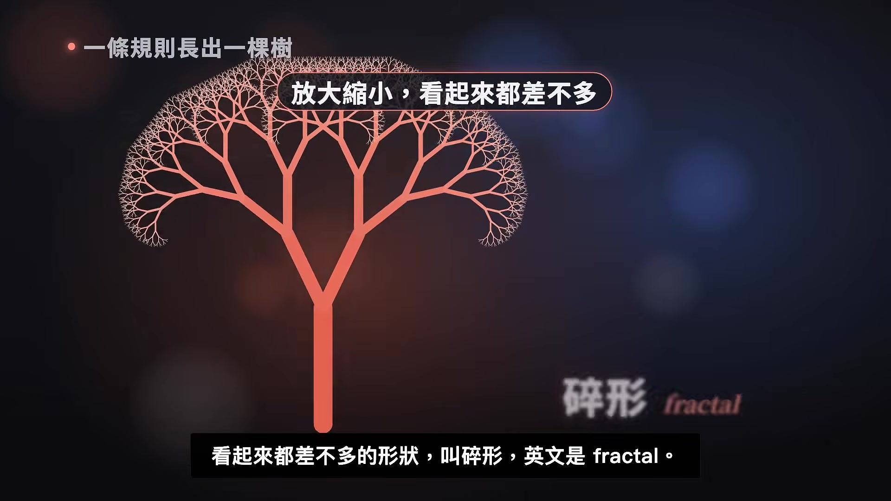

**逐字稿片段：** 叫碎形 英文是fractal 如果每一個分叉點 都要一個基因來指定 能大約有兩萬個基因 數量差太多了 Sapolsky提了一個假想的例子 也許基因說的不是在哪裡分叉 而是一條很簡單的規則 像是管子長到寬度的五倍 同一條規則再用一次 分叉就越來越密 一條規則就能長出血管 長出肺 長出神經細胞的樹 他特別說 這只是用來想象的例子 真實的機制複雜得多 可是方向很清楚 身體不需要一張 畫好每一根血管的藍圖 它需要幾條 會一直重複使用的規則 藍圖這兩個字 等一下還會回來 規則簡單 結果卻可能算不出來

**話題推測：** 介紹「碎形」這一數學/自然現象概念，可能顯示碎形圖案或生物分叉結構圖。

---

## 00:22:00

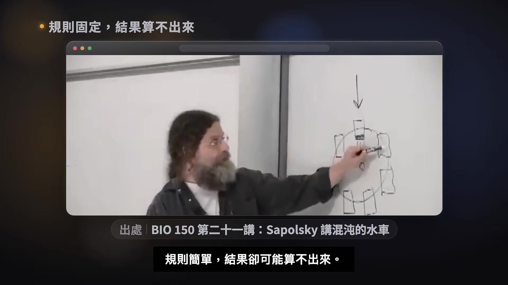

**逐字稿片段：** 這是混沌理論在講的 Sapolsky要全班讀一本書 James Glick寫的《混沌》 書裡有一個水車 水車上掛著底部有洞的水桶 上面一直倒水 水不多的時候 水車慢慢往一個方向轉 你可以算出它很久以後在做什麼 水加大 它開始左轉幾圈 右轉幾圈 還是有規律 再加大 到了某一個點 它的轉法就再也不重複 每一步都照著同樣的物理規則 可是你沒辦法跳著算 只能一步一步跑下去 更麻煩的是 兩個起點只差一點點 例如小樹點後面很多位的差別 跑一陣子以後 結果會差很遠 這叫蝴蝶效應 動物身上也看得到

**話題推測：** 介紹「混沌理論」及其核心概念，可能顯示混沌系統示意圖。

---

## 00:22:33

**逐字稿片段：** 研究者Ivan Chase 把四條魚放在一起 等他們排好地位 再分開兩個禮拜 然後放回同一個魚缸 同樣四條魚 第二次排出來的順序 只有大約四分之一 跟第一次一模一樣 Sapolsky的解釋是 誰剛好轉頭 沒看到誰贏了誰 就改變了結果 差一點點會被放大 這句話等一下會變得很重要 如果差一點點會被放大 那我們平常怎麼看 人跟人之間的差異 傳統的想法是 差異是雜訊 大量體溫 數字都不一樣 那是量得不夠準 工具越精密看得越細 雜訊就越小 最後就看到真正的那個答案 1990年代 Sapolsky跟一位大學部的學生 做了一件很費工的事 他們把十年前某一年發表的 所有跟灌顧同和行為有關的論文都找出來 從比較不同社會的人類學研究 一路到研究單一分子結構的研究 學生拿著尺 一張圖一張圖量物差有多大 量了三年多 如果傳統的想法是對的 越往分子那一層 數據的變異應該越小 結果沒有變小 每一層都差不多 只看被引用最多的好論文 也一樣 這篇論文1996年發表 他說 投稿的時候好多期刊的編輯都回信說 很有意思 可是跟我們這一行沒有關係 Sapolsky的結論是 在這種系統裡 差異不是你沒量好 差異就是系統本身 沒有一個標準的人 大家都只是在旁邊騙了一點 而那個中間的標準 本來就是平均出來的 差異不是雜訊 那秩序是從哪裡來的 Sapolsky的答案是一個名詞

**話題推測：** 介紹Ivan Chase的魚群社會地位實驗，可能顯示魚缸或魚群互動示意圖。

---

## 00:23:52

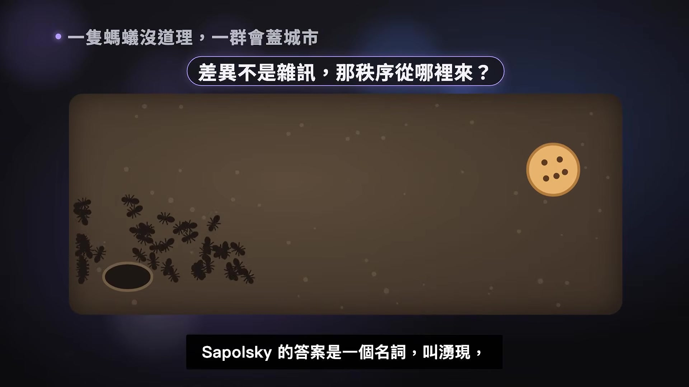

**逐字稿片段：** 叫湧現 英文是emergence 意思是很多很簡單的單位 照著幾條很簡單的規則 跟身邊的鄰居互動 整體就長出一個 沒有人設計過的複雜秩序 最好的例子是螞蟻 螞蟻出去找食物 會在路上留下一種氣味 叫費洛蒙 路越短 同樣多的氣味撲得越濃 也留得越久 後面隨便亂走的螞蟻 就越容易碰到它 跟上去 再留下自己的氣味 跑久了 最短的那條路自己浮出來 沒有一隻螞蟻知道哪條路最短 也沒有一隻螞蟻在下命令 大腦的線路也用類似的辦法長出來 胚胎的大腦裡先長出一批細胞 拉成長長的指甲 後來的神經細胞沿著指甲爬上去 再跟別的細胞接起來 沒有一張畫每一條線的藍圖 就是先後兩批細胞 跟幾條簡單的規則

**話題推測：** 介紹「湧現」這一複雜系統概念，可能顯示文字定義。

---

## 00:24:34

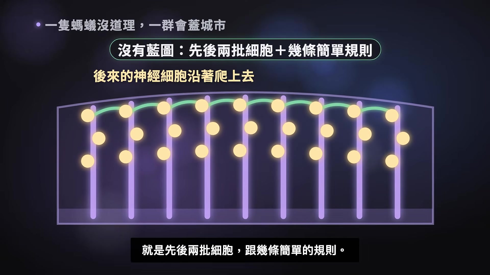

**逐字稿片段：** 這段聽Sapolsky自己講螞蟻 1,000 ants or so they suddenly start making sense and suddenly you suddenly have a colony that can grow fungi and all these things 永線還說了一件跟我們有關的事 在顯微鏡底下果蠅的一個神經細胞 跟人的一個神經細胞 看起來差不多 用來傳訊號的化學物質 很多也一樣 人不是靠發明一種全新的細胞 才變成人的 差別很大一部分在數量 人跟黑猩猩的基因比起來 跟大腦有關的差異不算多 Sapolsky說 其中有幾個 跟神經細胞在發育的時候 要分裂幾輪有關 人多分裂幾輪 細胞就多了很多 這部分的細節還在研究 可是數量很重要 這個大方向 很多研究者都同意 Sapolsky引用了一句話 數量夠多 就會長出新的性質 一隻螞蟻 沒有道理 一大群螞蟻會腫菌 會調節一窩的溫度 將近1000億個神經細胞 加上簡單的規則 長出了語言音樂 還有這門課 他還提到幾個跟直覺相反的地方 在這種系統裡 零件越簡單越好 鄰居之間的互動 比遠方的指定重要 而一點點隨機 反而幫系統找到比較好的路 這也說明了 為什麼差一點點的起點 會長成很不一樣的人

**話題推測：** 影片切換到Sapolsky教授的授課片段。

---

## 00:26:04

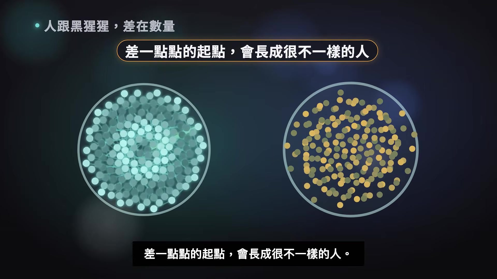

**逐字稿片段：** 我們再停一下 第二部分問的是 把零件都研究清楚 能不能算出一個人 答案是很難 不是因為科學家不夠努力 是因為人比較像雲不像時鐘 零件不夠用 所以大腦跟身體用的是網路 跟幾條會一直重複的簡單規則 起點差一點點會被放大 差異也不是雜訊 它就是系統本身 把這個答案接回第一部分 第一部分說 身體裡的很多東西是放大器 放大原本就在的傾向 第一部分說 原本就在的那一點點差別 本來就會被系統放大 兩個放在一起 你就比較能理解 為什麼基因幾乎一樣的 同卵雙胞胎 也會長成不同的人 為什麼額葉傷的差不多兩個人 一個在監獄 一個在彈鋼琴 所以第三部分要問的 就是這一集最直接的那一題 既然每個人都不一樣 那正常跟不正常的線 要畫在哪裡

**話題推測：** 總結第二部分的內容，可能顯示重點整理的文字圖表。

---

## 00:26:47

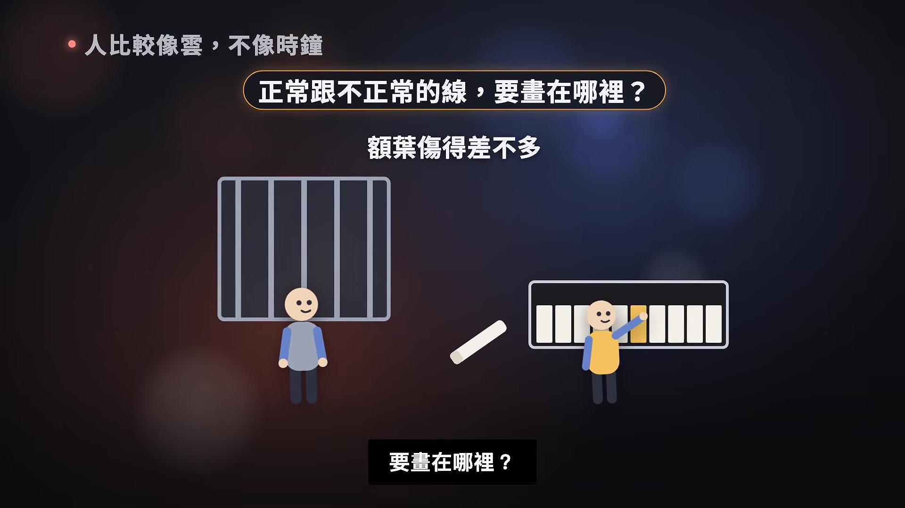

**逐字稿片段：** Sapolsky從語言開始 地球上有好幾千種語言 它們有一些共同的地方 每一種語言 都能把畫一層一層包起來 你說了一句話 前面加一句 他說再加一句 他說他說 可以一直加下去 每一種語言都能講 不在眼前的事 昨天的事 地球另一邊的事 沒有發生過的事 手語也有這些 用美國手語長大的龍人 看別人打手語的時候 大腦裡原本處理聲音的區域也會活躍 從小看手語長大的龍寶寶 在差不多的年紀 會用手做出牙牙斜語的動作 語言不只是嘴巴跟耳朵的事 是大腦的事 1950到60年代 品威主義的代表B.F. Skinner認為 語言是一個字一個字 靠獎勵學來的 語言學家Nom Chomsky認為不是 他的理由是 一兩歲的孩子 會講出他從沒聽過的句子 而且孩子學心智的速度 快到大人不可能一句一句叫 Chomsky的看法是 人生下來就帶著學語言的準備 這是天生的那一半 天生的準備 有一個很清楚的例子

**話題推測：** 開始介紹第三部分主題：正常與不正常，從語言的定義切入。

---

## 00:27:39

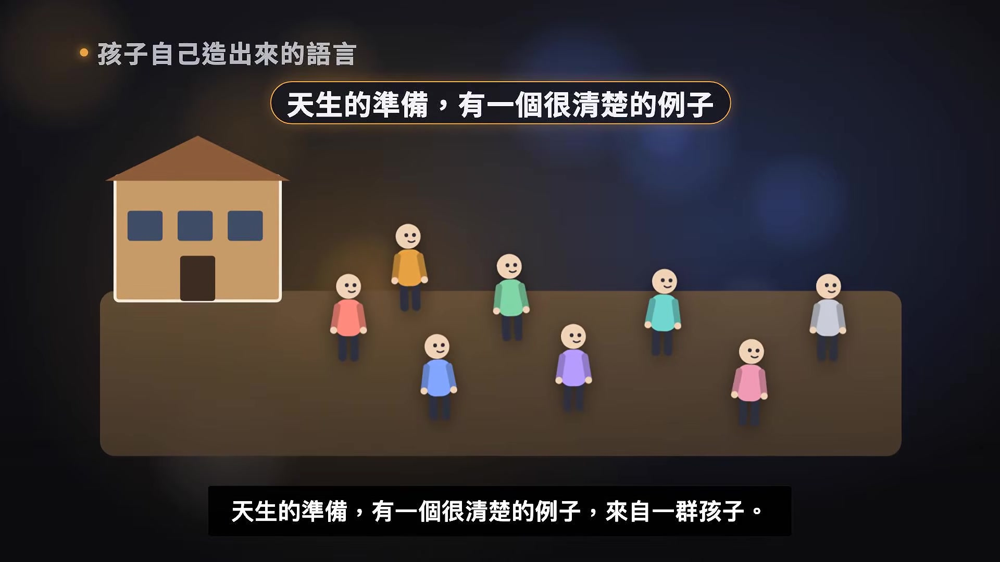

**逐字稿片段：** 來自一群孩子 1977年 尼加拉瓜的首都馬拿瓜 開了一所給龍瞳的活校 但之前這些孩子散在各地 各自跟家人比一些家裡自己發明的手勢 老師想教他們讀純語跟西班牙文 效果不好 可是在操場上 在校車上 孩子們自己湊出了一套手語 後來入學的年紀更小的孩子 又把這套手語 變得更有規則文法 更完整 大人還在開會討論 該用什麼手勢的時候 孩子已經造出一個語言了 這就是尼加拉瓜手語 Sapolsky 把它跟另一件事放在一起 一群說不同語言的人 被迫生活在一起 大人會拼湊出一種 很簡單的溝通方式 叫養精兵 他們的孩子 把它當成母語 長大以後 它會長成一個完整的語言 叫克里奧語 Sapolsky說 世界各地的克里奧語 文化常常很像 這指向人類 有一套內建的文法 這個說法有語言學家支持 也有很多人反對 到現在還在爭論

**話題推測：** 介紹尼加拉瓜手語的發展，可能顯示相關圖片或地圖。

---

## 00:28:27

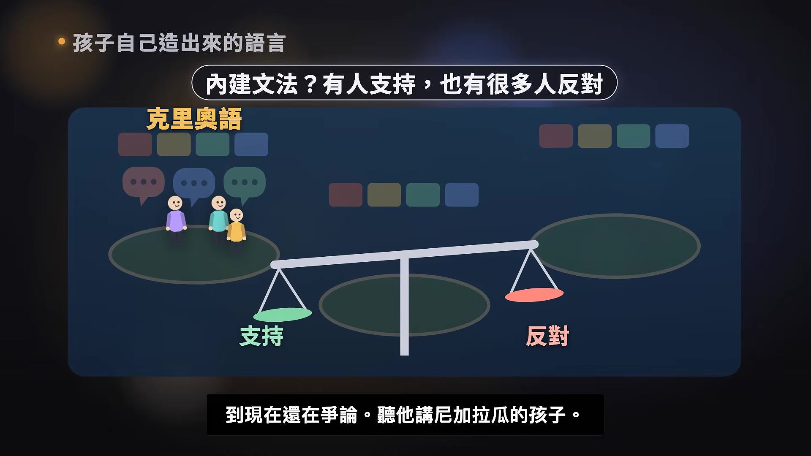

**逐字稿片段：** 聽他講尼加拉瓜的孩子 天生給的是學語言的準備 學哪一種是環境決定的 剛出生幾個月的寶寶 對世界上各種語言的發音反應都差不多 慢慢的他開始專心聽身邊的語言 到一歲左右 很多是在別的語言裡才有的音 他就分不太出來了 這是一種放棄也是一種專心 口音更有意思 心理學家Judith Rich Harris提醒大家 移民家庭的孩子 口音跟的是身邊的同學 不是爸媽 他們很早就開始用外面的語言回答爸媽 有時候還會覺得爸媽的口音很不好意思

**話題推測：** 影片切換到Sapolsky教授的授課片段。

---

## 00:29:24

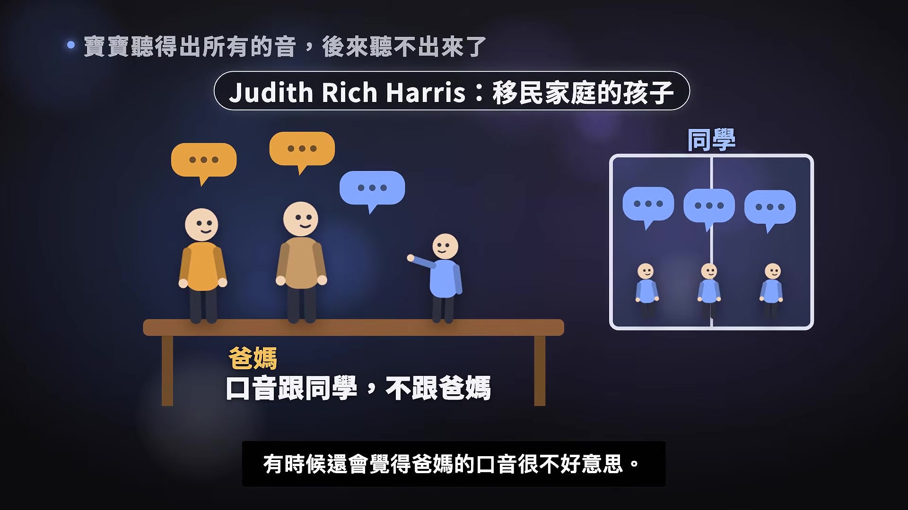

**逐字稿片段：** Zaborski也講到亞馬遜雨林的兩個族群 Piraha跟Munduruku 他們語言裡表示數量的詞很少 Piraha連一個精確的一都沒有 只有表示少一點跟多一點的詞 Munduruku的數字詞大約到五 研究發現他們比大概誰多誰少 跟我們差不多 可是東西一多要記住剛好是幾個 就變得很吃力 這些人對植物跟藥草的知識非常豐富 所以不是能力的問題 是語言給了他們什麼樣的工具 語言是這集最乾淨的例子 天生跟環境 同時在場 誰也離不開誰 如果學語言的準備是天生的 那其他的原類有沒有

**話題推測：** 介紹亞馬遜雨林中兩種特殊語言，可能顯示地圖或相關族群圖片。

---

## 00:29:55

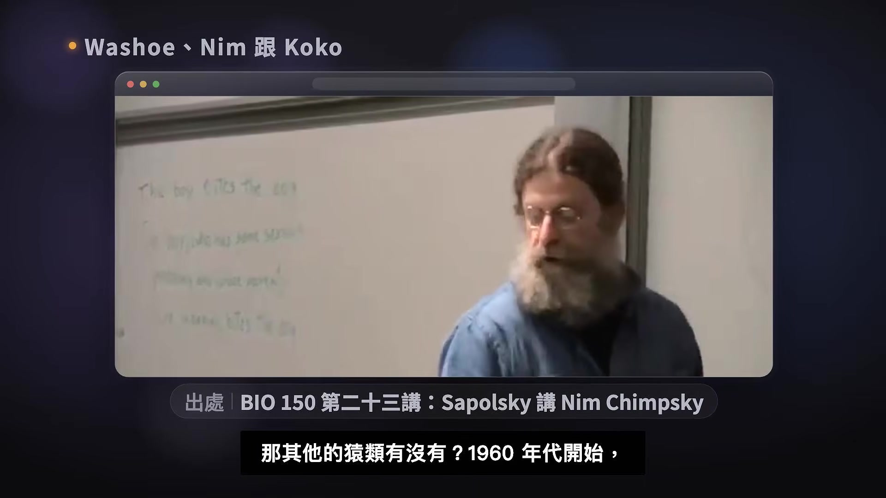

**逐字稿片段：** 1960年代開始 好幾個研究團隊教黑猩猩跟大猩猩打美國手語 黑猩猩的喉嚨發不出我們的聲音 所以改用手 最有名的是黑猩猩Washaw 研究者說他看到鴨子 打出了水跟鳥兩個手勢 大猩猩Coco更被說得很神 會說謊 會講別人的八卦 1979年 哥倫比亞大學的Herbert Harris 發表了一篇論文 主角是他自己的黑猩猩 名字故意取叫Nim Chomsky 本來是要挑戰Chomsky的 他回頭看錄影帶 發現Nim的手勢順序很隨機 句子越長意思沒有越多 而且大多是在模仿老師 為了拿到點心 他用同樣的標準 看其他的研究 也得到類似的結論 這引起很大的爭論 到現在還有人不同意他的分析 Sapolsky大一的暑假 就在Nim的計劃裡待過一整個夏天 他的看法是 最有希望的是一隻叫Kanzi的巴諾布園 可是到目前為止 大部分的研究並沒有證明 原類 像人類這樣的語言 天生的那份準備 看起來是人類這個物種帶著 語言講完Forsky 講了這一批課裡 唯一一堂專門講的精神疾病

**話題推測：** 討論對類人猿語言學習的研究，可能顯示黑猩猩或大猩猩進行手語的圖片。

---

## 00:30:53

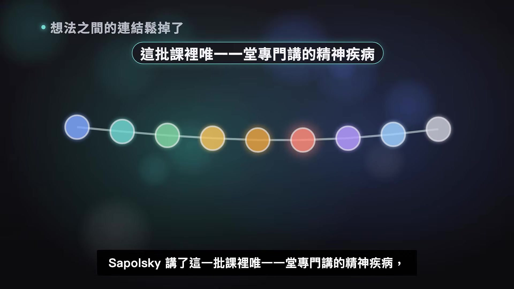

**逐字稿片段：** 視覺失調症 英文是極格分亞 臺灣以前叫精神分裂症 它不是一般人說的人格分裂 也不是心情很亂的一天 它的核心是思考的方式出了問題 跟患者說幾句話 你可能會發現 他的想法一個接一個岔開 連接很鬆 另一個特徵是 很難抽象 Forsky舉過一種測驗 請患者解釋一句諺語 例如滾石不生苔 有的患者會很認真的解釋 石頭滾下山 表面為什麼長不出苔蘚 還有幻覺 大家都是聽到聲音 以及退縮 不想跟人來往 表情變得平淡 這個病通常在青少年晚期 到神年早期發作 一般人一生得到的幾率 不到百分之一 Zaposki特別講了兩件事 一件是很多人以為患者很危險 其實大多數患者並不暴力 他們更常是暴力的受害者 最容易受傷的 常常是他們自己 另一件1960年代有人說 這個病是一種天賦 是看清了瘋狂世界的人 Sapolsky說 這種說法很殘忍 這是生物學出錯最痛苦的方式之一 沒有什麼隱藏的祝福 那正常跟不正常的線誰來畫 Sapolsky說 這是這個病最危險的地方之一 因為某種程度上 他的定義就是 大家覺得你想的不對 歷史上 確實有政府把持不同意見的人 診斷成精神病關起來 所以要先知道 正常可以有多寬

**話題推測：** 介紹精神疾病「思覺失調症」，可能顯示相關資訊或腦部掃描圖。

---

## 00:32:01

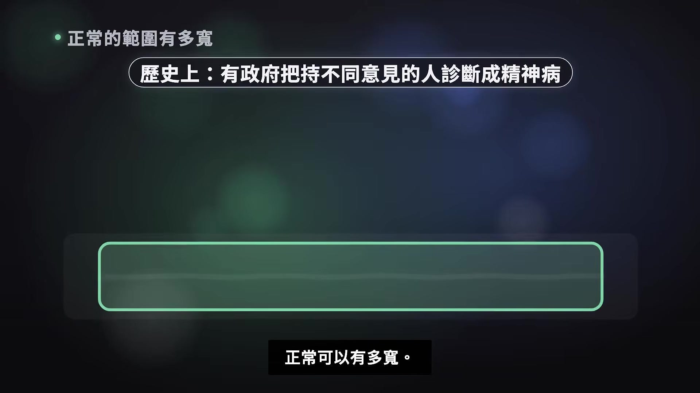

**逐字稿片段：** 他講了他在肯亞 唯一是碰到的例子 他的鄰居是馬賽人 一個以放牧為生的民族 生活方式跟我們差很多 有一天村裡的婦女衝來找他 說村裡有一個女人出了狀況 要他開車幫忙 他到了村子 那個女人用很不合規矩的方式 殺了一隻羊 還衝過來把他撲倒在地上 大家把他送到 40公里外的一間小診所 回城的路上 Sepulski問他的朋友 你們怎麼知道他生病了 朋友說他會聽到聲音 他說你們也會啊 馬賽人跳舞跳到恍惚的時候 也說聽到鬼魂的聲音 你們也會殺羊啊 朋友看著他 向他看一個不懂事的人 然後說了一句話

**話題推測：** 講述Sapolsky在肯亞遇到馬賽人判斷精神疾病的案例，可能顯示馬賽人的圖片。

---

## 00:32:35

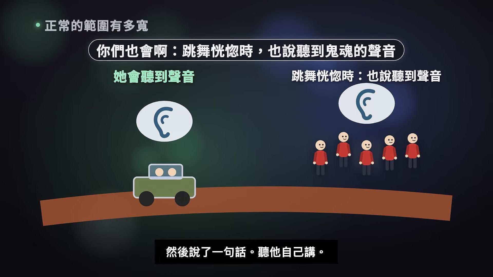

**逐字稿片段：** 聽他自己講 If you are a woman In the middle of the village With your bare hands and teeth You don't do this So I'm sitting there And I'm saying Well, you know This is kind of hard for me To tell the difference here And she says in a sense And that's the core ultimately 那是否有必要的目的 那思覺失調症 到底是天生的還是環境造成的 它是最早被證明有遺傳成分的精神疾病之一 可是看數字要小心 同卵雙胞胎的基因幾乎一樣 一個得病另一個也得病的幾率 Sapolsky當年說大約一半

**話題推測：** 影片切換到Sapolsky教授的授課片段。

---

## 00:33:19

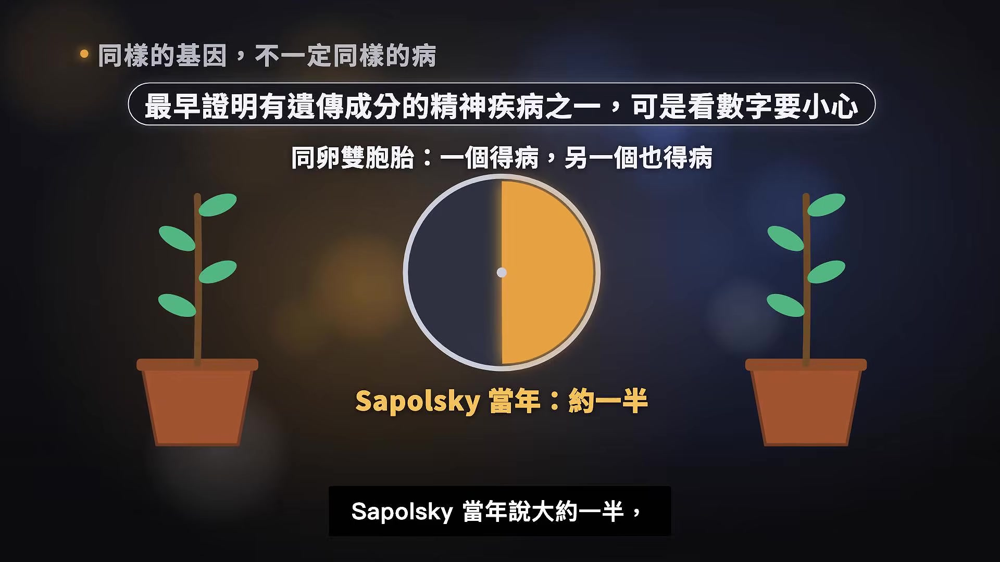

**逐字稿片段：** 2018年丹麥一個全國的雙胞胎研究 算出來大約三分之一 換句話說基因幾乎一模一樣 至少一半的雙胞胎手足並沒有得病 基因給的 比較像一個比較容易受傷的體質 還需要別的東西 別的東西包括什麼 1944年冬天 荷蘭西部發生大饑荒 那時候還在媽媽肚子裡的孩子 長大以後對思覺失調症的比例比較高 中國1959到1961年的大饑荒 也看到類似的結果 另外青少年時期的重大壓力 常常是第一次發作前的那根隱性 在大腦裡 最主要的假說跟多巴胺有關 很多治療的藥會擋住多巴胺的接收器 而會讓多巴胺大量增加的藥物 例如安非他命 可以讓人出現很像的症狀 這又回到上集那一句 基因說的是 如果怎樣就怎樣 可是講到環境 我相信這個病有一段很痛的歷史 1940到50年代 美國一些很有影響力的精神科醫師 相信思覺失調症是媽媽養出來的 當時甚至有一個詞 叫製造思覺失調症的母親 說這種媽媽會給孩子互相矛盾的訊息 例如送兒子兩條領帶 兒子打了其中一條 他就說你是不是不喜歡另一條 1956年 還有學者提出雙重束縛理論 把病因放在家庭的溝通上 好幾十年裡 很多媽媽帶著剛發病的孩子去看醫生 聽到的是是你害的 1950年代 第一批治療 視覺失調症的藥 出現了很多病人好轉 再加上後來的 雙胞胎跟領養研究 大家才慢慢接受 這是一種大腦的病 不是媽媽的錯 Sapolsky說 他讀過當時 資深醫師在期刊上的反省 說自己一輩子想幫病人 結果傷害了那麼多家庭 這段歷史 對 這一集的問題很重要 說天生 可以拿來怪一個人 說環境 也一樣可以拿來怪一個人 環境很重要 可是環境 不等於某一個人的錯 最後一堂課 Sapolsky就從這裡開始 他說這門課 從頭到尾在問 一個行為為什麼會發生 可是這個問題底下 常常藏著另一個問題 這是誰的錯

**話題推測：** 提到思覺失調症的最新雙胞胎研究數字，可能顯示統計圖表。

---

## 00:35:06

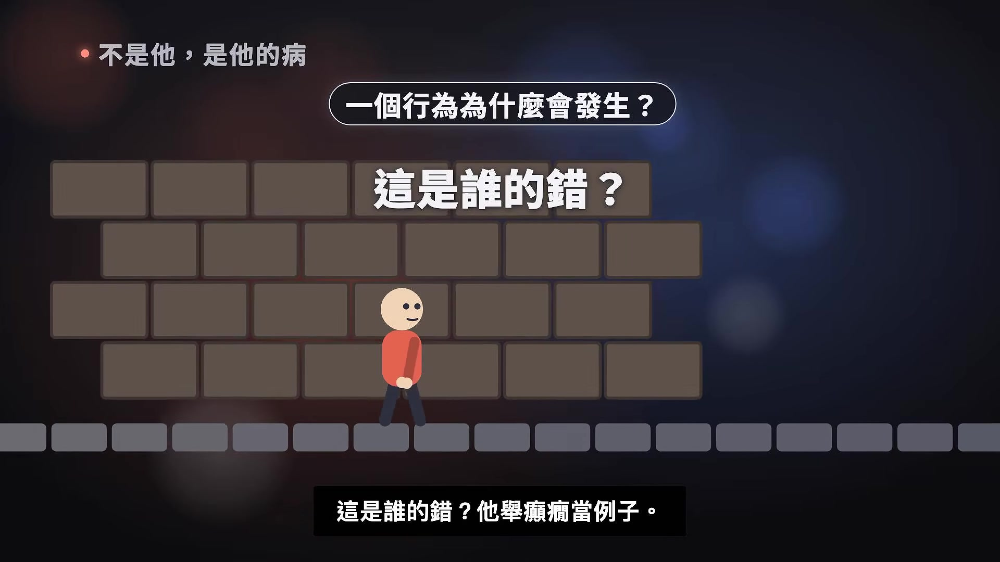

**逐字稿片段：** 他舉癲癲當例子 癲癲是大腦裡 一大群神經細胞 突然一起亂放電 人可能會抽搐 失去意識 500年前的歐洲 很多人相信那是被魔鬼附身 今天一個人癲癲發作的時候 手揮到旁邊的人 大家通常不會說 他在傷害別人 我們學會了一句話 不是他 是他的病 Sapolsky說 人在一個人 跟他大腦裡的一陣放電之間 畫一條線 是我們文化裡最好的成就之一 他說 他班上曾經有一位 有陀瑞症的學生 陀瑞症會讓人不自主地抽動 或發出聲音 這位學生到辦公室找他 說明自己的狀況 問能不能在另一間教室考試 整段對話裡 他的臉都在抽動 500年前 這樣的人可能被當成被附身 今天他可以換一間教室考試

**話題推測：** 介紹癲癇症，可能顯示腦電圖或相關醫療圖片。

---

## 00:35:45

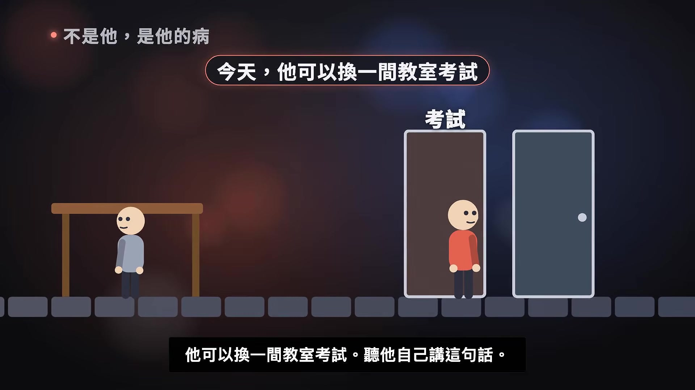

**逐字稿片段：** 聽他自己講這句話 現在可以回答上集開場的問問 現在可以回答上級開場那個問題了 一個40歲的男人 生活一切正常 有一天打了同事 接著外遇 接著捲走公司的錢消失 上級Sapolsky給了三個可能 他本來就是壞人 他在中年危機 他有一個基因出錯 最後一堂課他說

**話題推測：** 影片切換到Sapolsky教授的授課片段。

---

## 00:36:38

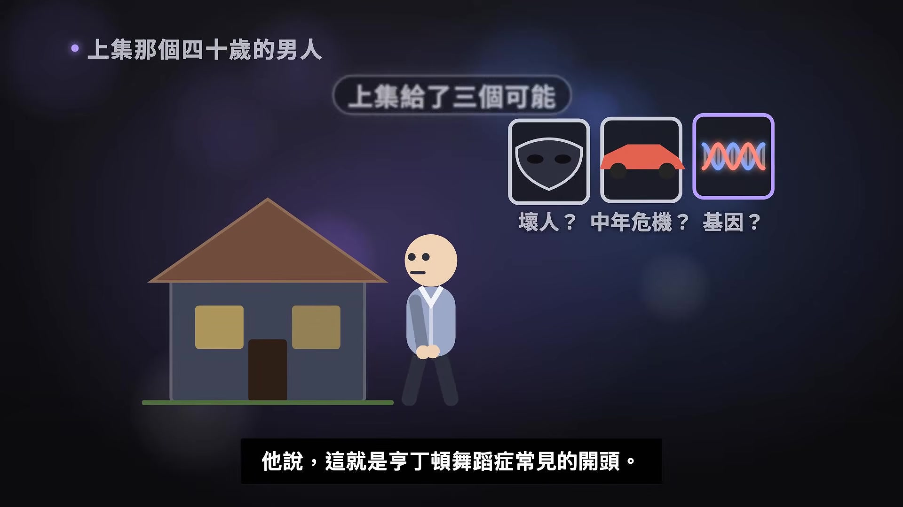

**逐字稿片段：** 這就是亨丁頓舞蹈症常見的開頭 亨丁頓舞蹈症 英文是Huntington's disease 它是一個基因裡的一小段重複太長造成的 爸媽只要有一方帶著 孩子就有一半的機會遺傳到 它常常在30到50歲之間發作 大家比較熟悉的是後期 身體不受控制的扭動 像在跳舞 所以叫舞蹈症 可是有不少病人在動作出問題之前 好幾年 先出現的是情緒跟行為的改變 衝動 暴躁 管不住自己 因為這個病 很早就影響到大腦裡跟控制行為有關的迴路 所以上集那三個答案裡 聽起來最不像的那一個 就是答案 如果你在他打人的那一天下判斷 你會說他是壞人 幾年後他住進神經科的病房 你才知道 那條線一開始就畫錯了地方 可是Sapolsky說 真正男的不在這裡 癲癇 亨丁頓舞蹈症 看起來離我們很遠 那是他們跟他們的病 麻煩的是 同一套生物學 也在我們每個人身上 坐在你旁邊的人 耳朵也跟你不一樣 有人一緊張就會數樓梯 Sapolsky說他自己就會 有人腦袋裡會一直重播同一段東西 他說他那天一整天 都在想一隻網路上 小寶寶咬哥哥手指的影片 這些都不是病 可是跟那些病在同一條連續的線上 他說 很多現在有名字的症狀 50年前根本沒有名字 以後會有越來越多的名字 每個人身上可能都會掛上兩三個 這時候有兩條路 一條很危險 標籤被拿來拒絕一個窮人的工作保險組的地方 另一條是我們願意把同理心的範圍拉得更大 他說 到了那一天 當我們說一個人很健康 意思其實只是 他的病跟大家的一樣 最後 Sapolsky對和聲說 上完這門課 最容易留下來的一句話可能是 一切都太複雜了 什麼都改不了 他說這很難 但不是不可能 他講了一個考古學的做法 他自己也說不確定是不是真的 挖掘一個遺址的時候 只挖一半 留下另一半 給未來有更好工具 更好理解的人 這是在提醒自己 今天我們很確定的是 可能就像500年前 那些最有智慧 最有同情心的人 相信癲癇是魔鬼附身一樣 可是複雜 不是什麼都不做的理由 他對臺下的學生說 你們之中 有人以後會在急診室 只有幾十秒 決定要不要違反一個人的意願 把他救回來 有人會當法官 有人會決定錢要花在哪裡 這門課講的每一件事 都會在那些時候回來

**話題推測：** 揭示開場案例的答案「亨丁頓舞蹈症」，可能顯示疾病相關資訊或症狀示意圖。

---

## 00:38:43

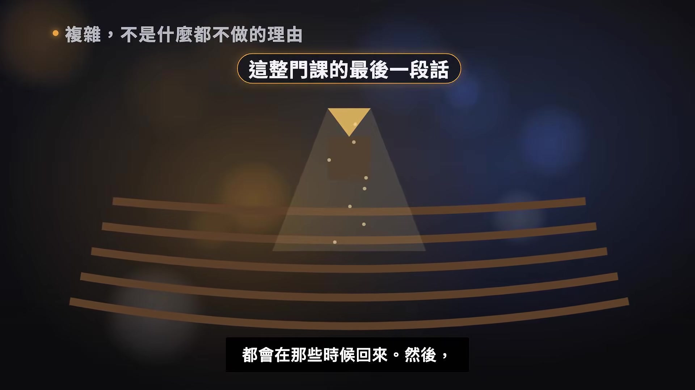

**逐字稿片段：** 然後他說了這整門課的最後一段話 So go and do both And good luck

**話題推測：** 影片切換到Sapolsky教授的授課片段。

---

## 00:39:13

**逐字稿片段：** 我們回到開場那個問題 一個人做了很可怕的事 或是想法跟大家都不一樣 那是他這個人 或者他身上發生的事 這巴扎克走了三步 供給那一部分告訴我們 身體裡很多東西像收音機的音量 放大原本就在的東西 而負責管住自己的額葉 最晚長好 也最受環境影響 第一部分告訴我們 人比較像雲 不像時鐘 一點點的差別會被放大 差異不是雜訊 是系統本身 第三部分告訴我們 正常跟不正常的線一直在移動 從魔鬼附身移到疾病 從怪罪媽媽移到大腦 也慢慢從他們移到我們 把三極放在一起 就是這個系列的答案 你以為的天生 有多少是環境造成的 這題很難算出一個百分比 基因說的是 如果怎樣就怎樣 那一秒 多半沒有誰在下命令 而每一個人 都是一朵不會重複的雲 所以下一次 你想說一個人天生 就是這樣的時候 可以先停一下 問問看他身上發生過什麼 Zyposki留給學生的最後一句話是 你不必在同理心跟科學之間 選一個兩個都做 最後問你一個問題 有沒有一件事 你以前覺得是某個人的錯 後來才知道 那是他身上發生的事 留言告訴我 喜歡的話訂閱AI Notebook 開啟通知 我們下次見

**話題推測：** 回顧開場問題，並總結整個課程系列的答案。

---
