# jimainotebook_jzc6fMYqHWI — 關鍵畫面索引

- 來源逐字稿：[jimainotebook_jzc6fMYqHWI_FIN.srt](jimainotebook_jzc6fMYqHWI_FIN.srt)
- 影片：https://www.youtube.com/watch?v=jzc6fMYqHWI
- 截圖數：58

## 00:00:10

**逐字稿片段：** 這一集是史丹佛大學公開課, 人類行為生物學的宗夾, 講臺上還是生物學家Robert Sapolsky, 這次上第九到第十七堂, 這九號課再回答一個問題, 你生氣, 害怕, 心動的那一秒, 身體裡到底是誰在決定?上集留下一個答案, 基因很少直接下命令, 他說的多半是如果怎樣就怎樣, 而如果的那一半常常在身體外面, 宗夾就接著問, 外面發生的事, 是怎麼走進身體變成一個動作的, 我先把答案放在前面, 神經跟荷爾蒙, 多半也不下命令, 天生給你的 常常是怎麼做 什麼時候做 對誰做 只是情境跟經驗教的

**話題推測：** 介紹課程主題：史丹佛大學公開課—人類行為生物學

---

## 00:00:42

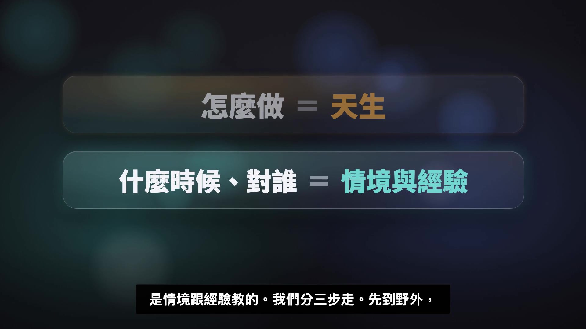

**逐字稿片段：** 我們分三步走 先到野外 看動物天生會什麼 再打開身體 看神經跟荷爾蒙怎麼傳話 最後看情緒 還有兩種最常被說成天生的行為 性跟攻擊 第十七堂課 Sapolsky講了一件自己做過的事 他在球場上故意絆倒一個人 他說那是他好幾個月來 最開心的一刻 同一個動作 換一個對象 全班都會覺得很可怕 差在哪裡

**話題推測：** 概述本集內容的三個主要部分

---

## 00:01:02

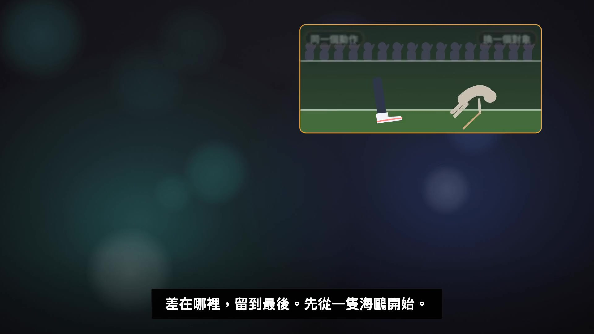

**逐字稿片段：** 留到最後 先從一隻海鷗開始

**話題推測：** 開始第一個具體動物行為例子：海鷗

---

## 00:01:04

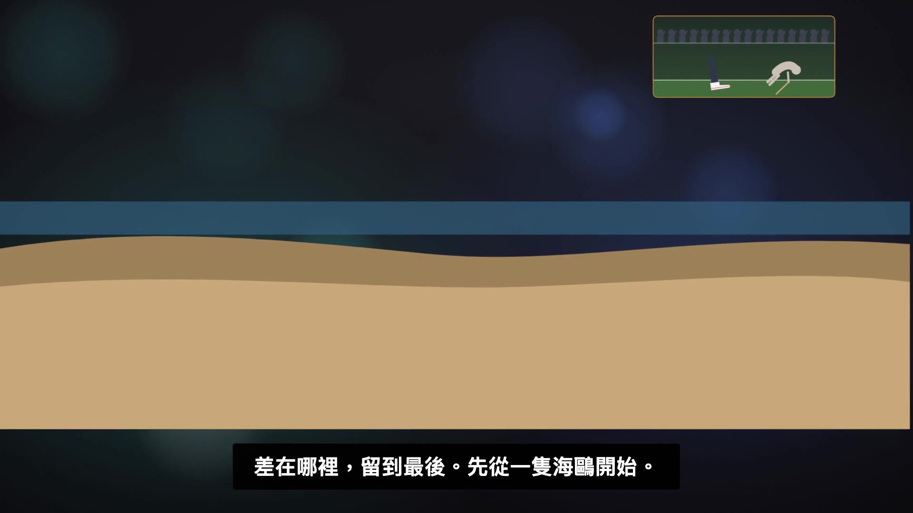

**逐字稿片段：** 1960年前後 荷蘭的動物學家 Nicole Timbergen 在英國海邊的沙丘上 看一大群紅嘴鵝坐臥 小鳥一孵出來 媽媽最早做的事情 有一件很奇怪 他把破掉的蛋殼叼起來 飛到窩外面丟掉 沒有人教過他 他可能這輩子第一次孵蛋 還是這樣做 為什麼 你可以坐在書桌前 想出一個漂亮的理由 Timbergen的做法不一樣 他做實驗 他把破蛋殼 放在別的蛋旁邊 再躲起來看 結果是 旁邊有蛋殼的那些蛋 被烏鴉跟其他海猴 吃掉的比例比較高 蛋殼的內面是白的 從天上看特別顯眼 所以媽媽叼走蛋殼 是在把它窩藏起來 這個故事裡有兩件事 我們這一集會一直用到 一件事 這個動作不用學 第一次就會 另一件事 要知道它的用途 你得到野外去 看它在真正的家裡 怎麼過日子

**話題推測：** 介紹動物學家：Nicole Tinbergen

---

## 00:01:47

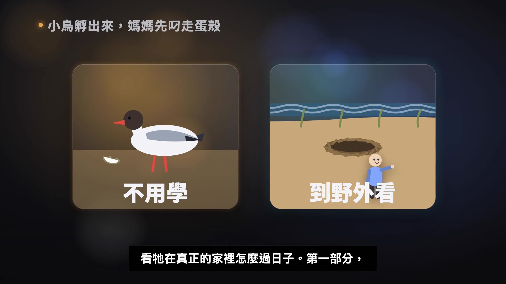

**逐字稿片段：** 第一部分 我們就跟著這群 在野外看動物的人走 問一個問題 動物天生會什麼 天生會的那些東西 又是怎麼跟經驗搭在一起 這就是Tinbergen做的 他進去,和剛剛完成的狗 和她的新的小寶寶 她的新小寶寶,剛剛被砍傷 她去給他們吃飯,或是其他 這位極致不知情的Tinbergen 進去,把鎖匙轉回白色 發生了什麼? 所有的蜜蜂飛過來 都比在那裡看到 那些小寶寶 who are gone by the time mom comes back tragically I know

**話題推測：** 進入第一部分主題：動物天生會什麼

---

## 00:02:30

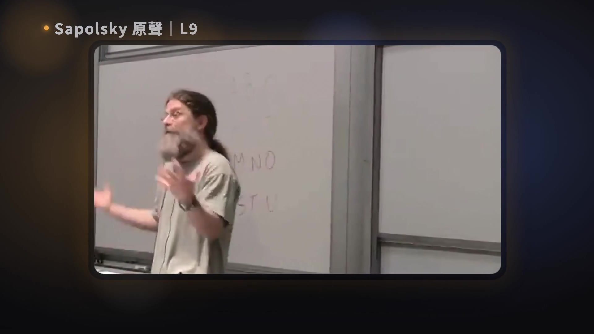

**逐字稿片段：** Tim Bergen這種做法 在當時其實是少數派 20世紀中 美國心理學的主流叫行為主義 行為主義的意思是 看得見 量得到的才算數 行為是被獎勵跟懲罰 一點一點塑造出來的 上集提過的Watson 是開山的人之一 名氣最大的是B.F. Skinner Skinner認為老鼠 鴿子 小孩 學東西的規則都一樣 既然一樣在實驗室裡 研究最方便的動物就好 同一個時間 歐洲長出另一條路 例如叫動物行為學

**話題推測：** 介紹與動物行為學對立的學派：行為主義

---

## 00:02:57

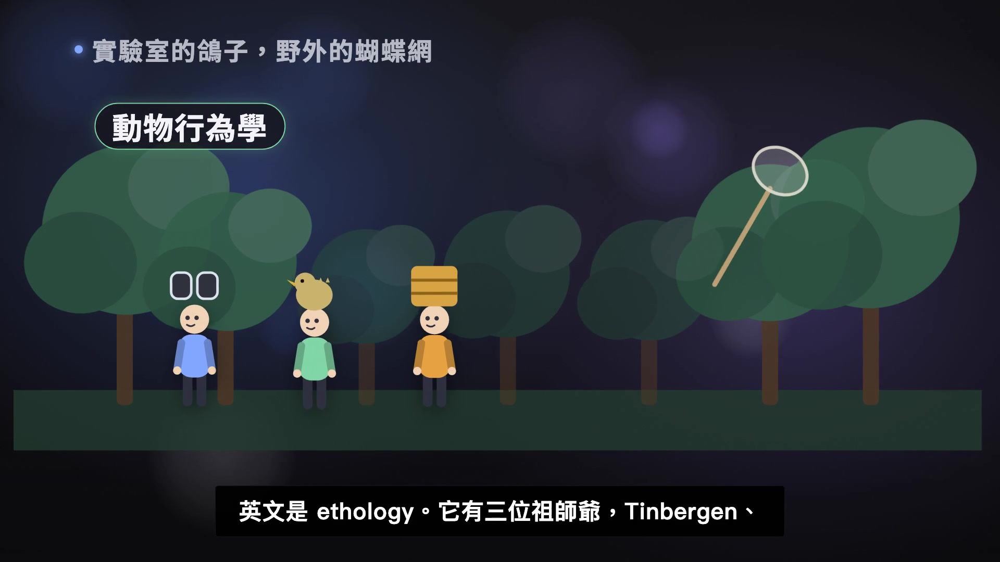

**逐字稿片段：** 英文是 Ethology 他有三位祖師爺 Tim Bergen Conrad Renz 還有研究蜜蜂的 Carl Von Frisch 1973年三個人一起拿了諾貝爾獎 Sapolsky說 這群人的心情 很像19世紀拿著網子在樹林裡抓蝴蝶的人 他們著迷的是不一樣 每一種動物都用自己的方式解決自己的問題 Sapolsky在黑板上引了一句話 動物行為學 是用動物自己的語言去訪問他 所以要到他真正住的地方去 兩邊最大的分歧在這裡 行為主義說 什麼都是環境叫的 動物行為學說 有些東西它一生下來就帶著

**話題推測：** 列舉動物行為學的三位祖師爺

---

## 00:03:26

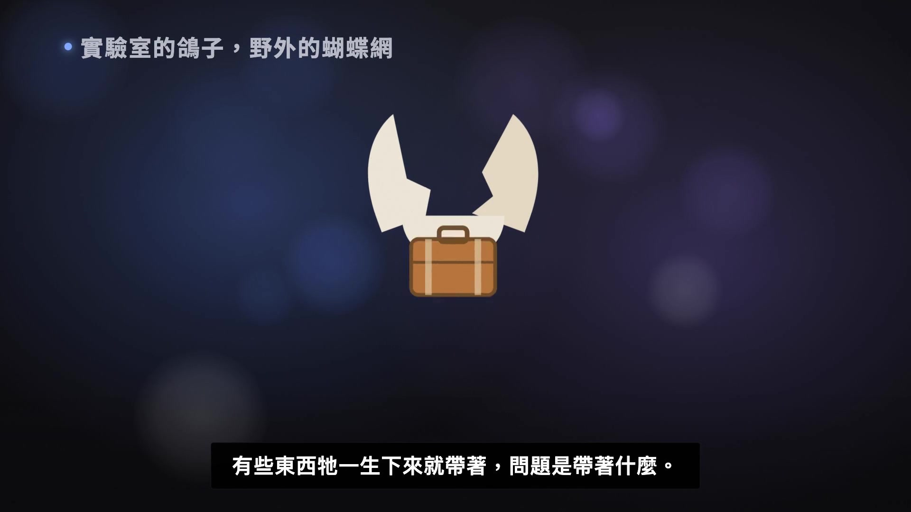

**逐字稿片段：** 問題是帶著什麼 動物一生下來帶著的東西 動物行為學給了一個名字 叫固定動作模式 英文是Fixed Action Pattern 它指的是一串固定的肌肉動作 不用學 第一次就做得出來 Sapolsky特別強調 這不是我們平常講的本能 說母愛是本能 說愛冒險是本能 這種話什麼都能解釋 所以等於沒解釋 固定動作模式小得多 也具體得多

**話題推測：** 解釋核心概念：固定動作模式 (Fixed Action Pattern)

---

## 00:03:47

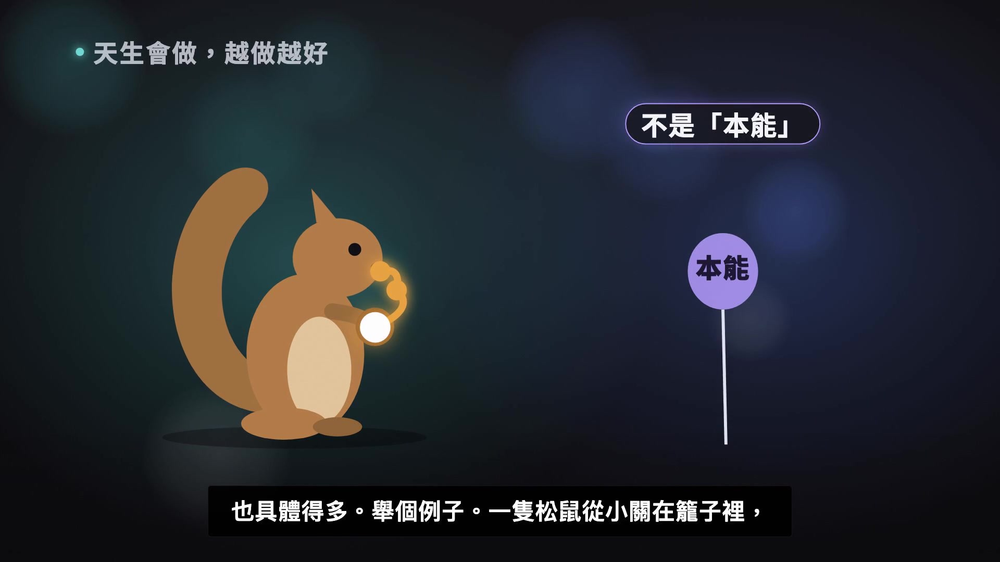

**逐字稿片段：** 舉個例子 一隻松鼠從小關在籠子裡 只吃流植的食物 沒看過別的松鼠剝堅果 你第一次給它一顆堅果 它會拿起來 轉一轉 開始啃 動作是天生的 可是你多觀察幾天 它越剝越快 越剝越乾淨 經驗在修這個動作 人也有 嬰兒會笑 連出生就看不見的嬰兒也會笑 它沒看過任何人笑 天生給的笑這個動作 它要學的是 對誰笑 什麼時候笑 玩偶不會笑回來 換句話說 固定動作模式是 一生下來就裝好的一段動作 可是 什麼時候拿出來用 用在誰身上 要在生活裡慢慢對 對 這是我們這集答案的第一個樣子 天生給的是動作 經驗教的是細節

**話題推測：** 舉例說明固定動作模式：松鼠剝堅果

---

## 00:04:22

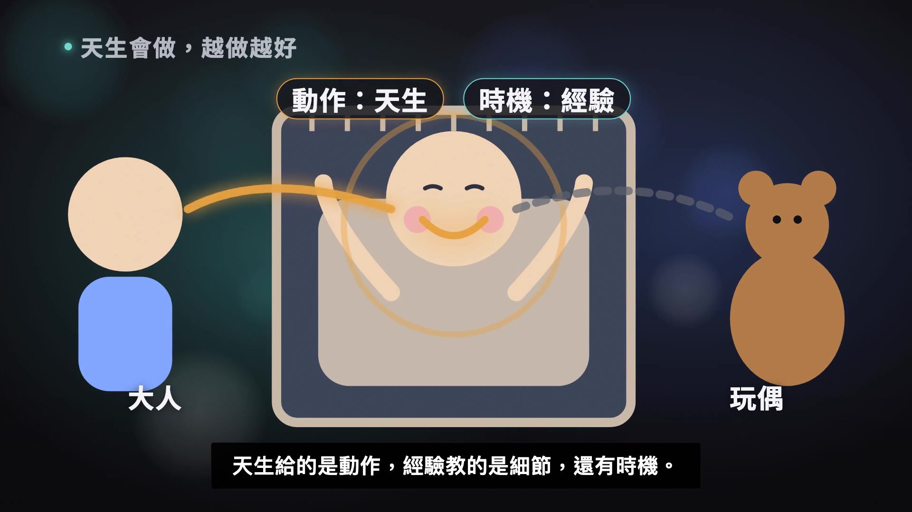

**逐字稿片段：** 還有時機 東非有一種猴子 叫長尾黑鱷猴 英文是Vervet Monkey 他們最怕三種敵人 花豹 老鷹 蛇 研究的人在野外錄音 發現他們看到這三種敵人 會發出三種不一樣的警報聲 聽到花豹的警報大家往樹上跑 聽到老鷹的警報 大家抬頭看天空 鑽進樹叢 聽到蛇的警報大家站起來往地上看 研究的人把錄音放出來 旁邊沒有真的敵人 猴子還是照著做 所以這些叫聲在傳遞資訊 發出警報這個動作 小猴子 天生就會 可是小猴子常常叫錯 看到一隻不會抓猴子的鳥飛過去 他也喊老鷹 Sapolsky開玩笑說 大猴子早就懂動物行為學了 他說小猴子一叫 大猴子常常先自己抬頭確認 看清楚了 才跟著叫 你可以想象叫錯的代價 喊老鷹 大家往樹叢裡鑽 喊花豹 大家往樹上爬 所以小猴子要學的 不是怎麼叫 是看到什麼才叫 叫哪一種 動作是天生的 用在哪裡 要一年一年學

**話題推測：** 介紹新的動物例子：長尾黑鱷猴的警報聲

---

## 00:05:39

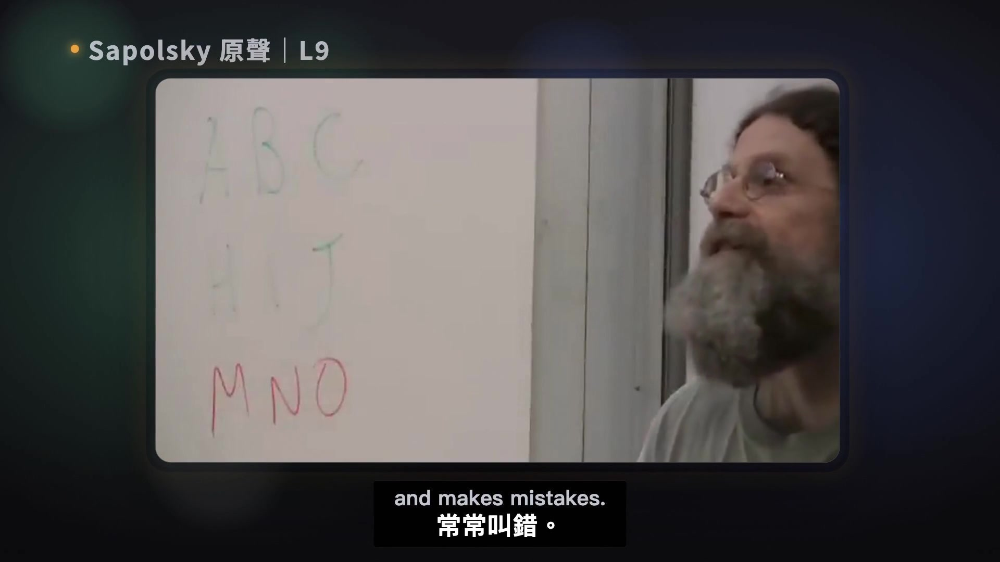

**逐字稿片段：** 知道了動作 下一個問題是 什麼東西讓這個動作開始 動物行為學把這個開頭叫做 釋放刺激 英文是Releasing Stimulus 意思是外面出現某個特定的東西 整串固定動作就跑出來

**話題推測：** 解釋下一個核心概念：釋放刺激 (Releasing Stimulus)

---

## 00:05:51

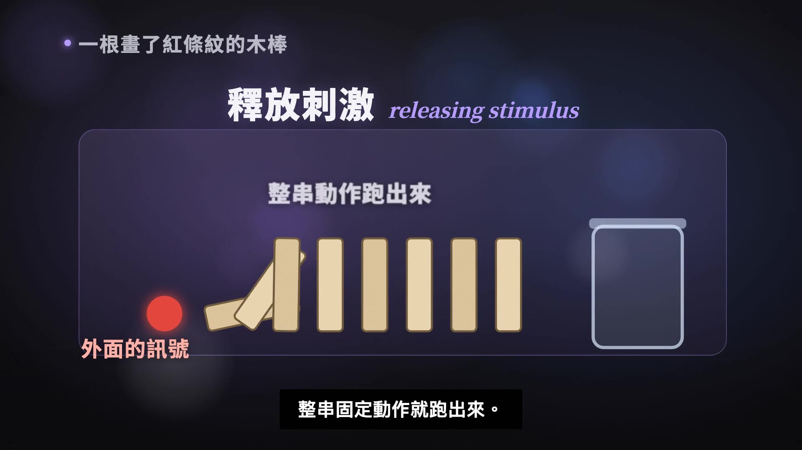

**逐字稿片段：** Tim Bergen又拿海鷗做了實驗 這次是銀鷗 銀鷗的小鳥餓了 會去啄媽媽的嘴 媽媽就把食物吐出來餵牠 媽媽黃色的嘴會下緣 有一個紅點 小鳥是在啄那個紅點嗎 他用了一套 到今天還在用的方法 先拿掉 做一個沒有紅點的假頭 小鳥啄的少很多 再放回去 啄的次數回來 再換掉 把紅點換成別的顏色 相間的條紋 小鳥啄它 比啄真的媽媽還起勁

**話題推測：** 介紹銀鷗雛鳥啄食行為的實驗

---

## 00:06:18

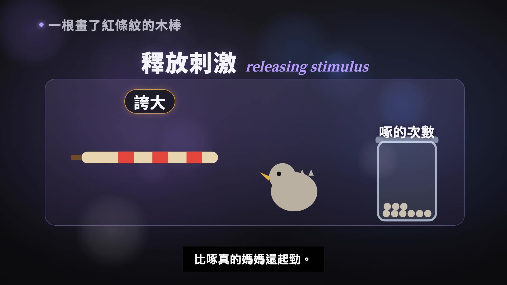

**逐字稿片段：** 這種比真的還有效的假訊號 叫超常刺激 你可以看到兩件事 觸發動作的訊號 常常非常具體 具體到一個木棒就能騙過去 還有訊號是外面給的 動作在身體裡等著 開頭的訊號在外面 所以下次你看到一隻動物 好像本能地做了什麼 可以多問一句 是外面哪一個很具體的東西 讓它開始 用動物自己的語言去訪問它

**話題推測：** 解釋相關概念：超常刺激 (Supernormal Stimulus)

---

## 00:06:38

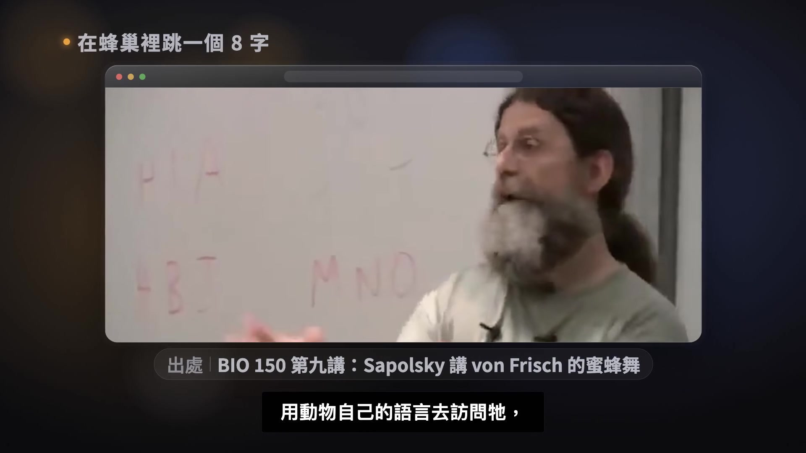

**逐字稿片段：** 最有名的例子是 Carl von Frisch的蜜蜂 一隻公蜂找到一片花 飛回風潮 在其他蜜蜂中間跳起一段舞 他沿著一條直線往前走 一邊走一邊搖屁股 走完繞回來再走一次 整個路線像一個八字 這叫搖擺舞 Ovan Frisch花了很多年 搞清楚這支舞裡藏著什麼 中間那條直線的角度 對印花跟太陽的方向 搖擺的那一段 跳得越久花就越遠 他不是坐著猜 他把糖水放在不同的方向 不同的距離 在數有多少蜜蜂 飛到哪個地方 一點一點對出來 這件事厲害的地方在於 當時很少人想到蜜蜂會用五步講方向跟距離 人類習慣用聲音跟眼睛理解世界 就很容易以為別的動物也是這樣 Sapolsky說 動物行為學最大的提醒是 很多動物在我們聽不到看不到的頻道裡講話 下一個例子 這個頻道就在你身上 所有人都在鞠躬中 都在鞠躬中 因為他們在鞠躬中 都在鞠躬中 所有人都在鞠躬中 都在鞠躬中

**話題推測：** 介紹Carl von Frisch與蜜蜂搖擺舞的研究

---

## 00:07:51

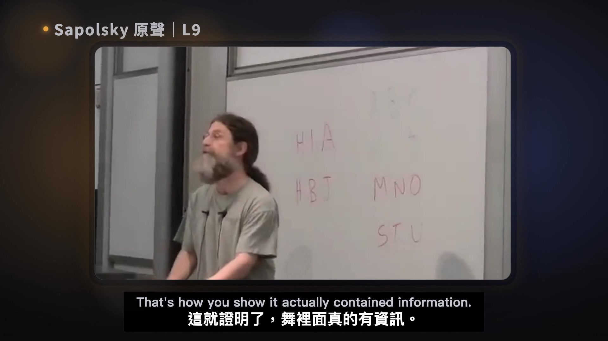

**逐字稿片段：** 2009年 美國紐約州立大學 實習分校一個團隊 做了一個研究 他們去找第一次跳傘的人 跳的是雙人跳傘 教練綁在背後 從登機前到落地 他們腋下一直貼著 吸汗的紗布墊 對照主是同一批人 在跑步機上跑步流的汗 然後讓另一群人聞 但靠鼻子 大家分不出兩種汗有什麼差別 可是把人放進腦部掃描機 聞到害怕的人流的汗 大腦裡一個叫性人核的地方明顯亮起來 運動流的汗就沒有那麼亮

**話題推測：** 介紹人類行為研究：跳傘者汗水與大腦反應

---

## 00:08:18

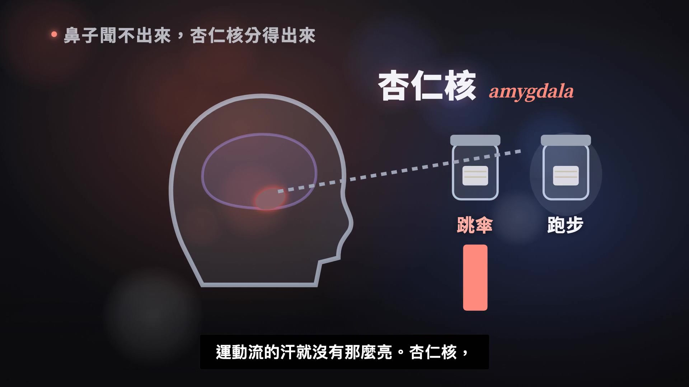

**逐字稿片段：** 性人核 英文是Amikdala 是大腦深處左右各一個 形狀像性人的構造 跟害怕和焦慮關係很深 這集後面會一直回來找他 同一年 美國萊斯大學另一個研究看得更細 聞過害怕的汗以後 再看一張 介於開心和害怕之間表情模糊的臉 女性受試者比較容易把他看成害怕 你沒有意識到自己聞到什麼 你的判斷已經被推了一下 這就是釋放刺激搬到人身上 外面一個你察覺不到的訊號 走進身體 改變了你怎麼看別人 我們以為自己是看了對方的臉才下判斷 其實在那之前 鼻子已經先投了一票 有些天真帶著的東西 會直接推翻行為主義

**話題推測：** 介紹大腦情緒相關區域：杏仁核 (Amygdala)

---

## 00:08:53

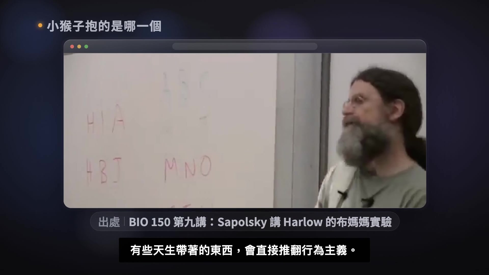

**逐字稿片段：** 1950年代 美國心理學家Harry Harlow 做了一個很有名 也很讓人不忍心的實驗 他把剛出生的小橫和猴跟媽媽分開 籠子裡放兩個嫁媽媽 一個是鐵絲做的 身上綁著奶瓶 沒有奶 行為主義的說法 就是被餵飽的獎勵 小猴子應該黏著有奶的那一個 結果剛好相反 小猴子大部分時間抱著布媽媽餓了 才過去鐵絲媽媽那邊喝幾口 喝完又回來 害怕的時候 他衝向的也是布媽媽 小猴子天生要的 不只是食物 是溫暖的接觸 結果在當時影響很大 Sapolsky提到 那個年代的醫院 常常把住院的小孩跟父母隔開 探病時間限得很短 理由是父母不夠衛生 反正護理人員一樣能餵奶 哈洛的猴子提醒大家 照顧不等於餵飽 也提醒我們 行為主義說的什麼都是環境教的 至少在這裡說錯了 小猴子帶著一個偏好來到世界上 我們每一天都要接種疫苗 為什麼會有這種規則 因為在野外 小鳥孵出來 第一個在旁邊動來動去的大東西 絕大多數時候真的是媽媽 你注意這裡的結構 規則是天生的 出生後那段時間看到的就是媽媽 可是媽媽是誰 是外面填進去的 上集最後 我們講過以色列集體農場的孩子 6歲前天天一起長大的人 長大後很少互相結婚 那也是同一種結構 規則天生 名單由環境來填

**話題推測：** 介紹心理學家Harry Harlow的猴子依戀實驗

---

## 00:10:59

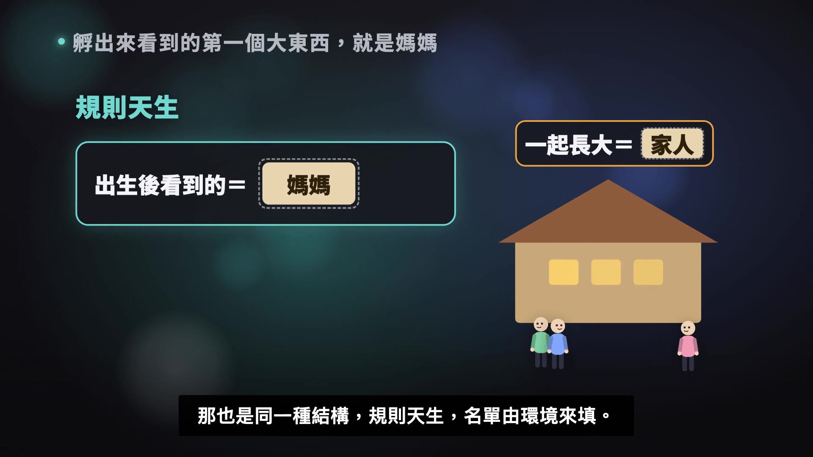

**逐字稿片段：** Sapolsky 再講一個比較日常的 心理學家Martin Seligman 有一次在餐廳吃了一道牛排 淋著一種法式醬汁 叫伯納西醬 晚上去聽歌劇 回家後整晚不舒服 後來證明那是腸胃型感冒 跟醬汁無關 可是他從此再也吃不下伯納西醬 光聞到就反胃 奇怪的是 他沒有因此討厭歌劇 行為主義的規則 時間上比較近的兩件事 比較容易被連在一起 歌劇明明比較近 可是身體把不舒服 算在食物頭上

**話題推測：** 介紹心理學家Martin Seligman的食物厭惡經驗

---

## 00:11:24

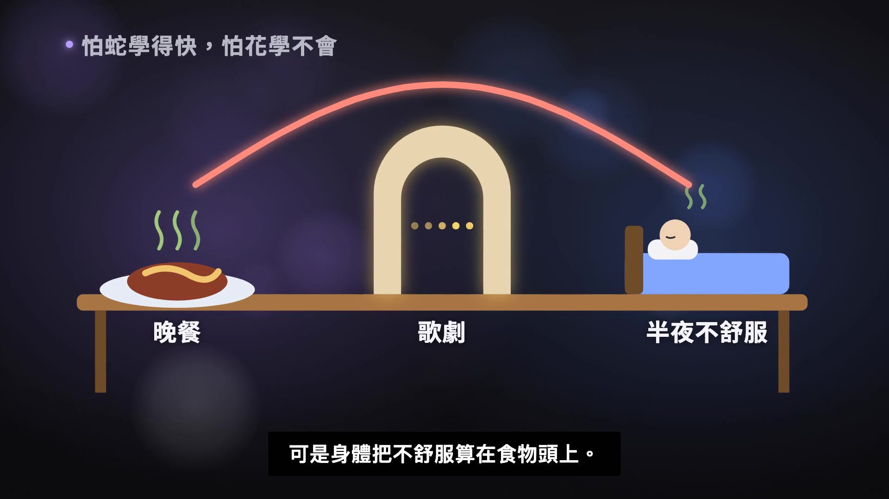

**逐字稿片段：** 這叫準備好的學習 英文是prepare learning 意思是有些連結 天生就特別容易學會 猴子的實驗更清楚 實驗室長大的橫河猴原本不怕蛇 研究的人給他們看錄影 畫面裡另一隻猴子對著一條玩具蛇表現出害怕 他們很快就學會怕蛇 同樣的錄影 剪接成那隻猴子來拍一束花 他們學不會 所以天生的不是怕蛇 天生的是 如果看到同伴怕蛇就很快學會怕 這又是一句如果怎樣就怎樣

**話題推測：** 解釋學習概念：準備好的學習 (Prepared Learning)

---

## 00:12:11

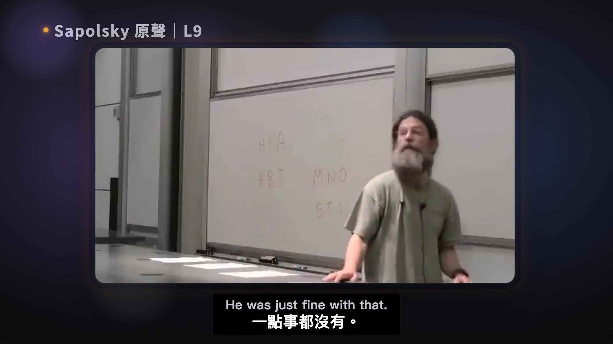

**逐字稿片段：** 我們先把第一部分收起來 這部分問的是動物天生會什麼 動物行為學的人到野外 看到的答案有三層 最底下一層是固定動作模式 海鷗雕蛋殼 松鼠剝堅果 嬰兒笑 不用學 第一次就會 中間一層是釋放刺激 一個很具體的外部訊號 讓這串動作開始 紅點 搖擺舞 害怕的漢 最上面一層是學習 而且學得很有選擇 小燕一次就認定媽媽 猴子怕蛇學得快 怕化學不會 三層疊起來 就是這一部分的答案 天生給的多半是怎麼做 還有比較容易學會什麼 什麼時候做 對誰做 要靠經驗 可是古典動物行為學的研究者 也承認一件事 外面的訊號進來 動作跑出去 中間那一段 身體裡發生了什麼 他們不知道 他們給它取了一個名字 叫先天釋放機制 然後就停在那裡

**話題推測：** 總結第一部分內容

---

## 00:12:55

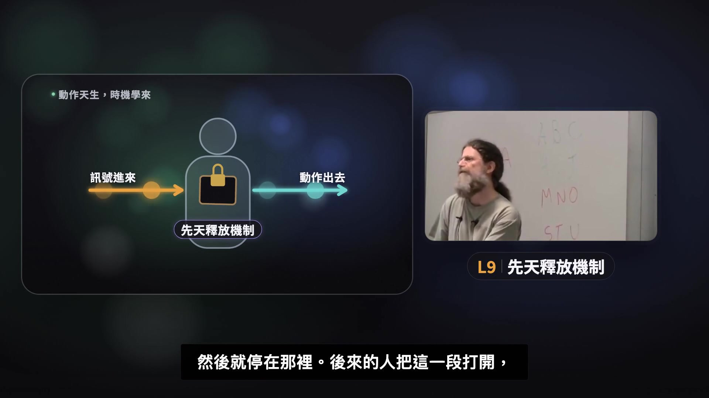

**逐字稿片段：** 後來的人把這一段打開 成了一門新學問 叫神經動物行為學 下一部分 我們就打開這個盒子 看神經跟荷爾蒙怎麼把話傳過去 接下來三堂 是註教上的入門課 Sapolsky說 就算你覺得自己修過 也當作沒修過回來聽

**話題推測：** 進入第二部分主題：神經與荷爾蒙如何傳話

---

## 00:13:09

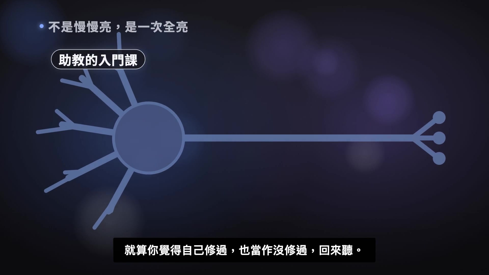

**逐字稿片段：** 我們也從最小的零件開始 大腦裡負責傳訊息的細胞叫神經元 一個神經元有很多短短的分支 叫速討 負責收訊息 也有一條長長的線叫軸圖 負責把訊息送出去 神經元收到的訊息 會在細胞裡加起來 加起來夠多越過一條門檻 那就放電 這次放電要動作電位 它有一個很重要的特性 叫全有或全無 不夠門檻 就安安靜靜什麼都不送 過了門檻 電就一路跑到軸圖的尾端 每一次都一樣大 為什麼要這樣設計 助教的解釋是 大腦裡到處是雜訊 一個訊號如果可以小小聲的 很快就被淹沒了 所以神經元選擇 要麼不說要說就說到底 一個神經元能說的 就是放電跟不放電兩種 真正的變化再多久放一次 還有多少個神經元一起放 先把這條門檻放在心上 後面我們會看到 很多讓人改變行為的東西 不是直接讓神經元放電 是去移動這條門檻 電跑到肘底的尾端

**話題推測：** 介紹大腦的基本傳訊單位：神經元結構

---

## 00:13:58

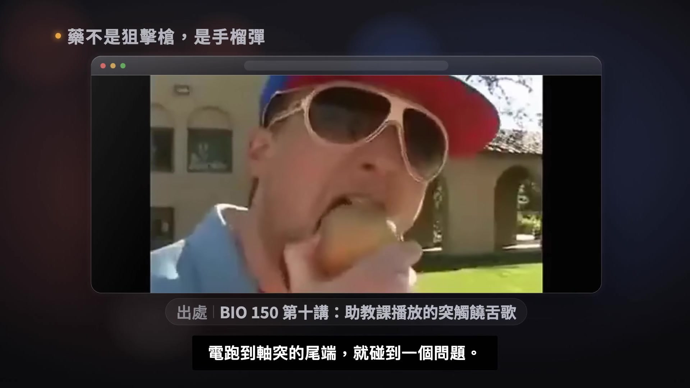

**逐字稿片段：** 就碰到一個問題 兩個神經元之間 有一道很窄的縫 電過不去 這道縫跟它兩邊的結構 合起來叫突觸 英文是Synapse 電到了尾端 會讓細胞把一些小分子 倒進縫裡

**話題推測：** 解釋神經元之間的連接點：突觸 (Synapse)

---

## 00:14:09

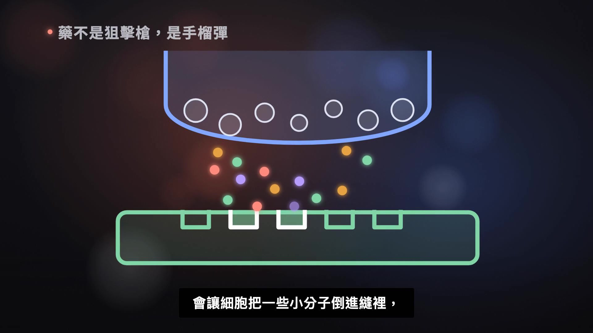

**逐字稿片段：** 這些小分子叫神經傳導物質 它們飄到對面 踏進對面細胞上的受體 對面才收到訊息 用完以後 有的被吸回去重複使用 這叫再回收 有的被分解掉 你聽過的多巴胺 血清素 正腎上腺素 都是神經傳導物質 很多治療情緒 跟精神疾病的藥 就是在突出這裡動手腳 讓傳導物質多一點 少一點 或者停留久一點 可是助教提醒了一件事 同一種傳導物質 在大腦不同的區域 做不同的工作 帕金森氏症 是腦裡某一區的 多巴胺不夠 所以醫生給人變成 多巴胺的藥 可是藥吃下去 不會只去那一區 有的病人會出現幻覺 課堂上播了一段學生寫的饒舌歌 裡面有一句 要不是狙擊槍是手榴彈 你瞄準一個地方 它在所有有受體的地方一起起作用 經驗要改變行為的 在大腦裡留下痕跡 這個痕跡在哪裡

**話題推測：** 介紹傳遞化學訊號的物質：神經傳導物質

---

## 00:14:54

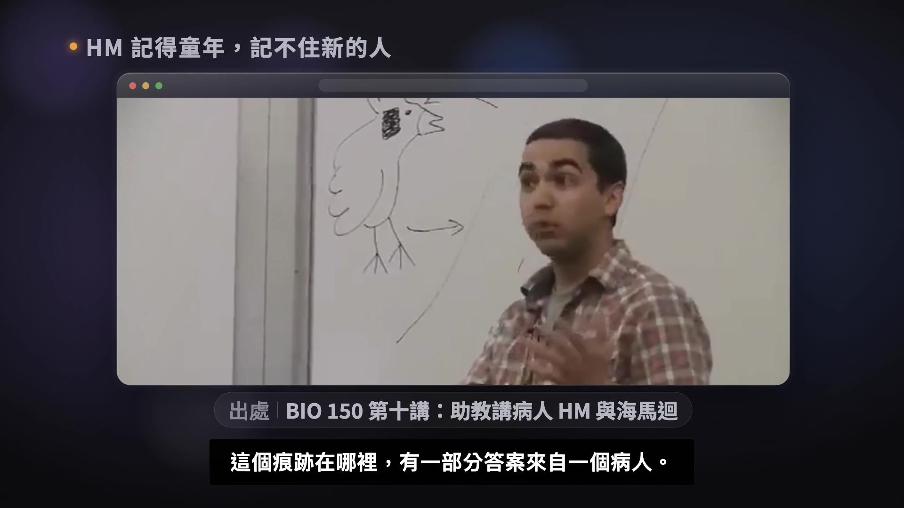

**逐字稿片段：** 有一部分答案來自一個病人 神經科學界叫他HM 他過世以後 大家才知道他的名字是Henry Molaison 他從小有很嚴重的癲癇 藥物控制不住 1953年 醫生切除了他大腦兩側的一部分

**話題推測：** 介紹記憶研究的著名病人：H.M. (Henry Molaison)

---

## 00:15:06

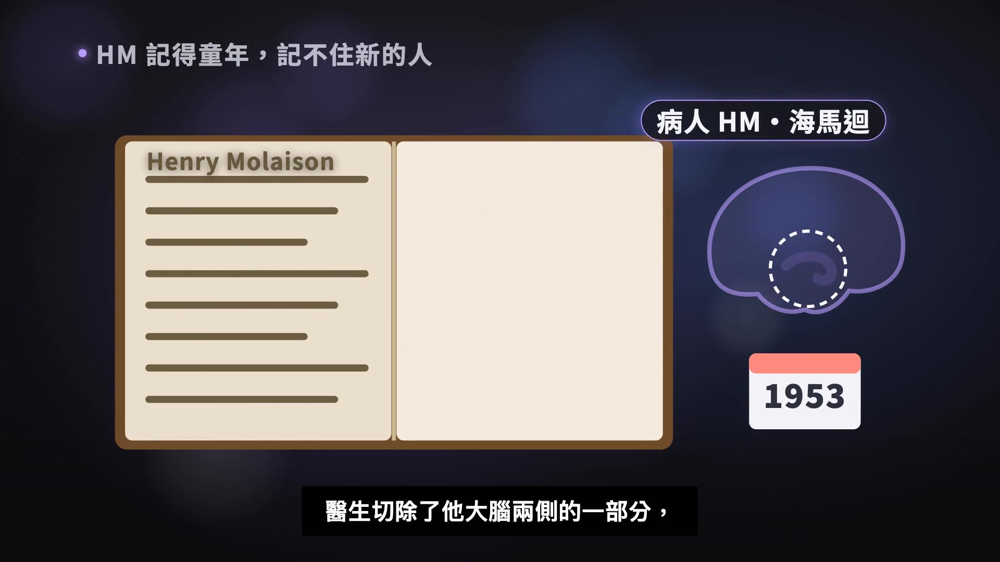

**逐字稿片段：** 包括一個叫海馬迴的構造 癲癇是好多了 可是HM從此記不住新的事情 每天來照顧他的人 他每次見面都像第一次見 可是手術前的童年往事 他大致還記得 所以海馬迴不是記憶最後存放的地方 他負責把新的經驗寫成記憶 寫進去以後靠的是什麼 目前主流的說法在提出 加拿大的心理學家Donald Hebb 在1949年提出 兩個神經元如果一再同時活動 它們之間的連接就會變強 後來被濃縮成一句話 一起放電的神經元 會連在一起 這是第二部分 第一個具體的答案 外面的經驗 會實實在在改變突出的強度 環境就是這樣走進身體 神經系統還有一大部分 你平常感覺不到 心跳 消化 流汗 起雞皮疙瘩 這些事不用你下指令 自己在跑

**話題推測：** 介紹大腦中與記憶相關的區域：海馬迴 (Hippocampus)

---

## 00:15:50

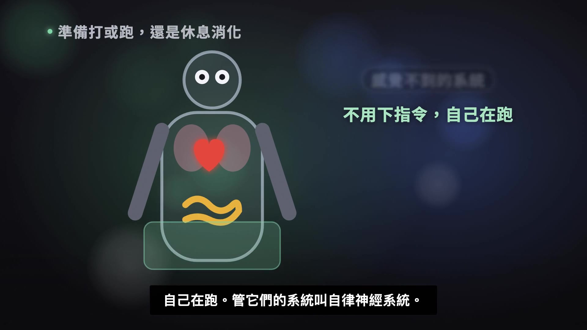

**逐字稿片段：** 管它們的系統叫自律神經系統 它分成兩支 一支叫交感神經 負責緊急狀況 危險出現 心跳加快 血壓上升 血液送到肌肉 消化暫停 瞳孔放大 準備打或者跑 另一支叫副交感神經 負責平常的日子 心跳放慢 好好消化 修補身體 免疫系統也有工作室 兩支通常一邊強另一邊就弱 助教舉了一個很具體的例子

**話題推測：** 介紹身體自動控制系統：自律神經系統

---

## 00:16:12

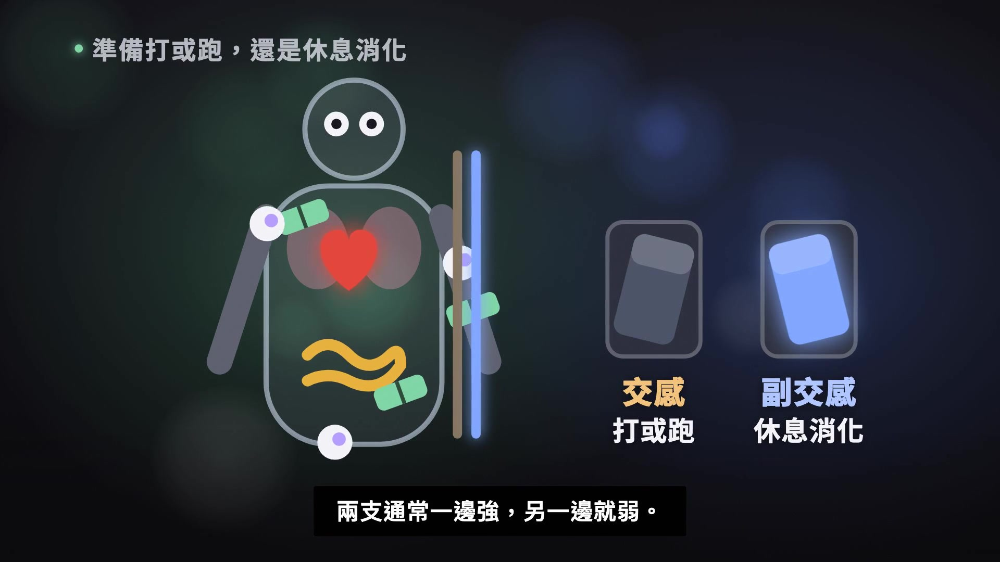

**逐字稿片段：** 乙型阻斷劑 心臟上接收交感神經訊號的受體 有一種叫乙型受體 這種藥把它擋住 心跳就沒辦法被摧壞 它原本是至高血壓的藥 可是在射箭跟射擊這種比賽 它被列為禁藥 因為手比較不會抖 成績幫助很大 你看緊張這件事不全在腦袋裡 有一部分就發生在心臟的受體上 擋住受體 腦子裡的擔心也許還在 身體卻不跟著抖 誰在指揮自律神經

**話題推測：** 舉例說明藥物作用：乙型阻斷劑 (Beta-blockers)

---

## 00:16:37

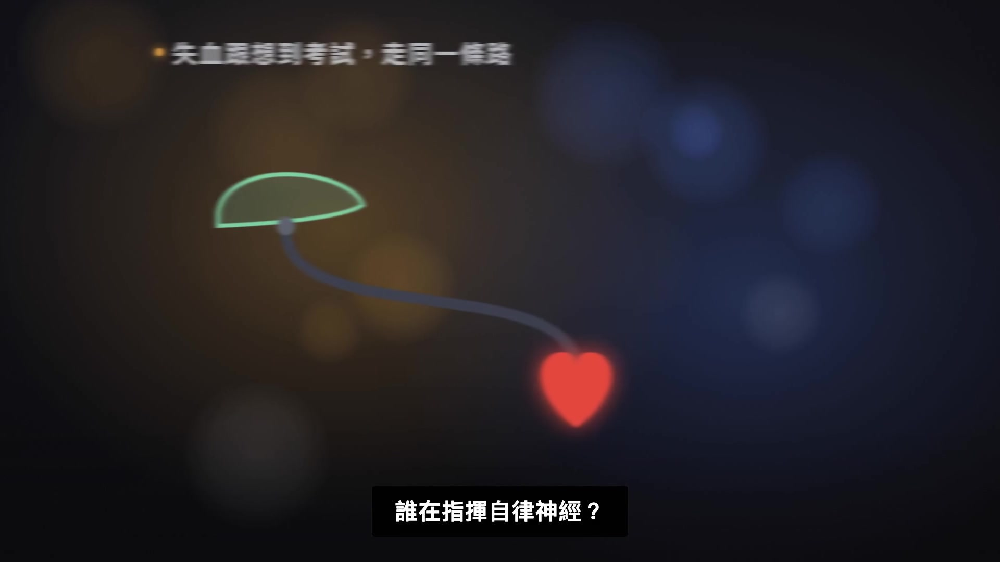

**逐字稿片段：** 中心在大腦底部一個叫下視丘的地方 下視丘 英文是Hypothalamus 他整天在監看身體的狀況 舉例來說你受傷 流了很多血 血壓往下掉 血管裡的感測器把消息送到下視丘 下視丘就讓 交感神經把心跳吹快 把血壓拉回來 爬蟲類就有這一套 很古老 也很可靠 哺乳類多了一層 光是看到天敵 聞到天敵 還沒受傷 同一套反應就啟動了 大腦外層的皮脂 人光是想到下心體的考試 想到一個不在身邊的人 心跳一樣會加快 手心要冒汗

**話題推測：** 介紹大腦中控制自律神經的中樞：下視丘 (Hypothalamus)

---

## 00:17:09

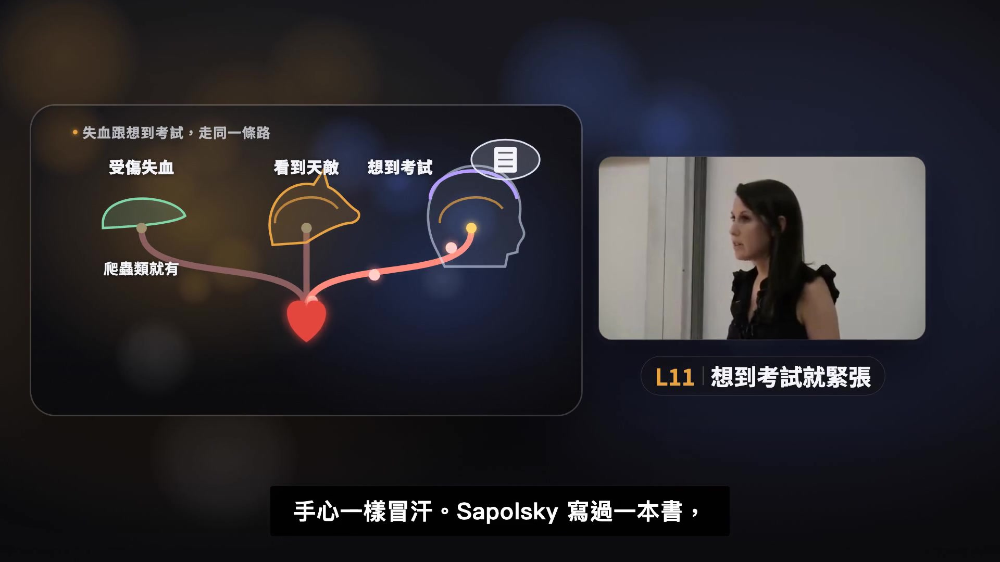

**逐字稿片段：** Szabowski寫過一本書 講的就是這件事 叫做什麼 斑馬不會得味潰瘍 斑馬被獅子追 幾分鐘就結束了 活下來身體就回到平常 人可以為了一個想法 把同一套緊急反應開上好幾個月 這一段讓我們看到 走進身體的外面 不一定是真的危險 一個念頭就夠了 對人來說 想像出來的獅子 跟真的獅子 身體分都沒有那麼清楚 神經傳化很快 可是傳得窄 一條線對一個點 身體還有另一套傳話的方式

**話題推測：** 提及Sapolsky的著作：《斑馬不會得胃潰瘍》

---

## 00:17:33

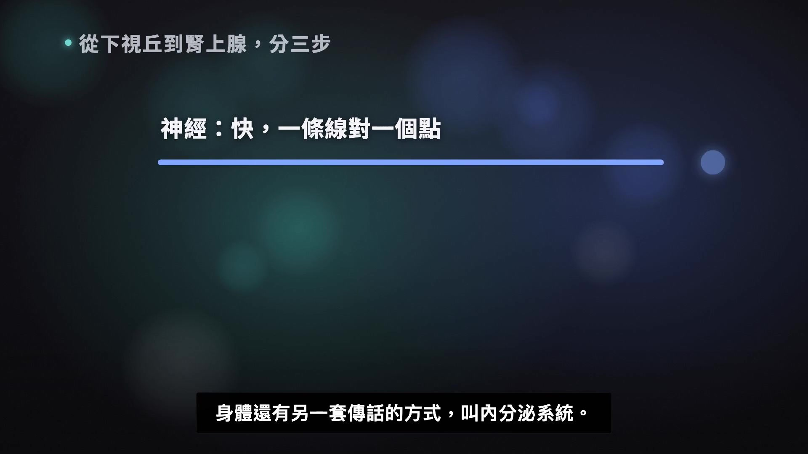

**逐字稿片段：** 叫內分泌系統 線體把化學物質放進血液 流到全身 這些化學物質叫荷爾蒙 中文也叫激素 荷爾蒙比神經慢 可是一次能讓全身的細胞一起改變

**話題推測：** 介紹另一種廣泛傳訊系統：內分泌系統與荷爾蒙

---

## 00:17:44

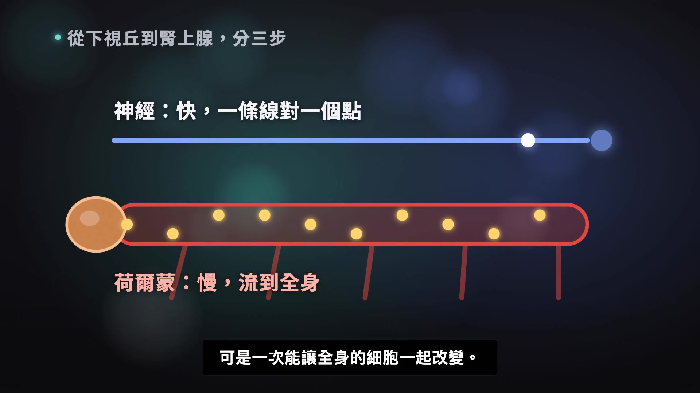

**逐字稿片段：** 這門課最常出現的一條路 叫下四丘腦下垂體腎上腺軸 英文簡稱HPA軸 它分三步 第一步壓力來了 下四丘放出一種荷爾蒙叫CRH 第一步CRH流到正下方的腦下垂體 腦下垂體放出ACTH 進到全身的血液 第三步 ACTH 到了腎臟上方的腎上腺 腎上腺放出糖皮質素 人身上最主要的一種叫皮脂醇 也就是大家說的壓力荷爾蒙 皮脂醇會把能量調出來應激 暫時壓住消化跟免疫 短時間這很有用 讓你應付眼前的麻煩 拖成好幾個月就開始傷身體 你注意第一步是誰 是大腦 所以壓力荷爾蒙放不放是大腦決定的 而上一段才說過 大腦光是一個念頭 就能啟動這件事 壓力荷爾蒙放出來了 什麼時候停 Sapolsky用了一個 每個家裡都有的東西來說明 馬桶的水箱 你衝完水 水箱開始進水 水裡有一顆浮球 水位越高浮球越高 升到一個高度 就把進水口關起來 水箱不用人看著 它自己涼自己停 這種亮到夠了 就自己關掉的設計

**話題推測：** 解釋壓力反應的主要路徑：HPA軸

---

## 00:18:40

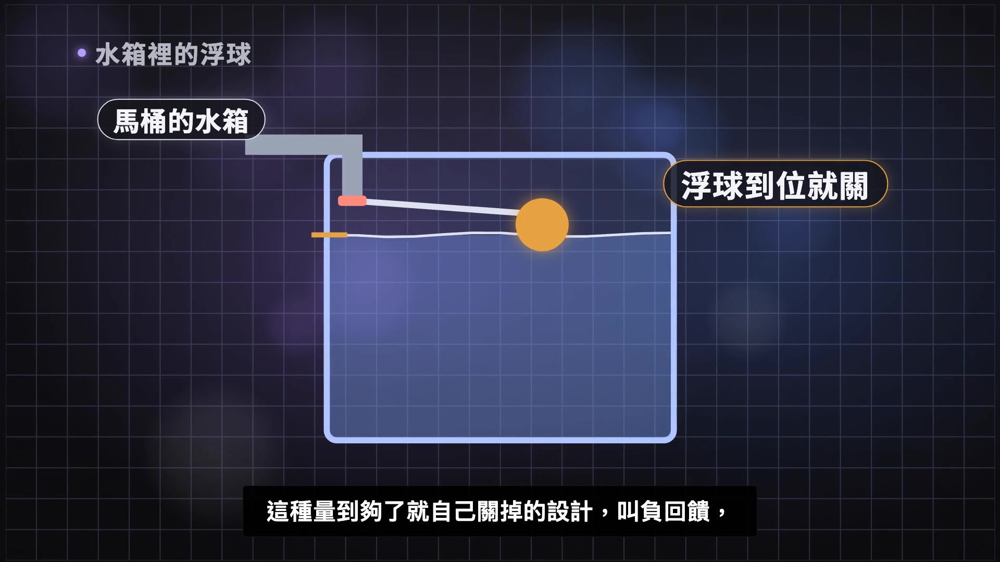

**逐字稿片段：** 叫復回饋 英文是negative feedback HPA角就是這樣 皮脂醇流遍全身 也流回大腦 下嗜秋跟腦下垂體上面 都有接收皮脂醇的受體 他們一直在數 薛離的皮脂醇夠了沒有 夠了 就少放一點CIH跟ACTH 整條路慢下來 前面講記憶的時候 提過的海馬迴 上面也有很多這種受體 他也參與把壓力反應關掉 浮球的比喻有一個界線 水槍的水位線是固定的 身體的這條線不是 它會跟著一天的時間 跟著你處在什麼狀況 一直在調整 所以同樣一件事 有人很快平復 有人要很久 差別有一部分 可能就在這條線設在哪裡 還有大腦數的準不準 三堂入門課講完 塞波斯基回到講臺 開頭的意思是 你們上星期學到的東西都太簡單了 他舉的例子之一還是壓力走 讓腦下垂體放出ACTH的 不是隻有CRH 還有好幾種荷爾蒙 其中一種叫血管加壓素 你單獨給血管加壓素 ACTH只上升一點點 你單獨給CRH ACTH上升比較多 兩個一起給 ACTH上升的比兩個分開加起來還多 血管加壓素自己不太下命令 他做的事是 CRH在的時候 把CRH的效果放大

**話題推測：** 解釋身體自我調節機制：負回饋 (Negative Feedback)

---

## 00:19:44

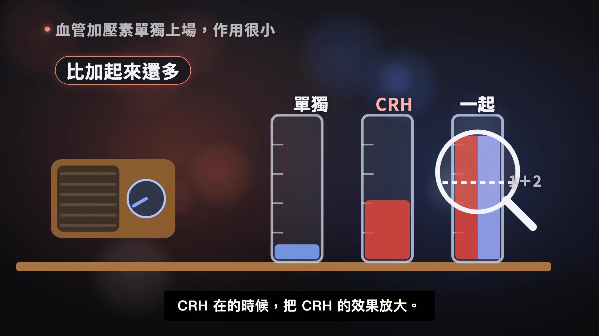

**逐字稿片段：** 這種作用有一個名字 叫調節 英文是modulation 你可以把它想成 一顆音量旋鈕 他不決定放哪一首歌 歌是別人選的 他只決定多大聲 沒有歌再放 你把旋鈕轉到底 也是一片安靜 大腦裡也有一樣的設計 有一種神經元 會接在另一個 神經元的軸突上 他自己不碰目標 只在對方要送訊號的時候 把那個訊號壓下來 Sabowski說 身體裡到處都是這種 如果另一件事正在發生 才起作用的訊號 再看一個你可能吃過的例子

**話題推測：** 解釋訊號調控的概念：調節 (Modulation)

---

## 00:20:09

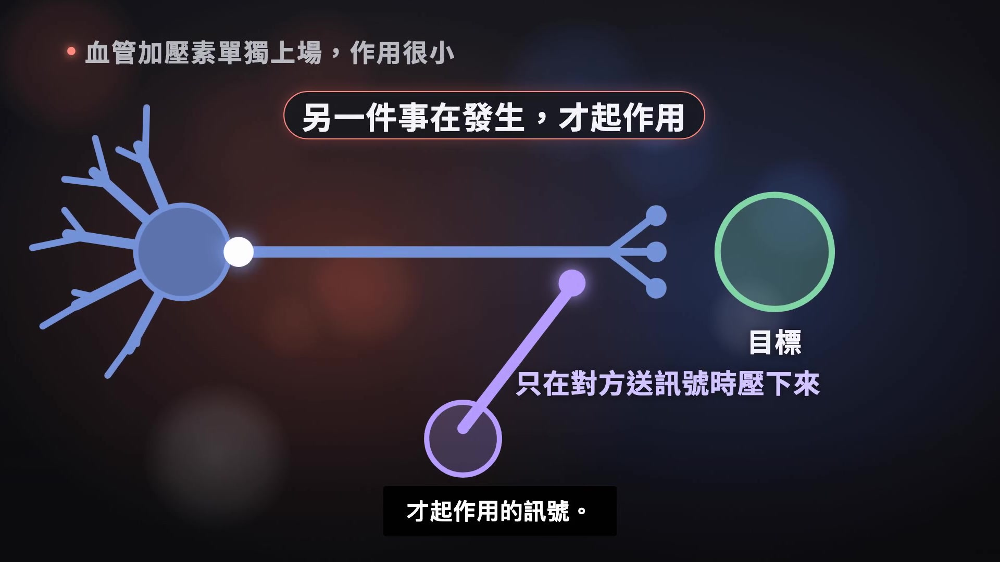

**逐字稿片段：** 大腦裡讓神經元 安靜下來的主要訊號 是一種神經傳導物質 叫GABA 它的受體不是一個簡單的零件 是好幾個蛋白質組成的大結構 上面除了GABA的位置 還有好幾個旁邊的位置 巴比陀類的麻醉藥 卡在其中一個位置 致焦率的這種二氮瓶類 像梵尼卡在另一個 還有一個位置 接的是黃體素轉化出來的分子 黃體素是女性的月經週期裡 會起伏的一種荷爾蒙 Sapolsky問全班 這些藥是直接讓神經元安靜 還是讓GGA更有效 差別在於強多少 巴比陀雷很強 強到可以讓人在手術檯上睡著 本類蛋瓶類溫和得多 這是調節的第二個例子 藥廠做出來的一些藥 其實是借用身體本來就有的調節位置 Zapolsky也提到 女性週期裡荷蒙的起伏 可能透過同一個受體影響情緒 不過這部分他說證據還在累積 還有一個常被忽略的地方

**話題推測：** 舉例說明GABA與鎮靜藥物的調節作用

---

## 00:21:01

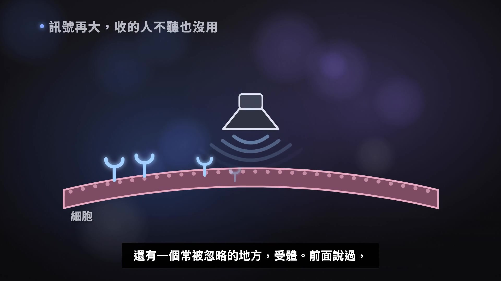

**逐字稿片段：** 受體 前面說過 訊號要卡進受體 對方才收得到 可是受體的數量是會變的 Zapolsky的說法是 如果有人一直對你大吼 你會慢慢不聽他 訊號太強 細胞就減少受體 訊號太弱 細胞就增加受體 這叫自我調整 它本來是保護 可是調過頭

**話題推測：** 討論細胞受體數量的自我調整

---

## 00:21:17

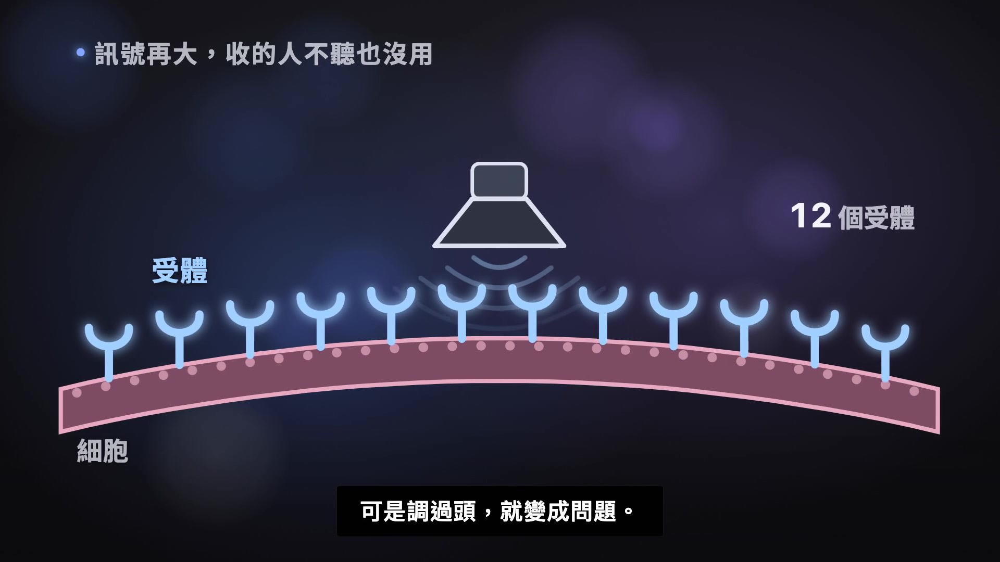

**逐字稿片段：** 就變成問題 第二型糖尿病是一個例子 長期吃得太多 血糖一直高 胰臟一直放胰島素 身體的細胞對胰島素越來越不理會 這叫胰島素主抗 胰臟只好放更多 細胞更不理 最後連胰臟都可能累壞 另一個例子是 抗憂鬱藥 像百憂解這一類藥 吃下去幾個小時 處理的血清素就變多了 可是病人常常要好幾個星期 才覺得好一點 一種主要的解釋是 真正起作用的是 受體在這幾個星期裡 慢慢改變的數量 所以Szabowski的結論是 訊號有多少很重要 收的人聽不聽得進去 一樣重要 每個人受體的多寡 跟種類都不一樣 這也是人跟人不一樣的一個來源 你會低調你的感受力 如果信號變得很弱 我們把第二部分收起來

**話題推測：** 舉例說明受體調整問題：第二型糖尿病與胰島素阻抗

---

## 00:22:16

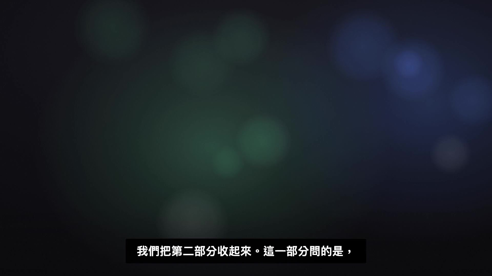

**逐字稿片段：** 這部分問的是 外面的訊號進到身體 中間那一段誰在傳話 答案也有三層 第一層 經驗會改變得出 一起放電的神經元會連在一起 這是環境走進身體最具體的方式 第二層 大腦跟身體靠兩套系統溝通 神經快而窄 荷爾蒙慢了廣 大腦光靠一個念頭 就能啟動整套壓力反應 再靠負回饋自己關掉 第三層 也是薩波斯基最想讓大家記得的 身體裡有很多訊號不下命令 他們在另一件事正在發生的時候 把它放大或者壓小 訊號多少重要 受體聽不聽得進去也重要 薩波斯基自己點出來 這跟上集講基因的那一句 是同一個形狀 基因說如果怎樣就怎樣 荷爾蒙跟神經也常常說 如果另一件事在發生 我才出手 所以中間那個盒子裡 大部分時候沒有一個發號施令的人 那情緒呢 害怕 渴望 生氣 這些是在大腦哪裡被放大被壓小的

**話題推測：** 總結第二部分內容

---

## 00:23:05

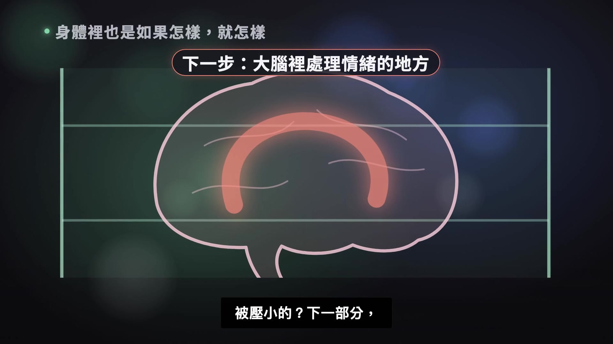

**逐字稿片段：** 下一部分 我們走進大腦裡專門處理情緒的地方 這個地方叫邊緣系統 英文是Lympic System 是大腦皮質底下 全互相連在一起的構造 它最早不叫這個名字 早期的解剖學家在老鼠的腦裡看到 負責嗅覺的嗅球非常大 送出去的線大多連到這一區 所以叫它鼻腦 後來另一批人發現 這一區跟情緒關係很深 改叫邊緣系統 兩派爭了很久 Sapolsky開玩笑說 真的像一場戰爭 答案其實要用動物行為學的方式想 對一隻老鼠來說 幾乎每一種情緒都跟氣味綁在一起 誰是敵人誰可以交配 誰是自己的孩子 都是聞出來的 所以對老鼠 鼻子的腦就是情緒的腦 換成靠聲音過日子的鳥 靠電流溝通的電雨 送進這一區最多的 就換成聲音換成電 人不是很靠嗅覺的動物 可是嗅覺的訊號 不用像視覺跟聽覺那樣 經過好幾個轉運站 很快就進到情緒的區域 這也許能解釋 為什麼一個味道比一張照片更容易 一下子把你拉回某個場景 邊緣系統的線路複雜到 Sapolsky自己都說 這是整門課圖最多的一堂 可是他給了兩個把他理清楚的方法 第一個方法 邊緣系統裡的每一個區域 最終都想做同一件事 告訴他試秋該做什麼 為什麼是下試秋 前一部分講過 下試秋一頭連著自律神經 一頭連著荷爾蒙 情緒要改變身體 最後都在經過這裡 所以每一區都想指揮下市丘 也都想讓別的區閉嘴 第二個方法是 數中間隔了幾站 一個區域如果直接連到下市丘 中間沒有轉手 它的影響就大 也快 如果要轉好幾手 每經過一站 就被那一站的意見改一點 到最後走樣 舉例來說 杏仁河有一條線 繞了一個大彎 可是中間不轉手 直接通到下市丘 那條線上的話 最有分量 這兩個方法合起來 複雜的線路就有了方向 這個方法以後很好用 看到一個腦區 先問他底下四秋幾戰 大概就知道 他在情緒裡有多少發言權

**話題推測：** 進入第三部分主題：邊緣系統與情緒

---

## 00:24:47

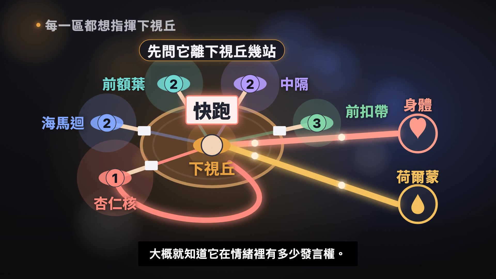

**逐字稿片段：** 先認識幾個主角 杏仁和 前面跳傘的漢已經見過他 他跟害怕和焦慮關係很深 也跟攻擊關係很深 塞波斯基認為這個重疊非常值得想 大腦裡最常為害怕亮起來的地方 也是攻擊開始的地方 換句話說 你要理解一個人為什麼動手 常常得先理解他在怕什麼 海馬輝 前面H&M的故事見過 他負責把新經驗寫成記憶 也參與把壓力反應關掉 這兩件事放在一起很合理 遇到危險 要記住剛剛怎麼逃出來的 下次遇到 要想起上次怎麼做 杏仁核跟海馬迴之間 也有線連著 你被一個聲音驚到過一次以後 一聽到就緊張 這種學習就需要他們合作

**話題推測：** 介紹邊緣系統的主要腦區之一：杏仁核

---

## 00:25:22

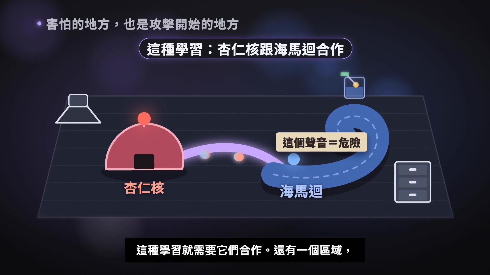

**逐字稿片段：** 還有一個區域 叫前扣帶皮子 你的手被墊了一下 它會活躍 你知道你愛的人 就在旁邊被墊一下 自己沒有痛 它也會活躍 這是2004年 一個很有名的研究 它跟感受別人的痛很有關係 害怕 記住 感受別人 這三件事 後面講性跟攻擊的時候會一直出現 邊緣系統還有一個特別的成員

**話題推測：** 介紹邊緣系統的主要腦區之一：前扣帶皮質 (Anterior Cingulate Cortex)

---

## 00:25:40

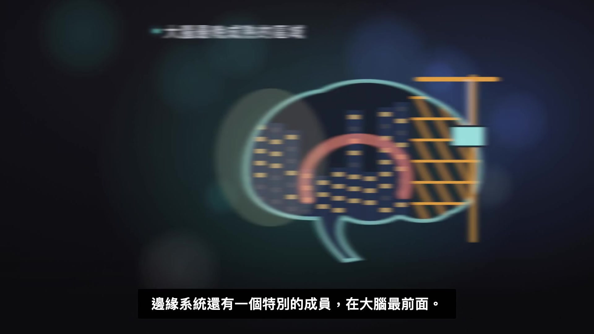

**逐字稿片段：** 在大腦最前面 荷蘭的神經解剖學家 Volignota一直主張 大腦皮質裡有一區 應該算進邊緣系統 這在當時很不受歡迎 皮質被當成理性的地方 邊緣系統是情緒的地方 怎麼能混在一起 後來證明它是對的 這一區叫前額葉皮質 它跟邊緣系統之間的線 多到分不開 它管的事情不是算數學 是控制衝動 延後享樂 做長遠的計劃 在情緒很強的時候 讓你做比較難的那個選擇 Sapolsky說 他是讓我們最像人的地方 也是整個大腦最晚成熟的區域 平均要到二十幾歲中斷 才算大致長好 他當場跟臺下的大學生說 你們大部分人的前額葉 還沒真正上線 全班笑了 前額葉不太發明性的動作 他決定的是 現在這個場合 這個動作該不該做 他管的 正好是我們第一部分說的那一半 什麼時候做對誰做 而他最晚長好 也代表他有最長的時間 被經驗塑造 研究邊緣系統 最常用的方法之一 是在某一區放電擊 輕輕刺激牠 看動物做什麼 Sapolsky說 這裡最需要的又是動物行為學那句話 用動物自己的語言去訪問牠 他舉了幾個例子 刺激同一個區域 老鼠開始把豹子撕碎 堆到角落 猴子卻抱起一個圓柱形的東西貼在胸前 看起來毫不相干 翻成那個物種的語言 一個在蛛巢 一個像在餵奶 都是照顧小孩 早年有一批研究 以為在哈士丘找到了公敵的區域 因為一刺激 老鼠就撲向籠子裡的小鼠 後來才弄清楚 老鼠本來就會吃小鼠 那很可能不是生氣 是劣質 生氣跟劣質在大腦裡走的是不同的迴路

**話題推測：** 介紹邊緣系統的主要腦區之一：前額葉皮質 (Prefrontal Cortex)

---

## 00:27:38

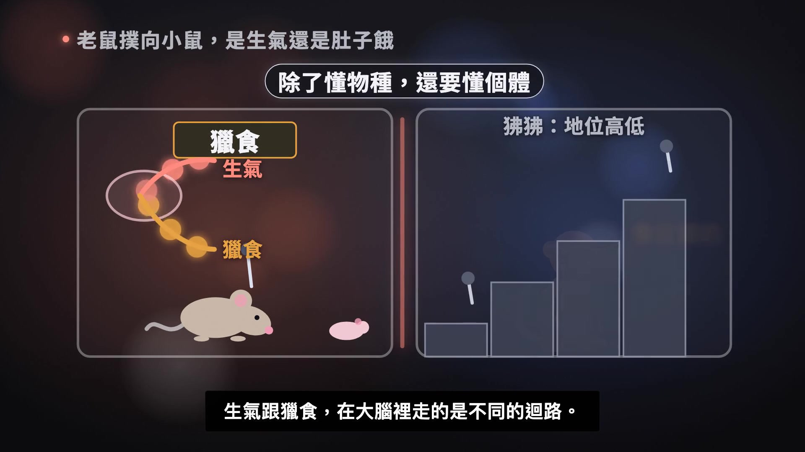

**逐字稿片段：** 除了懂物種 還要懂個體 Zaposki說 刺激同一個位置 一隻地位高的廢廢 會張大嘴 亮出犬齒威脅 同樣的刺激放在地位低的廢廢身上 常常什麼都沒發生 亨赫侯的實驗也一樣 刺激下刺繡引出的攻擊 多半打向地位比他低的同伴 大腦那一區有反應 可是要不要表現出來 對 誰表現 看他在群體裡是誰 邊緣系統裡還有一條線 跟渴望有關 大腦深處有一群會釋放多巴胺的神經元 他們把多巴胺送到一個叫伏格核的地方 再傳到大腦很多區域 過去大家以為 這是一條快樂的線 得到獎勵 多巴胺就上升 後來的實驗發現 事情比較細 一隻猴子學會一個規則 燈一亮壓乾十次 過一會就有果汁 剛開始學的時候果汁出現 多巴胺上升 學會以後多巴胺不在果汁出現的時候上升 在燈一亮的時候就上升 他好像在想 這個我會 這個我拿得到 Sapolsky說 如果在燈亮的時候把這個上升擋掉 動物就不太願意去壓感了 所以多巴胺講的不只是得到的快樂 更多是期待 而且他提供去追的力氣 期待跟快樂 聽起來很像在大腦裡卻是兩件事 Sapolsky說 骨科檢這類會讓人上癮的東西 直接或間接都作用在這條線上 讓人上癮的常常不是到手那一刻 是去追的那一路 接下來這個實驗

**話題推測：** 解釋渴望與獎勵系統：多巴胺與伏隔核 (Nucleus Accumbens)

---

## 00:28:46

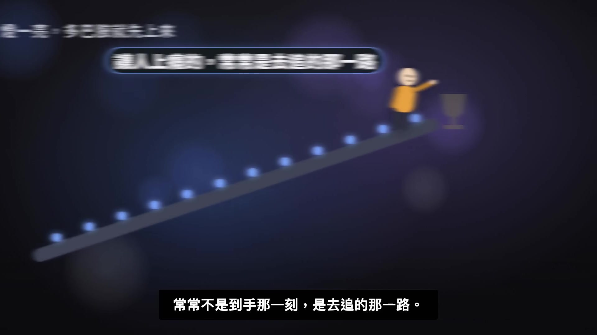

**逐字稿片段：** Sapolsky說是他看過最漂亮的研究之一 2003年 神經科學家Wolfram Schultz 在瑞士佛利堡大學的團隊 把規則改了 燈亮以後獎勵不一定會來 有時候是每次都來 有時候是一半的機會 有時候是四分之一 有時候是四分之三 你猜多巴胺在哪一種情況下最高 答案是50% 在等待結果的那段時間 這群多巴胺神經元的活動 在一半一半的時候最強 機會是四分之一或四分之三的時候 都比較低 這兩種情況剛好相反 一個獎勵比較多 一個比較少 他們的共同點是 也許比較小 最大也許在百分之五十 Zapolsky 說心理學家早就知道類似的事 要間歇爭搶 不確定會不會有獎勵的時候 動物跟人最賣力 他接著說拉斯維加斯的整個生意 就是讓你覺得眼前有一個百分之五十的也許 雖然真正的機會遠遠小於這個數字 他說明瞭 身體被放大的 不一定是獎勵本身 有時候是不確定 in contexts of maybe Psychologists have known this forever This is intermittent reinforcement than when you have introduced a maybe 到這裡我們看到的都是大腦指揮身體

**話題推測：** 介紹Wolfram Schultz關於多巴胺與不確定性獎勵的研究

---

## 00:30:04

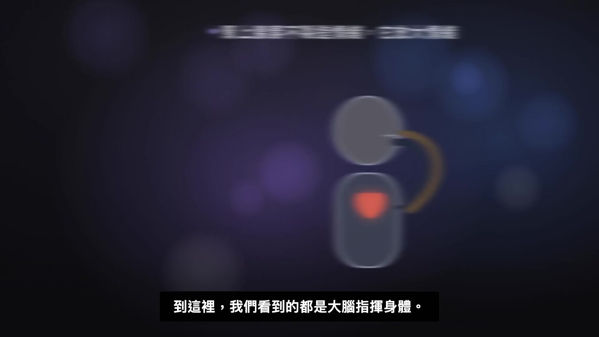

**逐字稿片段：** Sapolsky接著講反方向 19世紀末 美國的William James跟丹麥的Karl Lenk 各自提出一個聽起來很荒謬的理論 一般人以為 你先覺得害怕心跳才加快 他們說反過來 身體先反應 心跳先快了 大腦讀到身體的狀態 才判斷自己在害怕 這個理論 後來被批評了很多年 可是越來越多證據顯示 他至少說對了一部分 最有名的實驗在1961年

**話題推測：** 介紹William James與Karl Lange的情緒理論：身體反應影響大腦判斷

---

## 00:30:27

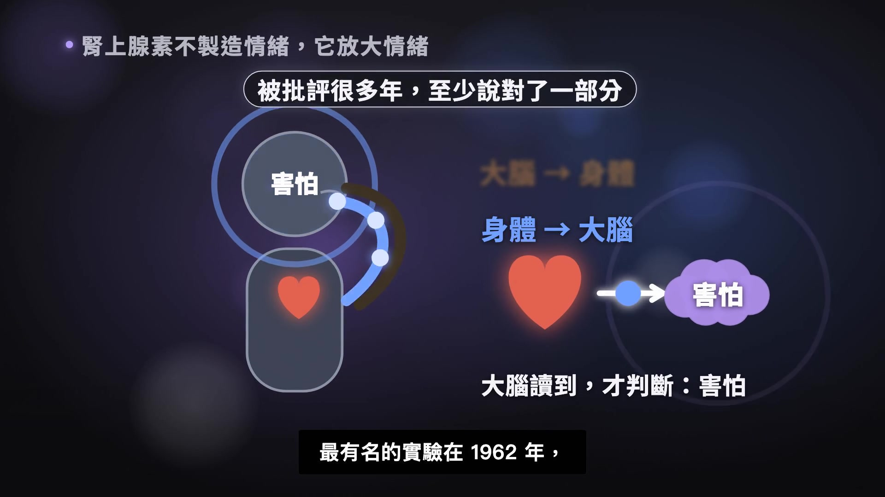

**逐字稿片段：** 心理學家Stanley Schachter 跟Jerome Singer 給受試者打了一針腎上腺素 跟他們說是維他命 然後請他們在後診室等 後診室裡有一個 研究人員假扮的受試者 有時候他很生氣 抱怨問卷很過分 有時候他很開心 在房間裡玩了起來 打了腎上腺素 也不知道自己會心跳加快的人 比較容易被帶著走 旁邊的人生氣 他跟著生氣 旁邊的人開心 他也玩起來 腎上腺素本身沒有決定是哪一種情緒 他把當下情境帶出來的那一種放大 這跟前面那顆音量旋鈕是同一件事 歌是情境選的 身體決定多大聲 後來有人重做這個實驗 結果沒有這麼幹淨 可是他留下的想法 影響到今天 Sepolsky把這個理論 用在一個很多伴侶都遇過的場景 兩個人吵架 一方做錯了事 另一方很生氣 做錯的人道歉很誠懇 對方也接受了 事情講清楚結束了 可是過了幾分鐘 生氣的那一方突然想起 好多年前的另一件事又吵起來 Sapolsky的解釋是 想通只要一秒 身體退回平靜要好幾分鐘 交感神經還在跑 心跳還快 大腦讀到這個狀態 就一定還有原因 就去記憶裡找一個 找到了就說出口 這是他的一個說法 不是實驗結果 可是他很能說明 身體怎麼回頭影響想法 另一個例子是藥 致焦慮的本二單瓶類 同一種藥 也被拿來放鬆抽筋的肌肉 為什麼同一顆藥有兩種用途? Szypowski的解釋是 焦慮有一部分是大腦在讀肌肉繃的多緊 肌肉一放鬆 大腦讀到的訊號就變了 事情一樣糟 人卻覺得沒那麼糟 所以決定情緒的不是大腦單方面 而是大腦跟身體來回在對話 I'm still feeling totally agitated It must be for some reason It's what that person did to me In the second Roosevelt administration And suddenly out it comes out

**話題推測：** 介紹Schachter-Singer的情緒雙因素實驗

---

## 00:32:19

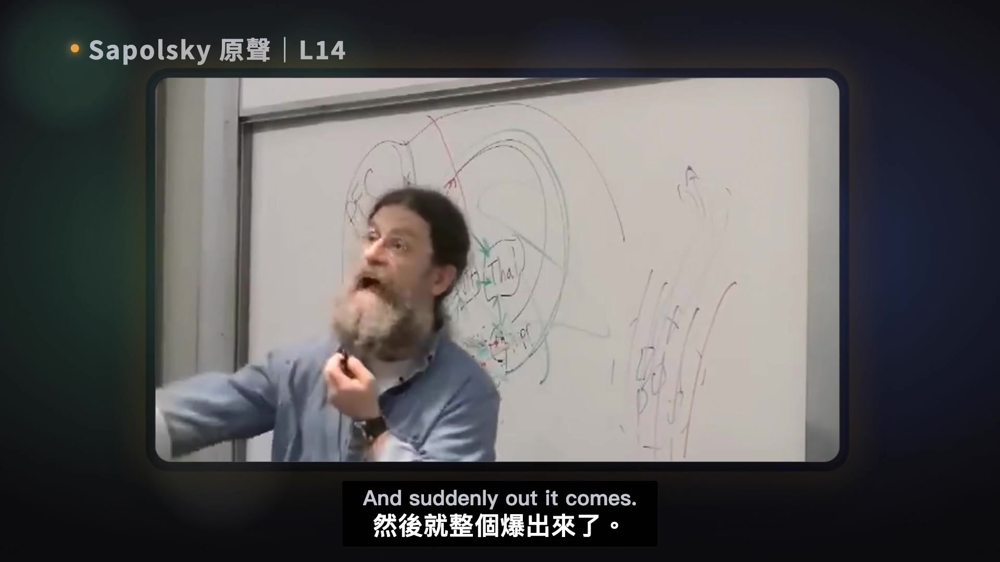

**逐字稿片段：** 接下來 Sapolsky用前面所有工具 去看兩種最常被說成天生的行為 先看性 很多人以為 男性的性慾是殘固酮推出來的 殘固酮越多欲望越強 證據怎麼說 研究的人拔工了大鼠去世 拿掉反固酮的來源 性行為大幅下降 再把反固酮補回正常的量 性行為回來了 看起來是因果 可是Sapolsky 要你看兩個細節 第一個細節 去世以後性行為下降 但沒有歸零 去世之前經驗越多的動物 之後留下來的越多 貓的研究是這樣 人也有類似的觀察 留下來的那一部分 靠的是經驗 第二個細節更關鍵 Sapolsky舉的範圍是 補回去的量 從正常的十分之一 到正常的兩倍 性行為恢復的程度差不多 只要過了一個 比正常還低的門檻 大腦就夠用了 它不在乎多一點少一點 所以兩個男人之間 做的是調節 它降低反應的門檻 讓情境裡的訊號比較容易起作用 Sepolsky說 下一個題目攻擊 會看到幾乎一樣的圖

**話題推測：** 進入具體行為分析：性行為

---

## 00:33:43

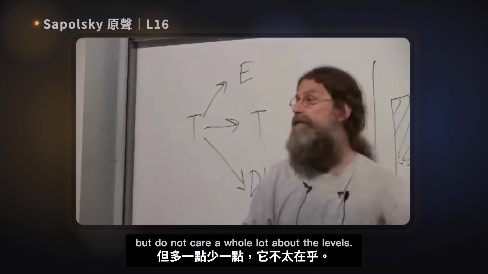

**逐字稿片段：** 那經驗跟童年對性行為做了什麼 Zapolsky的整理是一句話 早年的經驗 很少在教一隻動物怎麼做 他教的是在什麼情境下做 跟誰做 動作本身 相當接近第一部分講過的固定動作模式 在群體裡長大的猴子 學到的是誰可以接近 誰最好不要靠近 什麼場合該收斂 上集講過的以色列集體農場 就是人類的例子 六歲以前天天在同一間兒童屋長大的孩子 長大以後很少互相結婚 沒有人禁止 可是他們就是很少把對方當成對象 早年的共同生活 悄悄改寫了對象名單

**話題推測：** 探討經驗與童年對性行為的塑造

---

## 00:34:15

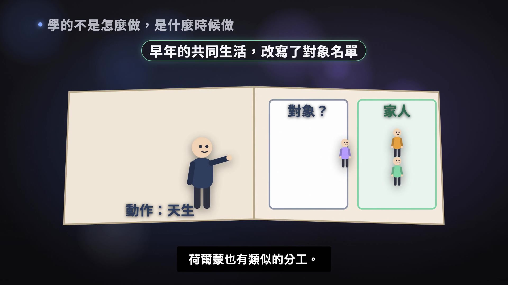

**逐字稿片段：** 荷爾蒙也有類似的分工 在胎兒時期跟剛出生的時候 荷爾蒙會影響大腦怎麼長 這叫組織作用 長大以後 荷爾蒙在當下起作用 這叫活化作用 Sapolsky舉的猴子實驗裡 常常要兩個都有 某些行為才會出現 又是一個如果怎樣就怎樣 走到這裡 你可以看出這一部分的形狀 性行為的動作 大多是天生帶來的對象跟時機 是一路被跳出來 這幾堂課裡Sapolsky也花了不少時間講性傾向的生物學

**話題推測：** 解釋荷爾蒙的兩種作用：組織作用與活化作用

---

## 00:34:39

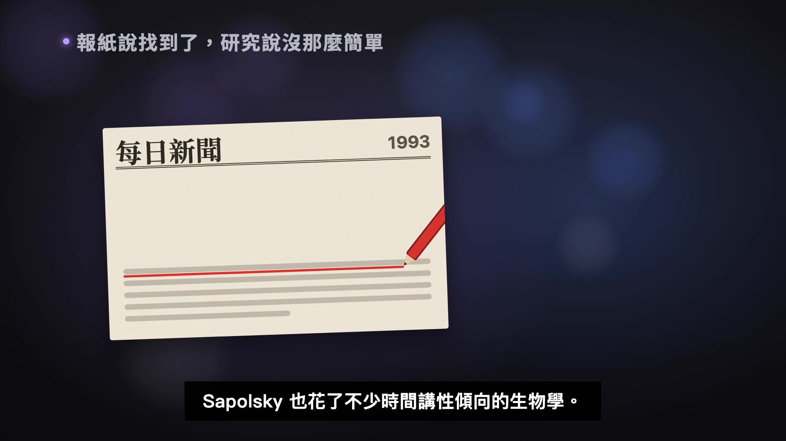

**逐字稿片段：** 他特別提醒 這是一個很容易被說過頭的題目 1993年 美國國家衛生研究院的遺傳學家Dean Hammer 發表研究 說在X染色體的一個區段 找到跟男性同性戀有關的遺傳標記 沒多久 報紙的標題變成 科學家找到同性戀基因 Sapolsky一條一條指出問題 那是標記 是染色體上的一個位置 不是一個基因 而且後來很多團隊想重現 結果不一致 更早的雙胞胎研究也要這樣讀 同卵雙胞胎裡 一個是同性戀 另一個也是的比例 明顯比異卵雙胞胎高 可是遠遠不到全部 這說明基因有影響 也說明基因不是全部 何況同卵雙胞胎被對待的方式 本來就更像像 2019年 一個用了將近50萬人資料的研究 結論也類似 沒有單一的基因 有很多個位置 每個影響都很小 加起來也是說明一部分的差異 扎波斯基的重點 不是他算不算天生 他是提醒我們 讀這類新聞 要先問清楚他到底找到了什麼

**話題推測：** 討論性傾向的遺傳學研究

---

## 00:35:32

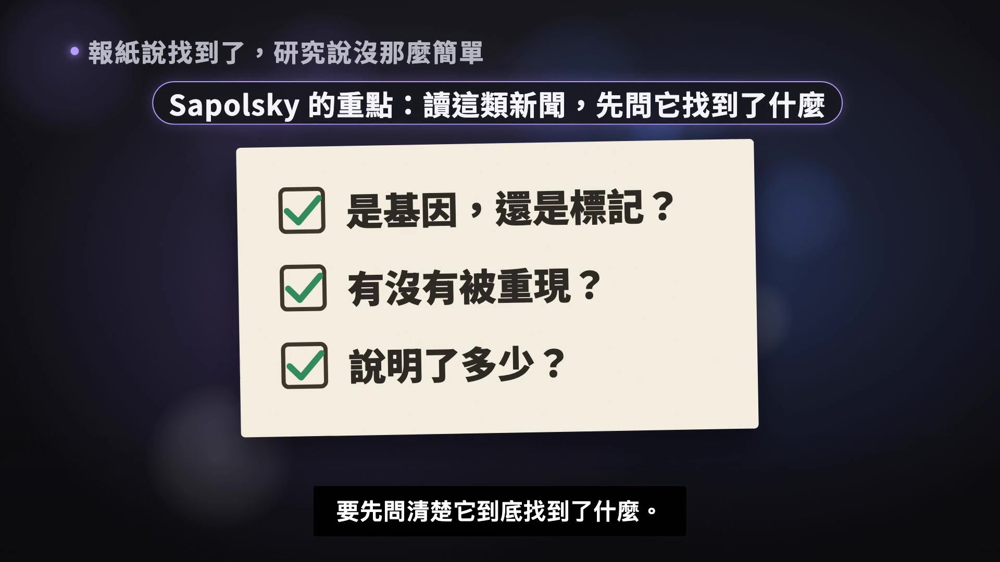

**逐字稿片段：** 接著是攻擊 Czapowski開場講他自己的事 他踢了好幾十年的業餘足球 踢得不好 有一陣子 對面老是有一個年輕人防守他 比他高比他快 還常常偷偷犯規 用手都頂他 有一天 兩個人一起往角落跑 球在另一邊沒人在看 他把腳伸出去 絆了那個人一下 對方滾進一攤泥巴裡 Czapowski說 他連一句你還好嗎都沒說 那是他好幾個月來最開心的一刻 全班大笑還有人鼓掌 然後他問 如果我絆倒的是曼德拉呢 當時的曼德拉91歲 身體很虛弱 同一個動作 一樣的肌肉 臺下的人會覺得很可怕 這就是他接下來所有攻擊課的出發點 我們不是討厭暴力 我們討厭錯的暴力 對著場合 同樣的動作會讓人拿獎牌 被升官被選上 所以攻擊的生物學 很少是在學怎麼動手 大多在學什麼時候對誰 他還說 神經疾病讓攻擊失控的時候 出問題的常常也不是力氣變大 是場合錯了 人常說只有人會有計畫的莉莎同類 只有人會打仗 Sapolsky說 這兩句都被野外研究推翻了

**話題推測：** 進入具體行為分析：攻擊行為

---

## 00:36:54

**逐字稿片段：** Jane Goodall在坦薩尼亞觀察的黑猩猩 公黑猩猩會成群巡邏領域的邊界 遇到隔壁群落落單的公黑猩猩 會圍上去把他打死 1970年代 他記錄到一個群落 在幾年之間 把分出去的另一群 一隻一隻撒光 可是故事的另一面也被推翻了 荷蘭的領長類學家 Franz de Waal 在1970年代末發言 黑猩猩打完架以後 比平常更容易互相擁抱 互相禮貌 這叫和好 後來在很多物種身上都看到 而且越需要彼此合作的兩隻 越容易和好 2006年 加拿大麥基爾大學的研究更新 一隻小鼠看到另一隻小鼠在痛 自己對痛會變得更敏感 可是這件事 對方是銅龍的室友才明顯 陌生的小鼠就沒有 銅理性的雛形在動物身上就有 而且他也看對象 殺戮跟和好都不是人類發明的 兩邊都取決於對方是誰 不過 人類確實把攻擊帶到了別的動物去不了的地方

**話題推測：** 介紹Jane Goodall對黑猩猩攻擊行為的觀察

---

## 00:37:44

**逐字稿片段：** 西波斯基講了一個朋友女兒的故事 她五歲在幼稚園跟一個同學吵架 打破了對方的復活節彩蛋 老師要她畫一顆心的陪給對方 他躲到角落一直回頭瞪大家 掛好了交出去 那是一顆整顆塗成黑色的蛋 對方一看就哭了 他照著規定做了 同時把規定的意思踩在腳底下 而且對方一看就懂 他也講了另一個例子

**話題推測：** 舉例說明人類攻擊的複雜性：五歲女孩的黑色彩蛋

---

## 00:38:03

**逐字稿片段：** 2010年前後 內華達州 一個空軍基地 有人早上家人道別 開車上班 坐進一個模擬駕駛艙 操控在半個地球外的無人機 發射飛彈 下班去拿送洗的衣服 去看女兒的芭蕾表演 人類可以靠一根手指 一句冷淡的稱讚 一次故意的不理睬去傷人 可是Sepulski也說 人類的和好一樣走得很遠 他提到在監獄陪伴死刑犯的修女Helen Pridgen 有人問她怎麼做得下去 Sepulski轉述她的回答 越難原諒的事越需要被原諒 暴力跟原諒 在人身上都可以離身體很遠 靠的是同一個會想的大腦 後來她的父親看著她的肩膀 在工作的地方 在看著她的肩膀 最後她就跟其他孩子說 這裡是你的蠢蛋 祝你聖誕快樂 給了她一個完全黑色的蛋 最後

**話題推測：** 舉例說明現代人類攻擊：無人機操作員

---

## 00:39:09

**逐字稿片段：** Zaposki回到大腦 攻擊發生的前一秒 大腦裡發生了什麼 他第一個找的還是杏仁核 破壞動物的杏仁核 很難再引出攻擊行為 刺激它 攻擊比較容易出現 人類這邊 有一段很不光彩的歷史 1967年 美國的城市發生暴動 三位醫生寫訊到一份醫學期刊 暗示暴力跟大腦的毛病有關 可以從大腦下手 後來確實有人對暴力的病人 做破壞性人核的手術 爭議很大 他也許減少了攻擊 也拿走了一個人 很多別的東西 1966年

**話題推測：** 分析攻擊行為的大腦機制，再次提及杏仁核

---

## 00:39:37

**逐字稿片段：** 在德州大學鐘樓上 開槍的Charles Whitman 死後解剖發現腦裡有一顆腫瘤 長在四丘下方 有人推測他壓迫到性人核 調查委員會說 腫瘤可能有影響 但沒辦法確定

**話題推測：** 提及Charles Whitman案例與腦部腫瘤的關聯

---

## 00:39:53

**逐字稿片段：** 追蹤一位杏仁核受損的病人 看人臉時的眼睛 發現他幾乎不看別人的眼睛 所以很難認出害怕的表情 請他刻意看眼睛 他就認得出來 杏仁核不只對危險起反應 他還決定你往哪裡找危險 薩波斯基說

**話題推測：** 介紹杏仁核受損對人臉視覺處理的影響

---

## 00:40:07

**逐字稿片段：** 下一堂要講顧孔 以及他怎麼讓人更容易 把摩連兩可的訊號看成威脅 我們回到開場那個問題 你生氣害怕心動的那一秒 身體裡是誰在決定 九來克走了三步 第一步在野外 動物天生帶著一套動作 還有一些特別容易學會的東西 可是什麼時候做 對誰做 要靠經驗 第二步 打開身體 經驗會改變提出 一個念頭就能啟動壓力反應 而身體裡很多訊號不下命令 他們在另一件事發生的時候把它放大或壓小 第三步走進情緒 多巴胺講的是期待 腎上腺素放大情境給的那種情緒 沾固同在正常範圍裡 多一點少一點差別不大 同一個半導的動作 對象換了 意義就換了 所以這集的答案是 那一秒裡多半沒有誰在下命令 動作很古老 常常是天生的 什麼時候對誰 是一路被情境跟經驗調出來的 這也接回上集的那個問題 你以為的天生常常是動作那一半 下一批課 賽卜斯基會繼續講攻擊 從昂固同講到童年 再講到競爭跟合作 最後問你一個問題 你有沒有個反應 你一直以為是天生的脾氣 後來才發現 他只在某些人面前 某些場合才會出現 留言告訴我 喜歡的話訂閱AI Notebook 開啟通知 我們下次見

**話題推測：** 預告下一堂課將討論的主題

---
