# jimainotebook_q5m0XsqgzrE — 關鍵畫面索引

- 來源逐字稿：[jimainotebook_q5m0XsqgzrE_FIN.srt](jimainotebook_q5m0XsqgzrE_FIN.srt)
- 影片：https://www.youtube.com/watch?v=q5m0XsqgzrE
- 截圖數：83

## 00:00:07

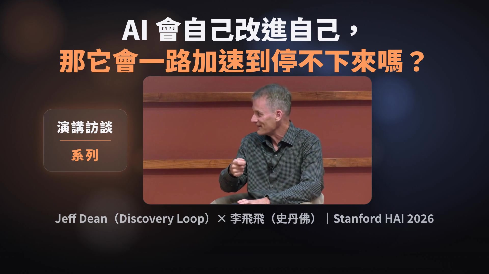

**逐字稿片段：** 大家好,我是Jim,這裡是AI Notebook。

**話題推測：** 影片開場與頻道介紹

---

## 00:00:10

**逐字稿片段：** 這一集是演講訪談系列,要回答一個最近很多人在問的問題。 AI會自己改進自己,那它會一路加速到停不下來嗎?

**話題推測：** 介紹本集主題：AI自我改進是否會無限加速

---

## 00:00:18

**逐字稿片段：** 我們頻道之前那一集,Anthropic的共同創辦人Jack Clark說, 這種加速已經開始了,他用的詞叫起點。

**話題推測：** 提及Anthropic共同創辦人Jack Clark的觀點

---

## 00:00:25

**逐字稿片段：** 這一集,我們聽另一個方向的回答。

**話題推測：** 引導至本集探討的不同觀點

---

## 00:00:27

**逐字稿片段：** 2026年10月28日,史丹佛大學以人為本人工智慧研究院的年會,

**話題推測：** 介紹訪談發生的時間與地點（史丹佛AI研究院年會）

---

## 00:00:31

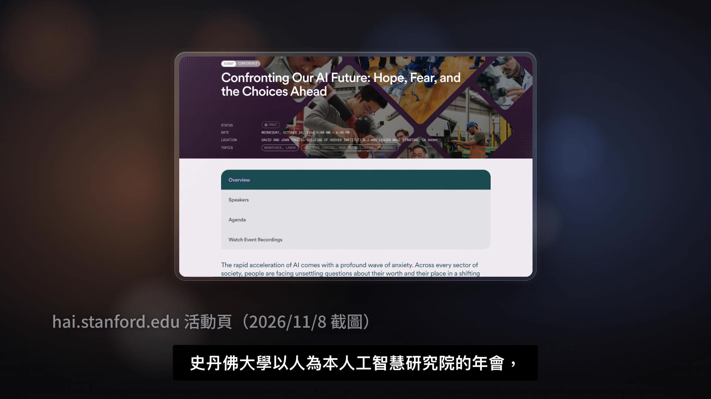

**逐字稿片段：** 最後一場是Jeff Dean和李飛飛的對談。 李飛飛問得很直接 好幾次要Dean把話講清楚

**話題推測：** 介紹對談講者Jeff Dean和李飛飛

---

## 00:00:37

**逐字稿片段：** 我們分三步 先把AI改進自己這句話講清楚 再看它為什麼不會無限快 最後看哪些事真的會先變快

**話題推測：** 說明本集討論的三個步驟

---

## 00:00:44

**逐字稿片段：** 先認識臺上的主講人

**話題推測：** 介紹主講人Jeff Dean的背景

---

## 00:00:46

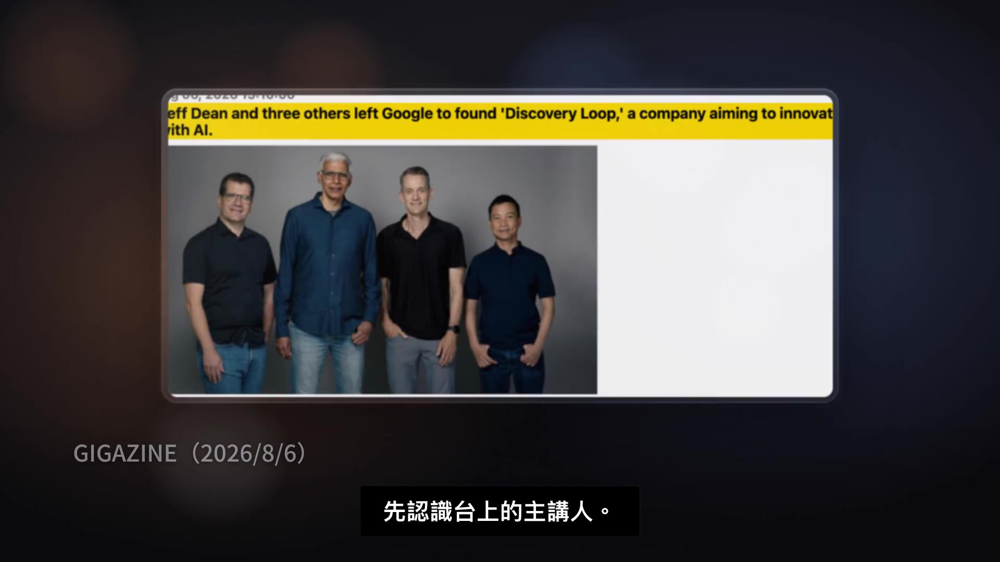

**逐字稿片段：** Jeff Dean在1999年加入Google 待了27年 Google早期用來處理大量資料的幾套系統 他是主要的設計者之一 很多人拿來訓練AI的工具TensorFlow 他也參與打造 這幾年他是Google的首席科學家

**話題推測：** 介紹Jeff Dean在Google的資歷與貢獻

---

## 00:01:00

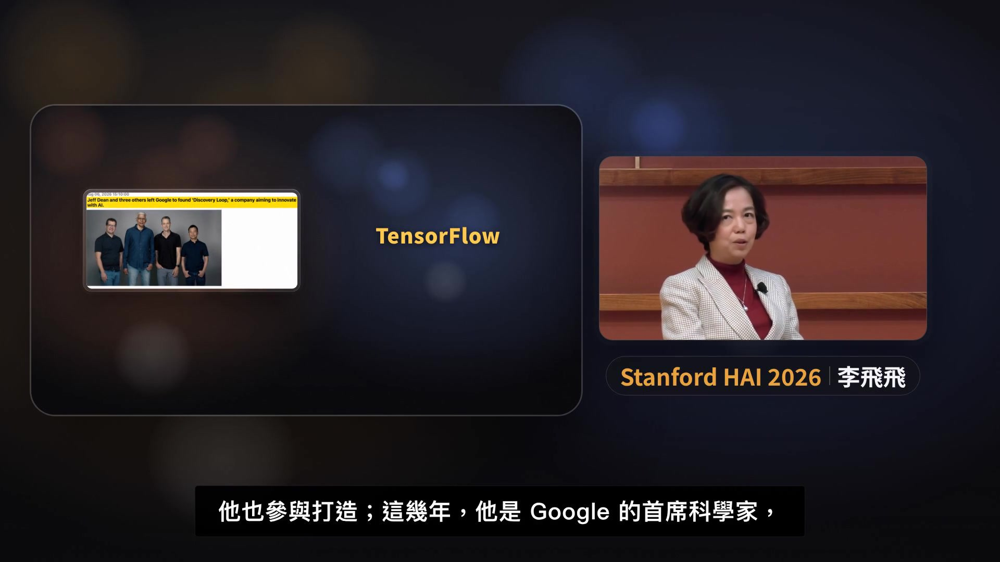

**逐字稿片段：** 也是Gemini的共同負責人 過去十幾年 把AI模型一代一代做得更強 就是他每天的工作 所以要問AI能不能自己變強 他是最有資格回答的人之一 2026年8月 他和三位合作了十幾年到三十年的老同事 一起離開Google

**話題推測：** 提及Jeff Dean是Gemini的共同負責人

---

## 00:01:16

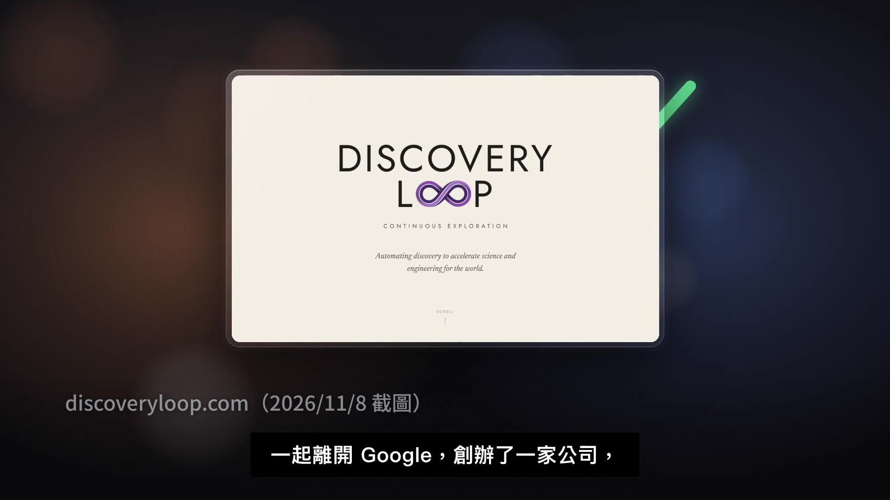

**逐字稿片段：** 創辦了一家公司叫Discovery Loop Google沒有跟他們鬧翻 反而當了創始投資人 他在臺上 先交代了自己怎麼從大主管 變回帶小團隊的人 AI teams up to about 4,400 people 我決定在Q2的OPEX的會議上花很多時間 in meetings about Q2 OPEC spending and I pressed them on an email that took me from 4,400 to 4 reports 然後Jeff Hinton退休了,所以我才有三個

**話題推測：** 介紹Jeff Dean創辦的新公司Discovery Loop

---

## 00:01:49

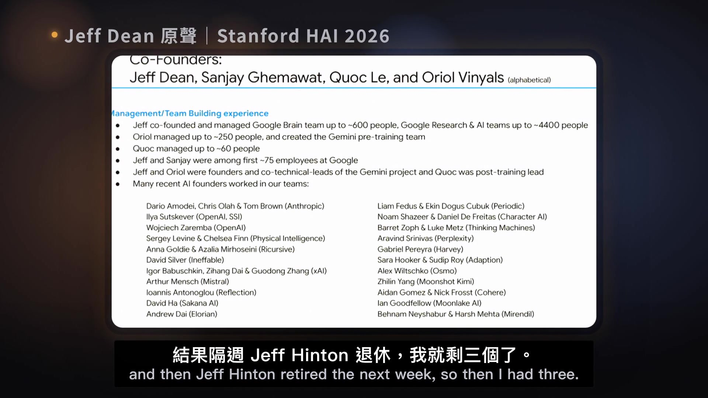

**逐字稿片段：** so then I had three 公司的名字就是他們要做的事 科學和工程研究常常在重複同一個循環

**話題推測：** 解釋Discovery Loop的公司理念

---

## 00:01:56

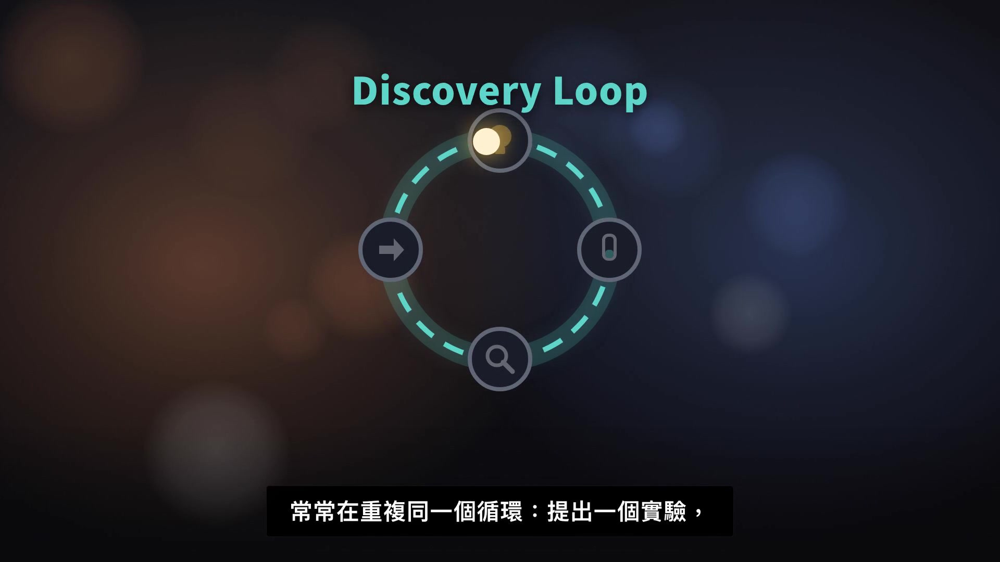

**逐字稿片段：** 提出一個實驗 把實驗做完 看結果 再決定下一個實驗 定想讓AI自己轉這個循環 每一圈轉得更快 一次轉很多圈 而且每一圈都從前面的結果學到東西 他還想象以後一個系統解過幾千個問題 遇到新問題時會先去參考最像的那幾個 李飛飛先問他 為什麼是現在 又為什麼要離開Google出來做

**話題推測：** 說明Discovery Loop欲自動化的科學研究循環

---

## 00:02:17

**逐字稿片段：** 他提到同事Quarkly十年前做過的一個研究 叫神經架構搜尋 讓電腦自己去試各種模型的結構 找出比較好的那一個 他說那個方法是有用的 只是當年做起來很麻煩 他說十年前要搜尋的範圍 得由工程師寫成一大堆拼拼湊湊的Python程式 現在可以直接跟一個夠強的模型 加上代理程式說 去找找看

**話題推測：** 引用Quarkly十年前的神經架構搜尋研究

---

## 00:02:38

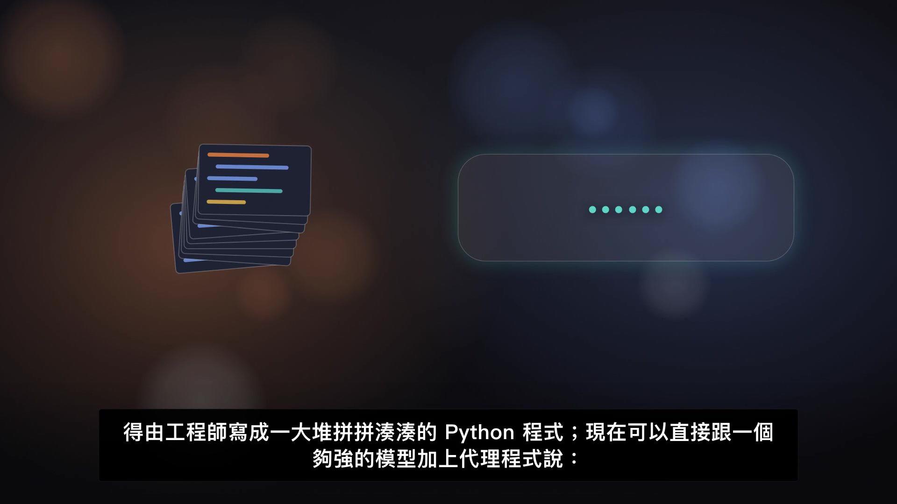

**逐字稿片段：** 有哪些模型結構 能幫忙判讀核磁共振影像 他就會自己去做 Dean說 這是電腦能做什麼的一個很大的轉變

**話題推測：** 以判讀核磁共振影像為例說明AI的應用潛力

---

## 00:02:46

**逐字稿片段：** 他還說了另外兩個理由 一個是 他們喜歡從五個人開始做一件事 加到第六個、第七個人的那種感覺 他也強調 目標是讓專家做事快上幾十倍 不是把人拿掉 現在他們用自己做的代理程式工具開發 頭三週就已經有一批自動改進的循環在轉

**話題推測：** Jeff Dean說明創立新公司的其他理由

---

## 00:03:03

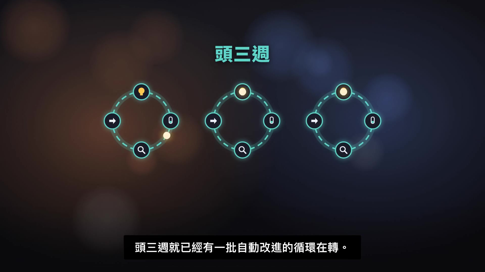

**逐字稿片段：** 另一個理由 是想把公司做成一種叫公益公司的形式

**話題推測：** 說明Discovery Loop採公益公司形式的理由

---

## 00:03:07

**逐字稿片段：** 公益公司是在法律上除了賺錢 也要追求公司寫下的公共使命的公司 丁在回答時還順口說了一句 十年前那種讓電腦自己找模型的研究 可以看成AI自己改進自己的早期版本

**話題推測：** 解釋公益公司的法律定義

---

## 00:03:19

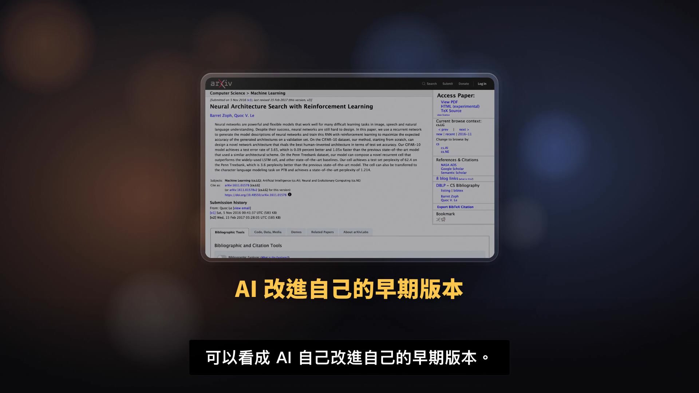

**逐字稿片段：** 到底怎樣才算AI自己改進自己 正是李飛飛接下來要追問的

**話題推測：** 李飛飛提問AI自我改進的嚴謹定義

---

## 00:03:23

**逐字稿片段：** 再介紹問問題的人

**話題推測：** 介紹問問題的人李飛飛的背景

---

## 00:03:26

**逐字稿片段：** 李飛飛是史丹佛大學電腦科學教授

**話題推測：** 介紹李飛飛的學術背景與ImageNet貢獻

---

## 00:03:28

**逐字稿片段：** 他帶頭建立的圖片資料庫ImageNet 有上千萬張由人標好的圖片 2012年,一個神經網絡在ImageNet的比賽裡大幅勝出 很多人把那一年看成深度學習起飛的起點 他也是這個研究院的創辦所長

**話題推測：** 提及李飛飛建立的ImageNet圖片資料庫

---

## 00:03:41

**逐字稿片段：** 現在另外創辦了一家公司World Labs 做能理解立體空間的AI 他和Dean是同一個年代念機器學習的人 兩個人很熟

**話題推測：** 提及李飛飛創辦的新公司World Labs

---

## 00:03:49

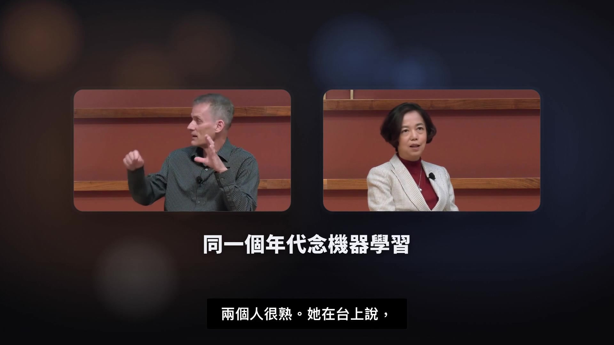

**逐字稿片段：** 他在臺上說,這個概念這些年換過好多名字 從持續學習、原學習 一直到今天最流行的兩個說法 他說,現在在矽谷,很多人把這些詞用得很鬆 身為科學家,這讓他很困擾 他要Dean給一個嚴謹的定義 把虛構和事實分開 他說 現在這個概念的炒作太多 能在公開場合好好討論 機會很少

**話題推測：** 說明AI自我改進概念的不同稱謂演變

---

## 00:04:10

**逐字稿片段：** Dean先說 演講裡那種循環 可以套在很多問題上 他的回答分成兩個名詞

**話題推測：** Jeff Dean開始定義AI自我改進

---

## 00:04:16

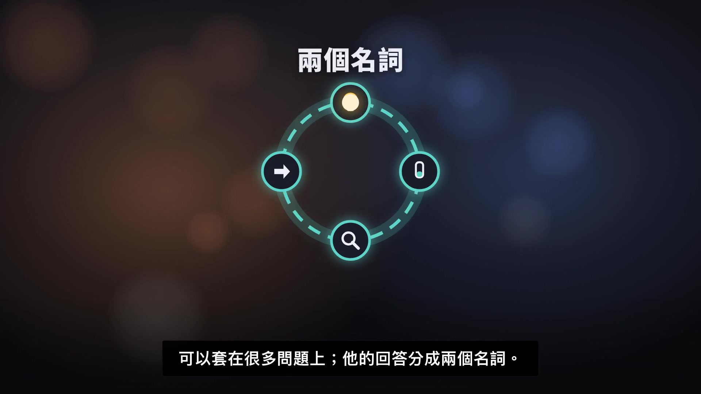

**逐字稿片段：** 一個叫自我改進 自我改進 是給系統一個可以測量的目標 讓他自己去試 把成績越做越好

**話題推測：** 解釋第一個概念：自我改進

---

## 00:04:23

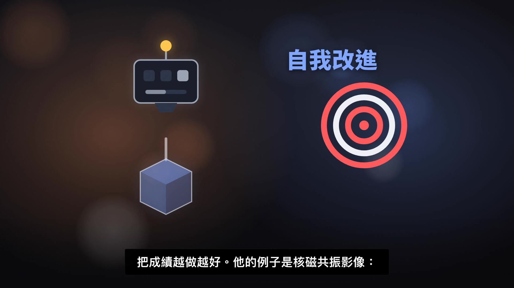

**逐字稿片段：** 他的例子是 核磁共振影像 把一大批影像和診斷結果 交給系統 要他做出一個判讀影像的模型 系統一次一次 是不同的做法 模型就越來越準 李飛飛在這裡插話 很多機器學習方法 本來就做得到這件事 這本身不算遞迴 Dean同意 因為被改進的是做出來的那個模型 負責提出下一步要試什麼的那個系統 本身沒有變好

**話題推測：** 以核磁共振影像判讀為例說明自我改進

---

## 00:04:45

**逐字稿片段：** 另一個名詞叫遞迴自我改進 遞迴自我改進 是連那個負責提出改進的系統 也被改進了 這一輪他變得更會想點子 下一輪就想出更好的點子 一圈帶動下一圈 前一種 提出點子的一直是同一個系統 後一種 提出點子的系統自己也在變強 大家擔心的越轉越快,指的就是它 李菲菲後來也用自己打了一個比方

**話題推測：** 解釋第二個概念：遞迴自我改進

---

## 00:05:31

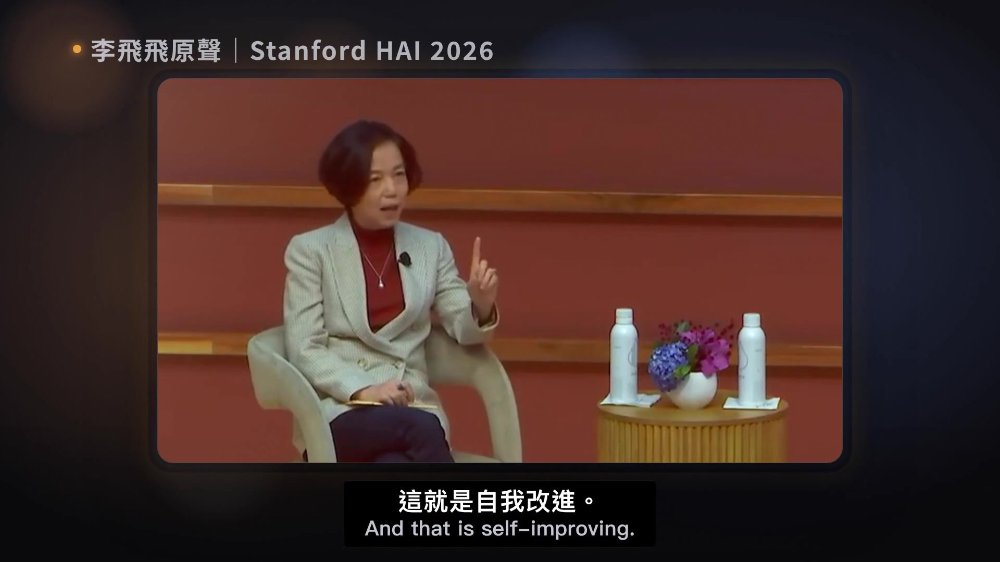

**逐字稿片段：** I am self-improving But the RSI part has to do with my brain 煎了十次,蛋變好吃 這是自我改進 被改進的是那顆蛋 他接著說 遞回的部分跟大腦有關 如果在學煎蛋的過程裡 大腦的神經連結也被改變了 變成一個更會煎蛋的大腦 再煎下去,大腦又在進步 那人就是一個遞回自我改進的系統 他還開玩笑 如果講到硬體升級 也許可以長出第六根手指 Ding回他 那你可能是AI生成的

**話題推測：** 李飛飛以煎蛋比喻說明兩種自我改進

---

## 00:06:00

**逐字稿片段：** 認真回答時,定說,人兩種都是 我們一輩子學很多東西 學會煎蛋,學會解微積分,這是自我改進 我們也學會了怎麼學 知道自己用什麼方式最容易學會 下一次學新的事情就更快 例如,你發現自己看圖比看文字學得快 下一次就先找圖

**話題推測：** Jeff Dean說明人類同時具備兩種自我改進能力

---

## 00:06:17

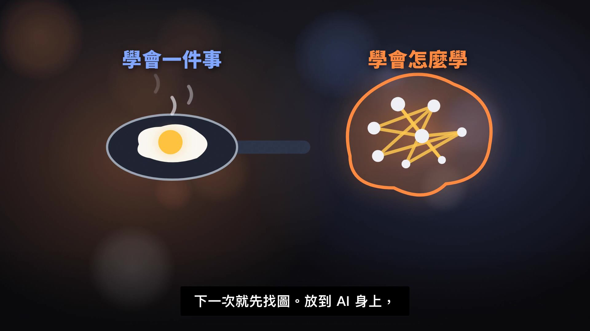

**逐字稿片段：** 放到AI身上,煎蛋就是AI做出來的模型 大腦就是負責提出改進的那個系統 他說,這個學會怎麼學 讓人也成為遞迴自我改進的系統 這個比方把兩個名詞分在兩個地方 一個在鍋子裡 一個在腦袋裡 李飛飛又補了一句 遞迴自我改進 也許有點像生物的演化

**話題推測：** 將煎蛋比喻類推到AI系統

---

## 00:06:36

**逐字稿片段：** 這一部分的答案是 要分辨AI是哪一種改進 問一個問題就好 這次變好的 是做出來的東西 還是負責改進的那個系統 AI幫醫院把一個 判讀影像的模型 調整得更準 是自我改進 AI幫忙做AI研究 做出下一代 更會做研究的AI 才是遞迴自我改進

**話題推測：** 總結如何分辨AI改進類型

---

## 00:06:54

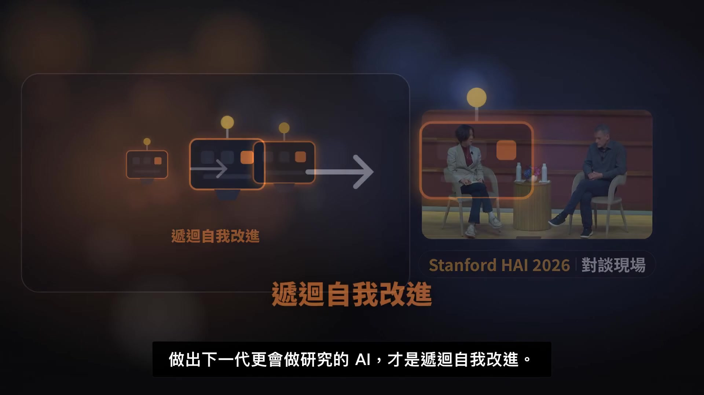

**逐字稿片段：** 以後看到新聞說 AI已經會自己改進自己 可以先用這個問題檢查一次 重點不是AI AI有沒有在進步 而是進步的是哪一層 兩種都會讓AI變強 差別在速度能不能一直往上疊 就像煎蛋那樣 先看清楚是鍋子裡變好 還是腦袋裡變好

**話題推測：** 提供辨別新聞說法的方法

---

## 00:07:11

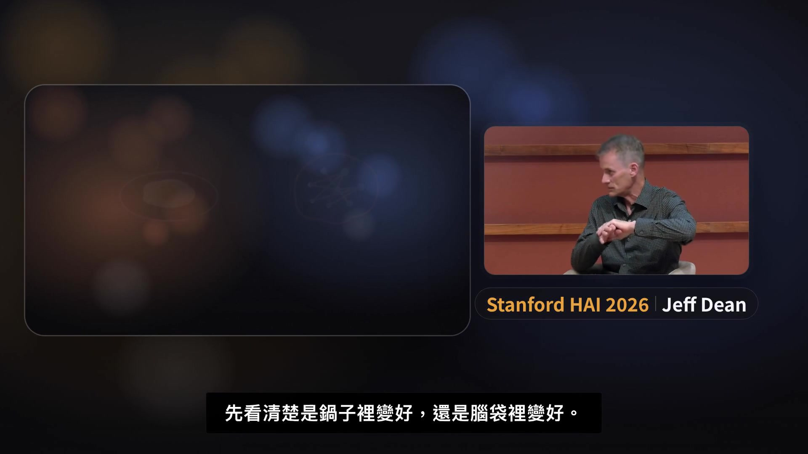

**逐字稿片段：** Dean也說 他們做的事理 有一部分屬於前一種 把一個會自動做機器學習工程的系統 拿去面對健康或材料的問題 請他做出專門的模型 這是自我改進 不是遞迴 可是他們同時也在做 機器學習研究本身 那就是後一種的候選

**話題推測：** Jeff Dean說明Discovery Loop的工作屬於哪種改進

---

## 00:07:26

**逐字稿片段：** 大家擔心的就是後一種 如果AI能讓下一代AI AI更會做研究 下一代又讓再下一代更快 每一圈越來越短 好像就會一路加速到無限

**話題推測：** 點出大眾對遞迴自我改進的擔憂（無限加速）

---

## 00:07:36

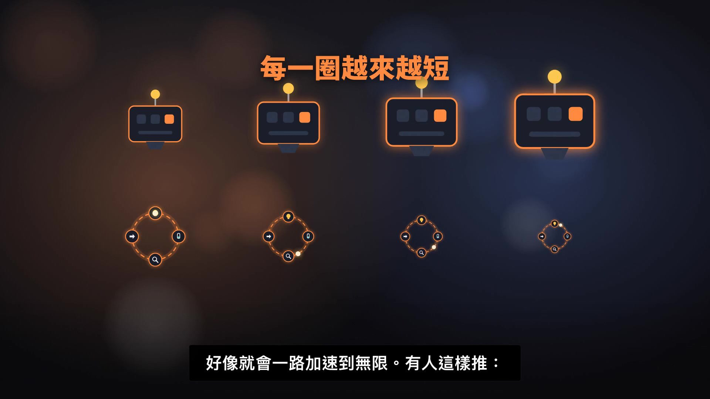

**逐字稿片段：** 有人這樣推 如果每一代都讓下一代的研究時間少一半 一圈接一圈加起來 好像在有限的時間裡 就能轉完無限多圈

**話題推測：** 說明無限加速的推論邏輯

---

## 00:07:44

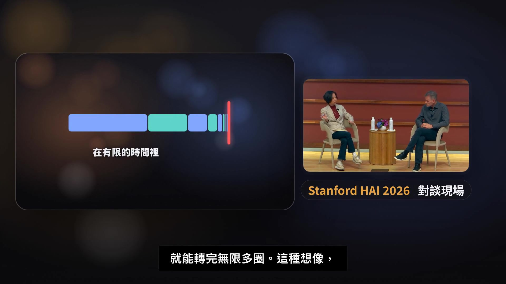

**逐字稿片段：** 這種想像就是開場提到的起點 起點是指AI推動科技進步快到人類跟不上 原本預測未來的方法都失效的那一刻

**話題推測：** 定義「起點」的概念

---

## 00:07:52

**逐字稿片段：** 李飛飛說 兩人在咖啡館準備這場對談時 就聊過這個詞的炒作和事實

**話題推測：** 李飛飛引導討論對「起點」的炒作與事實

---

## 00:07:57

**逐字稿片段：** 李飛飛在臺上直接問 遞迴自我改進被講得好像沒有盡頭 可以一路加速到無限 這裡面哪些是炒作

**話題推測：** 李飛飛直接提問遞迴自我改進是否會無限加速

---

## 00:08:04

**逐字稿片段：** 定先講人類現在怎麼把模型變強 一群研究員和工程師 先做很多小規模的實驗 看哪些點子有用 再把有用的放進下一代模型

**話題推測：** Jeff Dean解釋目前人類改進AI模型的流程

---

## 00:08:14

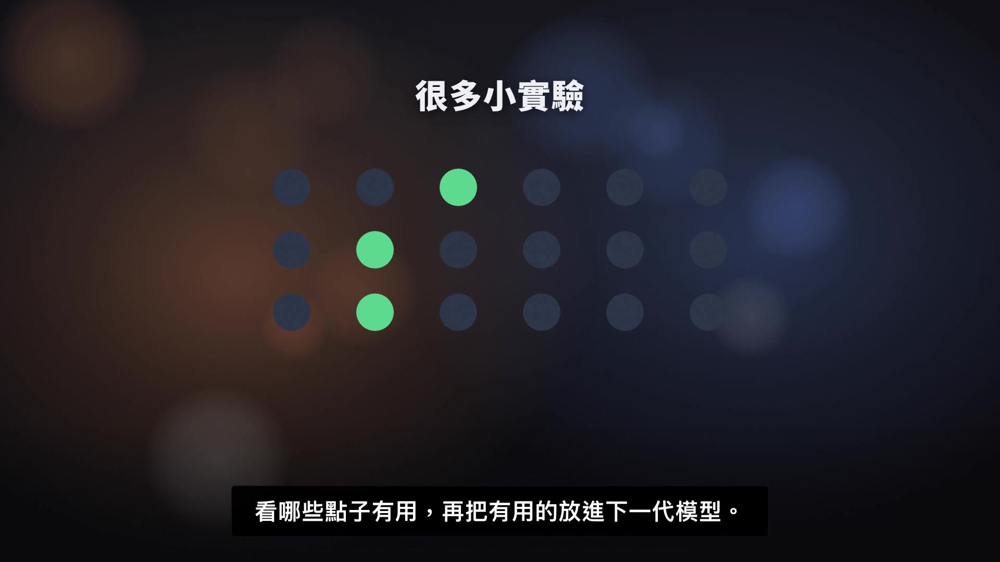

**逐字稿片段：** Gemini 2就是這樣從Gemini 1做出來的 這個過程裡 要試什麼 怎麼看結果 怎麼整理成下一代的設計 每一步都靠人 人要睡覺 要開會 也要等別人把實驗做完

**話題推測：** 以Gemini模型迭代為例說明人為介入的過程

---

## 00:08:25

**逐字稿片段：** 他說 把自動化放進這個過程 確實會變快 好處很具體 一個實驗可能凌晨兩點做完 研究員早上八點才進辦公室 中間六個小時沒有人看結果 自動系統可以馬上看 馬上決定下一步 在大專案裡 也可能比每個人各自決定做得更好 可是他也講了另一半

**話題推測：** Jeff Dean說明自動化如何加快AI研究速度

---

## 00:09:14

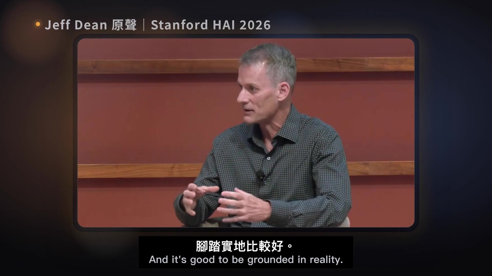

**逐字稿片段：** 他說的物理是很實際的事 要讓下一代模型變好 就得真的去訓練 真的做實驗 這些計算要在晶片上一步一步算完 要用電 要把資料存下來 再讓另一個模型看結果 提出點子可以很快 看結果也可以很快 最慢的往往是中間做實驗那一段

**話題推測：** 解釋為何AI加速會有物理限制

---

## 00:09:32

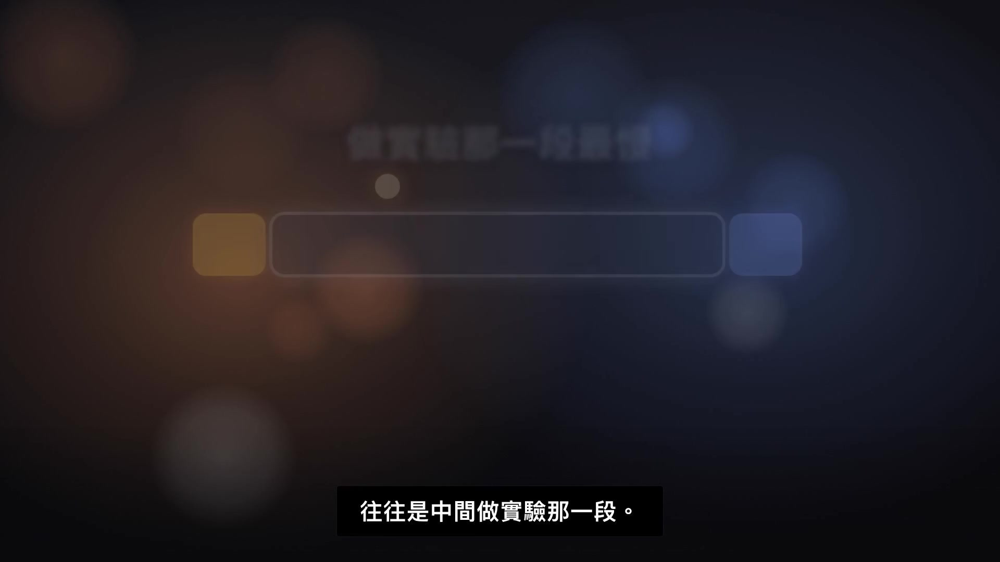

**逐字稿片段：** 訓練一個最前面的大模型 本來就要用大量晶片 算上很長一段時間 自動化再厲害 也沒辦法讓這段計算不花時間 自動化可以把人等待的時間省掉 像剛才那6個小時 可是實驗本身要算多久 要看計算有多大 晶片有多快 所以循環可以變快 每一圈卻都有一段省不掉的時間 電腦變快 晶片變多 這段時間可以縮短 但它不會變成0 Dean也說 自動系統一定會加快改進的速度 只是不會讓它無限快 他的意思不是AI不會進步 而是進步要花時間

**話題推測：** 指出訓練大模型是無法省略的時間成本

---

## 00:10:04

**逐字稿片段：** 李飛飛馬上說 這是很重要的一點 電影還補了一句 很多炒作說它會無限快 很可怕 如果把它當成一個實際在做事的工程系統來看 就沒那麼可怕

**話題推測：** 李飛飛認同物理限制的重要性

---

## 00:10:14

**逐字稿片段：** 也比較好懂 這可以跟Jack Clark那一集放在一起看

**話題推測：** 連結到Jack Clark的觀點進行對比

---

## 00:10:18

**逐字稿片段：** Clark的判斷是 今年已經有足夠的證據 起點開始了 他看到的是 在答案可以檢查的工作上 AI已經快得驚人

**話題推測：** 回顧Jack Clark對「起點」已開始的判斷

---

## 00:10:26

**逐字稿片段：** 那一集舉的例子 像寫程式 找數學的反例 都是答案可以馬上檢查的工作 這種工作 剛好也是整個流程 都能在電腦裡完成的那種

**話題推測：** 舉例AI在可檢查答案的工作上表現驚人

---

## 00:10:35

**逐字稿片段：** Dean沒有否認變快 他不同意的是無限快 他自己出來開公司 就是在賭AI研究會加速 這也是兩集可以一起看的原因 一集講已經看到的加速 一集講加速的上限 兩個說法不一定互相矛盾 變快是一件事 快到停不下來是另一件事 差別在於 那段省不掉的時間 會不會一直縮短

**話題推測：** Jeff Dean強調不否認加速，但不同意無限快

---

## 00:10:55

**逐字稿片段：** 這也不是Dean一個人說了就算

**話題推測：** 說明Jeff Dean也曾預測錯誤，顯示預測困難

---

## 00:10:58

**逐字稿片段：** 他在同一場對談裡 很坦白地承認自己猜錯過兩件事 他原本以為模型的結構會越來越奇特 長得像生物的神經一樣 結果大家用的還是很規則的設計 他也沒料到 寫程式的能力會是讓模型變強的關鍵 當年做Gemini 寫程式有做 但不是主力

**話題推測：** Jeff Dean承認自己曾對AI發展預測錯誤

---

## 00:11:15

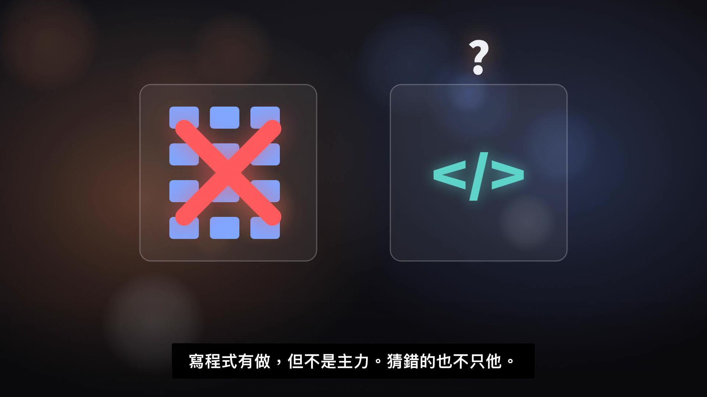

**逐字稿片段：** 猜錯的也不止他 他跟Hinton等人和寫過一篇論文 講的是用一個大模型去交出一個小模型 當年投稿被一個大會拒絕 評審覺得不太可能有影響 後來這個方法成了做小模型的常用技術

**話題推測：** 提到Hinton等人也曾對AI研究做出錯誤判斷

---

## 00:11:27

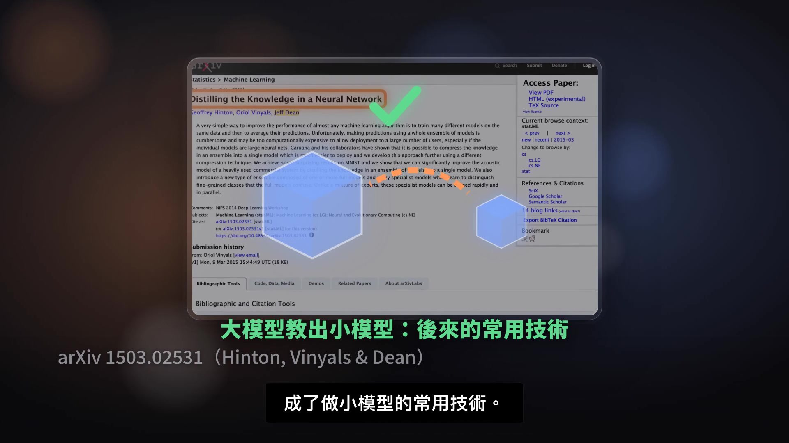

**逐字稿片段：** 這一部分的答案是 照Dean的看法 AI改進AI會讓研究變快 但不會無限快 自動化省掉的是人等待和協調的時間 省不掉的是實驗本身要算完的時間 連最懂這件事的人預測都會猜錯 所以聽到一路加速到無限 可以先問一句 那段省不掉的時間去哪裡了

**話題推測：** 總結Jeff Dean關於AI加速不會無限快的看法

---

## 00:11:47

**逐字稿片段：** 如果照他的看法 接下來比較可能看到的 不是某一天突然什麼都變了 而是某些領域先快起來 其他領域慢慢跟上 這也是為什麼他的公司 挑的是最快能轉起來的領域 那哪些事會先變快

**話題推測：** 說明AI發展將是部分領域先加速，而非全面突變

---

## 00:12:00

**逐字稿片段：** 李飛飛又追問了一次 他說 你講了很多discovery loop 可是你們到底要解哪一個科學問題 還是有點模糊 社會上有那麼多重要的科學問題 你現在最想做哪一個

**話題推測：** 李飛飛再次追問Discovery Loop的具體科學問題目標

---

## 00:12:11

**逐字稿片段：** 很多人最關心的是 AI什麼時候能幫忙治病 Dean先說 醫療是他很早就想做的領域 會做 但不是現在

**話題推測：** 提及大眾關心的AI在醫療領域的應用

---

## 00:12:25

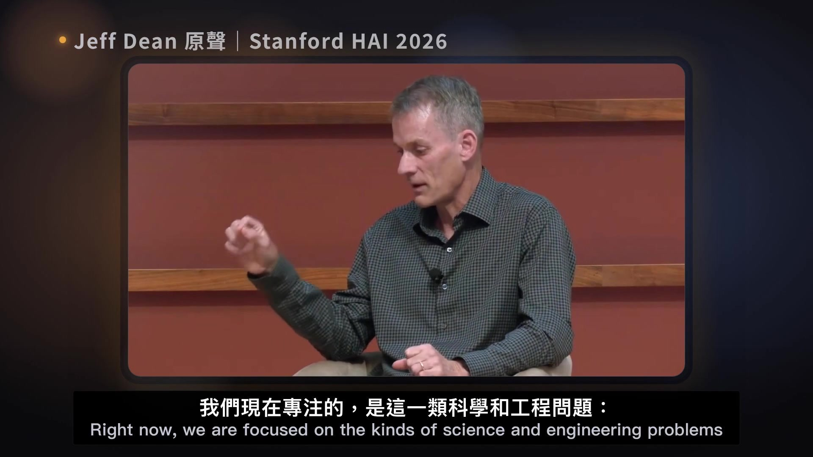

**逐字稿片段：** 可以在數碼形式進行整個循環 因為我們認為 這很適合在整個循環上速度上升 如果有實際的生物過程 那會比速度上升更難 整個循環都在電腦裡完成 意思是提出實驗、做實驗、看結果 全部都是程式和計算 不用等試管、等細胞、等病人

**話題推測：** 解釋為何全數位化循環能加快研究速度

---

## 00:12:46

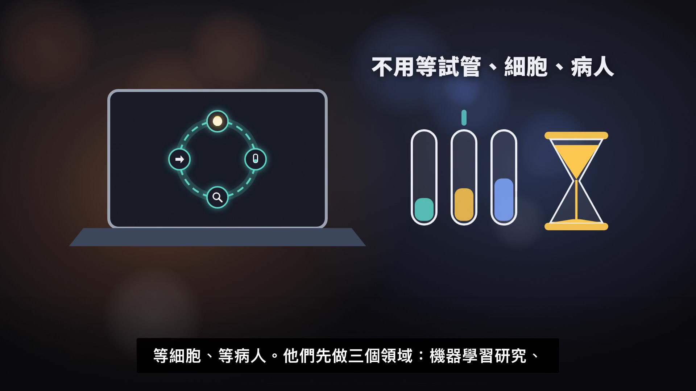

**逐字稿片段：** 他們先做三個領域 機器學習研究、機器學習工程 還有晶片設計 他們一開始選的 就是AI最容易自己轉起來的地方

**話題推測：** Discovery Loop優先關注的三個領域：機器學習研究、工程、晶片設計

---

## 00:12:54

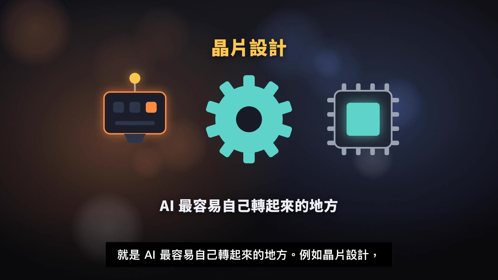

**逐字稿片段：** 例如晶片設計 可以在電腦裡模擬晶片上的元件怎麼擺放 算出效能 不用每試一次就真的做出一顆晶片 這三個是他們自己最熟的

**話題推測：** 以晶片設計為例，說明數位模擬的優勢

---

## 00:13:02

**逐字稿片段：** Dean和Quarkler在Google時 就參與過用AI幫忙設計晶片的研究

**話題推測：** 提及Jeff Dean和Quarkler在Google參與AI設計晶片的研究

---

## 00:13:07

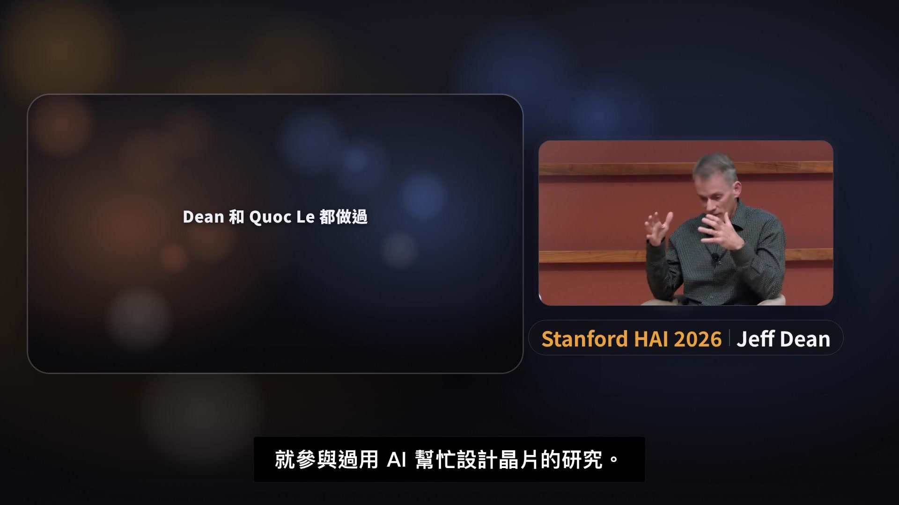

**逐字稿片段：** 這三個領域也會帶動別的領域 一個會自動做機器學習工程的系統 以後可以拿去幫醫療 幫材料科學做模型

**話題推測：** 說明這三個領域將帶動其他領域的發展

---

## 00:13:15

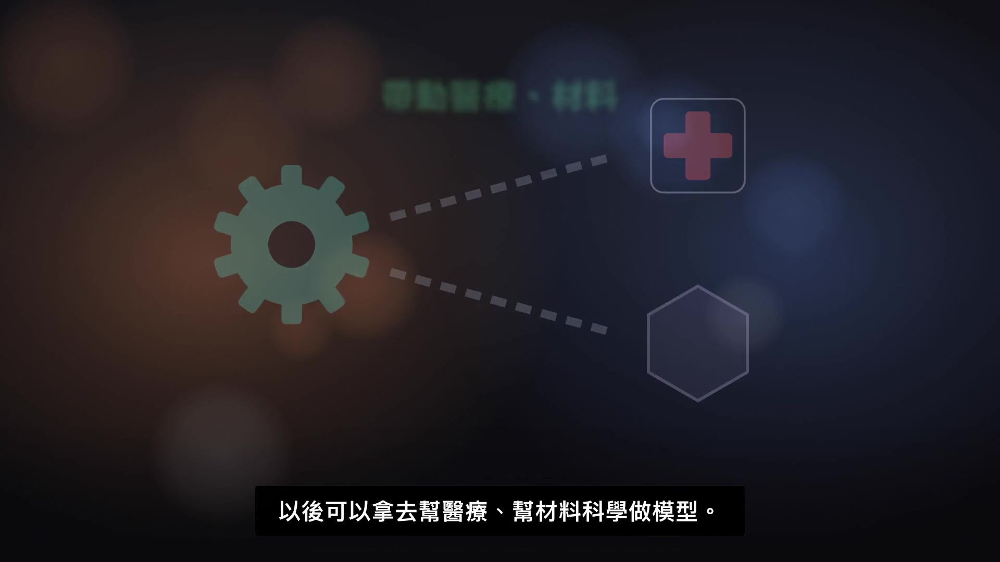

**逐字稿片段：** 他也承認 很多重要的學科一定要做實體實驗 他們有一些混合的做法可以加快一部分 但是實體的那一段就是比較難加快

**話題推測：** 承認實體實驗的加速難度

---

## 00:13:22

**逐字稿片段：** 一種新藥要在細胞、動物、人身上一步一步試驗 每一步都要等身體自己反應 這一段電腦沒辦法完全替代

**話題推測：** 以新藥開發為例說明實體實驗的限制

---

## 00:13:31

**逐字稿片段：** 這也回答了開場問題的另一半 就算AI研究本身變快 很多科學還是要等真實世界的實驗 李飛飛大學唸的是物理

**話題推測：** 總結為何AI研究加速但很多科學仍需真實世界實驗

---

## 00:13:38

**逐字稿片段：** 他說 定圖上寫的是提出實驗 物理學家會把這一步叫做提出假說 他接著問 這套方法是不是偏向做實驗

**話題推測：** 李飛飛以物理學角度提問AI方法是否偏向實驗

---

## 00:13:47

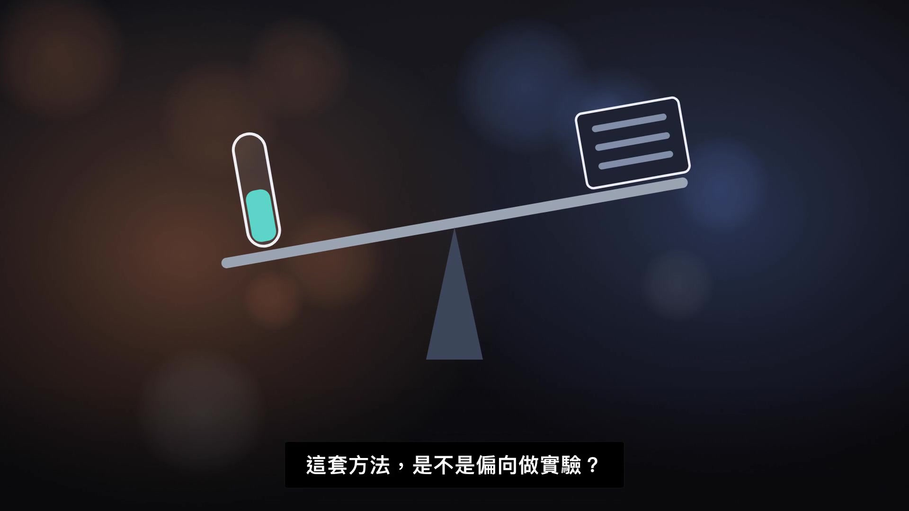

**逐字稿片段：** 物理學裡有做實驗的人 也有做理論的人 像牛頓、愛因斯坦 自己做的實驗不多 主要是讀別人的結果在想出理論

**話題推測：** 說明物理學中實驗與理論研究的不同

---

## 00:13:55

**逐字稿片段：** 定承認 這套方法可能稍微偏向實驗 可是他說 也可以要系統去找一個最簡單 又能解釋所有資料的理論 讓他一次一次修改

**話題推測：** Jeff Dean承認其方法可能偏向實驗，但也可用於理論探索

---

## 00:14:04

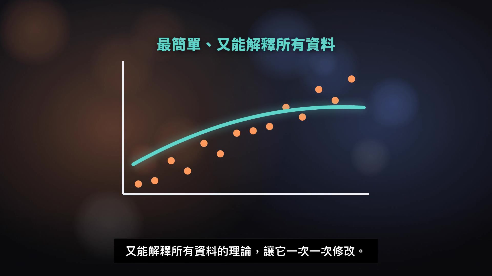

**逐字稿片段：** 他說 很多理論物理學家現在做的 也是看著實驗的新結果 想辦法提出能解釋他的理論 他還想象 未來有一個系統 在很多學科裡做過大量實驗 看過各種成功和失敗的結果 這是他的想象 還沒有人做出這樣的系統

**話題推測：** 說明AI也能協助提出和修改理論

---

## 00:14:18

**逐字稿片段：** 他說 這樣的系統 不會被大學科系的界限綁住 能找到人類因為分科而沒看到的關聯 例如,一個領域的實驗結果 剛好能幫忙解釋另一個領域的問題 他說,把這些當成分開的學科,其實不好 接著談到數學

**話題推測：** 說明跨學科AI系統的潛在優勢

---

## 00:14:33

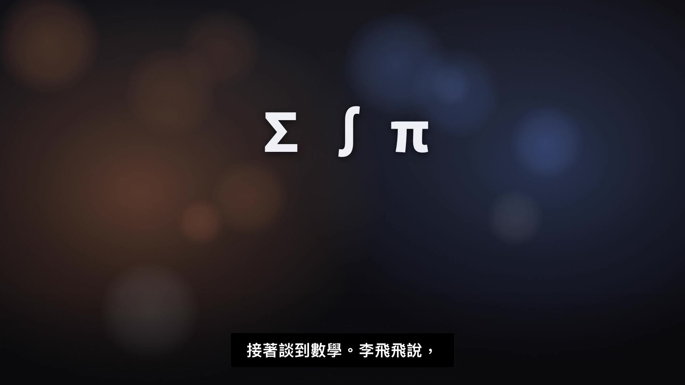

**逐字稿片段：** 李飛飛說,他原本也邀請了數學家陶哲軒 可惜他沒辦法來 最近幾周,好幾個數學難題接連傳出被AI解除 他心情很複雜 他說,他不是不喜歡這些新發現 只是上百年、上千年的數學難題 是人類智慧的頂峰

**話題推測：** 提及李飛飛曾邀請數學家陶哲軒參與對談

---

## 00:14:48

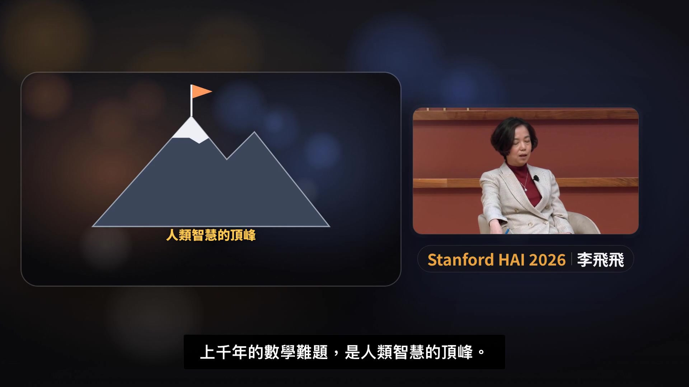

**逐字稿片段：** 他提到的其中一件 是流體力學裡一道很有名的難題 跟Navier Stokes方程有關

**話題推測：** 以流體力學的Navier Stokes方程為例

---

## 00:14:54

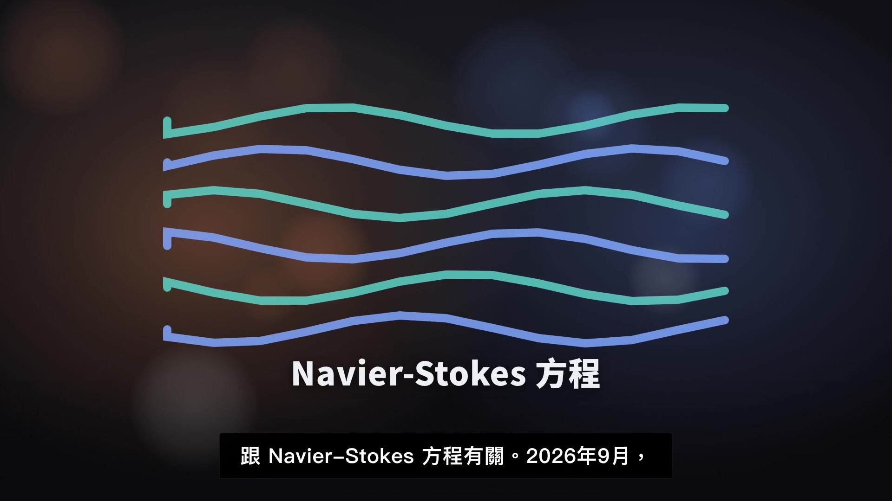

**逐字稿片段：** 2026年9月 OpenAI宣稱 他的模型在這個問題上 證出了一個結果 還附上一份讓電腦檢查的證明 是用一種叫LEAN的程式語言寫的

**話題推測：** 提及OpenAI在Navier Stokes問題上證出結果

---

## 00:15:02

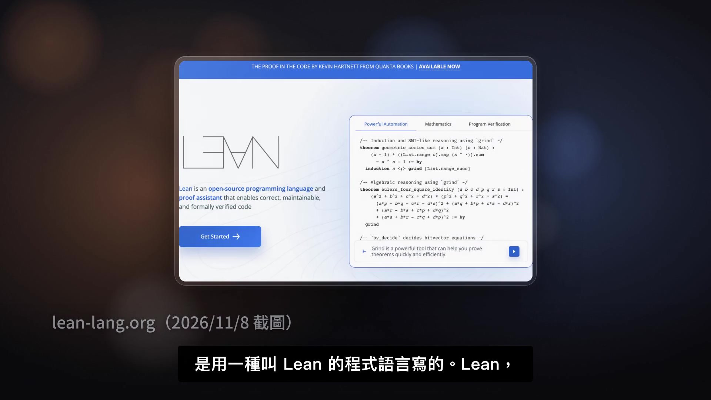

**逐字稿片段：** LEAN是專門讓電腦 一步一步檢查數學證明的語言

**話題推測：** 介紹LEAN程式語言的功能

---

## 00:15:06

**逐字稿片段：** 之後有數學家質疑 這份證明是不是真的回答了原本的問題 到現在還沒有定論 LEAN檢查過 代表每一步推理都沒有錯 可是他檢查的是證明本身 不保證題目寫得跟原題一模一樣

**話題推測：** 提及數學家對AI證明結果的質疑

---

## 00:15:19

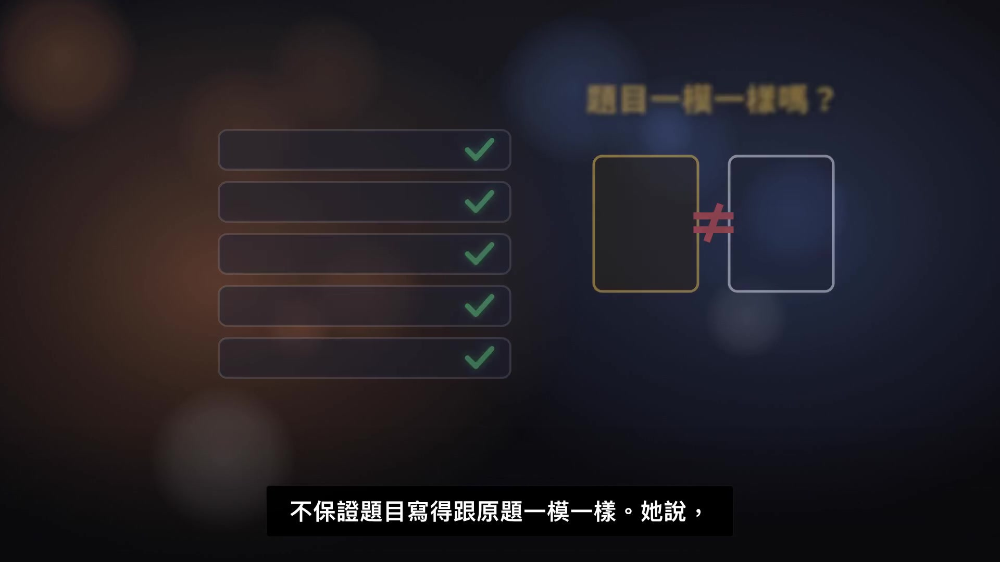

**逐字稿片段：** 他說 數學家在這些證明裡看到的 不只是答案 他也轉述陶哲軒的看法 AI能幫忙解某些類型的數學題 可是有些問題 連可以學的資料都沒有 不在AI能做的範圍裡

**話題推測：** 說明數學家看證明不只看答案，更看思路

---

## 00:15:31

**逐字稿片段：** Dean承認 現在的系統 加上大量同時工作的代理程式 確實解得出很難 以前沒人解出的數學問題

**話題推測：** Jeff Dean承認AI能解決高難度數學問題

---

## 00:15:38

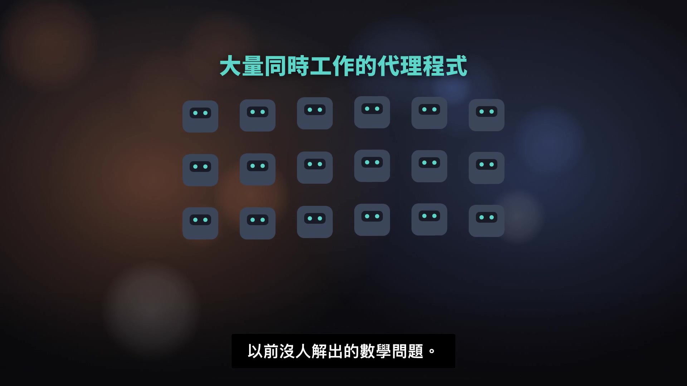

**逐字稿片段：** 那為什麼大家還是覺得不滿足 甚至有點不安 機器檢查過證明是對的 可是沒有人看得懂 那條簡單又漂亮的路在哪裡

**話題推測：** 探討為何AI解題仍讓人感到不滿足或不安

---

## 00:16:08

**逐字稿片段：** Dean說 數學家常常是在找那條路的時候 發明出新的數學 拿去解別的問題 不過他也說 知道一件事做得到 會逼人更努力 去找另一種更漂亮的解法 接下來 人要想的是 怎麼用這種能力 做更多數學 回到開場的問題 AI會自己改進自己 那它會一路加速到停不下來嗎

**話題推測：** Jeff Dean解釋數學家尋找「漂亮路徑」的重要性

---

## 00:16:28

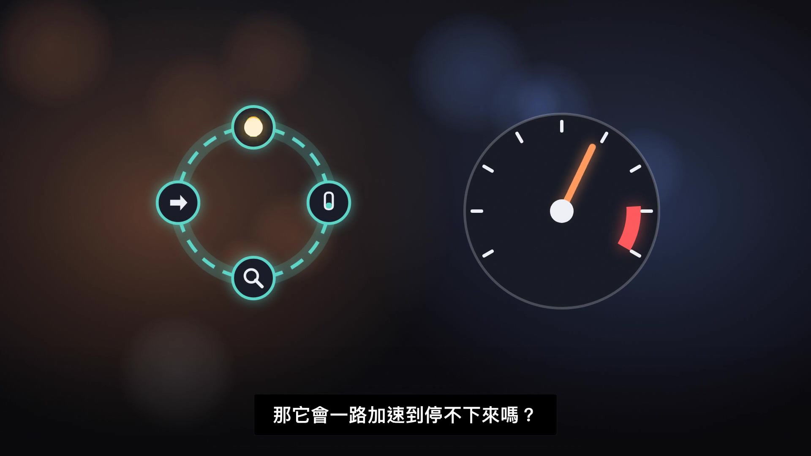

**逐字稿片段：** 這一集Dean給的答案是 會加速 不會無限快 整個循環都能在電腦裡完成的地方 例如AI研究和晶片設計 會先變快 牽涉真實世界實驗的地方 速度還是被實驗綁住 就算AI證出了結果 要讓人看懂 也還有一段路

**話題推測：** 總結Jeff Dean對核心問題的答案：會加速但不會無限快

---

## 00:16:44

**逐字稿片段：** 最後 李飛飛替臺下焦慮的大學生 問了一個問題

**話題推測：** 李飛飛為焦慮大學生向Dean提問

---

## 00:16:48

**逐字稿片段：** Dean的建議是 先搞懂正在出現的新技術 再把它用在你最有熱情的事情上 AI可以幫忙 但我們想一起做什麼 還是由人來決定

**話題推測：** Jeff Dean給年輕人的建議

---

## 00:16:57

**逐字稿片段：** 這一集整理的是 講者的看法和我們的查證 Discovery Loop到現在 還沒有公開任何研究成果

**話題推測：** 說明本集內容為觀點整理與查證

---

## 00:17:03

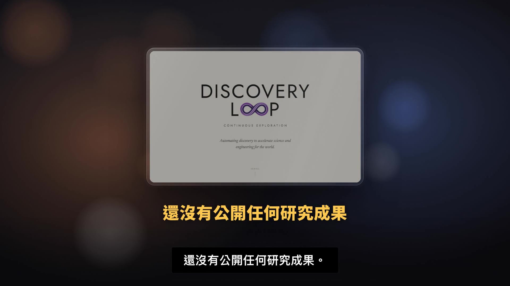

**逐字稿片段：** 最後問你一個問題 你覺得AI研究變快以後 哪一件事會最先讓你感覺到 留言告訴我 喜歡的話訂閱AI Notebook 開啟通知 我們下次見

**話題推測：** 向觀眾提問互動

---
