# jimainotebook_sHLv-2iFmHI — 關鍵畫面索引

- 來源逐字稿：[jimainotebook_sHLv-2iFmHI_FIN.srt](jimainotebook_sHLv-2iFmHI_FIN.srt)
- 影片：https://www.youtube.com/watch?v=sHLv-2iFmHI
- 截圖數：78

## 00:00:08

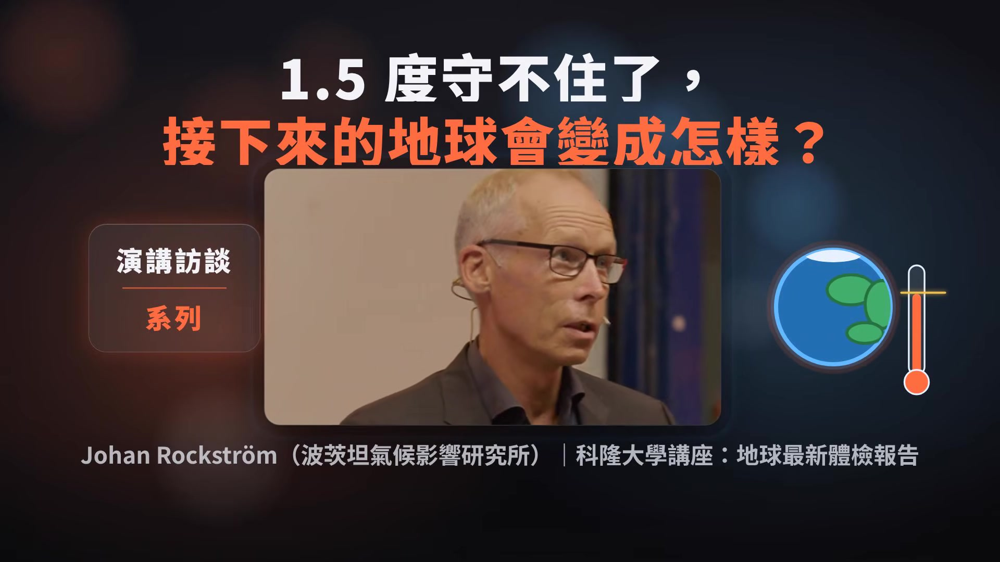

**逐字稿片段：** 大家好,我是Jim,這裡是AI Notebook,這一集是演講訪談系列。

**話題推測：** 影片開場，介紹主題和主講人

---

## 00:00:12

**逐字稿片段：** 主角是氣候科學家Johann Rockström,我們要問的是1.5度守不住了,接下來的地球會變成怎樣?

**話題推測：** 提出核心問題：1.5度守不住，地球會怎樣？

---

## 00:00:17

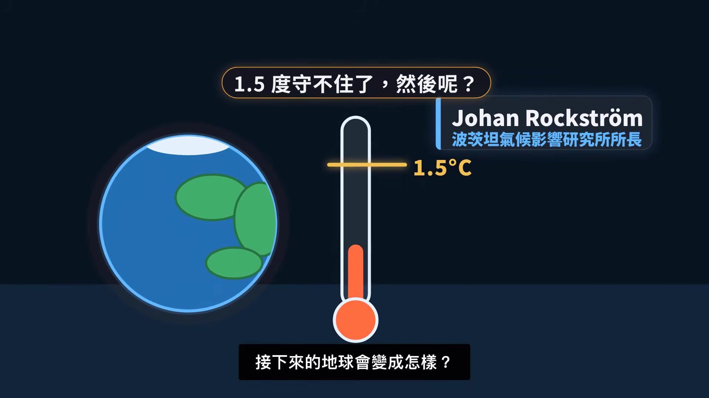

**逐字稿片段：** Rockström是德國波茨坦氣候影響研究所的所長,今年7月,他在德國科隆大學講了一個多小時,題目是地球的最新體檢報告。

**話題推測：** 介紹主講人Rockström的背景與演講主題

---

## 00:00:25

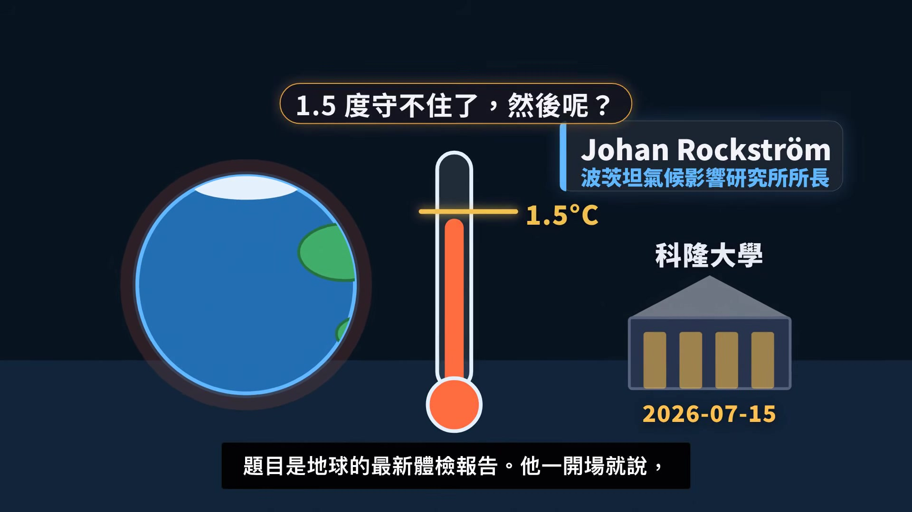

**逐字稿片段：** 他一開場就說,今晚會是一趟很暗的旅程,1.5度,是巴黎協定協下的升溫上限。

**話題推測：** 開始討論1.5度升溫上限與巴黎協定

---

## 00:00:30

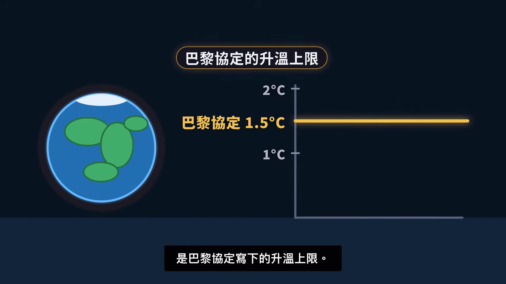

**逐字稿片段：** 根據歐盟的哥白尼氣候服務,2024年,全球平均氣溫第一次整年超過工業革命前1.5度。 不過這一集不只講壞消息

**話題推測：** 提出2024年全球平均氣溫首次整年超過1.5度的數據

---

## 00:00:37

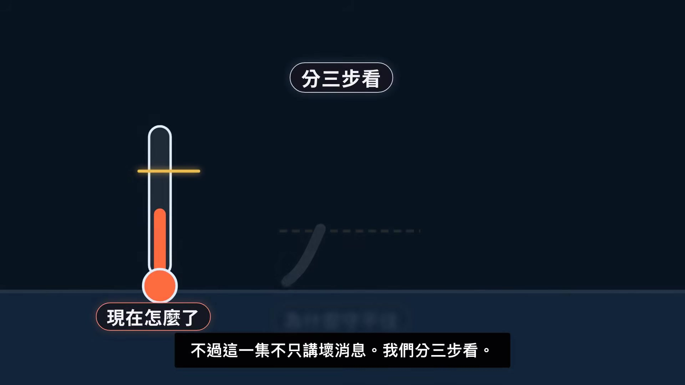

**逐字稿片段：** 我們分三步看 先看地球現在怎麼了 再看1.5度為什麼守不住 守不住又代表什麼 最後看地球會不會回不來 還有我們能做什麼 先說一件事 他講的有些是科學界的共識 有些是他自己的推估 我們會一路標清楚

**話題推測：** 介紹影片的三個主要分析步驟

---

## 00:00:48

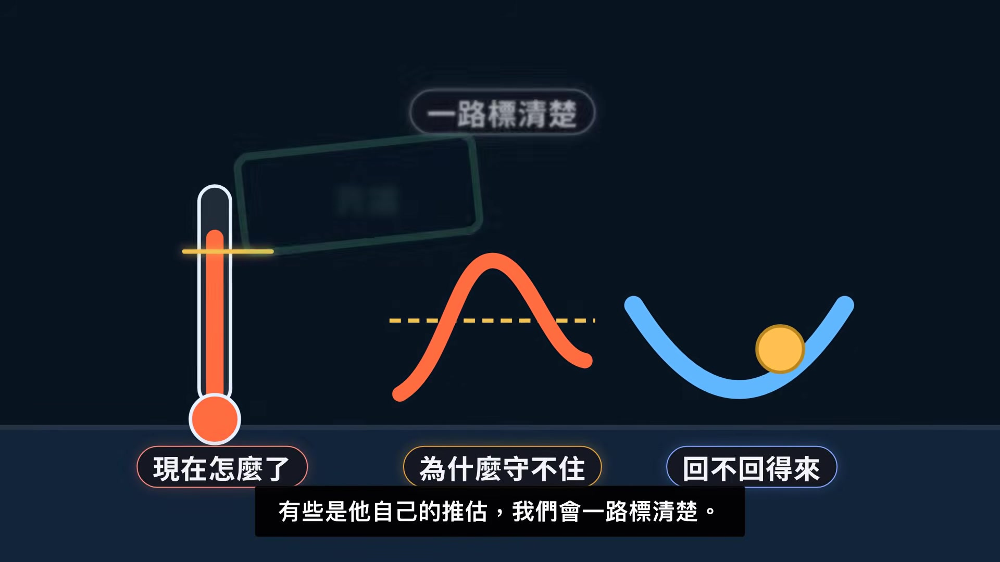

**逐字稿片段：** 先認識一下這位講者 2009年 Roxer Strom帶著一群科學家 提出一個框架

**話題推測：** 開始介紹講者Rockström及其提出的地球限度框架

---

## 00:00:54

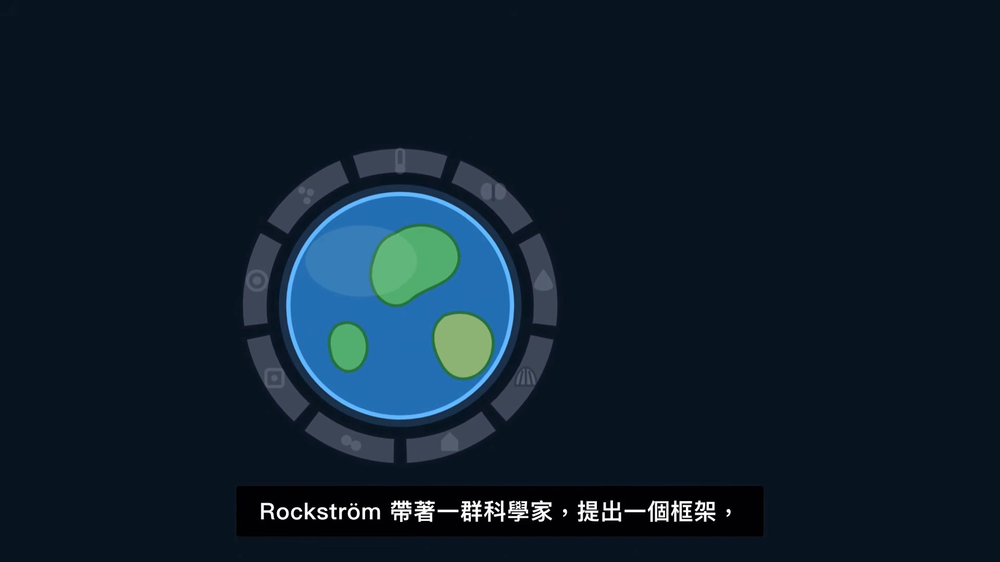

**逐字稿片段：** 叫地球限度 英文是Panetary Boundaries 他做的事 是幫地球列出九條界線 像氣候 生物多樣性 淡水 海洋雙化 只要人類待在界限裡面 地球就比較能維持穩定 這有點像健康檢查報告上的 九個項目 每一項都有正常範圍 他的團隊每年更新一次

**話題推測：** 說明地球限度框架的內容：九條界線

---

## 00:01:11

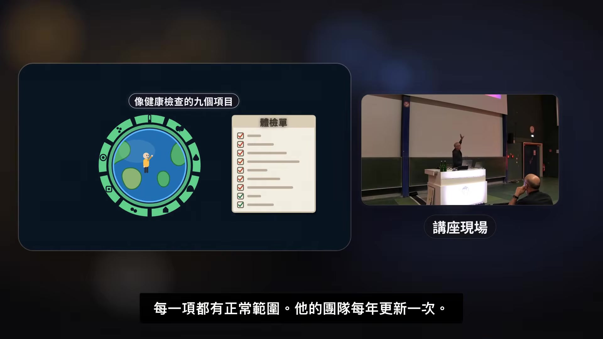

**逐字稿片段：** 根據他們去年九月的報告 九條裡面 已經有七條超出安全範圍 只剩臭氧層和空氣中的 懸浮微粒還在界限裡 這場演講 他就是在唸這份體檢報告

**話題推測：** 引用最新報告，指出九條界線中七條已超出安全範圍

---

## 00:01:20

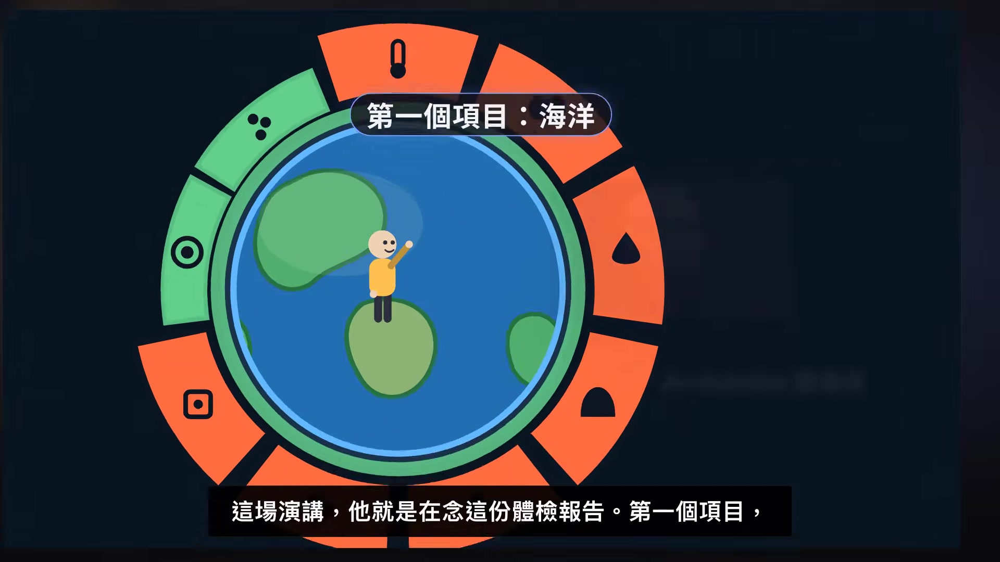

**逐字稿片段：** 第一個項目 他從海洋看起 為什麼先看海洋 因為人類多排的溫室氣體 把熱流在地球上 這些多出來的熱

**話題推測：** 進入演講第一個項目：從海洋看起

---

## 00:01:27

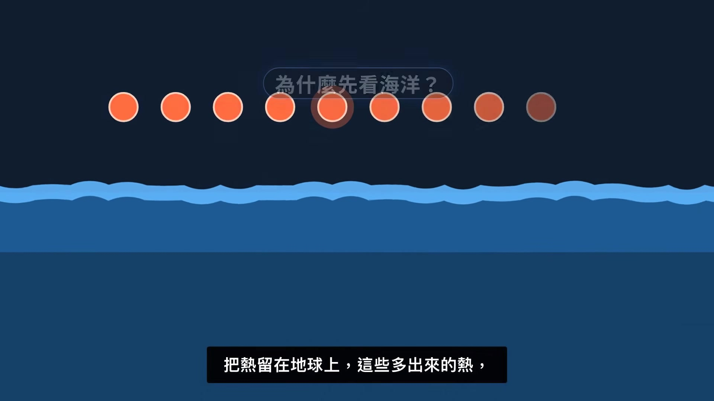

**逐字稿片段：** 9成以上被海洋吸走了 海洋就像地球的散熱器 替我們扛住了大部分的熱

**話題推測：** 解釋9成以上多餘的熱被海洋吸收

---

## 00:01:32

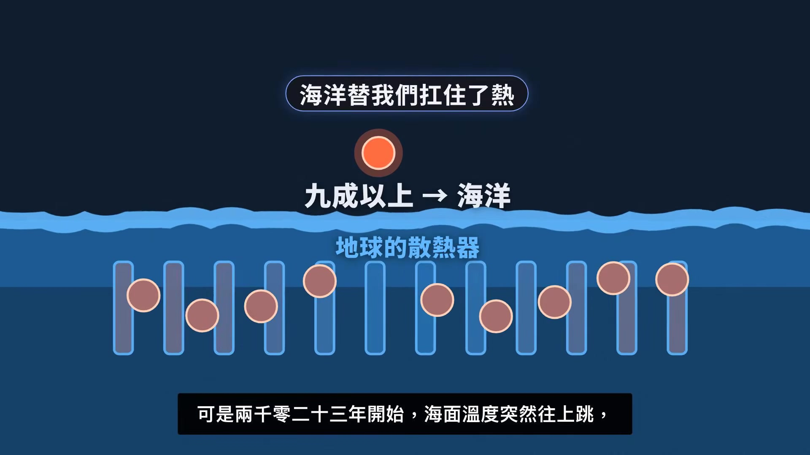

**逐字稿片段：** 可是2023年開始 海面溫度突然往上跳 一年就多了大約0.3度 以前要十幾年才會升這麼多 這一跳連科學家都還在找原因 可能跟傳播燃料變乾淨 低空的雲變少 地球顏色變暗都有關係

**話題推測：** 指出2023年海面溫度異常跳升0.3度

---

## 00:01:45

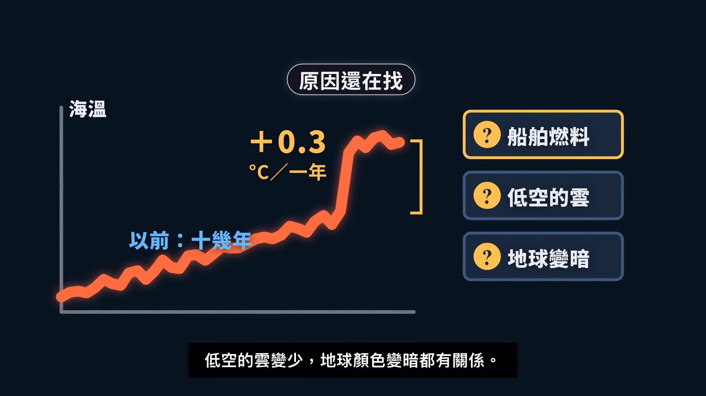

**逐字稿片段：** 而且這幾個月 太平洋正在形成一場很強的盛音 英文是El Nino 盛音的時候 太平洋會把存起來的熱放回空氣裡 美國海洋氣大氣總數

**話題推測：** 介紹聖嬰現象(El Nino)及其對氣溫的影響

---

## 00:01:54

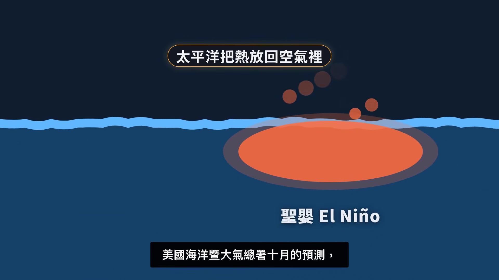

**逐字稿片段：** 10月的預測 今年冬天變成歷史級強度的幾率 大約八成三 演講的前一天 他下載了最新的太平洋海溫資料 放在投影片上

**話題推測：** 引用美國海洋大氣總署預測，聖嬰現象強度達八成三

---

## 00:02:02

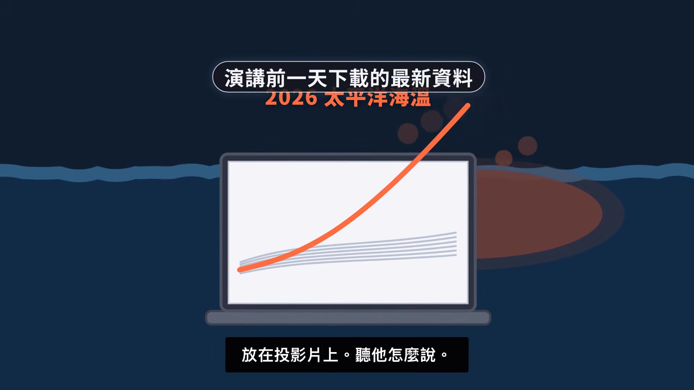

**逐字稿片段：** 聽他怎麼說 海太熱

**話題推測：** 播放Rockström演講投影片與發言片段

---

## 00:02:20

**逐字稿片段：** 第一個受不了的是珊瑚 珊瑚身上住著幫他製造養分的藻類 水溫太高 藻類會離開 珊瑚就變成一片白色 這個現象叫白化 白化太久 珊瑚就會餓死

**話題推測：** 討論海洋高溫對珊瑚造成的白化現象

---

## 00:02:31

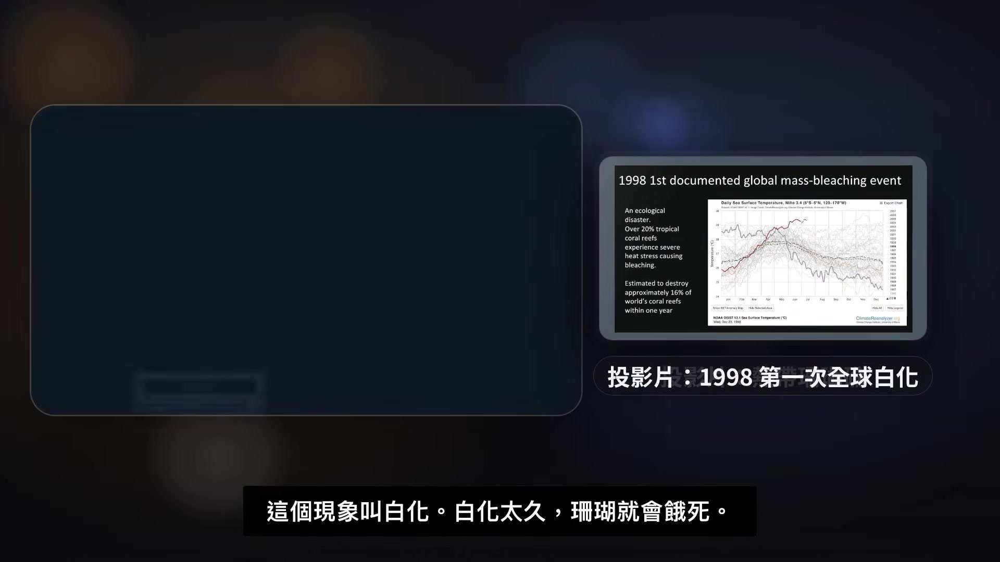

**逐字稿片段：** 1998年 第一次全球大規模白化 當時是國際新聞 大約兩成一的珊瑚礁碰到 會造成白化的高溫 美國海洋基大氣種署

**話題推測：** 回顧1998年第一次全球大規模珊瑚白化事件

---

## 00:02:39

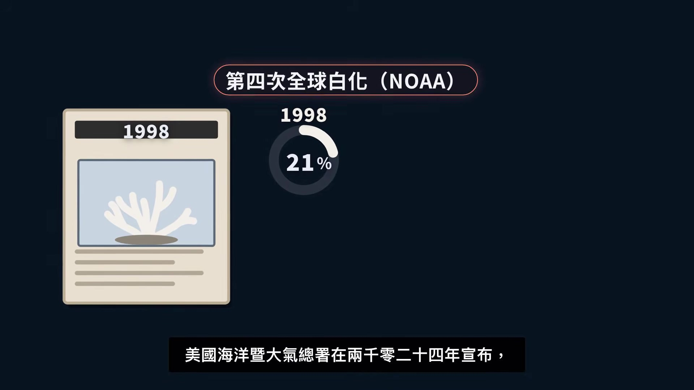

**逐字稿片段：** 在2024年宣佈 第四次全球白化開始了 從2023年到2025年 全世界大約八成四的珊瑚礁面積 都碰到這種高溫 Rockstrom說 範圍是當年的好幾倍 大家卻幾乎不談 他給這個現象取了一個名字

**話題推測：** 宣佈2024年第四次全球珊瑚白化開始，影響範圍達八成四

---

## 00:02:53

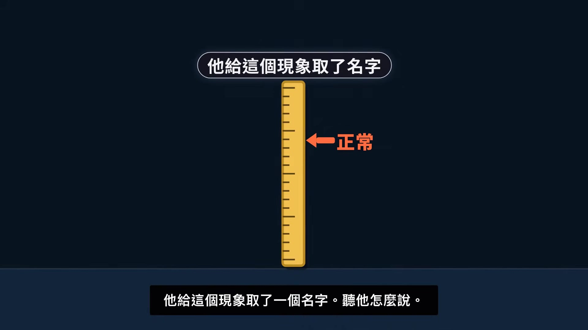

**逐字稿片段：** 聽他怎麼說 他說的這個詞

**話題推測：** 播放Rockström發言片段，引入「正常飄移」概念

---

## 00:03:16

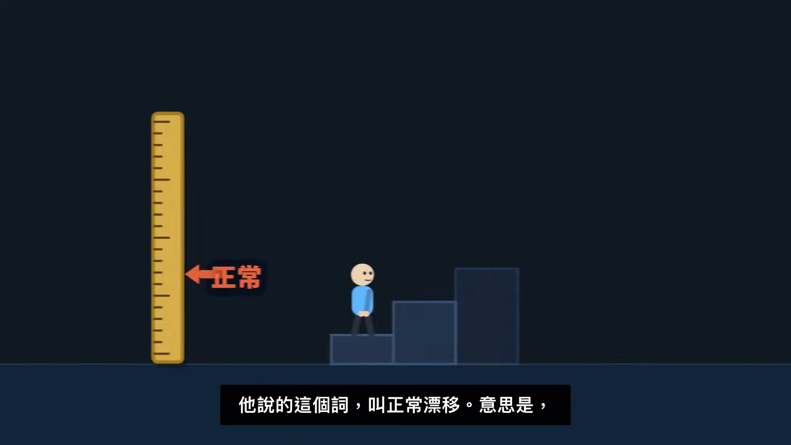

**逐字稿片段：** 叫正常飄移 意思是 一件事每年都更糟一點 大家就慢慢把它當成正常 熱浪就是最好的例子

**話題推測：** 解釋「正常飄移」現象，並以熱浪為例

---

## 00:03:21

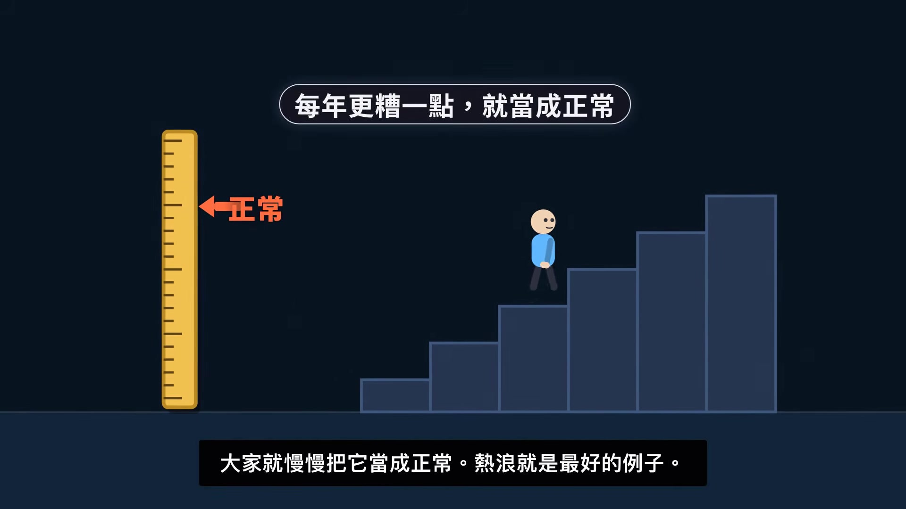

**逐字稿片段：** 2003年 歐洲一場熱浪 造成大約7萬人提早死亡

**話題推測：** 引用2003年歐洲熱浪及死亡人數數據

---

## 00:03:25

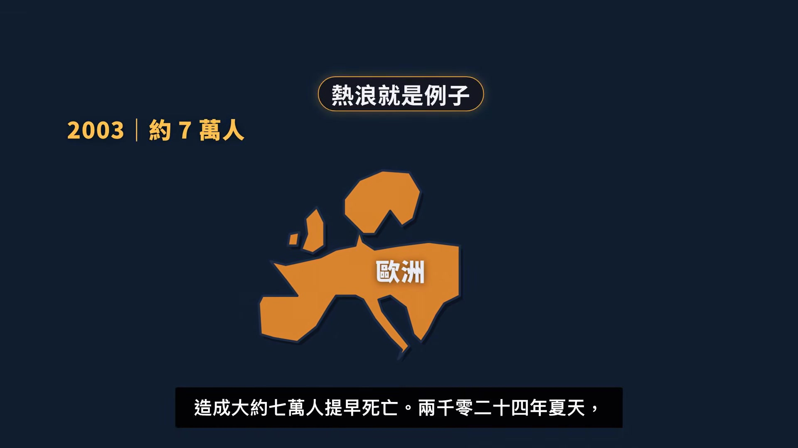

**逐字稿片段：** 2024年夏天 歐洲又有大約6萬2千人死於高溫 歐洲升溫的速度 大約是全球平均的兩倍

**話題推測：** 引用2024年歐洲熱浪及死亡人數數據，並指出歐洲升溫速度

---

## 00:03:32

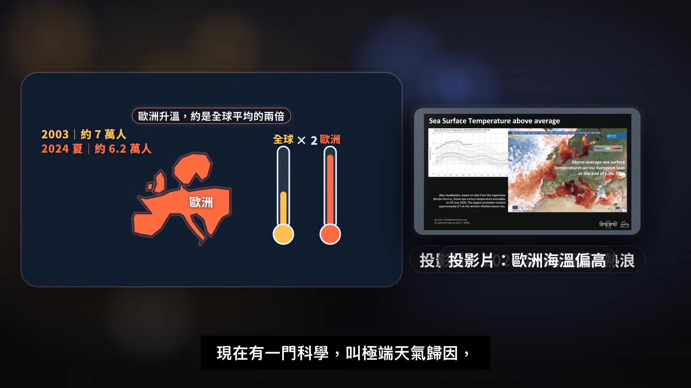

**逐字稿片段：** 現在有一門科學 叫極端天氣歸因 它做的事是比對有暖化跟沒有暖化的兩個世界 算出一場熱浪被人類放大了多少 結論很一致 很多熱浪啊 沒有人類造成的暖化 幾乎不可能那麼熱

**話題推測：** 介紹「極端天氣歸因」科學，解釋熱浪與人類暖化的關係

---

## 00:03:43

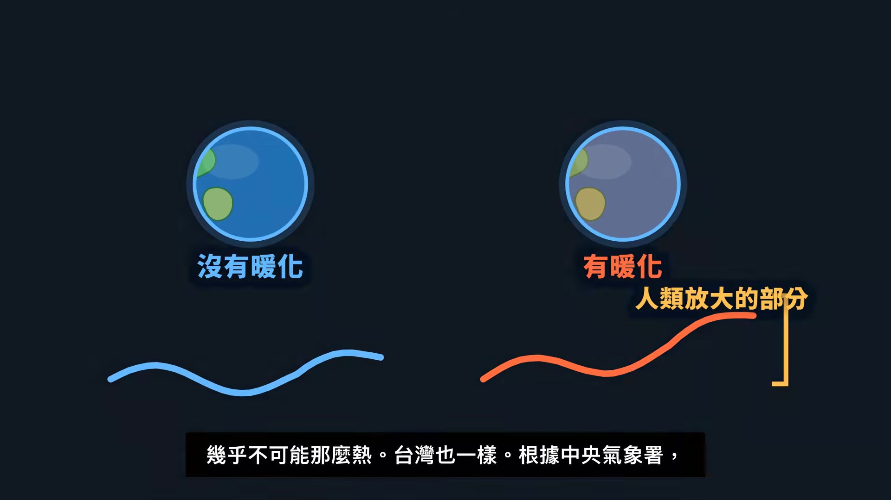

**逐字稿片段：** 臺灣也一樣 根據中央氣象署

**話題推測：** 轉向討論臺灣的氣候變遷數據

---

## 00:03:45

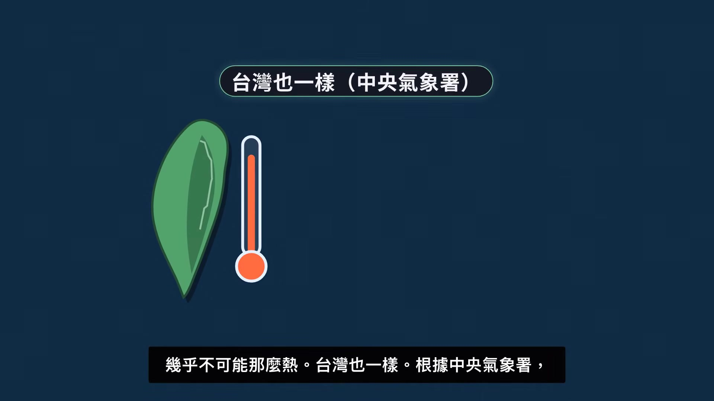

**逐字稿片段：** 2024年 臺灣年均溫24.6度 是有記錄以來最熱的一年

**話題推測：** 引用中央氣象署數據，2024年臺灣年均溫創新高

---

## 00:03:50

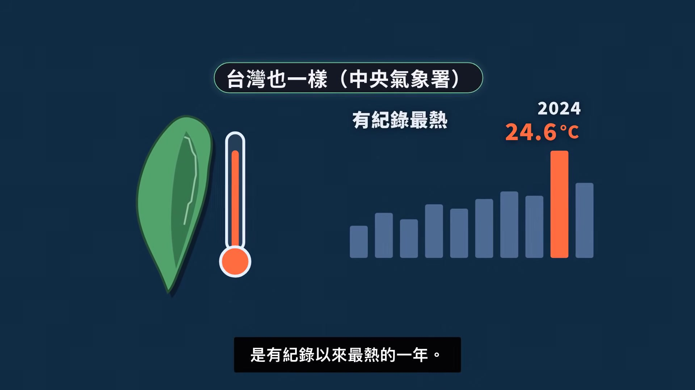

**逐字稿片段：** 從1911年到2020年 臺灣平均升溫大約1.6度 近50年 臺灣的夏天每10年拉長大約6到13天 所以這一部分的答案是 地球已經在發燒 海洋系的大部分的熱 海溫在跳 珊瑚在白化 熱浪在變多

**話題推測：** 呈現臺灣過去百年的升溫幅度及夏天變長的數據

---

## 00:04:04

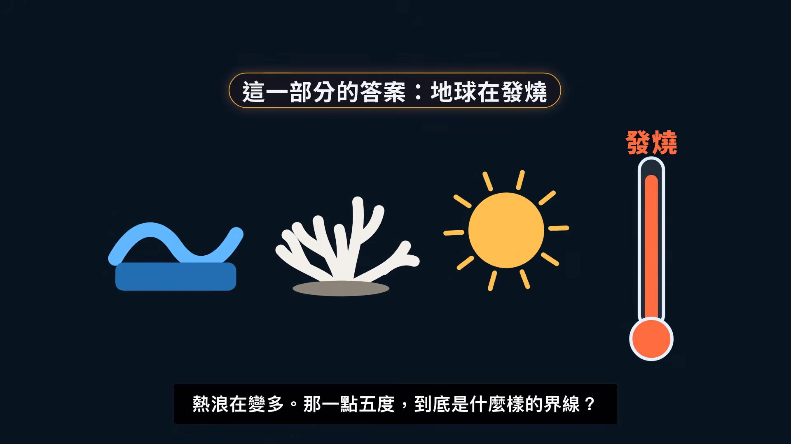

**逐字稿片段：** 那1.5度到底是什麼樣的界限

**話題推測：** 總結第一部分：地球正在發燒的現象

---

## 00:04:07

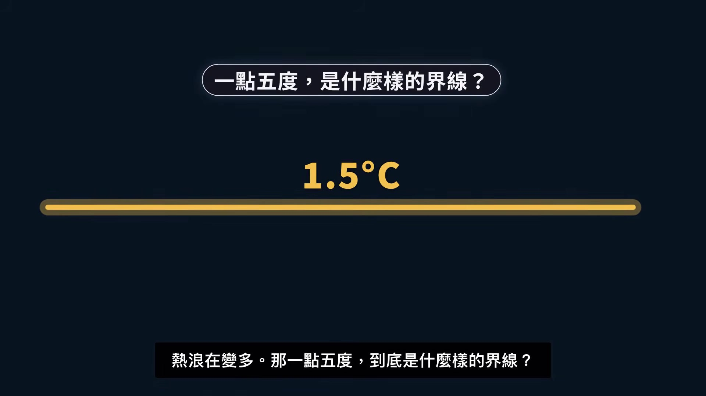

**逐字稿片段：** 先講清楚1.5度是什麼

**話題推測：** 進入新話題：1.5度升溫目標的定義與現況

---

## 00:04:09

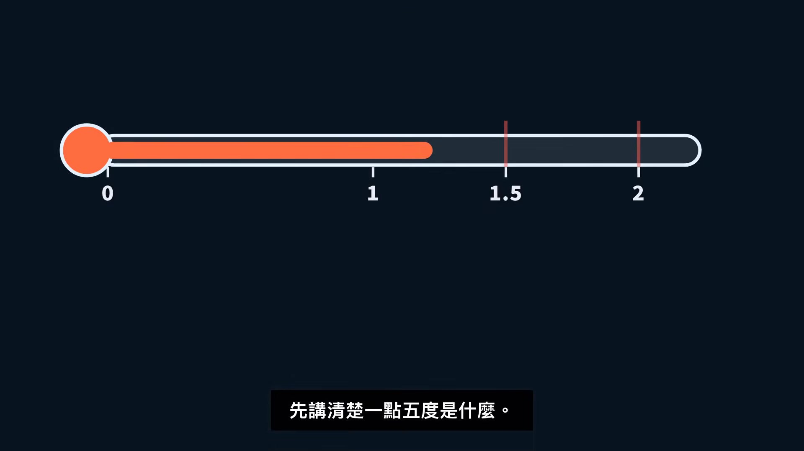

**逐字稿片段：** 2015年的巴黎協定 各國同意 把全球升溫控制在工業革命前兩度以內 並且努力限制在1.5度 這裡的1.5度指的是長期平均 大約是20年的平均 不是某一年 所以2024年單一年超過 還不等於巴黎協定的目標失敗 可是長期平均也已經很接近了

**話題推測：** 解釋巴黎協定中1.5度目標的意義，強調是長期平均

---

## 00:04:26

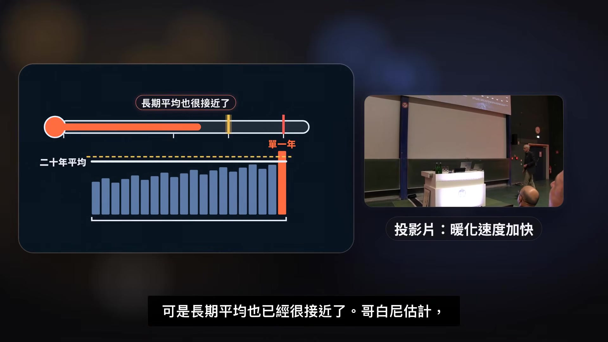

**逐字稿片段：** 哥白尼估計 長期的暖化已經大約1.4度了

**話題推測：** 引用哥白尼氣候服務數據，長期暖化已達1.4度

---

## 00:04:29

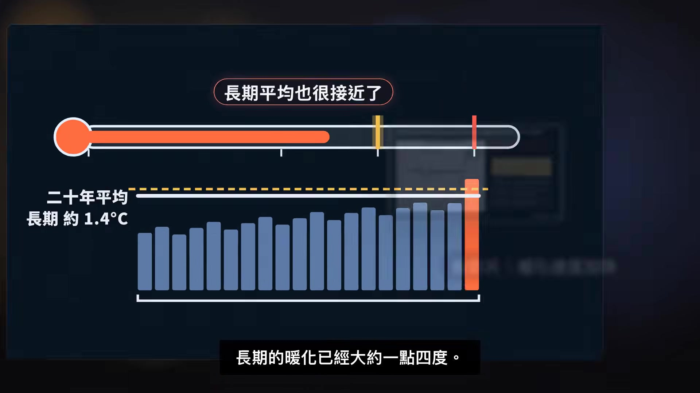

**逐字稿片段：** 世界氣象組織今年5月的預測 未來5年的平均超過1.5度 幾率大約7成5

**話題推測：** 引用世界氣象組織預測，未來五年平均升溫超1.5度機率達7成5

---

## 00:04:33

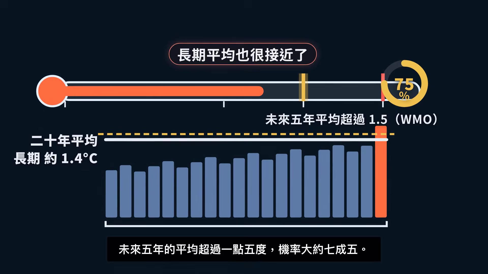

**逐字稿片段：** 去年在巴西的聯合國氣候大會上 Rockstrom和他的同事 站出來講一句以前不敢講的話 聽他怎麼說 為什麼說會超過 要從情境講起

**話題推測：** 播放Rockström發言片段，討論氣候目標無法達成

---

## 00:04:56

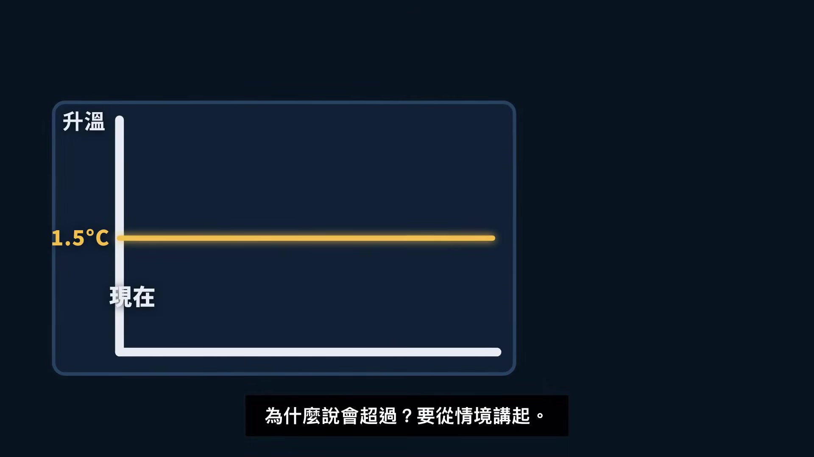

**逐字稿片段：** 聯合國的政府間氣候變遷專門委員會 英文縮寫IPCC 會算出很多種未來每一種叫一個情境

**話題推測：** 介紹聯合國IPCC的氣候情境模型

---

## 00:05:03

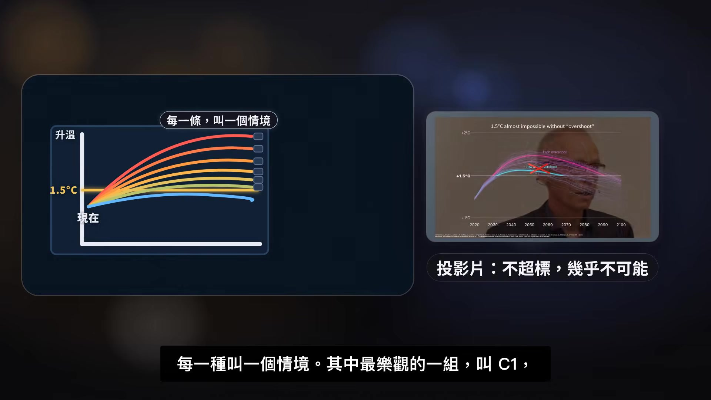

**逐字稿片段：** 其中最樂觀的一組 叫CE 意思是升溫不超過1.5度 或只稍微超過一點點 可是這組情境有一個前提 全球排放要在2025年以前開始下降 到2030年 比2019年少四成以上 現實是排放到現在都還在增加 只是增加的比較慢 Rockstrom的說法很直接

**話題推測：** 說明最樂觀的CE情境及其前提條件

---

## 00:05:20

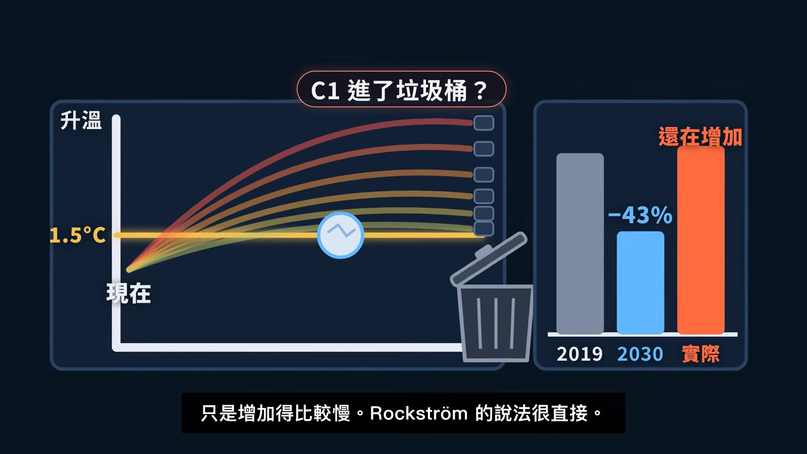

**逐字稿片段：** 聽他怎麼說 他說的是CE這一組 在他看來已經做不到了 這是他的判斷 不過不止他這樣想

**話題推測：** 播放Rockström發言片段，直指CE情境已無法實現

---

## 00:05:43

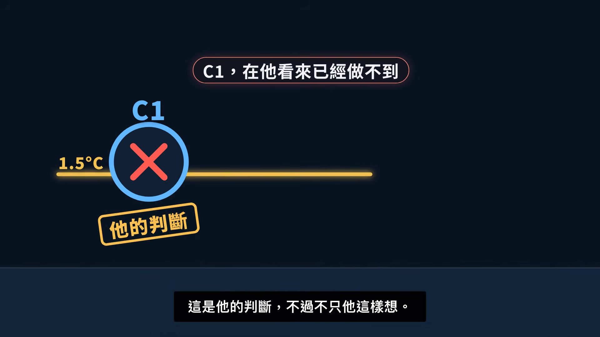

**逐字稿片段：** 替下一輪氣候模型設計 未來情境的國際計劃 今年發表的新設計裡 已經沒有一條是不超過1.5度的 最低的一條也會先超過 再在本世紀末降回1.5度左右 那剩下最好的路是什麼

**話題推測：** 提及新一輪氣候模型設計，已無不超過1.5度的情境

---

## 00:05:55

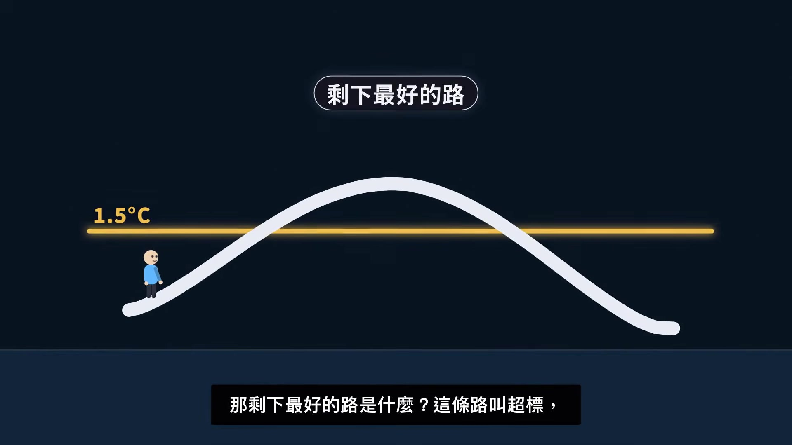

**逐字稿片段：** 這條路叫超標 英文是overshoot 意思是溫度先超過1.5度 到一個高點 再想辦法降回來 要降回來 光是不排放還不夠 還要把空氣裡的二氧化碳拿出來 例如種樹 富裕森林 或是用機器把碳抓起來埋到地下 這條路的高點有多高 要多久才降得回來 這是他和他的研究所的推估

**話題推測：** 介紹「超標（overshoot）」情境，即先升溫再降回

---

## 00:06:13

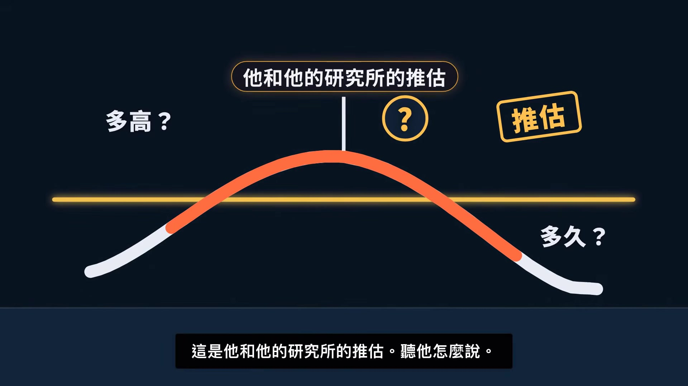

**逐字稿片段：** 聽他怎麼說 but can still bring us back to under 1.5 within the next 75 years so that's like that's the best we can offer today 他說的1.7度 75年是他們研究所的推估

**話題推測：** 播放Rockström發言片段，闡述超標情境的預估溫度與時間

---

## 00:06:33

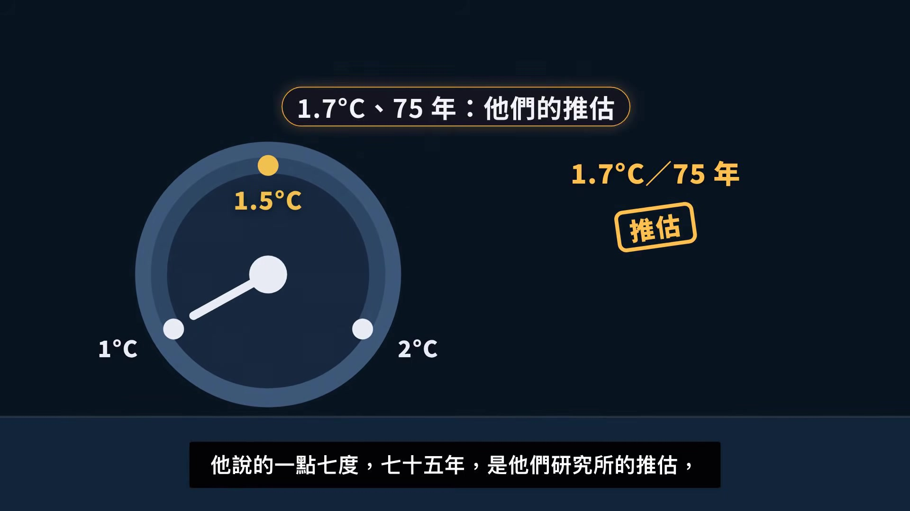

**逐字稿片段：** 不是IPCC的共識 不過有一件事 科學界的共識很清楚 IPCC第六次評估報告寫得很明白 每多升溫一點點 極端天氣就更頻繁更強 以50年才會出現一次的極端高溫來說 跟工業革命前比 升溫1.5度的世界 會多出大約8.6倍 升溫2度 大約是13.9倍 所以超標這段時間 不是平安無事地繞一圈 Lockstrom把話講得很白

**話題推測：** 澄清Rockström研究所的推估非IPCC共識，但極端天氣頻率有共識

---

## 00:06:54

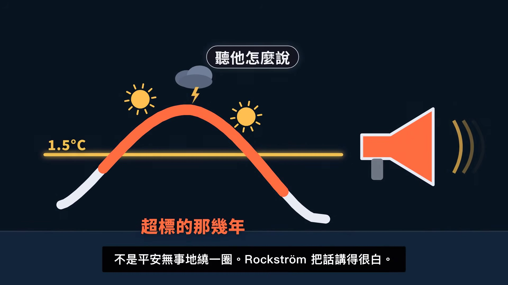

**逐字稿片段：** 聽他怎麼說 他講的是全球 放到臺灣 會是什麼樣子

**話題推測：** 播放Rockström發言片段，強調超標期間的嚴重性

---

## 00:07:20

**逐字稿片段：** 臺灣的國家氣候變遷科學報告 給了幾個推估

**話題推測：** 轉向討論全球暖化對臺灣的具體影響預估

---

## 00:07:23

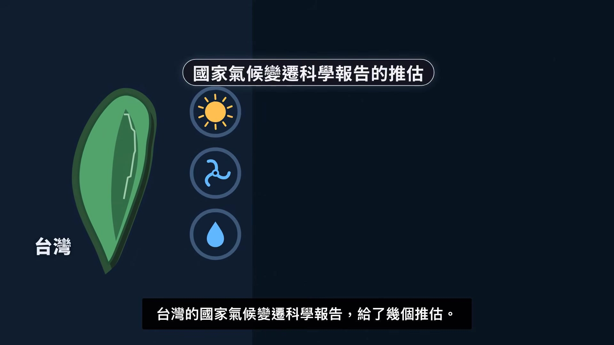

**逐字稿片段：** 先說熱 全球升溫2度時 臺灣每年36度以上的高溫日 平均多10天左右 升溫4度 會多50幾天

**話題推測：** 預估臺灣在升溫2度和4度時，36度以上高溫日的增加天數

---

## 00:07:30

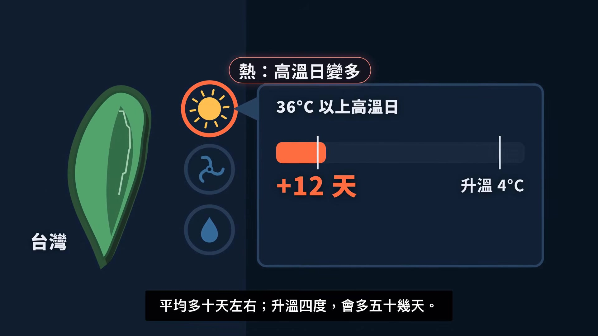

**逐字稿片段：** 如果排放一路走最高的情境 本世紀末 臺灣一年可能有超過210天 是夏天 也就是7個月

**話題推測：** 預估在最高排放情境下，臺灣本世紀末的夏季天數

---

## 00:07:36

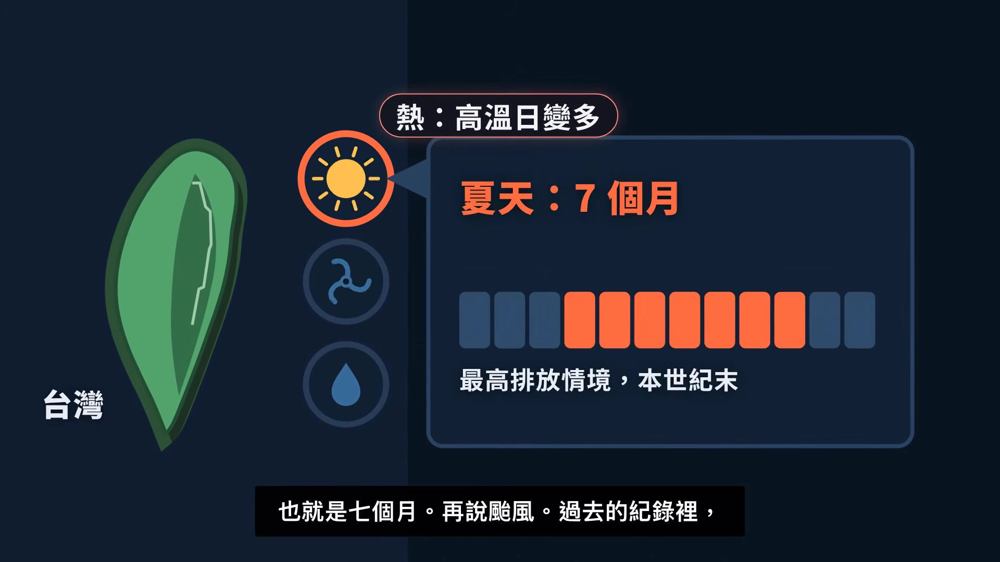

**逐字稿片段：** 再說颱風 過去的記錄裡 影響臺灣的颱風個數和牆臺 還看不出明顯的長期趨勢 不過少數高解析度的模式推估 到本世紀末 影響臺灣的颱風可能變少 周圍的牆臺卻變多 颱風帶來的雨也更猛

**話題推測：** 討論颱風對臺灣的影響趨勢：個數變少但強颱變多

---

## 00:07:49

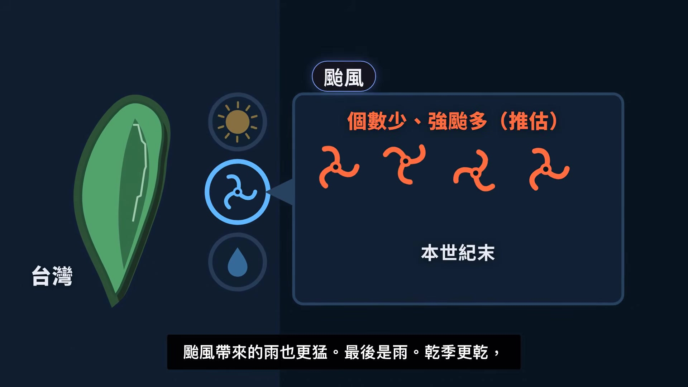

**逐字稿片段：** 最後是雨 乾季更幹 溼季更溼 現在50年才一次的強降雨 在全球升溫4度時 可能變成10年就一次

**話題推測：** 預估臺灣未來降雨模式：乾季更乾、濕季更濕

---

## 00:07:56

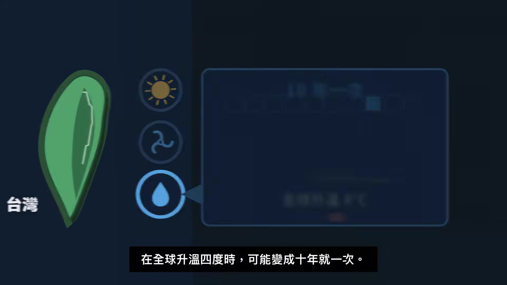

**逐字稿片段：** 所以這一部分的答案是 1.5度會先被超過 這幾乎沒有懸念 超標的那些年 熱浪啊 暴雨啊 牆臺啊 都會更多 真正的差別 在於溫度最高 衝到多高 在高點停多久 那地球自己

**話題推測：** 總結第二部分：1.5度將被超越，極端天氣增多

---

## 00:08:10

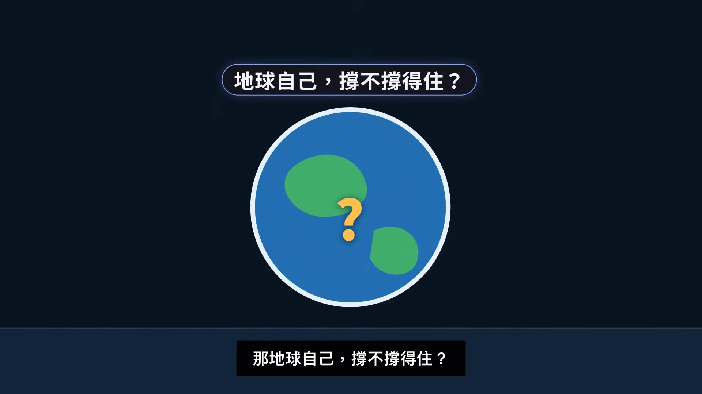

**逐字稿片段：** 撐不撐得住 要回答這個問題 先看地球替我們扛了多少 先看熱

**話題推測：** 進入新話題：地球系統能否承受暖化衝擊

---

## 00:08:14

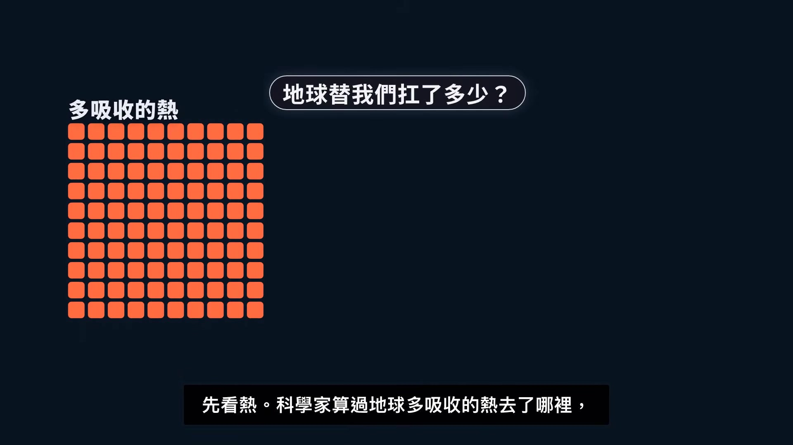

**逐字稿片段：** 科學家算過地球 有多吸收的熱去了哪裡 大約九成進到海里 約百分之六到陸地 約百分之四拿去融冰 留在空氣裡的 只有大約百分之一 我們感受到的熱浪 只是那一小份

**話題推測：** 解釋地球吸收多餘熱量的分佈比例（海洋、陸地、融冰、空氣）

---

## 00:08:25

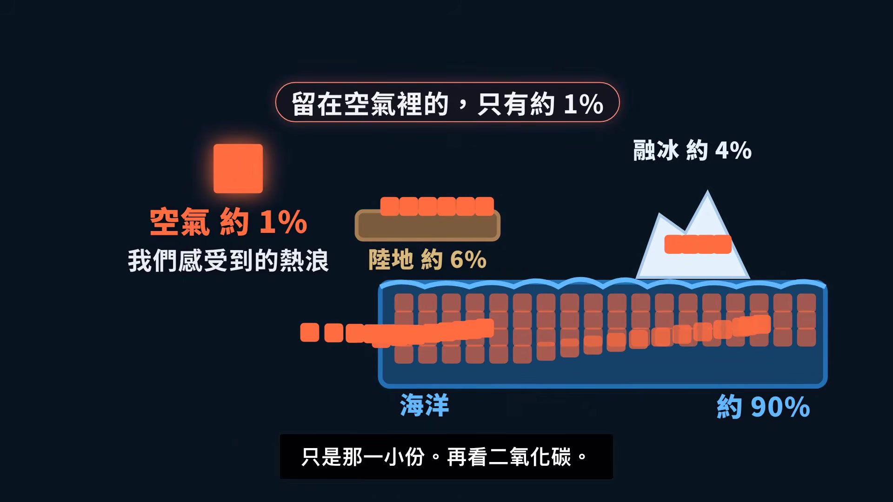

**逐字稿片段：** 再看二氧化碳 人類排出的二氧化碳 過去十年大約一半 被海洋和陸地上的植物吸走 只有一半留在空氣裡 Rock Strong說 地球一直在原諒我們 150年來默默替我們買單 問題是它還能撐多久 答案是

**話題推測：** 解釋地球吸收二氧化碳的分佈比例（海洋、陸地植物、空氣）

---

## 00:08:39

**逐字稿片段：** 有些地方開始撐不住了 能把二氧化碳吸進去 存起來的地方叫碳匯 海洋是碳匯 森林草原土壤也是碳匯 Rockstorm說海洋這邊吸碳還算穩定 代價是海水變酸 傷到珊瑚和貝類 陸地這邊開始出現裂縫

**話題推測：** 指出地球的某些碳匯能力已開始減弱

---

## 00:08:53

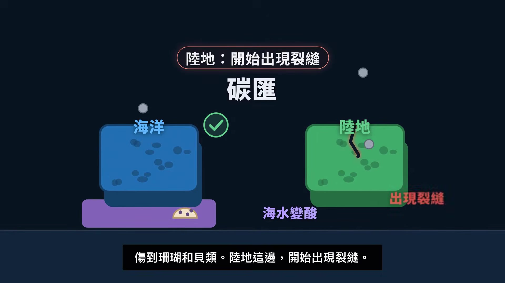

**逐字稿片段：** 一箇中國的研究團隊 算出2023年 陸地吸收的二氧化碳突然掉了一大截 是2003年以來最低 原因是破紀錄的高溫 亞馬遜的乾旱 還有加拿大的森林大火 這是一年的數據 還不能說是長期趨勢 可是他提醒我們 地球替我們扛的能力不是無限的

**話題推測：** 引用中國研究團隊數據，2023年陸地碳吸收量大幅下降

---

## 00:09:10

**逐字稿片段：** 海綿出現裂縫 最讓科學家擔心的是一個叫臨界點的東西 要懂臨界點

**話題推測：** 介紹科學家最擔心的「臨界點」概念

---

## 00:09:15

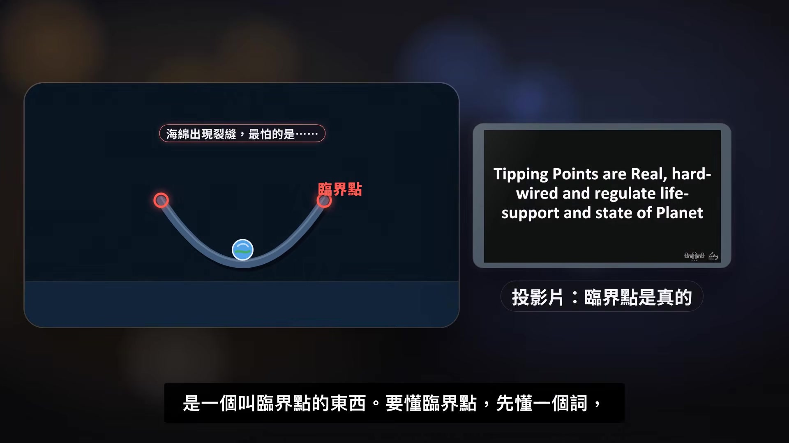

**逐字稿片段：** 先懂一個詞 叫回饋 負回饋 是會把變化壓回去的力量 海洋吸熱 森林吸碳 都是負回饋 地球被推一下 自己會晃回來 正回饋剛好相反 是會把變化放大的力量 例如冰融化以後 白色變成深色 吸收更多陽光 又融得更快 Rockstrom對臨界點的定義是這樣說的

**話題推測：** 解釋「回饋」機制，包括負回饋與正回饋

---

## 00:09:33

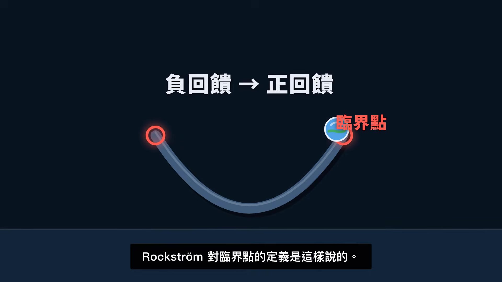

**逐字稿片段：** 聽他怎麼說 變成正確的反應 你會跌穿擊擊點 這就是擊擊擊擊的定義 當一個系統 在擊擊擊擊下的幾個反應之下 變成正確的反應 那麼這個系統 就會逐一被擊擊 進入一個不同的功能 科學家整理出十幾個 可能翻過去的地球系統

**話題推測：** 播放Rockström發言片段，闡述臨界點的定義

---

## 00:09:55

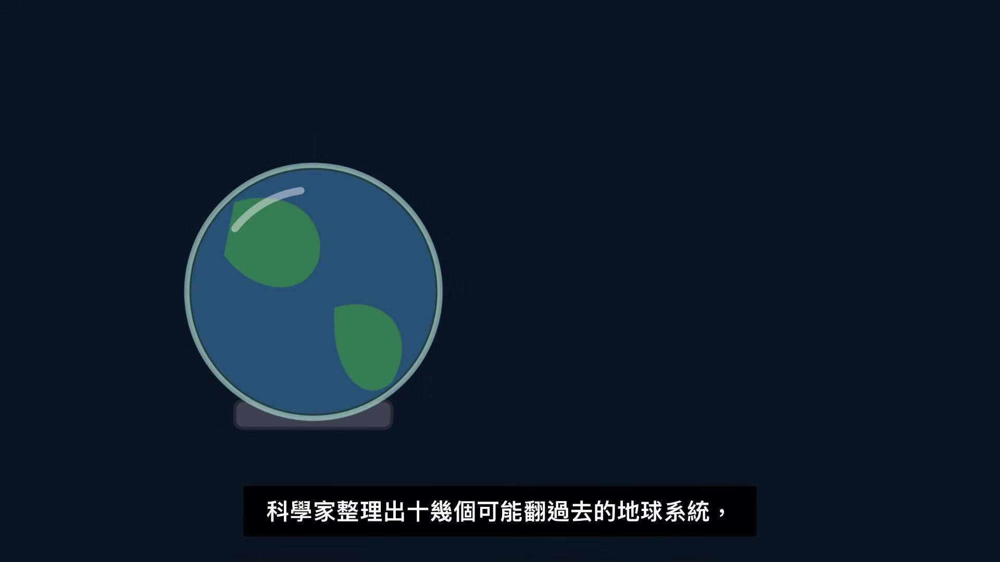

**逐字稿片段：** 叫臨界元素 Rockstrom特別講了三個

**話題推測：** 介紹科學家整理的十幾個「臨界元素」

---

## 00:09:57

**逐字稿片段：** 第一個是暖水珊瑚礁 去年10月 一份由大約160位科學家和諧的 全球臨界點報告 判定暖水珊瑚礁的臨界點 大約在升溫1.2度 現在已經越過了 這是第一個 被判定越過臨界點的地球系統

**話題推測：** 深入討論第一個臨界元素：暖水珊瑚礁已越過臨界點

---

## 00:10:11

**逐字稿片段：** 另一個是大西洋的一條洋流系統 叫大西洋金像翻轉環流 英文說寫AMOC 它像一條輸送帶 把熱帶的熱水送到北大西洋 讓歐洲沒那麼冷 IPCC第六次評估報告 認為它在本世紀內 突然崩潰的可能性不高 信心是中等

**話題推測：** 深入討論第二個臨界元素：大西洋經向翻轉環流（AMOC）

---

## 00:10:25

**逐字稿片段：** 可是之後幾篇研究的模型 算出中等排放 下到本世紀末 它可能減弱大約一半 Rockstrom認為 風險被低估了

**話題推測：** 引用最新研究模型，預估AMOC可能減弱一半

---

## 00:10:32

**逐字稿片段：** 最後是亞馬遜雨林 雨林會自己製造雨 可是砍掉太多 雨就下不夠 雨林可能慢慢變成草原

**話題推測：** 深入討論第三個臨界元素：亞馬遜雨林

---

## 00:10:38

**逐字稿片段：** 亞馬遜已經被砍掉 大約一層七到一層八

**話題推測：** 指出亞馬遜雨林砍伐比例及其對生態的影響

---

## 00:10:41

**逐字稿片段：** 今年五月 一篇自然期刊的論文推估 Rockstrom 也是作者之一 如果砍伐到22%到28% 再加上升溫1.5到1.9度 大約三分之二的亞馬遜 可能退化成稀疏的森林或草原 這三個珊瑚有比較多證據 洋流和亞馬遜 科學界還在爭論 臨界點到底有多嚴重 洛克斯托姆用了一個 每個人都懂的比喻

**話題推測：** 引用《自然》期刊論文，預估亞馬遜雨林退化情境

---

## 00:11:01

**逐字稿片段：** 體溫 他說地球知道自己的界限在哪裡 就像我們知道自己的體溫一樣 這些數字 人類是花了很長的時間 一次一次試出來的

**話題推測：** Rockström用「體溫」比喻地球的界限

---

## 00:11:08

**逐字稿片段：** 聽他怎麼說 他說地球也有這樣的體溫刻度 只是我們還沒問清楚

**話題推測：** 播放Rockström發言片段，闡釋地球的體溫刻度

---

## 00:11:33

**逐字稿片段：** 他最擔心的情況叫溫室地球 意思是溫度高到某個程度以後 就算人類停止排放 地球自己的回饋 也會讓溫度停在高處 甚至繼續上升

**話題推測：** 介紹Rockström最擔心的「溫室地球」情況

---

## 00:11:41

**逐字稿片段：** 他的團隊今年發表一篇論文 用模型算過 如果世界照中間路線走 升溫最高會接近四度 而且一直到西元三千年 都還停在三度左右 這是單一模型的推估

**話題推測：** 引用Rockström團隊模型推估，未來升溫路徑

---

## 00:11:52

**逐字稿片段：** 聯合國環境署估計 照各國目前的政策 本世紀末大約升溫2.8度 聽起來很糟 可是他在演講最後 講了一個重要的區別 現在地球承受的 還只是壓力 還沒變成另一種狀態

**話題推測：** 引用聯合國環境署估計，各國政策下本世紀末升溫2.8度

---

## 00:12:03

**逐字稿片段：** 聽他怎麼說

**話題推測：** 播放Rockström發言片段，強調地球尚未越過無法回頭的臨界點

---

## 00:12:27

**逐字稿片段：** 所以這一部分的答案是 地球還沒越過 回不來的那條線 海洋還在吸熱 森林還在吸碳 可是有些碳會在變弱 有些臨界點已經很近

**話題推測：** 總結第三部分：地球尚未回不來，但臨界點已近

---

## 00:12:35

**逐字稿片段：** 那我們能做什麼

**話題推測：** 進入新話題：人類可以做什麼來應對氣候變遷

---

## 00:12:37

**逐字稿片段：** Rockstorm在隔天的講座給了兩個方向 一個是加快淘汰煤 石油和天然氣 另一個是把生物圈救回安全範圍 保護森林 淡水 海洋和土壤 因為就算明天全世界都不燒化石燃料 生物圈太弱 還是守不住

**話題推測：** 介紹Rockström提出的兩個主要行動方向：淘汰化石燃料和保護生物圈

---

## 00:12:49

**逐字稿片段：** 放到臺灣

**話題推測：** 轉向討論臺灣在氣候行動上的具體政策與法規

---

## 00:12:50

**逐字稿片段：** 2023年修改法律 把2050年淨零排放 寫進了氣候變遷因應法

**話題推測：** 提及臺灣將2050淨零排放寫入氣候變遷因應法

---

## 00:12:55

**逐字稿片段：** 大型排放園要繳碳費 一般費率每噸300元 今年5月第一次繳費 461座工廠 總共繳了大約49億7千萬元

**話題推測：** 說明臺灣碳費制度及首次繳費情況

---

## 00:13:03

**逐字稿片段：** 勞動部也規定戶外工作的熱危害風險到第四級以上 僱主要提供遮陽降溫和休息的地方

**話題推測：** 提及勞動部針對戶外工作熱危害的防護規定

---

## 00:13:10

**逐字稿片段：** 對每個人來說最實際的是少浪費能源 選擇低碳的交通 也照顧好自己和家人度過越來越熱的夏天 他最後是這樣收尾的

**話題推測：** 提出個人層面的應對措施：節能、低碳交通、自我防護

---

## 00:13:17

**逐字稿片段：** 聽他怎麼說 Not for the next generation But for the next millennium

**話題推測：** 播放Rockström最後的收尾發言片段

---

## 00:13:37

**逐字稿片段：** 我們回到開場那個問題 1.5度守不住了 接下來的地球會變成怎樣 Rockstrom給的答案有三層 第一層地球已經在發燒 海洋變熱 珊瑚白化 熱量變多 這些都是量得到的現象 再來1.5度會先被超過 接下來的極端天氣只會更多 臺灣也躲不掉 最後一層地球還沒越過 回不來的那條線 海洋和森林還在替我們扛 所以每一掃生0.1度都有差 要記得先超標再降回來 降回來要花多少年 還有洋流亞馬遜什麼時候會翻轉 這些是他和他的研究團隊的推估 科學界還在討論 整理一下 1.5度守不住 不是世界末日 是一個警報 警報響了 接下來看的是我們把溫度壓在多高

**話題推測：** 總結影片內容，回答開場問題

---

## 00:14:16

**逐字稿片段：** 壓多久 最後問你一個問題 你覺得臺灣最該先準備的是熱浪 颱風還是缺水 留言告訴我 喜歡的話訂閱AI Notebook 開啟通知 我們下次見

**話題推測：** 提出一個問題，鼓勵觀眾互動留言

---
