# jimainotebook_tIscH2YrTrU — 關鍵畫面索引

- 來源逐字稿：[jimainotebook_tIscH2YrTrU_FIN.srt](jimainotebook_tIscH2YrTrU_FIN.srt)
- 影片：https://www.youtube.com/watch?v=tIscH2YrTrU
- 截圖數：79

## 00:00:04

**逐字稿片段：** 大家好,我是Jim,這裡是AI Notebook。

**話題推測：** 影片開頭，介紹講者與節目名稱，可能顯示標題或主持人的畫面。

---

## 00:00:11

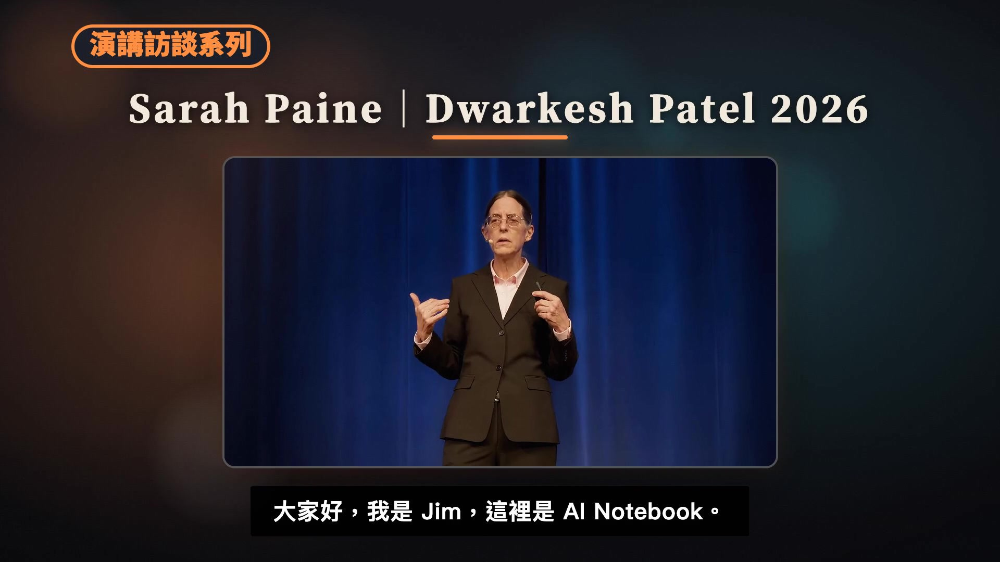

**逐字稿片段：** 這一集是演講訪談系列,主角是歷史學家Sarah Payne。

**話題推測：** 介紹本集主題人物歷史學家Sarah Payne，可能顯示她的照片或相關資訊。

---

## 00:00:15

**逐字稿片段：** 我們要問的是,戰爭為什麼開打容易,結束這麼難? 先想一個很小的場景,你跟朋友吵架,第一句重話一秒鐘就說出口了。 可是要和好,你得先想清楚自己到底要什麼,是一句道歉,還是以後不要再犯。 對方也要願意下臺階,旁邊的人也不能一直加油添醋,開始只要一個人決定,結束卻要好幾個人都覺得夠了。 國家打仗也是這樣 只是代價大上很多

**話題推測：** 提出本集的核心問題「戰爭為什麼開打容易，結束這麼難？」，可能顯示問題投影片。

---

## 00:00:40

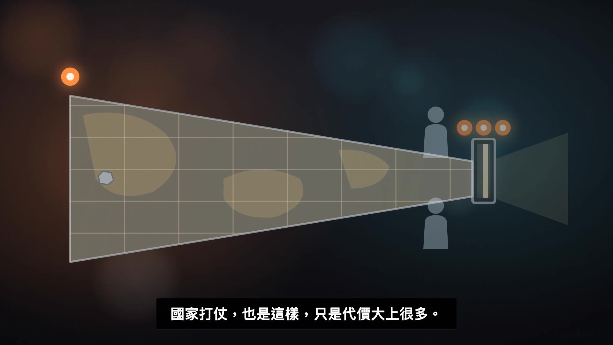

**逐字稿片段：** Payne用一百多年前的一場戰爭 來回答這個問題 那一次 一個小很多的國家 打贏了一個大帝國 而且知道什麼時候該停下來 先認識這一集的講者 Sarah Payne是一位歷史學家 在美國海軍戰爭學院教了25年戰略 現在在約翰霍普金斯大學 海軍戰爭學院 是美國海軍培養高階軍官的學校 她的學生 很多是以後要帶兵 要做決策的人

**話題推測：** 引導至Sarah Payne將以百年前的戰爭為例，可能顯示相關地圖或歷史圖像。

---

## 00:01:04

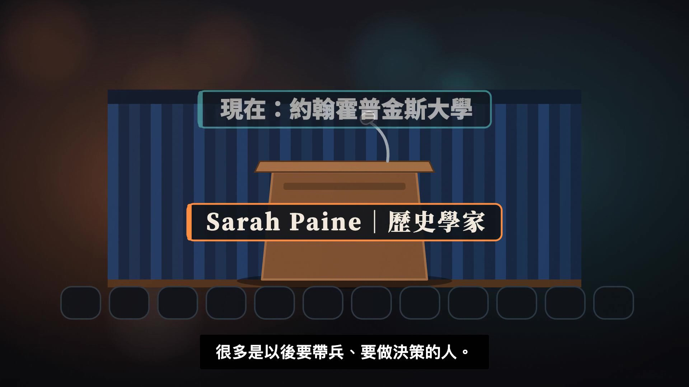

**逐字稿片段：** 她寫過好幾本書 講的是中國、日本和俄國之間的戰爭

**話題推測：** 提到講者撰寫的書籍，可能顯示相關書本封面。

---

## 00:01:08

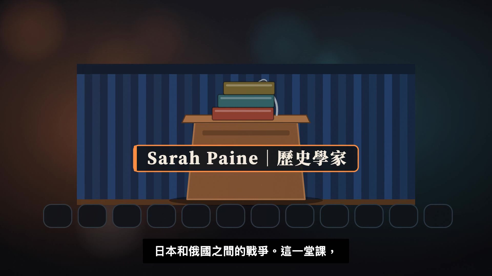

**逐字稿片段：** 這一堂課 2026年9月放上Dwarkesh Patel的頻道 Dwarkesh是一位專門做長天訪談的Podcast主持人 這是他和Pain合作的系列講座的最後一講 舞臺上只有他一個人 深藍色的布幕 臺下坐滿了觀眾 他的題目就是怎麼結束一場戰爭 他一開口就把整堂課的問題丟了出來 聽他自己怎麼說

**話題推測：** 說明演講的來源與發佈平台，可能顯示Dwarkesh Patel的頻道頁面或講座宣傳圖。

---

## 00:01:38

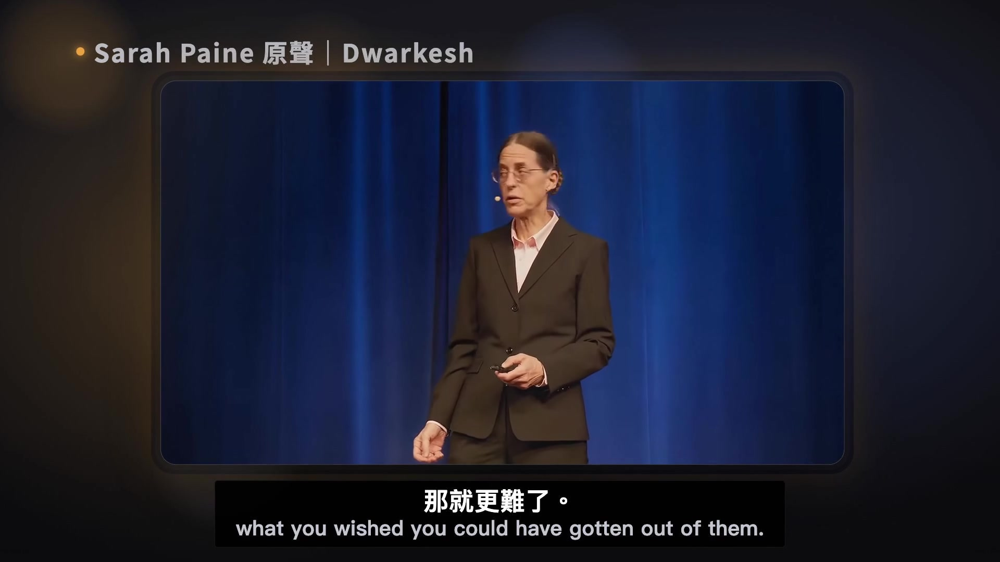

**逐字稿片段：** 他舉的第一個例子是1904年的日俄戰爭

**話題推測：** 介紹第一個歷史案例：1904年的日俄戰爭，可能顯示戰爭標題或相關歷史地圖。

---

## 00:01:42

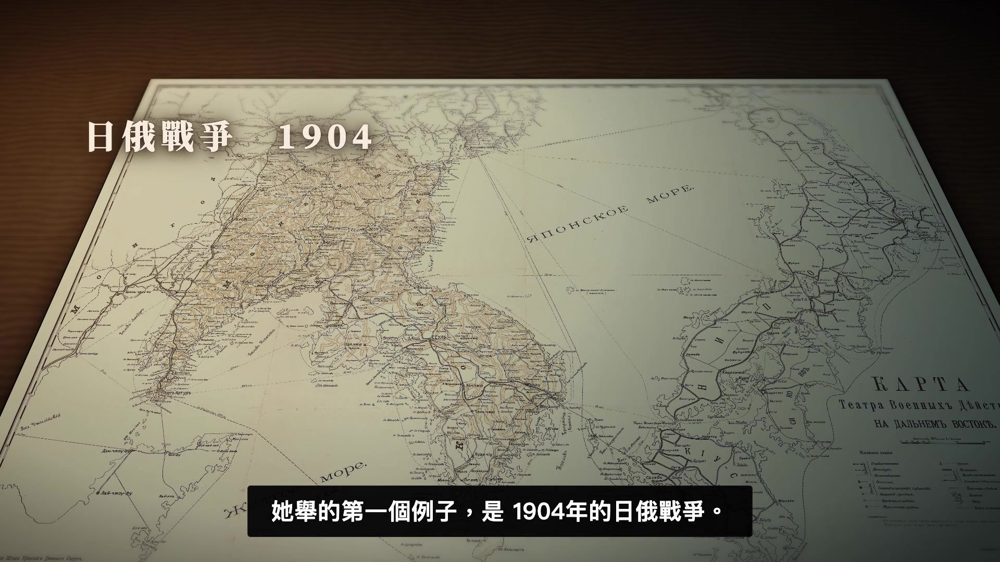

**逐字稿片段：** 先看兩邊的體型 那時候的俄國人口大約是日本的三倍 土地、工業、陸軍和海軍也都大上好幾倍 為什麼打起來? 戰場不在兩國自己的家 在中國的東北,當時叫滿洲 1900年義和團事件的時候 俄國派兵進了滿洲 事情平息以後答應撤兵,卻一直沒有撤 日本在意的是隔壁的朝鮮 日本提了一個交換 朝鮮歸日本 滿洲歸俄國 俄國不肯

**話題推測：** 比較日俄兩國的國力差距，可能顯示兩國人口、土地、工業、軍事實力對比的圖表。

---

## 00:02:08

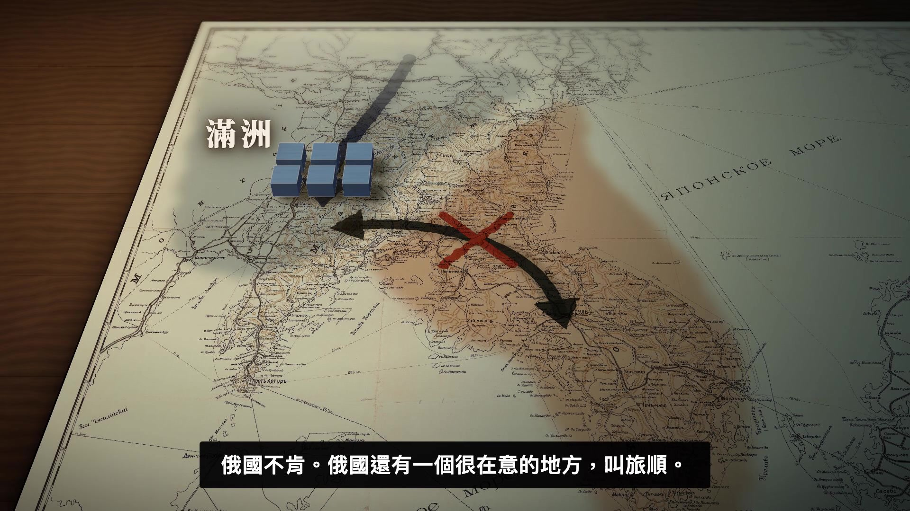

**逐字稿片段：** 俄國還有一個很在意的地方 叫旅順 它在遼東半島的尖端 是一個冬天不結冰的港口 俄國自己的海生威 一年有好幾個月要靠破冰船 譚布隆 日本決定動手 1904年2月 日本海軍在夜裡偷襲旅順港 一個小很多的國家 對一個大帝國開戰

**話題推測：** 說明俄國對旅順的重視，可能在地圖上突顯旅順港的位置及其重要性。

---

## 00:02:25

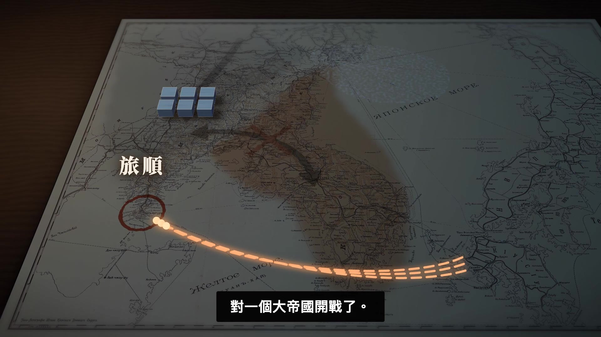

**逐字稿片段：** 在講仗怎麼打之前 Payne先問了一個更根本的問題 怎樣才算打贏 很多人的直覺是 打贏的仗比較多的那一邊 就是贏家

**話題推測：** 引入新的核心概念「怎樣才算打贏」，可能顯示問題投影片。

---

## 00:02:35

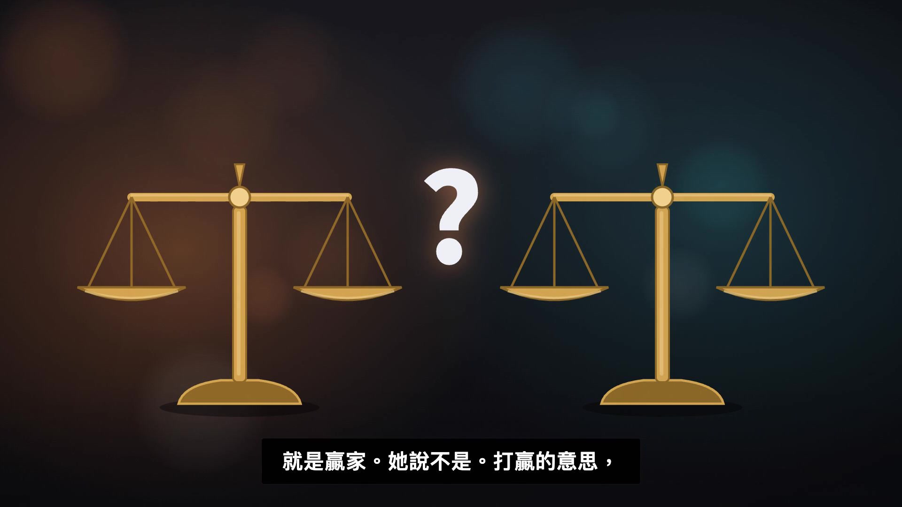

**逐字稿片段：** 他說不是 打贏的意思 是拿到你當初開戰想要的政治結果 仗打得再漂亮 那個結果沒拿到 就不算贏

**話題推測：** 闡述「打贏」的定義，可能顯示相關文字定義投影片。

---

## 00:02:43

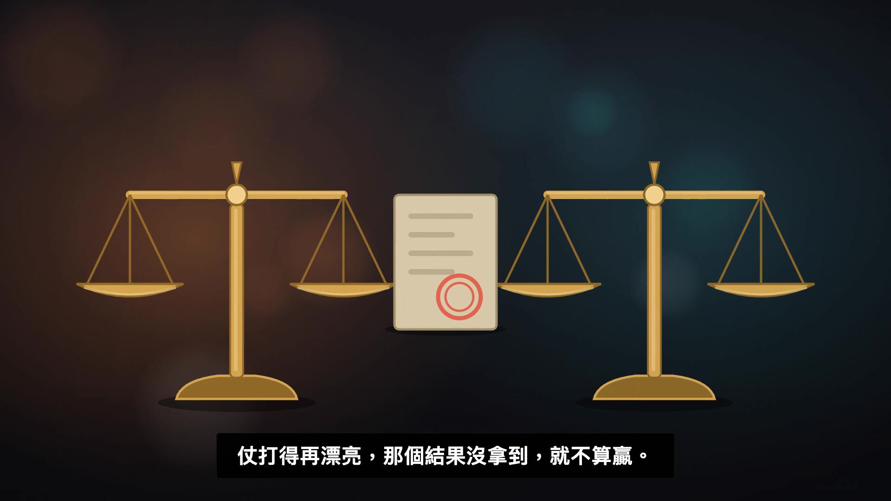

**逐字稿片段：** 有一段對話很常被引用 越南戰爭結束後 一位美國上校對北越的軍官說 你們在戰場上沒有打贏過我們 對方回答 也許是這樣 可是這跟結果沒有關係

**話題推測：** 引用越戰的對話來支持觀點，可能顯示越戰相關的圖像或引文投影片。

---

## 00:02:54

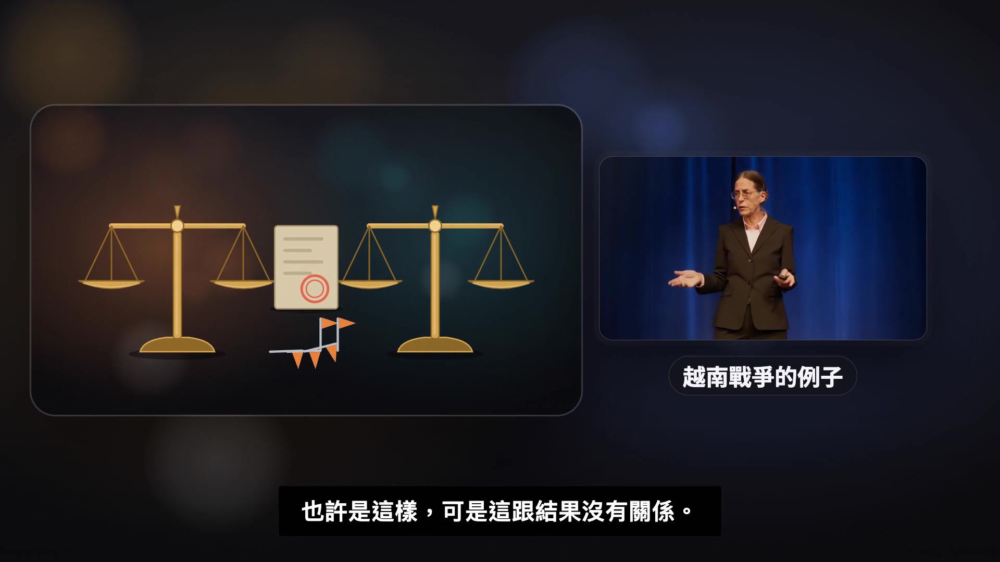

**逐字稿片段：** 所以要先看開戰的目標 目標大概分兩種 第一種叫有限目標 意思是隻想拿到某一樣東西 比如一塊地 一個讓步 拿到了就可以坐下來談 第二種叫無限目標 意思是要推翻對方的政府 把整個政權換掉 日本在1904年的目標是有限的 他只要俄國退出朝鮮 沒有打算打到莫斯科 這一點後面每一個例子都會用到

**話題推測：** 介紹戰爭目標的兩種分類，可能顯示「有限目標」與「無限目標」的清單投影片。

---

## 00:03:18

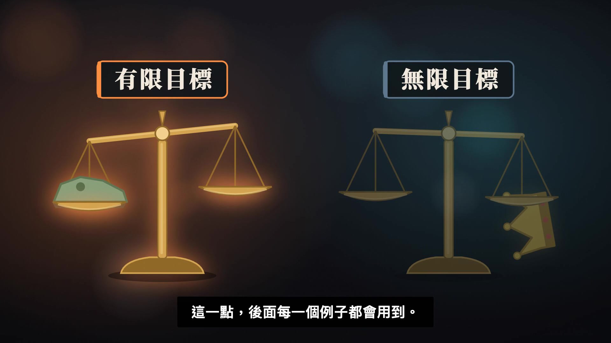

**逐字稿片段：** 日本的第一個難關就是旅順 俄國在港口四周的山上蓋了堡壘 港裡停著俄國的太平洋艦隊 負責攻城的將軍叫乃木西典 他一波接一波的正面強攻 整個圍城打下來 日軍死傷將近6萬人

**話題推測：** 回到日俄戰爭，講述旅順攻防戰，可能顯示旅順要塞的地圖或戰況圖。

---

## 00:03:32

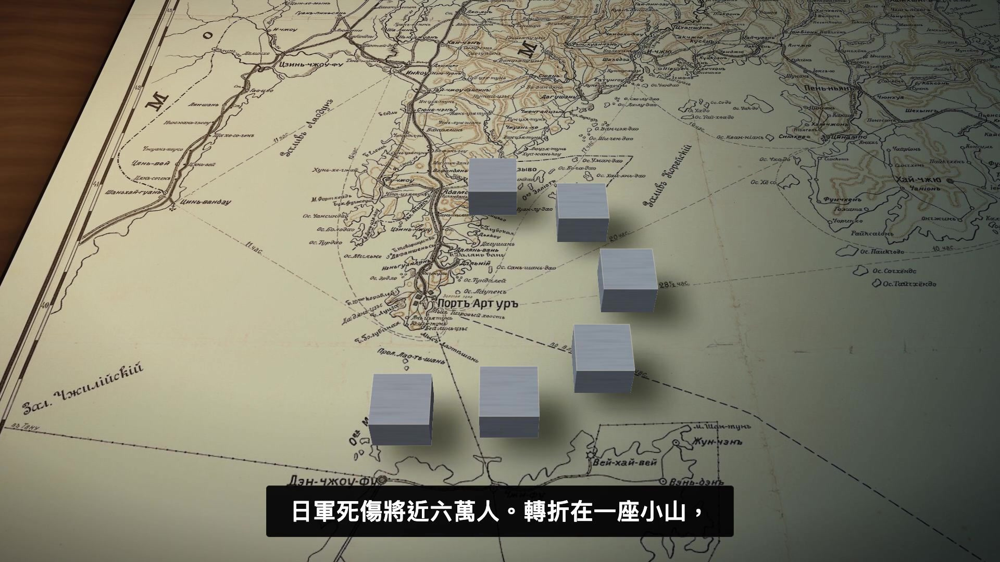

**逐字稿片段：** 轉折在一座小山叫203高地 1904年12月日軍拿下了它 站在山頂可以看見整個港口 大炮終於知道該往哪裡打 幾天之內港裡的俄國軍艦一艘接一艘被打沉 1905年1月2日呂順投降

**話題推測：** 提到203高地成為戰役轉折點，可能顯示戰場地圖上203高地的位置。

---

## 00:03:48

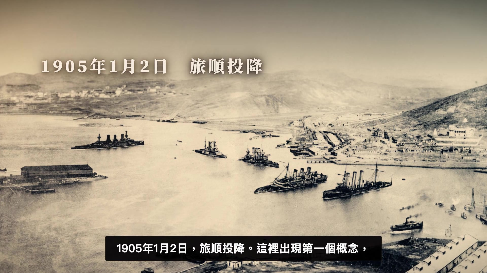

**逐字稿片段：** 這裡出現第一個概念叫攻擊頂點

**話題推測：** 引入第一個戰略概念「攻擊頂點」，可能顯示該術語的定義投影片。

---

## 00:03:51

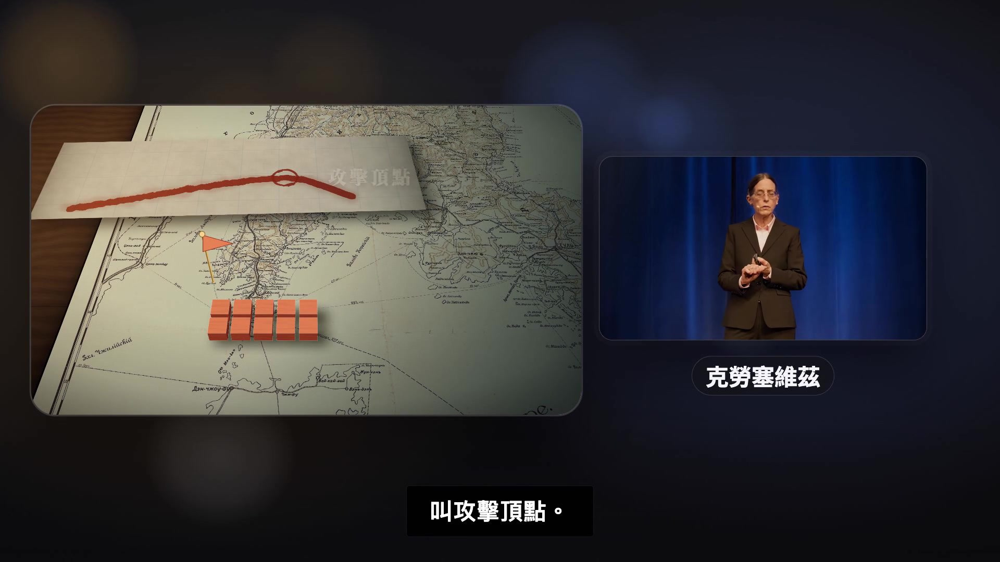

**逐字稿片段：** 他來自19世紀的普魯士將軍克勞塞維茲 他寫了一本書叫戰爭論 意思是進攻的一方力氣會越用越少 用到某一點剩下的力氣只夠守住 再往前推 對方的反擊反而會更重 日本拿下了旅順 可是這一仗用掉的人 已經接近日本陸軍承受得了的邊緣 攻擊頂點 講的是一場戰役 克勞塞維茨還有一個更大的概念

**話題推測：** 介紹克勞塞維茲及其著作《戰爭論》，可能顯示克勞塞維茲的肖像和書本封面。

---

## 00:04:14

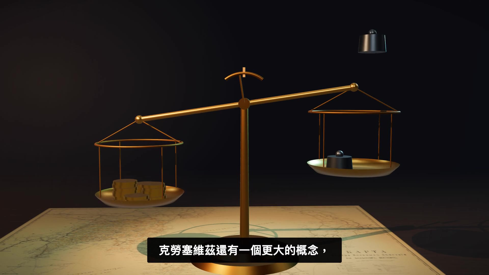

**逐字稿片段：** 看的是整場戰爭 叫勝利頂點 我用一個比喻來講 你買了一張股票 漲了一大段 這時候該賣還是繼續抱著 很多人都有過這種經驗 抱過了頭 賺到的又全部吐回去 那個最好的賣點就是停利點 勝利頂點就是戰爭的停利點 還沒走到就停 你少拿了本來拿得到的東西 走過頭 你付出的代價 開始超過你能拿到的好處 自己反而變弱 不過這個比喻 有一個地方不一樣 股票什麼時候賣 你一個人決定 戰爭的頂點在哪裡 還要看對手怎麼反應 看旁邊的人會不會插手

**話題推測：** 引入更重要的戰略概念「勝利頂點」，可能顯示該術語的定義投影片。

---

## 00:04:47

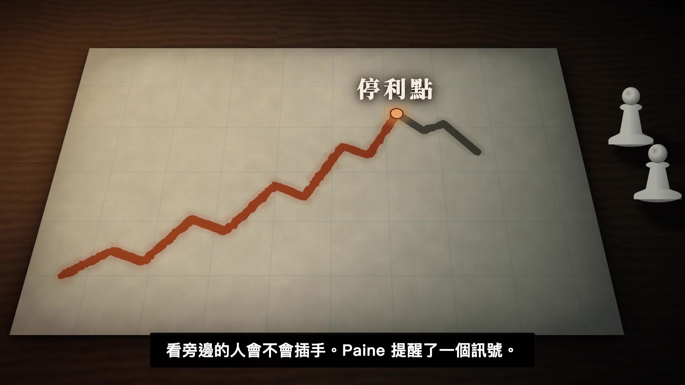

**逐字稿片段：** Pain提醒了一個訊號 走過頭最明顯的跡象 是本來在旁邊看的國家 決定加入 這個叫第三方介入 記住這個詞 第二部分和第三部分 都會一直看到它 那俄國是在哪一刻決定放棄的 Payne沒有直接給答案 他列了五個候選時刻 讓臺下的人自己判斷 我把他們分成三類

**話題推測：** 提出判斷勝利頂點的關鍵訊號「第三方介入」，可能顯示該術語的定義投影片。

---

## 00:05:07

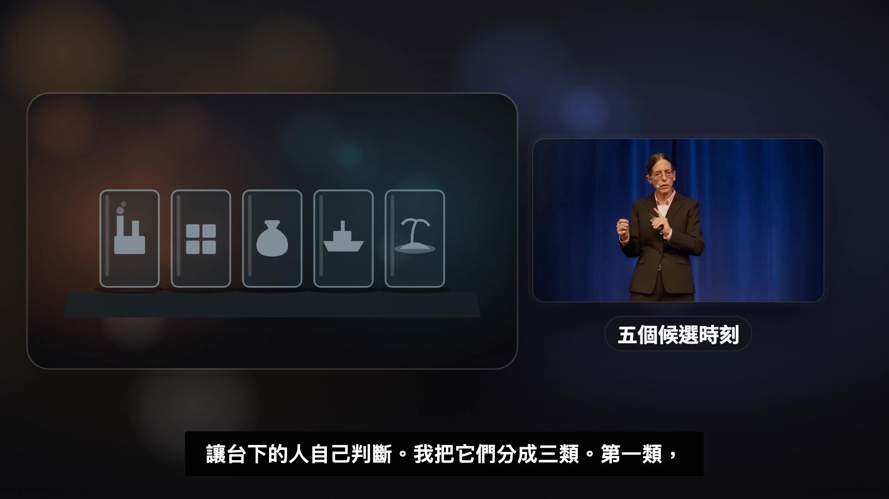

**逐字稿片段：** 第一類在俄國國內 1905年1月 聖彼得堡的工人和平請願 軍隊對人群開槍 這一天後來叫寫新星期日 全國開始罷工 沙皇最後答應設立議會

**話題推測：** 介紹第一個候選時刻，俄國國內的「血腥星期日」，可能顯示相關的歷史圖片或新聞畫面。

---

## 00:05:18

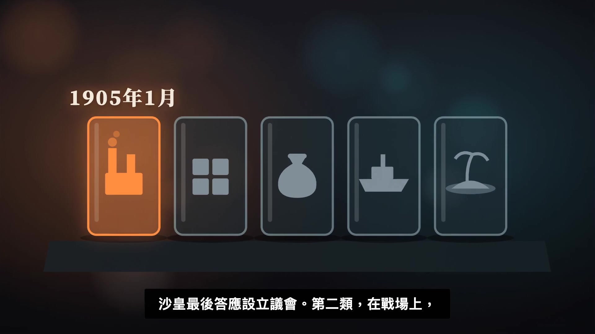

**逐字稿片段：** 第二類在戰場上 就是奉天會戰和對馬海戰

**話題推測：** 提及戰場上的奉天會戰和對馬海戰，可能顯示這些戰役的地理位置或示意圖。

---

## 00:05:22

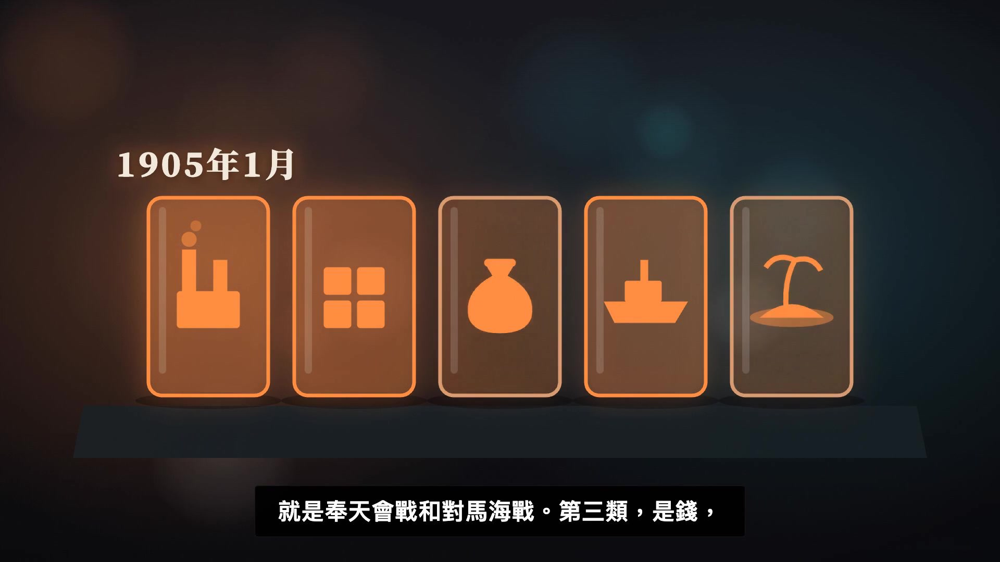

**逐字稿片段：** 第三類是錢 還有談判桌上的籌碼 可是為什麼這個頂點事先這麼難算 克勞塞維茲用了一個很奇特的東西來比喻,叫波隆納瓶。 聽他解釋這是什麼瓶子。 一刮就碎,還是越打越硬? 打下去之前你不會知道

**話題推測：** 提及金錢作為決策因素，可能顯示財政或借貸相關的圖表。

---

## 00:05:57

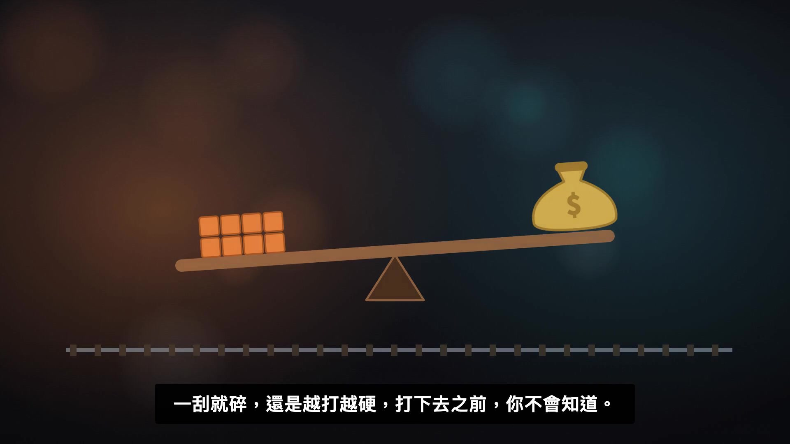

**逐字稿片段：** 俄國國內已經出現裂痕 可是他的軍隊還在 1905年2月到3月 雙方在奉天打了一場大會戰 是那個年代規模最大的陸上戰役之一 日本贏了 可是贏得很勉強 日本已經把能動員的人幾乎全部投進去了

**話題推測：** 回到奉天會戰，描述戰役規模與結果，可能顯示奉天地區的戰役地圖。

---

## 00:06:12

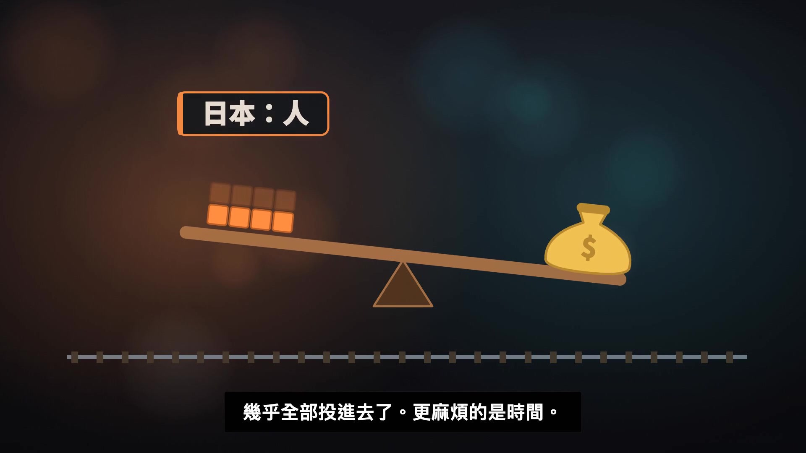

**逐字稿片段：** 更麻煩的是時間 西伯利亞鐵路的運輸量越來越大 戰爭拖得越久 俄國從歐洲運來的兵就越多 日本的將領心裡很清楚 對方本土還有大軍 自己的人卻已經用完了

**話題推測：** 分析西伯利亞鐵路在戰役中的運輸角色，可能顯示西伯利亞鐵路的路線圖。

---

## 00:06:24

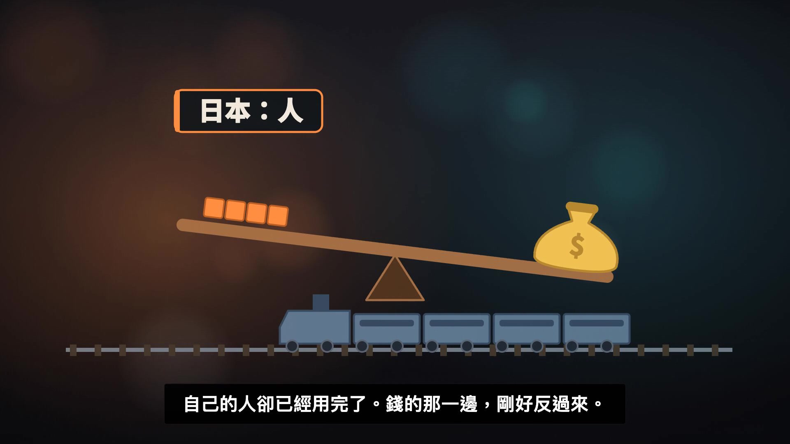

**逐字稿片段：** 錢的那一邊剛好反過來 兩個國家都靠向外國借錢打仗 日本一直打勝仗 借錢的利率就一路往下掉 俄國在奉天之後 向巴黎借錢的計劃失敗了 日本缺的是人 不缺錢 俄國缺的是錢 然後是1905年5月的對馬海戰 俄國把波羅的海艦隊 從歐洲派出來 繞了大半個地球 開到日本附近的海上 可是那時候 陸地上的情勢正在變得對俄國有利 兵一直運過來 俄國其實不需要在海上冒險

**話題推測：** 討論兩國的財政狀況與借貸利率，可能顯示日本與俄國借貸利率的對比圖表。

---

## 00:06:53

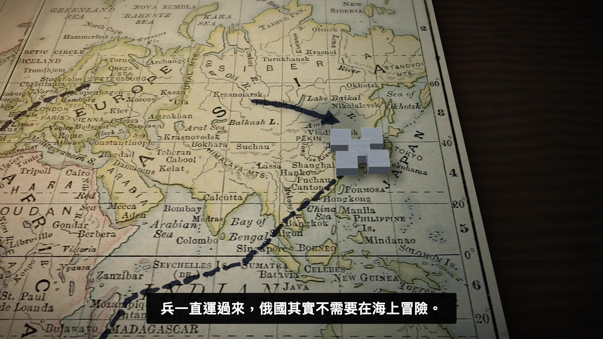

**逐字稿片段：** 俄國皇帝,也就是沙皇尼古拉二世,還是決定打這一仗。 在對馬海峽,俄國艦隊幾乎全軍覆沒。 聽他講尼古拉二世的這個決定。 日本艦隊打完一仗,船反而變多。 俄國在海上什麼都不剩

**話題推測：** 說明沙皇尼古拉二世的決策與艦隊覆沒，預告播放講者原音片段，畫面很可能切換到講者本人進行演說的影片片段。

---

## 00:07:23

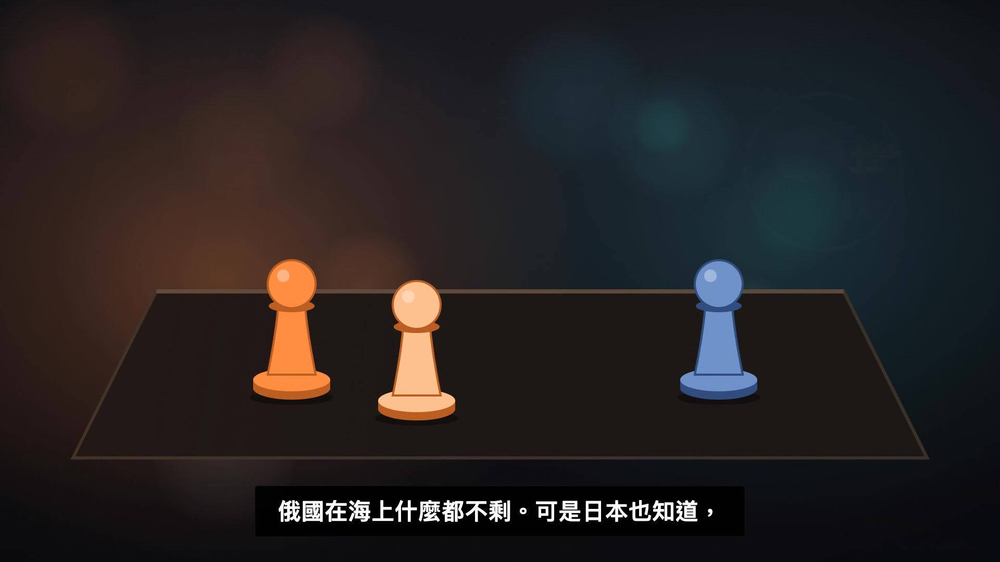

**逐字稿片段：** 可是日本也知道自己撐不了太久 這裡是日俄戰爭最值得學的地方 日本人在開戰之前 就已經想好要怎麼結束

**話題推測：** 闡述日本開戰前就預謀結束戰爭的策略，可能是一個策略示意圖或文字說明。

---

## 00:07:32

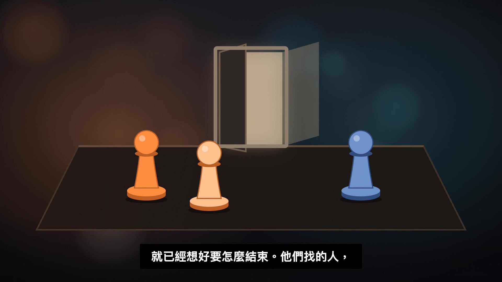

**逐字稿片段：** 他們找的人是美國總統老羅斯福 日本派了一位外交官 叫金子兼太郎到美國去遊說 金子和羅斯福都是哈佛大學畢業的 是校友 後來成了朋友 日本後來的談判代表小春壽太郎 也念過哈佛

**話題推測：** 介紹美國總統老羅斯福的角色，可能顯示老羅斯福的肖像。

---

## 00:07:46

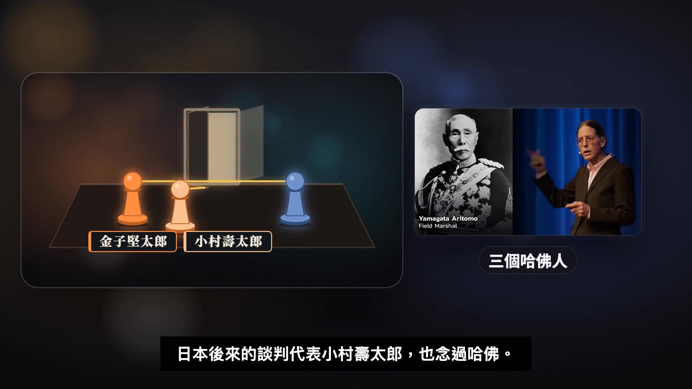

**逐字稿片段：** 這個安排到底有多早 聽他自己說

**話題推測：** 預告播放講者原音片段，強調日本外交佈局之早，畫面很可能切換到講者本人進行演說的影片片段。

---

## 00:08:07

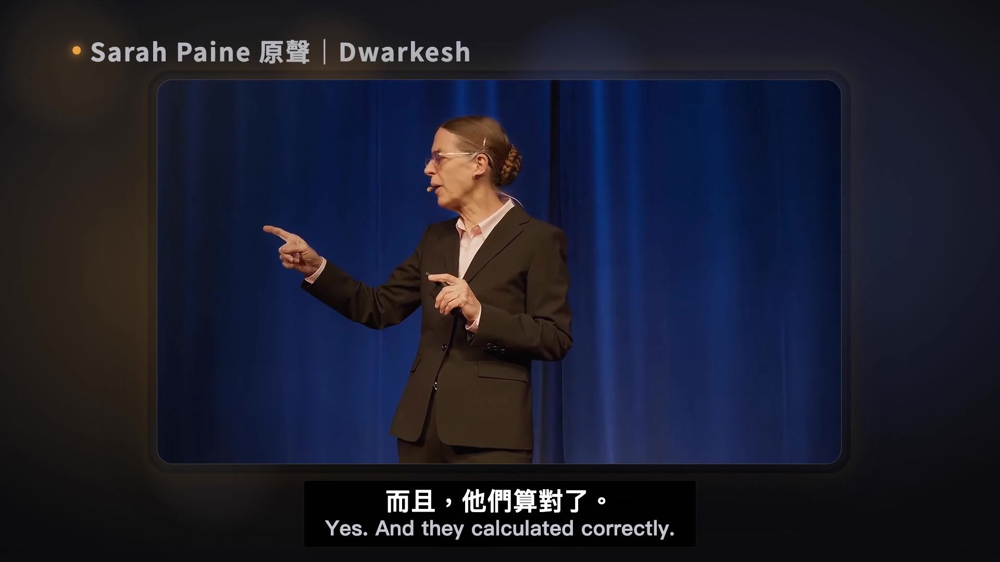

**逐字稿片段：** 美國人果然出面了 1905年夏天 日俄雙方在美國的普茨茅斯坐下來談

**話題推測：** 介紹在美國普茨茅斯的和平談判，可能顯示談判現場或簽署條約的歷史照片。

---

## 00:08:13

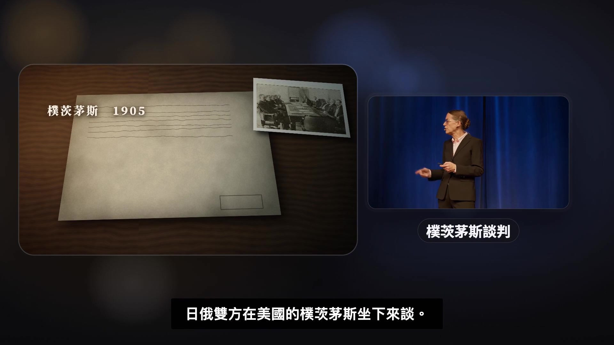

**逐字稿片段：** 談判開始之前 日本還先派兵搶下了庫葉島 讓手上多一張可以交換的牌 日本當時有一位將領的話很常被引用 大意是 火既然是你點的 你就得負責把它滅掉 這句話是流傳下來的說法 找不到原始出處 不過意思很清楚

**話題推測：** 說明日本在談判前搶下庫葉島的策略，可能在地圖上突顯庫葉島的位置。

---

## 00:08:28

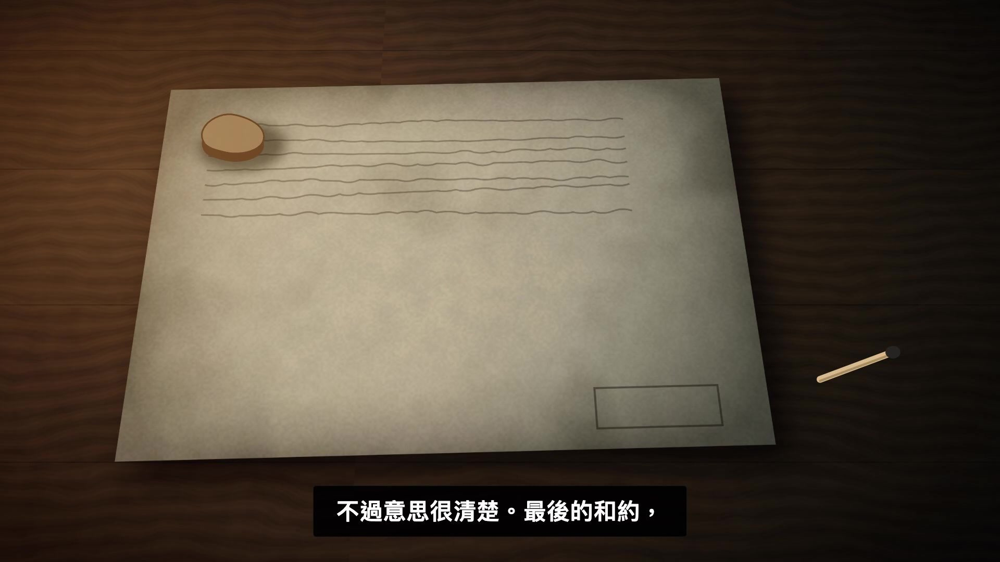

**逐字稿片段：** 最後的合約 日本拿到了在朝鮮的主導權 拿到了旅順和大連 拿到了南滿洲的鐵路 還有庫葉島的南半部 比他開戰時想要的還多

**話題推測：** 列出日俄戰爭最終合約中日本獲得的權益，可能顯示地圖標示出這些新取得的領土與權利。

---

## 00:08:37

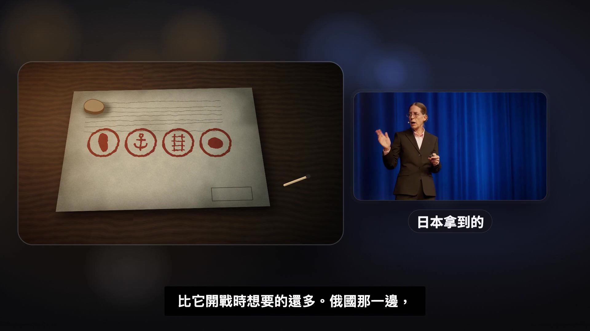

**逐字稿片段：** 俄國那邊 這場戰爭成了革命的開端之一 沙皇一家人 1918年在葉卡捷林堡被處決

**話題推測：** 說明戰爭對俄國造成的深遠影響，提及革命與沙皇一家被處決，可能顯示相關歷史圖片。

---

## 00:08:43

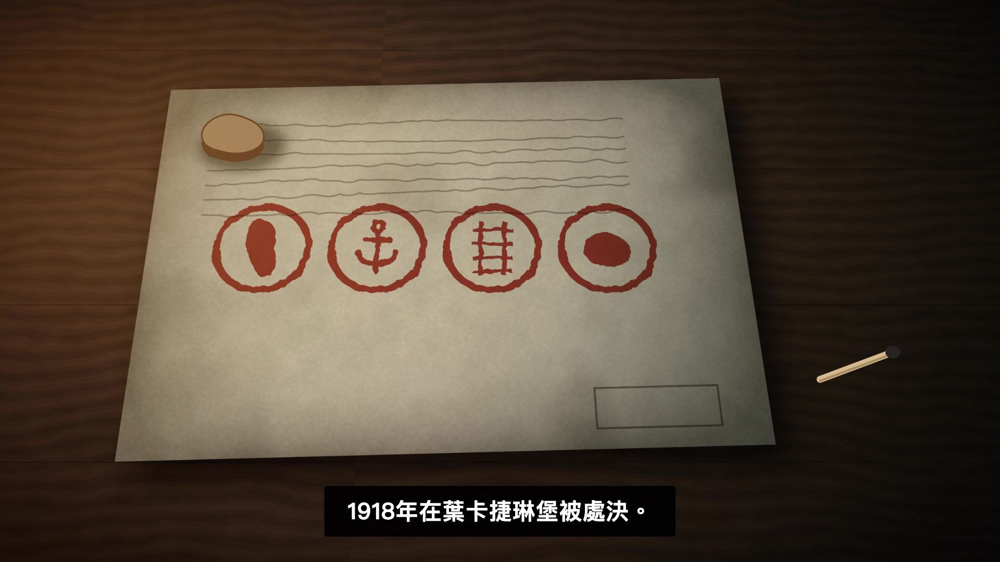

**逐字稿片段：** 第一部分的答案是這樣 打贏不是贏每一場仗 是拿到你開戰時想要的東西 日本做對了三件事 目標有限 只要朝鮮 開戰前就找好出口 走到停利點附近就收手 可是大部分的戰爭 沒有收得這麼漂亮 第二部分要問的是 為什麼常常收不了手

**話題推測：** 總結第一部分的觀點，可能顯示總結的投影片。

---

## 00:09:02

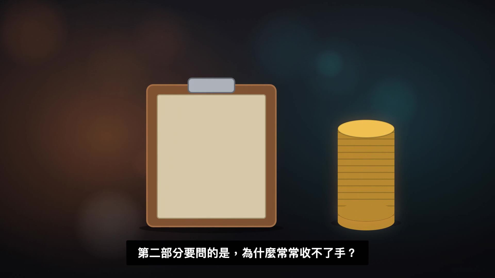

**逐字稿片段：** 先看一個收得很乾淨的例子 當作對照 1990年8月 伊拉克總統海珊出兵佔領了科威特

**話題推測：** 介紹第一次波斯灣戰爭作為「收得乾淨」的例子，可能顯示伊拉克與科威特的地圖。

---

## 00:09:09

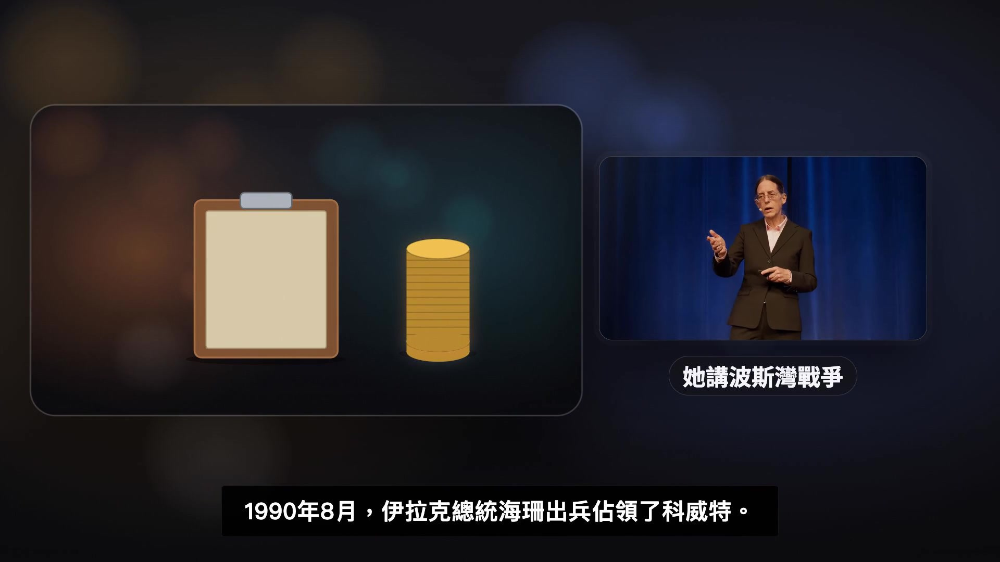

**逐字稿片段：** 隔年1月 美國的老布希總統簽了一份文件 叫國家安全指令第54號 上面把目標寫得清清楚楚 總共4條 伊拉克撤出科威特 恢復科威特原來的政府 保護海外的美國人 維持波斯灣的安全穩定 1991年2月底 伊拉克軍隊被趕出科威特 四個目標都達成了 美國就宣佈停火 沒有往巴格達打

**話題推測：** 列出美國老布希總統為第一次波斯灣戰爭設定的四個清晰目標，可能顯示目標清單投影片。

---

## 00:09:30

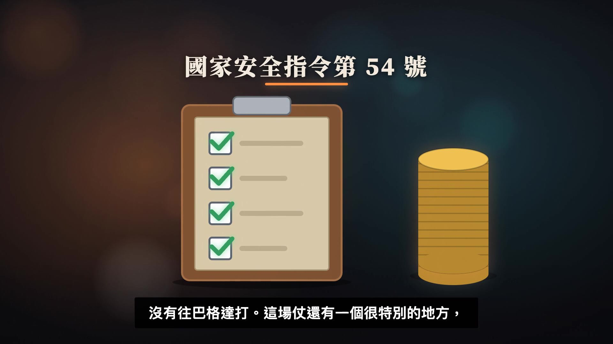

**逐字稿片段：** 這場仗還有一個很特別的地方 就是誰出錢 美國為了這場仗多花的錢 大約600多億美元 其中大約540億是盟國付的

**話題推測：** 討論第一次波斯灣戰爭的財政來源，提及盟國支付大部分費用，可能顯示資金構成的圖表。

---

## 00:09:39

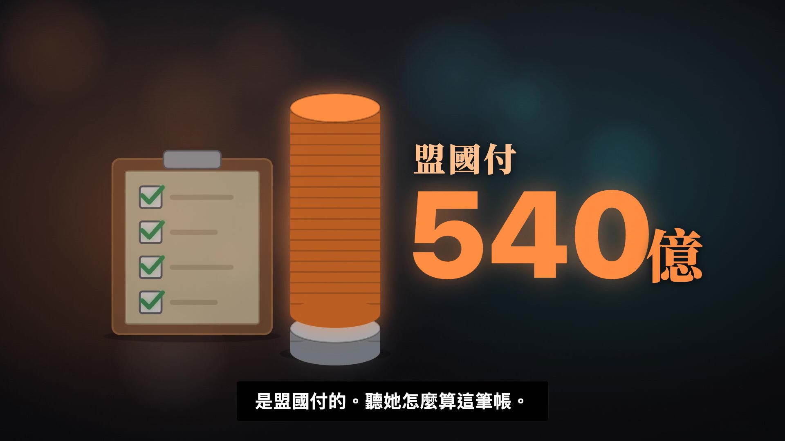

**逐字稿片段：** 聽他怎麼算這筆賬 成為他們想做的事的合作夥伴 所以美國並沒有為這次戰爭付出任何支援 他說的那140億 是盟國答應要給其他國家的錢 不是全部都已經付出去 不過重點沒有變 目標寫在紙上 達成就停 連錢都有人出

**話題推測：** 預告播放講者原音片段，解釋美國的戰爭資金帳目，畫面很可能切換到講者本人進行演說的影片片段。

---

## 00:10:08

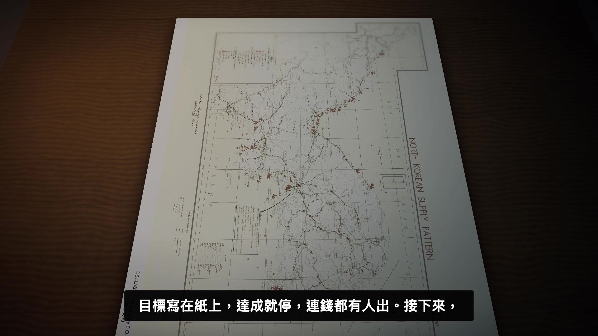

**逐字稿片段：** 接下來 看一個收得很辛苦的例子 韓戰 先看地圖 朝鮮半島像一根深進海裡的手指 南邊和北邊之間的陸地交界 大約250公里 兩邊的海岸線都可以用海軍封鎖 問題在半島的北邊 北韓跟中國之間的邊界 大約1400公里 河的對岸 就是前面講過的滿洲 那時候是中國的工業重鎮 這代表什麼 戰場封不住 北邊有一個很大的後方 兵和補給可以一直送過來 Pain的說法是 兩邊背後都有大哥在撐腰

**話題推測：** 介紹韓戰作為「收得很辛苦」的例子，可能顯示韓戰的標題或朝鮮半島地圖。

---

## 00:10:39

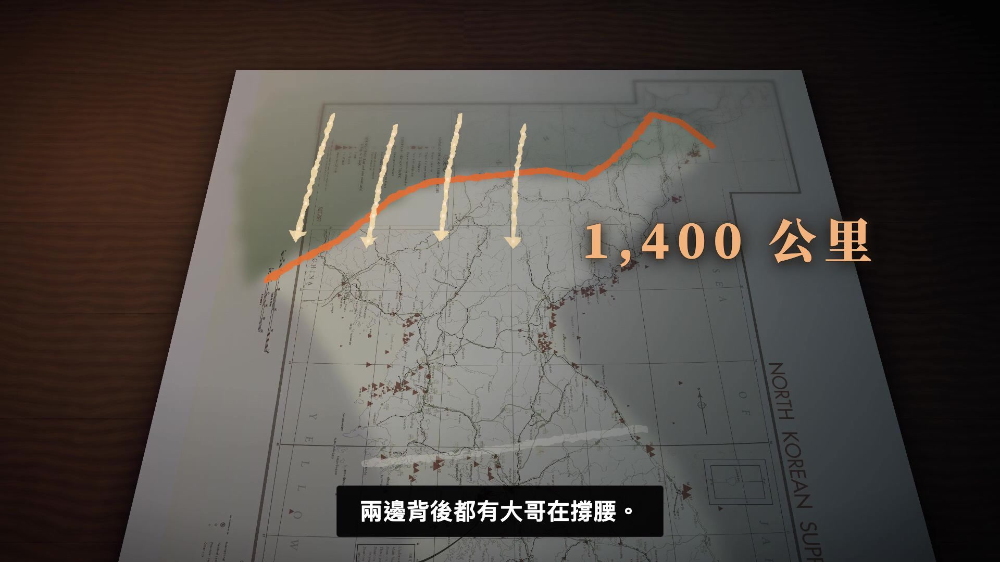

**逐字稿片段：** 1950年6月 北韓的領導人金日成出兵南下 他的算盤是 只要是南北兩邊自己打 他就贏得了 剛開始 事情也真的照他想的走

**話題推測：** 講述韓戰爆發，北韓金日成出兵南下，可能顯示金日成肖像或北韓軍隊南下的地圖。

---

## 00:10:49

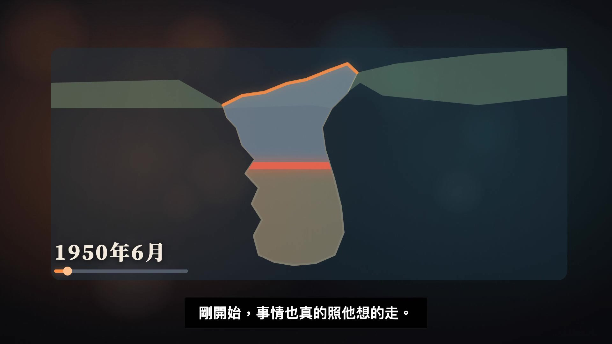

**逐字稿片段：** 北韓軍隊一路往南推 南韓和美國的部隊,最後被擠在半島東南角的一小塊地方,叫釜山防線 這是韓戰第一次有人走過了勝利頂點,聽他講金日成犯的錯 什麼是國際戰爭變成了國際戰爭 有可能變成了全球戰爭 你會遇到一個完全不同的種族 價值更高

**話題推測：** 描述韓戰初期北韓的推進，以及釜山防線的形成，可能顯示釜山防線的地圖。

---

## 00:11:29

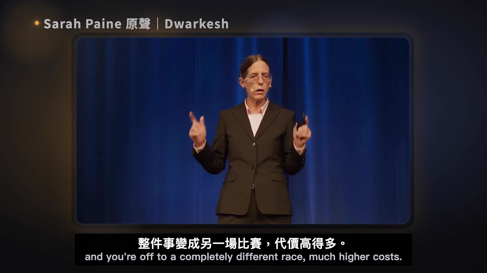

**逐字稿片段：** 金日成引來了美國和聯合國的軍隊 1950年9月 美軍在仁川登陸 從北韓軍隊的背後切進去 戰局一下子翻了過來

**話題推測：** 講述美國和聯合國介入韓戰，以及仁川登陸，可能顯示仁川登陸的戰術地圖。

---

## 00:11:38

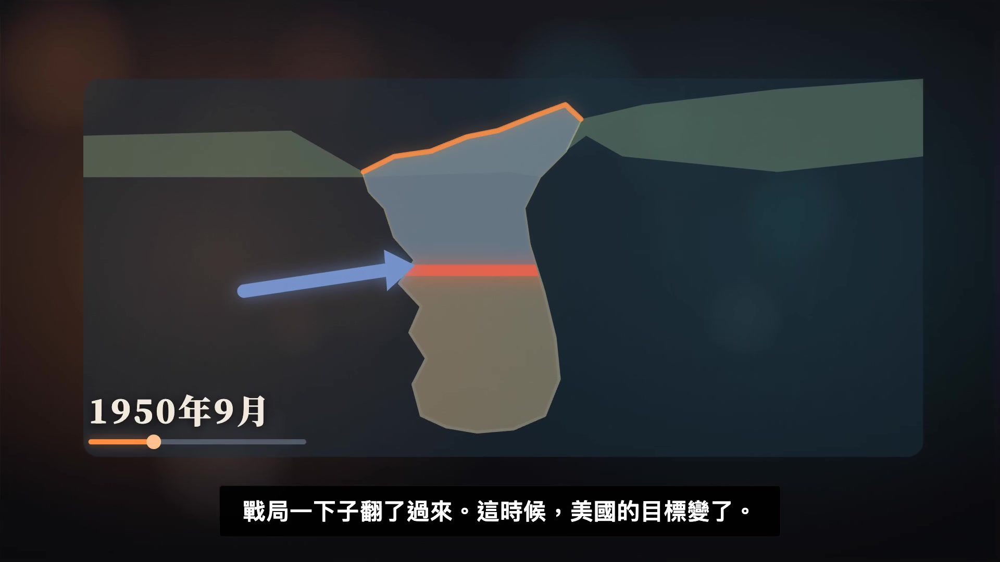

**逐字稿片段：** 這時候美國的目標變了 本來只是把北韓趕回去 恢復原來的邊界 現在變成乾脆把整個半島統一起來 軍隊一路往北推到靠近中國邊界的鴨綠江 1950年10月 中國的軍隊跨過鴨綠江參戰 這是第二次走過頭 這一次走過頭的是美國 前線又被推回南邊 接下來兩年多 雙方在差不多戰前的位置來回拉鋸 帶兵的麥克阿瑟將軍 1951年被杜魯門總統撤職

**話題推測：** 說明美國在韓戰中目標的轉變，從驅逐北韓到統一朝鮮半島，可能顯示目標變化的示意圖。

---

## 00:12:04

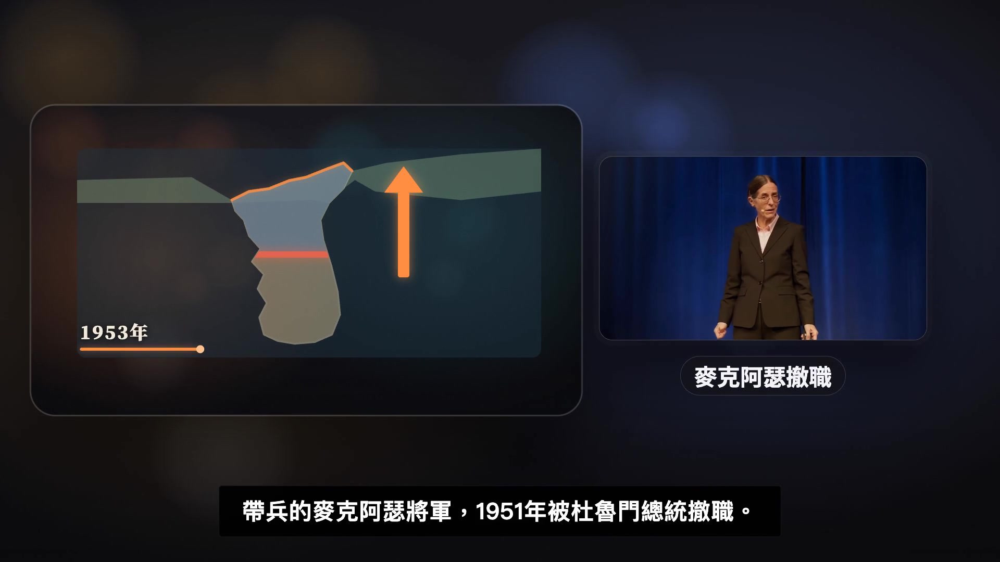

**逐字稿片段：** 1953年停戰 分界線離戰前的位置相差不遠 三年下來 各方估計的死亡人數 加起來有好幾百萬 大部分是平民

**話題推測：** 說明韓戰的結果與代價，可能顯示最終停火線的地圖或戰爭傷亡數字的圖表。

---

## 00:12:12

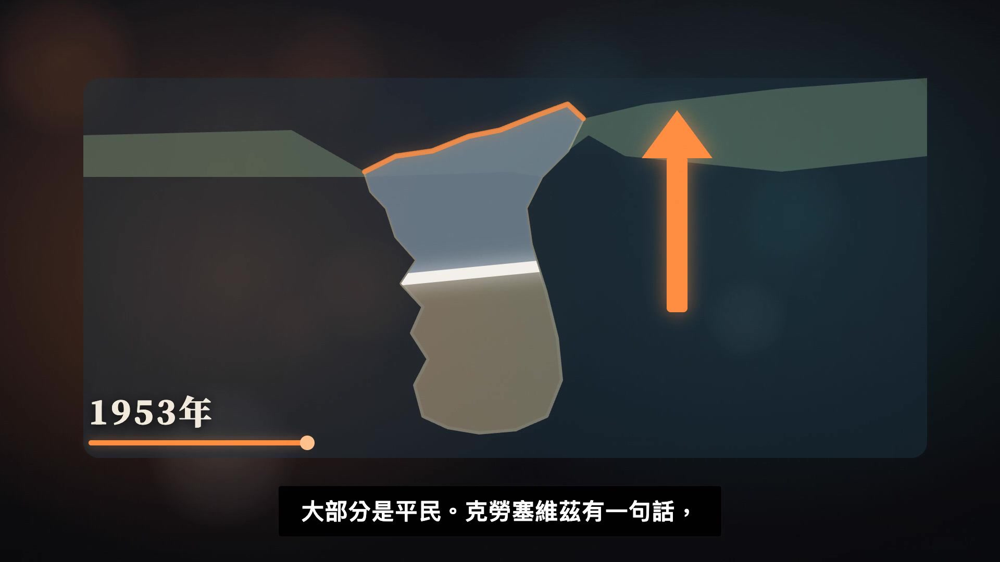

**逐字稿片段：** 克勞塞維茲有一句話 Payne特別強調 軍事上的考量 要服從政治上的考量 仗打得順不代表目標可以跟著變大 為什麼目標一變大戰爭就難收?

**話題推測：** 引用克勞塞維茲關於軍事服從政治的觀點，可能顯示該引文的投影片。

---

## 00:12:23

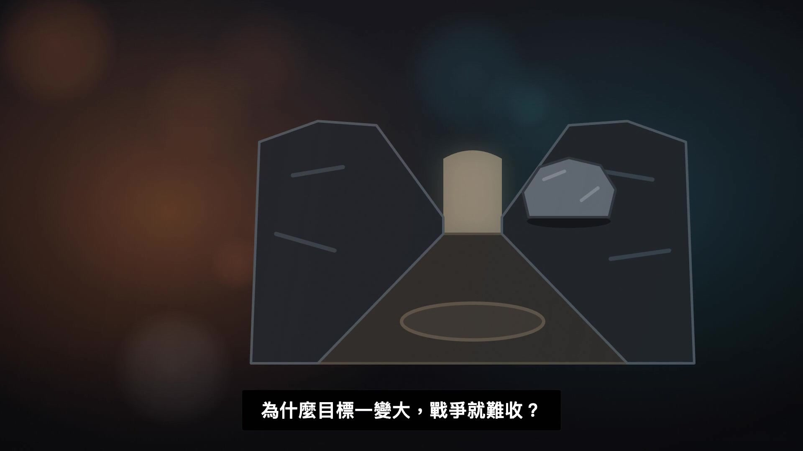

**逐字稿片段：** Pain借用了一位比克勞塞維茲早2000多年的人 中國的孫子 《孫子兵法》的九帝篇 講到一種地形叫死地 原文是 即戰則存 不即戰則亡者為死地 白話說 就是隻有拼命打才活得下來 不拼就會死的地方 人被放在這種地方會拼死作戰 Pain把這個概念 從地形搬到戰爭的目標上 這是他自己的延伸 當你的目標是推翻對方的政府 對方的領導人就沒有退路了 你等於親手把對手放進了死地

**話題推測：** 引入孫子兵法中「死地」的概念，可能顯示「死地」術語及其原文的投影片。

---

## 00:12:54

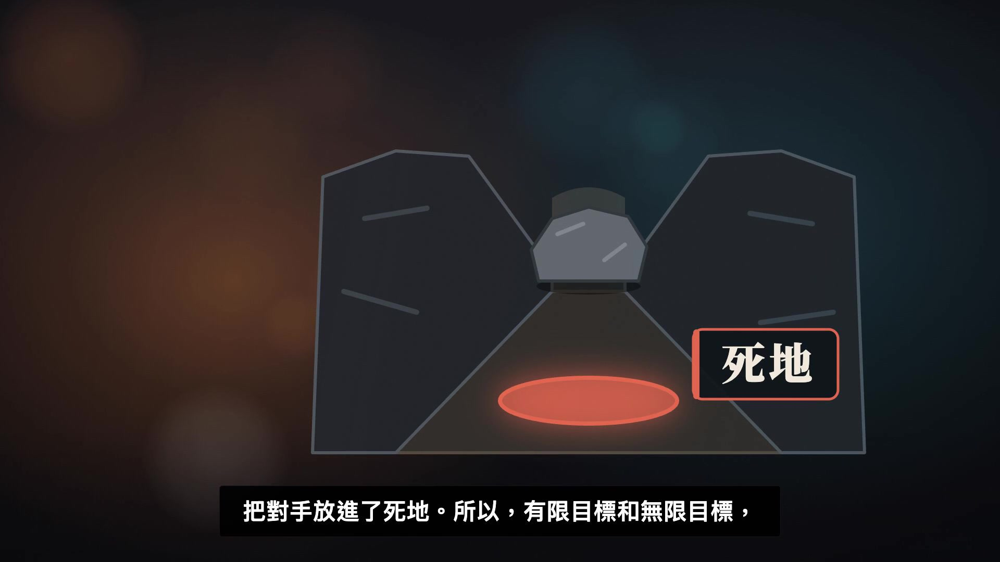

**逐字稿片段：** 所以有限目標和無限目標 男的地方剛好相反 聽他自己比較這兩種戰爭的差別 把一個失敗的國家變成一個要命的對手 這是無限目標最大的風險

**話題推測：** 比較有限目標與無限目標的難點，預告播放講者原音片段，畫面很可能切換到講者本人進行演說的影片片段。

---

## 00:13:33

**逐字稿片段：** 第二部分的答案是這樣 戰爭常常收不了手有兩個原因 第一個目標沒有寫清楚 或是寫了又跟著戰況變大 就像韓戰時的美國 打得順就想要更多 第二個目標一變大 有兩件事會一起發生 對手被放進死地 開始拼命 旁邊的國家覺得不能不管 第三方介入就來了 這兩件事一發生 你就走過了勝利頂點 回到停利點的比喻 就是抱過頭了 賬面上賺到的

**話題推測：** 總結第二部分的答案，說明戰爭難以結束的兩個主要原因，可能顯示總結的投影片。

---

## 00:13:59

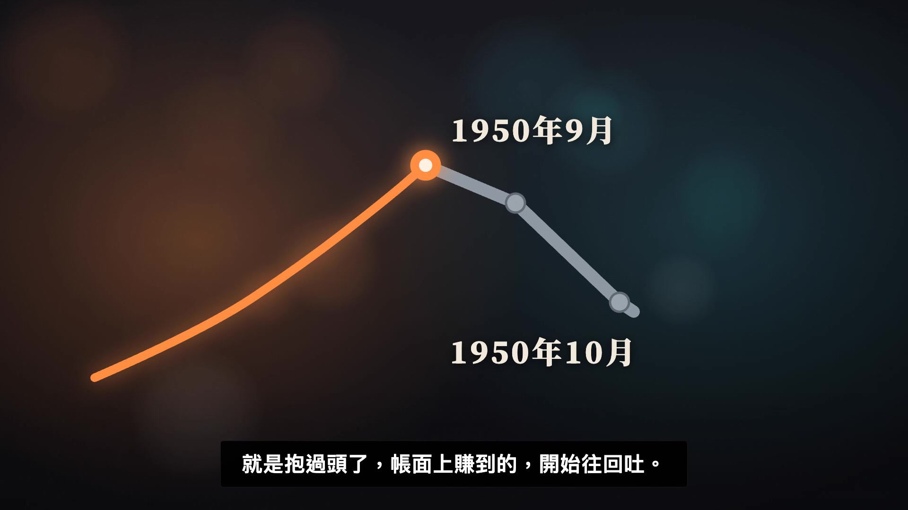

**逐字稿片段：** 開始往回吐 那走過頭之後呢 戰爭會變成什麼樣子 第三部分 看走過頭以後的兩種結果

**話題推測：** 轉入第三部分，探討戰爭「走過頭」後的兩種結果，可能顯示第三部分的標題投影片。

---

## 00:14:06

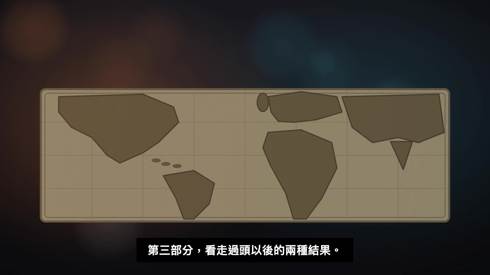

**逐字稿片段：** Pain把他們叫做兩種病 第一種病 是區域戰爭變成世界大戰 他舉的第一個例子 是美國獨立戰爭 北美13個殖民地的目標 是有限的 只要獨立 英國的目標卻是把叛亂完全壓下去 對殖民地來說 等於被放進了死地 仗一脫 旁人就進來了 1778年法國加入 1779年西班牙加入 1780年英國又對荷蘭宣戰 戰場從北美延伸到加勒比海 延伸到地中海的直布羅陀 一路到了印度 史學家多半認為 英國最後算了一筆賬 比起13個殖民地 加勒比海那些產塘的島嶼更值錢 所以英國保住了塘島 放掉了北美 一場殖民地的獨立戰爭 最後變成了一場全球的戰爭 第二個例子 是第一次世界大戰

**話題推測：** 比喻戰爭「走過頭」後會出現的兩種「病症」，可能顯示列出這兩種病症的投影片。

---

## 00:14:50

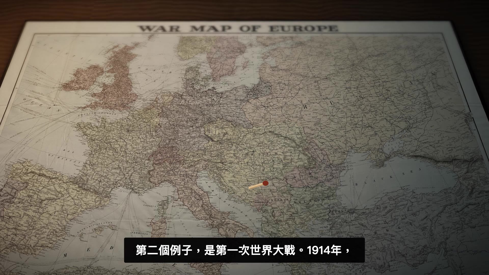

**逐字稿片段：** 1914年 奧匈帝國的皇族 在塞拉耶佛被刺殺 一場巴爾幹的衝突 把整個歐洲都捲了進來 麻煩的是 每個國家想要的東西都不一樣 法國想拿回1871年 割給德國的亞爾薩斯和洛林 意大利想要奧匈帝國的一部分領土 俄國盯著巴爾幹和黑海的海峽 就連同一個陣營裡 大家要的都談不攏 談不攏就沒有人能先退出 誰先退,誰就被盟友拋下 Pain用了一個很生活的比喻 聽他怎麼形容 派對越開越大,就是這種病 第三個例子 是日本從一場區域戰爭 一步一步走進太平洋戰爭 第一步,1930年 美國通過了一個大幅提高關稅的法案 叫斯姆特獲利關稅法

**話題推測：** 講述一戰的導火線薩拉熱窩事件，可能顯示巴爾幹半島地圖或事件相關照片。

---

## 00:15:42

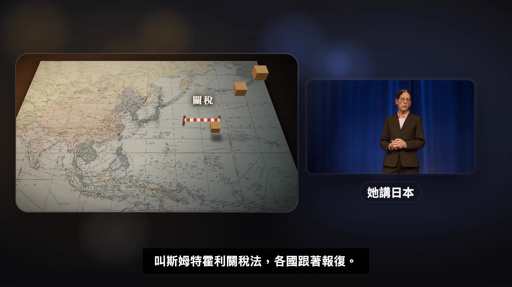

**逐字稿片段：** 各國跟著報復 關稅加上經濟大蕭條 世界貿易掉了大約三分之二 日本覺得 光靠貿易活不下去

**話題推測：** 說明關稅壁壘與大蕭條對世界貿易的衝擊，可能顯示全球貿易額下降的圖表。

---

## 00:15:50

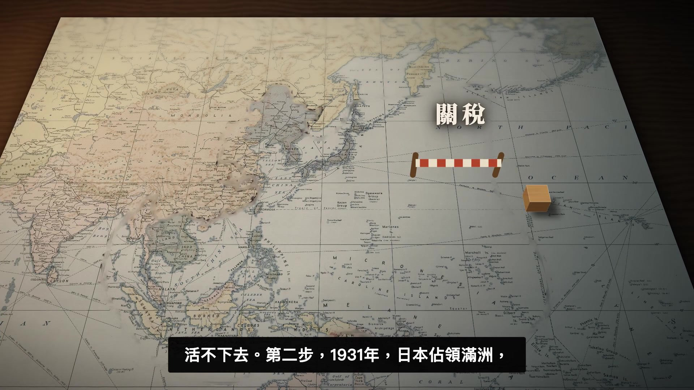

**逐字稿片段：** 第二步 1931年 日本佔領滿洲 想要一塊能自給自足的地盤 Payne說 到這裡為止 日本還算順利

**話題推測：** 講述日本擴張的第二步，佔領滿洲，可能顯示滿洲地區的地圖。

---

## 00:15:58

**逐字稿片段：** 第三步 1937年 日本把戰爭擴大到整個中國 這一次 他把中國人放進了死地 國民政府和共產黨 暫時停止內鬥 合作抗日 戰事陷入僵局

**話題推測：** 講述日本擴張的第三步，將戰爭擴大至整個中國，可能顯示中日戰爭的戰線地圖。

---

## 00:16:09

**逐字稿片段：** 第四步 為了切斷外國援助中國的路線 1941年12月 日本在幾個小時之內 接連攻擊珍珠港、馬來亞、菲律賓和香港 把美國和英國都拉了進來 目標每變大一次 就多一個國家加入

**話題推測：** 講述日本擴張的第四步，攻擊珍珠港等，使美英捲入，可能顯示太平洋戰爭爆發的地圖及攻擊地點。

---

## 00:16:22

**逐字稿片段：** 第二種病 是正規的仗打贏了 對方卻不投降 這種作戰方式叫游擊戰 它不跟你正面決戰 而是分散開來一直騷擾 讓你贏不了 日本在中國就遇到這個兩難 兵力集中 去打國民政府的正規軍 後方就空出來給游擊隊 兵力分散 去清理後方 正規軍就趁機反擊 國民黨和共產黨 各自都有遊擊部隊

**話題推測：** 介紹第二種病症：正規戰打贏但對方不投降（游擊戰），可能顯示游擊戰的標題投影片。

---

## 00:16:44

**逐字稿片段：** 游擊戰撐得下去 靠的是克勞塞維茨的 另一個概念 叫目標的價值 意思是 同一件事 對不同的人 值得付出的代價不一樣

**話題推測：** 引入克勞塞維茲的另一個概念「目標的價值」，可能顯示該術語的定義投影片。

---

## 00:16:53

**逐字稿片段：** 兩百多年前的 美國獨立戰爭 華盛頓就是這樣算的 聽他講這筆賬 物品價值總是非常高 如果你進行進行,你進行的距離會更遠 可能會低於物品價值 所以他在計算,將價值高於外國人的價值 So the outsider leaves 住在那裡的人,那是家 遠道而來的人,那是成本 成本拉得夠高,外人就會走

**話題推測：** 引用美國獨立戰爭華盛頓的計算為例，預告播放講者原音片段，畫面很可能切換到講者本人進行演說的影片片段。

---

## 00:17:30

**逐字稿片段：** Payne說,美國後來在越南、伊拉克和阿富汗 都站在外人的那一邊

**話題推測：** 提及美國在越南、伊拉克和阿富汗戰爭中的「外人」角色，可能顯示這些戰爭的地圖。

---

## 00:17:36

**逐字稿片段：** 他最後一個例子是2003年的伊拉克戰爭

**話題推測：** 介紹2003年伊拉克戰爭作為最後一個例子，可能顯示伊拉克戰爭的標題或相關圖片。

---

## 00:17:39

**逐字稿片段：** 這一次美國的目標是推翻海珊的政權 是一個無限目標 聽他講推翻之後的事 他用的英文很口語 意思就是 接下來的爛攤子全歸你

**話題推測：** 說明2003年伊拉克戰爭美國的無限目標，預告播放講者原音片段，畫面很可能切換到講者本人進行演說的影片片段。

---

## 00:18:02

**逐字稿片段：** 為什麼是爛攤子 看邊界 1991年 美軍只需要顧好科威特和伊拉克之間的邊界 大約158英里 2003年,美國接手整個伊拉克 要面對的邊界超過2000英里 周圍有6個鄰國 其中幾個在這個地區有自己的打算

**話題推測：** 比較1991年和2003年伊拉克戰爭中美國需面對的邊界長度，可能顯示兩時期伊拉克周邊邊界的地圖。

---

## 00:18:17

**逐字稿片段：** 2006年,伊拉克一座什葉派的重要清真寺 被武裝分子在寺內安放炸藥炸燬 教派之間的衝突從那之後一路擴大

**話題推測：** 提及2006年什葉派清真寺被炸毀事件，說明教派衝突的擴大，可能顯示相關新聞畫面或清真寺照片。

---

## 00:18:26

**逐字稿片段：** 第三部分的答案是這樣 走過勝利頂點以後,戰爭會往兩個方向生病 一種是越打越大,旁人一個一個加入 派對變成另一場派對 另一種是越拖越久 對方在自己家裡跟你耗 對他是生死 對你是成本 最後先走的是外人

**話題推測：** 總結第三部分的觀點，概述戰爭「走過頭」後的兩種病症，可能顯示總結的投影片。

---

## 00:18:42

**逐字稿片段：** Pain在課的最後 留下五個問題 要大家在開戰前 或是打到一半的時候問自己

**話題推測：** 介紹Sarah Payne在演講最後提出的五個問題，可能顯示一個列出這些問題的清單投影片。

---

## 00:18:48

**逐字稿片段：** 各方的目標是有限還是無限 各方的目標對得上嗎 這件事對誰值多少 誰有地理上的通道 誰有打不到的後方 以上這些有沒有不對稱的地方

**話題推測：** 列出這五個具體的問題，可能顯示以條列式呈現的投影片。

---

## 00:19:00

**逐字稿片段：** 他自己也拿這套問題 去看今天的戰爭 先講清楚 接下來兩段原生 是他個人的分析和看法 我們不替任何一方下結論 也不猜結局

**話題推測：** 說明Payne將這些問題應用於分析當代戰爭，預告對烏克蘭戰爭的分析。

---

## 00:19:09

**逐字稿片段：** 2022年2月俄國全面入侵烏克蘭 到現在已經打了四年半以上

**話題推測：** 分析俄烏戰爭，提及俄羅斯全面入侵與至今的戰況，可能顯示俄烏戰爭地圖。

---

## 00:19:14

**逐字稿片段：** 依美聯社2026年10月的報道 俄國控制了烏克蘭大約兩成的土地 雙方在美國的斡旋下談過幾輪 在土地和安全保證上 立場還是差得很遠

**話題推測：** 引用美聯社報導，提及俄羅斯控制烏克蘭兩成土地的數據，可能在地圖上標示俄羅斯控制的區域。

---

## 00:19:24

**逐字稿片段：** Payne怎麼用有限目標和無限目標 來看這場戰爭 這是他的看法 聽他說 有幾個鄰居,或是所有鄰居,或是一個 例如說,俄羅斯對於俄羅斯有限制的目標 但俄羅斯對於俄羅斯有限制的目標

**話題推測：** 解釋Payne如何用有限與無限目標分析俄烏戰爭，預告播放講者原音片段，畫面很可能切換到講者本人進行演說的影片片段。

---

## 00:19:53

**逐字稿片段：** 這是他的判斷 俄國官方的說法不一樣 莫斯科把這場戰爭叫做特別軍事行動 說他的目標一定會達成

**話題推測：** 提及俄羅斯官方對其「特別軍事行動」的說法，可能顯示俄羅斯官方聲明的文字或圖示。

---

## 00:20:00

**逐字稿片段：** 依美聯社的報導 俄方要求烏克蘭撤出俄國宣佈併入的四個州 也要放棄加入北大西洋公約組織

**話題推測：** 列出俄方要求烏克蘭撤出四個州並放棄加入北約，可能在地圖上標示這些州份與北約標誌。

---

## 00:20:06

**逐字稿片段：** 烏克蘭則希望先在現在的前線停火 而且要有防止再被入侵的保證 兩邊的目標,用他的問題去看 各自是有限還是無限 這件事對誰的價值比較高 這些我們留給你自己判斷

**話題推測：** 列出烏克蘭要求停火與安全保證，可能顯示烏克蘭訴求的文字說明。

---

## 00:20:19

**逐字稿片段：** 他在講韓戰的時候也對臺下提過一個問題 只問不答 聽他怎麼講

**話題推測：** 預告播放講者原音片段，提及Payne在韓戰時曾向聽眾提問，畫面很可能切換到講者本人進行演說的影片片段。

---

## 00:20:50

**逐字稿片段：** 他說這些詞很好用 同一組問題 也可以拿去看另外兩場 到今天還沒有結束的衝突

**話題推測：** 轉入分析其他至今未結束的衝突，預告將提及伊朗和加薩。

---

## 00:20:56

**逐字稿片段：** 一場在伊朗 2026年2月底 美國和以色列對伊朗發動攻擊 伊朗用飛彈和無人機反擊 也宣佈封鎖荷莫茲海峽 中間有過停火 也有過談判 到了10月 停火的條件和海峽的通行 都還沒有談定 另一場在加薩 2023年10月 哈馬斯襲擊以色列 以色列隨後出兵加薩 2025年10月雙方停火

**話題推測：** 介紹伊朗衝突，提及美國和以色列對伊朗的攻擊，可能顯示中東地圖。

---

## 00:21:18

**逐字稿片段：** 可是哈馬斯要不要解除武裝 以色列什麼時候撤軍 以後由誰治理加薩 這幾件事到現在還在爭論 套用他的問題 當初開戰的時候 各方的政治目標是什麼 現在離那個目標多遠 有沒有第三方介入 介入的又是誰 這件事對住在那裡的人 和遠道而來的人 各值多少 這些問題沒有標準答案 答案也會隨著局勢改變 他給我們的是一組問問題的方法

**話題推測：** 列出加薩衝突至今仍未解決的關鍵爭議點，可能顯示這些爭議的清單投影片。

---

## 00:21:43

**逐字稿片段：** 我們回到開場那個問題 戰爭為什麼開打容易 結束這麼難 照Pain的整理 開打只要一方下決定 結束卻要所有人都覺得夠了 對手要覺得再打下去不划算 盟友要談出大家都能接受的條件 旁邊的國家要願意不插手

**話題推測：** 回到開場的總問題「戰爭為什麼開打容易，結束這麼難」，可能顯示問題投影片。

---

## 00:21:59

**逐字稿片段：** 克勞塞維茲在戰爭論裡寫過一句話 一旦付出的代價超過了目標的價值 就應該放棄這個目標 接受和平 說起來很簡單 就像股票的停利點 最難的是在當下看出它在哪裡 最後問你一個問題 你生活中有沒有一件事 開始很容易 想收手的時候才發現很難 留言告訴我 喜歡的話訂閱AI Notebook 開啟通知 我們下次見

**話題推測：** 引用克勞塞維茲關於代價超過目標價值時應放棄的觀點，可能顯示引文的投影片。

---
