# jimainotebook_thL8LvmfNpc — 關鍵畫面索引

- 來源逐字稿：[jimainotebook_thL8LvmfNpc_FIN.srt](jimainotebook_thL8LvmfNpc_FIN.srt)
- 影片：https://www.youtube.com/watch?v=thL8LvmfNpc
- 截圖數：49

## 00:00:11

**逐字稿片段：** 這一集是哈佛大學CS50的終極,上第四到第六堂課, 記憶體、資料結構和Python,最後再加上一堂人工智慧的特別講。

**話題推測：** 介紹本集主題：哈佛CS50的第四到第六堂課與AI特別講

---

## 00:00:20

**逐字稿片段：** 上一集最後留下了一個小問題,兩個一模一樣的字,電腦卻說不一樣。 換一個生活一點的問法,這一集只問一件事,

**話題推測：** 回顧上一集結尾的問題：兩個一樣的字電腦卻說不一樣

---

## 00:00:27

**逐字稿片段：** 你存進電腦的東西,到底放在哪裡? 你在表單上打進一個名字,按下送出,那個名字不會飄在空中, 它一定住在某個地方。

**話題推測：** 提出本集核心問題：你存進電腦的東西到底放在哪裡？

---

## 00:00:36

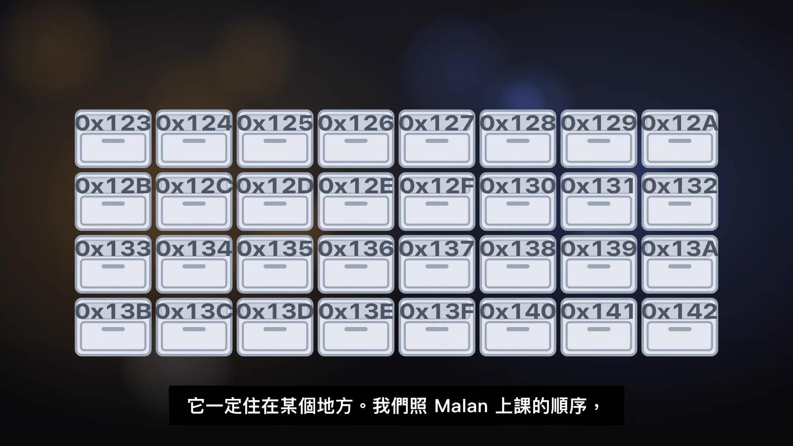

**逐字稿片段：** 我們照Malin上課的順序走三段路, 先看記憶體裡每一格都有門牌 變數存的常常不是東西本身 而是它住哪 再看怎麼用門牌 把散在各處的格子串起來 排出各種形狀的資料 最後看Python怎麼把這些門牌替你藏起來 還有AI眼中的字到底長什麼樣子 三段走完 我們再回來回答這個問題 我們先回到上一集那兩個字 第四堂課上到一個小時左右 Malan寫了一支很短的程式 他先請你打一個字 再請你打一個字 然後告訴你這兩個字一不一樣 他先打數字

**話題推測：** 概述本集將循的三個主題：記憶體、資料結構、Python與AI

---

## 00:01:06

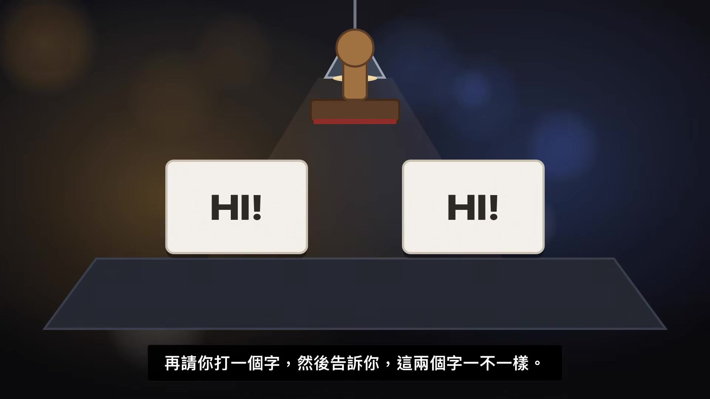

**逐字稿片段：** 50跟50 電腦說一樣 50跟51 電腦說不一樣 都很正常 接著他改成打字 第一次打Hi 第二次也打Hi 按下去 電腦說不一樣 他再試一次 David跟David 還是不一樣 明明是同一個字 同樣的大小寫 同樣的標點 電腦就是不認 這一段我們先不急著揭曉 要回答他 得先知道一件更基本的事 你打進去的Hi 被電腦放在哪裡 馬蘭在這堂課 一開始就先打了預防針 這一週本來就設計得很難 他自己當學生的時候 也是到這裡才終於想通 所以我們放慢一點 從記憶體的第一格開始看 上一集我們說過 記憶體就像一排很長很長的格子 每一格放一個位元組 每一格都有自己的門牌 叫做地址 馬蘭這堂課又拿教室打比方 這棟建築的地址是昆西街45號 記憶體的每一格也有地址 只是簡單得多 就是0、1、2、3 一路往下編

**話題推測：** 示範程式比對數字 '50' 和 '51' 的結果

---

## 00:02:01

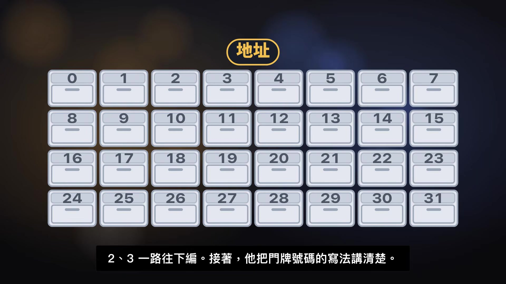

**逐字稿片段：** 接著他把門牌號碼的寫法講清楚 電腦科學家寫地址 習慣用一種叫16進位的寫法 數到9以後不進位 繼續用A到F代表10到15 為了不跟一般的數字搞混 前面再加上0X 意思只是後面這串是16進位 所以你會看到0X123 0X456這樣的門牌 接著他寫了一行最簡單的程式 有一個變數叫N 裡面放50 電腦會在記憶體裡找四個格子給他 假設他住在0X123 從這一刻起 N這個名字 對你來說是一個名字 對電腦來說是一個門牌號碼 他也提醒 寫程式的人其實很少在乎 門牌上的數字到底是多少 在乎的是照著它能不能找到那一格 既然每一格都有門牌

**話題推測：** 解釋記憶體位址的16進位表示法（0X開頭）

---

## 00:02:46

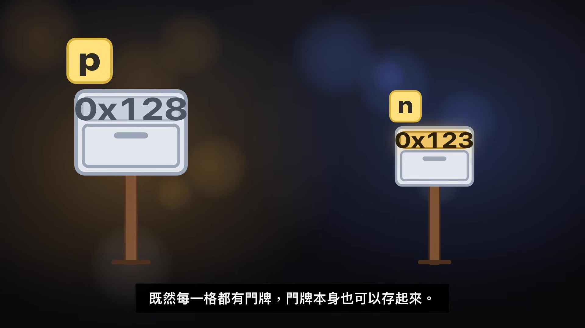

**逐字稿片段：** 門牌本身也可以存起來 這個東西叫指標 英文是pointer 指標就是一個專門存地址的變數 它裡面放的不是50 是50柱的那個地址 C語言給了兩個符號 一個問這東西住哪 一個說照這個地址走過去 為了讓大家看懂 馬冷在舞臺上擺了兩個白色信箱 一個貼著P放在他旁邊 一個貼著N由工作人員抱著 站在舞臺另一頭 你打開P的信箱 裡面不是你要的東西 只有一張紙條 寫著0X123 這就是我們這一集要一直帶著走的畫面 信箱裡放的不是包裹 是一張寫著地址的紙條 照著紙條走過去 打開另一個信箱 東西才在那裡 我們聽他自己怎麼示範 But it's kind of like a treasure map X marks the spot if we sort of abuse the metaphor That means I look in computer's memory and just to be dramatic We got a little big foam finger This is like the computer pointing at The actual location 0x123 and voila 紙條這個想法 馬上讓馬倫說出一件讓學生愣住的事

**話題推測：** 介紹指標（pointer）的概念：一個變數儲存另一個變數的記憶體位址

---

## 00:04:02

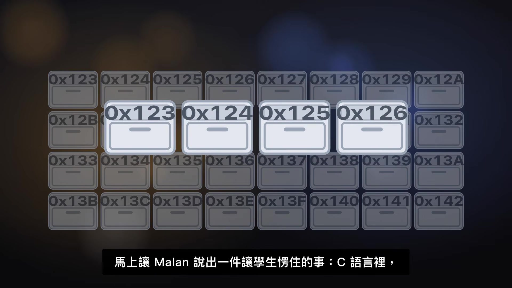

**逐字稿片段：** C語言裡其實沒有字串這種東西 前幾周大家寫的String 是CS50自己準備的方便寫法 真正的Hi 在記憶體裡是四個連在一起的格子 H I 驚歎號 最後一格放一個0 上一集我們講過結尾那一個0 它在這裡派上用場 因為變數S裡面存的 只有第一個字H的地址 就是一張紙條 它沒有記長度 也沒有記結尾在哪 電腦要印出這串字 就從紙條上的地址開始 一格一格往右讀 讀到0才停下來 所以你以為S是一整串字 其實它只是一張寫著 從這裡開始讀的紙條 說到這裡 他從講臺後面拿出了一樣道具 我們聽他當時怎麼說 輔助輪拿掉以後 開頭那個謎題就解開了 你第一次打hi 電腦在記憶體裡找一塊空位放它 假設從0x123開始 你第二次打hi 電腦又找了另一塊空位 假設從0x456開始 兩串字一模一樣 可是住在兩個不同的地方 變數s拿到一張寫著0x123的紙條 變數t拿到一張寫著0x456的紙條 用兩個等號去比s跟t 電腦比的不是兩串字 是兩張紙條 紙條上的門牌不一樣 答案當然是不一樣 臺下有學生先喊出了答案 是兩個不同的地址 後來Mullen還真的把S跟T兩個地址印出來 兩個數字很接近卻不一樣 他說他們在記憶體裡是鄰居 但不住在同一個地方 我們聽Mullen自己怎麼收這個伏筆

**話題推測：** 解釋C語言中沒有真正的字串，而是連續的字元加上結尾0

---

## 00:06:06

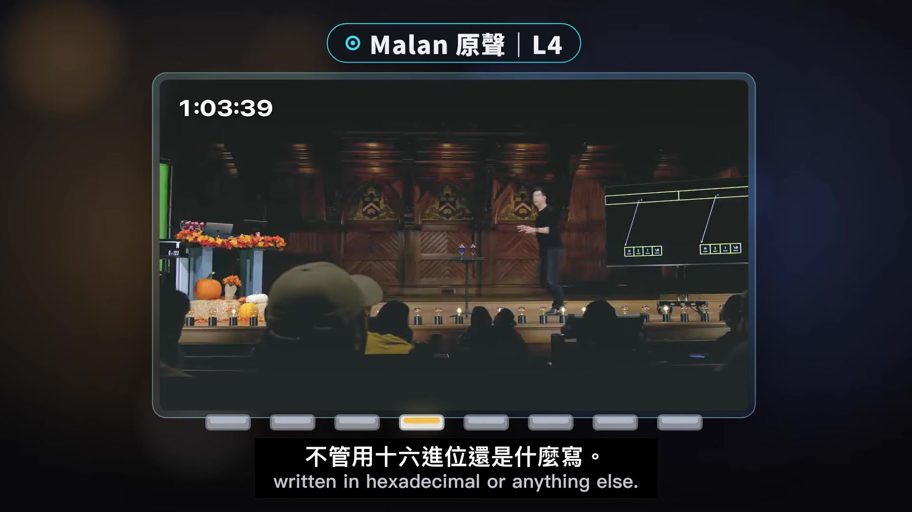

**逐字稿片段：** 那真的要比兩串字該怎麼辦 就得照著兩張紙條 各自走到門口 一個字一個字對 H對H I對I 一路對到結尾那個0 C語言有一個現成的韓式做這件事 叫STRCMP 意思是字串比較 上一集Mullen要大家用它 卻沒說為什麼 原因就在這裡 同一個病還有另一個症狀

**話題推測：** 解釋如何正確比較兩個字串的內容，並提到STRCMP函式

---

## 00:06:28

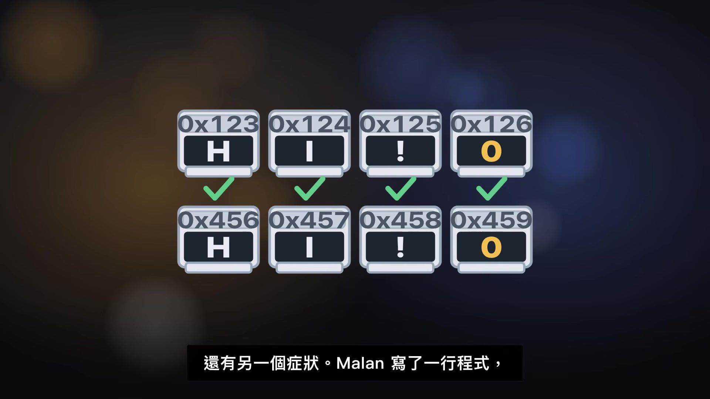

**逐字稿片段：** Mullen寫了一行程式 把S複製給T 再把T的第一個字改成大寫 結果印出來 S和T兩個都變成大寫開頭的Hi 因為那一行復制的只是紙條 S跟T拿著兩張一模一樣的紙條 指著同一個信箱 你動到的是信箱裡唯一的那一份 兩邊當然一起變 想要真的有兩份 就得自己再找一塊空位 要另外一塊空位

**話題推測：** 示範字串複製的副作用：複製指標導致共用同一塊記憶體

---

## 00:06:50

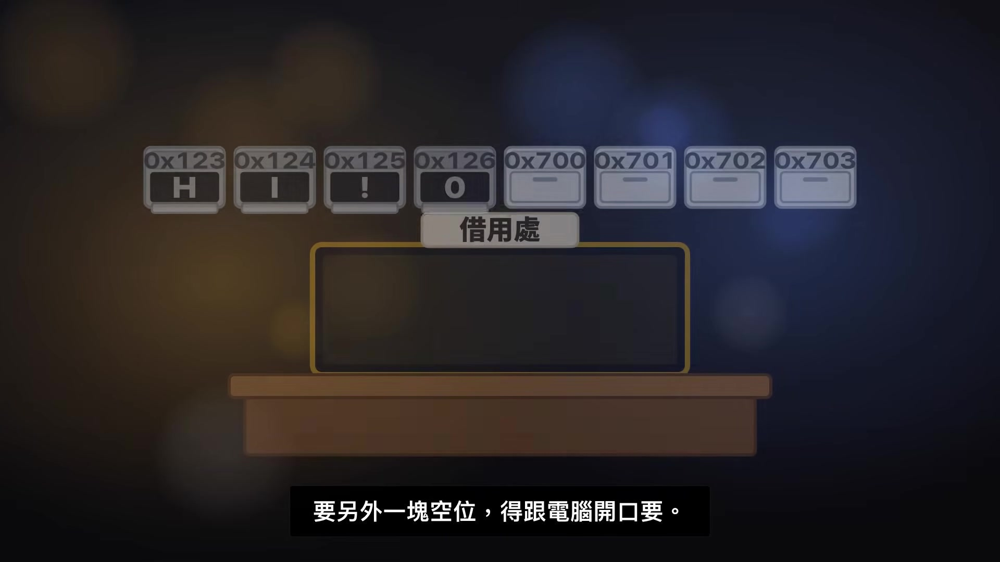

**逐字稿片段：** 得跟電腦開口要 這個動作叫Malloc 是Memory Allocation的縮寫 意思是配置記憶體 你告訴他要幾個格子 他找一塊空位給你 再交給你一張寫著開頭地址的紙條 拿到空位以後 再把H、I、金碳號 還有結尾的0一個一個抄過去 這樣S跟T才是兩份 各自寫各自的 借來的格子用完要還 還的動作叫Free Mallon特別提醒 忘記還就叫記憶體洩露 一隻程式開一下就關 問題不大 關掉的時候 作業系統會把格子全部收回 可是有些程式一開就是好幾個月 像網站的伺服器 每次都只借不還 可用的格子會越來越少 最後整臺機器慢下來 甚至蕩掉 記憶體洩露這個詞 等一下我們會在別的地方再遇到它 接下來 Mullen請一位大一學生上臺 桌上兩個玻璃杯 一杯粉紅色的水 一杯藍色的水 題目是 把兩杯的內容交換 學生先直接把兩個杯子換位置 Mullen說 這樣不算 我要的是粉紅色的水裝進藍杯子 藍色的水裝進粉紅杯子 學生停住了 他說 如果把藍的直接倒進粉紅的 兩杯會混在一起 這正是重點 直接倒過去 就會蓋掉原本的東西 所以馬倫給他第三個空杯子 學生先把藍水倒進空杯 再把粉紅水倒進原本的藍杯 最後把藍水倒回原本的粉紅杯 三步 換好了 全場鼓掌 片頭你看到的就是這三步 在城市裡 第三個杯子叫佔存變數 馬倫照這三步 寫了一個交換的函式 做法跟杯子一模一樣 執行下去 X是1 Y是2 交換完 還是1跟2 邏輯明明對 數字卻一動也不動 為什麼沒換成

**話題推測：** 介紹Malloc函式，用於向電腦請求新的記憶體空間

---

## 00:08:27

**逐字稿片段：** 馬蘭畫出記憶體的地圖 其中有一塊叫Stack 中文叫堆疊 他說 它就像學生餐廳裡疊起來的盤子 程式一開始 主程式Main拿到一個盤子 上面放著X跟Y 呼叫交換的韓式 就在上面再疊一個新盤子 放著A、B 還有那個暫存的杯子 問題就在這裡 A跟B是X跟Y的影本 韓式在自己的盤子上 把兩個影本換得好好的 換完盤子收走 底下那個盤子上的X跟Y 從頭到尾沒人碰過 這叫傳值 傳進去的是值的銀本 要讓他真的換到 得給他的不是銀本 是地址 把X跟Y的門牌 寫在紙條上交給韓氏 他照著紙條往下走到原本的盤子 在那裡換 這叫傳值 這樣寫好再執行一次 X變成2 Y變成1 知道每一格都有門牌 也就知道危險在哪 紙條可以寫錯 也可以亂值 Mullen先示範

**話題推測：** 透過記憶體堆疊（Stack）的圖示，解釋傳值呼叫導致變數未交換

---

## 00:09:19

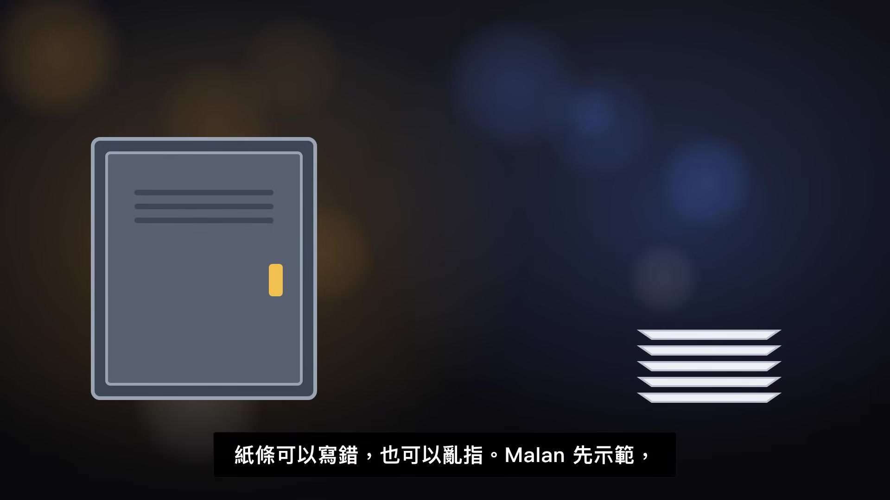

**逐字稿片段：** 準備了一千多個格子 卻沒有放東西 印出來是一堆亂七八糟的數字 有正有負 這叫垃圾值 是之前用過這些格子的程式留下來的 記憶體不會自動幫你擦乾淨 如果一個指標從來沒被設定過 紙條上寫的就是垃圾 你照著它走過去放東西 等於闖進一戶不知道是誰家的門

**話題推測：** 示範未初始化的記憶體中存在「垃圾值」

---

## 00:09:37

**逐字稿片段：** 他放了一段史丹佛大學Nick Peralante 在1999年做的黏土動畫 主角叫Binky 一根黏土指標乖乖指好了位置 一切正常 另一根什麼都沒指 就叫他去放東西 Binky的頭直接炸開 另外 疊盤子的那一塊也會疊太高 韓式一層呼叫一層 盤子疊到撞上別的區域 這叫堆疊意味 英文是Stack Overflow 很多工程師天天上的那個問答網站 名字就是從這裡來的 這些聽起來像課本上的小錯 Mullen接著舉了一個真的

**話題推測：** 播放史丹佛大學的Binky黏土動畫，解釋指標錯誤的危險

---

## 00:10:07

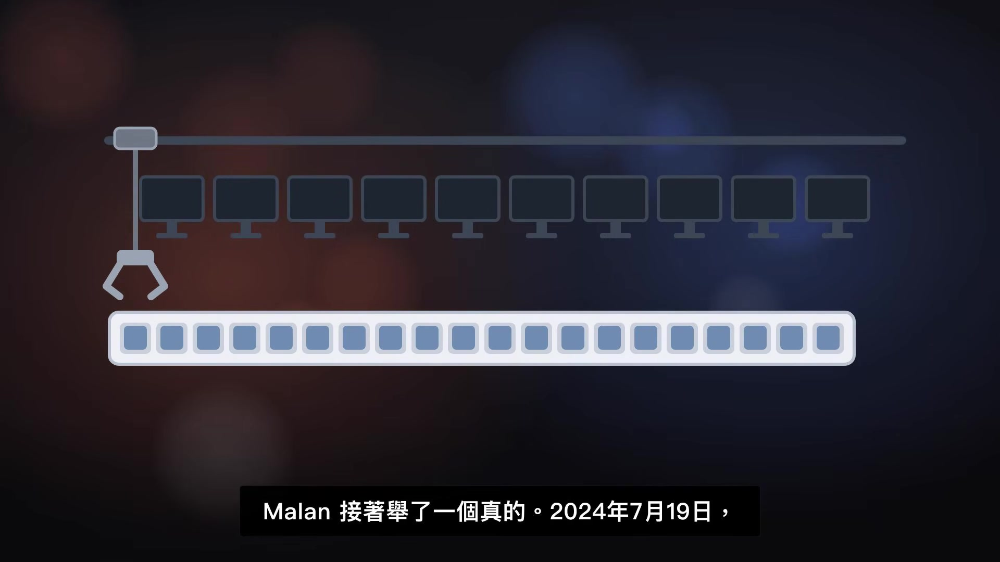

**逐字稿片段：** 2024年7月19日 一家叫CrowdStrike的資訊安全公司 推出一次例行的更新 大家裝它的軟體本來是為了安全 結果這次更新之後 全世界很多Windows電腦一起蕩機 藍色的畫面一臺接一臺出現 連航空公司都跟著停擺 事後CrowdStrike自己公佈了原因 程式準備好接收20個值 新的內容卻要他去讀第21個 就這樣讀到了陣列外面 讀到了不該碰的記憶體 這跟我們剛剛講的是同一件事 一排格子只有20格 你卻照著門牌去找第21個 Mullen在臺上把那份報告唸了出來 然後對臺下說了一段話 我們聽他當時怎麼說 Software froze or crashed Software froze or crashed and other side effects because of one off by one error Mallen說 這讓世界損失了好幾百萬美元 這一句他講得太保守了 微軟事後公佈

**話題推測：** 以CrowdStrike公司的軟體更新事件為例，說明記憶體錯誤的真實影響

---

## 00:11:13

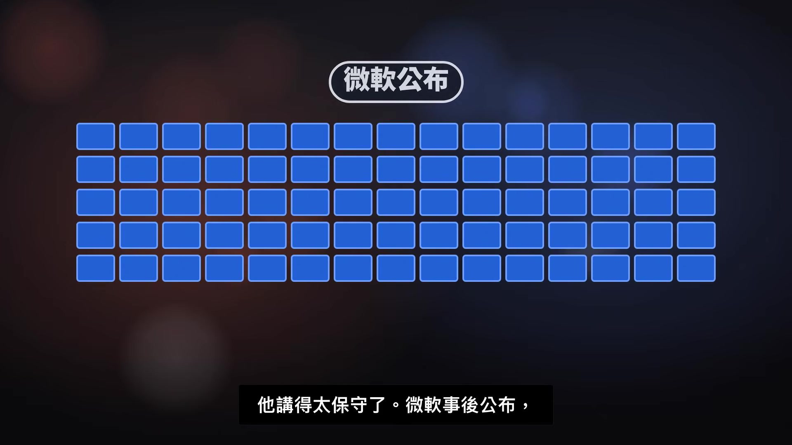

**逐字稿片段：** 受影響的Windows電腦大約有850萬臺 光是美國的Delta航空一家 五天裡取消了好幾千個航班 自己估計損失超過5億美元 保險公司估計 美國最大的500家公司加起來 直接損失是幾十億美元的等級 還有一個細節值得講清楚 CrowdStrike的報告特別寫了 這是讀錯不是寫壞 程式是讀到陣列外面 不是把別人的格子寫亂 C語言不會攔你 你叫他讀第21格 他就去讀 Nalin順便提了一句 像Python、Java這些語言 會先擋下來 直接告訴你超出範圍了 這句話我們到第三段會再回來 我們整理一下這一段 電腦裡的每樣東西 都住在一個有門牌的格子裡 變數可以存東西本身 也可以只存一張寫著門牌的紙條 這種變數叫指標 字串就是一張指著第一個字的紙條 所以兩個等號比字串會說不一樣 因為比的是兩張紙條 複製字串會一起變 因為複製的紙是紙條 交換的韓式沒效 因為他拿到的是影本 不是紙條 而照著寫錯的紙條亂走 輕的印出垃圾紙 重的就是850萬臺電腦一起當機

**話題推測：** 列舉CrowdStrike事件造成的具體數字損失（Windows電腦數量、航空公司損失）

---

## 00:12:17

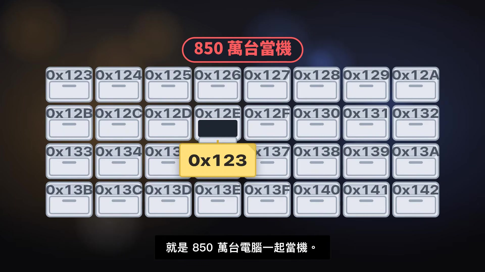

**逐字稿片段：** Melanne這堂課用一張網絡漫畫收尾 有個人說自己很爛 想跟朋友要幾個pointers 英文裡這個字也有訣竅的意思 朋友丟回來的是 三串0x開頭的地址 其實他在課堂中間 就偷偷預告了下一週 一格既然可以寫著 別的格子在哪裡 指標就能變成針線 把散在各處的格子縫起來 那麼資料還一定要排在一起嗎 第五堂課一開始 Mullen說 這是最後一週講C了 前幾周像一路爬坡 到這裡差不多要到頂了

**話題推測：** 以一張網路漫畫總結「指標」這個雙關語詞

---

## 00:12:46

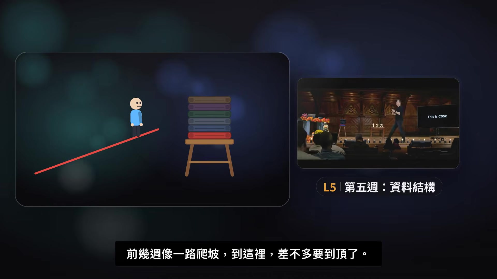

**逐字稿片段：** 他先用兩個生活裡的東西暖身 兩個都跟先後順序有關 一個是排隊 他請三位學生上臺排成一列 照順序發小禮物 先來的先拿 電腦裡也有很多這種排隊 例如印表機 誰先送出文件誰就先印 這種規則叫先進先出 另一個是一疊毛衣 舞臺上真的擺了一疊 他說洗好的衣服都放回最上面 所以他每天穿的 都是最上面那幾件 最底下那幾件 永遠輪不到 這種規則叫後進先出 這種結構叫堆疊 沒錯 就是第一段那一疊盤子 它的正式名字也是堆疊 他接著舉了一個 一個上班族都很熟的例子 店主郵件的收件夾 我們聽他自己怎麼說 排隊也好 疊毛衣也好 這些東西最後都得放進記憶體裡 最簡單的方法

**話題推測：** 以排隊和疊毛衣的例子，解釋先進先出（Queue）和後進先出（Stack）

---

## 00:13:56

**逐字稿片段：** 就是上一集的老朋友 陣列 陣列就是一排連在一起的格子 1 2 3 一個緊接著一個 問題是 陣列一開始就得決定要幾格 現在你想加一個4 最理想的位置是放在3的右邊 可是記憶體不是隻給你用的 緊接在3後面的那一格 可能早就住了別人 例如另一個字串的第一個字 這種情況 很像去電影院買了三個連號的座位 朋友臨時多來一個人 旁邊那個位置已經有人坐了 你不能把人家請走 只好四個人一起站起來 找另一排還有四個連號空位的地方 整排換過去 馬蘭的做法一模一樣 我們聽他自己怎麼說 And we can now have room for the four 整排搬家能解決問題 但每多一個人就要搬一次 資料越多搬得越久 這是在浪費時間 另一個辦法是一開始就多要一點 乾脆包下一整排500個座位 這樣不用搬 可是大部分座位空著 別的程式也用不到 這是在浪費空間 Mullen說 這是整門課 也是整個電腦領域會一直遇到的主題 永遠有取捨 最常見的就是時間跟空間之間的取捨 這裡的時間指的是電腦要做幾步 空間指的是要佔用幾個格子 格子連在一起 很方便也很不方便 方便的是 知道第一格在哪 就能直接算出第五格在哪 上一集從中間開門的二分搜尋 靠的就是這一點 不方便的是 後面一被站住 他就長不大 他還現場寫了一支程式 只是要把陣列加大一格 就寫了四十幾行 他自己也笑說 這麼多行只為了多一格 於是他換了一個方向想

**話題推測：** 回顧陣列（Array）作為最簡單的資料結構，並指出其限制

---

## 00:15:46

**逐字稿片段：** 如果不要求大家坐在一起呢 我們聽他接下來怎麼說

**話題推測：** 提出新的資料結構想法：不要求資料連續存放

---

## 00:16:14

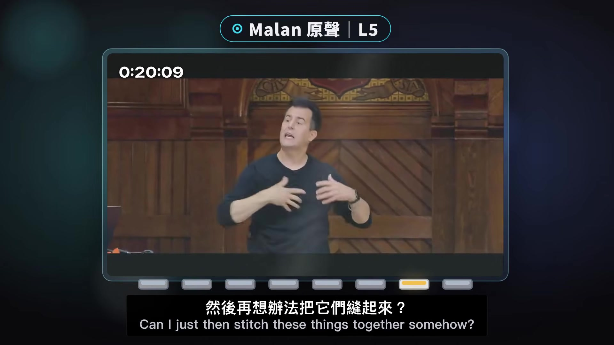

**逐字稿片段：** 這個結構叫鏈接串列 英文是linked list 它的做法是 每放一個數字 就另外附一張紙條 寫著下一個數字住在哪裡 1 放在0x123 旁邊被佔了 2就放到0x456 3再放到0x789 佔在記憶體各處都沒關係 1的紙條寫著0x456 2的紙條寫著0x789 3是最後一個 紙條上寫的是0 意思是到此為止 一個數字加一張紙條 合起來叫一個節點 第一段那張信箱裡的紙條 在這裡變成了針線 把一個一個節點縫成一串 最前面再留一張紙條 記住第一個節點在哪 整串就找得到 好處很明顯 不用整排搬家 有空位就放 代價也很明顯 每個數字都多帶一張紙條 空間差不多多了一倍 更麻煩的是 你不能直接跳到中間 只能從第一個開始 照著紙條一個一個走 上一集最厲害的二分搜尋 從中間開門那一招 在這裡用不上了 縫的順序也很重要 Mullen在臺上

**話題推測：** 介紹鏈結串列（Linked List），透過指標將散落的資料串聯起來

---

## 00:17:12

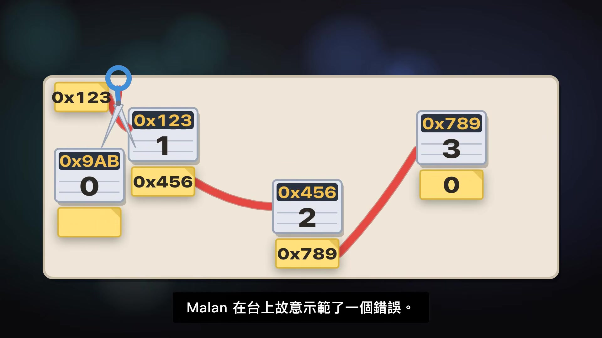

**逐字稿片段：** 故意示範了一個錯誤 要把一個新的節點 加到最前面 他先讓開頭那張紙條 指到新節點 再回頭處理原本的第一個節點 這時才發現 已經沒有任何紙條記得他住在哪了 用電腦的講法 他變成了孤兒 沒有人指著他 你就再也找不到他 也沒辦法把他還回去 這就是第一段講的記憶體洩露 而且一次就漏掉後面一整串 正確的順序是反過來 先讓新節點的紙條 指向原本的第一個 再讓開頭那張紙條 指向新節點 兩個步驟順序一顛倒 結果就差很多 他還遇到一個小意外 照順序放進1、2、3 印出來卻是3 2 1 因為每個新來的都插在最前面 他自己也在臺上嘆了一口氣 鏈節串列有彈性 卻不能二分搜尋 正列可以二分搜尋 卻一滿就得搬家 兩邊的好處能不能一起拿

**話題推測：** 示範鏈結串列插入節點時，指標操作順序錯誤會導致記憶體洩露

---

## 00:18:01

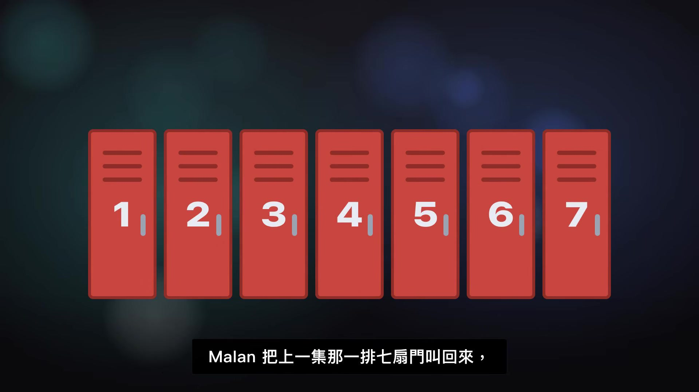

**逐字稿片段：** Mullen把上一集那一排七扇門叫回來 門後是1到7 他先標出正中間的4 再標出左半邊的中間2 右半邊的中間6 然後把整排從中間往上提 就變成一棵倒過來長的樹 4在最上面 下面是2跟6 再下面是 1 3 5 7 這個結構叫二元搜尋數 每個節點帶兩張紙條 一張紙像比它小的 一張紙像比它大的 要找5 從4開始 5比較大 往右走到6 5比較小 往左 找到了 不用算中間在哪 照著紙條走 就是二分搜尋 像撕電話布一樣 每一步丟掉一半 代價是每個節點兩張紙條 更佔空間 還有一個壞情況 如果資料剛好照 1 2 3 4的順序進來 數會長成一條斜線 媽人問臺下 這變成什麼 臺下回答 鏈接串列 到這裡 最快也就是二分搜尋 資料多一倍 多一步

**話題推測：** 介紹二元搜尋樹（Binary Search Tree），結合陣列和鏈結串列優點的結構

---

## 00:18:52

**逐字稿片段：** 馬冷接著丟出這一講的目標 他說 有沒有一種結構 不管裡面有多少資料 找一次都一樣快 他把這叫做 演算法和資料結構的聖盃 正式的名字叫長速時間 上一集我們看過 一扇一扇開門 資料多一倍 步數就多一倍 從中間開門 資料多一倍 只多一步 長速時間是第三種 資料多一倍 步數一步都不多 為了找他

**話題推測：** 提出本講目標：尋找一種「常數時間」的資料結構

---

## 00:19:15

**逐字稿片段：** 他在舞臺前排了四個白色水桶 分別貼著黑桃、紅心、梅花、方塊 手上拿一副特大號的撲克牌 他問大家 52張牌要怎麼排好 多數人會先照花色分成四堆 他就一張一張丟 梅花丟進梅花桶 黑桃丟進黑桃桶 他說 這樣還是要丟52次 可是他打賭 排四堆各13張 會比直接排一堆52張快 先照一個規則分好桶 再到小桶裡找 這就是下一個結構的想法

**話題推測：** 實體道具示範：用不同花色的水桶整理撲克牌，引出分桶概念

---

## 00:19:42

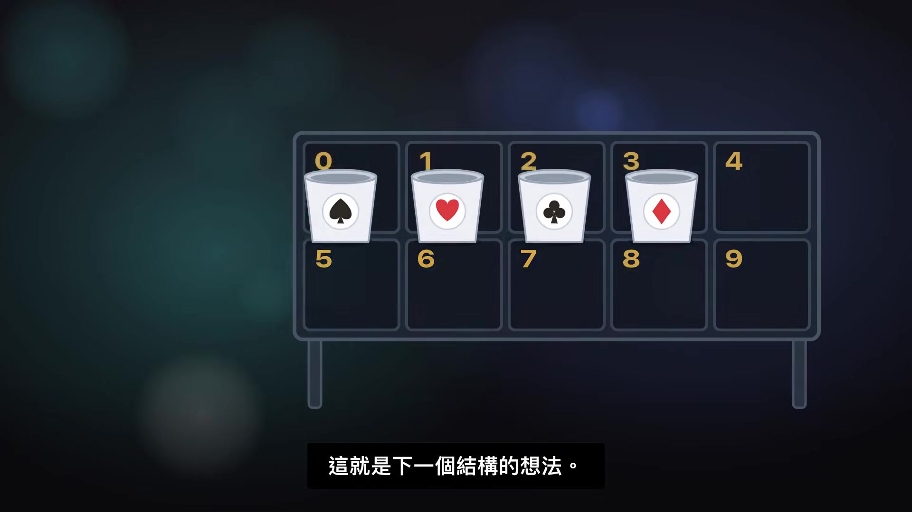

**逐字稿片段：** 這個結構叫雜臭表 英文是Hash Table 他有兩個零件 一排格子加上一條規則 規則會告訴你 一樣東西該放進哪一格 這條規則叫雜臭函式 馬冷用任天堂的角色名字示範 準備26格 照名字的第一個字母放 Mario放M那一格 Peach放P那一格 要找Mario不用從頭翻 直接走到M 臺灣最熟悉的雜臭表

**話題推測：** 介紹雜湊表（Hash Table），結合格子與規則實現快速查找

---

## 00:20:06

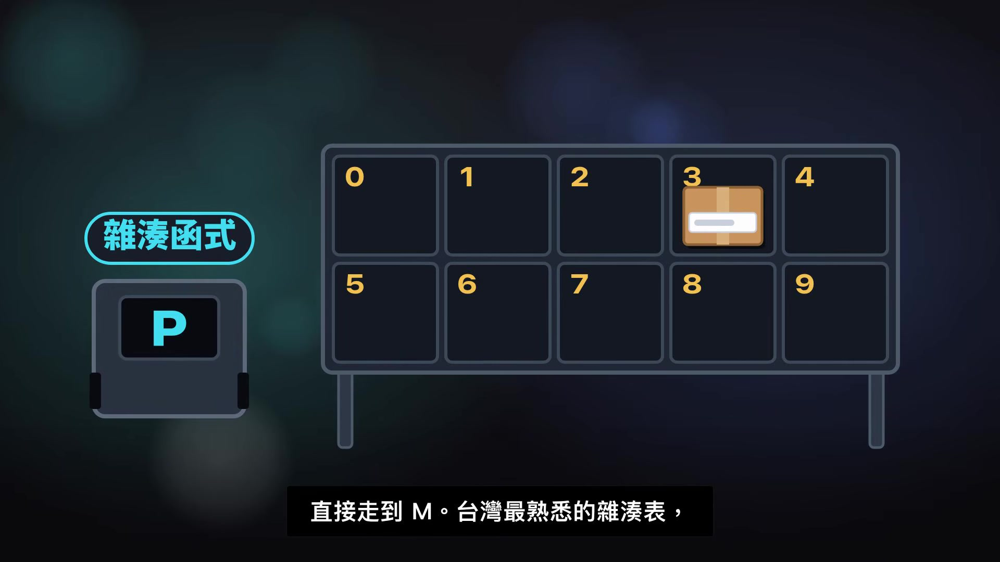

**逐字稿片段：** 就在超商的取貨架上 店員照你手機號碼的最後一碼 把包裹放進那一格 你爆出墨碼 他直接走過去拿 麻煩的是 但是,總會有兩個人墨碼一樣,這叫碰撞

**話題推測：** 以超商取貨架的例子，說明雜湊表在現實生活中的應用

---

## 00:20:16

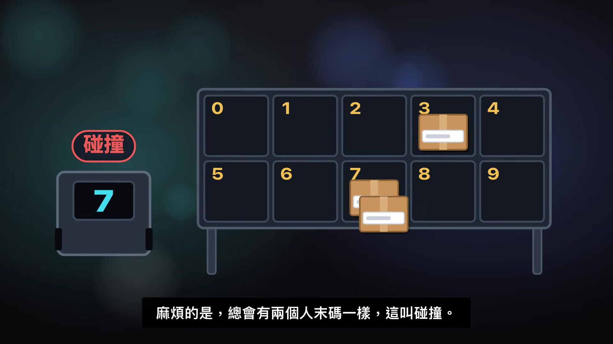

**逐字稿片段：** 馬冷提到生日問題,算一下就知道 一般只要23個人,有兩個人同一天生日的機會就超過一半 碰撞比你想的常見 解法是,在同一格里,用紙條把撞在一起的串成一小串 就是剛剛的鏈結串列

**話題推測：** 提及「生日問題」，解釋雜湊表中的「碰撞」現象

---

## 00:20:30

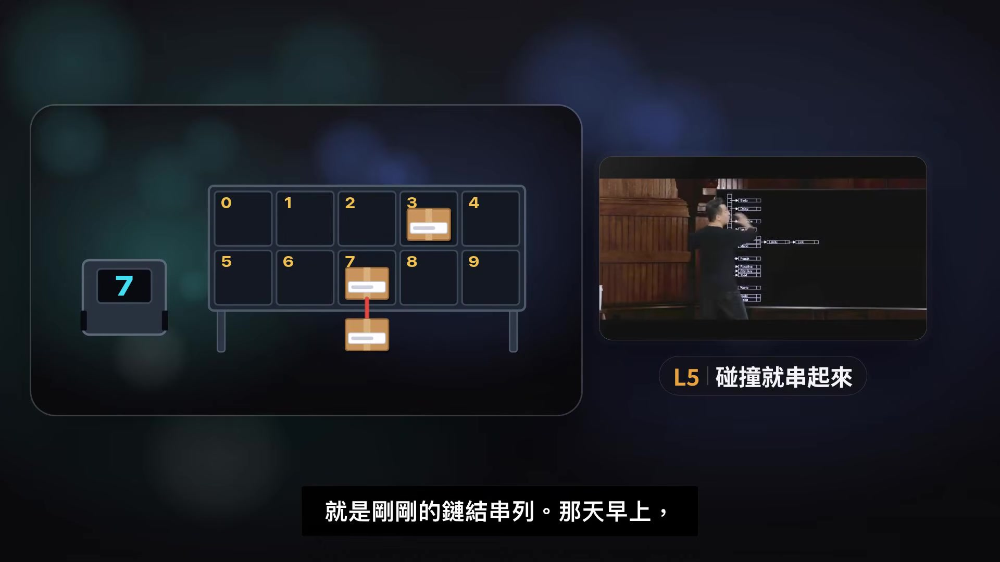

**逐字稿片段：** 那天早上,馬冷在哈佛附近一家沙拉店 拍到了一個真的雜臭表,我們聽他自己怎麼說 為什麼呢? that came out of the computer 他們會將它放在一個特定的位置 This is location A through E This is F through J K through N O through Z 這是O-Z的位置 not unlike one of these four buckets 取貨架很快 可是Mullen也提醒 他會擠 中午12點半最忙的時候 A到E那一格塞滿了 店員大概就隨手放旁邊 真實世界的結構也會越用越亂 最壞的情況 所有人都擠在同一格 又回到一個一個翻 改善的辦法 是把規則定得細一點 例如看名字的前三個字母 格子就變成一萬七千多格 碰撞少很多 可是大部分格子都空著 他最後再介紹一種

**話題推測：** 播放Malen在沙拉店拍攝的影片，展示現實中的雜湊表應用

---

## 00:21:29

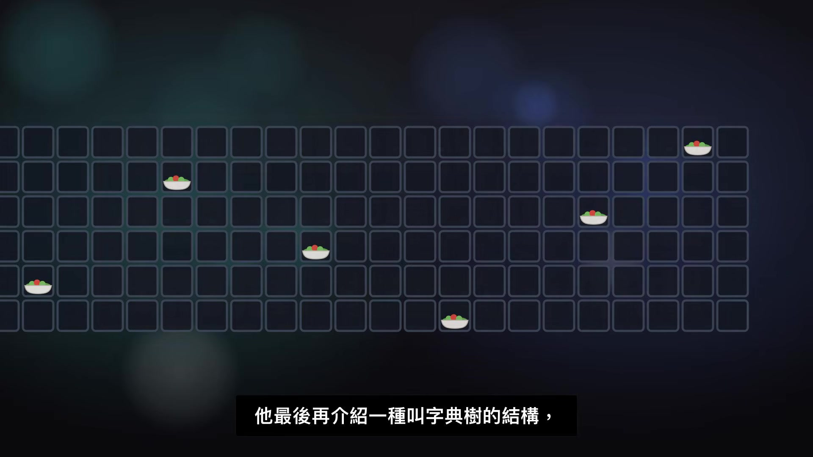

**逐字稿片段：** 叫字典數的結構 名字的每個字母走一層 找TOM 就是TOM三步 不管裡面已經存了十個名字 還是一百萬個名字 都是三步 聖盃找到了 代價是每一層 都要準備一整排26格 大部分用不到 超極佔空間 馬冷的結論是 大量花空間 換大量省時間 我們整理第二段 第一段的答案是 每一格都有門牌 變數可以只存門牌 第二段 就拿這張紙條來用 資料不一定要排在一起 每一格附一張 下一格住哪的紙條 就能縫成一串 叫鏈結串列 附兩張就長成一棵樹 先照規則分隔 再在格子裡串起來 就是雜湊表 正列 鏈結串列 樹 雜湊表 字典樹 沒有哪一種權盈 每一種都是在時間 跟空間之間 挑一個位置 可是你也發現了 這些紙條全都要自己借 自己寫 自己還 順序錯一步 就有節點變成孤兒 馬倫自己也承認 用C太容易寫出有問題 甚至危險的程式 這正是Python這類語言存在的原因之一 他跟學生說 這種跟記憶體搏鬥的日子 只要再忍耐這一週 那下一週 到底是誰在幫我們管這些門牌

**話題推測：** 介紹字典樹（Trie）這種資料結構，實現以名字前N個字母查找

---

## 00:22:36

**逐字稿片段：** 第六堂課 舞臺上那座磚塊金字塔 多了一條綠色的玩具蟒蛇 Python這個英文字 就是蟒蛇 雖然這個語言的名字 其實取自一個英國的喜劇團體 Mallon還是用蟒蛇來開場 宣佈從C換到Python 他說C是低階語言 什麼都要自己做 包括跟電腦借記憶體還記憶體 Python是高階語言 會把這些低階的雜事替你做掉 最直接的差別是寫程式的時間 他先執行上週作業的拼字檢查器 C寫的參考答案 檢查完一整本福爾摩斯小說 只花一秒多 很快 可是學生為了寫出它 花了好幾個小時 甚至好幾天

**話題推測：** 進入第六堂課，介紹Python語言及其對記憶體管理的自動化

---

## 00:23:13

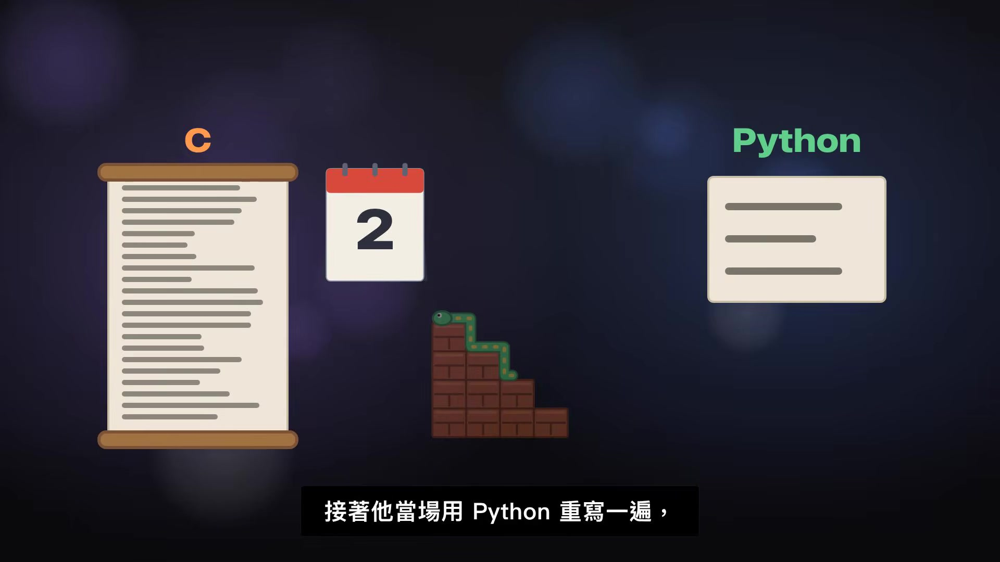

**逐字稿片段：** 他當場用Python重寫一遍 原本要自己做的雜臭表 要自己還的記憶體 幾行就交代完 他笑說有點在炫耀 因為手邊有答案 但確實只花了幾分鐘 然後他對學生說了一段話 我們聽他當時怎麼說 你會遇到新的功能 在Python 和未來的語言中 但沒什麼大不了 你只會在那一刻 填充一些空隙 而不是從一開始開始 我猜是是故意的 Scratch 是上一集第一堂課用的積木工具 所以他說 不用從零開始 也是在開這個玩笑 這堂課的中段 Mullen 翻出第四堂課那支 筆字串的程式

**話題推測：** 當場用Python重新實現C語言的拼字檢查器，展示其簡潔性

---

## 00:24:05

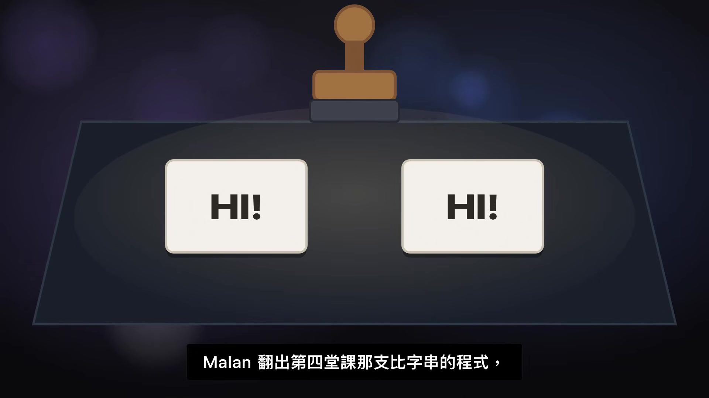

**逐字稿片段：** 用 Python 再寫一次 同樣輸入兩個一模一樣的字 這次電腦說 一樣 從上一集一路帶到這裡的那個問題 到這裡終於收線 Python一樣把字串放在記憶體的某個地方 一樣有門牌 只是你用兩個等號去比的時候 它不比紙條 而是替你走到兩個門口 把內容一個字一個字對完 再告訴你答案 所以Python沒有把門牌變不見 它只是替你換了一個問題來回答 你問的是 這兩串字一樣嗎 它就真的去比字 Mullen自己回頭 又講了一次C為什麼不行 我們聽他自己的整理 不只比字串 第二段我們辛苦縫出來的雜湊表

**話題推測：** 用Python重新測試兩個相同字串的比較，這次電腦判斷為「一樣」

---

## 00:25:08

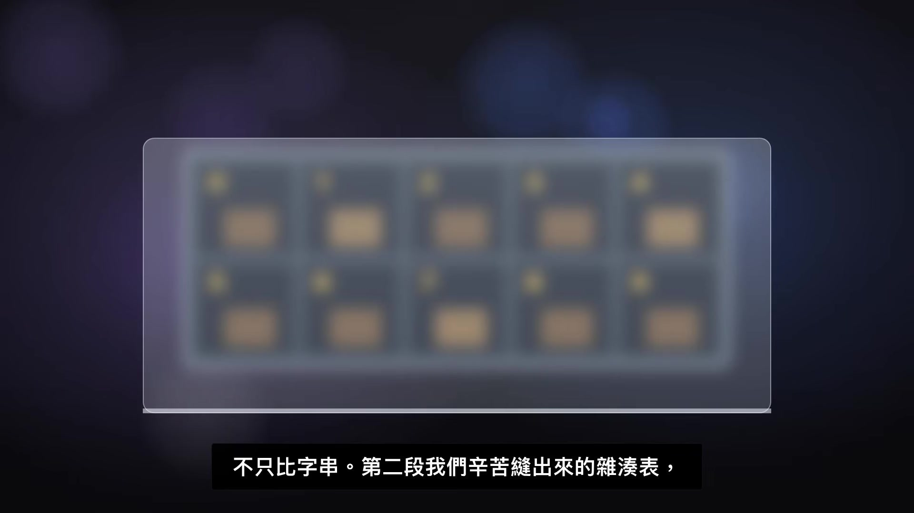

**逐字稿片段：** Python直接內建 叫dict 字典 用名字找電話 一行就寫完 上週作業那支拼字檢查器 Python 也是用內建的集合 叫 Set 幾行就裝下整本字典 第四堂課那支複製字串的程式 C 要先借記憶體 檢查有沒有借到 一個字一個字抄 最後還回去 三十幾行 Python 寫成六行 其中兩行還是空行 而且不用自己還

**話題推測：** 介紹Python內建的雜湊表（dict）和集合（set）資料類型

---

## 00:25:31

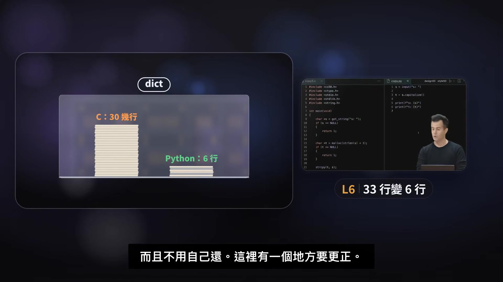

**逐字稿片段：** 這裡有一個地方要更正 Marlin 在課堂上說 Python 的 List 也就是清單 底下像一個幫你管好的鏈結串列 Python 官方的說法不是這樣 它其實是一個會自己變長的陣列 滿了他就在別處找一塊更大的空位 整排搬過去 就是第二段那一排電影院的座位 只是現在搬家這件事 Python替你做了 你感覺不到 上一集我們看過兩種格子不夠用的毛病

**話題推測：** 更正Python List的底層實現，說明它是一個會自動變長的陣列

---

## 00:25:53

**逐字稿片段：** 一種是整數異位 像里程錶數到最大就繞回0 波音飛機要定期重開機 小精靈達到第256關畫面就壞掉 Python解決了這個問題 數字變大他就自動多給格子 Mullen說 C的64位元整數也會異位 不過大概是在我們都死了以後 他沒說錯 每一奈秒加1 也要將近300年才數得完 另一種是浮點數 小數算不準 這個Python沒有解決 它把三分之一 印到小數點後50位 後面還是冒出一串亂掉的數字 你也可以自己試試 在Python裡 0.1加0.2 不等於0.3 馬倫說 這種算不準 要用別人寫的函式庫處理 其實Python本身就內建了 專門處理金額的工具 不管換哪一種語言 有限的格子 都記不下無限的小數 Python替你做了這麼多 也有代價 只是 Marlon 這堂課沒有特別講 我們補一句 首先,你看不見底下發生了什麼 搬家、借格子、還格子都還在 只是被藏起來了 再來,它通常比 C 慢 也比較佔記憶體 因為那些替你做事的步驟 每一步都要花時間和空間 所以這門課才先教 C 你親手縫過那些紙條 才知道 Python 在背後替你做了什麼 哪天它變慢了、出錯了 你也知道該往哪裡找 這堂課的最後 Marlon 示範了一個指令 一行就能把世界上別人寫好的程式裝進來 他說你可以站在那個人的肩膀上 幾天之後 他就站在別人的肩膀上 用Python做了一件更大的事 我們先把第三段的後半

**話題推測：** 解釋Python如何解決C語言中的整數異位問題，支援大數字

---

## 00:27:18

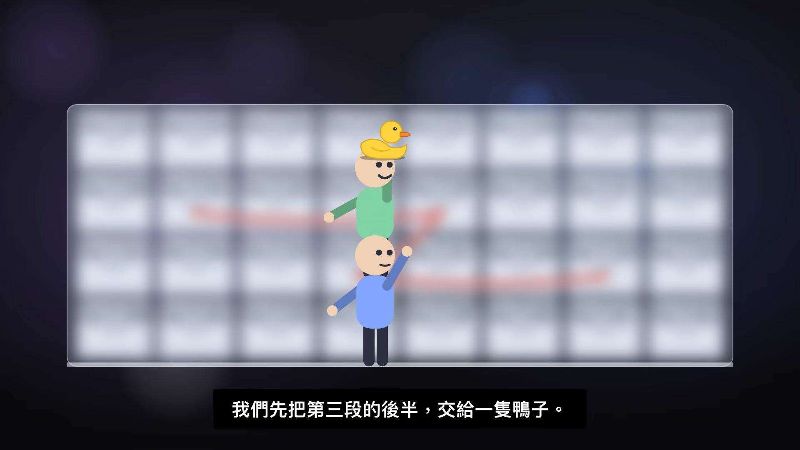

**逐字稿片段：** 交給一隻鴨子 這一講不在正式的周次裡 是CS50為家長週末開的一堂 人工智慧特別講 臺下坐著很多學生的爸媽 Mullen從一隻黃色的橡皮鴨講起 CS50有一個傳統 每個學生會拿到一隻橡皮鴨 城市卡住的時候 就對著鴨子把問題講出來 很多人講著講著 自己就想通了 這個方法 工程師叫它橡皮鴨除錯法 後來CS50做了一個軟體版的鴨子 你打字問它 它只會隨機回你幾聲呱呱

**話題推測：** 進入人工智慧特別講，以CS50的橡皮鴨除錯法為引子

---

## 00:27:46

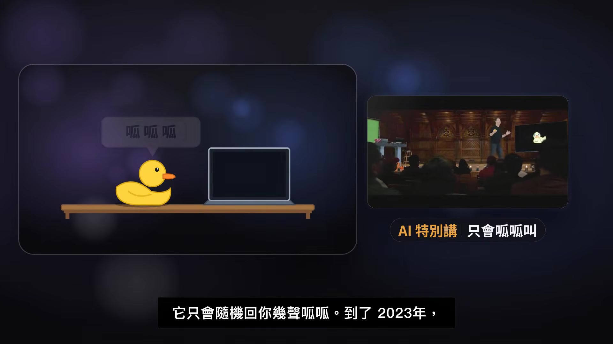

**逐字稿片段：** 到了2023年 這隻鴨子開始用完整的英文回答學生 因為它的背後 接上了人工智慧 也就是AI 馬冷當場用Python做給大家看 第一版兩行 讀盡你的問題 印出呱呱呱

**話題推測：** 介紹CS50的軟體版橡皮鴨如何於2023年接入AI，提供完整回答

---

## 00:27:59

**逐字稿片段：** 第二版大約20行 接上OpenAI的大型語言模型 用的是當時的GPT-4O 他問它 什麼是AI 他回了一大段解釋 最後還加了一聲 呱!全場鼓掌! 20行就能接上這麼強的AI 那CS50怎麼讓他變成一隻好助教? Mullen說 像ChatGPT這類工具 一開箱就太熱心了 太願意直接把答案給學生 所以課程規定 寫作業不能用其他會直接給答案的AI工具 CS50自己的鴨子才可以用

**話題推測：** 示範用20行Python程式碼，將橡皮鴨連接到OpenAI的GPT-4O模型

---

## 00:28:27

**逐字稿片段：** 關鍵在一段文字叫提示詞 英文是Prompt 就是你寫給AI的話 其中有一種叫系統提示詞 是有人事先寫好 每次都壓在最上面的工作說明 告訴AI它是誰、該做什麼、不能做什麼 學生打進來的問題會跟這份說明一起送出去 Mullen舉了一個例子 學生只問 我的程式怎麼怪怪的 鴨子沒有給答案 反問他 你讀進來的東西是數字還是文字 因為在Python裡 鍵盤打進來的1和2是兩個字 接在一起會變成12 CS50寫給鴨子的工作說明裡 有一句特別可愛 我們聽他自己怎麼念 或某程度的骯髒 或其他類似的可愛的行為 但我們繼續向AI說 只回答學生的問題 關於CS50在電腦科學的領域 不要回答關於不相關的問題 不要提供完整的答案 因為這會違反學術的誠實 這樣設計 是為了一個很老的教育夢想 馬蘭說 教學最理想的狀態 是一個老師對一個學生 可是現實做不到 她算給臺下的家長聽 就算一小時的助教時間 只來了六個學生 每個人也只分得到十分鐘 對真的卡住的學生從來不夠 鴨子的目標是一天24小時都在 一個學生配一隻鴨子 他先陪學生把問題講清楚 想清楚 真人助教就能留給最需要的人 馬蘭也提醒家長 這類AI其實早就在你身邊了 垃圾郵件被自動丟到一邊 沒有人一封一封看 你寫的字被手機認出來 雖然沒有人看過你的筆跡 影音平臺猜你下一步想看什麼 背後都是同一類技術 讓電腦從大量的例子裡 自己找出規律 那這隻鴨子 到底怎麼想出答案

**話題推測：** 解釋AI中的「提示詞」（Prompt），特別是「系統提示詞」的作用

---

## 00:30:09

**逐字稿片段：** 馬蘭從遊戲講起 最早的電腦玩家 全靠人寫好的規則 像打乒乓球的老店玩 球在左邊 球拍就往左 錦字遊戲也可以這樣做 而且電腦能把每一種下法都算完 總共也就二十幾萬局 對電腦來說 一下子就算好了 電腦怎麼算 把輸贏變成分數 X贏是1 O贏是負1 合局是0 一方想讓分數越大越好 另一方想越小越好 從最後一步一路往回推 就知道現在該下哪裡 所以他開玩笑說 如果你僅自遊戲輸過 你客觀上就是不會玩 因為有一套下法 能保證你永遠不輸 可是換成西洋棋 踩走前幾步 可能的局面就是幾百億種 換成圍棋 多到沒辦法算 規則寫不完 只好讓電腦自己學

**話題推測：** 開始解釋AI如何「思考」，從遊戲（圈圈叉叉）的規則式判斷說起

---

## 00:30:52

**逐字稿片段：** 這叫機器學習 他請一位高中生上臺

**話題推測：** 介紹機器學習（Machine Learning）的概念，讓電腦自己學習規則

---

## 00:30:55

**逐字稿片段：** 拿平底鍋翻一塊假鬆餅 每翻一次 他只說好或不好 Malan把這種方式 叫監督式學習 更準確的名字是強化學習 沒人教你怎麼翻 只告訴你結果好不好 好的多做一點 壞的少做一點 這種靠結果學習的方法 還有一個陷阱

**話題推測：** 實體道具示範：請高中生上臺翻鬆餅，說明強化學習的原理

---

## 00:31:12

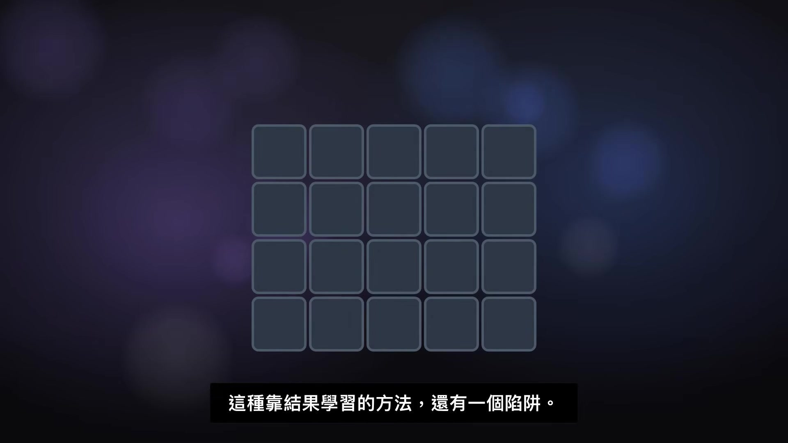

**逐字稿片段：** Mullen畫了一個小迷宮 一個黃點要走到綠色的出口 中間有幾格是熔岩 黃點看不到整張地圖 只能亂走 掉進熔岩就記住那一格別再去 試了很多次 他終於走到出口 贏了 可是繞了一大段遠路 如果他從此只走這條 已經知道會贏的路 就永遠找不到更短的那一條 電腦科學把這叫做探索和利用 利用是一直用已經知道的好答案 探索是偶爾冒險試試新的路 Mullen說 他一學到這個原則 就發現這解釋了他自己在餐廳的行為 第一次去一家店 點了一道很喜歡的菜 之後就只點那一道 誰知道菜單上有沒有更好吃的 解法是 大部分時間走已知最好的路 但留一點點幾率 例如十次裡有一次 隨便走一步 偶爾會掉坑 長期來看 卻可能找到更好的路

**話題推測：** 透過迷宮圖示，解釋機器學習中的「探索與利用」兩難

---

## 00:32:00

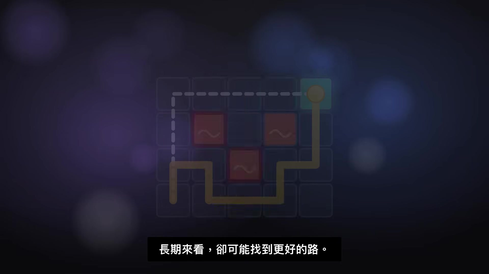

**逐字稿片段：** 現在最主流的學法叫神經網路 Mullen畫了一張平面圖 上面有紅點跟藍點 題目是 給你一個新的點 猜它是紅的還是藍的 最簡單的猜法 是畫一條線 把兩種點分開 資料越多 這條線就一直被調整 越分越準 這條線其實就是幾個數字 一個點的兩個座標 各乘上一個數字 再加上一個數字 總和大於0就猜藍 小於0就猜紅 神經網路做的 就是用大量的資料 自動把這條線的角度和位置 也就是一堆數字 調到最好 真正的大模型 要調的數字有幾十億個以上 連最頂尖的工程師 也說不出其中某一個數字代表什麼 大型語言模型 就是用網絡上大量的文字 調出這些數字 ChatGPT和CS50的鴨子 背後都是它 那它學會的到底是什麼 我們聽Mullen用一句招呼語來說明 All of this data, I bet 99% of the time 我,ChachyPT,或是CS50的Duck Good thanks, how are you? 所以不是總是正確的答案 他做的事,說穿了就是猜 照他讀過的大量文字 接下來最可能出現的是哪幾個字 這條路走了好幾年 2017年,Google的研究人員提出一種叫 Transformer的模型設計 讓機器能注意到一句話裡 隔得很遠的兩個字也有關係 2018年,OpenAI推出第一代GPT 2020年是更大的GPT-3 2022年底ChatGPT上線 GPT這三個字母的意思是 會生成東西 先用大量文字訓練過 用的是Transformer這種設計 Mullen用一個句子說明這種注意 馬薩諸塞是美國東北的一個州 這個州的首府是哪裡 模型要知道 後面的這個州 指的就是前面的馬薩諸塞 可是在模型裡面字不是字

**話題推測：** 介紹神經網路（Neural Network）的原理，以紅點藍點分類為例

---

## 00:33:58

**逐字稿片段：** 有一種模型叫遷入模型 專門把一個字變成一長串數字 CS50的鴨子就用了OpenAI的一個嵌入模型 在那個模型裡 Massachusetts這個字變成了1536個小數

**話題推測：** 介紹「遷入模型」（Embedding Model），將文字轉換成數字序列供AI處理

---

## 00:34:10

**逐字稿片段：** 熒幕上滿滿一整面數字牆 回到這一集的開頭 你存進電腦的東西 放在一排有門牌的格子裡 AI看到的字 到頭來也只是記憶體裡一排連在一起的數字 既然他是在猜最可能的下一句 就會有猜錯的時候 Marlon在最後提醒ChatGPT 坦白說 連CS50自己的鴨子 有時候會編出一些東西 而且講得非常有自信 這叫幻覺

**話題推測：** 螢幕顯示密密麻麻的數字牆，說明AI眼中文字的實際樣貌

---

## 00:34:33

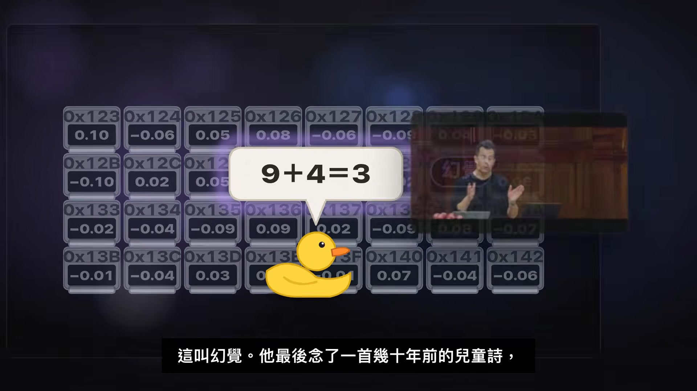

**逐字稿片段：** 他最後唸了一首幾十年前的兒童詩 講一臺寫作業的機器 投一枚硬幣 十秒就把作業寫好 結果9加4 他答3 幾十年前就有人想象過今天的問題 這也是CS50的鴨子 不直接給答案的另一個理由 他說的話 你要有能力自己判斷對不對 我們整理第三段 第二段最後的問題是 這些門牌太難管 有沒有人幫忙 Python就是那個幫手 他替你借格子 還格子 比內容 搬家 連兩個hi都替你比成一樣 代價是你看不見底下也比較慢 再往上一層 AI也是蓋在這些格子上面 你打進去的每一個字都變成一排數字 看不見不代表不存在 知道底下有什麼 你才知道它什麼時候會出錯 我們回到開場那個問題 你存進電腦的東西到底放在哪裡 上完這幾堂課 答案是 電腦裡的每樣東西都住在一個有門牌的格子裡 而變數存的常常不是東西本身 是一張寫著它住哪的紙條 懂了紙條才懂兩個一樣的hi 為什麼會被說不一樣 複製為什麼會一起變 交換為什麼沒效 用紙條把格子縫起來 就能排出一串 一棵樹 一排取貨架 每一種都是在時間跟空間之間做交換 Python把這些紙條都替你藏起來 AI再把每一個字變成一排數字 放進同樣的格子裡 下一集 資料多到要好好存起來 隨時要找

**話題推測：** 提到AI的「幻覺」問題，並引述一首兒童詩提醒AI答案的可靠性

---

## 00:35:52

**逐字稿片段：** 我們會走進資料庫 再走進網頁 最後問你一個問題 你會讓AI直接給答案 還是讓它像鴨子一樣只給提示 留言告訴我 喜歡的話訂閱AI Notebook 開啟通知 我們下次見

**話題推測：** 預告下一集將探討資料庫、網頁等更廣泛的電腦應用

---
