# jimainotebook_utYg7cA76qU — 關鍵畫面索引

- 來源逐字稿：[jimainotebook_utYg7cA76qU_FIN.srt](jimainotebook_utYg7cA76qU_FIN.srt)
- 影片：https://www.youtube.com/watch?v=utYg7cA76qU
- 截圖數：78

## 00:00:11

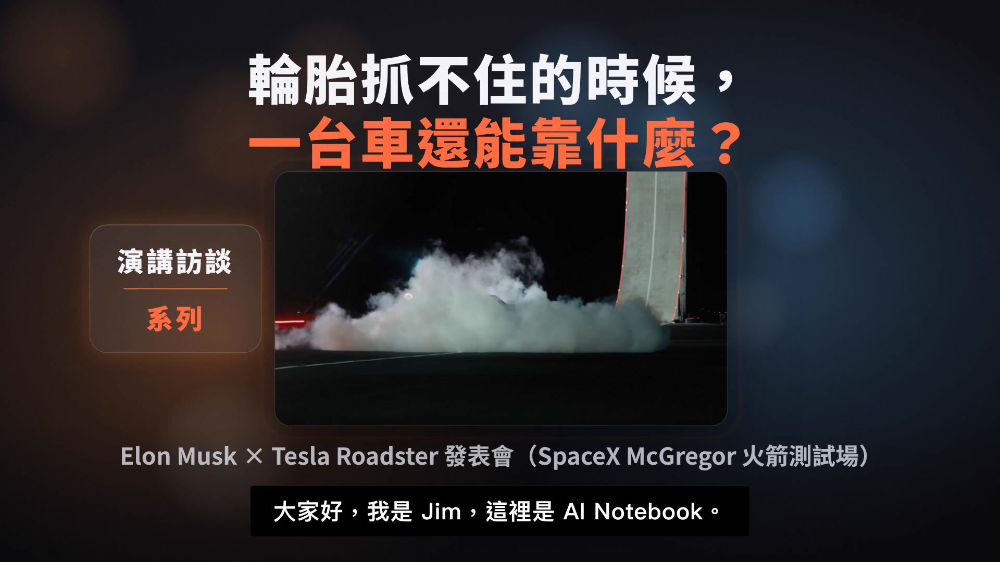

**逐字稿片段：** 這一集是演講、訪談系列,主角是Tesla新一代Roaster跑車的發表會。

**話題推測：** 介紹本集主題：Tesla新一代Roadster跑車發表會

---

## 00:00:16

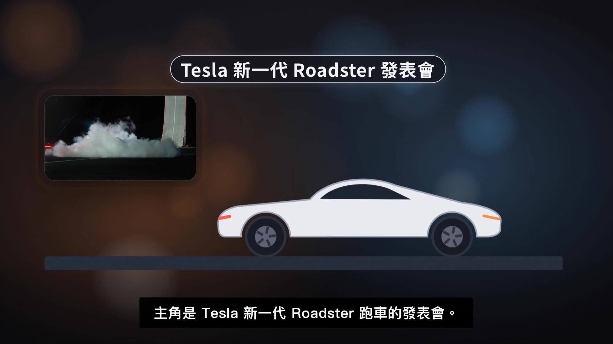

**逐字稿片段：** 我們要問的是,輪胎抓不住的時候,一臺車還能靠什麼?

**話題推測：** 提出本集核心問題

---

## 00:00:19

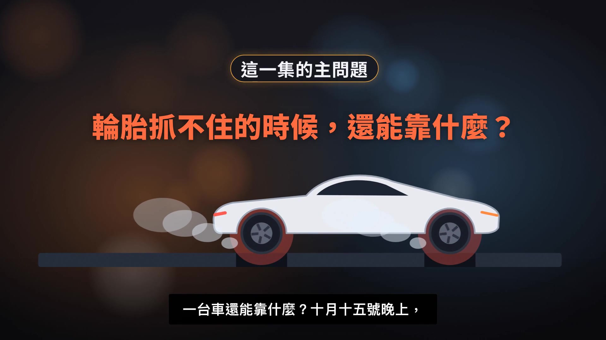

**逐字稿片段：** 10月15號晚上,Tesla把發表會辦在德州的McGregor,那裡是SpaceX測試火箭引擎的場地。

**話題推測：** 介紹發表會地點與日期

---

## 00:00:25

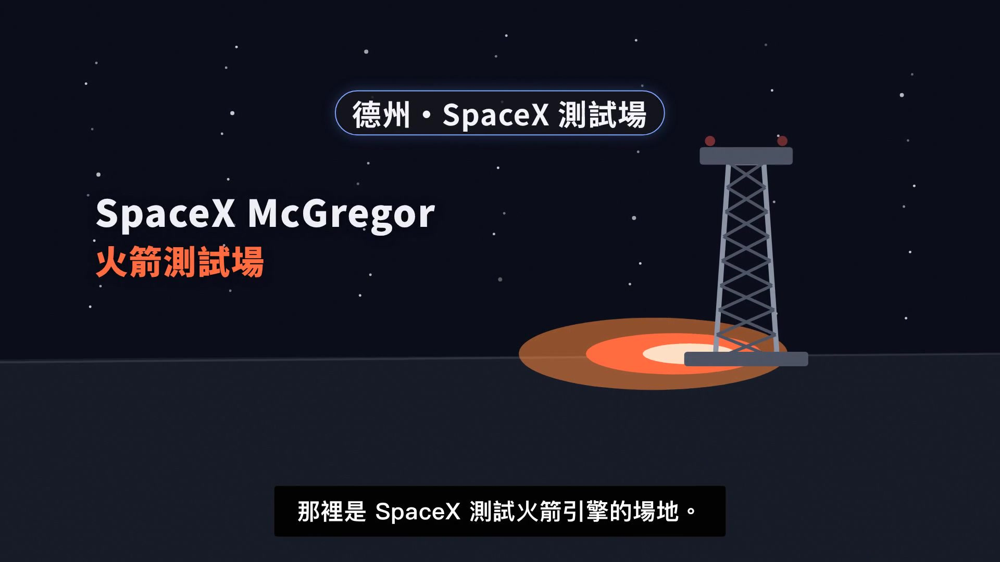

**逐字稿片段：** 臺上是Elon Musk和兩位主持人,首席設計師Francvon Holzhausen跟車輛工程副總裁Lars Morevi。

**話題推測：** 介紹發表會上的主要講者

---

## 00:00:32

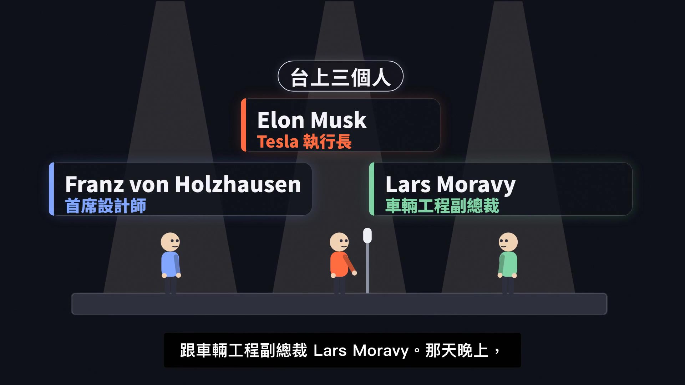

**逐字稿片段：** 那天晚上這臺車爬上一面 彎過頭頂的牆 倒吊在上面 再從牆上飛了出去

**話題推測：** 描述Roadster在發表會上的特技表演

---

## 00:00:38

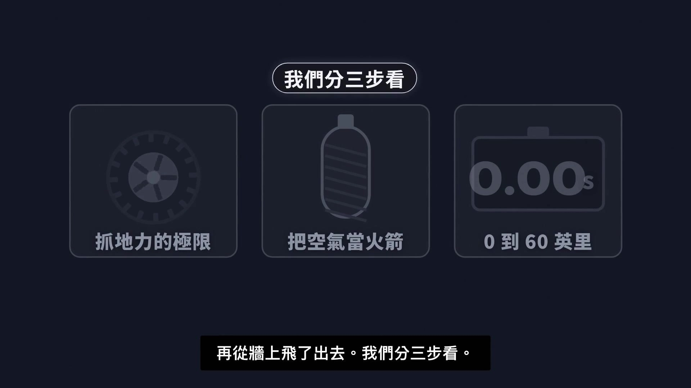

**逐字稿片段：** 我們分三步看 先看輪胎的抓地力到哪裡為止 再看連地面都沒有的時候 它怎麼把空氣當成火箭 最後算一算 0.81秒衝到時速60英里 到底代表什麼 先說清楚 片中很多規格是 Tesla在發表會上自己講的 還沒有第三方驗證

**話題推測：** 介紹本集分析的三個步驟

---

## 00:00:53

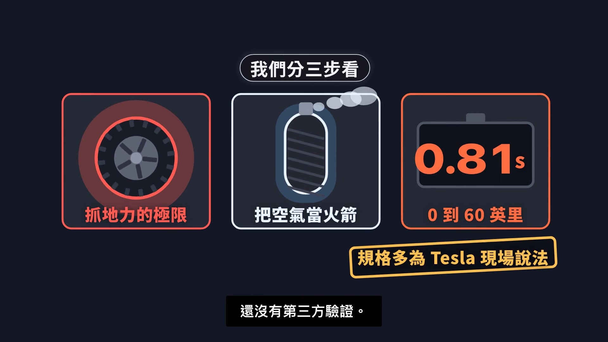

**逐字稿片段：** 你先看一個畫面 一面混凝土牆 從地面往上彎 彎到超過垂直 最上面整個翻過來 變成天花板 一臺白色的跑車開上去 越爬越陡 最後車頂朝下 倒掛在那裡 接著他從牆頂離開 在半空中翻陣 車身四周噴出白色的氣

**話題推測：** 描述發表會中「The Ramp」表演細節

---

## 00:01:10

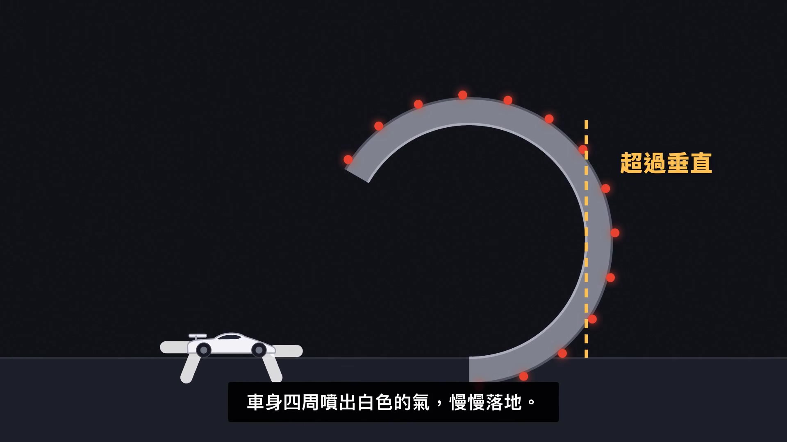

**逐字稿片段：** 慢慢落地 這是發表會的第一個現場表演 Tesla叫他The Ramp 就是斜坡 我們直接看完

**話題推測：** 指出這是發表會第一個表演，名為The Ramp

---

## 00:01:34

**逐字稿片段：** 第一個反應大概是 這是電腦特效吧 Mask 自己也知道大家會這樣想 所以現場刻意找了一大群觀眾 表演之前 他先把話講在前面 聽他怎麼說 聽他怎麼說 這臺車的故事

**話題推測：** 轉向觀眾對表演的反應

---

## 00:01:56

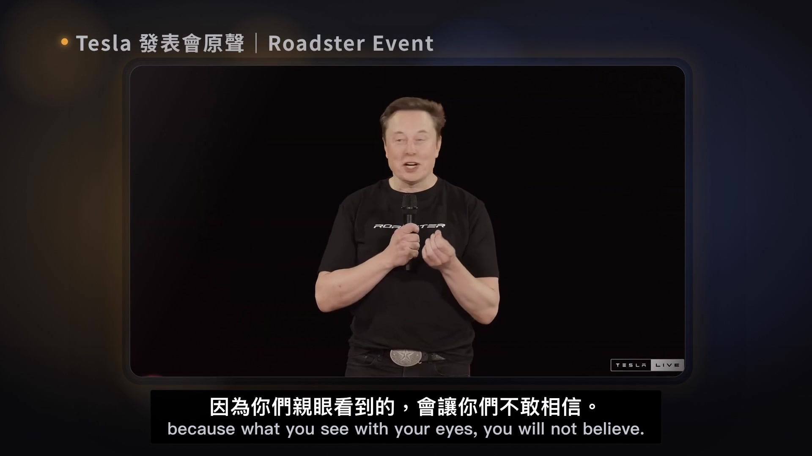

**逐字稿片段：** 這臺車的故事要從20年前講起

**話題推測：** 開始講述Roadster的歷史背景

---

## 00:01:59

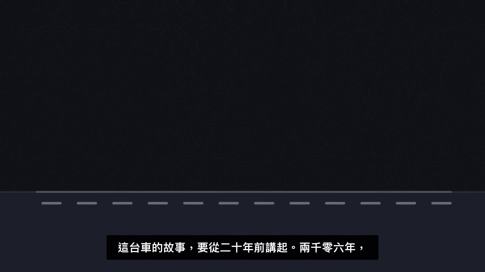

**逐字稿片段：** 2006年Tesla發表了第一代Roadster 當時它是拿來證明電動車也能當真正的車來開

**話題推測：** 提及2006年第一代Roadster發表

---

## 00:02:06

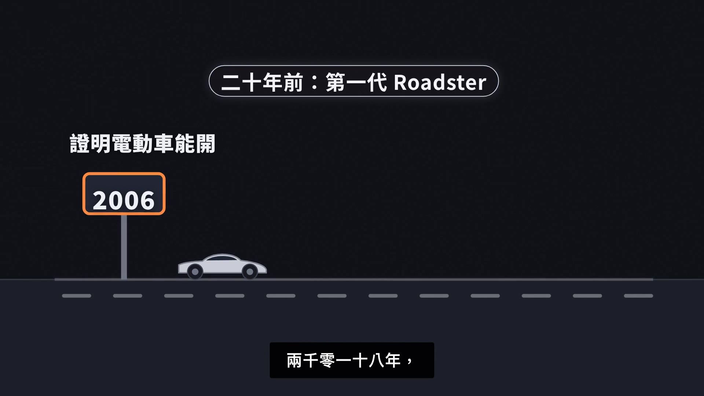

**逐字稿片段：** 2018年SpaceX的獵鷹重型火箭第一次升空 載的就是Musk自己那臺紅色Roadster 駕駛座上坐著一個穿太空衣的假人叫Starman 到現在還在繞著太陽轉

**話題推測：** 提及2018年SpaceX獵鷹重型火箭搭載Roadster升空事件

---

## 00:02:16

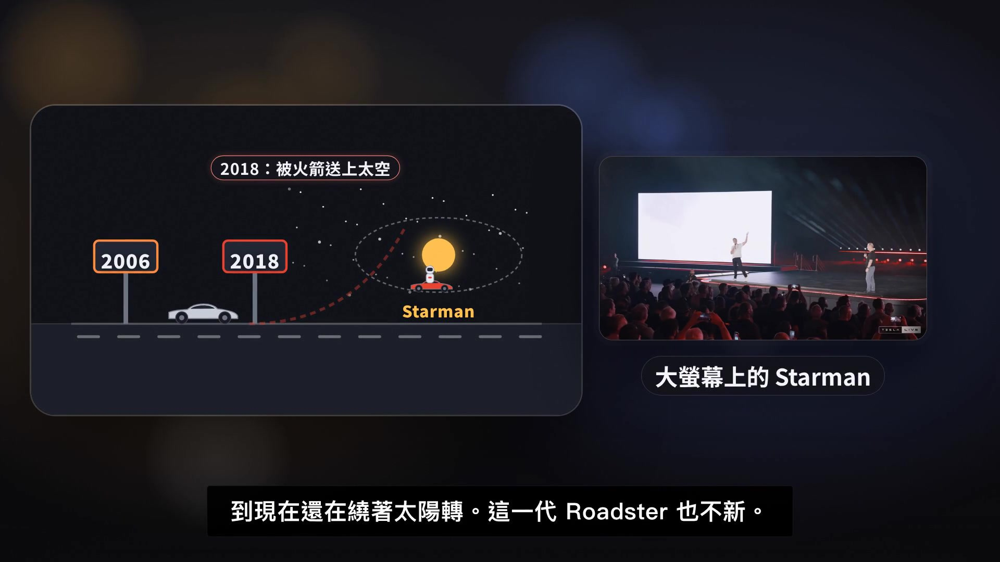

**逐字稿片段：** 這一代Rodest也不新 2017年就發表過原型 說2020年量產 結果一延再延 這一次MUSK 說2028年開始生產

**話題推測：** 回顧本代Roadster的發表與量產時間表（2017, 2020, 2028）

---

## 00:02:27

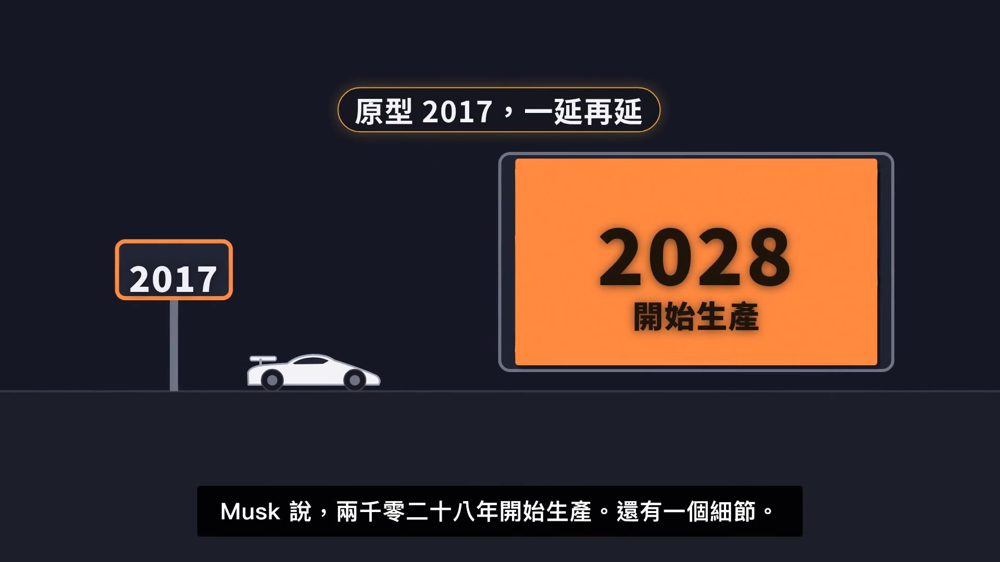

**逐字稿片段：** 還有一個細節 MUSK說以後Tesla會走向自動駕駛 這臺會是唯一要人自己開的車 可是今晚的表演 駕駛桌上沒有真人 聽他怎麼說

**話題推測：** 提及Musk對自動駕駛與Roadster定位的說法

---

## 00:02:56

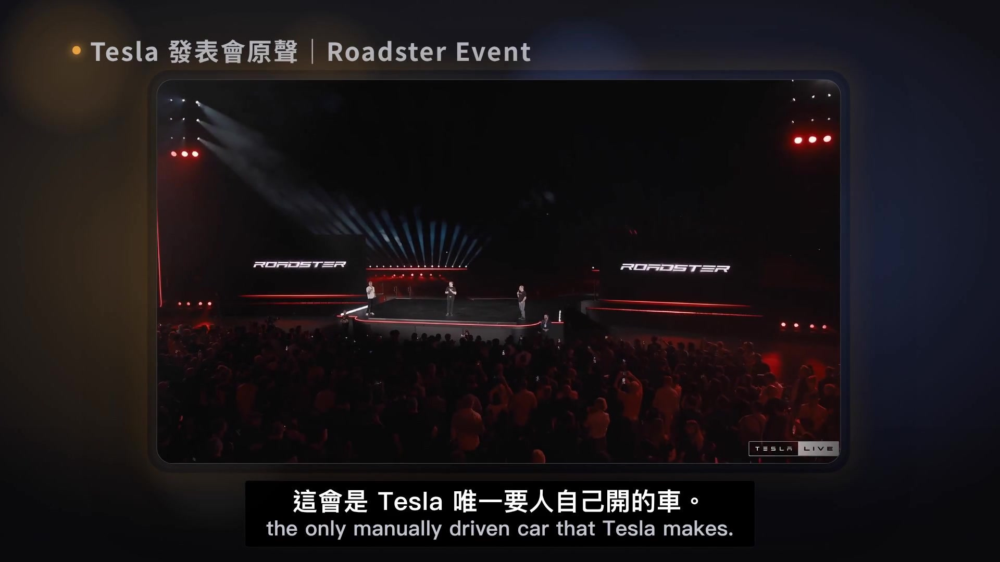

**逐字稿片段：** 所以回到我們的問題 輪胎抓不住的時候 一臺車還能靠什麼

**話題推測：** 回到本集核心問題，準備進入解釋

---

## 00:03:01

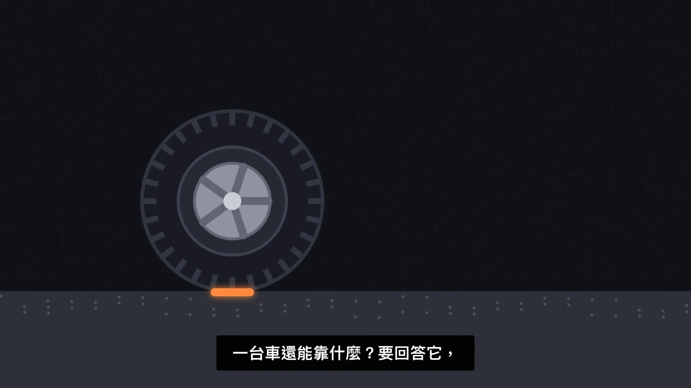

**逐字稿片段：** 要回答他 得先知道輪胎平常靠什麼 抓住地面 這個力叫摩擦力 車子想往前衝 想往旁邊甩 地面就用摩擦力把輪胎拉住 摩擦力有多大 看兩件事 一個是輪胎跟地面的材質 這個叫摩擦係數 另一個是車子壓在地面上有多用力 壓得越重摩擦力就越大 你推一個裝滿書的箱子 比推空箱子難 就是這個道理

**話題推測：** 開始解釋輪胎抓地力的基本原理：摩擦力

---

## 00:03:25

**逐字稿片段：** 可是車子越重 要推動它也越費力 兩邊剛好抵銷 所以輪胎能給的力 大概就是車重的一倍多一點

**話題推測：** 解釋車重與推動力的關係，並初步估算輪胎能提供的力

---

## 00:03:32

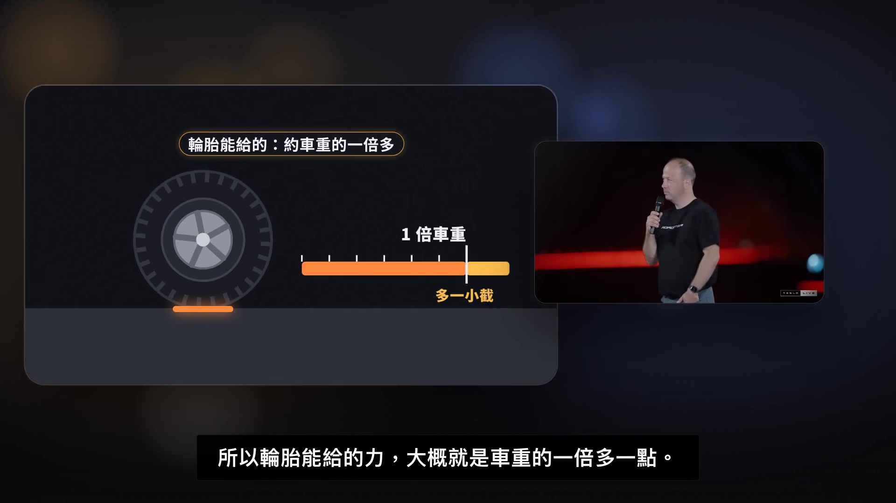

**逐字稿片段：** Tesla的車輛工程副總裁 拉斯摩爾維在臺上報了這個數字 聽他怎麼說 at greater than 2G and accelerate which is typically 1.26G

**話題推測：** 引述Tesla副總裁Lars Morevi發表的相關數據

---

## 00:03:57

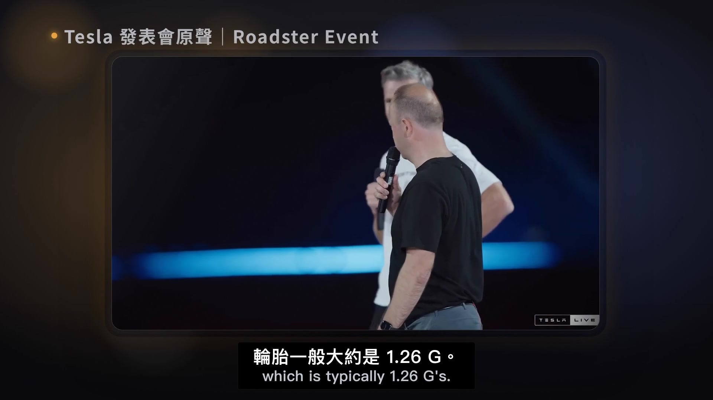

**逐字稿片段：** 他說的G是用地心引力當詞 一個G就是你站著不動時 地球拉你的那個力 輪胎的極限大約1.26個G 意思是他能拿出來的最大力 差不多是車重的1.26倍

**話題推測：** 解釋G的定義並給出輪胎抓地力極限約1.26G的數字

---

## 00:04:09

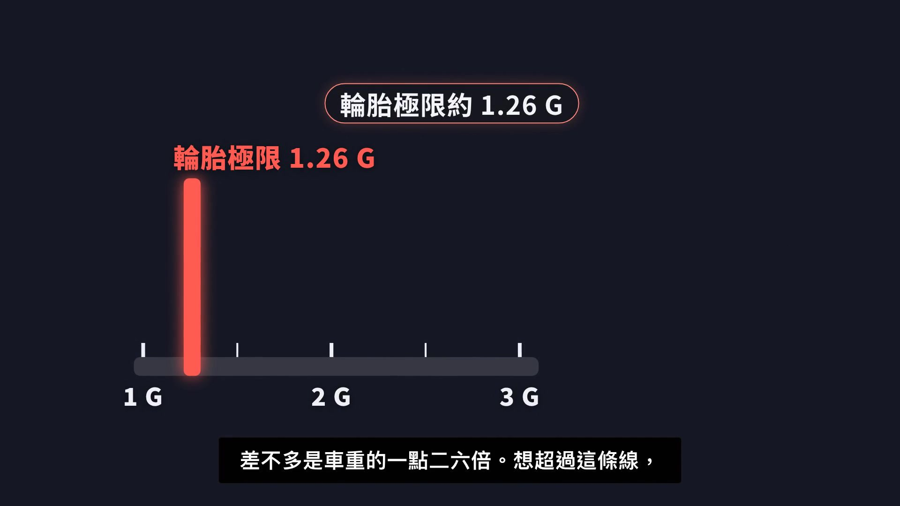

**逐字稿片段：** 想超過這條線 就要讓車子壓的更用力 又不能真的變重 這個額外往下壓的力叫下壓力

**話題推測：** 引入「下壓力」的概念，解釋如何增加抓地力而不增加車重

---

## 00:04:16

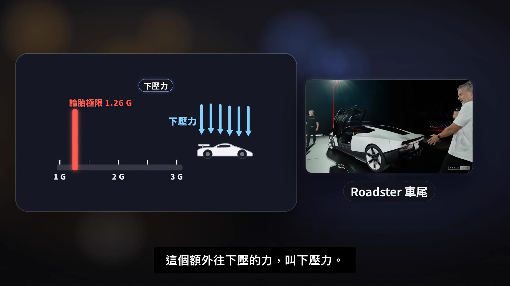

**逐字稿片段：** 賽車最常見的做法 是裝一片倒過來的機翼 飛機的機翼 讓空氣把飛機往上抬 賽車把它翻過來 空氣就把車往下壓 機翼有一個弱點 它要靠速度 車開得越快 下壓力越大 一慢下來 或是停住不動 就幾乎沒有了

**話題推測：** 介紹賽車增加下壓力常見的方法：倒過來的機翼

---

## 00:04:32

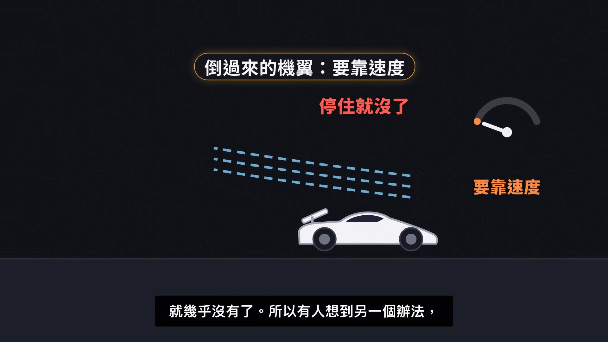

**逐字稿片段：** 所以有人想到另一個辦法 不等風來 自己把車底的空氣抽走 這種車叫風扇車 它的原理跟吸塵器很像 你把吸塵器的吸頭貼在地毯上 很難拔起來 因為吸頭裡的空氣被抽走 外面的大氣就把它按在地上 風扇車也一樣 車底用裙邊圍起來 風扇把裡面的空氣往外抽 整臺車就被大氣壓在地面上 不管開多快停著也有

**話題推測：** 介紹另一種產生下壓力的方法：風扇車

---

## 00:04:54

**逐字稿片段：** 這招很早就有人用過 1970年 美國的Chapel車隊 在車尾裝了兩個大風扇 其他車隊抗議 賽季一結束就被禁了

**話題推測：** 提及1970年Chapel車隊使用風扇車的歷史案例

---

## 00:05:01

**逐字稿片段：** 1978年 一級方程式的Brapham車隊也做了一臺 Nikki Lauda 開著它贏了瑞典大獎賽 只比了這一場就撤下 到了2025年 英國的McMurtry用風扇車 做出了倒過來開的表演 所以倒著開 不是Tesla 第一個做到的

**話題推測：** 提及1978年Brabham車隊使用風扇車的歷史案例

---

## 00:05:15

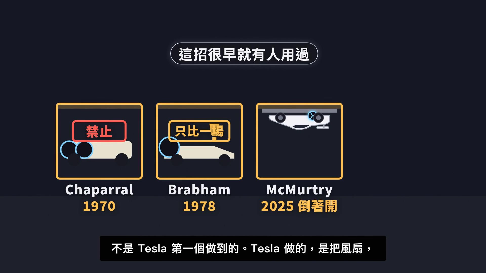

**逐字稿片段：** Tesla做的是把風扇 再加上火箭推進器 放進同一臺車

**話題推測：** 介紹Tesla的獨特結合：風扇與火箭推進器

---

## 00:05:20

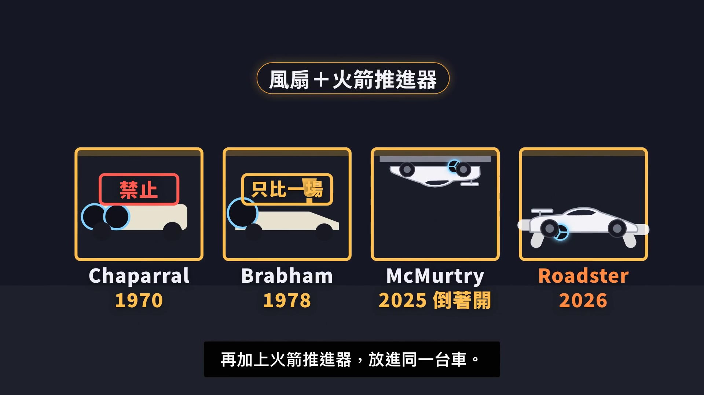

**逐字稿片段：** 那倒吊是怎麼撐住的 把車翻過來以後 重量變成把車往下拉 讓它離開牆面 這時候風扇的吸力 要先抵掉整臺車的重量 剩下的力 才能把輪胎按在牆上 讓它有東西可以抓

**話題推測：** 開始解釋倒吊表演的物理原理

---

## 00:05:32

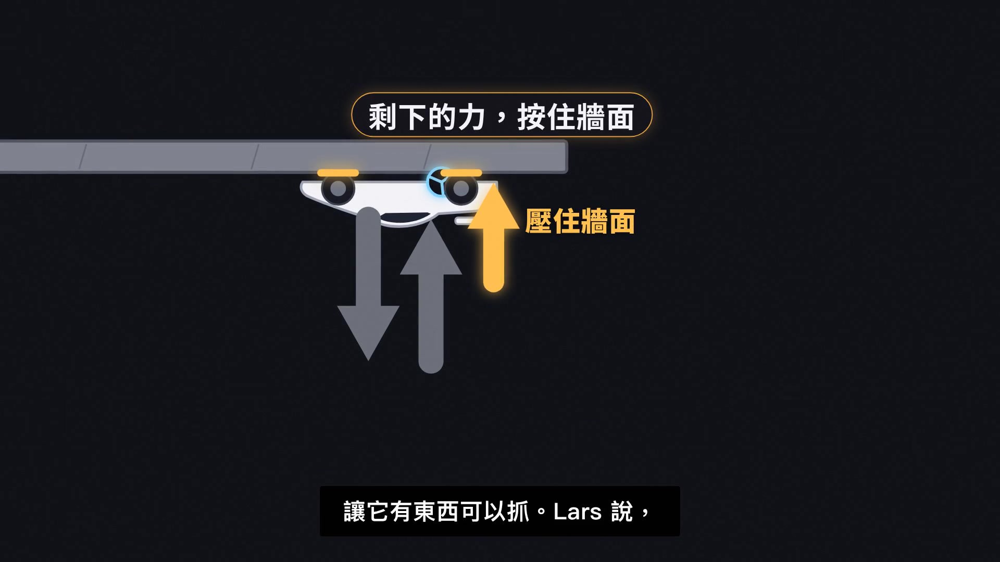

**逐字稿片段：** Lars說 這套系統最多可以拉到兩個機 照這個說法 倒過來的時候 扣掉一倍的車重 還剩下大約一倍車重的力 把車按在牆上 這是我們照現場說法 推出來的 Tesla沒有公佈車重 也沒有說兩個G是什麼量的

**話題推測：** 引述Lars關於系統最大拉力可達2G的數字

---

## 00:05:47

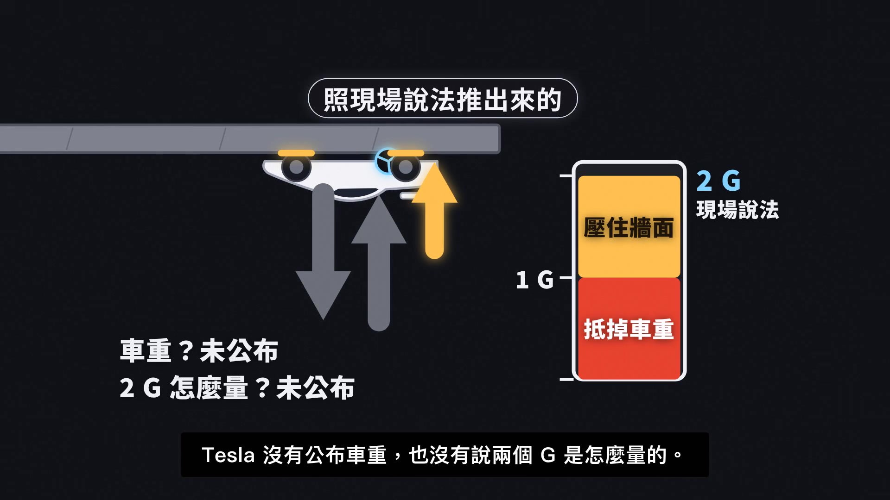

**逐字稿片段：** 表演的時候 畫面角落有一個儀表 一直在跳 外國媒體把它解讀成 下壓力

**話題推測：** 提到表演畫面中角落的儀表數據

---

## 00:05:52

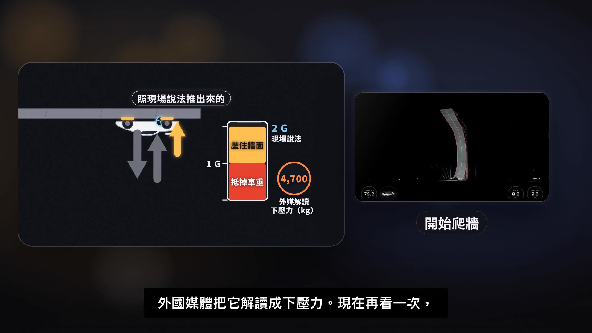

**逐字稿片段：** 現在再看一次 那個倒吊的畫面 這幾秒 就是車頂朝下 貼在牆上的畫面

**話題推測：** 指示觀眾再次觀看倒吊畫面

---

## 00:06:14

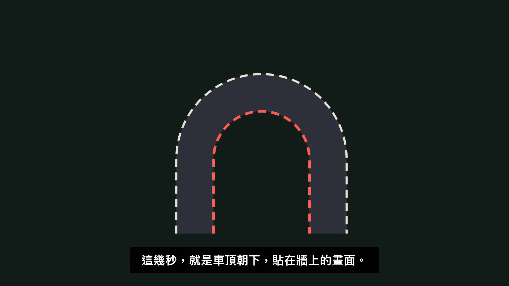

**逐字稿片段：** 你可能會想 誰會需要倒著開車

**話題推測：** 提出誰需要倒著開車的問題，引導到實際應用

---

## 00:06:17

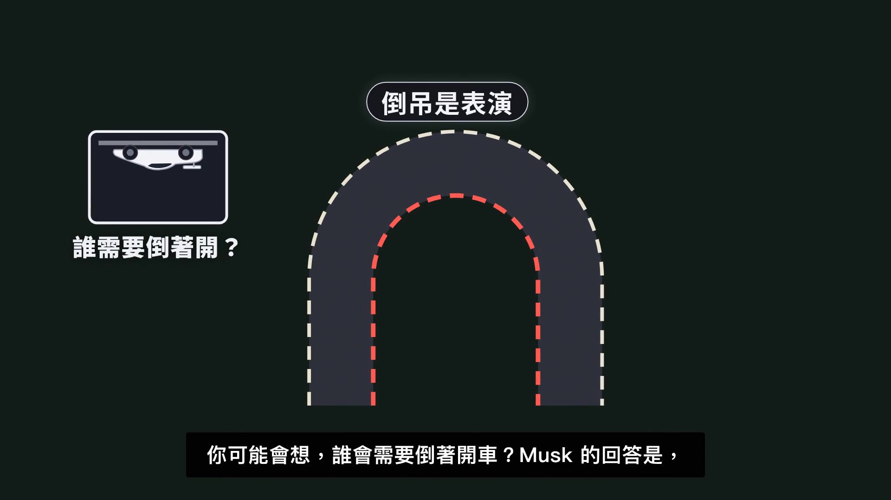

**逐字稿片段：** Mask的回答是 倒吊只是表演 真正有用的是過彎 車子轉彎的時候 要靠輪胎往側面抓 抓不住 車就會往外滑出去 下壓力越大 輪胎能抓的力越大 就能用更快的速度過彎

**話題推測：** 引用Musk對倒吊表演實際應用（過彎）的解釋

---

## 00:06:29

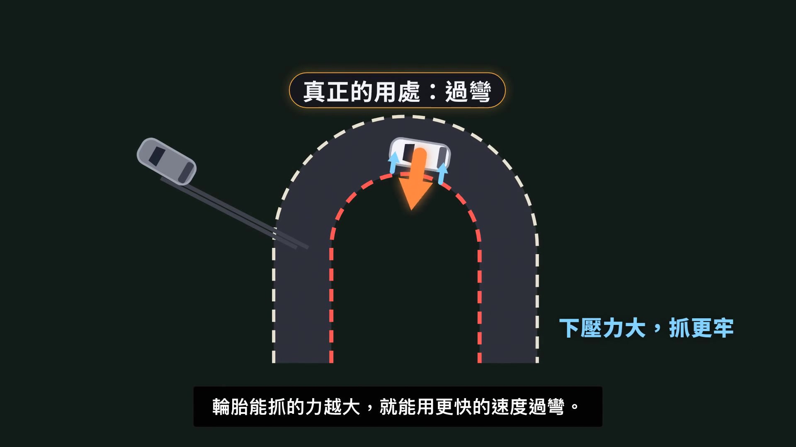

**逐字稿片段：** Tesla還準備了兩種模式 一種叫高下壓力模式 把尾翼立起來用在過彎 另一種叫低阻力模式 把車身收乾淨 用在衝直線 尾翼的角度也會自己變 車子會算你現在需要多少下壓力 聽Mask怎麼說

**話題推測：** 介紹Tesla Roadster的兩種模式：高下壓力與低阻力

---

## 00:07:05

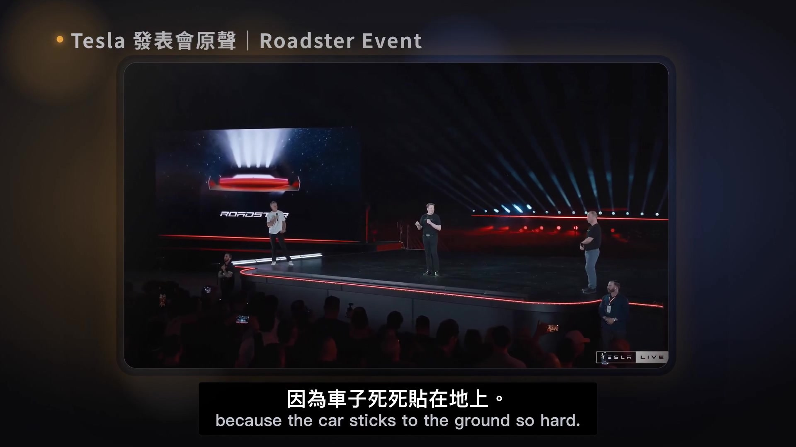

**逐字稿片段：** 這一部分的答案是 輪胎能抓多少 看車子被壓得多用力 機翼要靠速度 風扇車不用等 自己把車底的空氣抽走 讓大氣把車按下去 按得夠用力 連倒吊都撐得住 可是這一招有個前提 車子底下要有東西可以吸

**話題推測：** 總結第一部分關於抓地力與下壓力的解釋

---

## 00:07:20

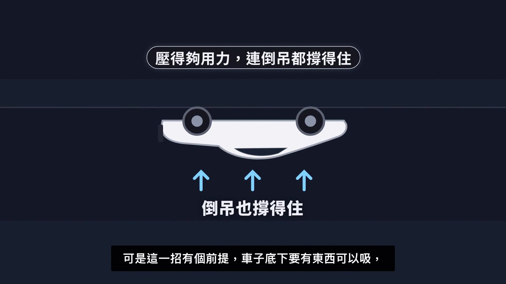

**逐字稿片段：** 輪胎要有東西可以抓 那如果連地面都沒有了呢

**話題推測：** 引入下一個問題：當沒有地面時如何驅動

---

## 00:07:23

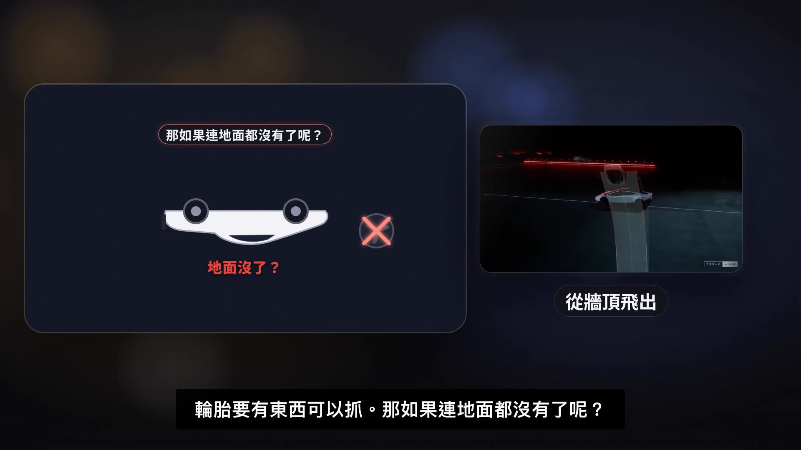

**逐字稿片段：** 第一個表演的最後 車子從牆頂飛了出去 那幾秒鐘 風扇幫不上忙

**話題推測：** 回顧第一個表演結尾車子飛出的畫面

---

## 00:07:27

**逐字稿片段：** 接下來的表演 Tesla叫他Kickflip 名字來自滑板的一個招式 板子在空中翻一圈再落地

**話題推測：** 介紹第二個現場表演「Kickflip」

---

## 00:07:33

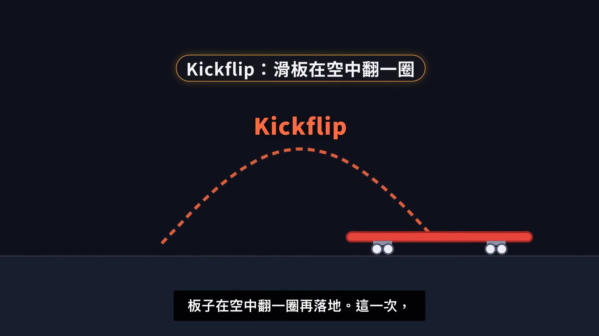

**逐字稿片段：** 這一次場地中間排了一整排Tesla 自駕的車有轎車有電動皮卡 Cybertruck還有大卡車Semi Roadster要從旁邊加速衝過去 跳過整排車在空中翻轉再落地 我們直接看 其實第一個表演一結束

**話題推測：** 描述Kickflip表演的場景與方式，提及其他Tesla車款

---

## 00:08:09

**逐字稿片段：** 主持人就說飛行車是真的啦

**話題推測：** 引述主持人對飛行車的評論

---

## 00:08:12

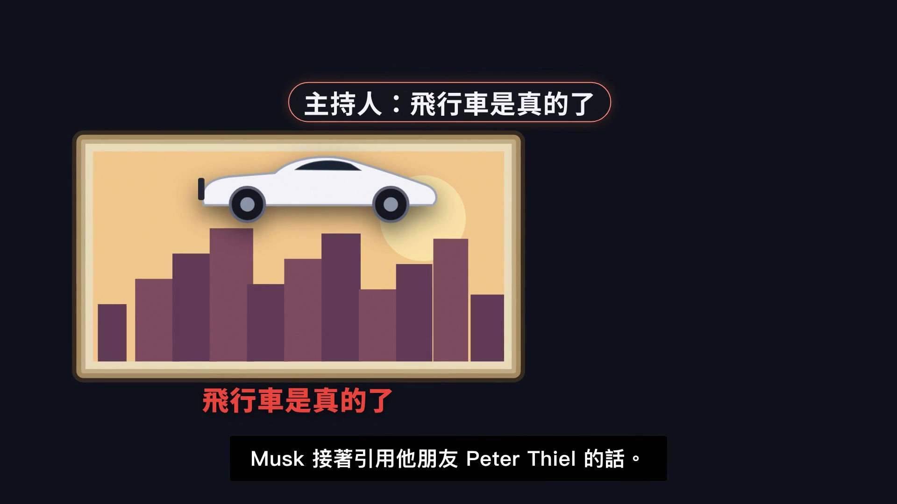

**逐字稿片段：** Mask接著引用他朋友Peter Thiel的話 TL是PayPal的共同創辦人 他以前抱怨過未來答應給我們飛行車 結果我們只拿到140個字 指的是推特早年 一則貼文只能寫140個字 Tim Musk怎麼說

**話題推測：** 引用Musk對Peter Thiel關於飛行車和推特的評論

---

## 00:08:36

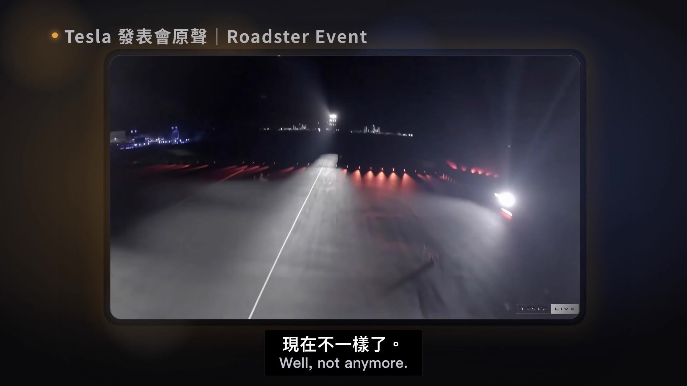

**逐字稿片段：** 那他是怎麼飛的

**話題推測：** 提出車子如何飛行的新問題

---

## 00:08:38

**逐字稿片段：** 靠的是300多年前就寫下來的一條規則 叫牛頓第三運動定律 他說的是 你推一個東西 那個東西也會用一樣大的力推回來 你把氣球吹飽 捏著口不綁 一放手 氣往後噴 氣球就往前亂飛

**話題推測：** 解釋飛行原理：牛頓第三運動定律

---

## 00:08:51

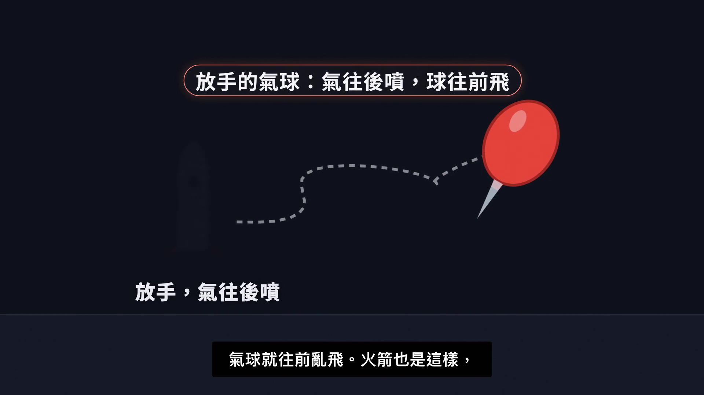

**逐字稿片段：** 火箭也是這樣 把東西用很快的速度往後丟 自己就被往前推 這個往前推的力 叫推力

**話題推測：** 解釋火箭推力原理

---

## 00:08:57

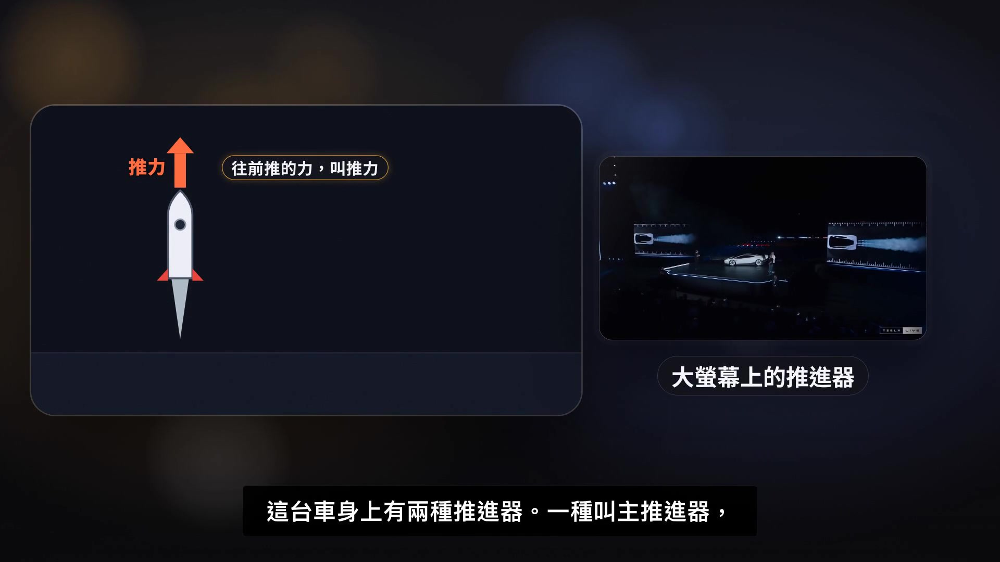

**逐字稿片段：** 這臺車身上有兩種推進器 一種叫主推進器 裝在車尾負責往前推 另一種叫姿態控制推進器 姿態就是車身的角度 這種小推進器裝在車子四周 用來讓車身翻轉 轉正 在落地前減速 聽Mask怎麼說

**話題推測：** 介紹車上的兩種推進器：主推進器與姿態控制推進器

---

## 00:09:32

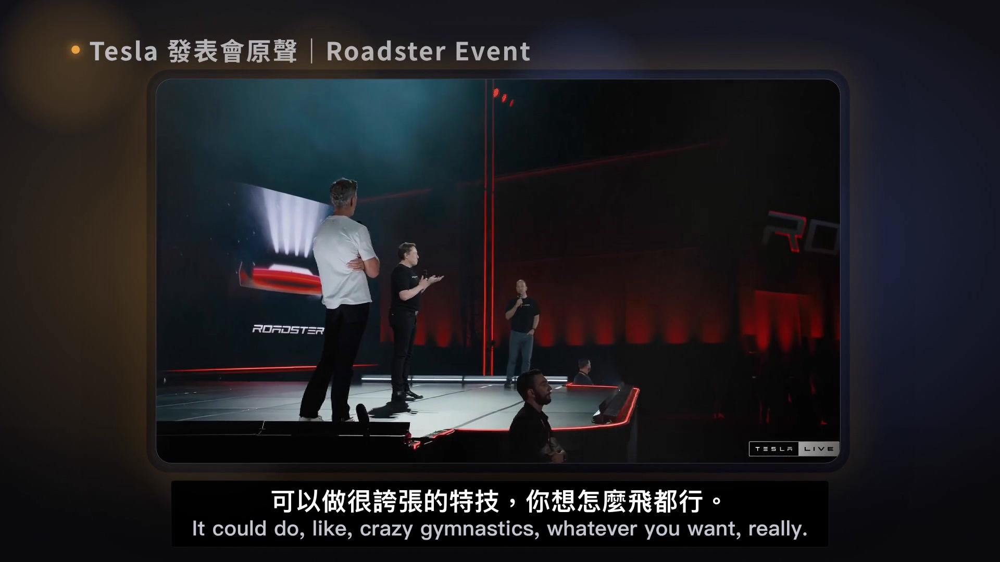

**逐字稿片段：** 火箭要燒燃料 這臺車噴的是什麼

**話題推測：** 提出推進器噴射物的問題

---

## 00:09:35

**逐字稿片段：** 答案是空氣 這種做法叫冷氣體推進 它不燒任何東西 只是把壓得很緊的空氣放出來

**話題推測：** 揭示噴射物是空氣，並介紹「冷氣體推進」技術

---

## 00:09:41

**逐字稿片段：** 裝這種空氣的桶子 要很耐壓 要很輕 SpaceX的火箭用的是一種叫碳纖維纏繞壓力容器的氣瓶 英文說寫是COPV 它的做法是 裡面用一層薄薄的內膽裝氣 外面用碳纖維一圈一圈纏起來 比全金屬的氣瓶輕很多

**話題推測：** 介紹儲存空氣的氣瓶技術：碳纖維纏繞壓力容器 (COPV)，並提及SpaceX應用

---

## 00:09:57

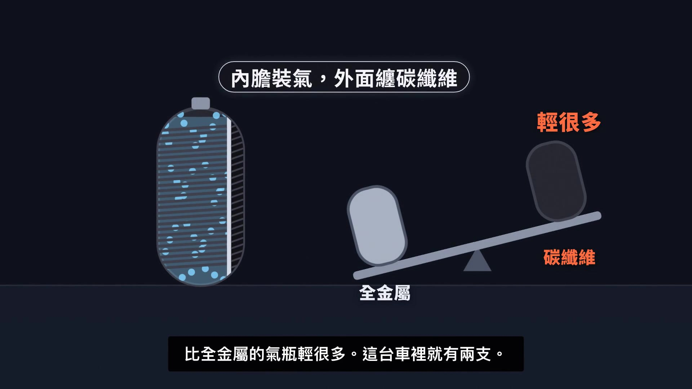

**逐字稿片段：** 這臺車裡就有兩隻 拉斯在臺上 把氣瓶的規格報了出來 聽他怎麼說

**話題推測：** 提到車內有兩隻COPV氣瓶，Lars公布其規格

---

## 00:10:21

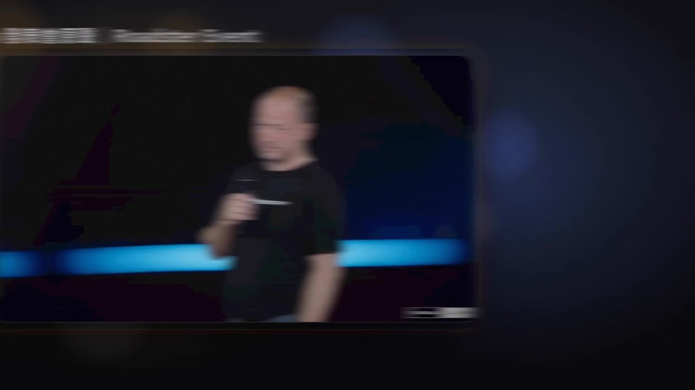

**逐字稿片段：** 250公斤的空氣 夠他噴多久

**話題推測：** 提出250公斤空氣的推進時間問題

---

## 00:10:23

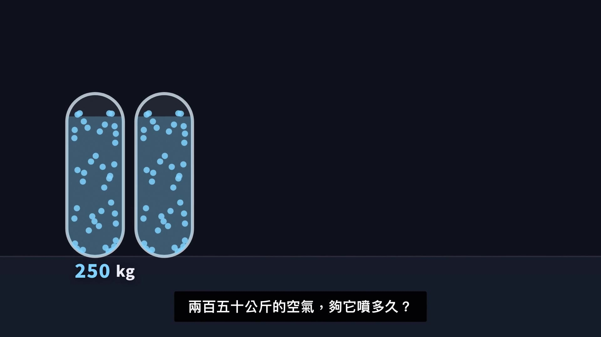

**逐字稿片段：** 我們用推力的公式算一下 推力等於每秒噴出去多少公斤的空氣 乘上它噴出去有多快

**話題推測：** 開始計算推力公式

---

## 00:10:30

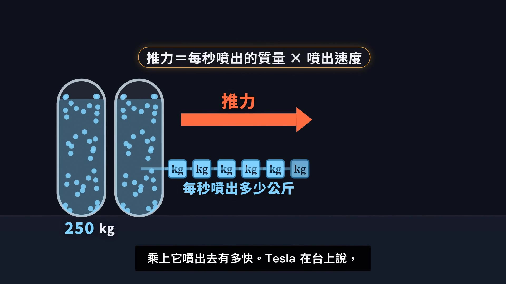

**逐字稿片段：** Tesla在臺上說 這套系統的推力超過8萬牛頓 大概是能把8噸重的東西撐在空中的力 空氣從高壓放出來 噴出去的速度 物理上最多大約每秒六七百公尺 用這個速度去算 要推出8萬牛頓 每秒就要噴掉100多公斤的空氣

**話題推測：** 指出Tesla公布的系統推力超過8萬牛頓

---

## 00:10:47

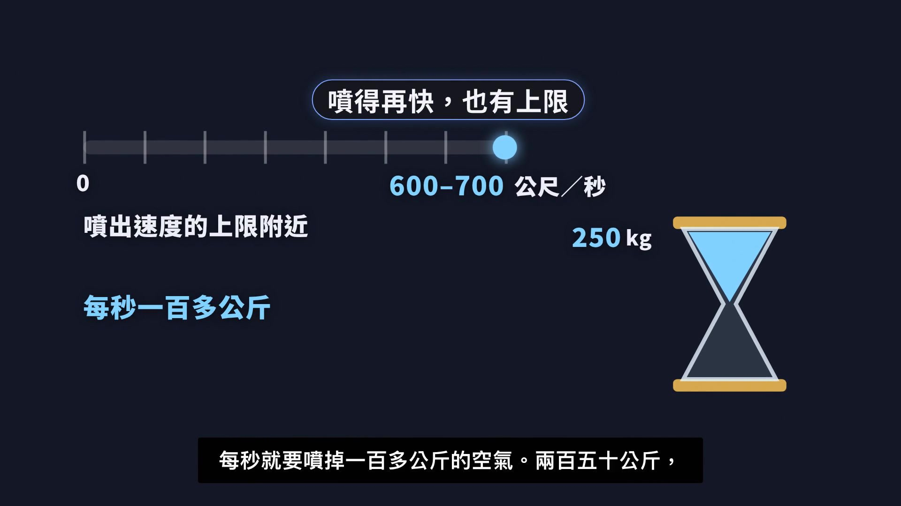

**逐字稿片段：** 250公斤 全力噴 大約兩秒就噴完了 這是我們自己的估算 噴口效率和真正的噴法 Tesla沒有公佈 這也是為什麼表演裡每一次噴氣都很短

**話題推測：** 估算出250公斤空氣全力噴射約可維持兩秒

---

## 00:10:55

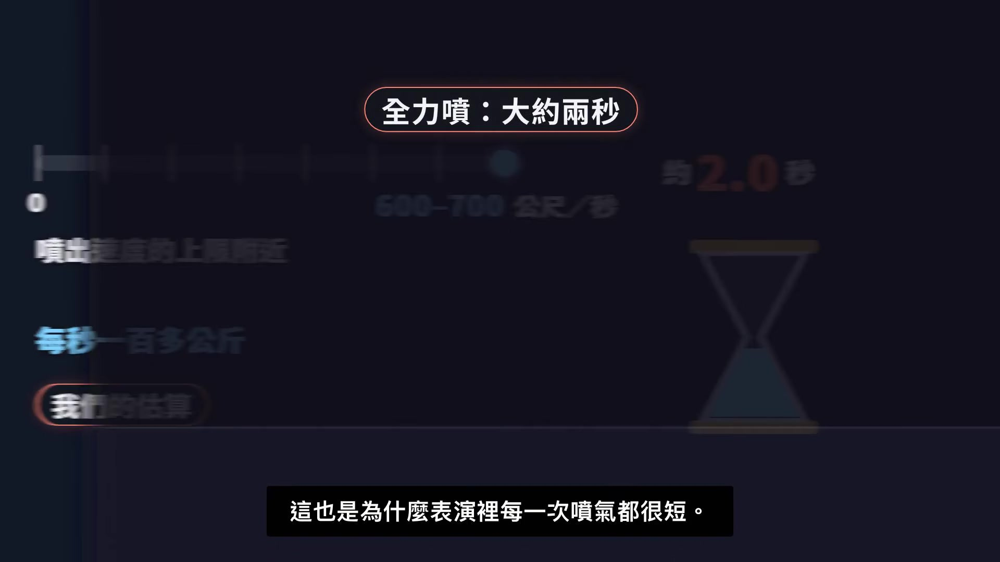

**逐字稿片段：** 在他噴的只是空氣 Mask說車子可以自己把氣瓶重新打滿 不需要特殊的推進劑

**話題推測：** 提及Musk說氣瓶可自行重新打滿空氣

---

## 00:11:01

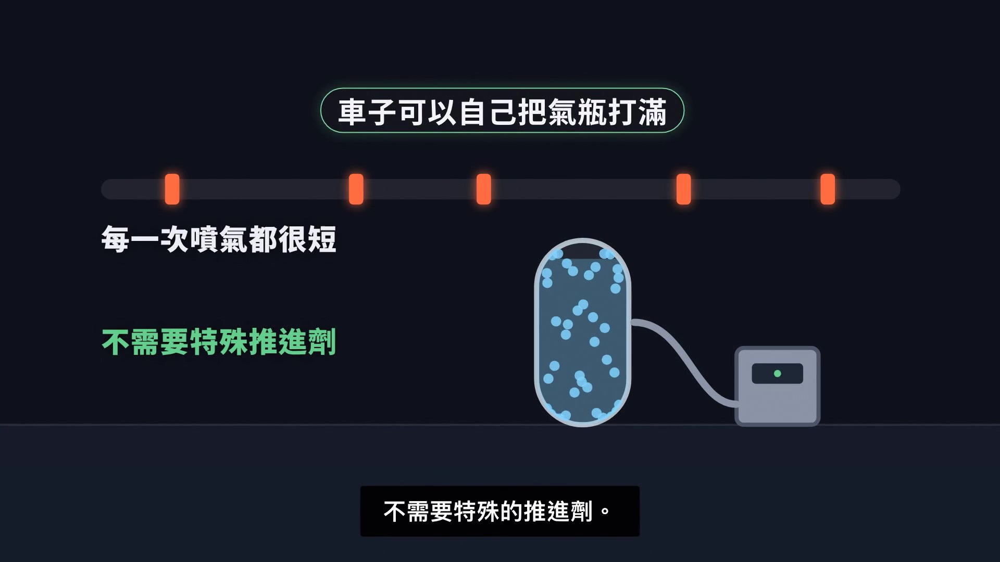

**逐字稿片段：** 空氣噴得那麼快 會在車尾留下一個很特別的痕跡 這個痕跡叫馬赫環 也有人叫振波鑽石 它是噴流裡一節一節 像鑽石一樣排成一串的花紋 它會出現是因為噴出來的氣流比聲音還快 噴口的壓力又跟外面的空氣不一樣 氣流衝出去 先膨脹過頭 被外面的空氣擠回來 又擠過頭 再彈出去 一來一回就排出一節一節的花紋 你在火箭發射或是戰鬥機全力加速的時候常常看得到 主持人說這臺車的推進器也有 聽主持人怎麼說

**話題推測：** 介紹超音速噴氣流產生的「馬赫環」現象

---

## 00:11:51

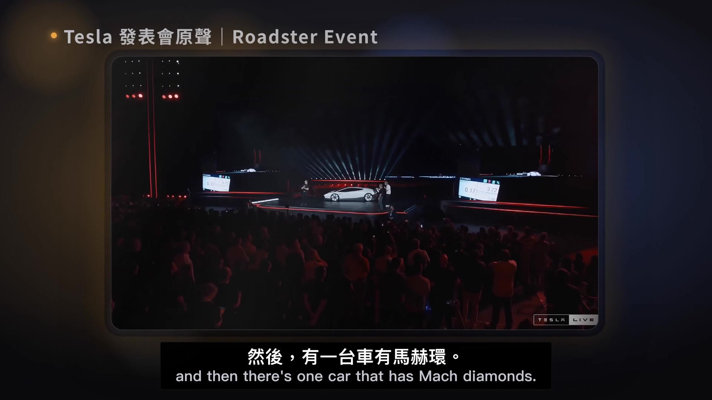

**逐字稿片段：** 這一部分的答案是 但是地面沒了 輪胎和風扇都使不上力 車子就換一種方法 把空氣用超過音速的速度往後丟 靠反作用力推自己 就像那顆放手的氣球 可是氣瓶裡的空氣 全力噴子撐得了兩秒左右 所以它不是一臺能一直飛的車 比較像是一臺 可以在關鍵的幾秒鐘裡 借火箭一把力的車

**話題推測：** 總結第二部分關於無地面推進的原理

---

## 00:12:11

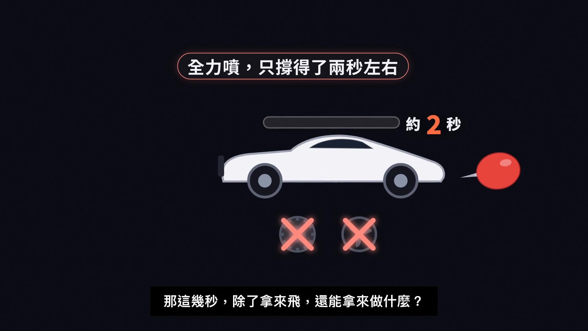

**逐字稿片段：** 那這幾秒除了拿來飛 還能拿來做什麼 答案是衝刺

**話題推測：** 引入推進器秒數的其他應用：衝刺加速

---

## 00:12:14

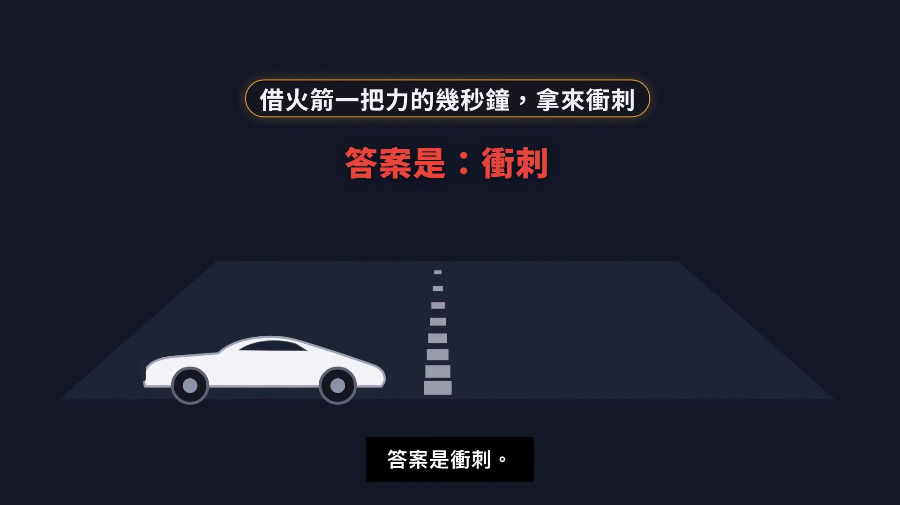

**逐字稿片段：** 0到60英里 也就是從靜止加速到時速 大約97公里 是車迷最愛比的數字

**話題推測：** 介紹0到60英里/小時的加速里程碑

---

## 00:12:19

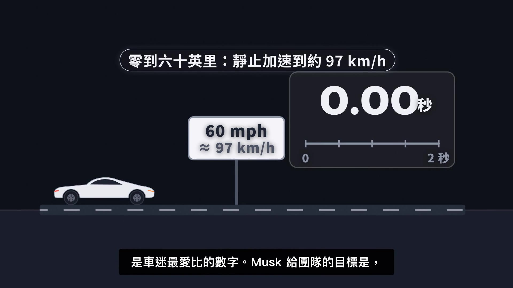

**逐字稿片段：** Mask給團隊的目標是一秒以內

**話題推測：** 提及Musk設定的加速目標：一秒以內

---

## 00:12:22

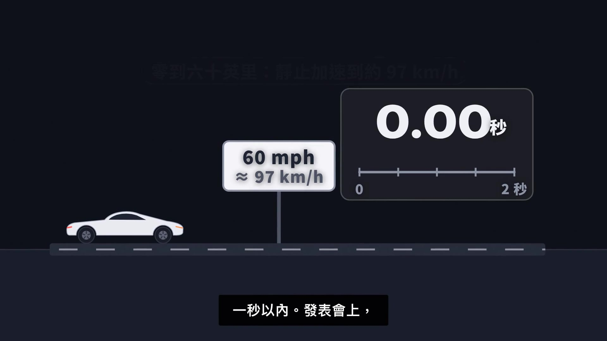

**逐字稿片段：** 發表會上 主持人先放了一段事先錄好的測試 剛好一秒

**話題推測：** 提到發表會上預錄的加速測試結果：一秒

---

## 00:12:26

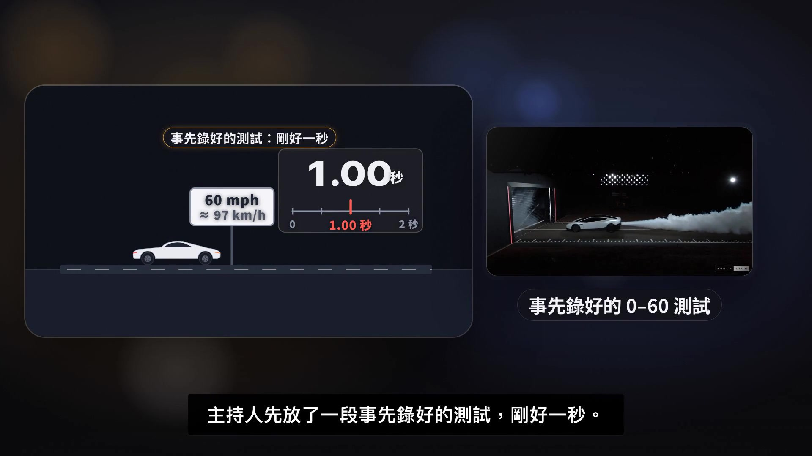

**逐字稿片段：** Mask說 他要的是比一秒更快 要現場再來一次 場地不夠長 他們只能在一小段路上衝 我們直接看

**話題推測：** 引用Musk要求現場進行更快的加速測試

---

## 00:12:46

**逐字稿片段：** 0.81秒

**話題推測：** 公布現場測試結果：0.81秒

---

## 00:12:51

**逐字稿片段：** 我們用前面那把尺 看他到底有多快

**話題推測：** 開始分析0.81秒加速的意義

---

## 00:12:53

**逐字稿片段：** 時速60英里 等於每秒大約27公尺 在0.81秒裡 從0加到這個速度平均下來 大約是3.4個G 意思是 坐在車裡的人 背後會被壓上 自己體重3.4倍的力 比雲霄飛車彈射起步 還要大上一截

**話題推測：** 計算0.81秒加速到60英里/小時的平均G值：3.4G

---

## 00:13:09

**逐字稿片段：** 再回到第一部分那條線 輪胎自己大概 只能給1.26個G 單靠輪胎 最快也要兩秒多 加上風扇 大約兩個G還是不夠 中間插的那一截 只能靠車尾的推進器 直接把車往前推

**話題推測：** 比較3.4G與之前提到的輪胎及風扇提供的G值，解釋推進器的作用

---

## 00:13:21

**逐字稿片段：** Mask在臺上 用了一個國中物理的公式 來講這件事 聽他怎麼說

**話題推測：** 提及Musk引用物理公式來解釋加速

---

## 00:13:48

**逐字稿片段：** 這個公式是牛頓運動定律裡最有名的一條 F是力 M是質量 A是加速度 Mask的意思是加速度等於力除以質量 想更快 就把推力加大 把車做輕

**話題推測：** 解釋牛頓第二運動定律 F=MA，並說明加速的策略

---

## 00:13:59

**逐字稿片段：** 所以座椅直接坐在車身的骨架上 方向盤 煞車和油門 也用了一種叫線控的做法 不靠機械連桿 改用電線傳訊號 少掉一大堆零件 他還開玩笑說 極限是別讓車裡的人 視網膜玻璃

**話題推測：** 介紹車身輕量化的設計細節：座椅與線控系統

---

## 00:14:12

**逐字稿片段：** 臺上還丟出幾個目標 極速超過每小時230英里 之後想挑戰音速的一半 還要重新挑戰1974年 Evil Knievel 飛越蛇和峽谷的特技 那一次降落傘提早打開 沒能飛過去 這些 都還只是現場說法

**話題推測：** 提及Roadster未來的高速目標（230英里/小時，音速一半）與挑戰Evil Knievel特技

---

## 00:14:26

**逐字稿片段：** 講到這裡 也要把Mask自己 說的幾句保留講清楚

**話題推測：** 轉向說明Musk自己提出的保留意見

---

## 00:14:30

**逐字稿片段：** 首先 首先今晚的表演 車子是自動駕駛的 駕駛座上沒有真人

**話題推測：** 闡明表演是自動駕駛，無真人駕駛

---

## 00:14:34

**逐字稿片段：** 再來他自己說 這臺車不是以安全為優先設計的 聽他怎麼說

**話題推測：** 提及Musk說此車並非以安全為優先設計

---

## 00:14:52

**逐字稿片段：** 還有合不合法的問題 Kickflip表演之後 Mask說這會是一臺真的有人能買能開的車 可是他也沒有把話說滿 聽他怎麼說 但是 所以會很棒的

**話題推測：** 提出合法性問題，並引用Musk對量產車的說法

---

## 00:15:19

**逐字稿片段：** Tesla官網寫得更直接 Rollster分成三個版本 只有風扇的版本加上車尾推進器的版本

**話題推測：** 介紹Tesla官網顯示的Roadster三個版本（風扇、推進器、飛行）

---

## 00:15:26

**逐字稿片段：** 還有能飛的版本 能飛的版本只接受邀請 不是每個地區都買得到 頁面上還寫著 還沒有核準在一般道路上使用

**話題推測：** 說明飛行版本的購買限制與未獲準上路的狀況

---

## 00:15:32

**逐字稿片段：** 所以這一部分的答案是 0.81秒 代表平均大約3.4個G 超過輪胎和風扇加起來能給的 剩下的靠空氣推進器補上 物理上說得通 可是量產版坐不住的道 哪裡能合法開 都要等到2028年以後才知道

**話題推測：** 總結第三部分0.81秒加速的技術與限制

---

## 00:15:47

**逐字稿片段：** 我們回到開場那個問題 輪胎抓不住的時候 一臺車還能靠什麼

**話題推測：** 回到開場問題並進行總結

---

## 00:15:50

**逐字稿片段：** 這臺Roadster給了兩層答案 第一層 讓車子壓得更用力 風扇把車底的空氣抽走 大氣把車按在地上 按得夠用力 連倒吊都撐得住

**話題推測：** 總結第一層解決方案：增加下壓力（風扇）

---

## 00:16:01

**逐字稿片段：** 再來一層 連地面都靠不住的時候 就把空氣用超過音速的速度往後丟 靠反作用力推自己 代價是氣瓶 只夠撐幾秒 0.81秒的衝刺 就是這兩層加在一起的結果

**話題推測：** 總結第二層解決方案：空氣推進器

---

## 00:16:12

**逐字稿片段：** 要記得 吸力推力和加速的數字 大多是Tesla在發表會上 自己講的 大約兩秒的噴氣時間 是我們用公式估算的 最後問你一個問題 如果有一臺車真的會飛 但不見得能合法上路 你會買嗎 留言告訴我 喜歡的話訂閱AI Notebook 開啟通知 我們下次見

**話題推測：** 再次提醒數據來源與估算差異

---
