# jimainotebook_vyNgabvLfWY — 關鍵畫面索引

- 來源逐字稿：[jimainotebook_vyNgabvLfWY_FIN.srt](jimainotebook_vyNgabvLfWY_FIN.srt)
- 影片：https://www.youtube.com/watch?v=vyNgabvLfWY
- 截圖數：58

## 00:00:11

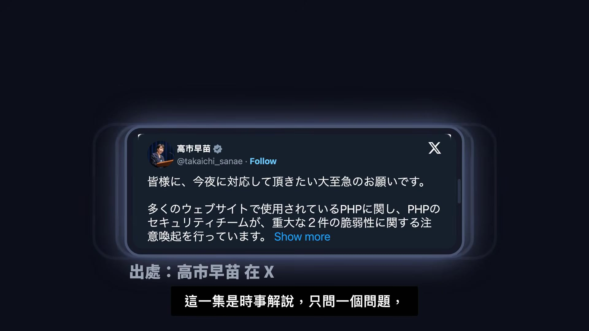

**逐字稿片段：** 為什麼一個城市語言的漏洞,能讓一國首相親自發文 10月21號晚上,臺灣時間8點55分

**話題推測：** 提出本集核心問題，預期顯示標題文字

---

## 00:00:18

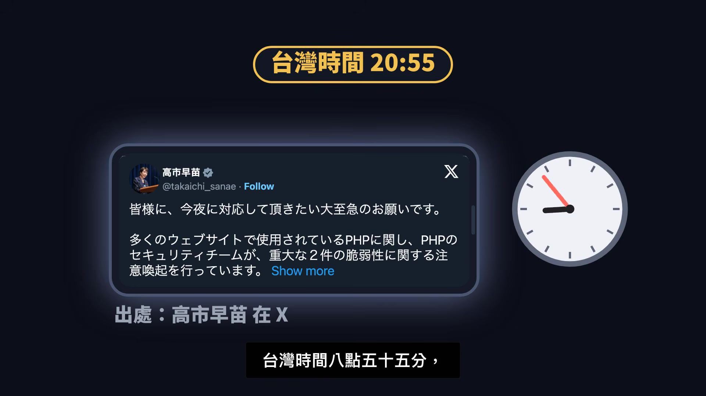

**逐字稿片段：** 日本首相高士藻苗在X上發了一則貼文 第一句是,各位,有件事非常緊急,要請大家今晚就處理 他要大家處理的不是颱風,也不是地震

**話題推測：** 提及日本首相在X上發文，預期顯示首相貼文的截圖或新聞畫面

---

## 00:00:28

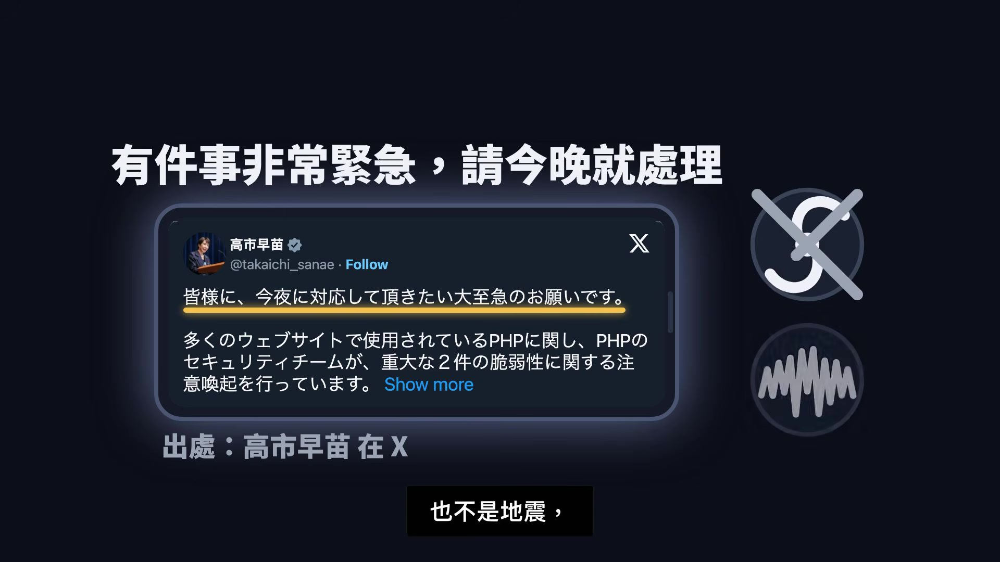

**逐字稿片段：** 是很多網站背後在用的一種城市語言,叫PHP 那天下午,日本一個讓人開網路商店的平臺 已經先把服務停了

**話題推測：** 首次介紹「PHP」這種程式語言，預期顯示PHP的Logo或解釋性圖示

---

## 00:00:35

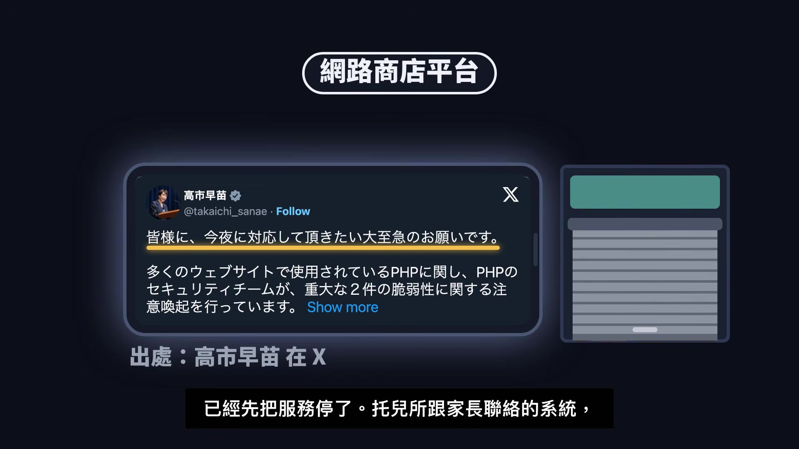

**逐字稿片段：** 託兒所跟家長聯絡的系統 也逐步停掉了服務 同一天

**話題推測：** 提及託兒所聯絡系統暫停服務的案例，預期顯示相關公司Logo或新聞報導

---

## 00:00:39

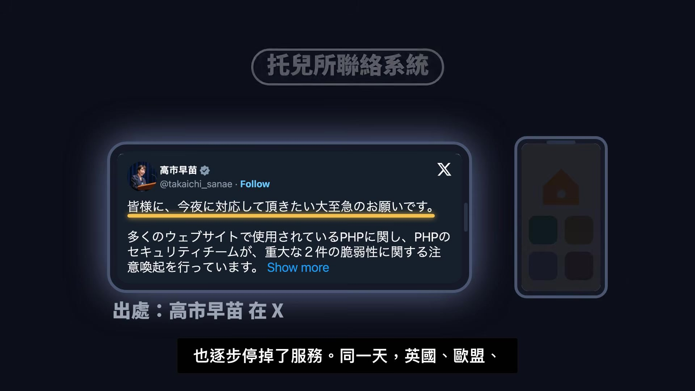

**逐字稿片段：** 英國、歐盟、德國的資訊安全機關 也發了警示 我們分三步來回答 先弄懂這是什麼漏洞 再看為什麼這麼急 最後看日本為什麼這麼大動作 再回到臺灣 先說清楚 這集只整理公開的官方資訊和防禦建議 不講任何攻擊的細節

**話題推測：** 提及英國、歐盟、德國等多國資安機關發出警示，預期顯示地圖標示或各國機構Logo

---

## 00:00:53

**逐字稿片段：** 先從名詞開始 你在手機上打開一個網站 按下登錄 這些動作是送到遠方一臺 一直開著的電腦上處理

**話題推測：** 開始解釋專業名詞，預期顯示新段落標題或名詞解釋畫面

---

## 00:01:01

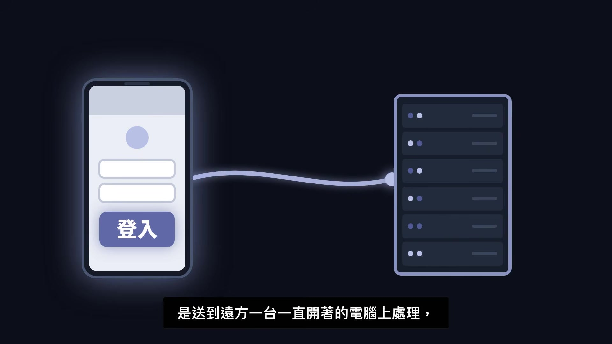

**逐字稿片段：** 這臺電腦叫伺服器 伺服器收到你的要求 要有一套程式決定回你什麼畫面 寫這套程式用的語言 叫程式語言 程式語言有很多種 其中一種叫PHP 專門用在網站上 你可能沒聽過PHP

**話題推測：** 解釋「伺服器」的定義，預期顯示伺服器的示意圖

---

## 00:01:14

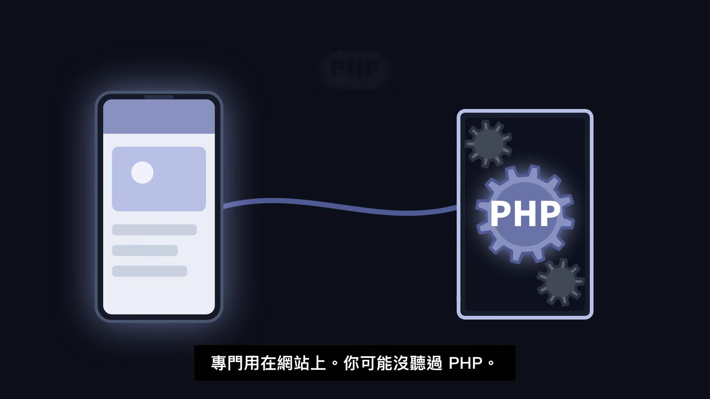

**逐字稿片段：** 可是有一套 架網站的軟體叫WordPress 很多部落格公司 官網 網路 商店都用它 它就是用PHP寫的 PHP在伺服器那一端 安安靜靜地做事 所以很少出現在新聞裡 這一次出問題的就是PHP本身 不是哪一個網站 也不是WordPress的哪一個外掛 問題出在大家共用的那一層 這也是這件事會變大的原因

**話題推測：** 提及WordPress這套架站軟體，預期顯示WordPress的Logo或應用場景

---

## 00:01:34

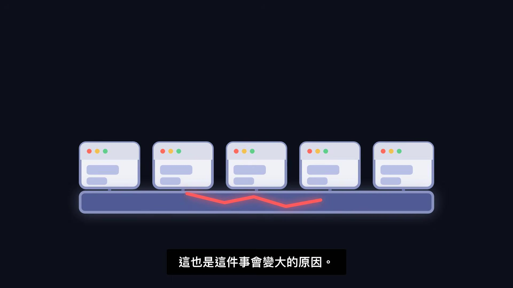

**逐字稿片段：** 那共用這一層的網站有多少 有一個專門調查網站 用了什麼技術的網站叫W3Tex 他的統計是 在他看得出伺服器用什麼語言的網站裡

**話題推測：** 提出問題並準備顯示PHP在網站上的使用比例，預期顯示統計數字或圖表

---

## 00:01:43

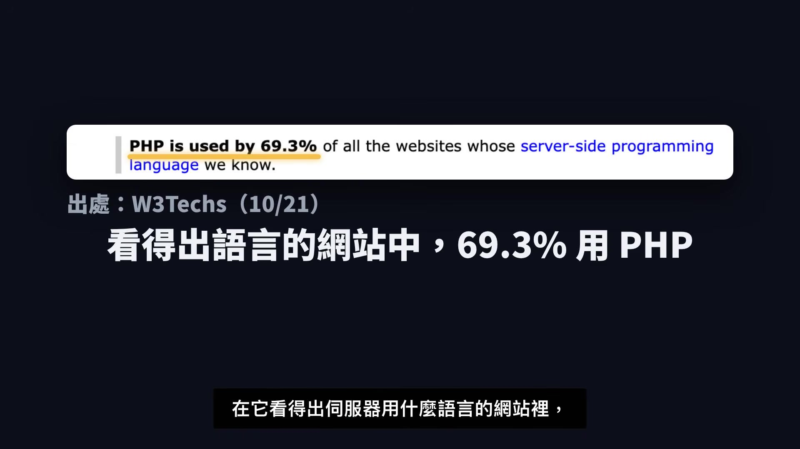

**逐字稿片段：** 大約七成用PHP 精確一點是69.3% 很多網站看不出用的是什麼語言 那些不算在內 所以不能說成全世界七成的網站 只能說在看得出來的網站裡 大約七成

**話題推測：** 顯示使用PHP的網站比例（約七成），預期顯示圓餅圖或大數字

---

## 00:01:55

**逐字稿片段：** 一條街上有很多家店 每一家的招牌和裝潢都不一樣 可是大部分的店 門上裝的是同一個牌子的鎖 PHP 就像那個大家都在用的鎖 平常沒有人會注意門鎖是哪個牌子 可是哪天這個牌子的鎖被發現有毛病 整條街的店都要一起緊張 這就是為什麼一個程式語言的問題 不會只是工程師自己的事

**話題推測：** 以「門鎖」比喻PHP漏洞的普遍性，預期顯示生動的插畫或示意圖

---

## 00:02:14

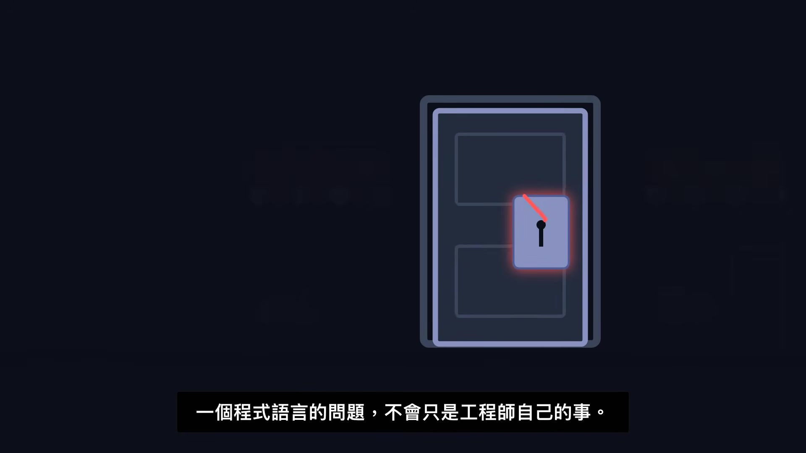

**逐字稿片段：** 那鎖到底出了什麼毛病 程式裡沒有做好 可以被別人拿來利用的地方 叫漏洞 這次PHP找到兩個漏洞 研究者替他們取了一個名字

**話題推測：** 提出問題並準備說明漏洞的具體內容，預期顯示新段落標題

---

## 00:02:23

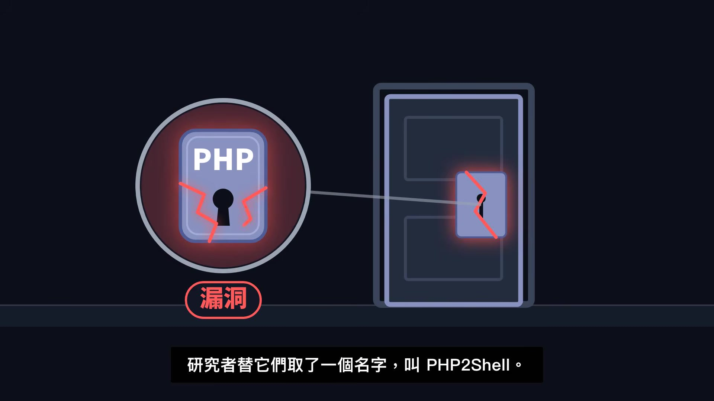

**逐字稿片段：** 叫PHP-2 Shell 兩個漏洞屬於同一種類型

**話題推測：** 顯示漏洞的名稱「PHP-2 Shell」，預期顯示專有名詞的文字

---

## 00:02:25

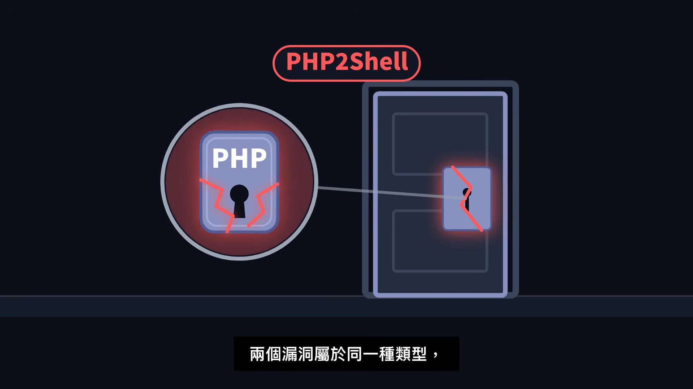

**逐字稿片段：** 這種類型叫遠端執行程式碼 英文是Remote Code Execution 意思是一個陌生人不用賬號不用密碼 從網路上就能讓你的伺服器照他的指令做事 官方公告寫的就是不需要登錄 就能遠端執行程式碼 用門鎖來說 這不是鎖有點松 而是陌生人不用鑰匙就能開門 進門之後還能使喚店裡的機器 伺服器上有什麼會員資料訂單 網站本身的內容 這些東西可能被看到被篡改 或是被弄到停擺 官方也說 所有處理網頁請求的PHP都有風險 兩個漏洞怎麼發生的 我們不講細節

**話題推測：** 解釋漏洞類型為「遠端執行程式碼」(Remote Code Execution)，預期顯示專有名詞解釋

---

## 00:02:58

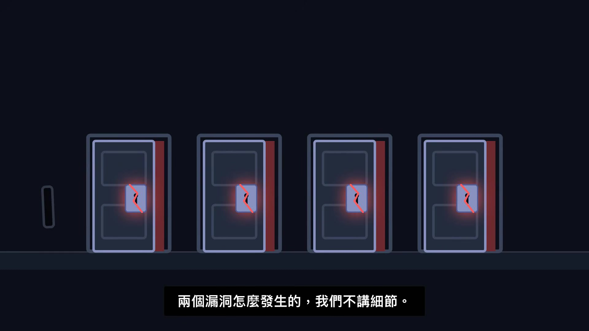

**逐字稿片段：** 那這兩個漏洞有多嚴重 資訊安全領域 有一把共用的兩尺

**話題推測：** 提出問題並準備說明漏洞的嚴重程度，預期顯示新段落標題

---

## 00:03:03

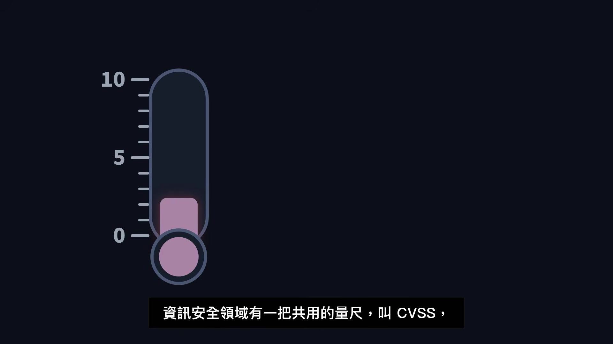

**逐字稿片段：** 叫CVSS 是漏洞嚴重程度的評分 從0分到10分 9分以上 屬於最高的一級 叫嚴重 這次的兩個漏洞啊 都是9.2分 消息剛傳出來的時候 有人說是滿分 10分 可是PHP官方 還有美國的國家漏洞資料庫 寫的都是9.2 為什麼不是10分 因為要攻擊成功 需要湊齊的條件比較難 毛病找到了 就要補 開發者寫好一段新的程式 把漏洞補起來 這個東西叫修補 英文是patch 用門鎖來說 修補就是換掉有毛病的鎖心 PHP官方這次出了四個修補過的版本

**話題推測：** 介紹漏洞嚴重程度的評分標準「CVSS」，預期顯示CVSS的Logo或定義

---

## 00:03:37

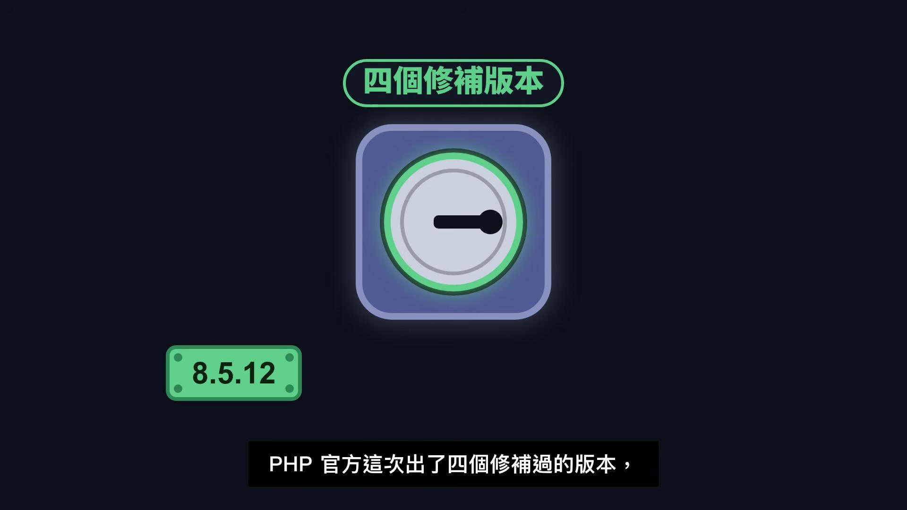

**逐字稿片段：** 版本號在畫面上 官方還說除了更新 沒有完整的替代辦法

**話題推測：** 提及PHP修補過的四個版本號，預期顯示版本號列表

---

## 00:03:42

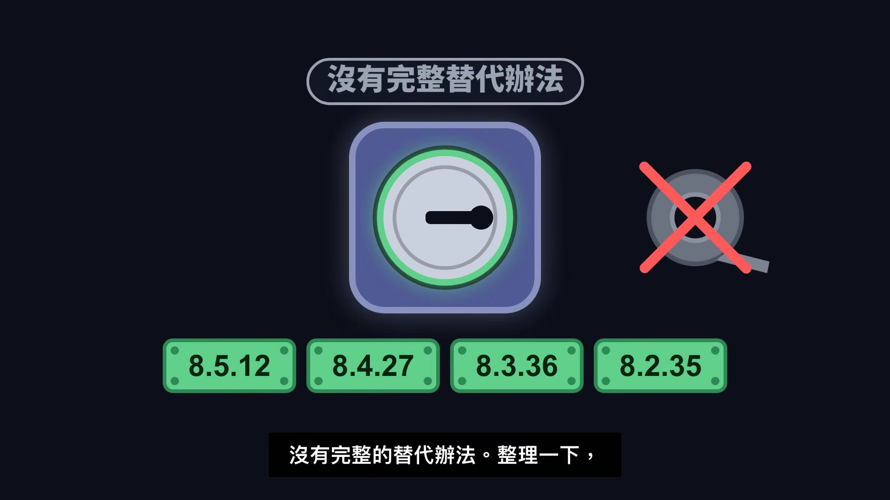

**逐字稿片段：** 整理一下 這一部分的答案是 PHP是很多網站背後共用的程式語言 就像整條街都裝了同一個牌子的鎖 這次的漏洞 讓陌生人不用鑰匙就能進門 嚴重程度9.2分 唯一可靠的解法 是換上修補過的版本

**話題推測：** 總結本段內容，預期顯示重點摘要的簡報畫面

---

## 00:03:57

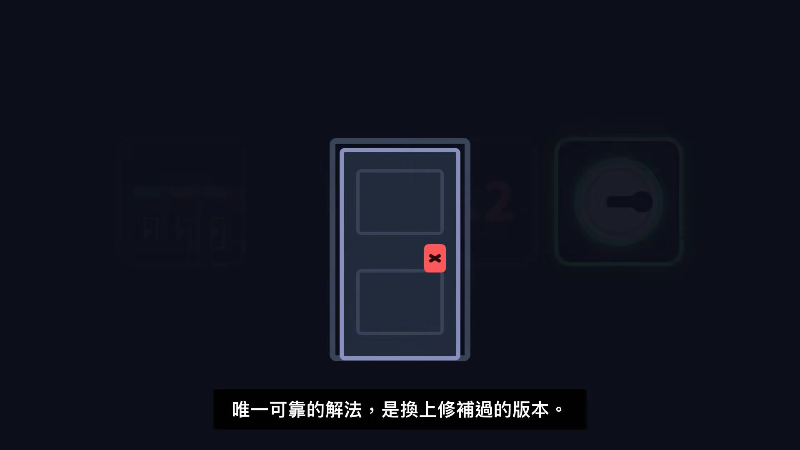

**逐字稿片段：** 那這個漏洞是誰找到的 官方致謝的有三方 一個資訊安全研究團隊

**話題推測：** 提出問題並準備說明漏洞的發現者，預期顯示新段落標題

---

## 00:04:02

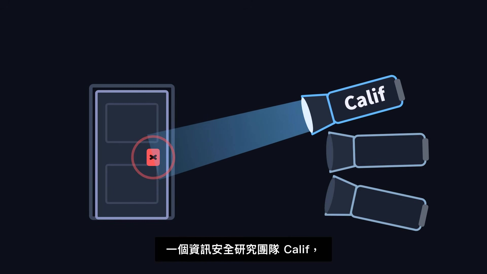

**逐字稿片段：** Calif一家資訊安全公司Wiz 還有OpenAI的資訊安全團隊 三方都說自己有用AI幫忙 可是幫了多少 講法不一樣 OpenAI的公告寫 Calif是用OpenAI的模型找到的 Wiz說是自己獨立找到的

**話題推測：** 提及資訊安全公司Calif和Wiz，預期顯示其Logo或名稱

---

## 00:04:16

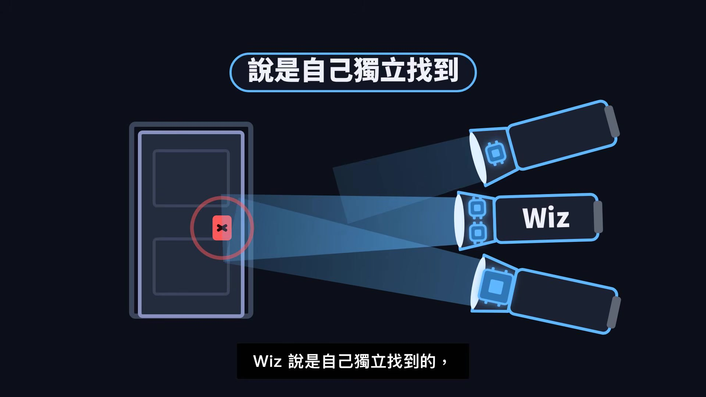

**逐字稿片段：** 用了Google的Gemini和OpenAI的模型 Calif自己的說法比較保守 他說關鍵是研究者很熟這個專案 過去的漏洞還寫了一句 沒有哪個模型 簡單下幾句指令 就能挖出所有的漏洞 比較準確的說法是 三個團隊各自找到都有用 AI幫忙

**話題推測：** 提及Google的Gemini模型，預期顯示Google Gemini的Logo

---

## 00:04:32

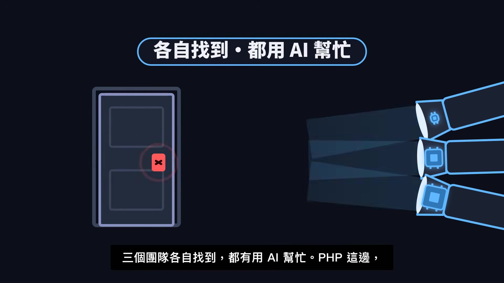

**逐字稿片段：** PHP這邊有一個支持他開發的組織 叫PHP基金會 基金會說 今年8月 Calif和OpenAI在同一天 各自回報了同一個問題的根源 基金會也承認 其中一個漏洞的根本問題 他們在2024年就看到了 修補卻一直卡住 基金會的原話是這樣的 延誤是結構上的失敗 他還說 AI幫忙整理大量的回報 但每一個判斷 每一個修補都是人做的 找到漏洞之後 通常不會馬上公開 這種做法有個名字

**話題推測：** 介紹支持PHP開發的組織「PHP基金會」，預期顯示其Logo或名稱

---

## 00:04:58

**逐字稿片段：** 叫保密期 意思是找到漏洞的人 先私下通報 開發者和各家廠商約好一天 一起公開修補 在那之前誰都不說 這次約好的日子是10月22號 可是10月20號 事情開始走樣 兩個漏洞的編號 先在網絡論壇和社群上流傳 還附上錯的時間和錯的時分 PHP基金會特別強調 那時候流出去的只有編號 沒有任何技術細節 同一天稍晚 PHP官方發了預告 把公開的時間提前一天 排在10月21號 臺灣時間晚上10點 官方在預告裡寫了一句 如果漏洞的細節被公開 或是出現真正的攻擊 他們保留提早發佈的權利 換成門鎖來說 鎖匠原本跟各家店約好 隔天一起換鎖 現在消息先傳出去了 鎖匠只好提早出門 為什麼要搶這一天 修補一公開 等於告訴所有人 這個牌子的鎖哪裡有毛病 已經換好鎖的店 安全了 還沒換的店 反而變成最容易被找上的那一家 從公開到每一家都換好鎖 中間總會有一段空檔 保密期要保護的 就是這段空檔 讓大家儘量在同一時間拿到新鎖

**話題推測：** 介紹漏洞公開前的「保密期」概念，預期顯示專有名詞解釋

---

## 00:05:59

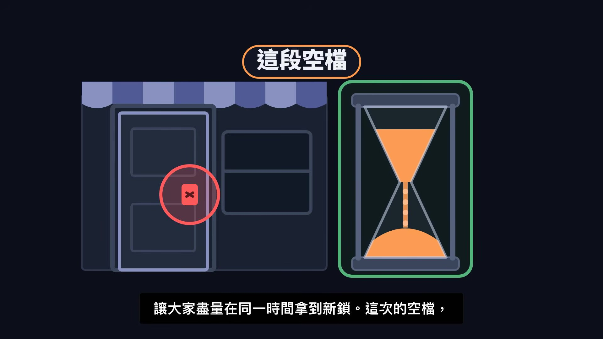

**逐字稿片段：** 這次的空檔又被壓縮了兩次 PHP基金會說

**話題推測：** 提及保密期被壓縮兩次，預期顯示時間軸或流程圖的變動

---

## 00:06:03

**逐字稿片段：** 研究團隊Calif不小心發出一段示範影片 展示攻擊可以成功 影片很快就刪掉了 但已經流傳出去 基金會說 這加速了別人做出攻擊程式 接著在10月21號

**話題推測：** 提及研究團隊不小心發出示範影片，預期顯示相關新聞或事件說明圖

---

## 00:06:14

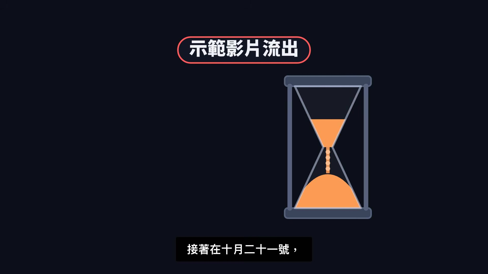

**逐字稿片段：** 一家替別人打包軟體的公司叫Chenguad 比約定的時間早了好幾個小時 自己先發布了含修補的版本 基金會說 它是單方面打破了保密器 最後PHP官方實際放出修補的時間 又比預定的再早了大約半小時 修補出來之後 技術細節很快也公開了 那有沒有人已經在攻擊 這一題說法不一 一邊是業者 據報道

**話題推測：** 提及公司Chenguad比預定時間早發布修補版本，預期顯示公司Logo或事件說明

---

## 00:06:35

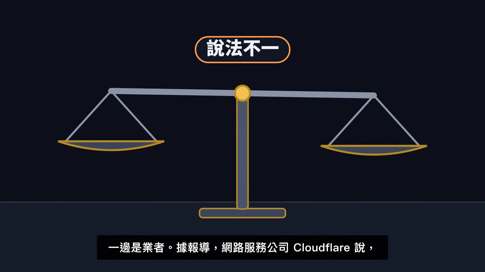

**逐字稿片段：** 網絡服務公司Cloudflare 說看到了早期的攻擊

**話題推測：** 提及網路服務公司Cloudflare的回報，預期顯示其Logo或名稱

---

## 00:06:38

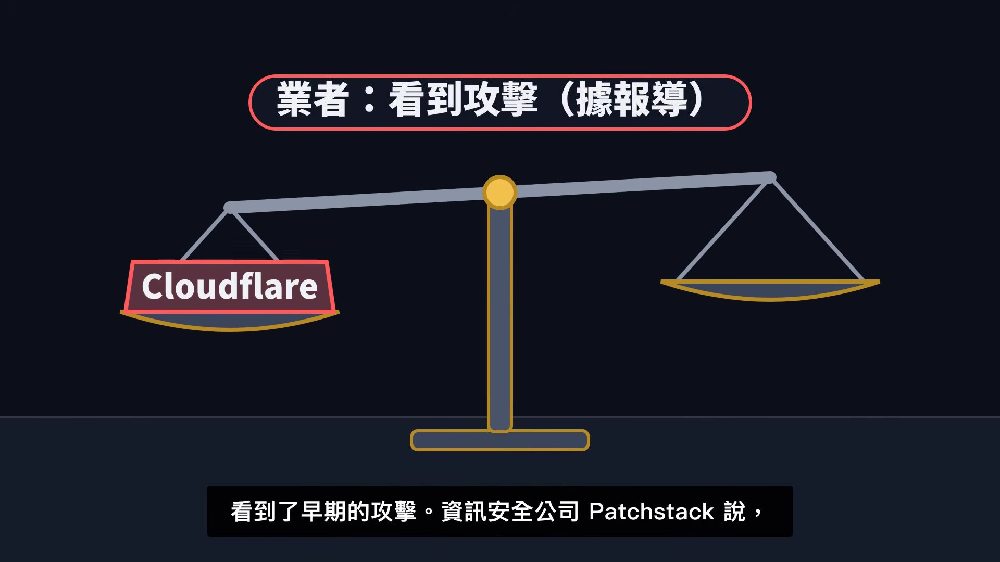

**逐字稿片段：** 資訊安全公司Patchstack說 合作的主機商回報了攻擊 另一邊是官方 德國的聯邦資訊安全局 英文縮寫BSI 說目前沒有已確認的利用

**話題推測：** 提及資訊安全公司Patchstack的回報，預期顯示其Logo或名稱

---

## 00:06:49

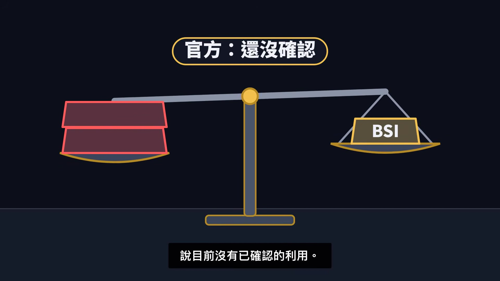

**逐字稿片段：** 美國的網絡安全暨基礎設施安全局 英文縮寫CISA 有一份已知遭到利用的漏洞清單 到我們查證的時候 還沒有收錄這兩個漏洞 PHP基金會說 公開的當下 沒有收到可用的攻擊程式的回報

**話題推測：** 提及美國網絡安全暨基礎設施安全局(CISA)，預期顯示其Logo或名稱

---

## 00:07:02

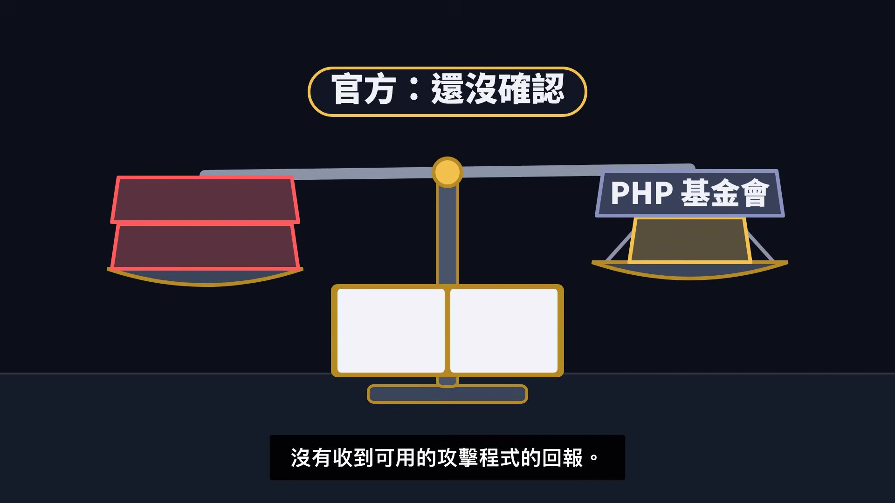

**逐字稿片段：** 歐盟的資訊安全團隊 SATE EU的提醒 攻擊示範已經開始流傳 被利用的可能性提高了 所以準確的說法是 到我們查證的時候 沒有任何一方給出攻擊的數量 有人說看到了 官方還沒確認

**話題推測：** 提及歐盟資訊安全團隊SATE EU的提醒，預期顯示其Logo或名稱

---

## 00:07:15

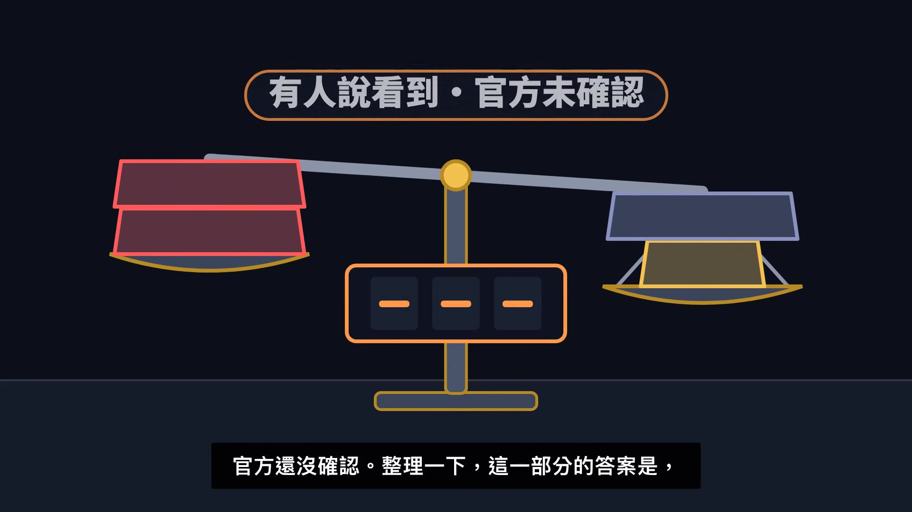

**逐字稿片段：** 整理一下 這一部分的答案是 為什麼這麼急 因為這款鎖裝在大約七成看得出語言的網站上 陌生人不用鑰匙就能進門 而修補一公開 就等於公告了哪個牌子的鎖有毛病 這次保密器又被提早打破 大家準備的時間比原本少了一天

**話題推測：** 總結本段「為什麼這麼急」的內容，預期顯示重點摘要的簡報畫面

---

## 00:07:31

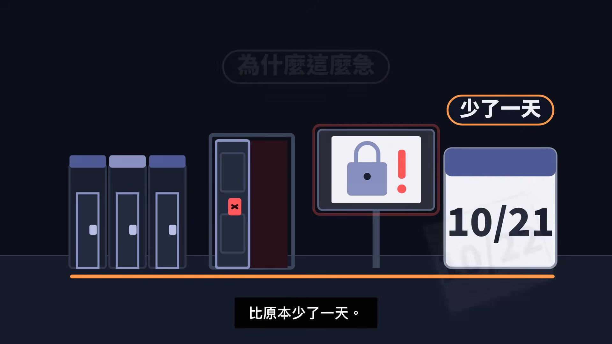

**逐字稿片段：** 回到日本 首相的貼文到底說了什麼 他先說 有件事非常緊急 要請大家今晚就處理 接著說 很多網站都在用PHP PHP的資訊安全團隊發出警告 有兩個嚴重的漏洞 然後是請求 請確認你公開的網站有沒有用PHP修補 預定在日本時間今晚11點公開 請準備好一出來就儘快套用 如果沒辦法馬上套用 像是先把網站暫時停下來 也是降低風險的有效方法之一 他也請大家去看一個賬號

**話題推測：** 進入探討日本反應的環節，預期顯示新段落標題或日本相關圖示

---

## 00:07:58

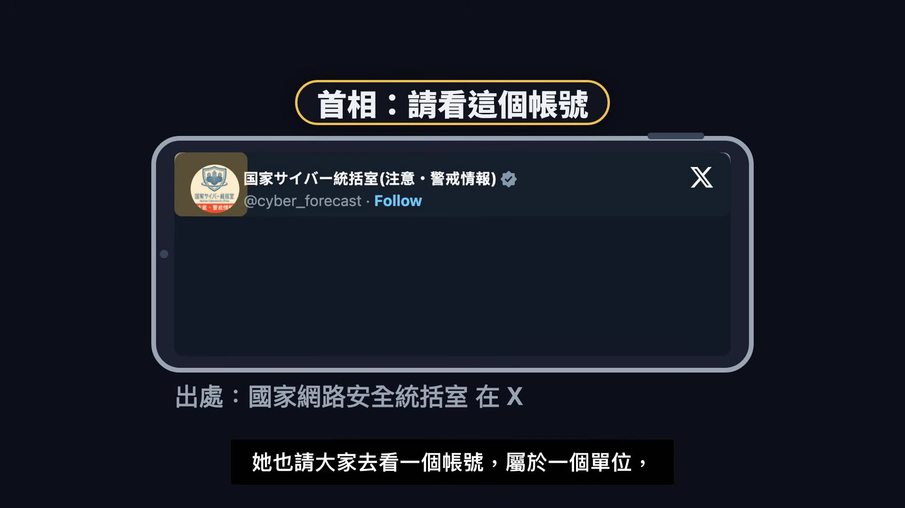

**逐字稿片段：** 屬於一個單位 叫國家網絡安全統擴室 是日本內閣底下負責網絡安全的單位 統擴室 在日本時間下午1點左右 就在官方X賬號發了警示 晚上又發了一則 說來不及修補的話 暫時停掉網站是有效的方法 把首相的貼文跟這兩則放在一起看 句子幾乎一字不差 首相做的是把兩則合起來 前面加上一句非常緊急的請求 捅闊式的警示只發在X上 到我們查證的時候 他的官網還沒有這則公告 日本媒體形容 這是很少見的呼籲 首相說暫時停掉網站也是一個辦法 有些公司在他發文之前 就已經這麼做了

**話題推測：** 提及日本「國家網絡安全統擴室」這個單位，預期顯示其Logo或名稱

---

## 00:08:34

**逐字稿片段：** 有一個平臺叫BASE 讓人自己開網絡商店 他在下午就提前開始緊急維護 預定停到隔天早上 商店頁面和下單全部暫停

**話題推測：** 提及網路商店平台BASE提前維護，預期顯示BASE的Logo或新聞截圖

---

## 00:08:43

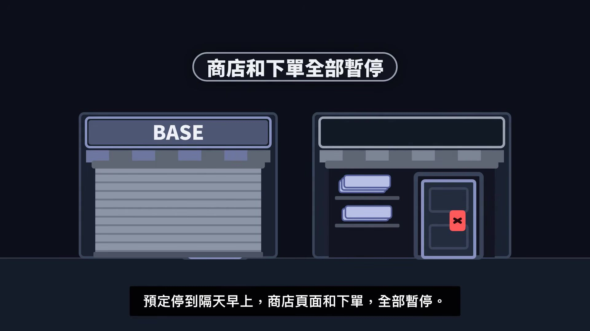

**逐字稿片段：** 另一家公司叫Codymon 做的是日本很多託兒所和幼兒園 用來跟家長聯絡的系統 他從下午2點多開始逐步停掉全部服務 連家長用的APP也停了 兩家都說這是預防性的措施 目前沒有確認到資料外洩 BASE的公告寫明的是PHP的漏洞 Codymon的公告只寫他用的軟體出了重大漏洞 沒有寫PHP這幾個字 是媒體把他跟這次的PHP漏洞連在一起 停掉網站 就像店家晚上先拉下鐵門 拉下鐵門 一晚的生意就沒了 可是鎖還沒換好就開門營業 萬一有人進來 賠上的可能是所有客人的資料 這是每一家公司要自己算的取捨 首相和同夥室說的是一個選項

**話題推測：** 提及Codymon公司暫停服務，預期顯示Codymon的Logo或新聞截圖

---

## 00:09:22

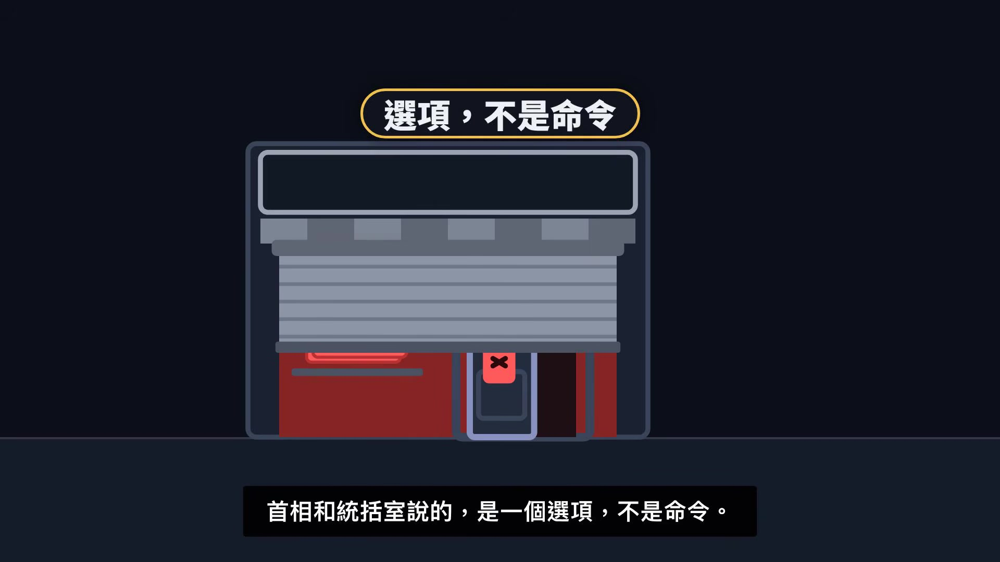

**逐字稿片段：** 不是命令 那其他國家怎麼做 同一天 好幾個國家的資訊安全機關也發了警示 可是說話的方式不一樣

**話題推測：** 進入探討其他國家反應的環節，預期顯示新段落標題或世界地圖

---

## 00:09:28

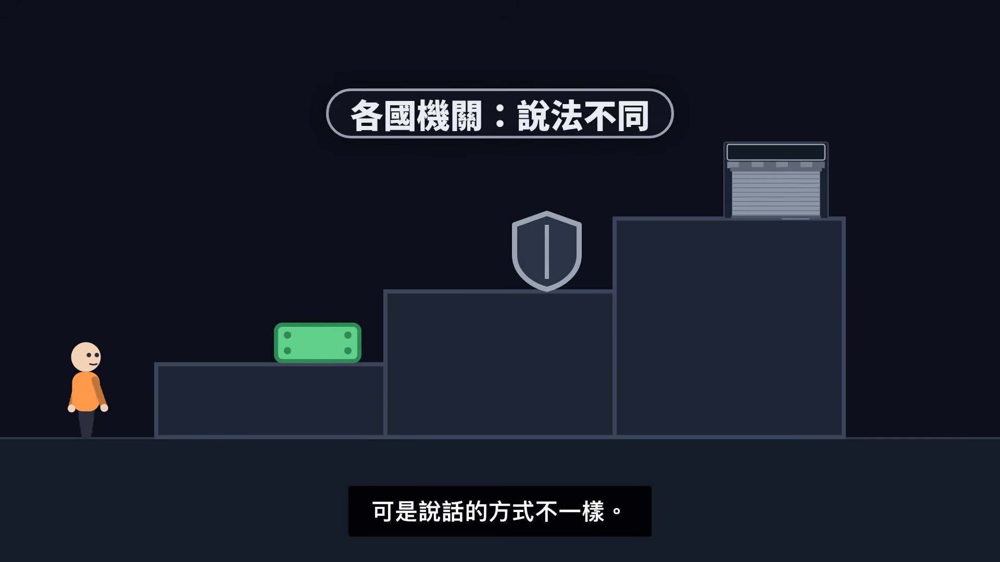

**逐字稿片段：** 英國的國家網絡安全中心 英文縮寫NCSE 要大家先更新 做不到的話 先用暫時降低風險的辦法 如果連這一步都做不到 或是要花太久 才應該考慮把系統下線

**話題推測：** 提及英國國家網絡安全中心(NCSC)的建議，預期顯示NCSC的Logo或說明

---

## 00:09:39

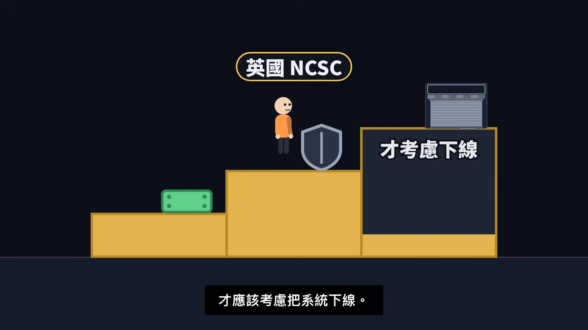

**逐字稿片段：** 歐盟的資訊安全團隊 State EU也類似 先修補 的網站跟公開的網絡隔開

**話題推測：** 提及歐盟資訊安全團隊SATE EU的建議，預期顯示SATE EU的Logo或說明

---

## 00:09:46

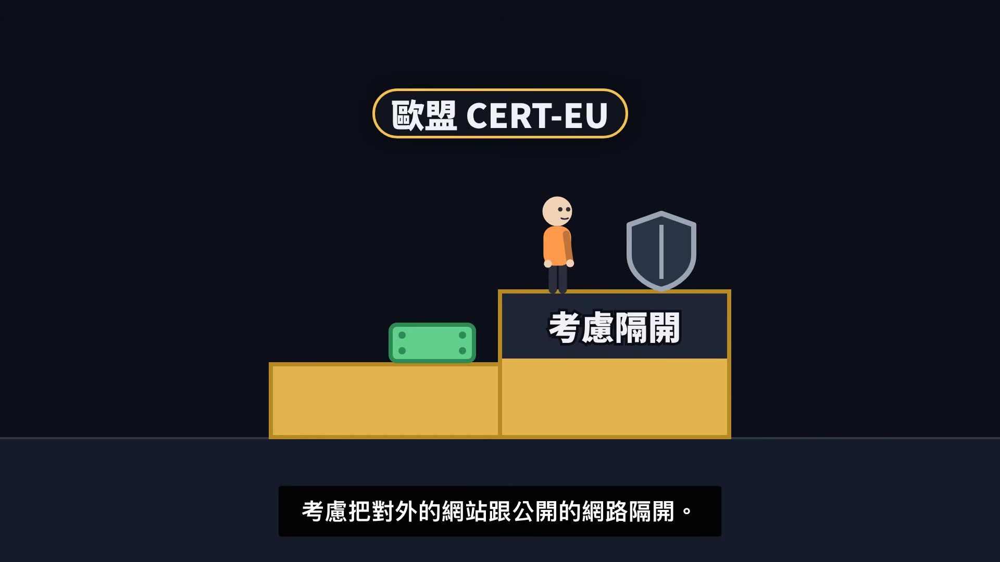

**逐字稿片段：** 德國的BSI 我們看到的版本只寫了修補 應該立刻安裝

**話題推測：** 提及德國聯邦資訊安全局(BSI)的建議，預期顯示BSI的Logo或說明

---

## 00:09:51

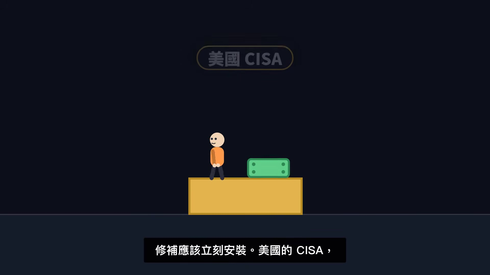

**逐字稿片段：** 美國的CISA 我們沒有找到針對這次的專門警示 所以不能說歐美各國都要求網站下線 他們說的下線都是有條件的考慮

**話題推測：** 提及美國網絡安全暨基礎設施安全局(CISA)未發布專門警示，預期顯示CISA的Logo或說明

---

## 00:10:00

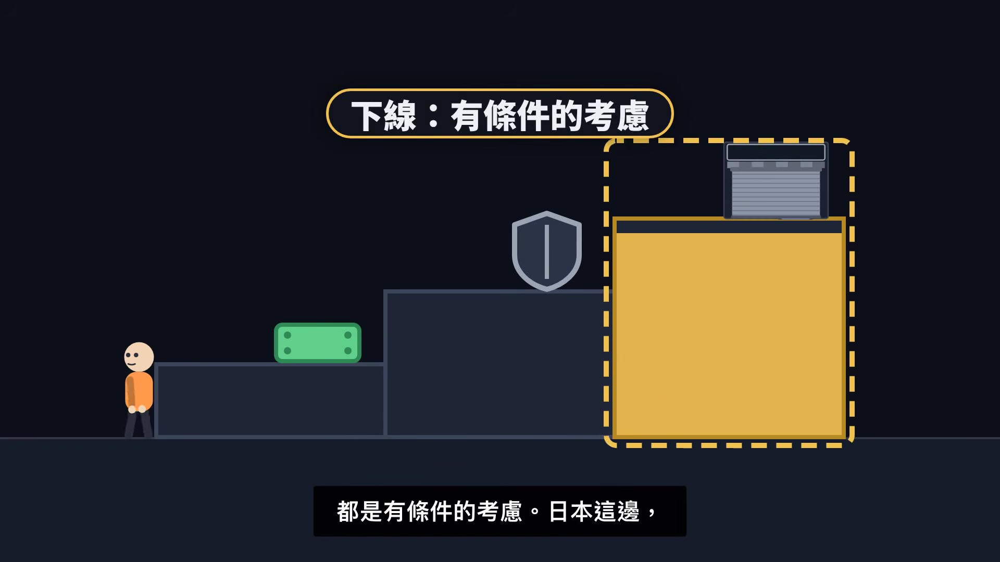

**逐字稿片段：** 日本這邊還有一個公家機構叫IPA 他發了一頁公告 標題是事前準備的請求 IPA寫明 他還沒確認有人用這個漏洞攻擊 他也提醒還有網站在用 已經停止資源的舊版PHP 在歐洲出來說話的是資訊安全機關 在日本除了資訊安全機關 首相自己也出來說了一次

**話題推測：** 提及日本公家機構IPA的公告，預期顯示IPA的Logo或公告截圖

---

## 00:10:19

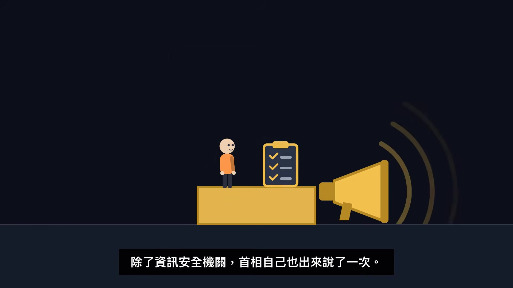

**逐字稿片段：** 為什麼日本會走到首相親自開口這一步 官方沒有給理由 我們只能看有官方文件的背景

**話題推測：** 提出問題並準備說明日本首相親自發文的原因，預期顯示新段落標題

---

## 00:10:25

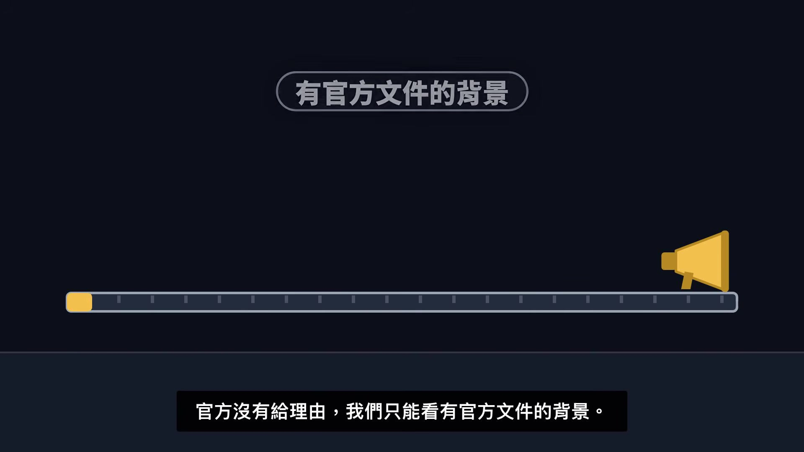

**逐字稿片段：** 2025年5月 日本國會通過一部法律 讓政府在某些條件下 可以主動處理網絡攻擊 這種做法叫主動網絡防禦

**話題推測：** 提及日本國會通過一部法律，預期顯示法律條文或時間軸

---

## 00:10:33

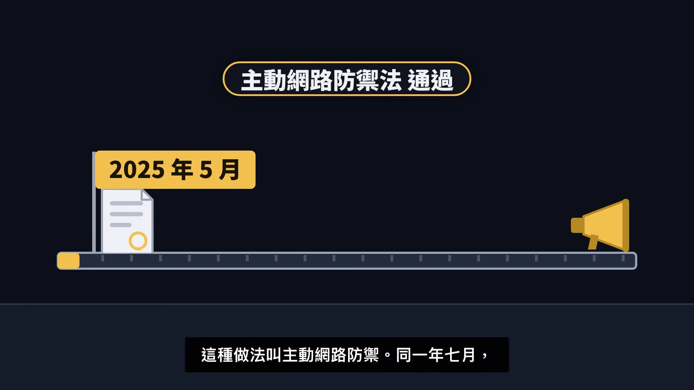

**逐字稿片段：** 同一年7月 原本的內閣網絡安全中心改組 成立了剛剛那個國家網絡安全統擴市 今年10月1號 這部法律裡官民合作 還有讓攻擊用的伺服器失效的部分規定 剛開始上路 離這次事件只有三個星期

**話題推測：** 提及內閣網絡安全中心改組，預期顯示組織架構圖的變動或時間軸

---

## 00:10:47

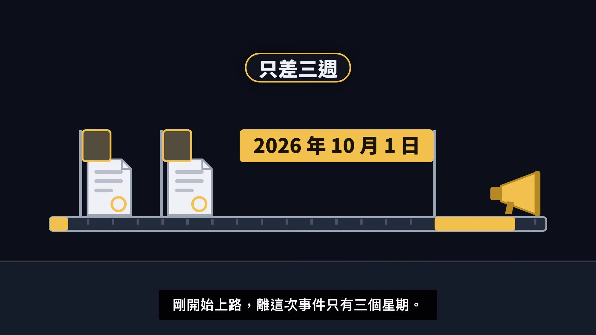

**逐字稿片段：** 今年7月底 高市首相在一場網絡安全的會議上說 越來越快的網絡攻擊 不會等我們準備好

**話題推測：** 提及高市首相在網絡安全會議上發言，預期顯示會議畫面或首相照片

---

## 00:10:54

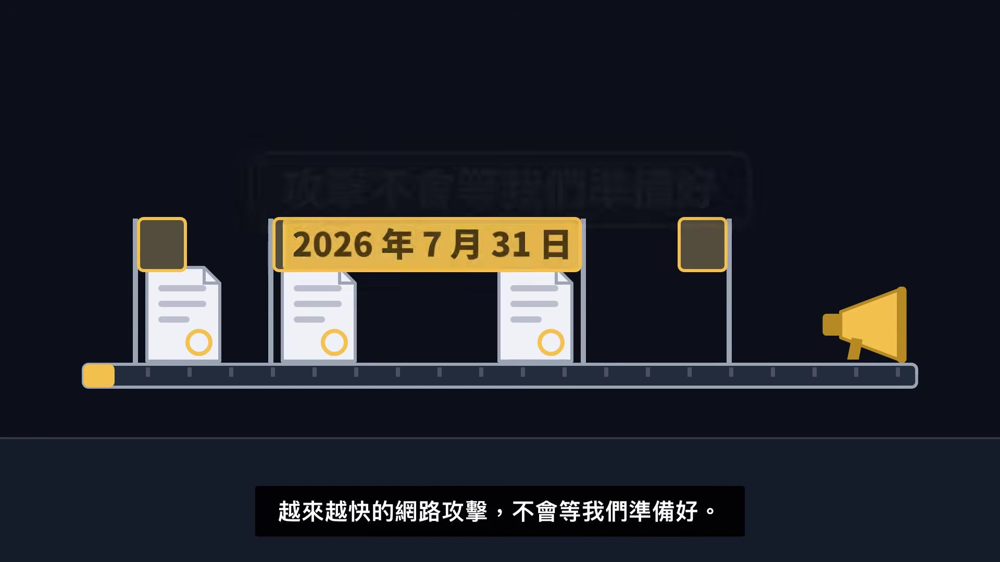

**逐字稿片段：** 10月上旬 日本也剛經歷一波個人資料外洩的事件 這些都是背景 不是官方說的原因 沒有任何官方說法 說首相是因為這些才發文 整理一下 這一部分的答案是 首相會親自發文 是幾件事疊在一起 這款鎖裝在大約七成 看得出語言的網站上 修補公開的時間 是全世界都知道的倒數 而日本剛把網路安全的單位和法律整頓過 統括式說過的話 有首相再說一次

**話題推測：** 提及日本剛經歷一波個人資料外洩事件，預期顯示相關新聞畫面或數據外洩圖示

---

## 00:11:20

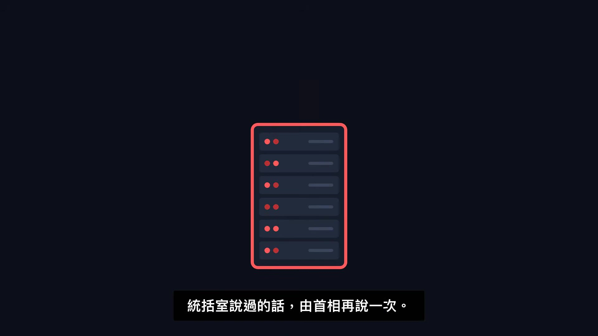

**逐字稿片段：** 那這件事對你代表什麼 先看有自己網站的人 如果你管理的伺服器上有PHP 官方的建議只有一個 儘快更新到修補過的版本

**話題推測：** 進入對觀眾的影響與建議環節，預期顯示新段落標題或「行動指南」圖示

---

## 00:11:28

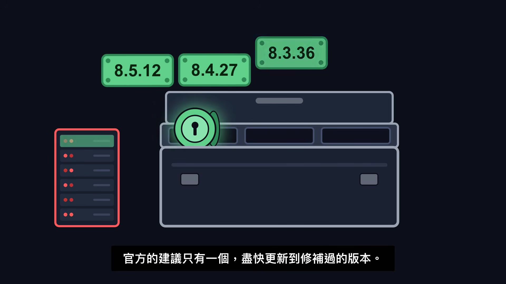

**逐字稿片段：** 四個版本號在畫面上 也會放在說明欄 如果你的網站放在主機商那裡 PHP是主機商在管 那就去問主機商 修補裝好了沒有 如果你還在用很舊的PHP 事情比較麻煩 官方說 比較舊的版本已經不再出更新 要自己想辦法升級 或是跟提供軟體的廠商拿修補 W3Tex的資料裡

**話題推測：** 再次顯示PHP修補過的四個版本號，預期顯示版本號列表

---

## 00:11:48

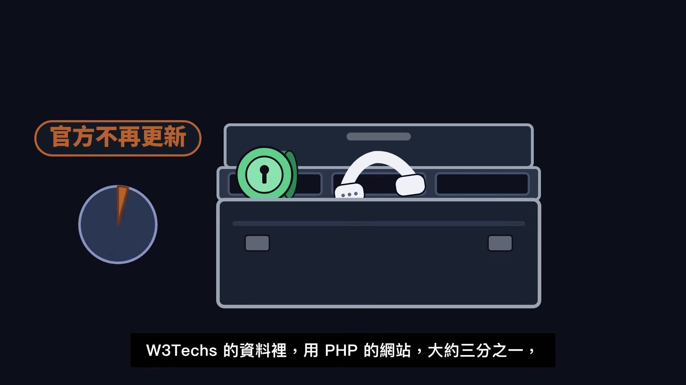

**逐字稿片段：** 用PHP的網站大約三分之一 還在用官方已經不再更新的第七版和第五版 來不及更新 又做不到暫時降低風險 就照歐洲機關說的 考慮先把網站停下來 也就是先拉下鐵門 官方也說 除了更新 其他暫時的做法都只能降低風險 不等於補好 換句話說 鐵門只能擋一晚 真正要做的還是換鎖 那如果你只是用網站的人呢 照官方建議的層級 一般使用者通常不用安裝任何東西 因為這是網站伺服器那一端的問題 你能做的是留意常用的網站 有沒有發維護公告

**話題推測：** 顯示約三分之一PHP網站仍使用舊版本統計，預期顯示數據圖表

---

## 00:12:20

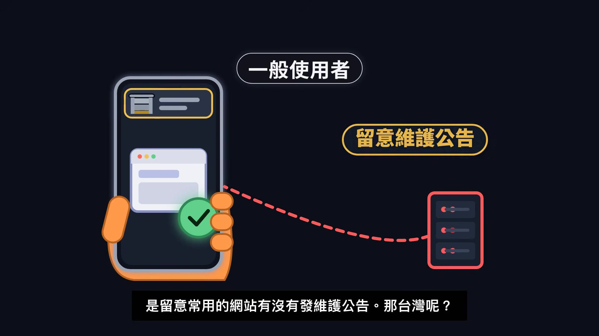

**逐字稿片段：** 那臺灣呢 截至10月21號晚上 我們看了臺灣三個機關的公告頁

**話題推測：** 進入探討台灣反應的環節，預期顯示新段落標題或台灣地圖

---

## 00:12:25

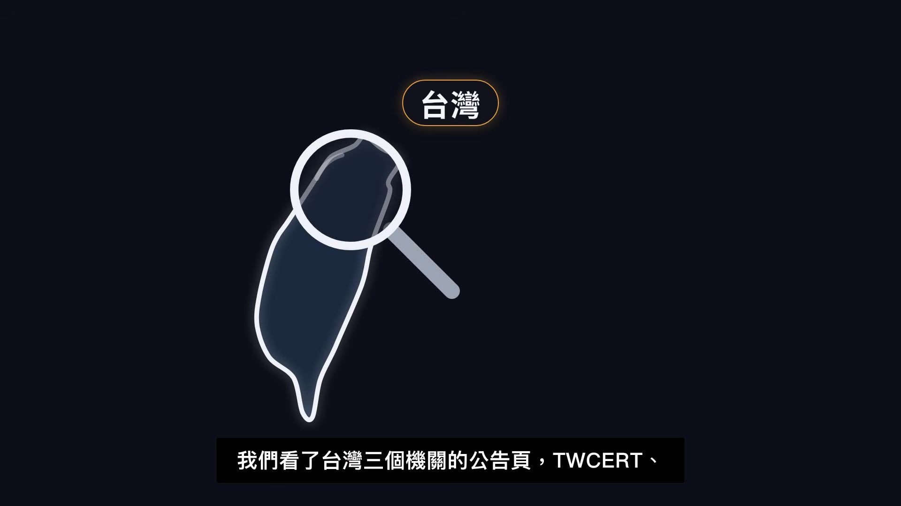

**逐字稿片段：** TWCERT 數位發展部 自通安全署

**話題推測：** 提及TWCERT的公告頁面，預期顯示其Logo或名稱

---

## 00:12:28

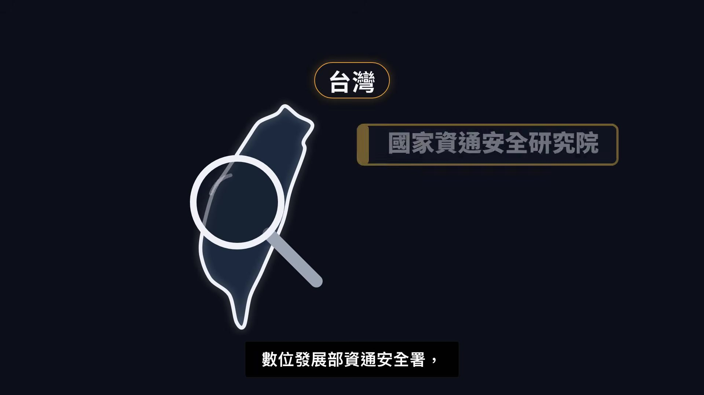

**逐字稿片段：** 還有國家自通安全研究院 都查不到針對這次PHP的警訊 臺灣媒體有報道漏洞本身 也報道了歐洲和日本首相的反應 可是查不到臺灣網站因此停機的消息 這不代表臺灣沒有受影響的網站 只代表到我們查證的時候 還沒有公開的資訊 之後官方可能還會發 看到了要以官方的公告為準 臺灣有網站的人該做的事 就是剛剛工具箱裡的那三樣

**話題推測：** 提及國家資通安全研究院的公告頁面，預期顯示其Logo或名稱

---

## 00:12:49

**逐字稿片段：** 最後回到這次的另一條線AI

**話題推測：** 進入探討AI在此事件中角色的環節，預期顯示新段落標題或AI相關圖示

---

## 00:12:51

**逐字稿片段：** 英國的NCSC在2025年 發過一份報告 裡面寫漏洞從公開到被拿去攻擊 中間的時間已經縮到只剩幾天 而AI幾乎肯定會讓它更短 防守的一方也在用AI

**話題推測：** 提及英國NCSC在2025年的報告，預期顯示報告封面或時間軸

---

## 00:13:04

**逐字稿片段：** 美國國防高等研究計劃署 英文說寫DARPA 辦過一場AI網絡安全挑戰賽 在決賽裡 AI系統找到比賽裡 埋好的大部分漏洞 還自己補好了 其中多數 另外又找到一些 真實世界的漏洞 OpenAI這次的公告也說 他們所知 這次是AI比攻擊者先找到 可是同一份公告也寫 同樣的能力 也可能幫攻擊者 很快做出攻擊工具

**話題推測：** 提及美國國防高等研究計劃署(DARPA)的挑戰賽，預期顯示DARPA的Logo

---

## 00:13:25

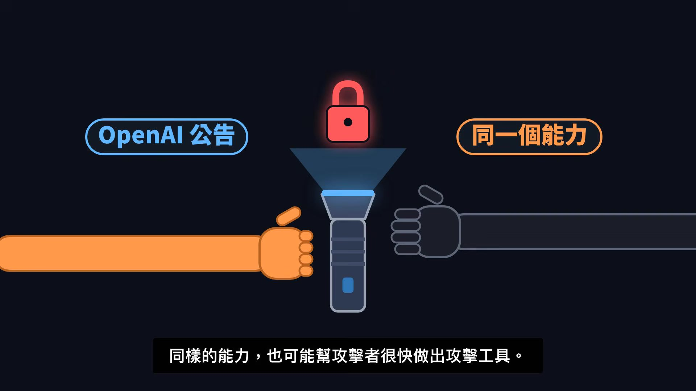

**逐字稿片段：** 最後這一部分的答案是 對一般使用者 通常不用做什麼 而網站的人 就是更新 來不及就先拉下鐵門 而AI讓找到鎖的毛病 變快了 換鎖的速度也得跟上

**話題推測：** 總結本段「AI角色」的內容，預期顯示重點摘要的簡報畫面

---

## 00:13:35

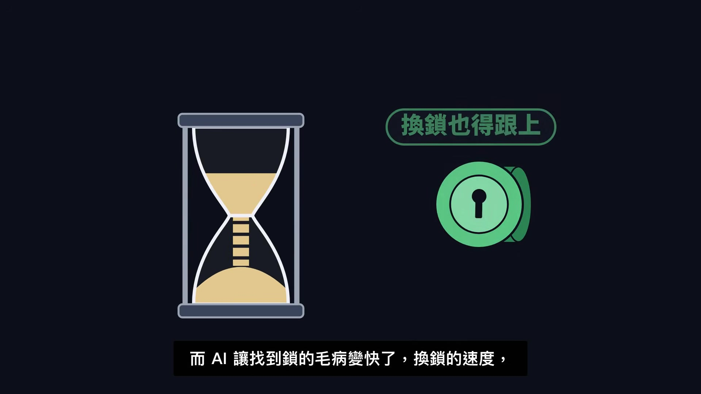

**逐字稿片段：** 我們回到開場那個問題 為什麼一個城市語言的漏洞 能讓一國首相親自發文 因為這款鎖 裝在大約七層 看得出語言的網站上 因為修補一公開 就是一場全世界一起看的倒數 也因為日本剛把網路安全的單位 和法律整頓過 統括式說過的話 有首相再說了一次 說法不一的地方 我們都照實說了 判斷留給你

**話題推測：** 回顧影片開頭提出核心問題，預期顯示核心問題的標題畫面

---

## 00:13:56

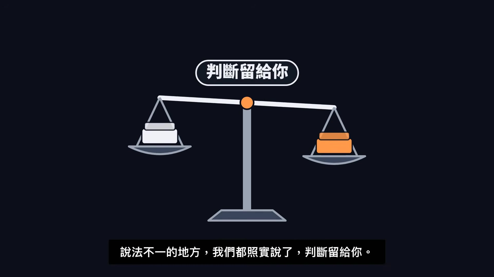

**逐字稿片段：** 最後問你一個問題 AI找漏洞的速度越來越快 你覺得它會先幫到守門的人 還是先幫到想闖進來的人 留言告訴我 喜歡的話訂閱AI Notebook 開啟通知 我們下次見

**話題推測：** 向觀眾提出互動問題，預期顯示問答或投票界面

---
