# jimainotebook_wlVt2vpz9Dg — 關鍵畫面索引

- 來源逐字稿：[jimainotebook_wlVt2vpz9Dg_FIN.srt](jimainotebook_wlVt2vpz9Dg_FIN.srt)
- 影片：https://www.youtube.com/watch?v=wlVt2vpz9Dg
- 截圖數：46

## 00:00:10

**逐字稿片段：** 這一集我們要回答一個問題,科學怎麼知道自己是對的? 一個實驗做出結果,寫成論文,經過審查,登上期刊,我們就相信它。

**話題推測：** 提出本集核心問題：科學如何知道自己是對的？

---

## 00:00:19

**逐字稿片段：** 可是2015年,200多位研究者把100篇已經發表的心理學研究重做一次。 原本幾乎每一篇都找到了效果,重做之後,還找得到的只剩三分之一多。 這是怎麼回事?

**話題推測：** 提出心理學研究重做結果不佳的具體案例與數字（2015年，200多位研究者，100篇研究）。

---

## 00:00:30

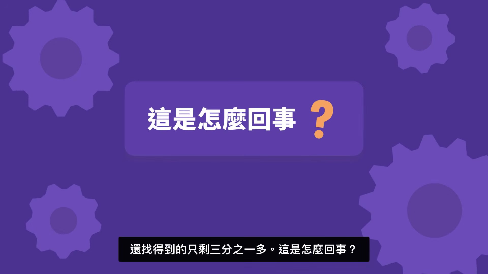

**逐字稿片段：** 要回答這個問題,我們從將近300年前一位哲學家問的問題開始, 沿著歷史一路走到今天 最後回到AI 當AI也開始提出假說 做實驗 我們又要怎麼知道它是對的 先從一個很簡單的問題開始 你怎麼知道明天太陽會升起 你會說 因為它每天都升起

**話題推測：** 轉向歷史背景，追溯科學哲學的發展起點。

---

## 00:00:47

**逐字稿片段：** 1748年 蘇格蘭哲學家休摩 在《人類理解研究》這本書裡 認真問了這個問題 他說 太陽明天不會升起 這句話跟太陽明天會升起 一樣好懂 也不自相矛盾 所以我們沒辦法用邏輯證明 太陽會升起 我們相信它靠的是過去的經驗

**話題推測：** 介紹蘇格蘭哲學家休摩及其著作《人類理解研究》與年份。

---

## 00:01:05

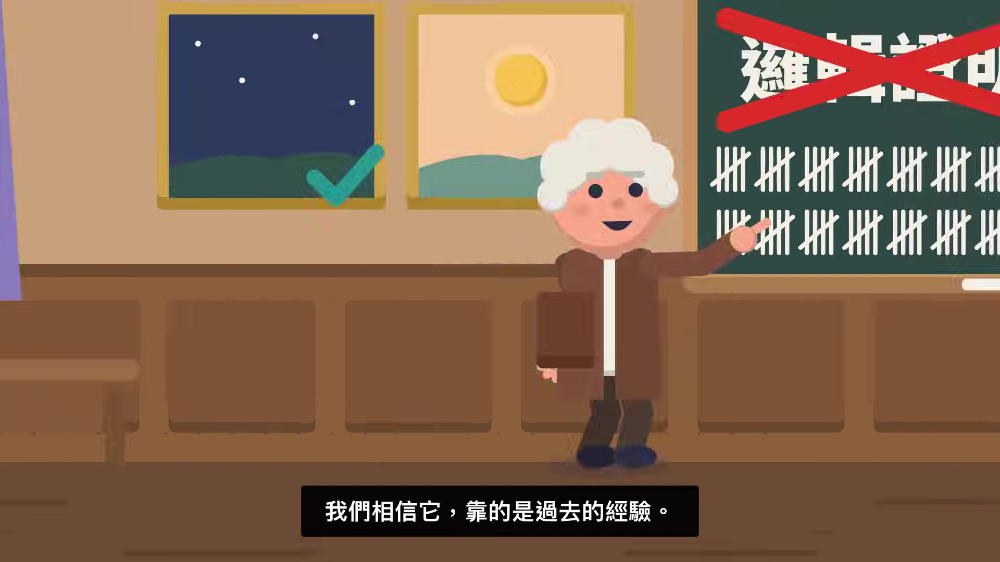

**逐字稿片段：** 修摩用撞球來說明 一顆球滾過去撞到另一顆 我們預期被撞的那顆會動 可是如果一個人完全沒有經驗呢 牛津大學的哲學家Milliken 在課堂上用修摩書裡的亞當來講 亞當剛被創造出來 第一次看到撞球 看了100次之後 亞當當然會猜 被撞的那顆會動 這種從看過的例子 推到還沒看過的情況 叫歸納 我們每天都在用歸納 昨天的咖啡讓你清醒 今天你也這樣預期 科學也靠它 做了很多次實驗都一樣 我們就說這是一條定律 修摩問的是 歸納有什麼理由 它背後藏著一個假設 未來會像過去 能不能證明這個假設 邏輯證明不了 因為想象未來不一樣 並不矛盾 用經驗證明呢 說過去的未來 一直都像過去 所以以後也會像 這本身又是用過去推未來 是在繞圈子 這個問題 後來叫歸納問題 一百多年後

**話題推測：** 引入休摩用撞球比喻經驗歸納。

---

## 00:02:19

**逐字稿片段：** 英國哲學家羅素 在1912年的哲學問題裡 用一隻雞 把這件事講得更清楚 每天早上 同一個人來喂這隻雞 一天 一百天 一千天 每一次都一樣 對這隻雞來說 證據越來越多 這個人來 就有東西吃 直到最後一天 這個人來了 擰斷了他的脖子 羅素說 這隻雞對大自然的一致性 如果有更細緻的看法 會比較有用 再看一個很常被拿來講的例子 天鵝 歐洲人看過的天鵝都是白的 羅馬詩人尤維納利斯 甚至拿黑天鵝 來比喻世上極少見的東西 看過一萬隻白天鵝 可以說所有天鵝都是白的嗎 造修模的問題 不行

**話題推測：** 介紹英國哲學家羅素，並用「被餵食的雞」比喻歸納問題。

---

## 00:02:59

**逐字稿片段：** 1697年 荷蘭船長De Vlaming的船隊 在今天澳洲西部 博斯附近的一條河上 看到一大群黑天鵝 他們把那條河取名叫天鵝河 注意 這裡有一個不對稱 一萬隻白天鵝 證明不了所有天鵝都是白的 可是一隻黑天鵝就能推翻它 再過兩百多年 有一個人會把整套科學方法 建立在這個不對稱上 不過修摩並沒有說 那就什麼都可以信 他說 讓我們預期未來像過去的 不是推理 是習慣 他的原話是 習慣是人生的大嚮導 不靠習慣 我們連早上起床出門都辦不到 可是這樣一來就出現一個麻煩 如果科學最後也是建立在習慣上 那用星座算命看茶杯裡的茶葉渣算命 是不是也一樣算數 科學憑什麼比迷信可靠 Milliken把這個問題點了出來 這一部分的答案是 觀察再多次 都證明不了一條通則 因為明天可能跟今天不一樣 可是隻要一個反例 就能推翻它 這留下兩個問題 一個是 既然證明不了 科學到底憑什麼說自己對 另一個是 科學和迷信界限在哪裡

**話題推測：** 講述1697年荷蘭船長發現黑天鵝的歷史事件。

---

## 00:04:23

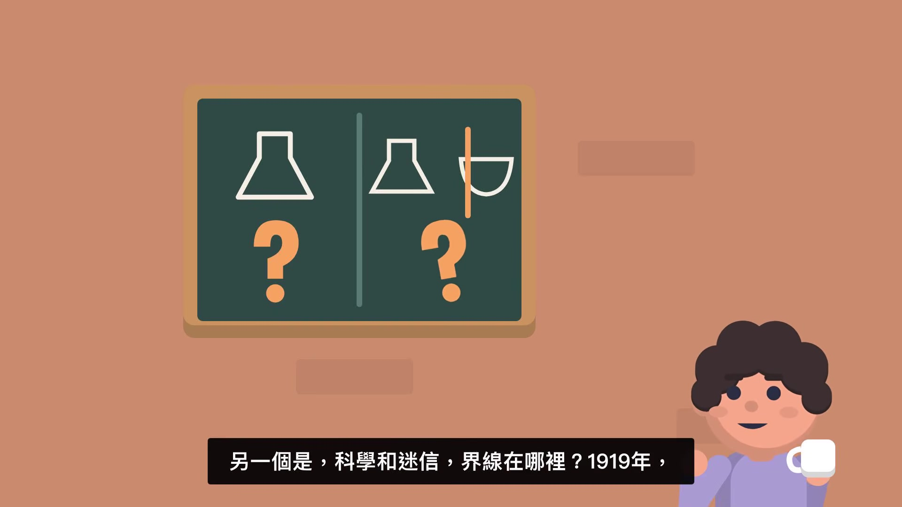

**逐字稿片段：** 1919年 維也納一個十幾歲的年輕人 開始認真想後面這個問題 這個年輕人叫Popper 1919年的維也納

**話題推測：** 介紹卡爾·波普爾及其在1919年對科學界線的思考。

---

## 00:04:31

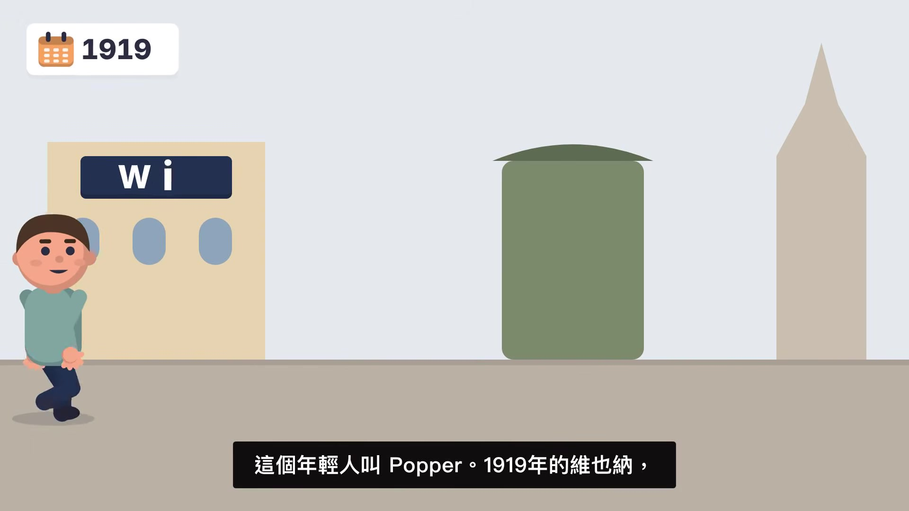

**逐字稿片段：** 有幾套理論很流行 弗洛伊德的精神分析 阿德勒的個體心理學 還有馬克思的歷史理論 Pauper的朋友們很佩服他們 因為這些理論好像什麼都解釋得了 Pauper當時也在阿德勒身邊 參與兒童的社會工作 有一次他向阿德勒報告一個個案 他覺得這個個案不太符合阿德勒的理論 阿德勒連那個孩子都沒見過 就用他的自卑感理論解釋得清清楚楚 Pauper問他 怎麼這麼確定 阿德勒說 因為我有1000次的經驗 Pauper回他 那加上這一次 就是1001次了 Pauper想到的是 但是, 這些理論永遠對得上, 問題就出在這裡,

**話題推測：** 列舉當時維也納流行的理論：弗洛伊德、阿德勒、馬克思。

---

## 00:05:07

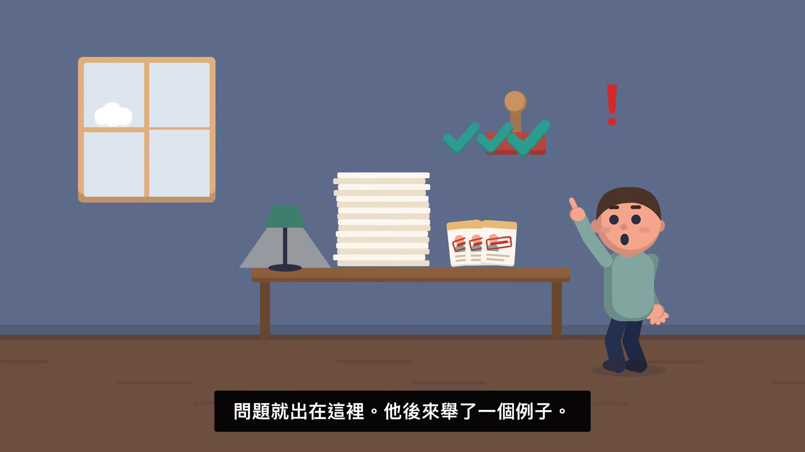

**逐字稿片段：** 他後來舉了一個例子, 一個人把小孩推下水, 想淹死他, 另一個人跳下水, 犧牲自己去救小孩。 兩個完全相反的行為,弗洛伊德的理論解釋得通,阿德勒的理論也解釋得通。 照阿德勒的說法, 兩個人都有自卑感, 一個要證明自己敢犯罪, 一個要證明自己敢救人, 不管發生什麼, 理論都對, 支持者覺得這是他最強的地方, Pauper開始覺得這正是他最弱的地方。 一個理論如果什麼結果都能接受 它其實沒有告訴你世界會是什麼樣

**話題推測：** 舉例弗洛伊德與阿德勒理論如何解釋相反行為。

---

## 00:05:36

**逐字稿片段：** 同一年 有一個理論走了完全相反的路 愛因斯坦的廣義相對論 他預測光經過太陽旁邊會被重力拉彎 所以日食的時候 太陽附近的星星 位置看起來會往外偏一點點 平常白天看不到這些星星 日食的時候才拍得到

**話題推測：** 引入愛因斯坦的廣義相對論及其預測。

---

## 00:05:52

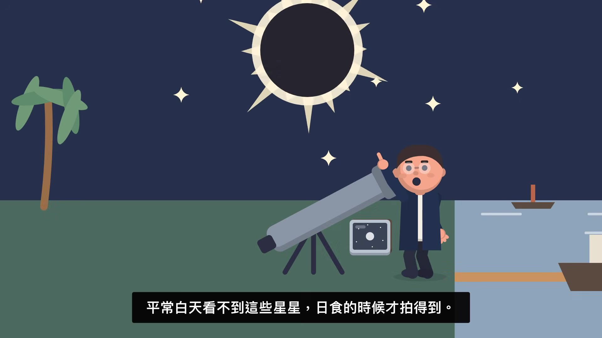

**逐字稿片段：** 1919年5月29日 有一次日全食 英國派了兩支觀測隊 一支到巴西 一支到非洲西岸的普林西比島 拍下太陽旁邊的星星 在跟晚上拍的同一片星空比較 Popper看到的重點是風險 如果照片上的星星沒有偏 愛因斯坦的理論就錯了 而且錯得很清楚 那年11月 結果在倫敦公佈 星星偏了 跟愛因斯坦的預測相符

**話題推測：** 說明1919年日全食觀測如何驗證愛因斯坦理論。

---

## 00:06:15

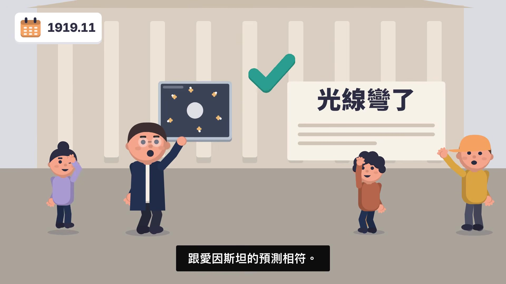

**逐字稿片段：** Popper從這兩種理論的差別 得出一個標準 叫可否證信 他說的是 一個理論算不算科學 要看它有沒有可能被推翻 好的科學理論會禁止某些事情發生 禁止得越多越好 什麼都不禁止的理論不是科學 所以重點不在找到多少證據支持他 要找支持的證據其實很容易 重點是他有沒有做出可能落空的預測 又經不經得起認真想推翻他的檢驗

**話題推測：** 提出波普爾的科學判準：「可否證性」。

---

## 00:06:39

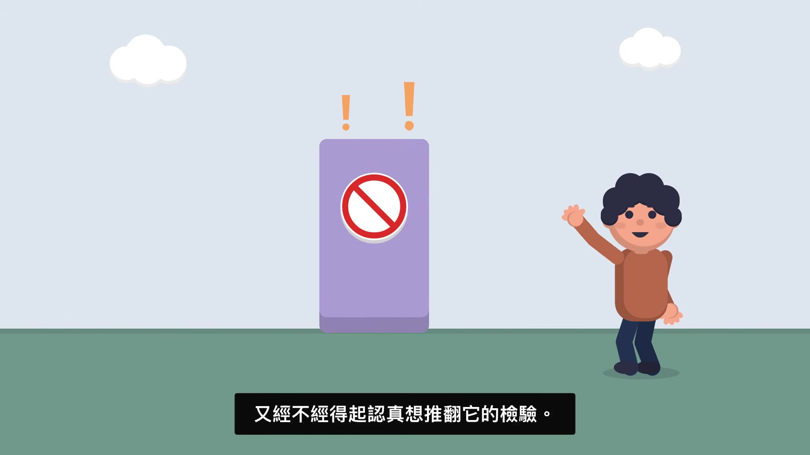

**逐字稿片段：** Popper把這套想法寫成書 1934年底在維也納出版 1959年出了英文版 叫《科學發現的邏輯》 他的看法可以這樣講 科學是猜測和反駁 先大膽提出猜測 再想辦法推翻它 推翻不了的留下來 留下來的理論也不能說它被證明是對的 只能說到目前為止還沒有被推翻 愛因斯坦的理論也一樣 他通過了1919年的考驗 可是哪天碰到推翻他的觀測 他也要讓位 這個態度

**話題推測：** 提及波普爾的著作《科學發現的邏輯》與出版時間。

---

## 00:07:07

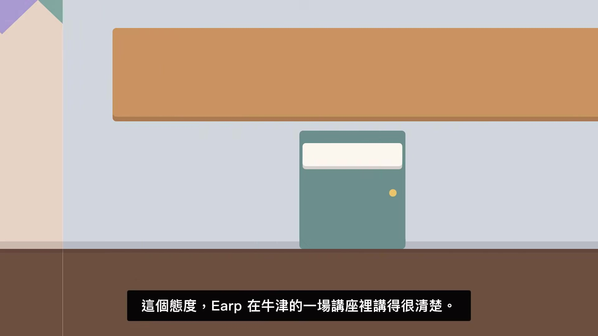

**逐字稿片段：** Erp在牛津的一場講座裡講得很清楚 他研究心理學和科學哲學 And begrudgingly will over time 許多批評測試說 Say maybe we have something here We haven't been able to falsify it Even though we tried our best to do so

**話題推測：** 引用心理學家與科學哲學家Erp的觀點。

---

## 00:07:39

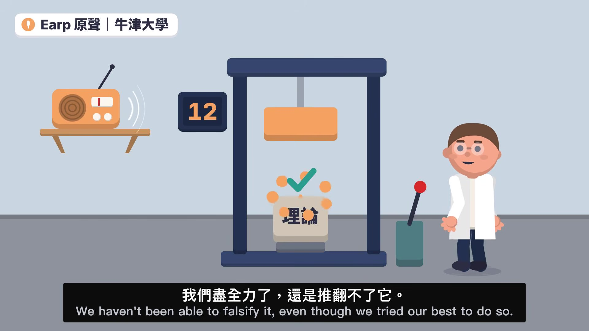

**逐字稿片段：** 可是Popper自己也看到一個漏洞 一個理論被發現跟觀測不合 支持者總是有辦法救他 再加一條說明 例如儀器出了問題 或者還有別的東西在幹擾 這種額外加上去的說明 叫輔助假設 Popper說 這樣做總是辦得到 可是每救一次 理論的科學地位就降低一點 問題是 你怎麼分辨 這一次是合理的修正 還是在應就 1919年的日時就碰到這件事 巴西那邊有一臺望遠鏡拍的照片 算出來的結果比較接近牛頓 主持的天文學家判斷 那臺望遠鏡的照片有問題 沒有采用 這個判斷到今天 還有科學史家在討論 後來更精確的測量 都支持愛因斯坦 ERP指出 一次觀測對不上 能出錯的地方不值理論 這一部分的答案是 科學不靠證明 靠可以被推翻的預測 一個理論能留下來 是因為它經得起一次又一次想推翻它的檢驗 可是真正碰到一次對不上的結果 邏輯沒辦法告訴你 該丟掉的是理論 還是觀測 儀器 或某個輔助假設 這一步要靠判斷 那科學家實際上是怎麼判斷的

**話題推測：** 介紹「輔助假設」的概念及其如何保護或削弱理論。

---

## 00:08:42

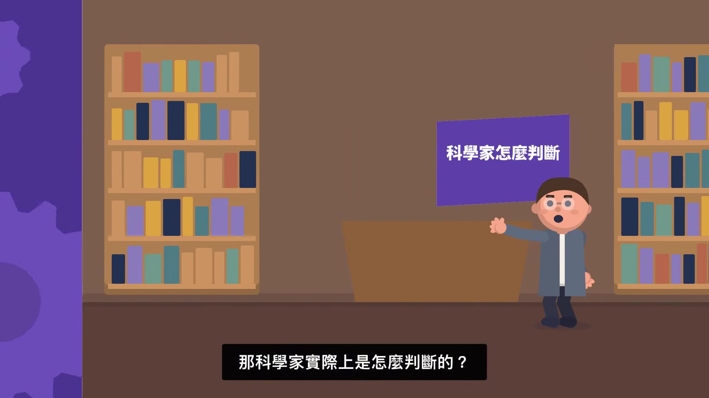

**逐字稿片段：** 歷史上有一個很好的例子 同一招用了兩次 一次成功 一次失敗

**話題推測：** 開始講述用輔助假設成功與失敗的案例。

---

## 00:08:47

**逐字稿片段：** 1781年 天王星被發現了 天文學家用牛頓的萬有引力計算它的軌道 可是幾十年下來 天王星的位置一直跟算出來的對不上 照Popper最嚴格的說法 預測落空 牛頓的理論該被推翻

**話題推測：** 介紹天王星的發現與軌道異常問題。

---

## 00:08:59

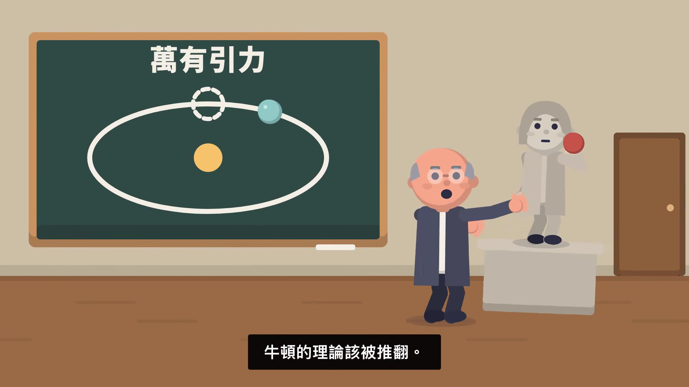

**逐字稿片段：** 法國天文學家Le Verrier沒有這樣做 他加了一條輔助假設 天王星外面 還有一顆沒人看過的行星在邋遢 他從天王星的偏差 反過來算出這顆行星 應該在天空的哪個位置

**話題推測：** 介紹天文學家勒維耶（Le Verrier）如何提出海王星的輔助假設。

---

## 00:09:12

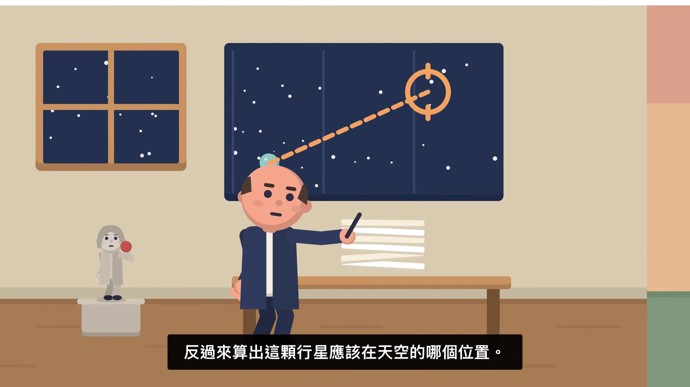

**逐字稿片段：** 1846年9月18日 他寫信給柏林天文臺的天文學家Gal Gal收到信的那天晚上 就在預測位置不到一度的地方 找到一顆新的行星 也就是海王星 他回信寫 您指出位置的那顆行星真的存在 守住牛頓是對的

**話題推測：** 說明1846年海王星被成功發現的過程。

---

## 00:09:27

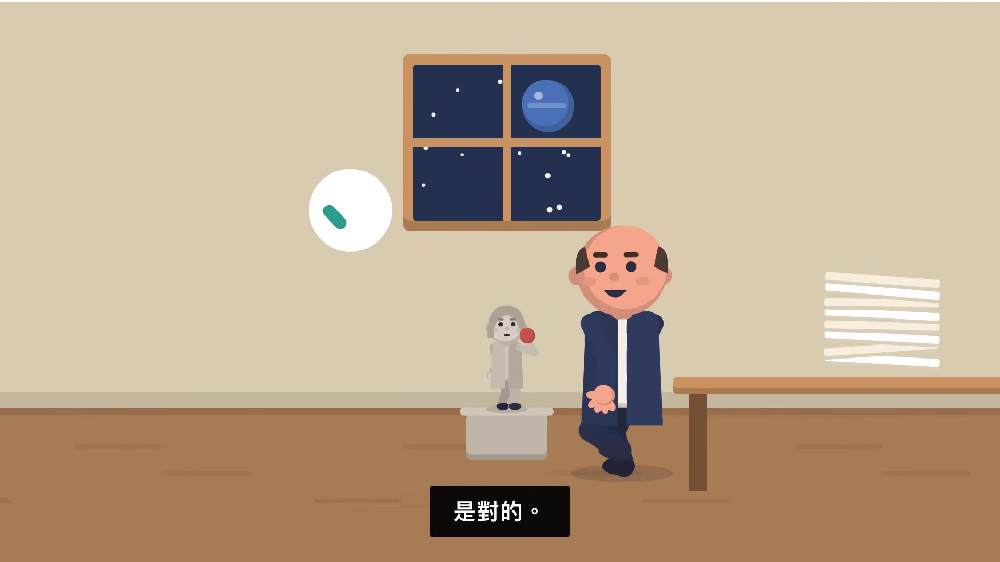

**逐字稿片段：** 13年後 Le Verrier碰到另一個對不上的地方 水星 水星繞太陽的軌道 最靠近太陽的那一點 會一圈一圈慢慢往前移 移得比牛頓力學算得多一點

**話題推測：** 提及勒維耶在13年後遇到的水星軌道異常問題。

---

## 00:09:38

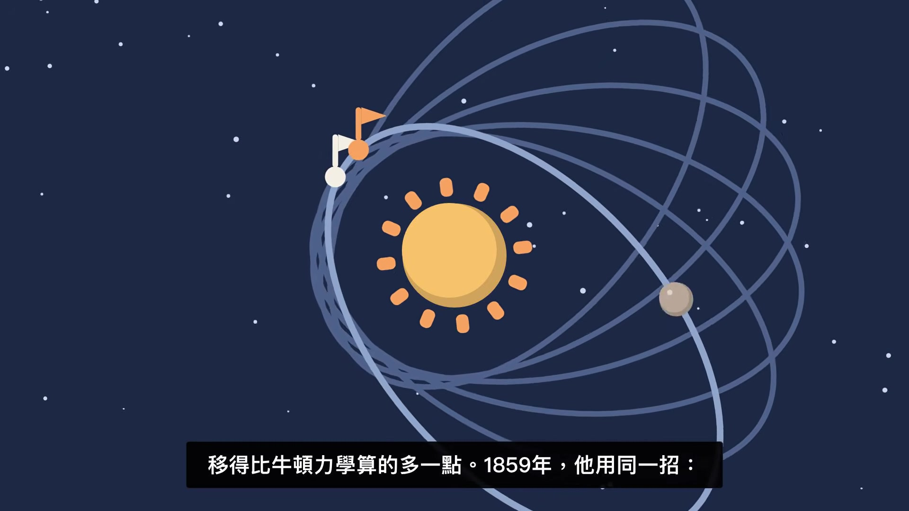

**逐字稿片段：** 1859年他用同一招 太陽和水星之間應該還有一顆行星 他還替它取了名字 叫柱榮星 之後有人說看到了 可是這些目擊一直沒有被確認 柱榮星始終沒有找到

**話題推測：** 勒維耶在1859年提出「祝融星」的輔助假設，但未被證實。

---

## 00:09:50

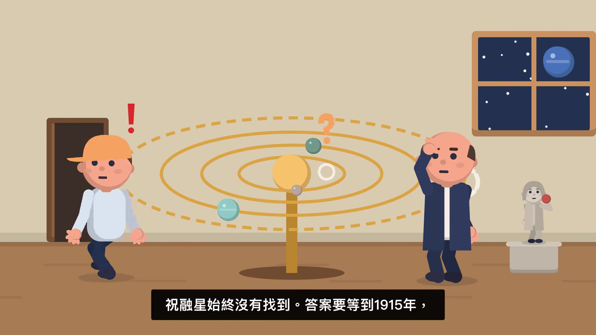

**逐字稿片段：** 答案要等到1915年 愛因斯坦的廣義相對論 不需要新的行星 就算出了水星多出來的那一點移動 同樣是守住理論 加一條輔助假設 一次發現了海王星 一次換來一顆不存在的行星 而且在當下 沒有人分得出這兩次有什麼不同

**話題推測：** 揭示水星問題最終由愛因斯坦的廣義相對論解決，無需新行星。

---

## 00:10:05

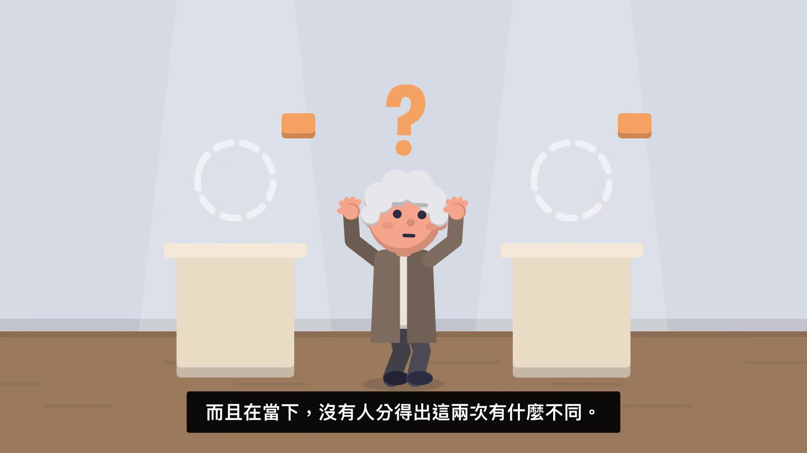

**逐字稿片段：** 美國的科學史家 Kuhn認真看了這種歷史 1962年 他出版《科學革命的結構》 他說 一個研究領域在平常的時候 大家共用一整套東西 基本的理論 做實驗的方法 標準的範例 還有哪些問題值得研究

**話題推測：** 介紹美國科學史家庫恩及其1962年著作《科學革命的結構》。

---

## 00:10:20

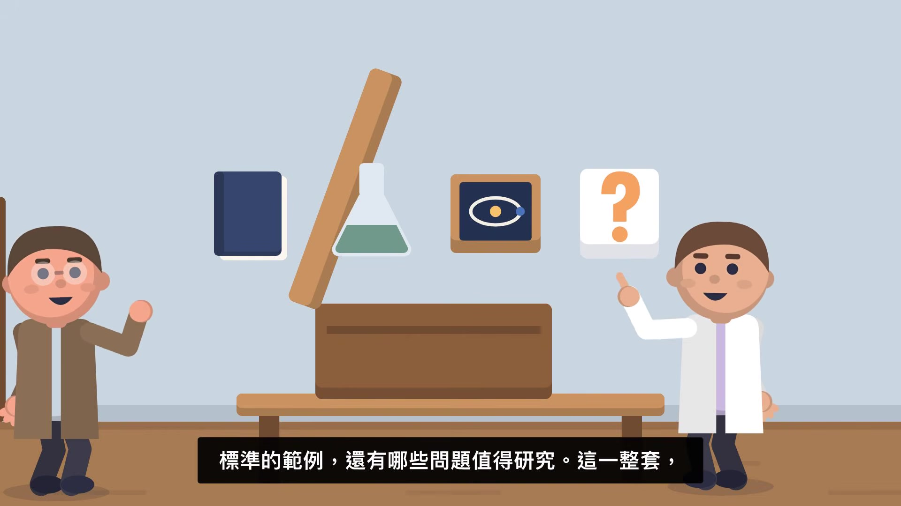

**逐字稿片段：** 這一整套 他叫典範 在一個典範裡做研究 它叫常規科學 Kuhn說 常規科學很像解謎 玩拼圖的人 不會懷疑這和拼圖拼不起來 他假設拼得起來 只是還沒找到對的那一片 Le Verrier找海王星 就是一次漂亮的解謎 大部分科學家一輩子做的 都是這種工作 那拼不進去的那一片呢 Kuhn叫它異常 他的觀察跟Popper很不一樣 在常規科學裡 科學家不會因為一個異常 就丟掉整個典範 能解釋掉就解釋掉 解釋不了就先放著 要等到解不開的異常越積越多 大家開始對這套典範失去信心 才會進入它叫危機的階段 這時候如果出現另一套理論 能解開這些問題 舊的典範才會被換掉 這叫科學革命 庫恩認為 科學家不會只因為舊理論有問題就放棄它 要有新的理論可以取代才會放棄 水星就是這樣 它的異常放了半個世紀 一直到相對論出現 才被當成牛頓力學不夠的證據

**話題推測：** 定義「典範」作為常規科學研究的基礎。

---

## 00:11:15

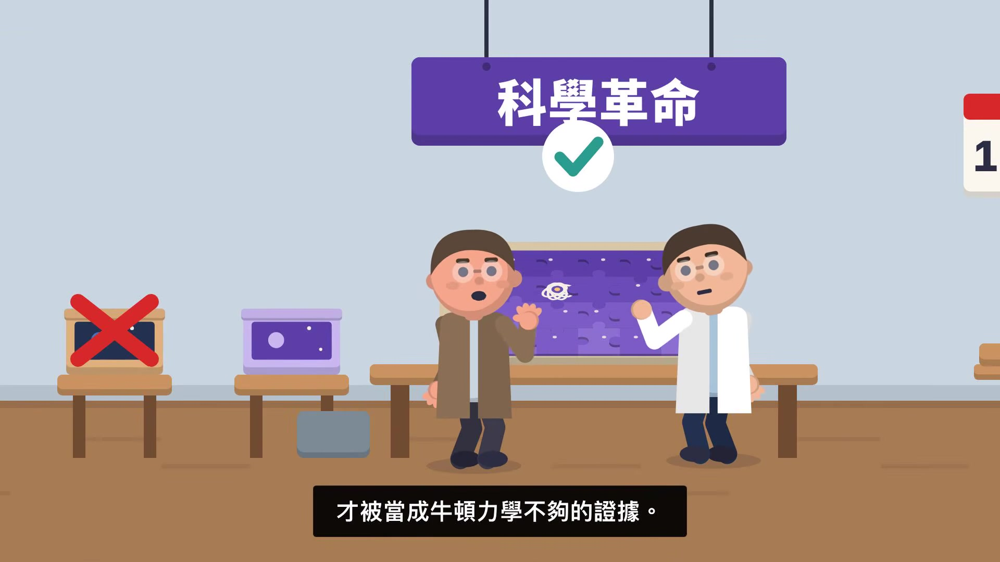

**逐字稿片段：** 1965年 倫敦有一場科學哲學研討會 庫恩和Popper的看法 在會上被正面拿來比較 Popper說 科學應該一直試著推翻自己 Kuhn說 實際上 科學家大部分時間都在守住理論 這兩個說法聽起來衝突 其實各自看到一半 Popper講的 是科學應該用什麼標準判斷一個理論 Kuhn講的 是科學家實際上怎麼做事 而且Kuhn描述的那種保守 很多時候是對的

**話題推測：** 提及1965年庫恩與波普爾看法的比較研討會。

---

## 00:11:41

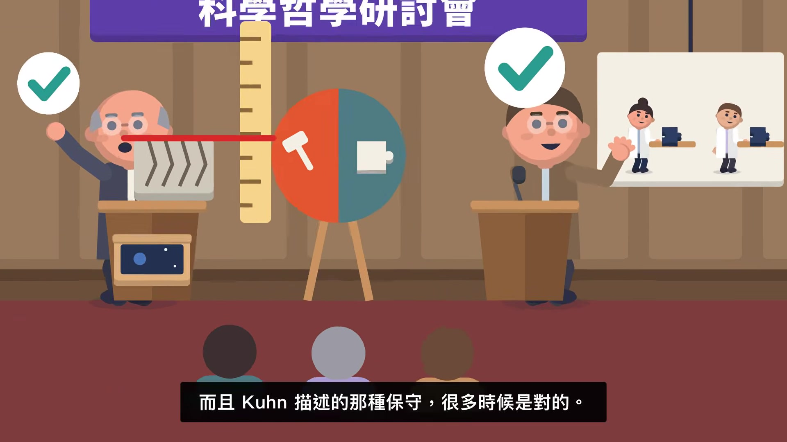

**逐字稿片段：** 2011年9月 義大利的Opera實驗宣佈 他們測量到微中子比光還早一點點抵達 如果是真的 真的,愛因斯坦的相對論就有大麻煩 物理學界很多人的反應是 先別急著推翻相對論,先檢查實驗

**話題推測：** 舉例2011年義大利Opera實驗測量微中子超光速的爭議。

---

## 00:11:55

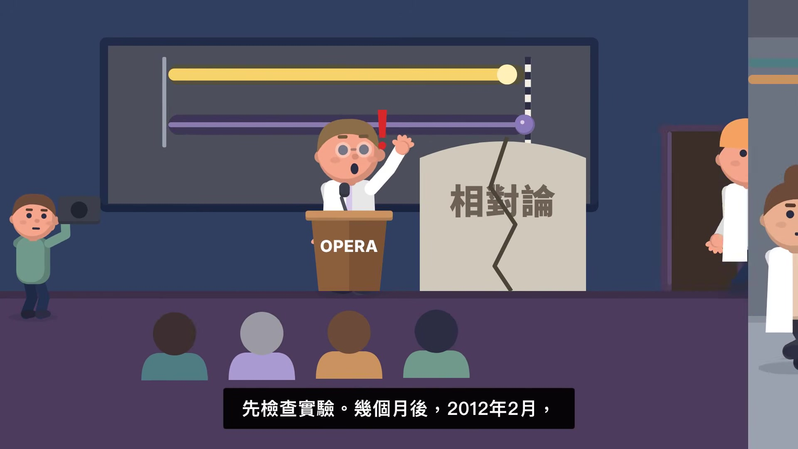

**逐字稿片段：** 幾個月後,2012年2月 團隊找到一個可能的原因 把GPS訊號接到實驗主時鐘的一條光纖 接頭可能沒有接好 之後重新測量,微中子並沒有比光快 如果每一個異常都拿來推翻理論 科學每個月都要重寫一次 可是這樣的保守也有前提 要有人一再檢查,一再重做 錯的地方才會被找出來 這一部分的答案是 一次對不上的結果 推翻不了一個理論 科學家會先守住理論 懷疑實驗 要等異常越積越多 又有新的理論可以取代 舊的才會被換掉 所以一個理論對不對 不是一個實驗說了算 是一群人花很長的時間 一再重做 一再檢查之後的判斷 那問題就來了 如果大家其實很少重做呢 如果重做失敗了 也沒有人知道呢

**話題推測：** 說明2012年Opera實驗發現錯誤原因（光纖接頭問題）。

---

## 00:12:40

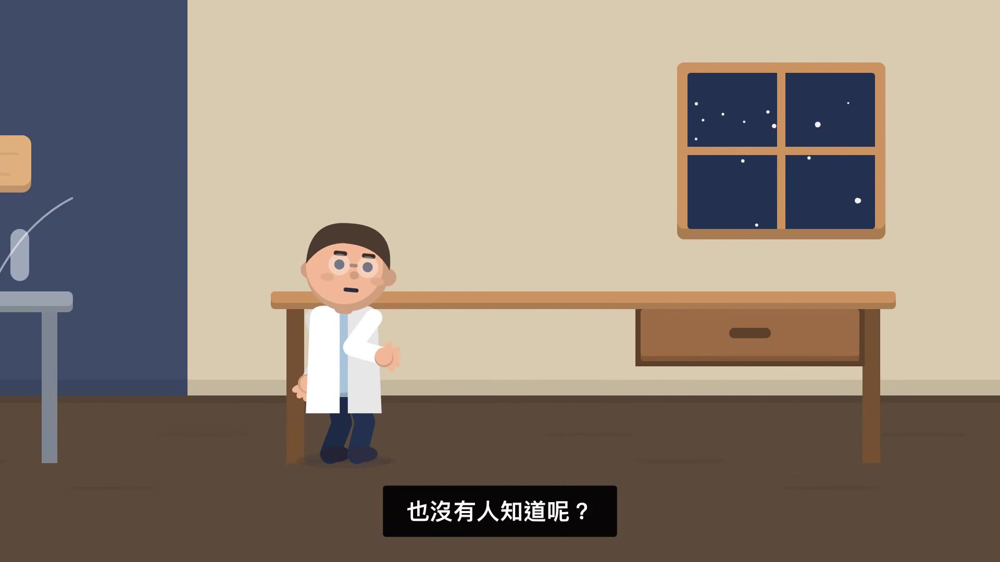

**逐字稿片段：** 2011年 心理學頂尖期刊之一 《人格與社會心理學》期刊 刊出一篇論文 作者是康乃爾大學的心理學家Bam 他用心理學裡標準的方法做了好幾個實驗 結論是 人可以感覺到未來 很多心理學家不相信這個結論 可是更讓他們不安的是另一件事 如果用大家都在用的標準方法 可以做出這麼不可能的結果 那會不會是方法本身有問題

**話題推測：** 討論2011年心理學家Bam關於「預知能力」的爭議論文。

---

## 00:13:03

**逐字稿片段：** 隔年 英國的三位研究者照著做了三次 三次都沒有做出效果 他們把結果投給同一本期刊 期刊沒有送審就退稿 理由是 本刊不刊登重做的研究 這篇論文最後登在另一本期刊 這種事不是隻發生一次 很多期刊比較喜歡刊登有發現的研究 沒做出效果的研究很難發表 研究者知道投了也沒用 乾脆不寫 結果就收進抽屜裡

**話題推測：** 指出複製研究被期刊拒稿，引出「發表偏差」問題。

---

## 00:13:27

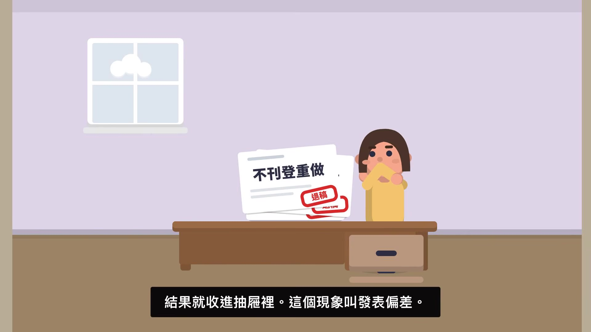

**逐字稿片段：** 這個現象叫發表偏差 它的後果是 我們在期刊上看到的 只是做過的實驗裡剛好成功的那一部分 Erp描述過 以前那些失敗的重做都到哪裡去了 It just get buried 如果藏匿了,那你會出現的文章 只是一部分的嘗試

**話題推測：** 解釋「發表偏差」現象的定義。

---

## 00:14:02

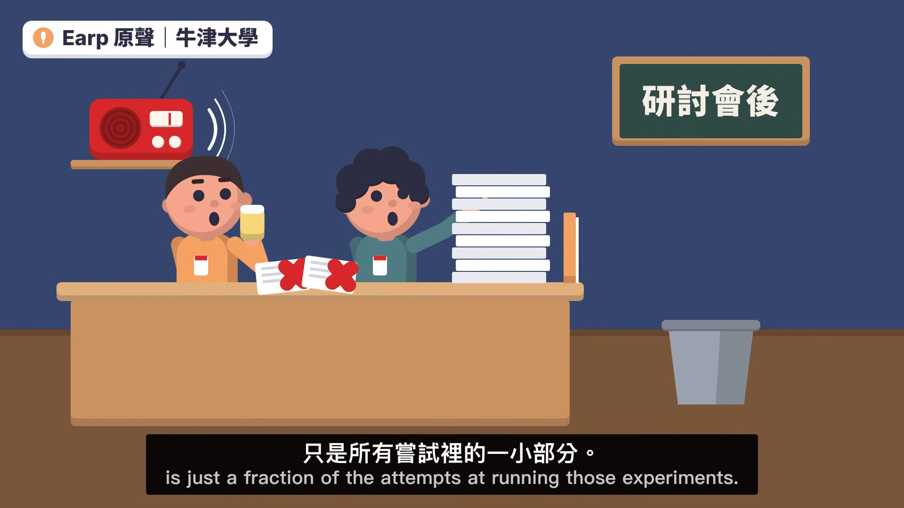

**逐字稿片段：** 這裡有一個很有名的例子 1996年 美國心理學家Bark的團隊做了一個實驗 受試者先做造句題 其中一組的題目裡混了跟老人有關的字 例如皺紋、灰色 做完之後 研究人員拿著馬錶 偷偷計時他們走過走廊的時間 結果 看過老人字詞的那一組 走得比較慢 這篇論文被引用了幾千次 寫進了教科書

**話題推測：** 舉例1996年Bargh團隊「老人詞語引發走路變慢」的知名心理學實驗。

---

## 00:14:25

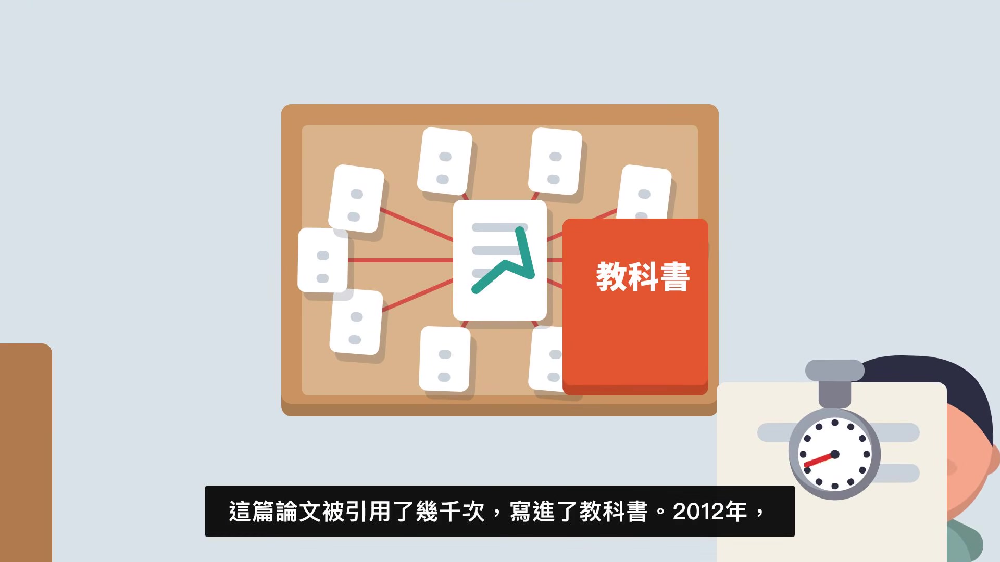

**逐字稿片段：** 2012年 比利時的一個團隊重做 改用紅外線感應器計時 受試者也更多 結果沒有效果 他們又做了一個實驗 先告訴一部分負責計時的研究人員 受試者應該會走得比較慢 結果 只有在研究人員相信 受試者會走得比較慢的時候 才測量到走得比較慢的效果 這些事情接連發生 心理學界決定做一件以前很少人做的事 大規模重做

**話題推測：** 說明2012年比利時團隊對走路實驗的複製失敗。

---

## 00:14:49

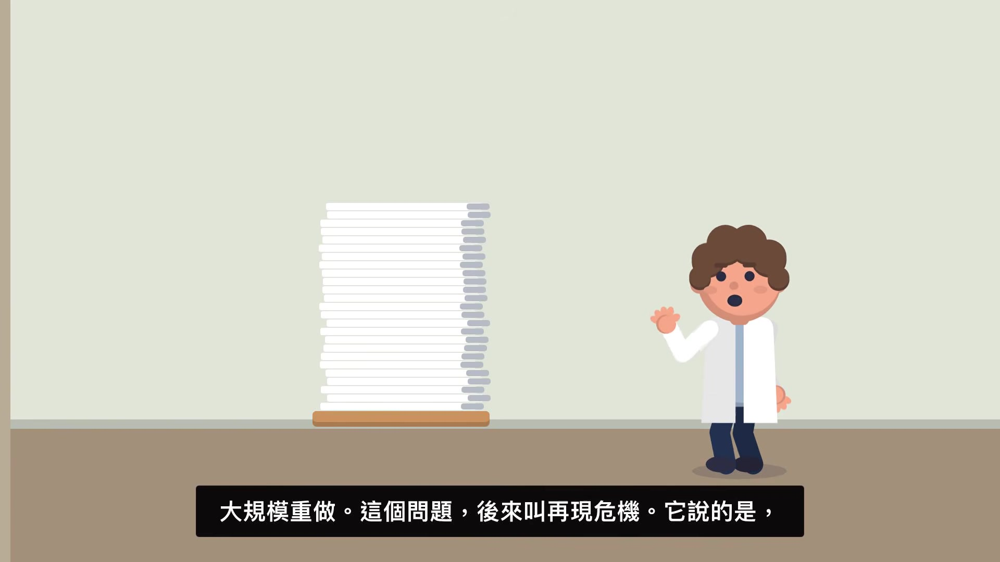

**逐字稿片段：** 這個問題後來叫在線危機 他說的是 很多已經發表的研究 別人照著重做 做不出同樣的結果

**話題推測：** 提出「複製危機」一詞，描述學術界普遍存在的複製問題。

---

## 00:14:57

**逐字稿片段：** 2015年 一個叫開放科學合作計畫的團隊 200多位研究者 從三本心理學期刊裡挑了100篇研究 一篇一篇重做 原來的研究裡 97%都找到了統計上明顯的效果 重做之後 只剩36% 就算找到了 效果平均也只剩原本的一半左右 不止心理學

**話題推測：** 引用2015年開放科學合作計畫大規模心理學研究複製的數據。

---

## 00:15:16

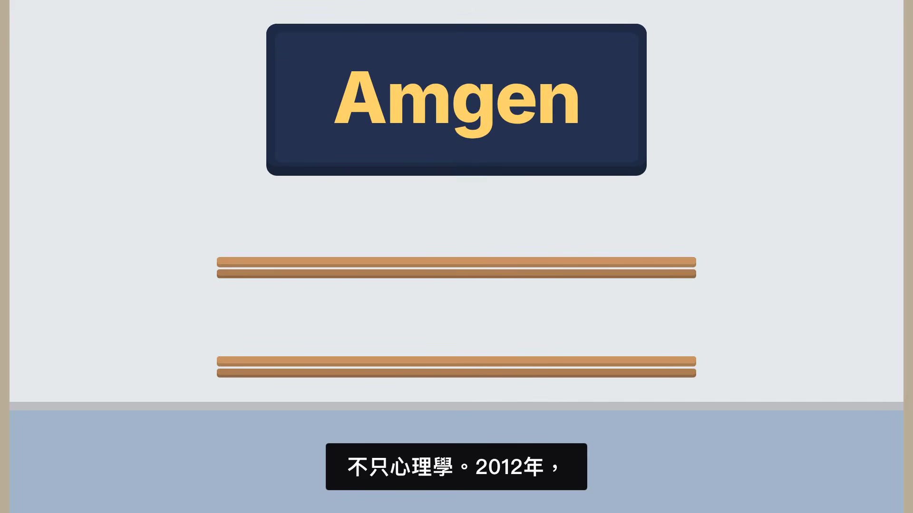

**逐字稿片段：** 2012年 曾經主管美國藥廠Amgen癌症研究的一位科學家 和一位癌症醫師 在Nature期刊發表了一篇評論 Amgen的團隊挑了53篇被認為是里程碑的癌症研究 想先在自己的實驗室重做出來 再拿來開發新藥 53篇裡 確認成立的只有6篇 前一年 德國的拜爾藥廠也報告 67個內部專案裡 跟發表結果對得上的大約五分之一 這兩份報告都有限制 它們是公司自己的報告 Amgen也沒有公開是哪些論文 別人沒辦法檢查 不過2021年 一個把計劃和資料都公開的癌症研究重做計劃 結果也相當接近 重做出來的效果 中位數比原本小了八成多 不過重做失敗 也不一定代表原來的研究是錯的 這裡又回到Popper碰到的那個問題 一次對不上 可能是理論錯 也可能是做法不一樣 例如剛才那個走路實驗 比利時的團隊把造句題翻成了法文 有語言學家指出 那些字在法文裡讓人聯想到老人的程度 可能比在英文裡弱很多 重做到底忠不忠實 常常很難說 ERP的結論很謹慎 那怎麼辦

**話題推測：** 延伸到癌症研究領域，Amgen藥廠2012年複製里程碑研究的低成功率。

---

## 00:16:33

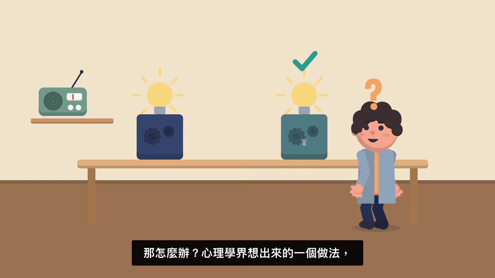

**逐字稿片段：** 心理學界想出來的一個做法 叫預先登記報告 它的做法是 研究者在收資料之前 先把要問什麼 怎麼做 怎麼分析 寫成計劃書交給期刊審查 審查通過 不管最後有沒有發現 期刊都會刊登

**話題推測：** 介紹解決複製危機的一個做法：「預先登記報告」。

---

## 00:16:46

**逐字稿片段：** 2013年 Cortex這本期刊開始採用 後來有研究者比較 一般的心理學論文 幾乎每一篇都說 找到了自己預期的結果 預先登記報告裡 找到預期結果的不到一半 差這麼多 很可能有一部分 就是原本會被收進抽屜的那些結果 這一部分的答案是 科學知道自己對 靠的不是一篇論文 是別人照著重做 而且失敗的結果也看得到 這套機制有漏洞 發表偏差讓很多站不住的結果留了下來 可是找出這些漏洞的 也是科學自己的辦法 重做 比較 公開

**話題推測：** 說明2013年Cortex期刊率先採用預先登記報告的政策。

---

## 00:17:19

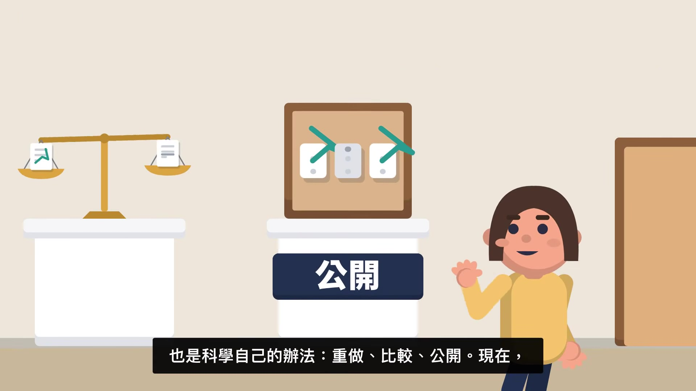

**逐字稿片段：** 現在這套機制要面對一個新的情況 提出研究結果的開始不只是人

**話題推測：** 轉向新的議題：AI在科學研究中的角色。

---

## 00:17:23

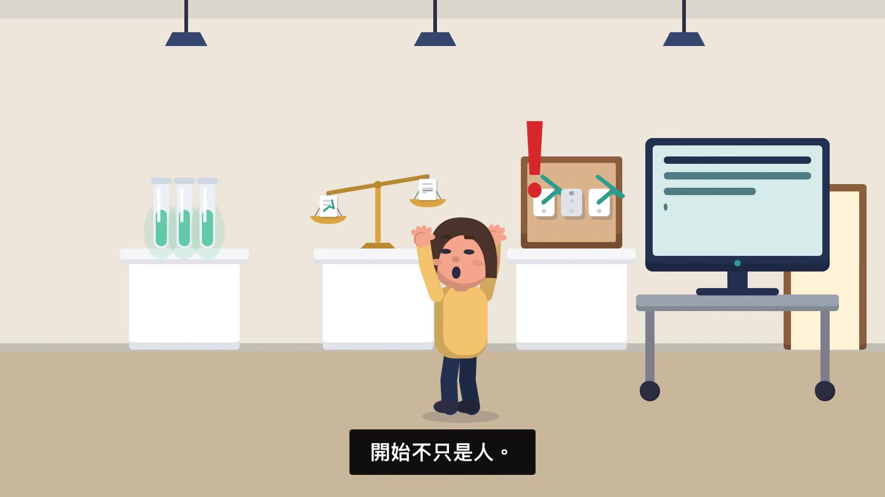

**逐字稿片段：** 2024年 日本的Sagana AI發表一個系統 叫AI Scientist 它自己想研究題目 寫程式 做實驗 再寫成論文 一篇的成本大約15美元 後來的版本寫出的一篇論文 通過了一個學術研討會的審查

**話題推測：** 介紹日本Sagana AI公司在2024年發表的AI Scientist系統。

---

## 00:17:38

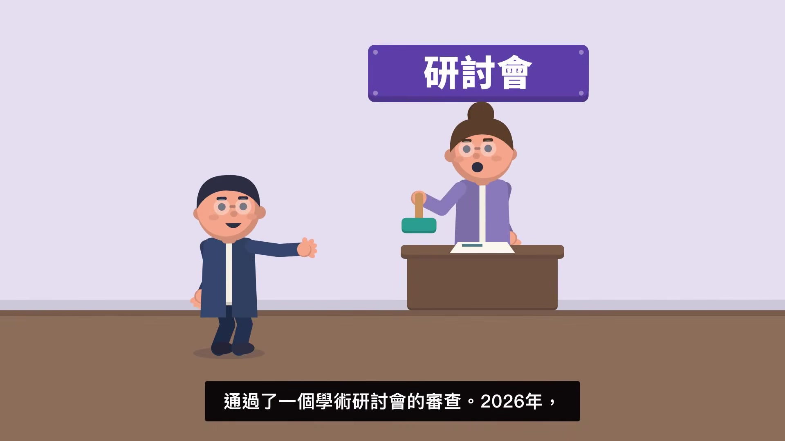

**逐字稿片段：** 2026年,這項研究登上Nature期刊 論文裡也寫明瞭限制 那個研討會的錄取率是七成 這個系統還達不到頂尖發表的標準 而且會出現引用錯誤之類的幻覺 另一組研究者測試這個系統 發現有些論文裡的數字是他自己編出來的

**話題推測：** 提及AI生成的論文在2026年登上Nature期刊。

---

## 00:17:53

**逐字稿片段：** Google也做了一個AI共同科學家 有一個研究團隊花了好幾年 做出一項還沒發表的細菌研究 這個系統排在第一位的假說 跟團隊的實驗結果一致 AI提出假說的速度比人快很多 可是前面三部分告訴我們 科學真正花時間的地方是檢查

**話題推測：** 提及Google也開發了AI共同科學家，並討論其能力。

---

## 00:18:11

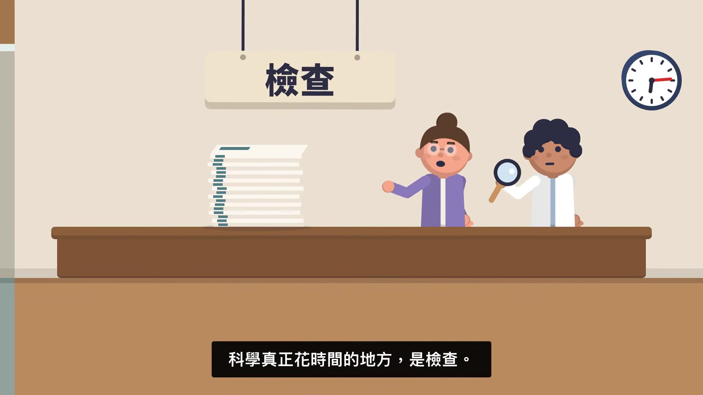

**逐字稿片段：** 頻道上一集就碰到這件事 一篇部落格文章說 他們讓AI模型Astra 直接修改另一個小模型Quant的權重 數學考卷的分數

**話題推測：** 提及頻道上一集關於AI模型Astra修改Quant權重的部落格文章。

---

## 00:18:19

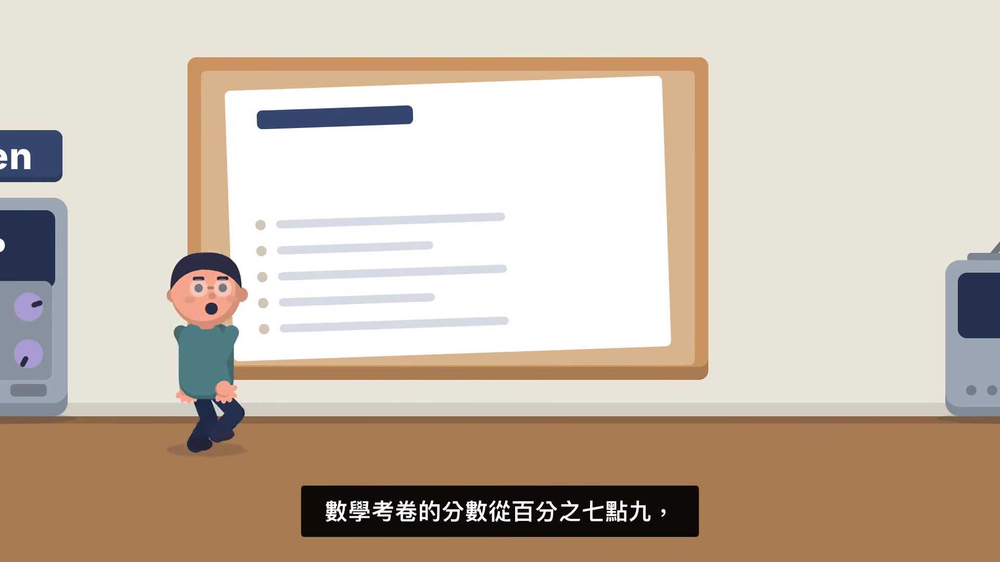

**逐字稿片段：** 從7.9%變成48.1% 方法是找出模型內部 跟一直重複有關的方向 從權重裡減掉 這次部落格文章 沒有經過同材審查 我們照作者的流程重做了一次 同樣50題 開著思考模式 原版不到一成 修改版五成多 文章的提升重現了 可是同樣這50題 原版只要把思考模式關掉 就有5乘2 減掉重複的方向 是讓一直重複 寫不完答案的模型 回到它本來的程度 沒有讓它比不思考的時候更強 這是我們自己的測試 題目不多 只能看大方向 可是它跟走路實驗是同一個問題 一個數字出來 要先問 它跟什麼比 所以 回到主問題 科學怎麼知道自己是對的 答案是 它不知道 至少不是用證明的方式知道 修模告訴我們 看過再多次也證明不了下一次 那隻每天被喂的雞就是這樣 Popper說 那就換一個方向 科學不靠證明 靠可以被推翻的預測 經得起推翻的留下來 Kuhn補上另一半 一次對不上 推翻不了一個理論 要靠一群人長時間的判斷 海王星和祝融星用的是同一招 在線危機告訴我們 這個判斷要成立 前提是有人重做 失敗的結果也被看見 所以科學不是一張保證書 是一套一直在檢查自己的過程 AI讓提出研究結果變得很便宜 重做和檢查就變得更重要 不管做研究的是人還是AI 科學沒辦法證明自己是對的 可是它有一套辦法 讓錯的東西比較容易被找出來 做出可能落空的預測 讓別人重做 把失敗的結果也公開

**話題推測：** 顯示AI模型修改前後數學考卷分數的具體數字。

---

## 00:19:49

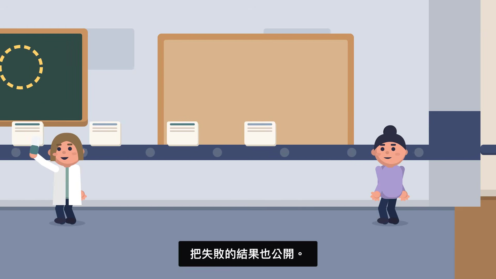

**逐字稿片段：** 最後問你一個問題 如果AI做出一項研究結果 你覺得要經過什麼檢查 你才會相信

**話題推測：** 向觀眾提出總結性問題，邀請互動。

---

## 00:19:55

**逐字稿片段：** 留言告訴我 喜歡的話訂閱AI Notebook 開啟通知 我們下次見

**話題推測：** 呼籲訂閱和開啟通知，結束影片。

---
