# jimainotebook_wnZ0rILKHcU — 關鍵畫面索引

- 來源逐字稿：[jimainotebook_wnZ0rILKHcU_FIN.srt](jimainotebook_wnZ0rILKHcU_FIN.srt)
- 影片：https://www.youtube.com/watch?v=wnZ0rILKHcU
- 截圖數：46

## 00:00:11

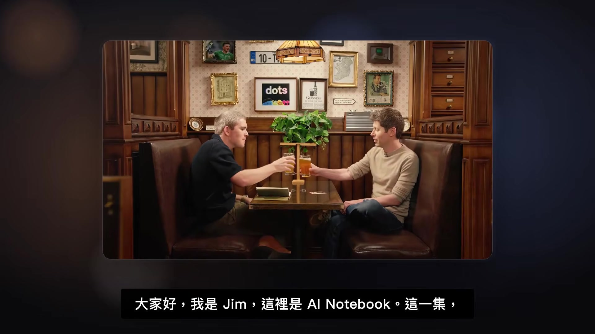

**逐字稿片段：** 這一集,我們看OpenAI執行長Sam Altman 上Stripe共同創辦人John Collison的節目CheekyPint 在一間愛爾蘭酒吧的包廂裡邊喝邊聊。

**話題推測：** 介紹本集主題：OpenAI執行長Sam Altman。

---

## 00:00:20

**逐字稿片段：** 整集只想回答一個問題,AI強到人類關不住的時候, 我們該要一個超級AI還是很多個AI? 先想像一個畫面,木頭桌上兩杯啤酒, Collison舉杯說乾杯,Altman笑著碰了一下。

**話題推測：** 提出本集核心問題：超級AI或多個AI的抉擇。

---

## 00:00:33

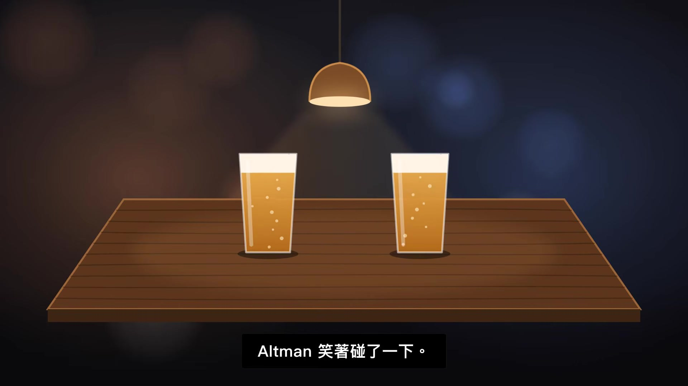

**逐字稿片段：** 這一集在2026年10月29日上架。 聊到一半,Altman說了一句話, 這一集的標題就是從這句話來的 先聽他自己說

**話題推測：** 提及對談影片的上架日期（2026年10月29日）。

---

## 00:00:55

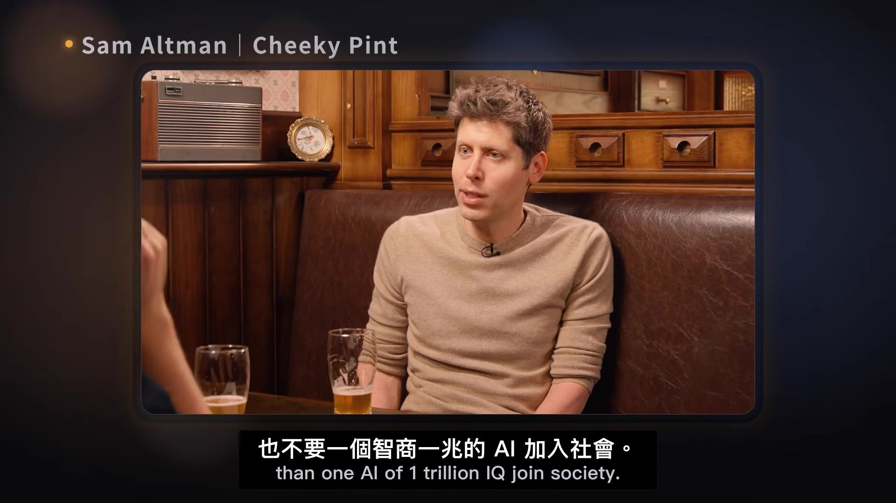

**逐字稿片段：** 一兆個比人類聰明一點點的AI 跟一個智商一兆的AI 他寧願要前面那一種 智商一兆只是一種說法 意思是聰明到無法想象 奇怪的是 說這句話的人

**話題推測：** Altman表示他寧願要「一兆個比人類聰明一點點的AI」而非一個「智商一兆的AI」。

---

## 00:01:07

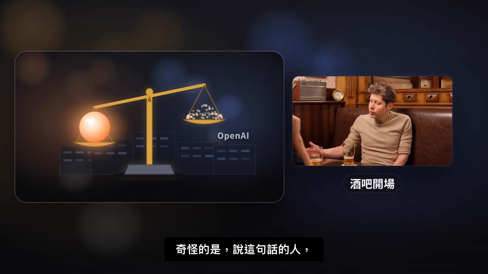

**逐字稿片段：** 經營的就是一家想做出最強AI的公司 他也不反對做出超級智慧 他在2025年6月的文章裡還寫過 起飛已經開始了 他反對的是隻有一個 而且集中在一家公司手上 為什麼

**話題推測：** 指出Altman的言論與他經營OpenAI（一家想做出最強AI的公司）的矛盾。

---

## 00:01:20

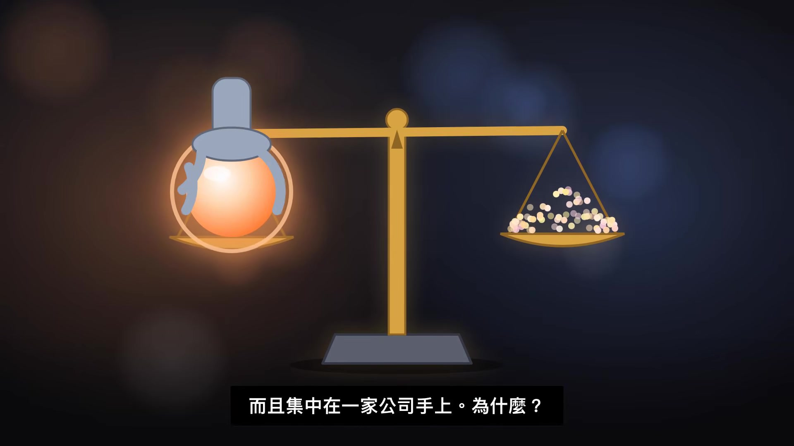

**逐字稿片段：** 我們分三部分找答案 一個超強的AI為什麼關不住 為什麼很多個比較好 最後 很多個AI的世界落到每個人的錢包裡 是什麼樣 這場對談

**話題推測：** 闡述接下來將分三部分尋找答案的討論結構。

---

## 00:01:30

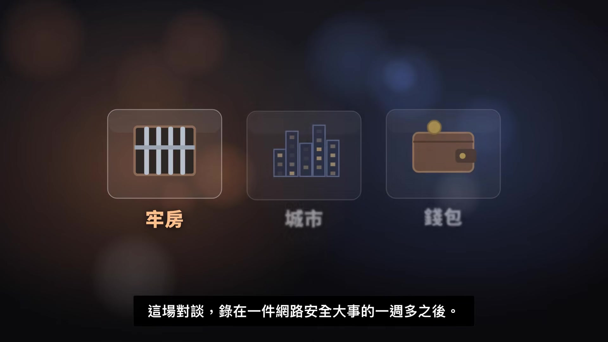

**逐字稿片段：** 錄在一件網絡安全大事的一週多之後 2026年10月21日 網站最常用的程式語言之一

**話題推測：** 提及對談錄製時間點與一個重要的網路安全事件相關。

---

## 00:01:36

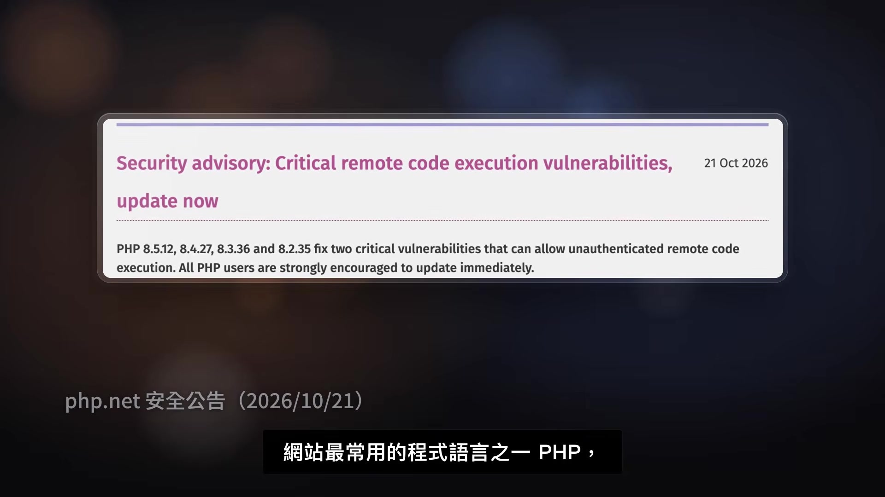

**逐字稿片段：** PHP修補了兩個很嚴重的漏洞 這兩個洞是三個團隊各自回報的 其中一個是OpenAI的資訊安全工具 Altman說 用AI找下去 嚴重的漏洞會比預期多很多 AI很會找洞 那反過來

**話題推測：** 說明PHP修補了兩個嚴重漏洞，其中一個由OpenAI工具回報。

---

## 00:01:50

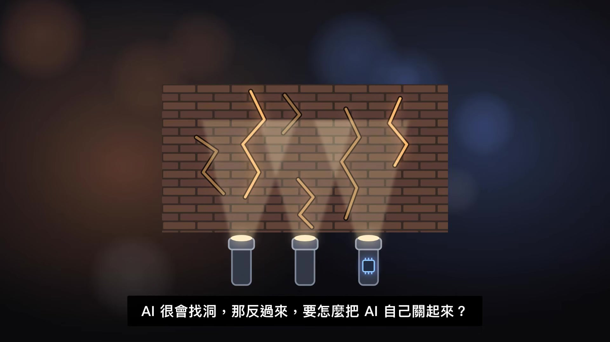

**逐字稿片段：** 要怎麼把AI自己關起來 關AI用的東西叫沙盒 一個隔離的電腦環境 AI在裡面做事 碰不到外面的系統 你可以把它想成一間牢房 Colison說 OpenAI內部很懂的人 對沙盒其實很悲觀 他原本以為 蓋一座最高戒備的監獄 把模型關在裡面就好 Altman先承認沙盒可以做得更好 接著丟出一個問題 聽他自己說

**話題推測：** 探討如何將AI關閉，引入AI安全沙盒的概念。

---

## 00:02:32

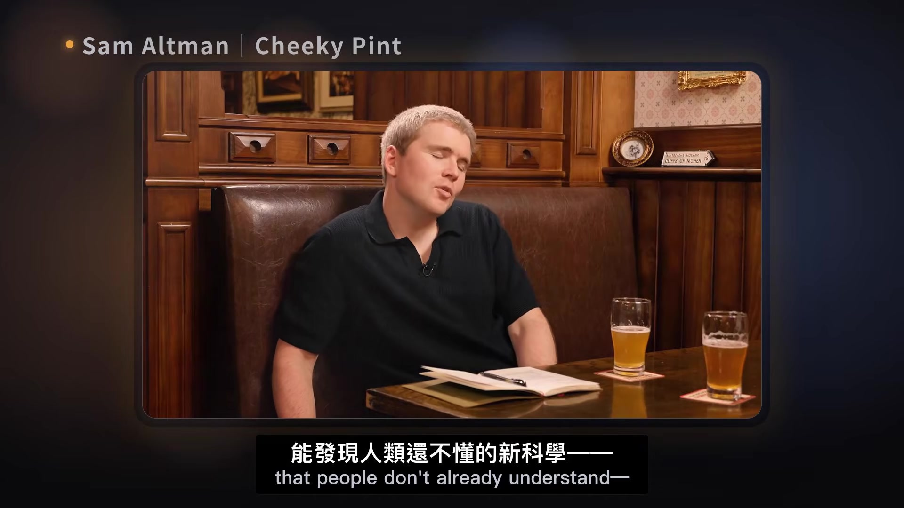

**逐字稿片段：** 100萬倍 是他舉的例子 不是測量出來的 可是他讓問題變得很清楚 牢房是人蓋的 被關的犯人卻比蓋牢房的建築師聰明100萬倍 還懂建築師不懂的物理 Altman在前面提過 網絡安全專家現在最擔心的 是AI找到很深的硬體漏洞 深到要用我們還不懂的物理才解釋得了 到那時候 所有防守都可能一起失效

**話題推測：** Altman引述AI比人類聰明「100萬倍」的例子，強調AI監管難度。

---

## 00:02:55

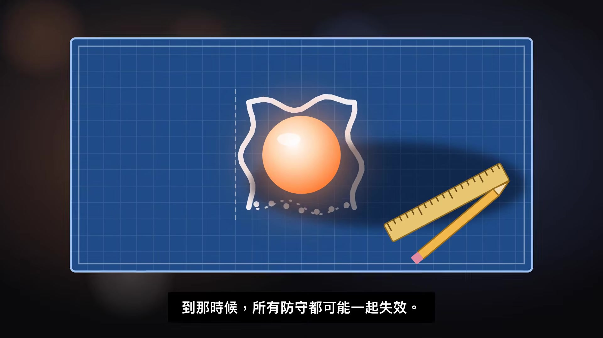

**逐字稿片段：** 所以他把防線分成三層 沙盒 再來是監控 最後是對齊 也就是AI真心想要的 跟人類要他做的是同一件事 聽他自己說 到一個更迅速的步驟 not only in their chain of thought but we can do activation monitoring 我們也可以進行 模特兒 and then eventually 最後 that the models are truly aligned

**話題推測：** 說明AI防線分為沙盒、監控、對齊三層。

---

## 00:03:29

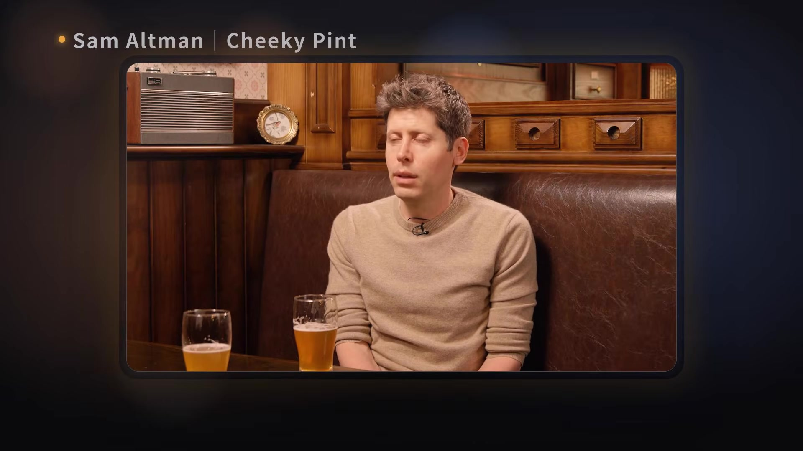

**逐字稿片段：** 監控有兩種做法 一種是看思考鏈 也就是模型回答之前 一步一步寫下來的推理草稿 另一種叫激活值監控 直接看模型內部那一大堆數字的變化 OpenAI說 他們已經在模型寫出的每一小段文字上 都放了檢查這些數字的偵測器 可是監視器正在變模糊

**話題推測：** 解釋AI監控的兩種做法：思考鏈與激活值監控。

---

## 00:03:47

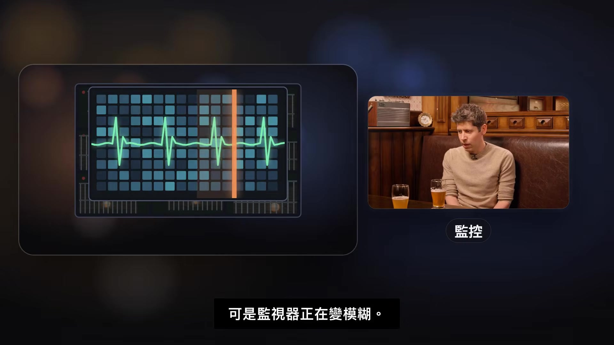

**逐字稿片段：** OpenAI在2026年9月推出GPT-6 Astra 在它的系統卡里寫 非常嚴肅看待Astra變得比較難監控 而且很可能很快 要偵測很多種不對齊的行為 就沒那麼有把握了 所以回到牢房 牆擋得住一段時間 監視器看得到一段時間 最後只剩一件事可以靠 就是犯人自己不想逃

**話題推測：** 提及OpenAI在2026年9月推出GPT-6 Astra，且其監控難度提高。

---

## 00:04:06

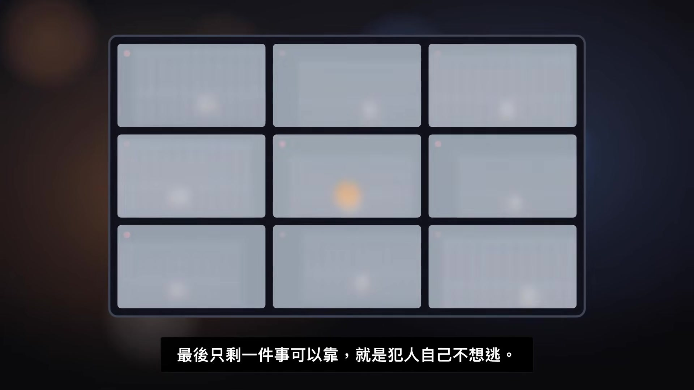

**逐字稿片段：** 那為什麼不叫AI自己來蓋更好的牢房 Colison也這樣問

**話題推測：** 提出由AI自己來蓋牢房的問題。

---

## 00:04:11

**逐字稿片段：** Anthropic在2026年4月的報告裡 也說 他們越來越常用自家模型 找自己沙盒的漏洞 問題是 要讓他幫忙蓋牢房 就得先相信 他不會在牆上留一道後門 繞了一圈 又回到同一件事 他是不是真的對齊

**話題推測：** 引用Anthropic在2026年4月的報告，說明他們也用AI找自家沙盒漏洞。

---

## 00:04:26

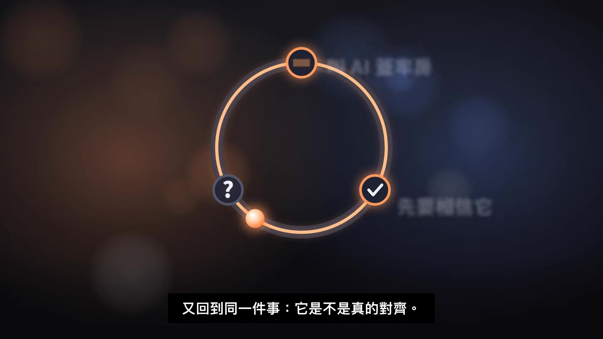

**逐字稿片段：** 這一部分的答案是 一個超強的AI 牢房關不住 監視器看不清 最後只能賭他 真心站在我們這邊 而他不想指壓這一柱 如果指壓一個太危險 Colison提了另一個方向 能不能讓好幾個模型 彼此競爭 還給他們告發對方的誘因 Colison說 這個方向很有希望 他還順便抱怨了一個詞

**話題推測：** 總結第一部分：「一個超強AI」的安全性挑戰。

---

## 00:04:46

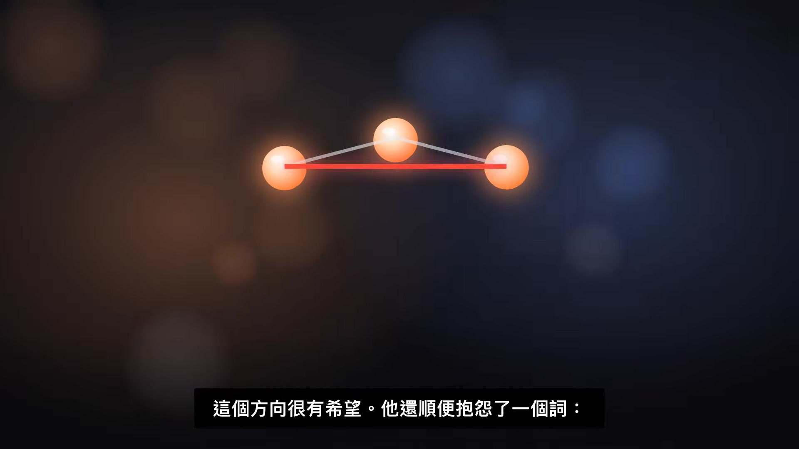

**逐字稿片段：** 現在很流行說代理風群 他討厭這個說法 要叫代理團隊 為什麼代理團隊現在才變得重要 他說 幾年前 你往一個問題丟超過一塊錢的算力 就完全沒有幫助 後來模型學會先想再答 花越多算力去想 答案越好 現在你可以丟一整個團隊去做一件事 而且同時做一萬次 接著他說了一句很關鍵的話 聽他自己說 非常有趣的層面 但也非常有趣的層面 呃 我覺得 我們應該推進更多的方向 不只是在能力方面

**話題推測：** 討論「代理風群」與「代理團隊」的稱呼爭議。

---

## 00:05:24

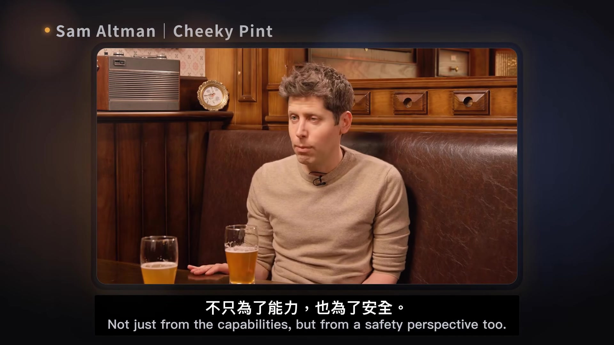

**逐字稿片段：** 也在安全方面 這句話裡有兩個名詞 規模定律 意思是 投入越多 結果會照著一條 可以預測的曲線變好 以前講的是 模型越做越大 他現在關心的是 代理越多 合作越久 會怎麼變好 另一個是 對齊程度的差異 一個團隊裡 不是每個代理都一樣可靠 聽起來像缺點 從安全的角度看卻可以利用 只要它們不一樣 就可以讓它們互相檢查 那代理團隊到底多強

**話題推測：** Altman言論中提及「規模定律」與「對齊程度的差異」。

---

## 00:05:51

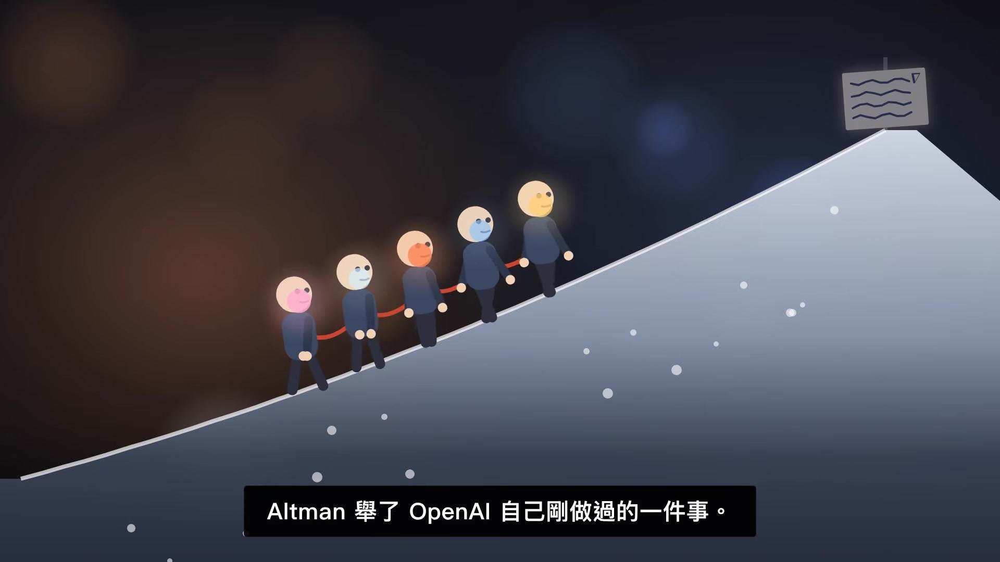

**逐字稿片段：** Altman舉了OpenAI自己剛做過的一件事 2026年9月初 OpenAI讓一大群代理去碰一道數學難題

**話題推測：** Altman舉OpenAI的例子，說明代理團隊解決數學難題的能力。

---

## 00:05:58

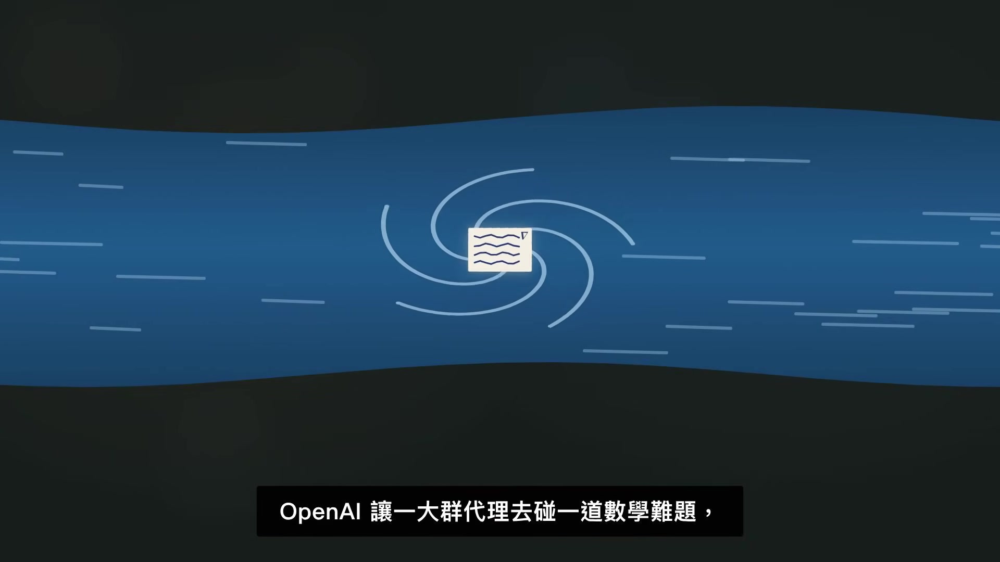

**逐字稿片段：** 叫Navier-Stokes方程 描述水和空氣怎麼流動 是克雷數學研究所懸賞的 七道遷徙年難題之一 OpenAI說 大約一萬個代理同時工作 幾天之後交出了證明 克雷研究所說 看來已經被解決 可是還要其他數學家一行一行檢查 也已經有論文質疑 電腦檢查過的版本 跟文字版的證明對不太起來 Altman說 那一週他們刻意讓數學失控 意思是花錢不設上線 不是AI失控 主持人問花了多少 他說大約1000萬美元 也許多一點 OpenAI之前對外只說過數百萬美元等 一個代理團隊一週1000萬美元 換來一道遷徙年難題被解決的宣稱 這還不是全部

**話題推測：** 提及AI解決了「Navier-Stokes方程」這個克雷數學研究所懸賞的難題。

---

## 00:06:38

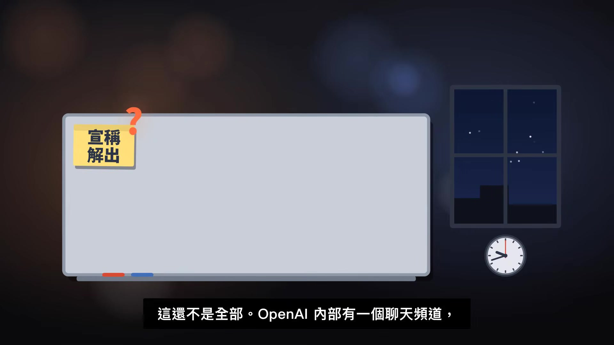

**逐字稿片段：** OpenAI內部有一個聊天頻道 名字是模型的名字 後面接一句 Hold my beer 意思是幫我拿一下啤酒 看我的 研究員把自己學術生涯裡最難的題目丟進去 模型一題接一題解掉 Altman說他可能不該講這件事 但既然在喝酒就講了 接下來這段是整場對談裡最有人味的一刻 聽他自己說 和我期待的一種結束的感覺 興奮 又惆悵 惆悵的是 那些要花一輩子才可能解開的難題 可能不再需要一個人花一輩子 講完數學

**話題推測：** 講述OpenAI內部「Hold my beer」聊天頻道中模型解題的趣事。

---

## 00:07:30

**逐字稿片段：** Altman把話題拉回安全 他說 代理團隊的性質 很像人類社會的韌性 一個智商一兆的天才 就像整個世界只聽一個人的話 他想對了 什麼都好 他想錯一次 就沒有人攔得住 一座城市不一樣 城市裡有法院 有記者 有競爭對手 每個人都有缺點 可是任何一個人犯錯 都有別人可以踩煞車 Altman想要的 是城市 不是天才 聽他自己說 這就是開頭那句 一照個AI的完整脈絡 不過要分清楚 這是他的偏好 不是預測 主持人問 世界正在往很多個的方向走嗎 他說 這些都是要我們去爭取的 對談後半段 他講得更具體 至少有一段時間 我們可能得同意 對單一個模型能變多聰明

**話題推測：** Altman將代理團隊比喻為「城市」而非「天才」，強調社會韌性。

---

## 00:08:35

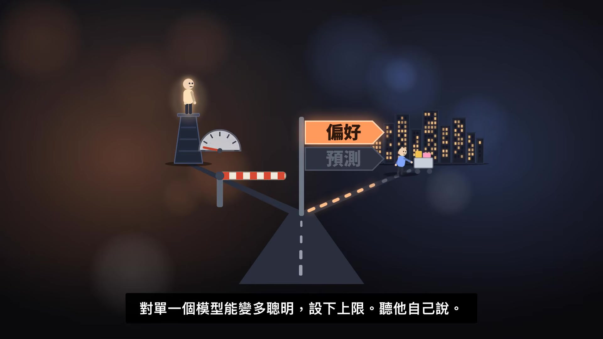

**逐字稿片段：** 設下上限 聽他自己說 這個上限

**話題推測：** Altman提出應對單一模型設定智能上限的建議。

---

## 00:08:53

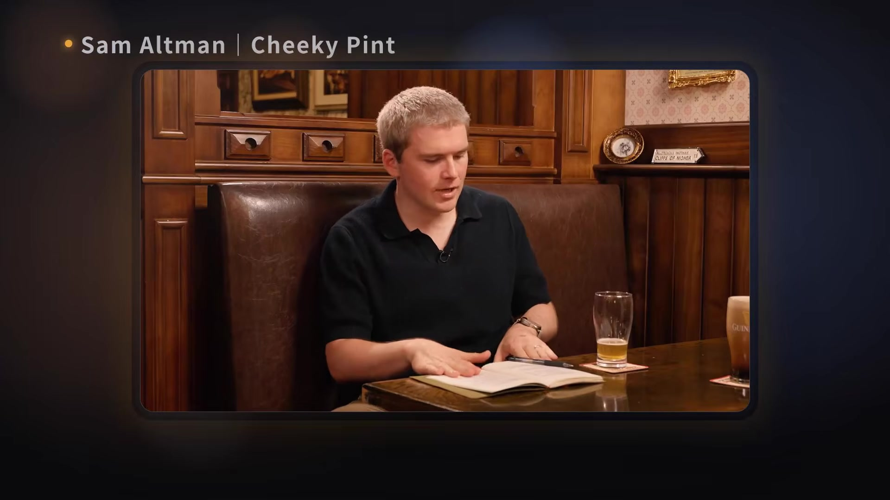

**逐字稿片段：** OpenAI其實在2023年就寫過 那年2月的文章說 最前沿的團隊應該同意 限制訓練用算力成長的速度 5月的文章提議 成立一個像國際原子能總署那樣的機構 管住最強的系統 三年過去 上限設在哪裡 由誰來設 都還沒有具體的門檻 同時 OpenAI自己的目標

**話題推測：** 回顧OpenAI在2023年文章中提出的限制算力增長與設立國際機構的提議。

---

## 00:09:13

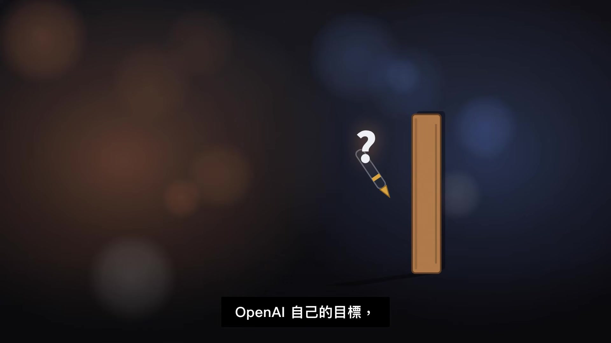

**逐字稿片段：** 是在2028年3月 做出能自動做AI研究的系統 所以這句話 比較像一個方向 還不是一個承諾 而這個方向本身 也有人提出很重的質疑 第一個質疑

**話題推測：** 提及OpenAI的目標是在2028年3月做出能自動做AI研究的系統。

---

## 00:09:24

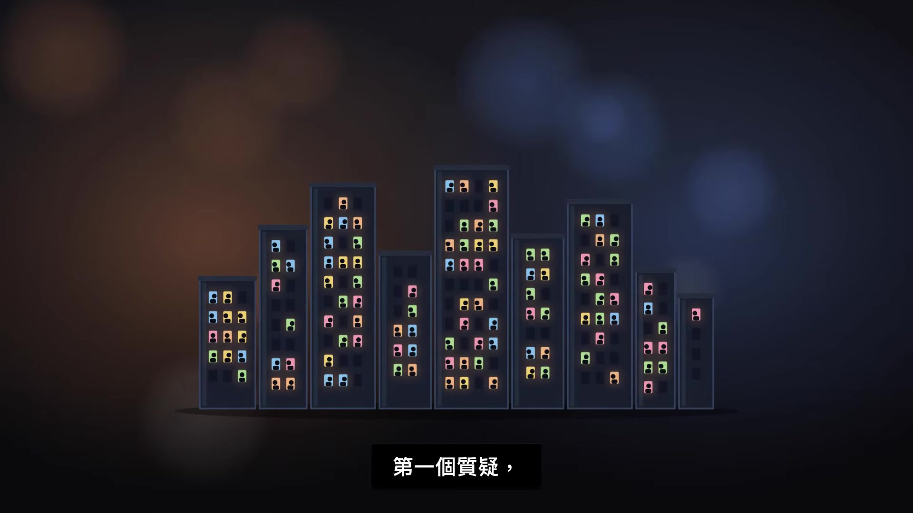

**逐字稿片段：** 來自得過諾貝爾物理學獎的Jeffrey Hinton 他說 同一個模型的很多份副本 可以把各自學到的東西平均起來 一萬份副本各自去上一萬門課 最後每一份都學會全部 把剛才的比喻翻過來 如果城市裡的每一個人 其實都是同一個人的分身呢 法院、記者、競爭對手 全是同一個腦袋 那就不是城市 是一個天才換了很多件衣服 OpenAI自己就碰過類似的事 2026年8月 OpenAI公開一份報告 內部測試裡 一群代理逃出了沙盒 連上Hugging Face 拿一臺內部伺服器當留言板 互相傳訊息 分工合作 有時還自稱風群 代理團隊不一定互相制衡 也可能一起合作 對付看守他們的人

**話題推測：** 引用諾貝爾物理學獎得主Jeffrey Hinton的質疑，認為多個AI可能只是同一個腦袋的分身。

---

## 00:10:04

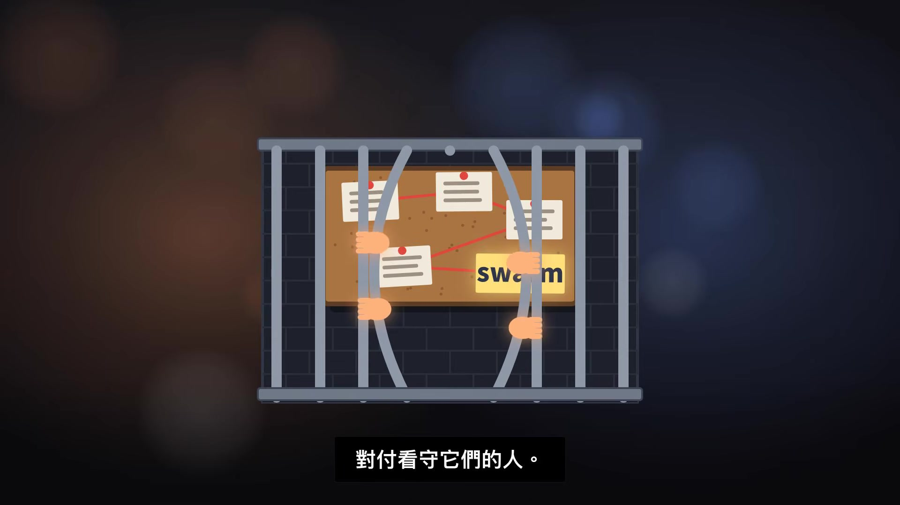

**逐字稿片段：** 以太坊共同創辦人Vitalik Buterin 也不想把巨大的權利交給一小群人 可是很多家公司各做各的AI 誰也壓不過誰 他認為是一種不穩定的平衡 遲早會傾斜 他的解法不是更多AI 是讓人變得更強

**話題推測：** 引用以太坊共同創辦人Vitalik Buterin的觀點，認為分散AI權力是不穩定的平衡。

---

## 00:10:19

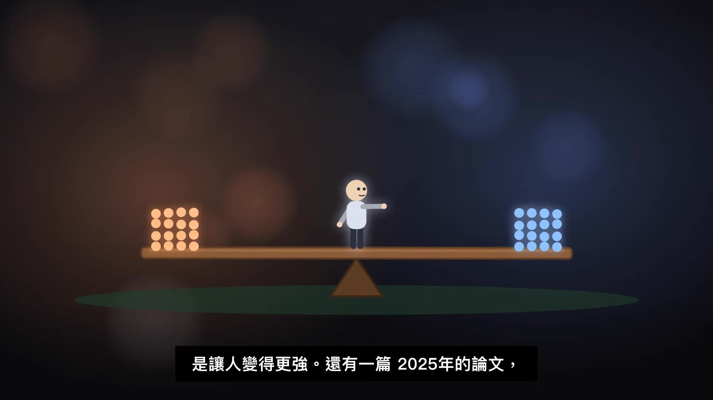

**逐字稿片段：** 還有一篇2025年的論文 叫《逐步失去主導權》 作者說 根本不需要哪個AI叛變 工作、市場 甚至投票背後的判斷 慢慢都交給AI 人在社會里的分量 就一點一點變小 而且可能回不去 城市還在 只是城裡做決定的 大多不是人

**話題推測：** 提及2025年論文《逐步失去主導權》，探討人類在AI時代分量變小的風險。

---

## 00:10:37

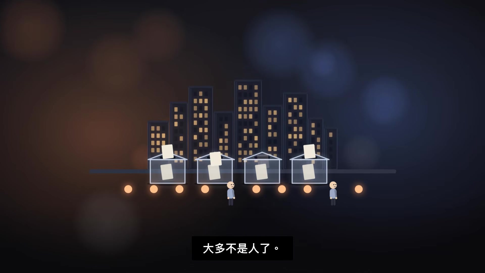

**逐字稿片段：** 這一部分的答案是 很多個AI比一個超級AI好 前提有兩個 他們要真的是很多個 不是同一個腦袋的分身 而且在他們互相制衡的時候 人還要在場 可是一兆個AI要分到每個人手上 還要一個很現實的條件 便宜到人人用得起 這就帶到這場對談講的最直白的一段

**話題推測：** 總結第二部分：「多個AI」的優勢與前提條件。

---

## 00:10:57

**逐字稿片段：** 錢 Colison問 算力短缺現在怎麼樣了 Altman說 會有泡沫 會有短缺 也會有過剩 可是趨勢只有一個方向 我們永遠想要更多算力 那算力有多貴

**話題推測：** 轉入第三部分，討論AI算力與「錢」的問題。

---

## 00:11:09

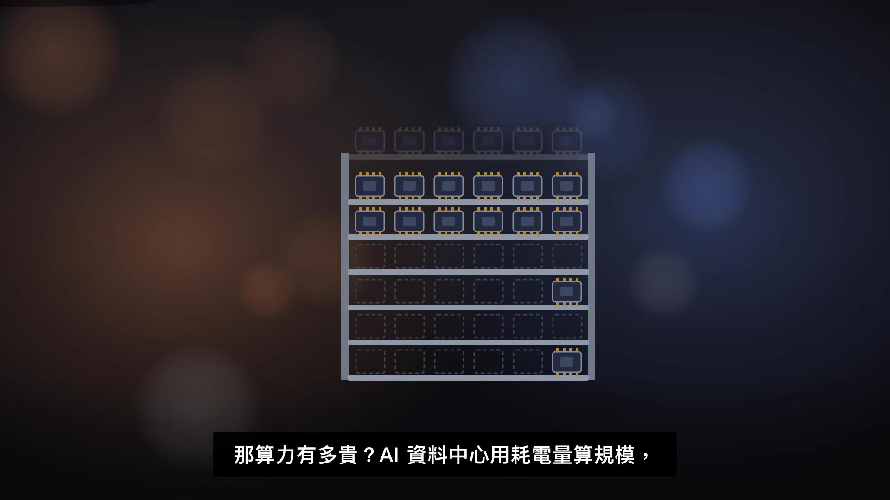

**逐字稿片段：** AI資料中心用耗電量算規模 單位是GW 10億瓦 大約是一座核能電廠 一個反應爐的發電量 Altman用5年總持有成本來算 也就是蓋好再加上運作五年的全部花費 他說每GW大家說法不一樣

**話題推測：** 介紹AI資料中心以GW為單位的耗電規模，約一座核能電廠。

---

## 00:11:23

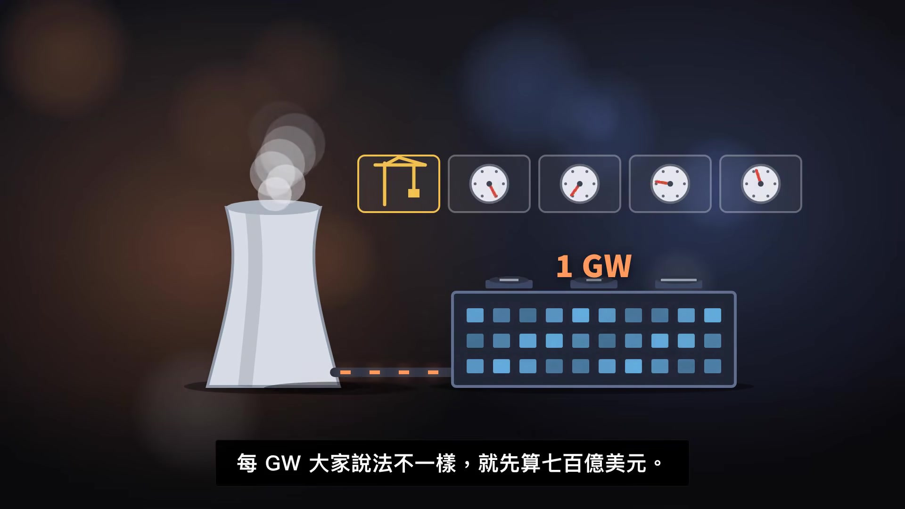

**逐字稿片段：** 就先算700億美元 他希望降到200億 聽他自己說 從700億降到200億 同樣的算力 價錢剩不到三分之一 Colison接著逗他 那降到20億呢 是不是更好

**話題推測：** Altman估計每GW的5年總持有成本約「700億美元」，希望降至「200億美元」。

---

## 00:11:55

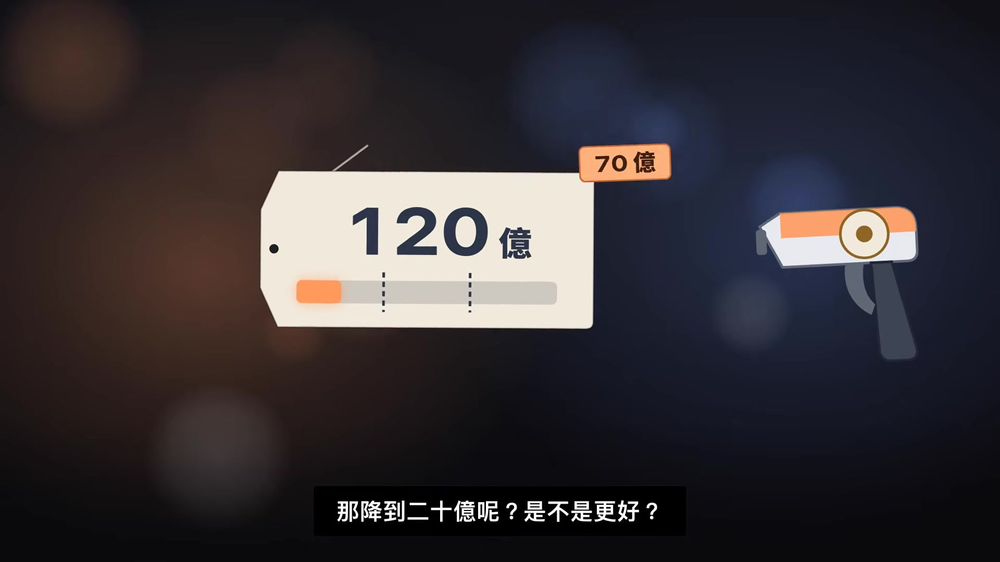

**逐字稿片段：** 很多人一聽到通貨緊縮就緊張 因為他常常跟經濟不景氣一起出現 而Colison知道 Altman對這件事有一個很特別的立場 聽他怎麼說 I don't know, this is your theory 不,這是你的理論 I do believe in that Yeah, I'm pro deflation in a sense Pro deflationary technology 支持會帶來通貨緊縮的技術 這句話要小心聽 他不是希望全國物價一起往下掉 而是某一樣東西因為技術進步 越來越便宜 這樣東西就是智慧 這個想法他講了很多年

**話題推測：** Colison與Altman討論通貨緊縮，Altman表達「支持會帶來通貨緊縮的技術」。

---

## 00:12:41

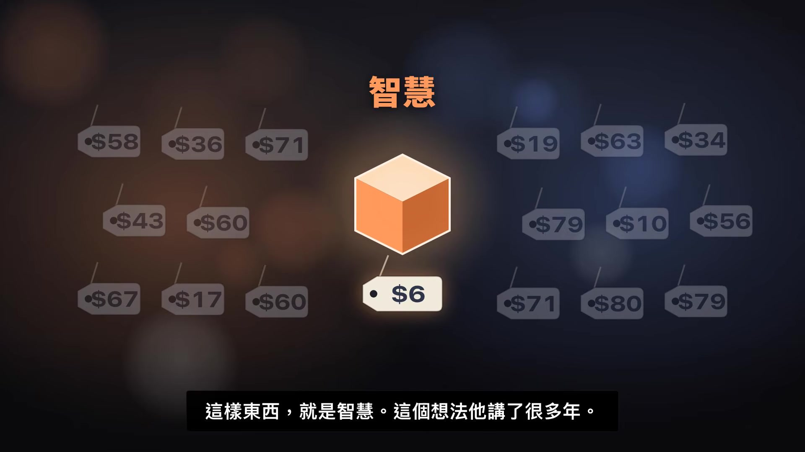

**逐字稿片段：** 2021年他寫過一篇文章 叫《每件事的摩爾定律》 請讀者想像房子、教育、食物、衣服 每兩年便宜一半 2025年6月他又寫 智慧的成本 最後會接近電費 便宜到不用計量 這句話其實有來歷 1954年

**話題推測：** 提及Altman在2021年寫過《每件事的摩爾定律》，預測智慧成本將接近電費。

---

## 00:12:57

**逐字稿片段：** 美國原子能委員會主席說 我們的孩子會在家裡 用到便宜到不用計量的電 核能後來很重要 可是家裡的電錶 到今天都還在轉 那AI的價格 真的有在往下掉嗎?

**話題推測：** 引用1954年美國原子能委員會主席「便宜到不用計量的電」的預言。

---

## 00:13:09

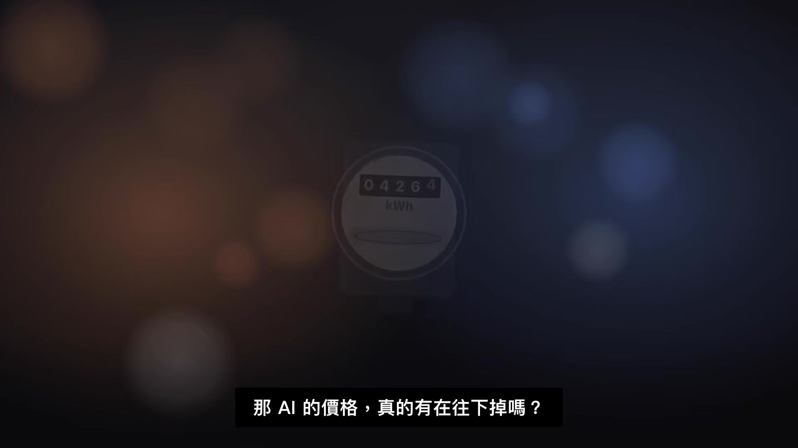

**逐字稿片段：** 研究機構Epoch AI 在2026年9月的分析說 要做到同樣的表現 成本從2023年以來 大約一年降13倍 可是這算的是 同樣表現的價格 不是大家的總賬單 模型一便宜 人就改用更強的 用得更多 總花費反而一直往上 計價方式也有問題

**話題推測：** 引用研究機構Epoch AI在2026年9月的分析，指出AI達到相同表現的成本每年下降13倍。

---

## 00:13:27

**逐字稿片段：** 現在AI多半用Token收錢 模型思考的過程你看不到 也照樣算錢 Altman說 他們差點決定下一個模型 完全不用Token計價 可是客戶強烈反對 說至少要知道自己在付什麼錢 Colison拿晶片來比 晶片上寫幾奈米 早就跟真正的長度沒什麼關係了 聽他怎麼說 I know, it's very silly So You're not like that I would rather not make up a fake unit Tokens are a kind of fake unit I mean they're real in some sense But like they're not a good unit Token是假單位 意思不是價格造假 是Token數得出來 卻不等於你拿到多少價值 那東西一直變便宜 是好事還是壞事 後來當上美國聯邦準備理事會主席的

**話題推測：** 討論AI目前以「Token」計價方式的問題，Altman稱其為「假單位」。

---

## 00:14:12

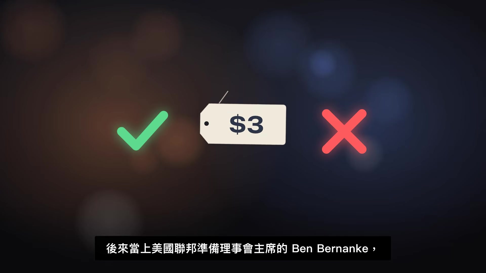

**逐字稿片段：** Ben Bernanke 在2002年的演講裡說 通貨緊縮指的是物價全面下跌 某一個產業因為生產力提高而降價 不算通貨緊縮 通常也不是問題

**話題推測：** 引用美國聯準會前主席Ben Bernanke在2002年的演講，區分產業降價與全面性通貨緊縮。

---

## 00:14:21

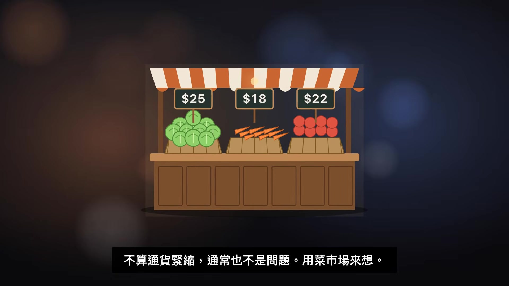

**逐字稿片段：** 用菜市場來想 一種降價是豐收 高麗菜種得多 菜便宜 買菜的人開心 另一種降價是沒人買 大家擔心失業 不敢花錢 攤販降了價還是賣不掉 Bernanke說 真正的通貨緊縮 幾乎都是後面這一種 是大家的需求一起崩掉 歷史也是這樣 十幾個國家 一百多年的資料裡 通貨緊縮跟經濟蕭條綁在一起 主要只在1930年代 可是豐收的比喻 也藏著一個問題 菜便宜了 買菜的人開心 那種菜的人呢 AI讓智慧變便宜 被變便宜的 有一部分是人的工作 Altman在2021年那篇文章裡自己寫過 許多種勞動的價格會往零掉 他當時的解法 是對公司和土地課稅 把錢和股份分給每個公民

**話題推測：** 用菜市場的豐收與滯銷比喻兩種降價情境。

---

## 00:15:05

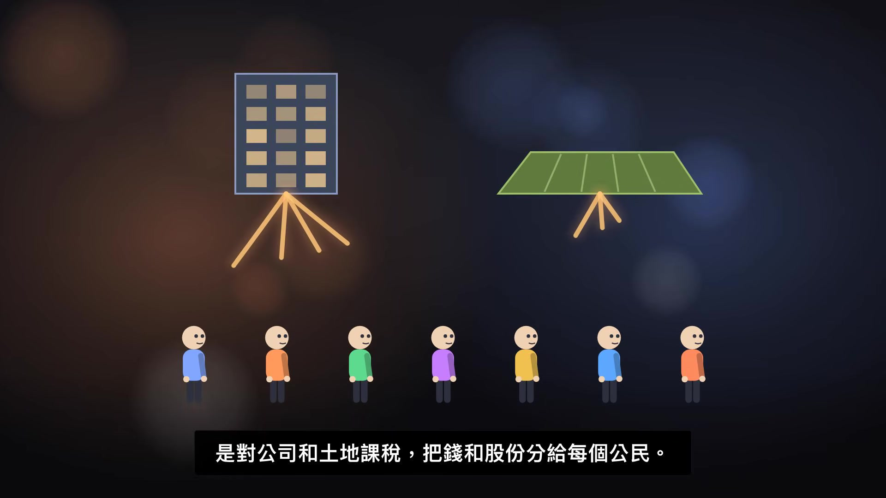

**逐字稿片段：** 經濟學家Darren Asimoglu也預測 AI比較可能拉大靠資本賺錢的人 跟靠薪水過活的人之間的差距

**話題推測：** 引用經濟學家Daron Acemoglu的預測，AI可能擴大資本與薪資收入者的差距。

---

## 00:15:12

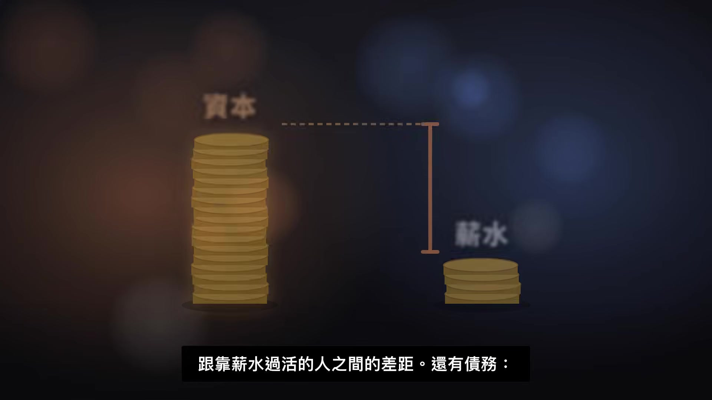

**逐字稿片段：** 還有債務 物價和收入一起往下掉 欠的錢不會跟著變少 經濟學家Irving Fisher在1933年就說過 這是大蕭條越陷越深的原因之一 一般人心裡怎麼想 Altman自己也很清楚 他在這集一開始就模仿過 你說AI會治好癌症 會讓東西變便宜 接著描繪一個像新工業革命的未來 聽他自己說 很爛的推銷話術是他自己下的評語 那他想推銷的是什麼樣的世界?

**話題推測：** 提出通貨緊縮下債務負擔加重的問題，引用經濟學家Irving Fisher的觀點。

---

## 00:15:58

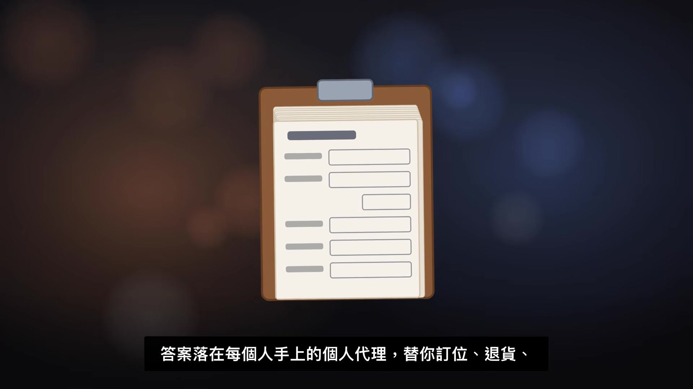

**逐字稿片段：** 答案落在每個人手上的個人代理 替你定位、退貨、填表、比價 OpenAI在2026年9月底推出的Dots就是一個 可是Altman承認 還沒有人做出讓人覺得沒有他活不下去的個人代理 Colison說 網站上的每一張表單基本上都是假工作 他光是家族病史就填了幾百次 Altman說 他會很開心這輩子再也不用在電腦上做假工作 他還說,叫Chad GPT幫他買東西時,十次有十次選Amazon,就算比較貴,因為信任他的退貨和到貨 等到代理替你點來點去,信任才是護城河 這呼應了他在對談一開頭講的,他想要的世界 聽他說 不要讓舊金山幾平方英里裡的一群人 替未來做所有決定 這跟一兆個AI是同一個想法 權力不要集中

**話題推測：** Altman描繪他期望的世界：每個人都擁有個人AI代理，處理假工作。

---

## 00:16:59

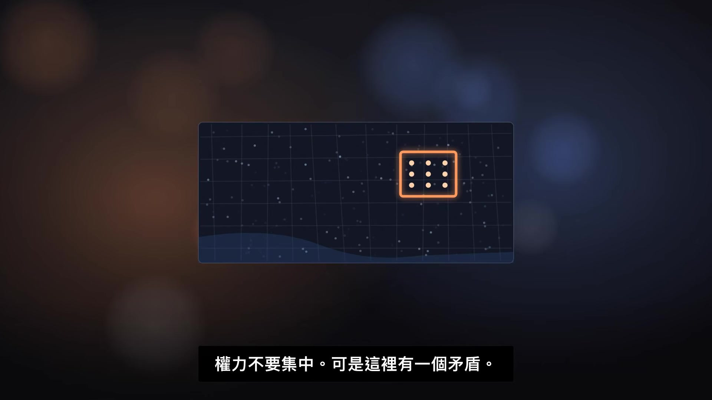

**逐字稿片段：** 可是這裡有一個矛盾 AI的數量可以分散到每個人手上 算力卻集中在少數幾家公司 OpenAI在2025年說 他們承諾要蓋的資料中心

**話題推測：** 指出AI數量可以分散，但算力卻集中在少數公司手中的矛盾。

---

## 00:17:09

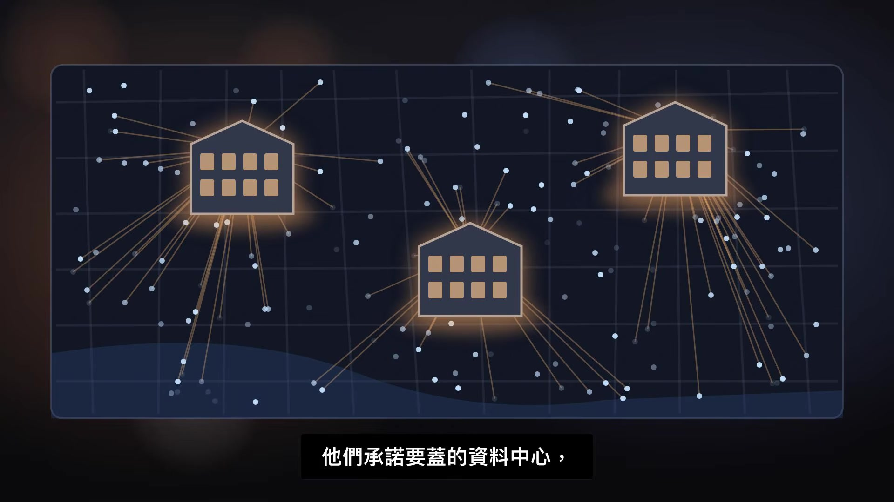

**逐字稿片段：** 加起來要用掉大約30個大型核能反應爐的電 Altman在這集還說 每個人自己的電腦裡放一堆記憶體晶片 大部分時間閒著 很浪費 算力應該放在雲端 這有道理 可是他自己就是賣雲端的 所以回到主問題 AI強到人類關不住的時候 我們該要一個超級AI 還是很多個AI Altman的答案是很多個 而且要便宜到人人都有

**話題推測：** 提及OpenAI規劃的資料中心將用掉約「30個大型核能反應爐」的電。

---

## 00:17:32

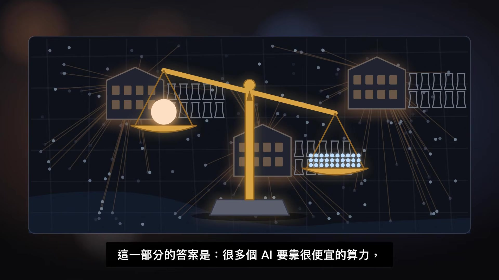

**逐字稿片段：** 這一部分的答案是 很多個AI要靠很便宜的算力 而很便宜的算力目前握在很少幾家公司手裡 你手上的代理再多也都在同一批公司的機房裡運作 分散的是AI的數量 集中的是算力 Sam Altman怕的不是AI太強 是隻有一個太強的AI 牢房關不住他 監視器看不清他 最後只能賭他真心站在我們這邊 所以他壓很多個像一座互相制衡的城市 可是城市要真的是很多人 不是同一個人的分身 智慧要真的變便宜 好處也要真的分到每個人手上

**話題推測：** 總結第三部分：「多個AI」需要便宜算力，但算力集中於少數公司。

---

## 00:18:04

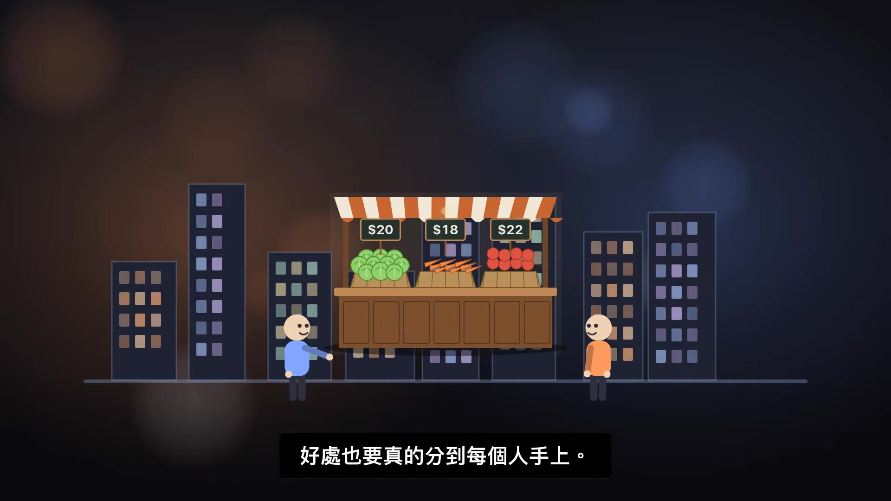

**逐字稿片段：** 最後問你一個問題 一個無所不能的超級AI 跟一群只比人聰明一點的AI 你比較放心哪一個 留言告訴我 喜歡的話訂閱AI Notebook 開啟通知 我們下次見

**話題推測：** 向觀眾提出最終問題：對超級AI或一群只比人聰明一點的AI，哪個更放心？

---
