# jimainotebook_xMlSBKB3o0w — 關鍵畫面索引

- 來源逐字稿：[jimainotebook_xMlSBKB3o0w_FIN.srt](jimainotebook_xMlSBKB3o0w_FIN.srt)
- 影片：https://www.youtube.com/watch?v=xMlSBKB3o0w
- 截圖數：52

## 00:00:10

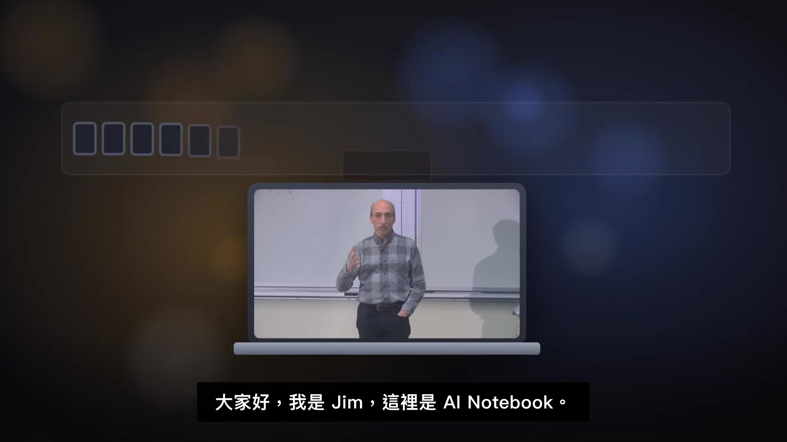

**逐字稿片段：** 這一集是麻省理工學院MIT的公開課, 區塊鏈與貨幣的下集, 也是最後一集, 這次上最後七堂課,

**話題推測：** 影片開始介紹麻省理工學院的公開課程。

---

## 00:00:17

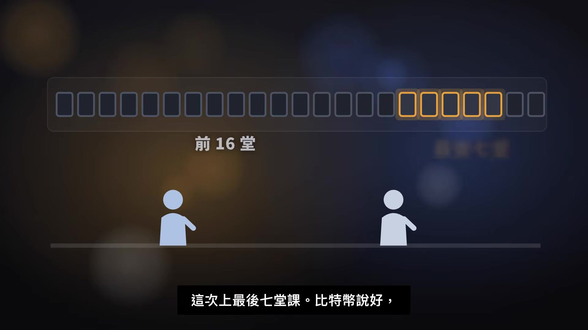

**逐字稿片段：** 比特幣說好買賣錢不需要中間人, 十年後回頭看, 中間人到底有沒有被拿掉, 這是我們這一集唯一要回答的問題,

**話題推測：** 提出本集核心問題：比特幣承諾的無中間人交易是否實現？

---

## 00:00:24

**逐字稿片段：** 上一集我們說錢說穿的是一本大家都相信的帳本, 終極我們問這本帳到底該交給誰來記, 這一集, 我們回到比特幣最早的那個承諾, 看它走到現實裡, 變成了什麼樣子, 我先講一下。

**話題推測：** 回顧上集內容，錢的本質是一本大家都相信的帳本。

---

## 00:00:37

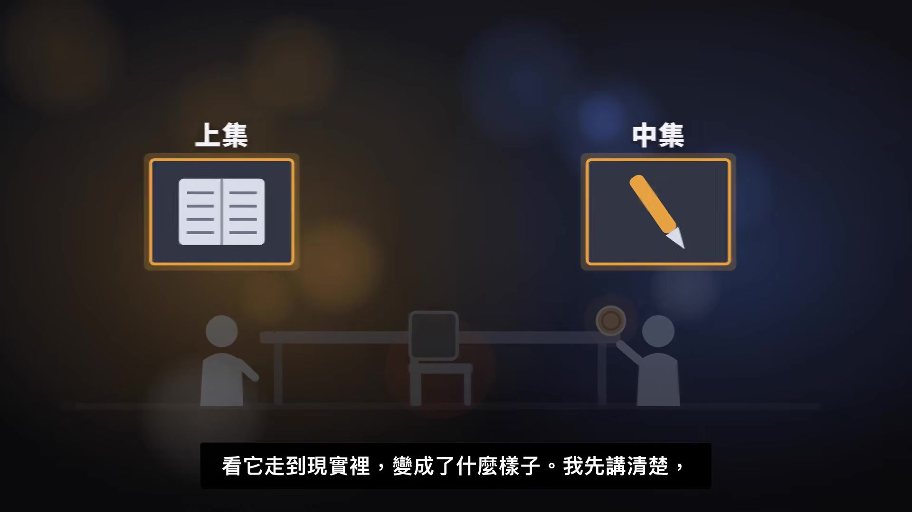

**逐字稿片段：** 這是2018年秋天的課 課堂上有些數字跟預測 今天看已經過時 遇到這種地方 我會停下來 補一句 後來發生了什麼

**話題推測：** 說明課程時間背景為2018年秋天，並提及內容可能過時。

---

## 00:00:46

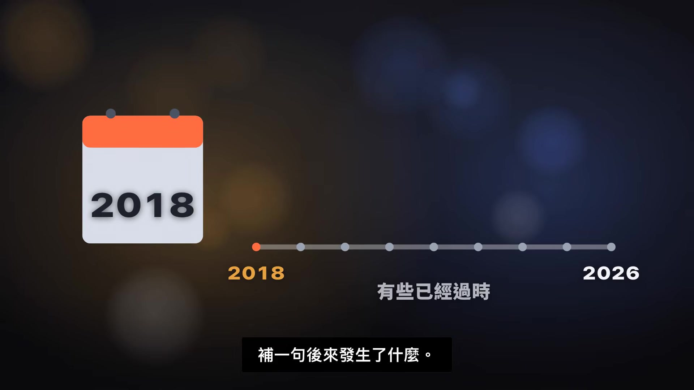

**逐字稿片段：** 講臺上的老師叫Gary Gensler 他在投資銀行高順工作過18年

**話題推測：** 介紹課程講者Gary Gensler的身份和背景。

---

## 00:00:51

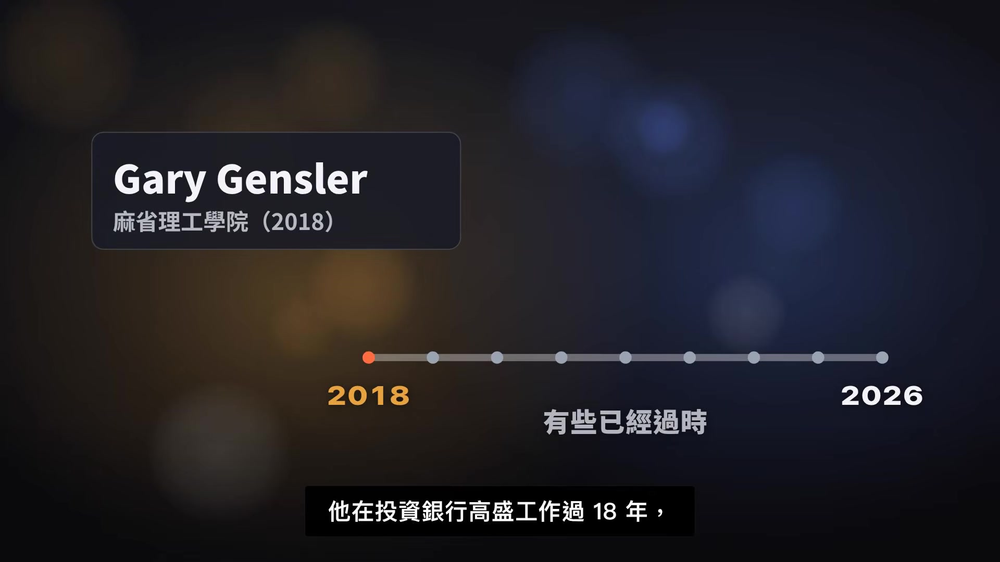

**逐字稿片段：** 上完這門課兩年多 從2021年4月到2025年1月 他擔任美國證券交易委員會的主席 也就是負責管股票 跟投資市場的那個政府機關 所以這一集的答案卷有點特別 他在課堂上談了好幾個問題 後來就擺在他自己的辦公桌上 我們照此對答案 不替他打分數

**話題推測：** 說明Gensler在課後擔任美國證券交易委員會主席的職務。

---

## 00:01:08

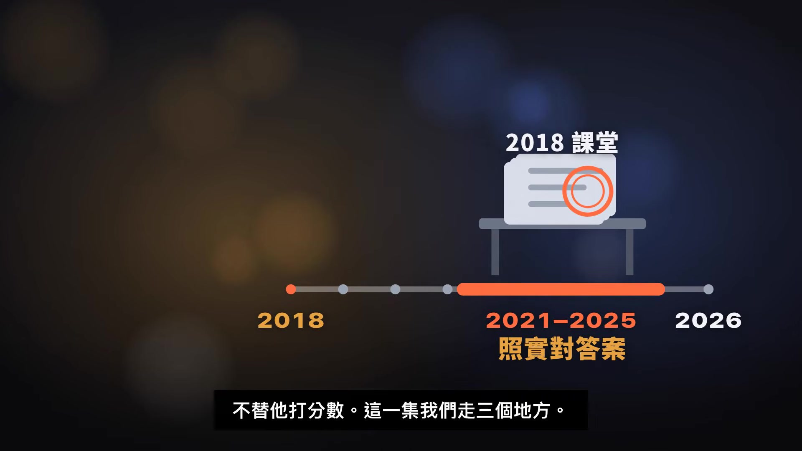

**逐字稿片段：** 這一集我們走三個地方 先看買賣的地方 也就是交易所 再看目前的地方 有人只靠一份文件 就募到上億美元 最後看一般人看不見的後臺 銀行跟大公司彼此記賬的地方 三個地方看完 我們再聽Gensler在最後一堂課 替整門課下的結論

**話題推測：** 概括本集將探討的三個主要領域：交易所、募資方式和金融後台。

---

## 00:01:25

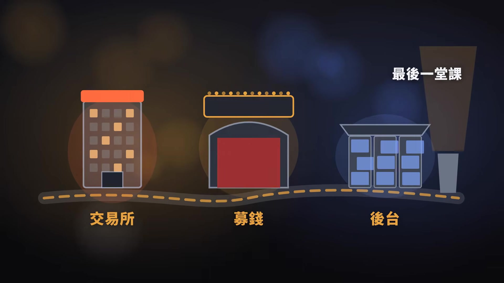

**逐字稿片段：** 2018年11月 麻省理工學院的教室裡 Gensler請大家舉手 誰買過比特幣 或者其他加密資產

**話題推測：** 引導至課堂情境，講者詢問學生是否有購買加密資產。

---

## 00:01:31

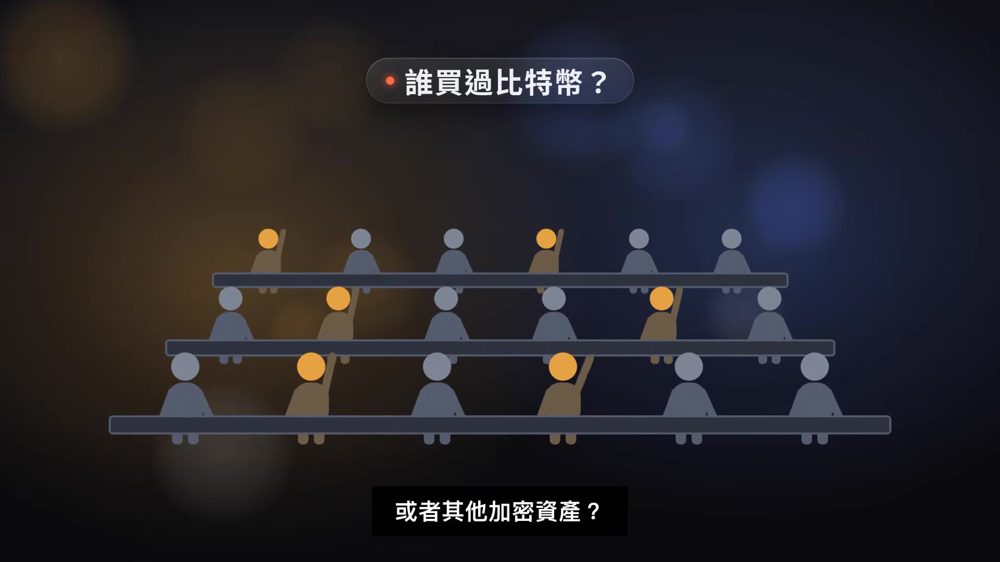

**逐字稿片段：** 大概三分之一到一半的人舉起手來 他接著問 這些人裡面 有誰是自己在區塊鏈上操作 自己保管那把私密金鑰的 整間教室 最後只剩一隻手 而且那個人是在課堂上 幫忙教書的研究人員 其他人的做法都一樣 在一家教育所開了戶 在那裡買 買完也放在那裡 這一幕很小 可是他把這一集的問題 直接擺到了桌上 比特幣當初想解決的事 是讓兩個陌生人 在網絡上直接轉賬 中間不用經過銀行 也不用經過任何一家公司 結果連麻省理工學院的學生 都選擇把錢交給一家公司 Gensler說 這其實不奇怪 因為交易所很方便 人本來就會選方便的那條路 可是他還是把這件事 叫做整個加密世界的一個諷刺 我們就從那家公司開始看 交易所到底在做什麼 他算不算一個新的中間人 我們先聽他自己怎麼說這個諷刺 中本聰的夢想 跟教室裡那一排一排的手之間 到底差了什麼 Gensler用一個很簡單的問題回答 他說你拿著比特幣或美元 去一家交易所開戶 開戶的時候 你簽了一份使用者協議 協議裡寫著 你的加密資產

**話題推測：** 揭示課堂上約三分之一到一半學生舉手表示購買過加密資產。

---

## 00:02:58

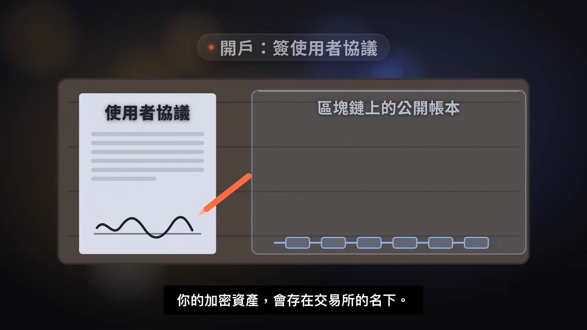

**逐字稿片段：** 會存在交易所的名下 這句話很重要 我們慢慢看 在區塊鏈上那些幣 待在交易所控制的一大堆地址裡 你手上有的是交易所另一本賬上的一個名字 還有你對這家公司的一份權利 那你在交易所裡買賣的時候 區塊鏈上發生了什麼 大多數時候什麼都沒有發生 你跟另一個客戶成交 交易所只是在自己的賬本上 把你的數字減一點 把它的數字加一點 這本賬不在區塊鏈上 它在交易所自己的電腦裡 gancer了說早期有些交易所 這本賬甚至是用試算表記的 交易所每天只把彼此的差額 送上區塊鏈幾次 上一集我們聽過 大部分人並沒有自己保管 這一集我們看到了 那些人的幣到底在哪裡 在一家公司的賬本上 換句話說 那本人人都能檢查的公開賬本 前面又多了一本 只有交易所自己看得到的賬本 這本私人的賬本 是誰在記賬的人 又同時在做哪些事 那這家公司 跟我們熟悉的證券交易所 有什麼不一樣 Gansler說

**話題推測：** 解釋用戶在交易所開戶後，其加密資產會存在交易所名下。

---

## 00:03:54

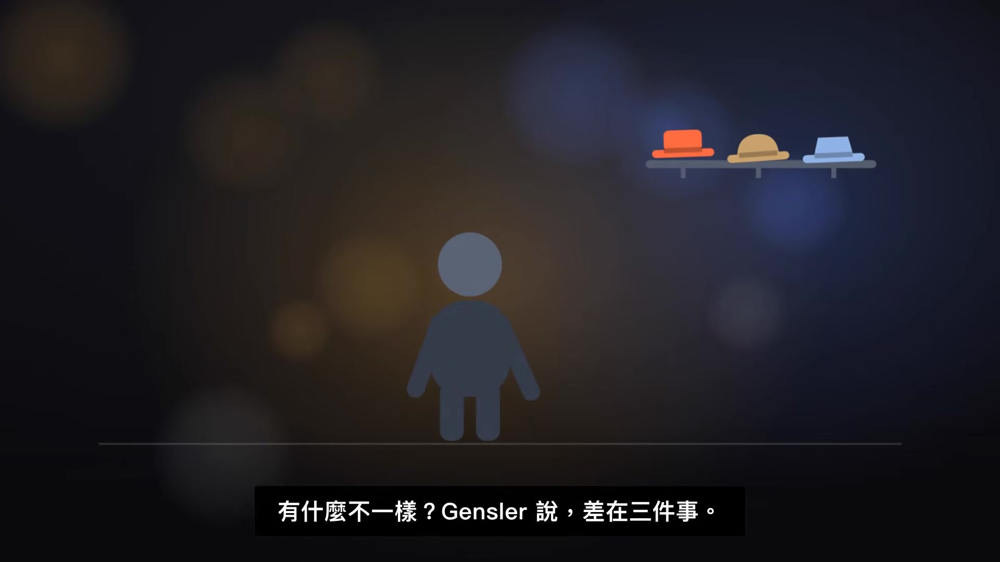

**逐字稿片段：** 差在三件事 我們先講名詞 交易所最基本的工作 叫撮合 撮合的意思 是把想買的人 跟想賣的人湊在一起 讓雙方的價格對上 紐約證券交易所 做的主要就是這一件事 可是加密交易所 常常還多做兩件 他可能自己下場買賣 跟你對坐 也就是說 你在這家店買東西 賣給你的 可能就是店家自己 另外 他還替你保管資產 你的幣就放在他那裡 在股票的世界

**話題推測：** 探討加密交易所與傳統證券交易所在功能上的三點差異。

---

## 00:04:20

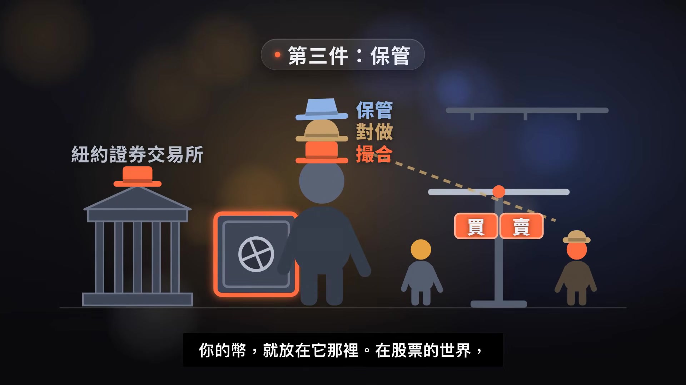

**逐字稿片段：** 這三份工作是分開的 你透過證券公司下單 交易所負責撮合股票 最後寄在另一家 專門的結算機構的賬本上 三個角色 由不同的公司來做 每一個角色 旁邊也都有人在管 在2018年的加密交易所 三份工作常常落在同一家公司身上 而且任何人都可以直接開戶 中間沒有證券公司那一層 所以我們得到這一集的第一個觀察 中間人沒有被拿掉 他回來了 而且一個人建了三份工作 三份工作放在一起 會出什麼事 Gensler先從一個看起來比較小的地方講起 數字 一家交易所生意好不好 看的是成交量 也就是一天裡 有多少錢在這裡換手 成交量越大 代表越多人在這裡買賣 價格也越可信

**話題推測：** 對比說明在股票市場中，撮合、對作和保管是分開進行的。

---

## 00:04:59

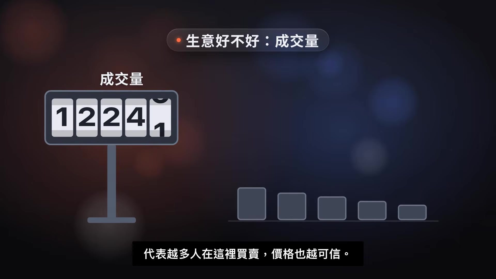

**逐字稿片段：** Gensler在課堂上放了一張交易所的排行榜 然後他說了一句話 我對這些數字沒有信心 為什麼 因為這些數字是交易所自己報的 報假數字的方法 除了直接說謊

**話題推測：** 提及Gensler在課堂上展示了一張交易所排行榜，並對其數據表示不信任。

---

## 00:05:10

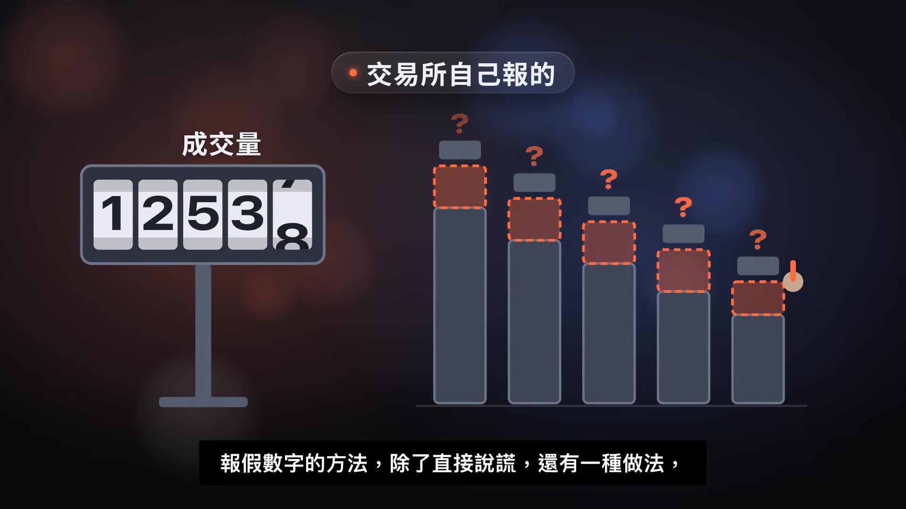

**逐字稿片段：** 還有一種做法叫洗量交易 洗量交易的意思 是自己買自己賣 或者跟講好的人互相對坐 錢到一圈回到原地 賬面上卻多出一大筆成交 這樣做可以讓一家交易所看起來很熱鬧 讓價格看起來很穩 吸引更多客戶進來 在美國的股票跟期貨市場 這種做法是被法律禁止的 可是在2018年的加密市場 沒有人在管這件事 而且很多大交易所 註冊在離主要金融中心很遠的小地方 哪一國的規則該管他們 本身就說不清楚 Gensler要講的 不是哪一家交易 所說的謊 他要學生看見的是 規則不在的地方 誘因會自己長出來 一個人兼了三份工作 又沒有人在旁邊數 數字就會往對自己有利的方向藏 下一個誘因比數字更大 而且就藏在三份工作的最後一份裡

**話題推測：** 介紹「洗量交易」這種虛報成交量的方法。

---

## 00:05:54

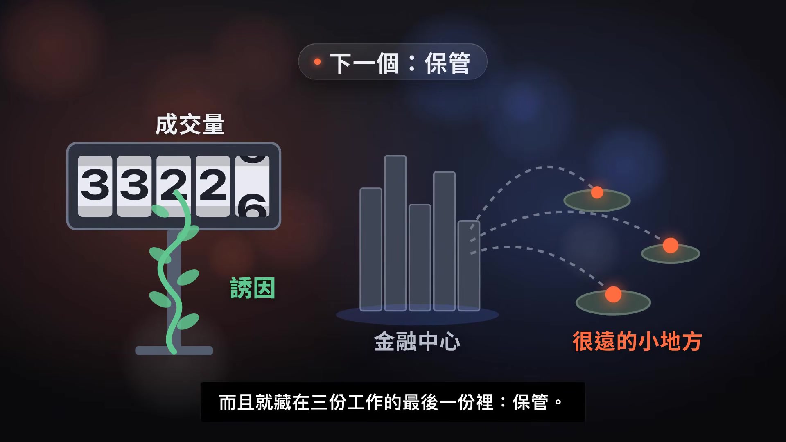

**逐字稿片段：** 保管 我們回到那三份工作 撮合 對 做 保管 Gensler覺得最危險的是保管 因為交易所手上放的是別人的錢 你可以想象這樣一個情況 一家公司的保險箱裡 放著很多客戶的資產 同一家公司又在市場上天天自己買賣 哪一天他自己的交易虧了錢 週轉不過來 保險箱就在隔壁房間

**話題推測：** 開始討論交易所三份工作中「保管」的潛在風險。

---

## 00:06:14

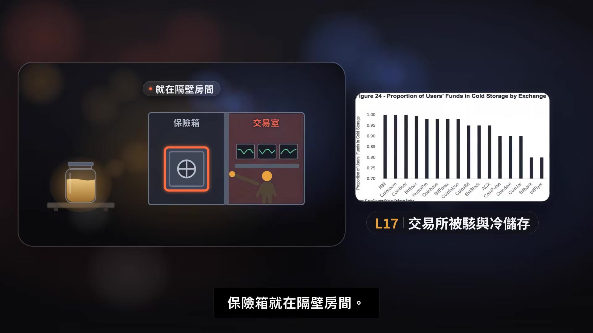

**逐字稿片段：** 這就是Gensler說的利益衝突 利益衝突的意思是 你替別人辦事 可是你自己的好處 跟對方的好處 站在不同的方向 在傳統金融處理這件事的辦法 是把保管交給另一家獨立的機構 再由監管機關定期去檢查 客戶的錢跟公司自己的錢 要放在不同的賬戶 不能混在一起 2018年的加密教育說 很多並沒有這一層 所以Gensler在 2018年11月的課堂上 給了一個很直接的處方 保管這件事 要麼修理好 要麼分出去 他還用了一個很有畫面的詞 密貫 密貫太甜 不只會招來外面的小偷 連看守密貫的人 也會想伸手 我們聽他自己怎麼說 I think from a public policy perspective they're better spun off and also transacting it's just too sweet a honeypot not just to be stolen but for the operator to say I want to use it in my own lend it, borrow it, transact around it 這段話是2018年11月講的 我們把時間往後撥四年

**話題推測：** 解釋了「利益衝突」的概念，即保管者與交易者角色合一的風險。

---

## 00:07:26

**逐字稿片段：** 2022年11月 一家叫FTX的大型加密交易所 在短短几天之內倒閉 美國證券交易委員會 後來提出的指控是 客戶放在交易所的錢 被挪到創辦人自己的一家交易公司 隔年陪審團認定 創辦人的罪名成立 Gensler在課堂上描述的那種情況 保管的人自己也在交易 最後伸手去拿保險箱裡的錢 四年後以最嚴重的方式出現了 我們回到2018年的教室 看Gensler怎麼處理這種問題 他說任何東西想要長大 讓更多一般人放心走進來 就得接受某種規則

**話題推測：** 引用FTX倒閉案例，說明保管者挪用客戶資產的嚴重後果。

---

## 00:07:59

**逐字稿片段：** 他用了一個跟汽車有關的例子 我覺得是整門課最好記得一個 一百多年前 汽車剛開始上路的時候 城市裡沒有紅綠燈 也沒有斑馬線 路上大部分的人還在走路 汽車是少數人的新玩意 走路的人很怕車 因為誰都不知道 那輛車會不會停下來 後來城市開始在路口裝上燈 畫上白線 告訴開車的人什麼時候該停 告訴走路的人什麼時候可以過 Gensler在講交易所的這堂課 把話題突然帶到這裡 因為前面那幾個問題 假的成交量 保管的利益衝突 最後都會回到同一個問題 規則到底是在擋路 還是在鋪路 很多做加密資產的人 在2018年的直覺是前者 規則代表限制 代表麻煩 代表中間人回來 Gensler想讓學生換一個角度看 他在課堂上問 紅綠燈跟斑馬線 有沒有限制汽車 當然有 你不能想開多快就開多快 紅燈亮了就得停 可是他接著問了另一個問題 他們有沒有讓汽車賣得更好 這個問題聽起來有點奇怪 限制怎麼會讓東西賣得更好 我們聽他自己怎麼回答 紅綠燈 讓走路的人 敢讓鄰居開車上路 這就是Gensler對規則的看法 他會限制一些事 也會讓原本不敢進來的人 願意進來 他說加密市場 如果想從2018年的規模 長成真正大的市場 就得走進公共政策的框架裡 公共政策的框架 意思是政府 替一整個市場定下的規則 像保護投資人 防止洗錢 維持金融穩定 我們把買賣的地方整理一下 如果只記一句 記這句 比特幣說 好不要中間人 可是大多數人 買賣比特幣的地方 又是一箇中間人 而且這個中間人 一開始沒有紅綠燈 他一個人兼的撮合 做保管三份工作 成交量可以灌水 別人的錢 就放在自己交易室的隔壁 出了事以後 規則跟著回來了 交易所沒有消失 他還在 只是身邊多了紅綠燈 那下一個問題就來了 如果誰都能開一家交易所 那誰都能自己 發行一種新的幣 拿去募錢嗎

**話題推測：** Gensler以汽車交通規則的類比，說明市場規則的重要性。

---

## 00:10:19

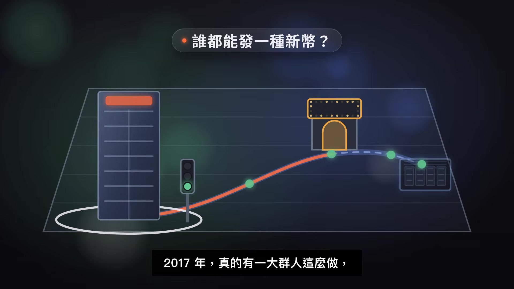

**逐字稿片段：** 2017年 真的有一大群人這麼做 而且募到了很多錢 有人只靠一份文件 就拿到了上億美元 我們走到這一集的 下一個地方 目前的地方 我們先講名詞

**話題推測：** 轉向討論第二個主題，首次代幣發行（ICO）的募資現象。

---

## 00:10:29

**逐字稿片段：** 這種做法叫ICO 中文叫首次代幣發行 他做的是很簡單 一個團隊寫好一份白皮書 說明自己要做什麼 然後在網路上賣自己發行的代幣 買的人付比特幣或以太幣 團隊就拿到了錢 白皮書的意思 是一份說明計劃的文件 它不是財務報表 通常也沒有任何人替他擔保 從2017年6月到2018年6月 這12個月 Gensler估計 全世界用這種方法募到的錢

**話題推測：** 介紹ICO的定義與運作方式。

---

## 00:10:53

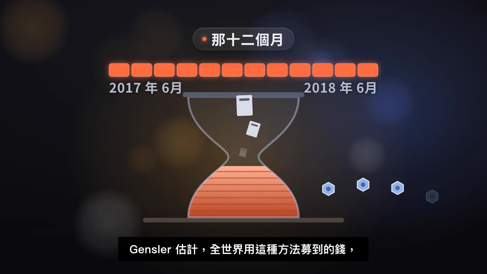

**逐字稿片段：** 大約是250億美元 這是他在2018年課堂上的估計 不是官方的統計數字 可是他讓你感覺到那一年有多熱 他在課堂上說了一句很有畫面的話 如果你在這12個月裡有個點子 又募得到錢

**話題推測：** 提供2017-2018年間ICO募資總額約250億美元的數字。

---

## 00:11:06

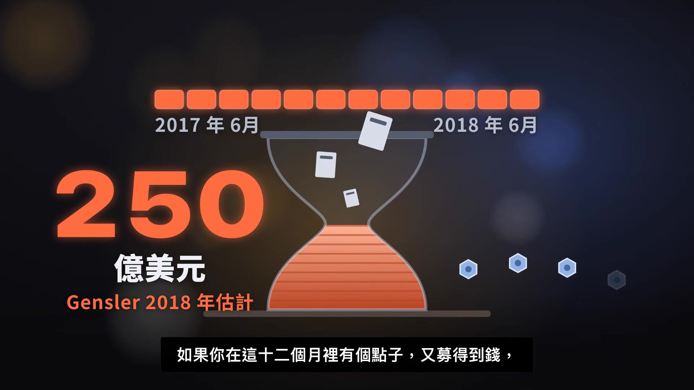

**逐字稿片段：** 那就是那個時刻 其中最有名的例子是通訊軟體Telegram Gensler在課堂上說

**話題推測：** 以通訊軟體Telegram為例，說明其ICO募資規模與問題。

---

## 00:11:11

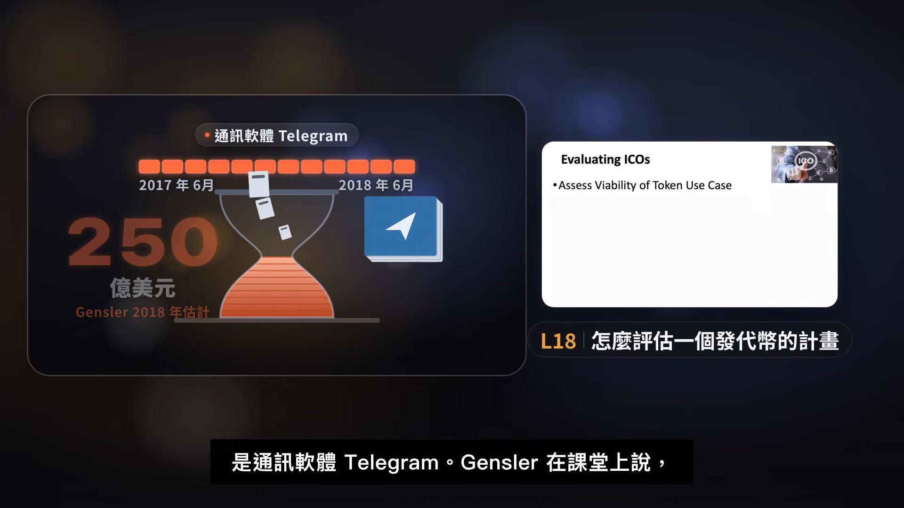

**逐字稿片段：** 他靠一份白皮書募了17億美元 他自己把那份白皮書讀了好幾次 還是看不出來 這筆錢到底要拿去做什麼 他說我讀了好幾次 我不會投資 一般的公司要從大眾手上募錢 得先把財務攤開 請律師跟會計師把關 花上好幾個月 在那12個月裡 有人只靠一份文件 就跳過了這些步驟 這件事本身 就是一個訊號 這個訊號是什麼 一般的公司募資 通常要先有東西給人看 可能是一個產品原型 可能是一群 已經在付錢的客戶 至少也要有一個完整的團隊 投資人看了這些 才決定要不要給錢 給多少錢 首次代幣發行 常常倒過來 東西還不能用 錢先進來了 Gensler 在課堂上分析過 2018年第三季的案子 他發現大多數案子 手上其實只有一個點子 沒有產品 進來以後團隊才開始想辦法把東西做出來 做得出來 大家皆大歡喜 做不出來 錢通常也拿不回來 因為代幣不是股份 買的人沒有董事會可以去開 也沒有財務報表可以看 Gensler自己用了一個很好記的比喻

**話題推測：** 提及Telegram透過白皮書募資17億美元，但Gensler看不懂其用途。

---

## 00:12:11

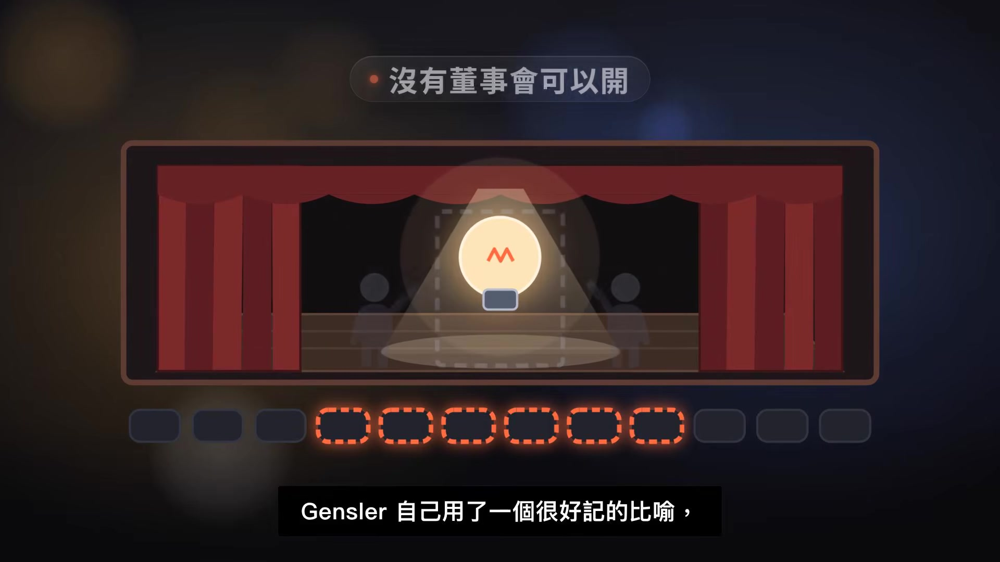

**逐字稿片段：** 跟紐約的劇院有關 百老匯是紐約的劇院街 一齣舞臺劇要上演 得先有劇本 有演員 再找人出錢 排練好幾個月才能開幕 現在想像有人拿著一張海報 上面只有一個劇名 就開始賣這齣戲的投資份額 我們聽他怎麼說 還沒有演員跟劇本 就先替一出百老匯舞臺劇幕前 這個比喻我們先記著 後面還會用到 可是你可能會問 這不就是群眾募資嗎

**話題推測：** 使用百老匯舞臺劇的比喻，說明ICO常在無實質內容下募資。

---

## 00:12:55

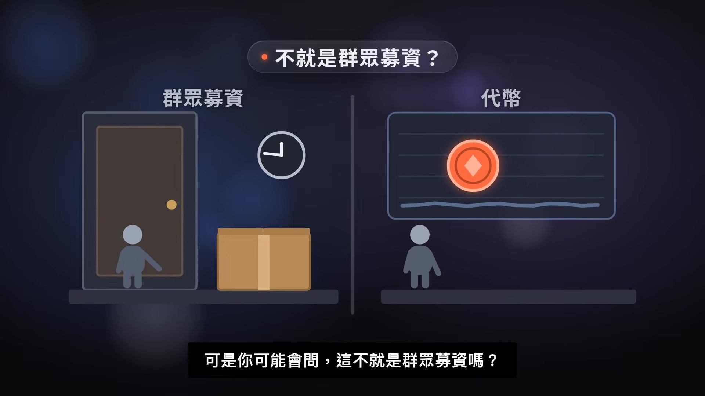

**逐字稿片段：** 像Kickstarter那種網站 也是產品還沒做出來 大家就先付錢 跟著說 差別在買的人心裡在等什麼 在群眾募資網站上付錢的人 等的是一個產品 可能是一副耳機 一套桌上游戲 東西寄到了 交易就結束了 買代幣的人 大部分等的是另一件事 代幣漲價 他們希望團隊做得好 代幣變得更值錢 自己再拿到交易所賣掉 賺一筆 還有兩個特點 讓代幣更像投資 創辦團隊通常會留下一大部分代幣給自己 代幣也可以在交易所上隨時轉賣 就是前面我們看過的那些交易所 所以買家期待的是靠別人的努力賺錢 這一句話正好碰到美國證券法最核心的問題

**話題推測：** 對比Kickstarter等群眾募資平台，區別ICO投資的本質。

---

## 00:13:34

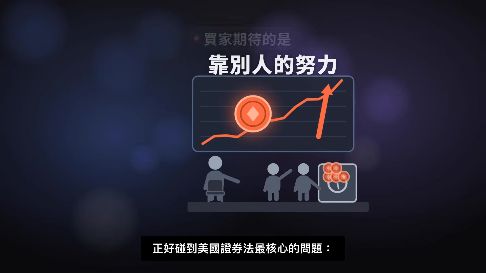

**逐字稿片段：** 這算不算證券 證券的意思 是你把錢交給別人去經營 期待分到賺頭的那種憑證 股票跟債券都是 如果代幣算證券 發行的人就得照證券的規矩來 把資料公開 不能誇大 出了事要負責 那到底怎麼判斷算不算 美國法院用的方法

**話題推測：** 引出加密代幣是否屬於「證券」的法律核心問題。

---

## 00:13:52

**逐字稿片段：** 要從佛羅里達州的一片流程原講起 1930年代末 佛羅里達州有一個商人叫William Howey 他在當地有很多土地 也經營柳橙園 他想出一個做法 把柳橙園的土地切成一小塊一小塊 賣給外地的投資人 賣地的時候 他另外給買家一個選擇 你可以自己來種 也可以跟他的關係企業籤一份合約 讓他們幫你種 再把賣柳橙的錢分給你 大部分買家住得很遠 根本不會來種柳橙 他們要的只是每年那筆收入 這件事後來鬧上了美國最高法院 1946年法院判定 這種安排是一種投資契約 也就是證券 得照證券法來管 法院還留下了四個條件

**話題推測：** 介紹美國法院用於判斷是否為證券的「Howey測試」起源故事。

---

## 00:14:28

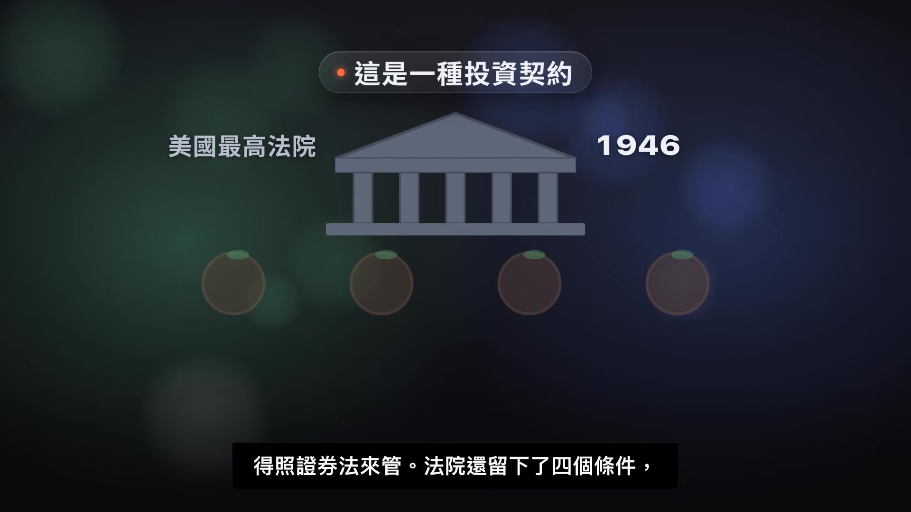

**逐字稿片段：** 後來大家就把它叫做Howey測試 你投入了錢 你的錢跟別人的錢 放在同一個事業裡 你合理的期待賺錢 而這個賺頭主要靠別人的努力 四個條件都符合 它就是證券 不管它叫土地 叫合約還是叫別的名字 這個判決在美國用了70多年 到了2017年 它被拿來判斷一枚一枚的代幣 我們聽Gensler講這個故事 3 acres but he said if you want you can enter into a contract with my affiliate Howie on the Hills I think was the affiliate as well but and we'll grow your oranges for you and give you the the revenues I'm growing you 柳城源的故事啊 聽起來跟區塊鏈 一點關係都沒有 可是你把柳城換成代幣 把幫你種柳城的公司 換成發代幣的團隊 四個條件就一個一個對上了 你付了錢 大家的錢放進同一個計劃 你期待代幣漲價 而漲不漲 要看團隊有沒有把東西做出來 法律條文常常寫得很長 判決書也很難讀 Ganser自己倒是有一個更短的說法

**話題推測：** 列出Howey測試的四個判斷條件。

---

## 00:15:32

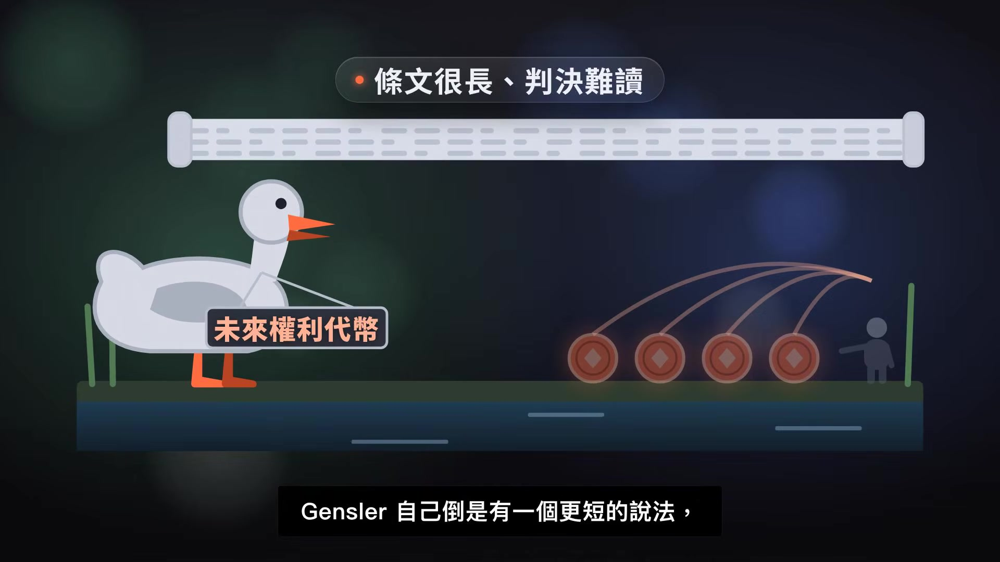

**逐字稿片段：** 叫鴨子測試 這個名字來自一句英文的老話 走起來像鴨子 遊起來像鴨子 叫起來也像鴨子 那大概就是一隻鴨子 他的意思是 判斷一個東西是不是正確 不要被他取的新名字帶走了 回到常識就好 那看起來像投資 賣的方式像投資 買的人也把它當投資 那他就是投資 就該照投資的規矩來 這個工具很簡單 可是他在這一集裡 會一直回來 在結尾 Gensler自己也會再提一次 記住他的名字 鴨子測試 我們聽他怎麼說 既然有這麼清楚的常識 為什麼 2017年 還是有那麼多人掏錢 Gensler在課堂上 給了幾個原因

**話題推測：** Gensler提出更簡潔的判斷方法「鴨子測試」。

---

## 00:16:25

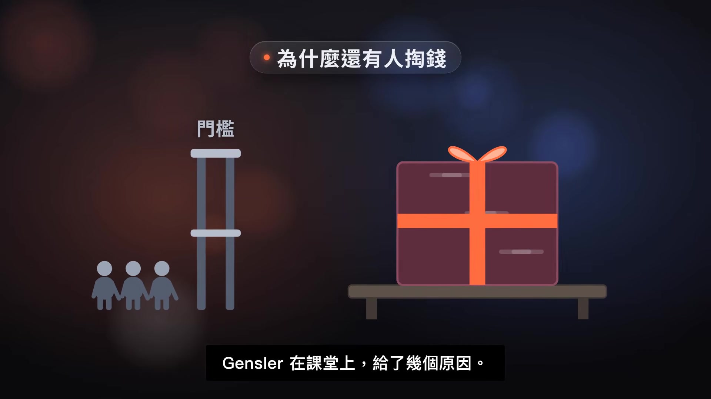

**逐字稿片段：** 最直接的原因是門檻低 一份白皮書 一個網站 就能開始募錢 不用像上市公司那樣 把財務報表攤開給人看 再來是怕錯過 朋友都在買 價格天天漲 你會覺得自己晚一步 就少賺了一大筆 不過Gensler也很公平 他提醒學生 不是每個發代幣的團隊 都是騙子 很多團隊是真心想做一個東西 只是發現這筆錢來得太容易 又太便宜 不用讓出公司的股份 也不用每一季交報告 結果憑一份白皮書 募到錢 三個月後 才發現自己的點子行不通 所以問題不只是 有沒有壞人 而是這個目前的方式 少了一些 讓好人也會停下來 想一想的關卡 還有最後一個原因 他講得特別好 區塊鏈的世界 有很多技術名詞 雜臭 函數 數位簽章 共識機制 一般人聽不懂 就容易覺得很厲害 也就不好意思再問下去 這句話不只適用在區塊鏈 我覺得每個人都該聽一次 我們聽他自己說 我們聽他自己說 when it's shrouded in jargon And so maybe it's a lesson for all of us 我們要小心自己的投資 when something is shrouded in jargon 而它不只需要用來用來用來用來 用來用來用來用來 東西被術語包起來的時候 比較容易騙到大眾 那社會用什麼方法來處理這種問題

**話題推測：** 分析ICO在2017年盛行的幾個原因，包括低門檻和怕錯過心態。

---

## 00:17:47

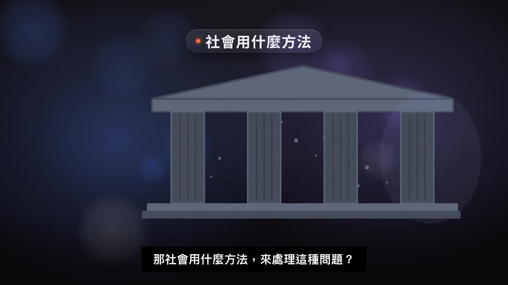

**逐字稿片段：** Gensler在課堂上列了四件事 這四件事在美國 已經用了將近100年 最先的是揭露 你要募大眾的錢 就要把你知道的事情講清楚 寫在公開的文件裡 再來是禁止詐欺 說謊騙錢 要負法律責任 再來是市場的誠信 不能操縱價格 也不能自己買自己賣 灌出假的成交量 最後一件 是管住利益衝突 替別人辦事 不能把自己的好處 擺在客戶前面 你有沒有發現 這四件事 跟交易所那一段講的問題 幾乎一模一樣 假的成交量 就是市場誠信的問題 密冠就是利益衝突的問題 換了一種技術 老問題一個都沒有少 根據這些觀察

**話題推測：** 列出社會處理投資問題的四項原則：揭露、禁止詐欺、市場誠信、利益衝突。

---

## 00:18:26

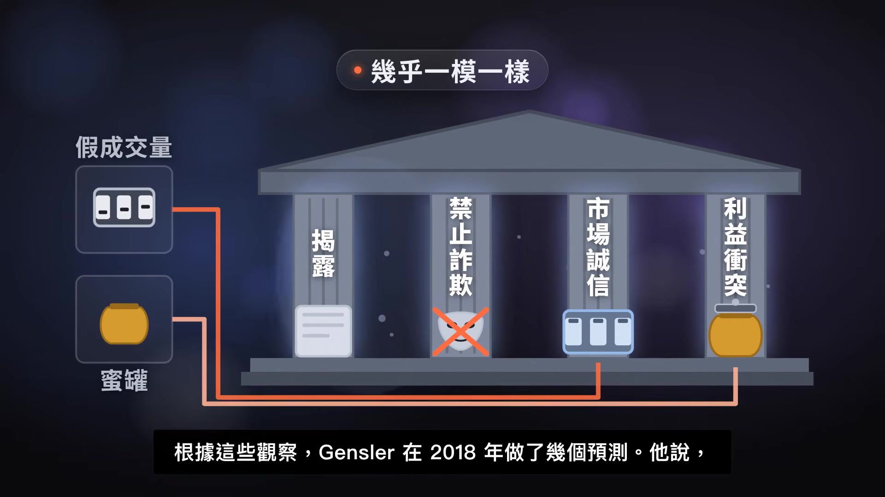

**逐字稿片段：** Gensler在2018年做了幾個預測 他說首次代幣發行會越來越少 監管機關的執法案件會越來越多 絕大多數的代幣最後會失敗 然後他講了一句很有意思的話 他說幾十年後回頭看 大家可能會說 那是2010年代發生的一件小小的怪事 也許吧 可是他說他看到的不是零 這幾個預測 我們一個一個來一堆答案 我們先對最具體的一題 Gensler在課堂上講過一種做法 律師設計了一種合約 先賣給投資人一個將來可以拿到代幣的權利 這一步照證券法的規定辦 等代幣真的發出來 再說代幣已經不是證券了 Gensler形容 這次想擠進幣值跟監管正面牆之間的那條縫 還替他取了一個好聽的名字 他說我想他們最後大概會錯 Telegram那17億美元 用的就是這一類做法 後來美國證券交易委員會把他告上法院

**話題推測：** Gensler在2018年對ICO市場趨勢做出的幾項預測。

---

## 00:19:16

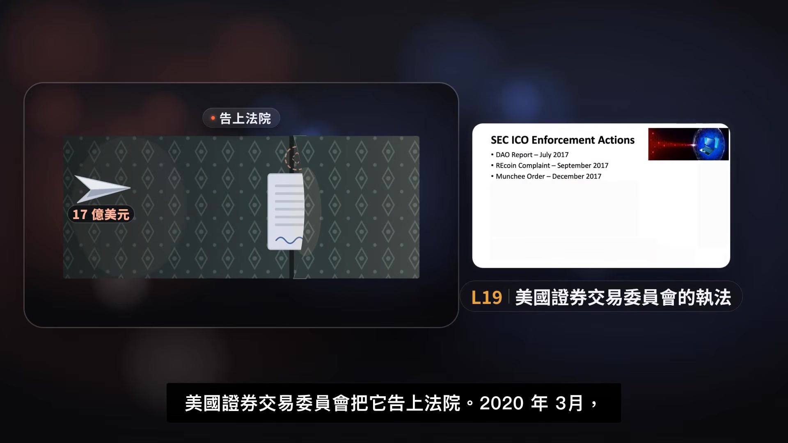

**逐字稿片段：** 2020年3月 法院下了禁制令 代幣不準交給投資人 同一年6月雙方和解 Telegram退還投資人 超過12億美元 另外付了罰款 那枚代幣 最後一枚都沒有發出去 這一題 他說中了 首次代幣發行會越來越少 這一題也說中了 2018年以後 那股熱潮很快就退了 到今天也沒有回到當年那麼瘋狂 執法案件越來越多 這一題也發生了 而且在2021年到2025年之間 主導這些案件的 正是Gensler自己領導的委員會 三題都對上了 可是還有一個預測 不是關於會不會發生 而是關於什麼時候會講清楚 Gensler在2018年11月預測 接下來18到36個月內 法院跟監管機關 會把證券的定義講清楚 也就是說 最晚大概2021年底 大家就會知道 哪些代幣算證券 哪些不算 實際上這條線炒了七八年 到今天 美國的國會跟監管機關 都還在替這條線定規則 所以這一題 時間沒有說中 其實在同一堂課 他也講過為什麼會慢 他說執法的案子很難組起來 要收集大量的證據跟文件 一件就要花很久的時間 我們也不在這裡判斷 哪一枚代幣是不是證券 那是法院跟立法的人要做的事 我們把目前的地方整理一下 如果只記一句 記這句換了名字的募資 還是募資 首次代幣發行 讓一出還沒有演員 跟劇本的百老匯舞臺劇 也能先募到錢 可是買票的人期待的是賺錢 所以照著柳成元留下來的那四個條件 用鴨子測試看一眼 很多代幣就是投資 投資就有投資的老規矩 接入禁止詐欺市場誠信 管住利益衝突 這些規矩沒有 因為技術心就消失 真正炒了很多年的 只是那條線要劃在哪裡 你會發現這跟交易所那一段 是同一個形狀 先是說好不要中間人 然後新的中間人長出來 交易所發代幣的團隊 出了事以後紅綠燈回來了 而紅綠燈要裝在哪個路口 又炒了很多年 到這裡我們看的都是一般人 把自己的錢放進來的地方 可是在2018年 很多銀行家說 譬如說區塊鏈真正的用處 根本不在這裡

**話題推測：** 說明Telegram的ICO最終被美國證券交易委員會告上法院並和解的結果。

---

## 00:21:17

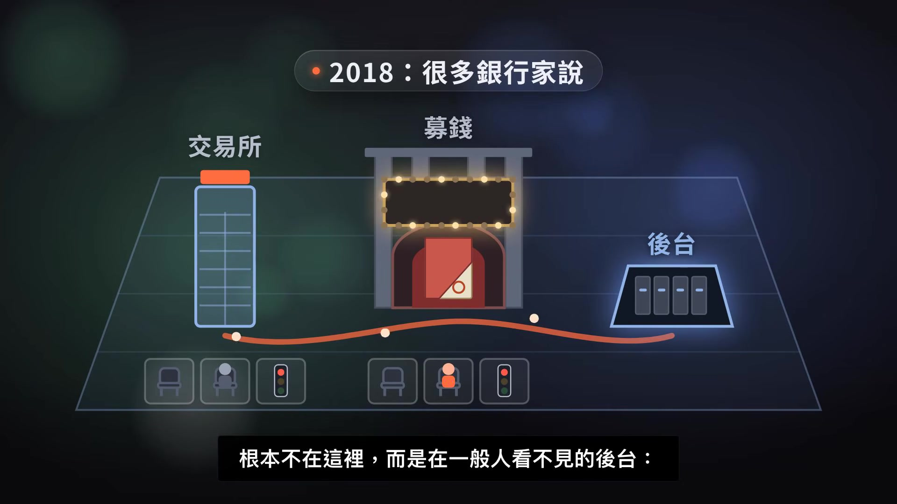

**逐字稿片段：** 而是在一般人看不見的後臺 銀行跟銀行 大公司跟大公司 彼此記帳的地方 那裡面有散戶 只有一群互相認識的大機構 不需要擔心陌生人說謊 如果連那裡都還需要中間人 那中間人存在的理由 就不只是因為大家互相不信任 我們走進後臺看看 在你手機上按下買進一張股票的那一刻 你可能以為事情結束了 其實對後臺來說 事情才剛開始 後臺的意思 是一般客戶看不到的那一層 確認身份 確認錢跟股票都在 最後把賬記上 這一層平常沒有人在意 他安安靜靜的運作 每天處理數不清的交易 出錯的時候才會有人想起他 可是在2018年 很多銀行跟交易所相信 區塊鏈最大的用處就在這裡 他們想用中級講過的 有門禁的區塊鏈 也就是隻讓一群認識的機構 加入的區塊鏈 把後臺好幾本各自記的賬 合成一本大家共用的賬 這樣一來 就不用每天跟別人對賬 也許連站在中間的那家機構 都可以省掉 這個想法聽起來很合理 可是要判斷他行不行 得先知道後臺本來在忙些什麼 這件事 連在華爾街做了很多年的人 都不一定說得清楚 Gensler在投資銀行高深做了18年 他在課堂上 很坦白地講了一件事 我們聽他自己說 那清算跟交割到底差在哪 一筆股票交易大致分成三步 開頭那一步叫成交 你出價我接受 價錢跟數量談好 法律上就算成交了 接下來叫清算 確認你真的有錢 我真的有股票 還有一件最重要的事

**話題推測：** 轉向討論第三個主題，一般人看不見的金融「後台」運作。

---

## 00:23:01

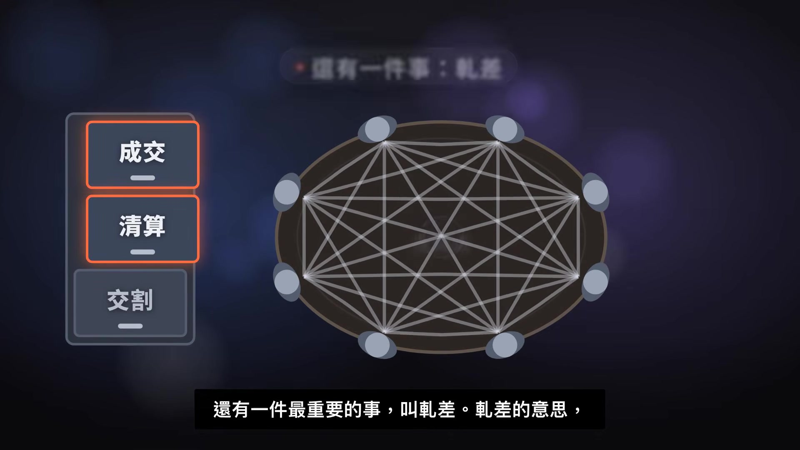

**逐字稿片段：** 叫扎差 扎差的意思 是把一堆互相欠來欠去的賬先抵消 只算金額 最後叫交割 在賬本上做最後一次記錄 錢跟股票真的換手 扎差為什麼重要 舉個例子 一家證券公司 今天替客戶買了很多筆臺積電 也替另一群客戶賣了很多筆 如果每一筆都各自付錢 各自交股票 搬運的次數會非常多 啊 扎插以後 他每天只要跟清算所 結一次金額 Danzler說 扎插可以把要處理的筆數 砍掉九成以上 然後他補了一句 我知道這違反中本聰的整個理念 可是中央的中間人會出現 最大的原因之一 就是假插 要假插 就得有一個站在中間 看得到所有人賬目的人 比特幣那種成交 就把錢跟股票都準備好 不能先買後付 課堂上提到 美國負責股票結算的那家公司 問遍了客戶 找不到真的想要成交就交割的人 不過在2018年 也有人非常樂觀 而且不是新創公司 是一個國家的證券交易所

**話題推測：** 介紹「扎差」（Netting）概念，以及其對交易處理效率的影響。

---

## 00:23:58

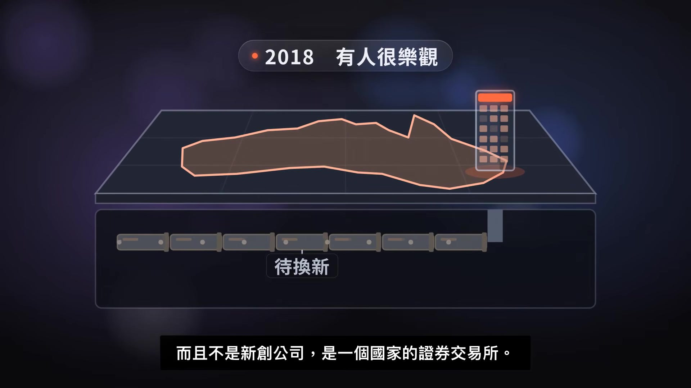

**逐字稿片段：** 澳洲證券交易所 負責整個澳洲股票市場的 成交清算跟交割 他有一套用了很多年的 清算交割系統 需要換新 他的打算 是用有門禁的區塊鏈 換掉舊系統 Gensler在課堂上說 整門克里 他對這一講是比較樂觀的 至少對有門禁的區塊鏈 用在清算交割這件事上 原因是後臺的麻煩很真實 每一家證券公司 都得各自保存一份記錄 每天跟別人對賬 對不上 就要找人一筆一筆處理 如果大家共用一本賬 對賬這件事 就可以省下來 Gensler把澳洲這個專案 當成全世界最受注目的例子 他引用了澳洲證券交易所 自己發佈的報告 報告裡有一個很長遠的判斷 講的不是澳洲一個國家 而是全世界的清算所 這是一個有具體年份的預言 很少有預言寫得這麼清楚 我們聽他轉述

**話題推測：** 引用澳洲證券交易所（ASX）的案例，探索區塊鏈在清算交割的應用。

---

## 00:25:08

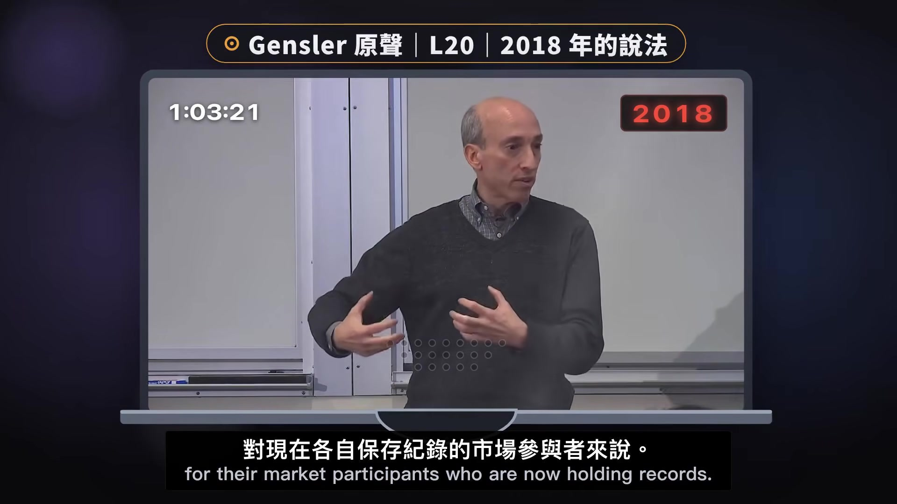

**逐字稿片段：** 15到20年後 每一家清算所都會用 有門禁的區塊鏈

**話題推測：** 提及ASX預測15到20年後所有清算所都會採用有門禁區塊鏈。

---

## 00:25:12

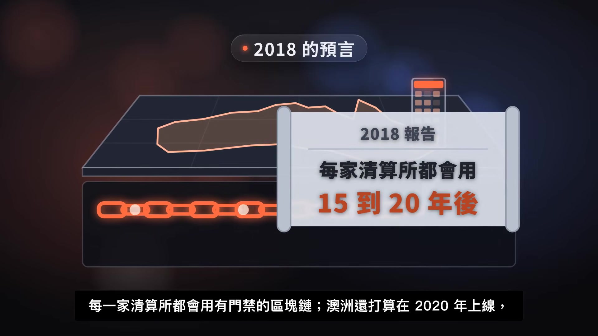

**逐字稿片段：** 澳洲還打算在2020年上線 先跟舊系統一起運作一年 這是澳洲證券交易所在 2018年的預言 Gensler是轉速的人 這個專案後來怎麼了 終極我們講過

**話題推測：** 說明ASX計劃在2020年將新系統上線的預期時間。

---

## 00:25:24

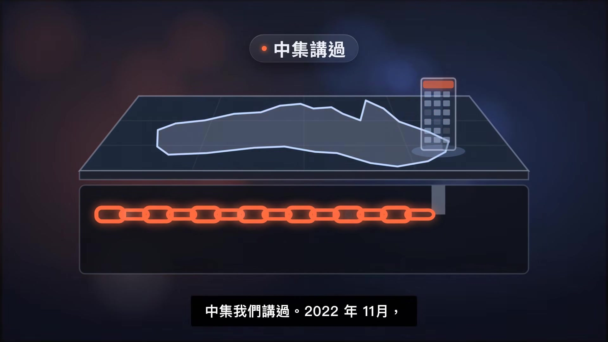

**逐字稿片段：** 2022年11月 澳洲證券交易所宣佈暫停這個專案 後來改回一套傳統的系統 Gensler在課堂上 其實也提醒過一件事 他說市場幾百年來都是先成交 過一兩天才交割 要整個市場一起換一種做法 這條路會很陡 清算交割是金融市場的後臺 再往外走一點 是海上的後臺

**話題推測：** 揭示ASX的區塊鏈專案在2022年11月宣佈暫停的結果。

---

## 00:25:43

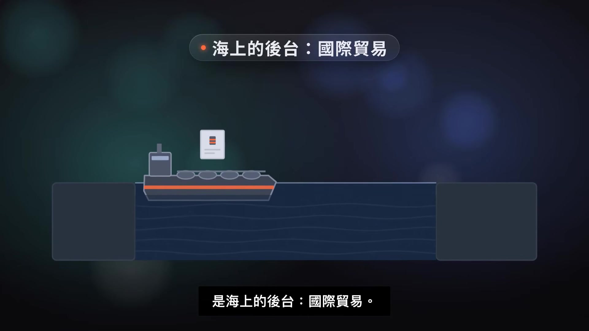

**逐字稿片段：** 國際貿易 一艘船從中東再游到美國 賣方跟買方可能從來沒見過面 賣方怕貨送到了 錢收不到 買方怕錢付了 貨沒有來 幾百年來 貿易界發明了兩樣東西 來處理這件事 先講名詞

**話題推測：** 將話題擴展到國際貿易的後台，討論信用狀和提單的作用。

---

## 00:25:58

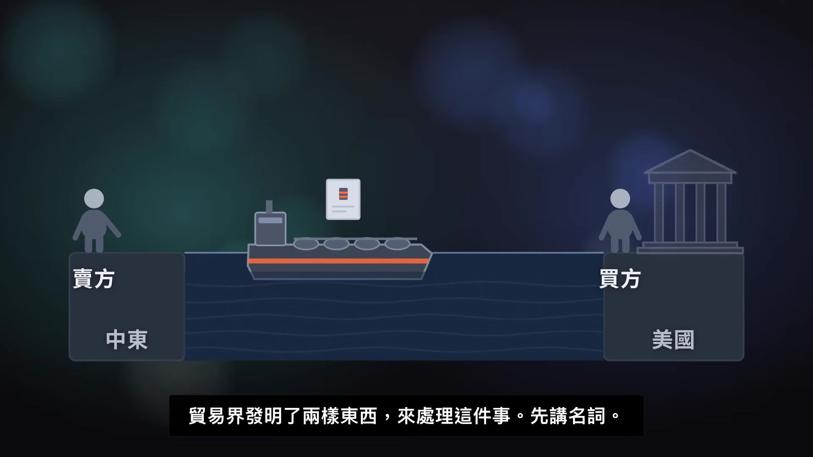

**逐字稿片段：** 一樣叫信用狀 就是買方的銀行出面保證 只要賣方把該交的單據交起 銀行就付錢 你不認識我沒關係 銀行替我擔保 另一樣叫提單 是船公司開的收據 誰拿了它 誰就能在港口領貨 嚴死爾說 提單其實就是船上的倉單 上集我們講過 很早以前的紙鈔 就是從倉單來的 你把東西存在倉庫 拿到一張收據 收據就能拿去買賣 所以他說 某種程度上 你可以把提單想成一種錢 它可以賣 可以拿去跟銀行借錢 一船遊在海上走的那段路 提單可能已經換手很多次 問題也跟錢一樣 同一張提單 會不會被拿去跟兩家銀行借錢 貿易界有一個名字 叫重複融資 其實就是貿易版的雙重支付 所以根斯德說 貿易融資大概是區塊鏈最好的應用場景之一 至少對有門禁的區塊鏈來說 這是整門克里 他很少見的正面評價 在2018年 真的有人這麼做了 全世界最大的航運公司之一 快為

**話題推測：** 介紹國際貿易中用於處理信任問題的「信用狀」和「提單」。

---

## 00:26:54

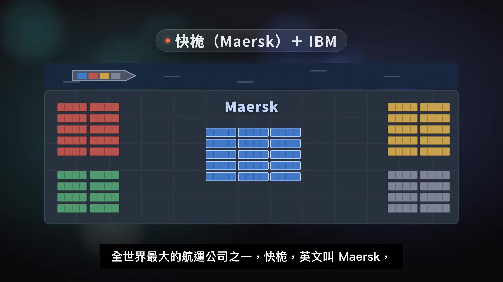

**逐字稿片段：** 英文叫Mersk 跟IBM一起做了一個平臺 叫TradeLens 他想把貨櫃從出發到抵達的每一份單據 都放到同一本共用的賬上 照理說 這是很好的點子 單據不會遺失 也比較難造假 海關 銀行 港口 都能看到同一份資料 可是Gansler在課堂上說 這個平臺宣佈了一年半 幾乎沒有人採用 原因不在技術 你可以站在 另一家航運公司的位置 想一想 你的競爭對手邀請你 把你所有客戶的出貨資料 放到他主導的平臺上 你會答應嗎 Gansler在課堂上

**話題推測：** 以馬士基（Maersk）與IBM合作的TradeLens平台為例，探討區塊鏈在貿易中的應用。

---

## 00:27:25

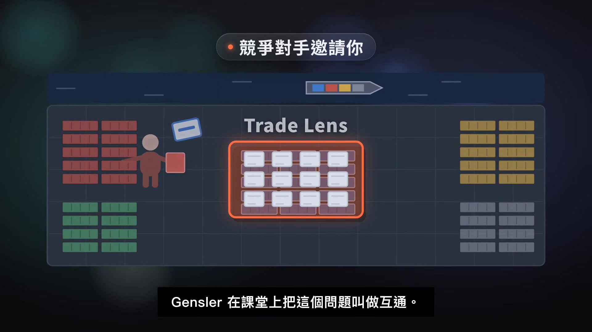

**逐字稿片段：** 把這個問題叫做互通 互通的意思 是不同的系統之間 能不能接起來 還有更重要的 大家願不願意接起來 在貿易融資這一塊 2018年已經有好幾個 每一家都想當那個站在中間的人 誰都不想把自己的生意 交到別人的平臺上 技術上這些平臺都做得出來 難的是誰來當中心 我們聽他自己怎麼說 我不想把我的資料 我的資訊 還有市場力量 交給快為 這是Gensler 在2018年12月 替其他航運公司 說出來的話 四年後

**話題推測：** Gensler提出「互通性」問題，即不同系統間的連接意願與中心化考量。

---

## 00:28:31

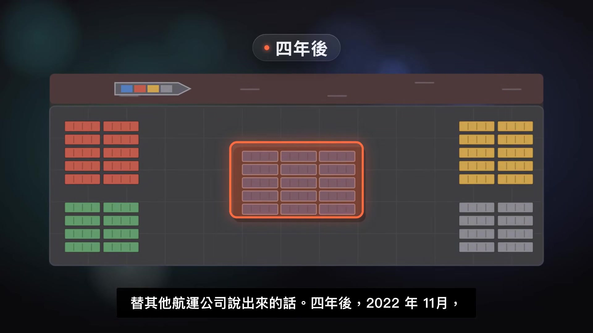

**逐字稿片段：** 2022年 11月快為跟IBM 宣佈TradeLens 要收掉 官方給的理由是 全球產業的 全面合作 沒有達成 跟他當年說的 幾乎是同一件事 課堂上還有一個學生 講了一段很真實的話 他問一家石油公司的人 為什麼不用一套 標準的資料庫就好 對方說要整條供應鏈 換新系統 跟大家說這是區塊鏈 比說這是一套 很好的資料庫 好推得多 Gensler聽完說 你可以拿區塊鏈 讓董事會緊張 也可以拿它 讓董事會興奮 反正兩種方法都能拿到 換掉舊系統的預算 這句話有點好笑 可是他說出了一件事 區塊鏈常常是改變的理由 不一定是改變的內容 後臺還有最後一本賬 是記錄你是誰的那一本

**話題推測：** 說明TradeLens平台在2022年11月宣佈收掉，印證了Gensler當年對互通性的疑慮。

---

## 00:29:09

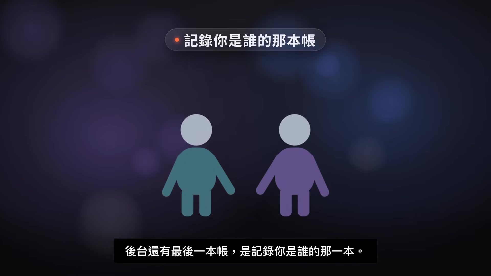

**逐字稿片段：** Gansler在講數位身份的那一堂課 放了一張照片 是他跟他的雙胞胎哥哥Rob 他們是同軟雙胞胎 DNA一模一樣 可是Gansler說 我覺得我們是兩個不同的人 那一年的感恩節 Rob把一隻iPhone遞給他 問他你看到什麼 Gansler說一堆簡訊 Rob罵了一聲 我給你的是一隻鎖著的手機 原來手機的臉部辨識 把他認成了哥哥 這個故事很好笑 可是他點中了 數位身份的難處 身份在數位世界裡 是一組屬性跟證明 你的名字 生日 賬號 還有誰替你擔保 這些是真的 金融業特別在意這件事 銀行開戶前 要先確認你是誰 這叫認識你的客戶 2001年的911事件以後 美國的反洗錢規定 把金融 稅務跟身份 綁得更緊 銀行在開戶的時候 替社會確認你是誰 這正是他當中間人的一個理由 所以在2018年 很多人想用區塊鏈 做一套不需要中間人的身份系統 這個想法 有一個很好聽的名字

**話題推測：** 轉向討論後台的最後一本賬：數位身份。

---

## 00:30:04

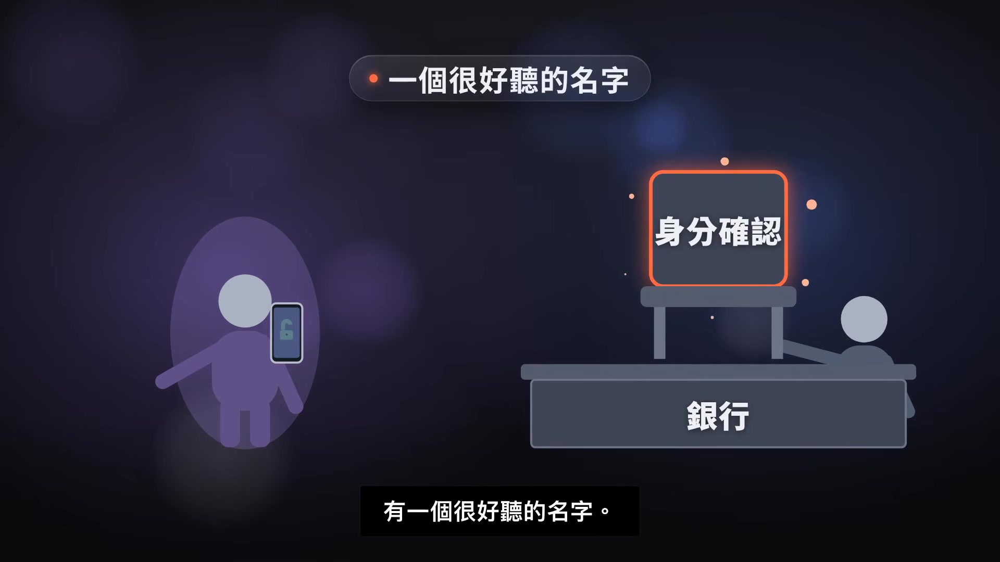

**逐字稿片段：** 這種想法叫自主身份 意思是 你的身份證明 放在你自己的數位錢包裡 你自己決定什麼時候 拿給誰看 不用每次都靠一個大機構 替你作證 Gensler喜歡這個理念 可是他提醒學生兩件事 一件是 自主身份 不一定需要區塊鏈 它是一個理念 不是一種技術 另一件更直接 區塊鏈的做法 是把同一份資料 複製到每一個節點上 節點的意思 是幫忙保存 這本賬的每一臺電腦 他說 三五年前 之前大家還想把整套身份直接存在區塊鏈上 後來都說不行 因為你不會想把我所有的個人資料 放在一萬個節點上 而且當時已經在運作的國家級身份系統 像愛沙尼亞的資料交換系統

**話題推測：** 介紹了「自主身份」的概念，強調個人對身份資料的掌控權。

---

## 00:30:44

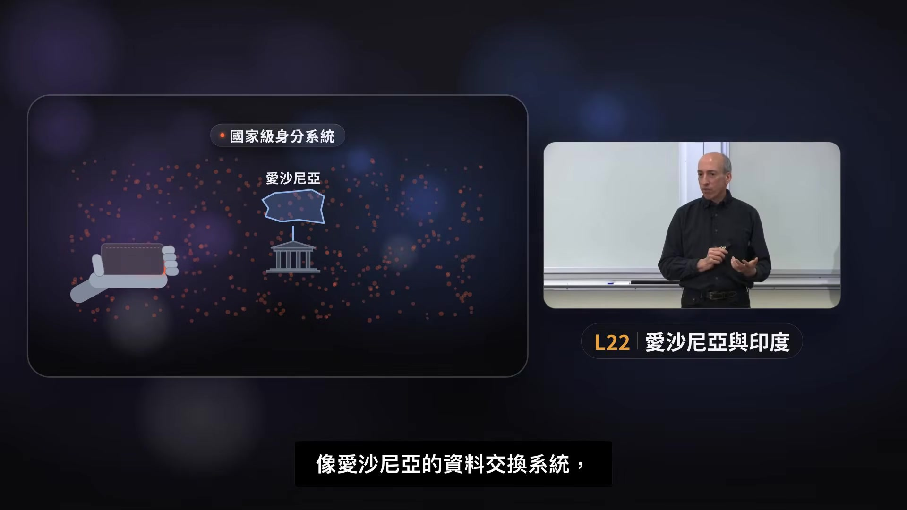

**逐字稿片段：** 還有印度的Adhar 都不是區塊鏈專案 他還說課堂上點名的幾個身份新創專案 還沒有一個真正在運作 後來呢 到目前為止 身份這本賬 主要還是由國家在管 我們把後臺整理一下 如果只記一句 記這句 在後臺 區塊鏈多半沒有取代中間人 卻逼著舊系統自己變快 為什麼中間人沒有被取代 因為他們做的事 本來就有人需要 清算所替大家詐差 讓一大堆交易變成少數幾筆 結算機構保管那本最後算數的賬 銀行替兩個不認識的貿易商擔保 國家替你證明你是誰 這些工作 不會因為賬本換成城市來記 就消失 前面我們還以為 只要大家互相認識 中間人就可以拿掉 後臺告訴我們 中間人存在 不只是因為不信任 也是因為有些工作 本來就需要有人站在中間 可是區塊鏈也不是白忙一場 澳洲的專案失敗了 可是那套用了25年的舊系統 還是得換新 就像前面那段課堂對話 區塊鏈常常是換掉舊系統的理由 Densler在最後一堂課 用了一個詞來形容區塊鏈 在這些地方的角色

**話題推測：** 提及愛沙尼亞和印度的國家級身份系統，並指出它們並非區塊鏈專案。

---

## 00:31:46

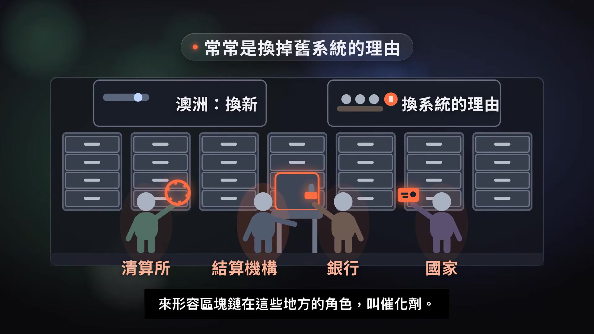

**逐字稿片段：** 叫催化劑 催化劑的意思 是他自己不一定變成最後的產品 卻能讓反應發生得更快 終極 我們聽他說過 新技術會用力踢舊系統一腳 後臺發生的事 就是那一腳 三個地方都看完了 我們回到2018年12月 最後一堂課的教室 2018年12月最後一堂課 Gangster把整個學期 收回到第一堂課講的那件事

**話題推測：** Gensler用「催化劑」一詞形容區塊鏈在推動舊系統改變中的角色。

---

## 00:32:08

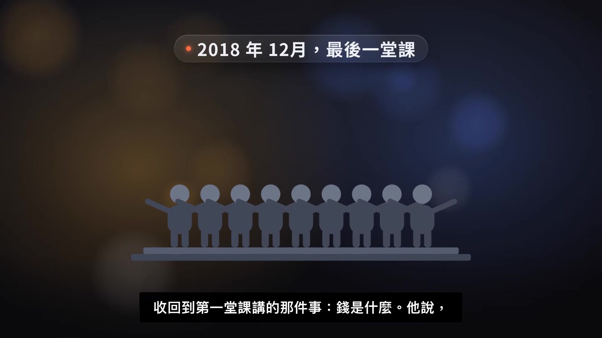

**逐字稿片段：** 錢是什麼 他說錢是一種社會共識 共識的意思 是大家都同意 大家都接受 就算有中央銀行 也只是把這個共識寫進法律 再蓋一棟有柱子的大樓 讓它看起來很穩固 可是它說穿了 還是一種共識 這也是三集以來 我們一直繞著走的那件事 上集說 說錢是一本大家都相信的檔本 終極問 這本賬該交給誰來記 這一集看到 說好不要中間人以後 中間人換了一張臉回來 那新的錢 要怎麼跟美元這種 已經被幾十億人接受的錢競爭 我們先講名詞 美元這種錢

**話題推測：** 回歸課程核心，再次定義「錢是一種社會共識」。

---

## 00:32:41

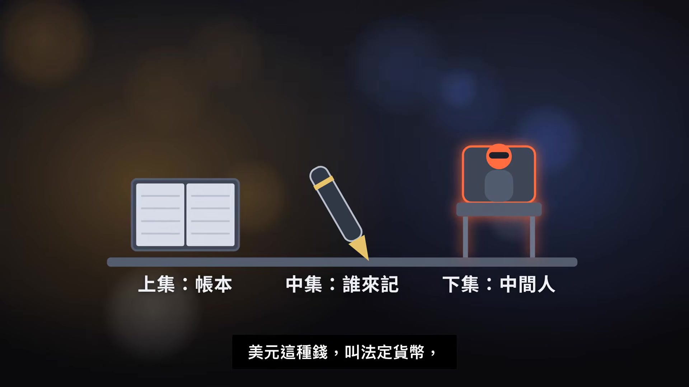

**逐字稿片段：** 叫法定貨幣 意思是政府規定 可以拿來繳稅 還債的錢 Gansler說 這是新錢最難的地方 因為法定貨幣的網絡效應太強了 網絡效應的意思是 用的人越多 他就越好用 也就越難被換掉 最後一堂課 還有一個小插曲 今天聽起來特別有感 Gensler說 麻省理工學院 有一個金融科技的研究計劃 贊助的大公司 把區塊鏈 列在清單上 可是不是第一名 他們最看重的是

**話題推測：** 引入「法定貨幣」的概念，並解釋其網絡效應為何難以取代。

---

## 00:33:04

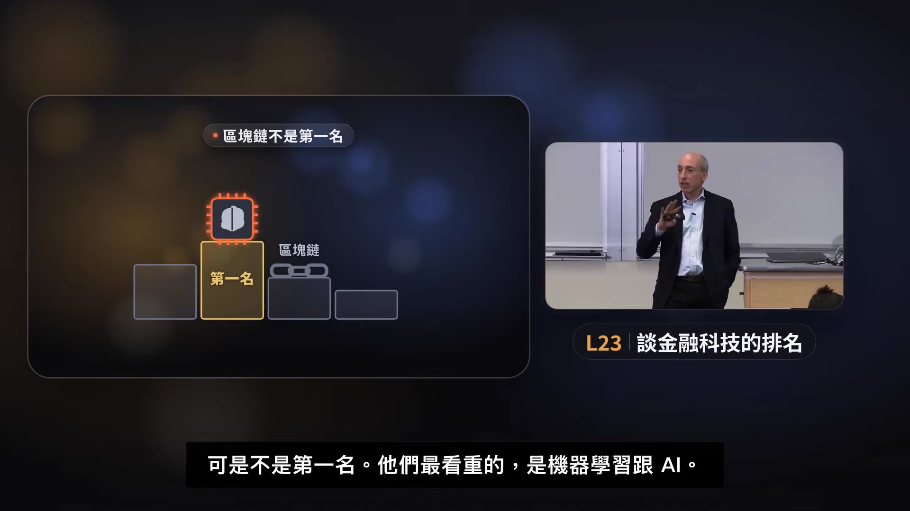

**逐字稿片段：** 機器學習跟AI 那是2018年 8年前 那去中心化的錢 最後會怎麼樣 Gensler沒有給一個 簡單的答案 他給的是一個觀察 而且他先說 別人可以有不同的看法 這個觀察 跟交易所那一段的紅綠燈 是同一件事 鐵路剛出現的時候 電報剛出現的時候 網際網路剛出現的時候 都曾經有人覺得 他們可以活在原本的規則之外 後來每一項都長大了 大到整個經濟都離不開他 而每一次 社會都替他畫了路口 裝了紅綠燈 鐵路 有了票價跟安全的規定 電報跟電話有了通訊的法律 網際網路有了隱私 跟消費者保護的規則 這個觀察 也剛好接上這一集 走過的三個地方 交易所要有紅綠燈 目前要照投資的老規矩 後臺的新賬本 也得先讓大家願意一起用 Gensler在2018年 就把這三件事放進同一個框架裡 我們聽他自己說 任何一種新的科技 若成長成為經濟化的 就必須在公共政策中活著 社會也會 穩定地改變公共政策 但你仍然要保護公眾 對於核心社會的利益 這不只在駕駛線上發生 也在19世紀上發生 也在網路上發生 那這是不是代表 去中心化的錢沒有機會 Gensler不這麼想 他在課堂上提過一個 可能中央銀行比較弱的國家 也許會想採用 後來真的有一個國家

**話題推測：** 指出2018年麻省理工學院研究計劃中，機器學習和AI比區塊鏈更受重視。

---

## 00:34:30

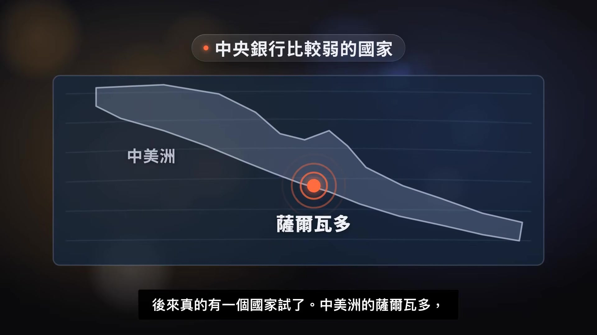

**逐字稿片段：** 是中美洲的薩爾瓦多 把比特幣定為法定貨幣 規定商家都要收 幾年後又修改法律 改成商家自己決定要不要收 一個國家可以用法律 規定一種錢 可是這種錢能不能真的流通 還是要看大家願不願意接受它 也要看它放在什麼樣的規則裡 這件事 剛好把我們帶回Gensler 在最後一堂課 對整門課說的最後一段話 他對學生說 如果你們只記得一件事 接下來他講的 不是哪一種技術 也不是哪一種幣 而是一個很好很好的發明 還有發明他的那個人 三集以來 我們聽了他很多段原聲 這是最後一段 我們聽他自己說 我們回到開場那個問題 比特幣說好 買賣錢不需要中間人 十年後中間人到底有沒有被拿掉 這七堂課給的答案是 中間人沒有消失 只是換了一張臉回來 在買賣的地方 交易所一個人兼了三份工作 出了事以後 紅綠燈裝上了 在目前的地方 還沒有劇本的百老匯 舞臺劇募到了大錢 最後還是要通過鴨子測試 照投資的老規矩來 在看不見的後臺 區塊鏈多半沒有取代舊賬本 卻逼著舊賬本自己變快

**話題推測：** 提及薩爾瓦多曾將比特幣定為法定貨幣的案例，說明國家層面的嘗試。

---
