# jimainotebook_xeeLFSZOrUs — 關鍵畫面索引

- 來源逐字稿：[jimainotebook_xeeLFSZOrUs_FIN.srt](jimainotebook_xeeLFSZOrUs_FIN.srt)
- 影片：https://www.youtube.com/watch?v=xeeLFSZOrUs
- 截圖數：52

## 00:00:03

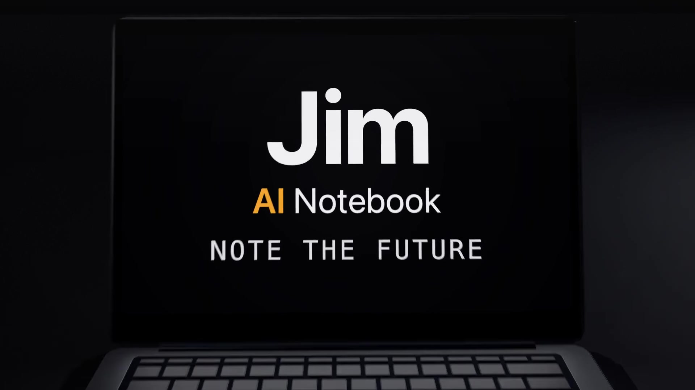

**逐字稿片段：** 大家好,我是Jim,這裡是AI Notebook。 這一集要回答一個問題。

**話題推測：** 影片開場及頻道介紹。

---

## 00:00:13

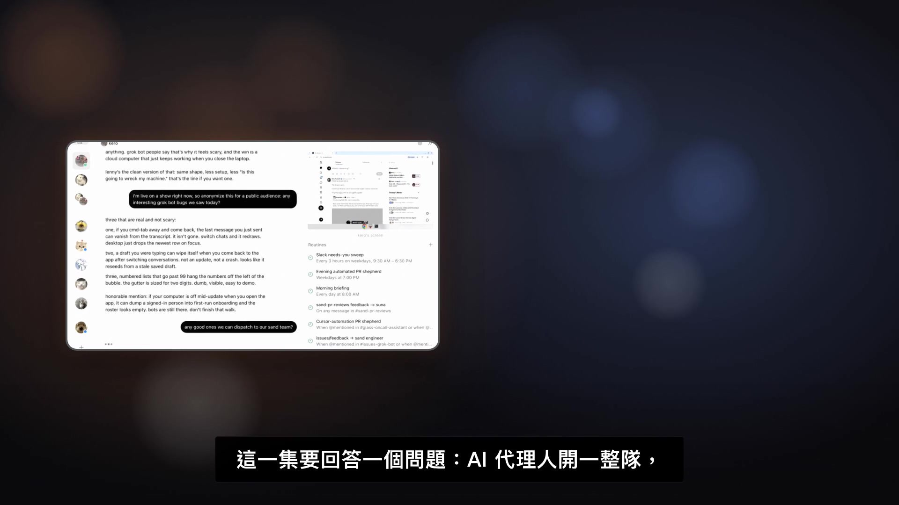

**逐字稿片段：** AI代理人開一整隊,真的比只用一個強嗎? 你剛剛看到的畫面是Grokbot的官方示範。 Grokbot是XAI在2026年8月推出的產品。 Grokbot團隊的Lauren Tan先問她的幕僚長, 今天有沒有值得處理的bug。 這個幕僚長也是一個AI, 他找到幾個,再把工作分給對上其他的AI。 每個隊員負責一個功能,看起來很合理。 一個人做不完,就找一隊來分。

**話題推測：** 提出本集核心問題：AI代理人開一整隊，真的比只用一個強嗎？

---

## 00:00:37

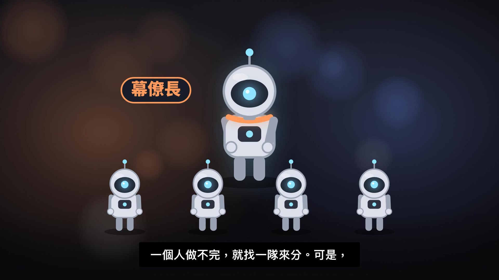

**逐字稿片段：** 可是,兩家做AI代理人很有名的公司 對這件事的看法剛好相反 2025年6月,同一個星期

**話題推測：** 轉折，開始對比兩家公司對多代理人不同看法。

---

## 00:00:44

**逐字稿片段：** Cognition發了一篇文章 標題是Don't Build Multi-Agents 意思是,不要讓好幾個代理人一起做事 隔一天,Anthropic發了另一篇 說他們讓一整隊代理人一起做研究 表現好了九成 同一個星期,兩個相反的答案 我們先看一對贏在哪,再看他輸在哪 最後回到你身上,看你手上的工作該怎麼選 先把名字講清楚 我們平常用的聊天AI 你問一句 他答一句 答完就停下來 代理人不一樣

**話題推測：** 介紹Cognition公司及其文章標題「Don't Build Multi-Agents」。

---

## 00:01:10

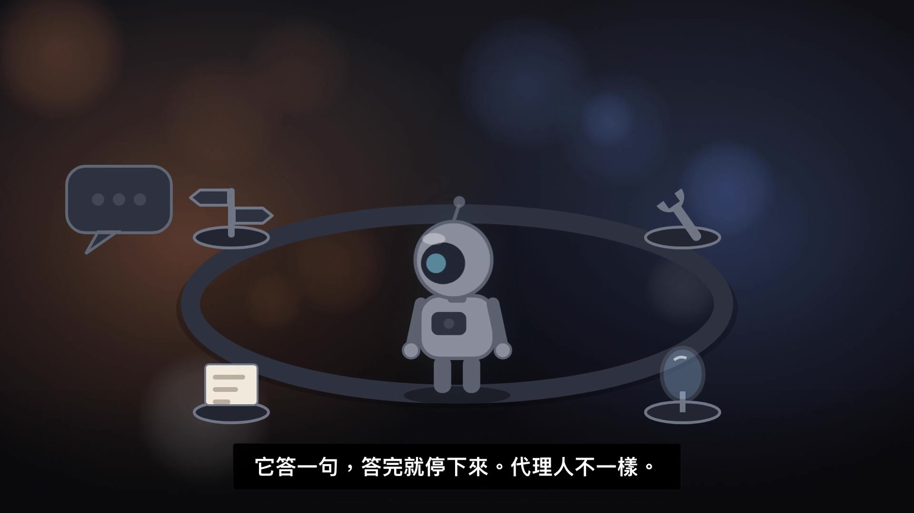

**逐字稿片段：** 這種會自己做事的AI 叫代理人 英文是agent 他做的事是這樣 先看任務 自己決定下一步要做什麼 用工具去做 看做出來的結果 再決定下一步 一直轉到做完為止 Anthropic的工程師Barry John 在2025年的一場演講裡 說得很簡單 模型在一個迴圈裡 一次又一次被呼叫 這就是代理人 代理人讀過的檔案 做過的事 想到一半的計劃 都要放在同一個地方 這個地方叫脈絡,英文是context

**話題推測：** 定義「代理人」並說明其工作流程。

---

## 00:01:37

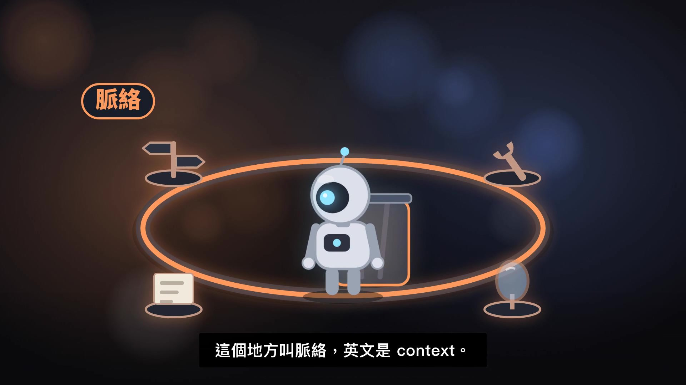

**逐字稿片段：** Cursor的Lee Robinson在2025年說過 脈絡就是AI腦袋裡最多能放的工作記憶 麻煩的是,工作記憶有上限 Anthropic在2025年9月的文章裡提到 脈絡塞得越長,模型對前面的東西就記得越不準 記憶塞不下,最直接的解法就是多找幾個幫手

**話題推測：** 引用Cursor的Lee Robinson對「脈絡」的解釋。

---

## 00:01:56

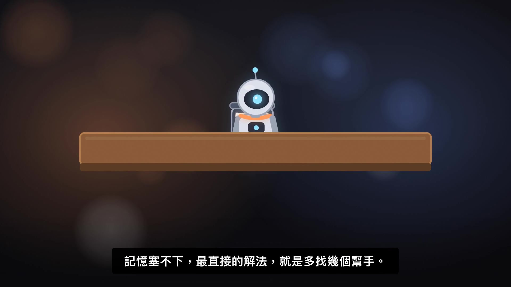

**逐字稿片段：** 讓好幾個代理人一起做事 這種做法叫多代理人,英文是multi-agent 最常見的組法是這樣 一個主管代理人負責把工作分出去 再把結果收回來 底下幾個子代理人 各自去做分道的那一塊 這樣組 關鍵在於 每個子代理人 都有自己一份乾淨的工作記憶 他可以在自己的記憶裡 翻很多資料 翻完只交回短短一段摘要 主管的記憶就不會被塞爆 開場那個幕僚長 就是Grogbot版的主管代理人

**話題推測：** 定義「多代理人」及其常見的組織方式。

---

## 00:02:23

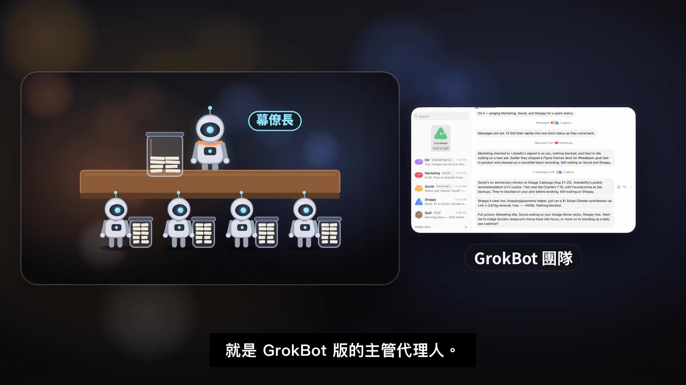

**逐字稿片段：** 做Grogbot的Roman Ugarte說 這個用法一開始不是他們設計的 內部測試大約兩個星期後 有同事把表現最好的那個bot 生成幕僚長 後來很多人跟著做 不過他也說 這不是公司裡大多數人的用法

**話題推測：** 引用Grokbot的Roman Ugarte說明幕僚長代理人的用法。

---

## 00:02:35

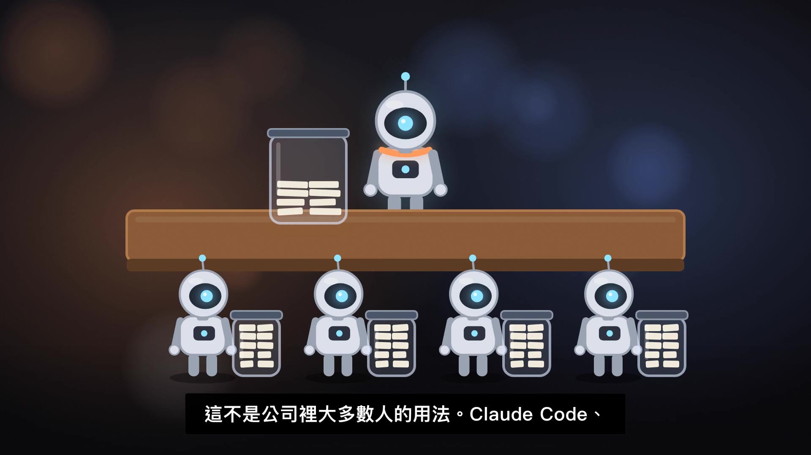

**逐字稿片段：** Cloud Code、Cursor這些寫程式的工具 現在也都可以同時開好幾個代理人 2025年的時候 很多人相信這就是下一步 Barry Jung在同一場演講的最後 說了一個預言 也留下一個問題 聽他自己怎麼說 But I think a big open question here is 就是這些代理人跟C-Chart 怎麼溝通 他說這段話是在2025年4月

**話題推測：** 提及Cloud Code、Cursor等支援多代理人的程式工具。

---

## 00:03:15

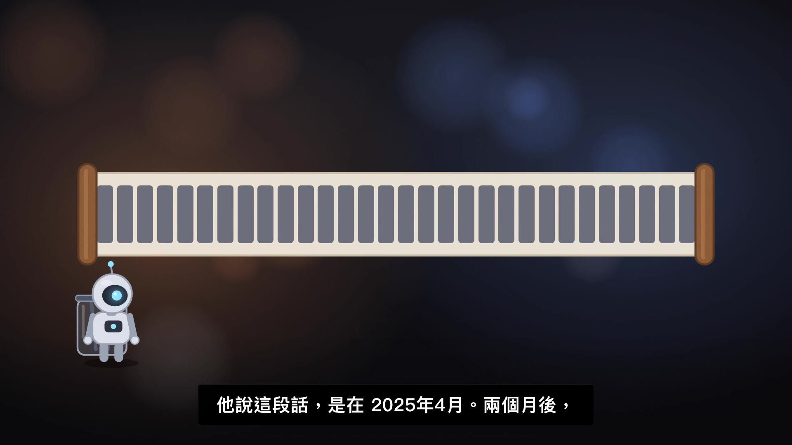

**逐字稿片段：** 兩個月後,Anthropic自己做出來了 他們做了一個專門做研究的多代理人系統 還寫了一篇文章說明它怎麼運作 文章裡舉了一個例子 題目是 找出美國標準普爾500指數里 所有資訊科技類公司的董事 一個代理人來做 只能一家公司接著一家公司慢慢找 工作記憶越塞越滿 最後沒有完成 換成一對 主管把公司名單分成好幾份 每個子代理人負責幾家 同時找各自交回名單 主管再合起來 結果在Anthropic內部的研究題目上 一整隊代理人的分數

**話題推測：** 介紹Anthropic開發研究型多代理人系統的成果。

---

## 00:03:47

**逐字稿片段：** 比單讀一個Cloud Opus 4高了九成 這個數字要看清楚是在哪裡測量出來的 這是Anthropic自己出的考卷 一開始只有大約20題 考的都是研究型的問題 它說明一對在找資料這種工作上很強 不代表所有工作都是這樣

**話題推測：** 數據呈現：多代理人表現比單一Cloud Opus 4高了九成。

---

## 00:04:01

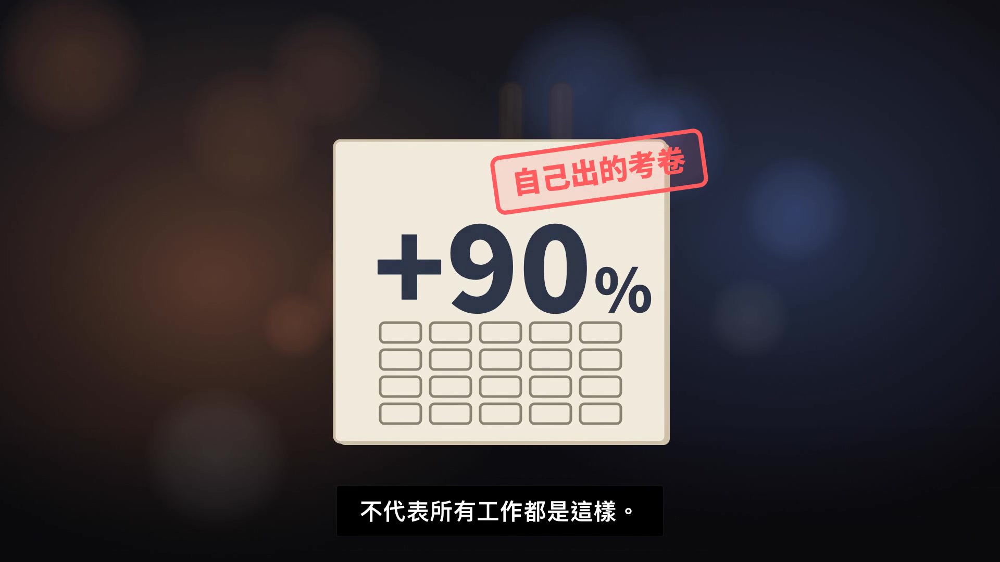

**逐字稿片段：** 一對為什麼會贏 把這個例子看仔細 有兩個原因

**話題推測：** 新章節：討論多代理人會贏的原因。

---

## 00:04:05

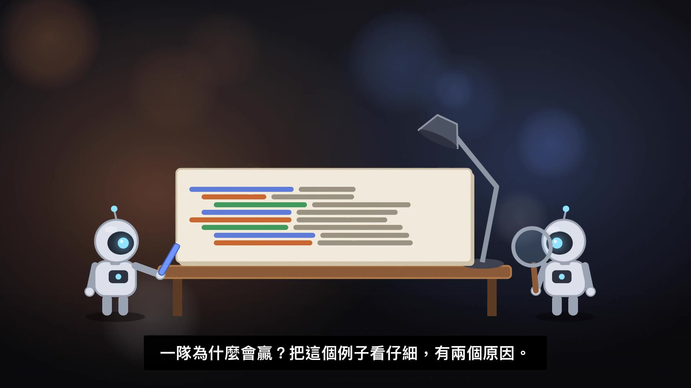

**逐字稿片段：** 一個是同時做 一大串公司分給好幾個代理人 每個只要負責一小段 時間自然短很多 另一個比較不明顯 是記憶乾淨 每個子代理人 只裝著自己那幾家公司的資料 不會被別人的東西干擾 還有一種用法 不是為了快 是為了多一雙眼睛 Factory的工程師 Luke Alvaro 講過一個很好懂的道理 寫程式的那個代理人 花了很多力氣 會希望自己寫的東西是對的 換一個記憶乾淨的新代理人來檢查 比較容易找出問題 人類工程師要互相審查程式碼 也是同樣的道理

**話題推測：** 說明原因之一：工作可同時進行。

---

## 00:04:36

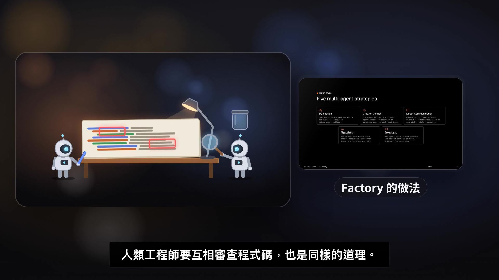

**逐字稿片段：** Anthropic The Cloud Code團隊 就把同時做和多一雙眼睛接在一起用 他們在2026年9月的對談裡 講了自己的做法

**話題推測：** 介紹Anthropic Cloud Code團隊結合多代理人做檢查的做法。

---

## 00:04:44

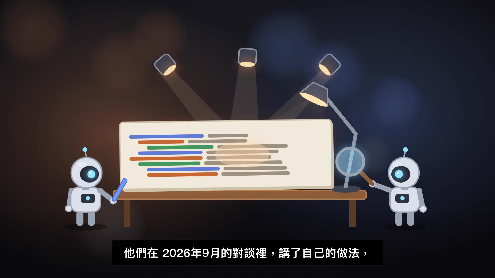

**逐字稿片段：** 聽他們說 分頭去找 再從三個角度互相挑毛病 最後只把最重要的交給人看 聽起來很理想

**話題推測：** 播放Anthropic Cloud Code團隊的影片片段。

---

## 00:05:13

**逐字稿片段：** 可是這裡有一張賬單 AI讀寫文字 是用一種單位來計算的

**話題推測：** 轉折，引入多代理人會產生「賬單」的成本問題。

---

## 00:05:18

**逐字稿片段：** 這個單位叫Token 中文常翻成詞源 你可以把它當成 AI的計費單位 Anthropic在同一篇文章裡 自己算過 多代理人用掉的Token

**話題推測：** 定義「Token」作為AI的計費單位。

---

## 00:05:27

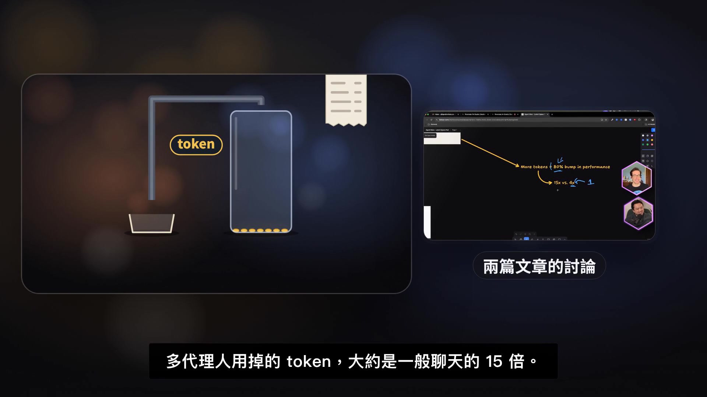

**逐字稿片段：** 大約是一般聊天的15倍 這裡比較的對象 是一般聊天 不是單一代理人 更關鍵的一句 也在同一篇文章裡 他們在一個叫

**話題推測：** 數據呈現：多代理人Token使用量約是一般聊天的15倍。

---

## 00:05:35

**逐字稿片段：** BrowseComp的上網找資料測驗上分析 發現光是Token用了多少 就能解釋大約八成的表現差距 他們也坦白 早期的版本遇到很簡單的問題 竟然一口氣開了50個子代理人 換句話說 一對會贏 有很大一部分 是因為他花了比較多的運算資源 Anthropic自己也寫 這種做法要用在價值夠高 付得起成本的工作上 而且大部分寫程式的工作 真正能同時進行的部分 比研究少 這一部分的答案是這樣 一對代理人會贏靠的是三件事 工作可以分成互不相干的幾塊 大家可以同時做 做的主要是找資料 讀資料和檢查 不是一起動手修改同一份東西 最後 這件事值得多花好幾倍的錢 Anthropic那個九成 就是三個條件同時成立的例子 一大串公司可以分開找 找的時候只是讀 研究報告也值得多花錢 還要記得那張賬單 一對的成績比較好 有一大部分是因為他花的比較多 所以看到一對贏的消息 可以先問一句 他是做的比較聰明 還是隻是花的比較多

**話題推測：** 提及BrowseComp上網找資料測驗，解釋Token使用量與表現差距。

---

## 00:06:33

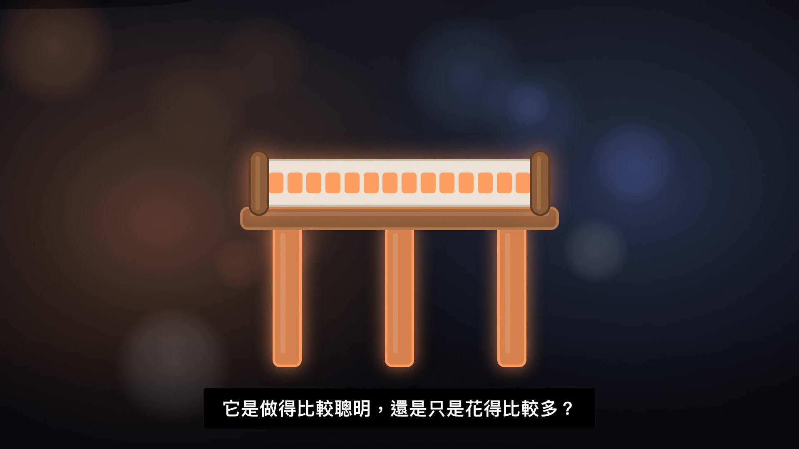

**逐字稿片段：** 那反過來 三個條件少了一個 會發生什麼事 寫出不要讓好幾個代理人 一起做事的那家公司 就是從這裡開始講

**話題推測：** 新章節：討論多代理人會輸的場景。

---

## 00:06:40

**逐字稿片段：** 這家公司叫Cognition 他們做的是一個 寫程式的代理人 叫Devin 共同創辦人Walden Yan 在2025年6月 寫了那篇文章 後來在一場講座裡 把理由講得更清楚 他的頭一個理由

**話題推測：** 介紹Cognition公司及其寫程式的代理人產品Devin。

---

## 00:06:53

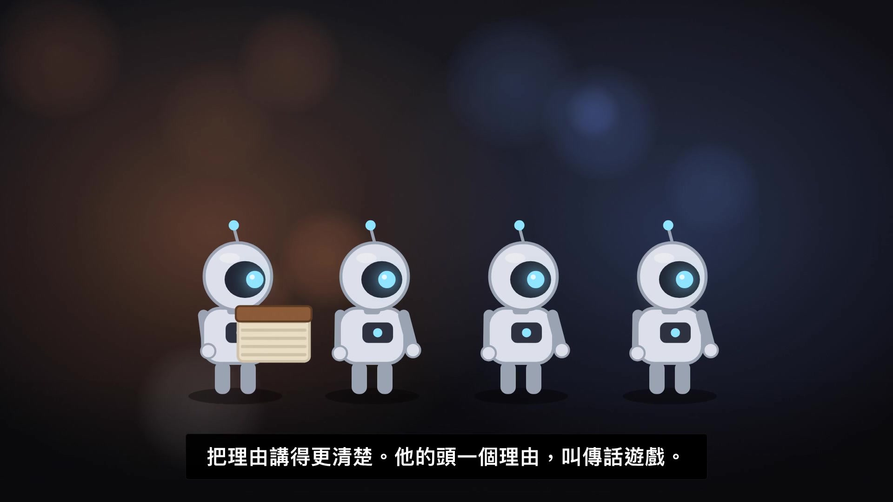

**逐字稿片段：** 叫傳話遊戲 很多人小時候都玩過 第一個人聽到一句話 悄悄傳給下一個人 一個接一個 傳到最後 常常變成完全不同的一句 主管代理人在分工作的時候 也在玩這個遊戲 他讀過完整的任務 知道使用者真正要什麼 可是交給子代理人的 只是自己重新寫過的一張便條 子代理人只知道便條上寫的 不知道主管腦袋裡其他的東西 也因為這樣 他在文章裡提到 2025年那時候的Cloud Code 子代理人通常只負責回答問題 不跟主代理人同時動手寫程式 這就是交接 也是一對代理人最常出問題的地方 聽他自己怎麼說 被主持人告訴你 Where like you're telling the main agent 你告訴主持人 分拆出來 你真的想要 他的解法是 交接的時候不要只給一張便條 要把整本工作紀錄一起交出去 讓子代理人看到主管看過的所有東西 另一個理由更麻煩 每一個動作都偷偷做了決定

**話題推測：** 描述多代理人分工時像「傳話遊戲」的問題。

---

## 00:07:59

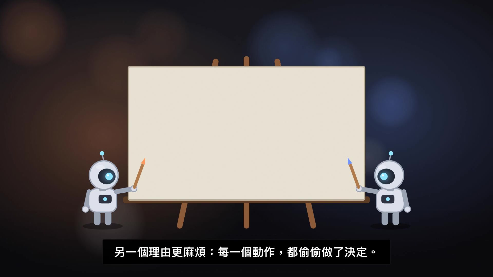

**逐字稿片段：** 他舉的例子是做一個像Flappy Bird的小遊戲 Flappy Bird是一個手機遊戲 一隻小鳥在畫面上一跳一跳 穿過一根根綠色的水管 主管把工作分成兩份 一個子代理人做背景和水管 另一個做那隻鳥 結果做背景的那個 做出了馬利歐風格的背景 做鳥的那個 做出一隻跟這個遊戲完全不搭的鳥 兩邊都照便條做了 合起來卻對不上 這就像請兩個人各畫半幅畫 事先沒有說好畫風 最後拼起來一邊是油畫一邊是漫畫 做產品的人也看到同一件事 Cursor的執行長Michael Trull 在2026年6月的發表會上說 很多人在自己的電腦上 同時開三到五個代理人 可是大家擠在同一份程式碼上 很容易互相絆倒 前面提過的Luke Alvarero 支持找新的代理人來檢查 可是說到讓很多代理人同時寫程式 他的結論很直接 聽他說 互相踩到對方的修改 重複做一樣的事 各自做出不一致的決定 這是做產品的人自己踩過的坑 研究者那邊有沒有比較完整的答案

**話題推測：** 舉例Flappy Bird遊戲開發，說明多代理人決策不一致的問題。

---

## 00:09:24

**逐字稿片段：** Google和麻省理工學院的研究團隊 在2025年12月放出一份研究 後來又更新了幾版 他們用幾百種組合 把一個代理人和好幾種多代理人的設計 放在同樣的題目上比較 最有說服力的是兩種題目放在一起看

**話題推測：** 介紹Google和麻省理工學院的研究團隊對代理人的比較研究。

---

## 00:09:39

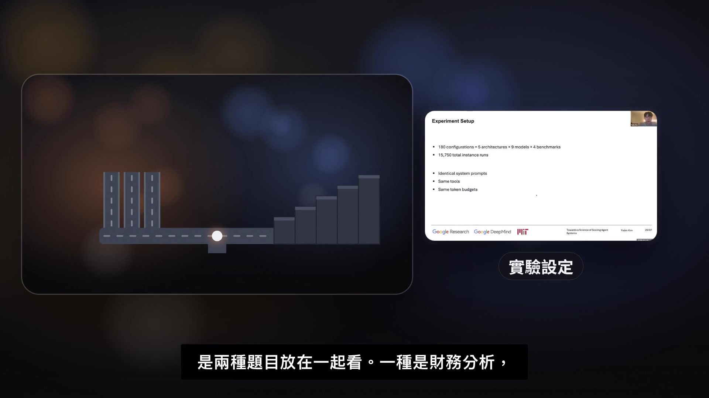

**逐字稿片段：** 一種是財務分析 題目可以自然分成好幾塊各自去做 另一種是叫PlanCraft的規劃題 在遊戲裡一步接一步 把材料合成成指定的東西 前一步沒做好 下一步就做不了 結果分成兩邊 可以分開的財務分析

**話題推測：** 比較財務分析與PlanCraft兩種不同任務類型在多代理人表現上的差異。

---

## 00:09:53

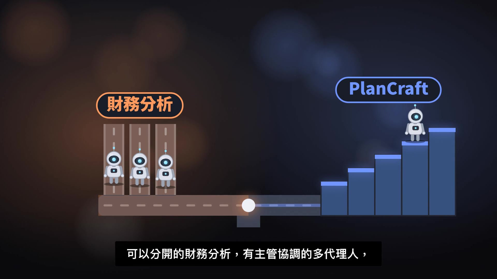

**逐字稿片段：** 有主管協調的多代理人表現好了八成 一步接一步的規劃題 多代理人沒有幫助 有的設計還差了七成 同樣的模型 差別只在題目能不能分開 加州大學伯克萊分校的另一份研究 整理了上千次多代理人的執行記錄 發現最常見的失敗 包括一直重複同樣的步驟 還有不知道什麼時候該停

**話題推測：** 數據呈現：財務分析多代理人表現提升八成，PlanCraft則下降七成。

---

## 00:10:13

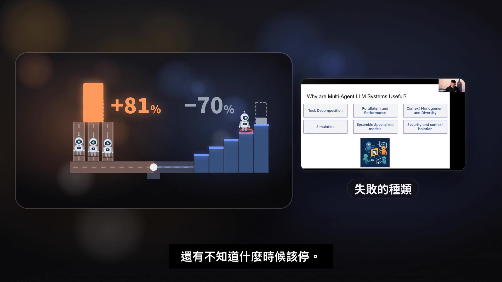

**逐字稿片段：** 這份Google研究的第一作者Ubin Kim 在一場線上講座裡解釋這個結果

**話題推測：** 引用Google研究的第一作者Ubin Kim解釋實驗結果。

---

## 00:10:18

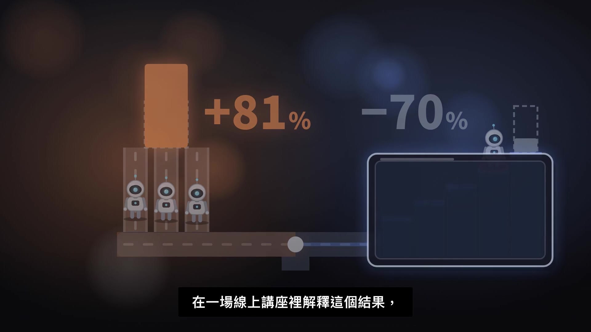

**逐字稿片段：** 聽Ubin Kim自己說 MAS, so there was a big win here, but considering the plant craft, MAS had no benefits at all 可以分開就有用,分不開就沒有用。有一個實驗把這兩種情況放進了同一個故事裡 2026年2月

**話題推測：** 播放Ubin Kim的影片片段。

---

## 00:10:57

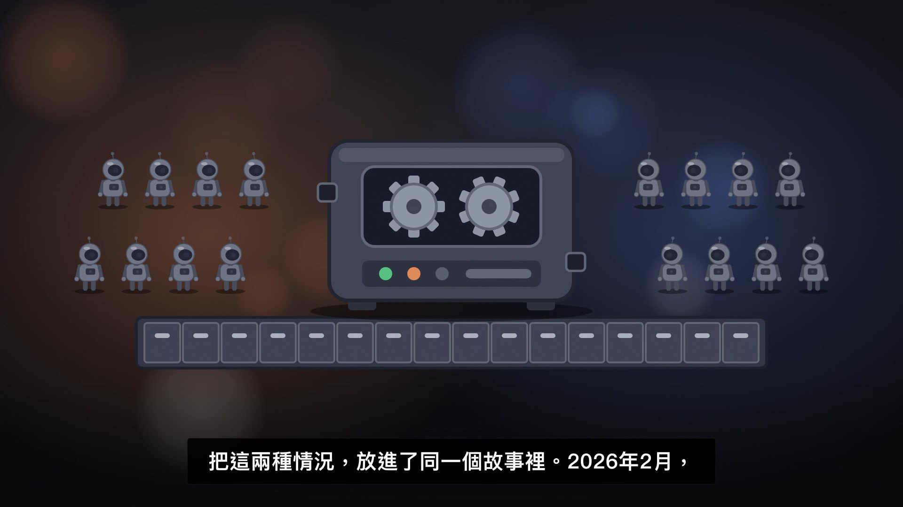

**逐字稿片段：** Anthropic的研究員Nicholas Carlini 讓16個Cloud同時工作

**話題推測：** 介紹Anthropic研究員Nicholas Carlini讓16個Cloud同時寫C語言編譯器的實驗。

---

## 00:11:01

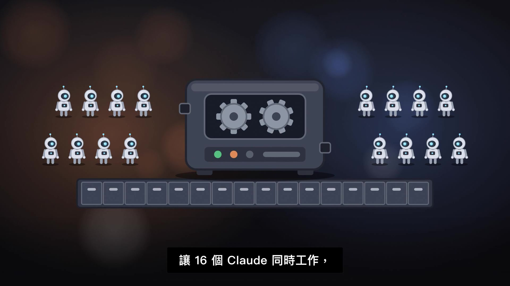

**逐字稿片段：** 目標是從頭寫出一個C語言的編譯器 編譯器就是把人寫的程式 翻譯成電腦看得懂的指令的程式 他沒有安排主管代理人 每個Cloud自己去認領還沒人做的工作 認領的方法是在檔案上做記號 別人看到就不碰 前半段很順 很多互不相干的錯誤可以分頭修正 兩個星期 他們寫出了大約10萬行程式

**話題推測：** 說明編譯器實驗的目標：從頭寫出一個C語言編譯器。

---

## 00:11:23

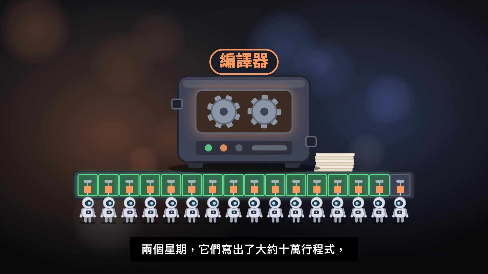

**逐字稿片段：** 最後真的能編譯Linux的核心 可是編譯Linux核心這一步 變成了一整件分不開的大事 16個Cloud都撞上同一個錯誤 各自修正 再互相把對方的修改蓋掉 Carlini自己寫 16個代理人在這裡沒有幫助 因為大家都被同一件事卡住 後來他拿一個成熟的編譯器

**話題推測：** 提及實驗成果：成功編譯Linux核心。

---

## 00:11:41

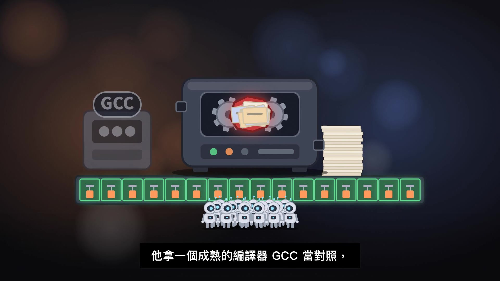

**逐字稿片段：** GCC當對照 讓每個Cloud負責找出 不同檔案的問題 工作才又分得開 他也寫得很誠實 看到測試通過 就以為工作做完了 這很容易 可是實際上很少是這樣 這個故事 是把前面兩部分接在一起了 工作分得開 一對就有用 分不開 人再多也沒用 還有一個問題沒回答 前面說過 一對會贏 很大一部分是因為花的比較多

**話題推測：** 提及以GCC編譯器作為對照組，找出問題的後續做法。

---

## 00:12:05

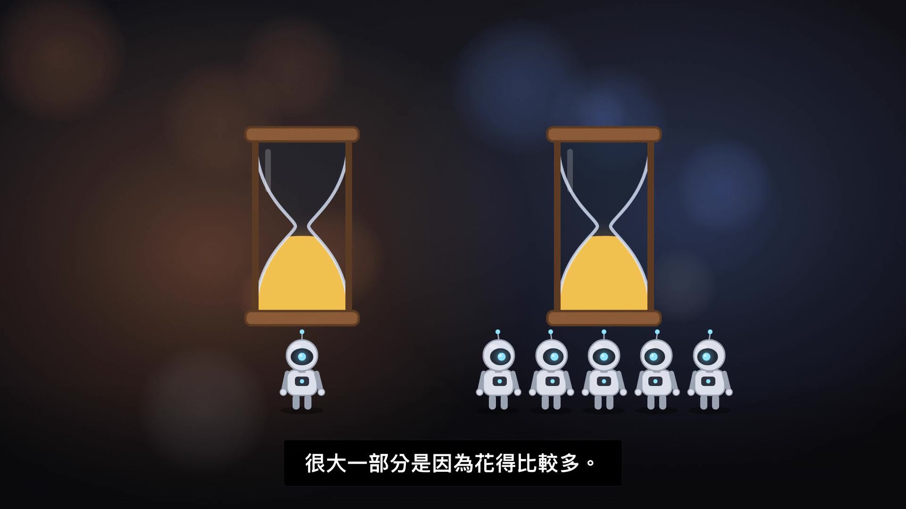

**逐字稿片段：** 那如果讓一個代理人跟一整對花一樣多呢?

**話題推測：** 提出新問題：如果單一代理人與多代理人花費同樣多運算資源，結果會如何？

---

## 00:12:08

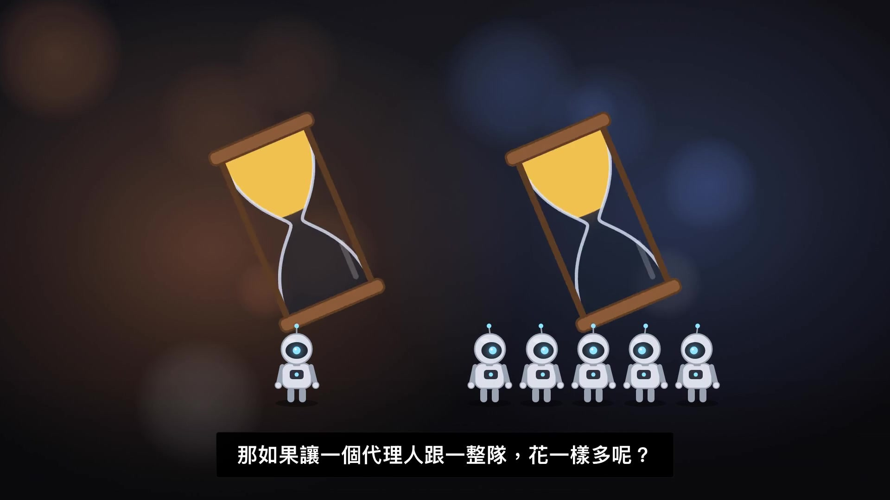

**逐字稿片段：** 史丹佛大學的兩位研究者 在2026年4月放出一份預印本 也就是還沒經過同時審查的論文 做的就是這件事 他們讓一個代理人和好幾種多代理人設計 用同樣多的思考額度 去回答需要好幾步推理的問題 結果 一個代理人打成平手

**話題推測：** 介紹史丹佛大學的研究，比較相同資源下的單一與多代理人表現。

---

## 00:12:25

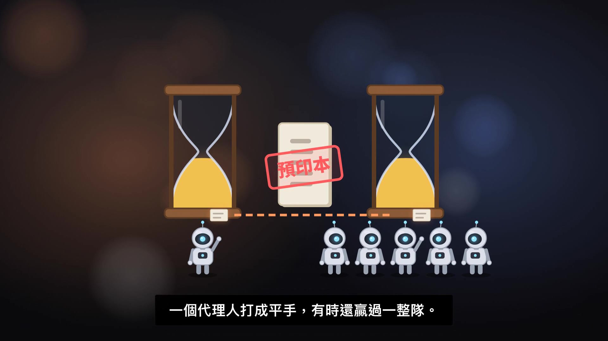

**逐字稿片段：** 有時還贏過一整隊 他們的解釋是 多代理人看起來比較好的時候 常常是因為多花了運算資源 或是那一個代理人的記憶沒有用好 同一年9月 OpenAI用了大約1萬個代理人 連續處理一個很難的數學問題三天多 這個成果在數學界還有爭議 負責多代理人研究的OpenAI研究員

**話題推測：** 史丹佛研究結果：單一代理人有時能打平甚至贏過一整隊。

---

## 00:12:43

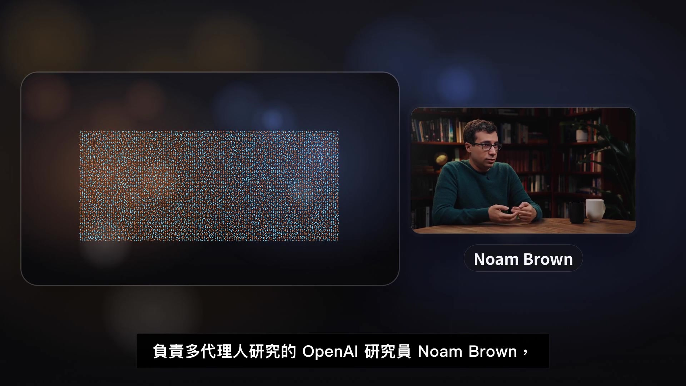

**逐字稿片段：** Nome Brown 被問到這件事的時候 他的回答跟很多人想的不一樣

**話題推測：** 引用OpenAI研究員Nome Brown對實驗結果的觀點。

---

## 00:12:47

**逐字稿片段：** 聽他自己說 Multi-agent的承諾 事實上,我們訓練了一個很強大的模式 我們可以讓這個模式在很長的距離運作 我們可以讓它思考在相同的程度 但在它的核心,我們能夠做到的原因 是因為我們有一個非常強大的目標 連做最大規模實驗的人都說 功勞大部分在那一個很強的模型 這也呼應了Anthropic文章裡的另一個發現 把模型升級一代 效果比把Token額度加倍還大 可是就算錢不是問題 一對代理人還有一個瓶頸常常被忘記

**話題推測：** 播放Nome Brown的影片片段。

---

## 00:13:30

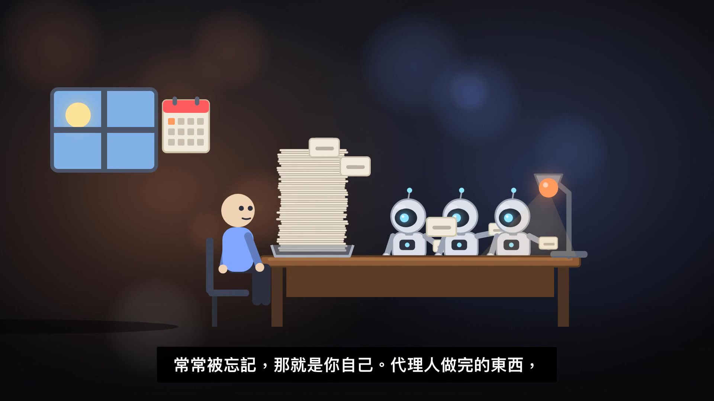

**逐字稿片段：** 那就是你自己 代理人做完的東西最後要有人看 要有人決定收不收 開的代理人越多 等你看的東西就越多 Cloud Code團隊在同一場對談裡也說 分頭找回來的東西太多 一定要先過濾一次 不然講者自己讀了都會受不了 Saster的創辦人Jason Lemkin說 他們公司用了20個代理人 負責的同事每個星期要花十幾個小時 審查他們做出來的東西 因為代理人晚上和週末都不休息

**話題推測：** 引入「人類審核」作為多代理人另一個常被忽略的瓶頸。

---

## 00:13:56

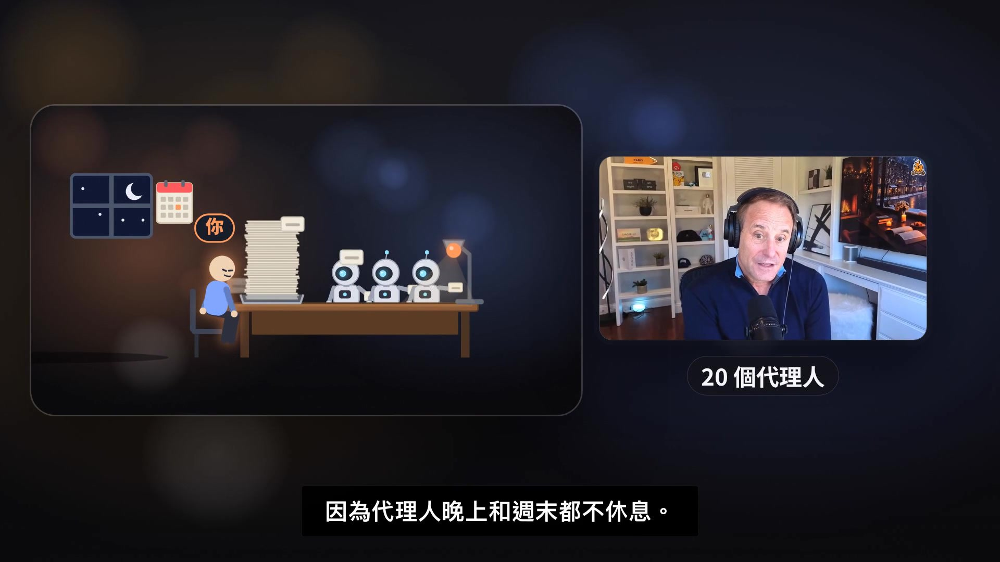

**逐字稿片段：** Simon Willison是Jango這個網站框架的共同作者 也是寫了很多年部落格的獨立開發者 每天都在用寫程式的代理人 他在2026年3月的訪談裡 講了一句很實在的話

**話題推測：** 引用Jango網站框架共同作者Simon Willison說明人類注意力限制。

---

## 00:14:06

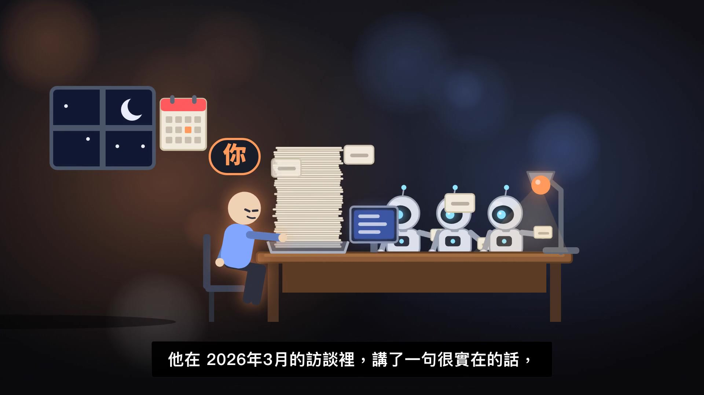

**逐字稿片段：** 聽他自己說 三個專案同時進行 兩個小時就累到不行 這不是他不夠努力 是人的注意力本來就有限

**話題推測：** 播放Simon Willison的影片片段。

---

## 00:14:31

**逐字稿片段：** 這一部分的答案是這樣 一對代理人會輸在三個地方 交接的時候 主管只交出一張便條 就像傳話遊戲 越傳越走樣 每個動作都帶著決定 兩個代理人決定不同 就像兩個人各畫半幅畫 拼不起來 一步接一步的工作分不開 人再多 也只是互相干擾 另外還有兩件常被忘記的事 很多一對比較強的成績 花的運算資源也比較多 花的一樣多的時候 一個代理人常常不輸 還有 代理人做的再多 最後都要經過你 所以 問題不是一對好不好 而是你手上的工作 是哪一種 最後一部分 我們把前面的答案 變成三個 你自己就能回答的問題 這三個問題 都是從前面兩部分來的 頭一個問題 這件工作 能不能分成 彼此不依賴的幾塊 像Anthropic那串公司名單 可以 像Linux核心 那個大錯誤 就不行 接下來問 大家要做的 是找資料 讀資料和檢查 還是要一起動手修改同一份東西 前者可以交給一對 後者就是Flappy Bird那種拼不起來的風險 最後問 這件事值得多花好幾倍的錢 還有你自己的注意力嗎 在三個問題之前 還有一個前提 OpenAI寫給開發者的指南 建議先把單一代理人的能力發揮到最大 在支持多代理人的Anthropic內部

**話題推測：** 總結多代理人會輸的三個主要原因及其他考量。

---

## 00:15:44

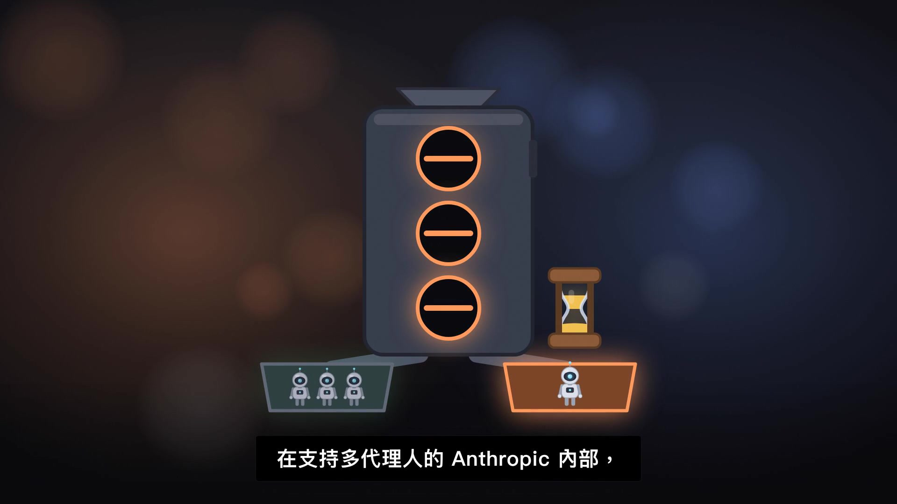

**逐字稿片段：** 也有人這樣說 Anthropic一位負責大型客戶的架構師Alex 在2026年8月的一場活動裡 談到該從哪裡開始

**話題推測：** 引用Anthropic大型客戶架構師Alex的建議。

---

## 00:15:51

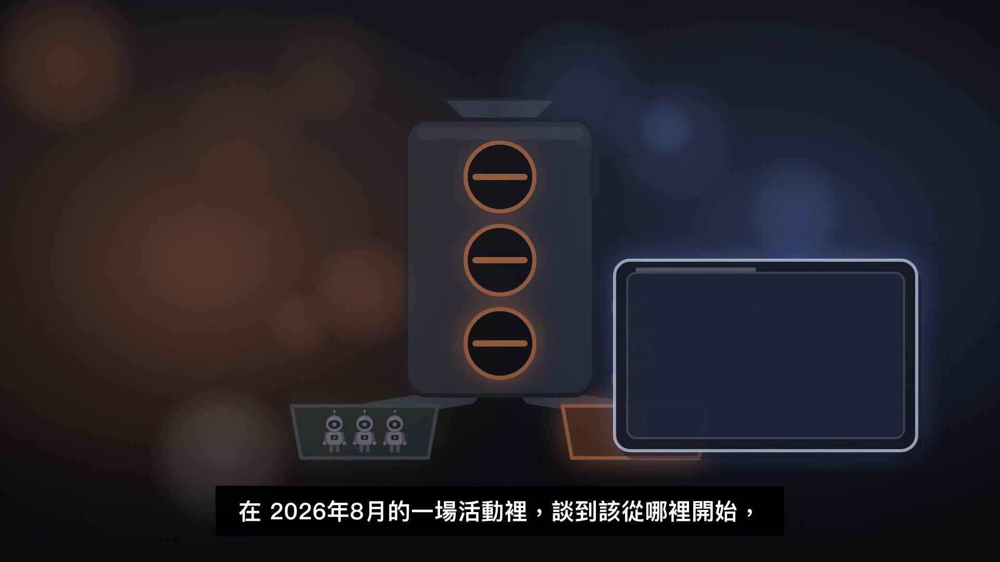

**逐字稿片段：** 聽Alex怎麼說 有這麼多的變化 開始從更多的專業 是一般是錯誤的方式 所以我的觀點是 開始從一個專業 去理解你的失敗模式 嘗試找出 與那個專業有什麼關係 在發展與達到更多的能力之前 先用好一個 搞懂他會在哪裡出錯 再決定要不要加人 Alex接著說

**話題推測：** 播放Alex的影片片段。

---

## 00:16:16

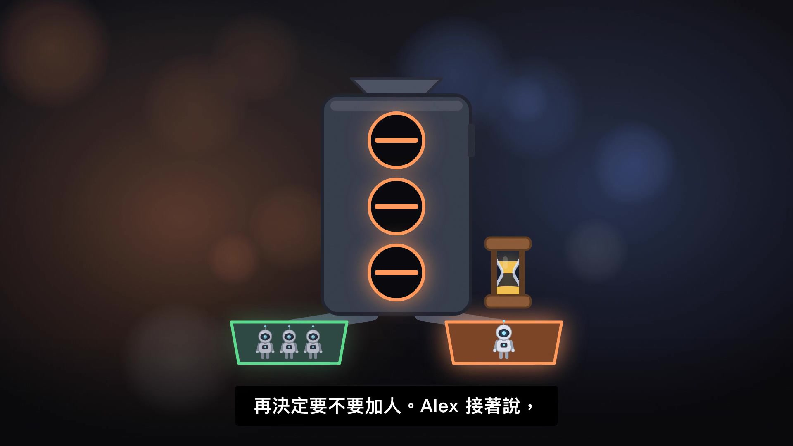

**逐字稿片段：** 真正需要一對的訊號有三個 工作記憶被塞得太滿 需要不同的專長 還有工作可以同時進行 各家的官方文件到了2026年也走到同一個地方

**話題推測：** 總結真正需要多代理人的三個訊號。

---

## 00:16:26

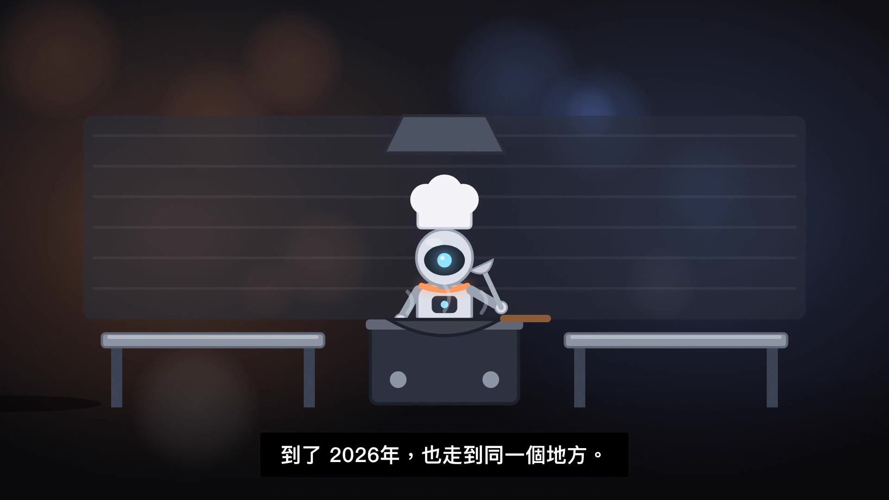

**逐字稿片段：** Cloud Code有一個實驗中的功能叫Agent Teams 可以開一整隊代理人 它的官方文件寫著 一步接一步的工作 要修改同一個檔案的工作 一個代理人比較有效 還寫 三個專注的隊友常常勝過五個分散的 Grogbot的文件也建議 先從最小夠用的陣容開始

**話題推測：** 引用Cloud Code官方文件關於Agent Teams功能和使用建議。

---

## 00:16:43

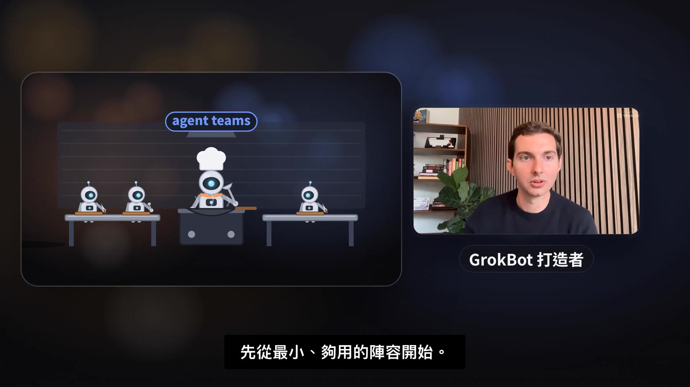

**逐字稿片段：** 寫出不要讓好幾個代理人一起做事的Cognition 在2026年4月寫了續篇 他們現在也用好幾個代理人 可是規則很清楚 動手修改的只留一個 其他的代理人負責出主意和做審查

**話題推測：** 引用Cognition續篇，說明他們現今對多代理人的使用原則。

---

## 00:16:55

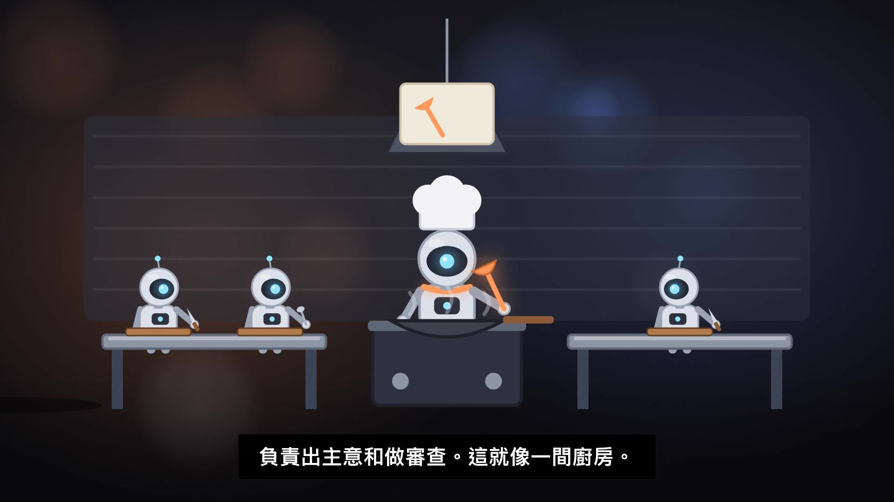

**逐字稿片段：** 這就像一間廚房 主廚只有一個 決定這道菜最後的味道 其他人可以備料、試味道、提醒火候 可是不會十個人一起炒同一鍋 我們回到開場那個畫面 Grogbot的幕僚長把bug分給隊員 每個隊員負責一個完整的功能 不碰別人的 最後那一步,交給誰?

**話題推測：** 以廚房主廚和幫手為例，比喻多代理人分工與最終決定權。

---

## 00:17:13

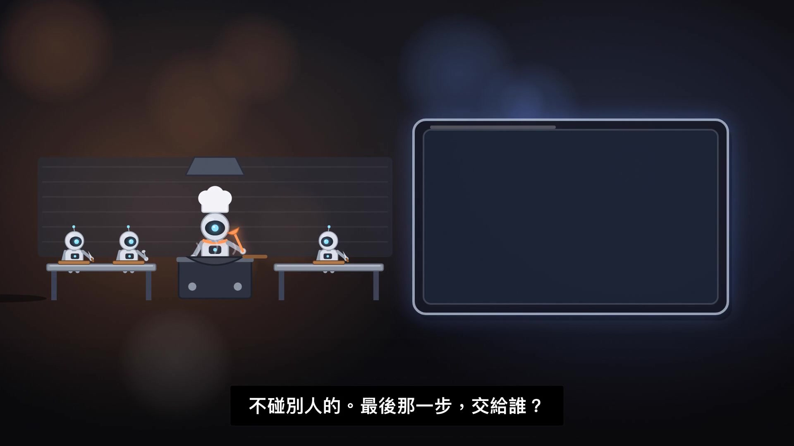

**逐字稿片段：** 聽Lauren Tan自己說 我會跟我的各個團隊的同事 然後他們會去做這些任務 然後最後我會收到我可以評論的提議

**話題推測：** 播放Lauren Tan的影片片段，說明最終成果如何被提交和審核。

---

## 00:17:45

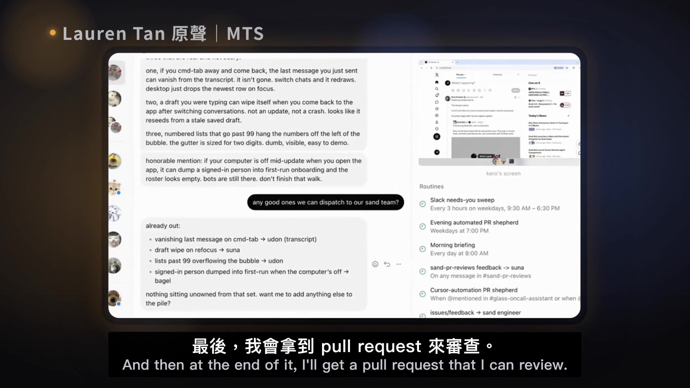

**逐字稿片段：** 他最後會收到的叫pull request 中文常說合並請求 就是一份修改的提案要等人看過 同意了才會真的放進程式裡 隊員再多 最後還是有一個人決定收不收

**話題推測：** 提及「pull request」作為最終修改提案的審核機制。

---

## 00:17:57

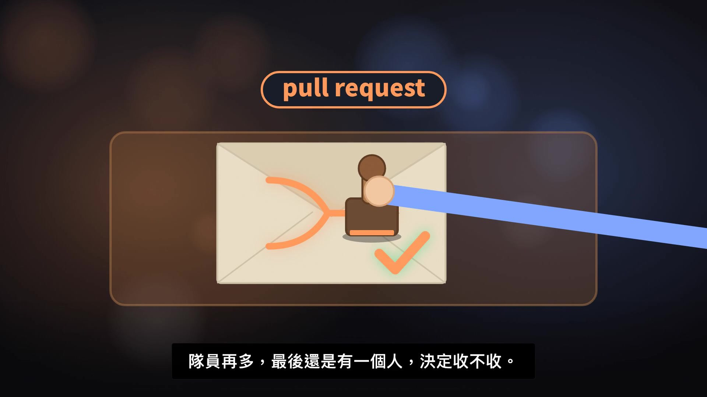

**逐字稿片段：** 這一部分的答案是這樣 先把一個代理人用好 工作分得開 主要是讀資料和檢查 又值得多花錢 再考慮一對 就算開了一對 動手修改的最好只留一個 其他的負責找資料和檢查 最後由你決定

**話題推測：** 最終總結性建議：先用好一個代理人，再考慮多代理人，並保持人工審核。

---

## 00:18:11

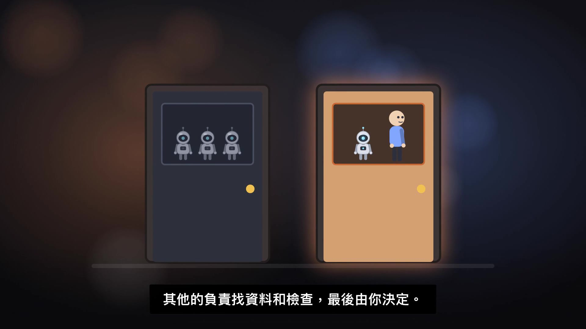

**逐字稿片段：** 放到生活裡 你要比較十家飯店 整理一大堆資料 或是在一份程式裡找出所有的錯誤 這種工作可以分開 可以交給一對 你要寫一篇前後一致的文章 做一個風格要統一的作品 一個好的代理人 加上你自己把關 通常比較好

**話題推測：** 舉例生活與工作中的任務，說明哪些適合多代理人，哪些適合單一代理人。

---

## 00:18:26

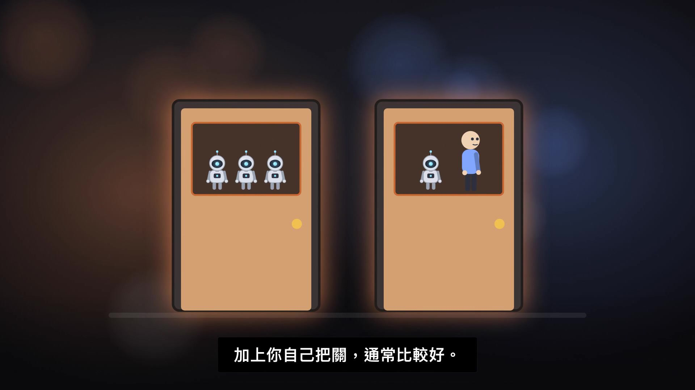

**逐字稿片段：** 我們回到開場那個問題 AI代理人開一整隊 真的比只用一個強嗎 答案是 要看工作 工作分得開 主要是讀資料和檢查 又值得多花錢 一隊會贏 工作一步接一步 大家要修改同一份東西 一隊會輸 很多時候 一個很強的代理人就夠了 到了2026年 不管原本支持還是反對 幾家做得很認真的公司 都走到相近的做法 一個主廚加上幾個幫手 最後由人決定 最後問你一個問題 你現在教給AI做的事 是可以分給一整隊的 還是一個就夠 留言告訴我 喜歡的話訂閱AI Notebook 開啟通知 我們下次見

**話題推測：** 回答影片開頭的核心問題：AI代理人開一整隊，真的比只用一個強嗎？

---
