# jimainotebook_yZ_IgLkICEE — 關鍵畫面索引

- 來源逐字稿：[jimainotebook_yZ_IgLkICEE_FIN.srt](jimainotebook_yZ_IgLkICEE_FIN.srt)
- 影片：https://www.youtube.com/watch?v=yZ_IgLkICEE
- 截圖數：51

## 00:00:13

**逐字稿片段：** 主角是Ray Dalio, 幣錢基金喬水的創辦人,

**話題推測：** 介紹影片主角Ray Dalio

---

## 00:00:15

**逐字稿片段：** 我們要問的是一個國家是怎麼從借錢一步一步走到危機的, 先說清楚, 這一集是知識整理, 不構成任何投資建議,

**話題推測：** 提出本集的核心問題：國家如何走向財政危機

---

## 00:00:23

**逐字稿片段：** 先想像一個家庭, 夫妻兩個人一個月賺5萬, 卻花了7萬, 差了2萬, 先刷卡, 頭一個月沒什麼感覺, 可是卡費的利息一個月一個月疊上去, 有一天最先被砍掉的, 是孩子的補習費, Dahlio說 一個國家走的路 跟這個家庭很像 只差一件事

**話題推測：** 開始用家庭財務做比喻

---

## 00:00:40

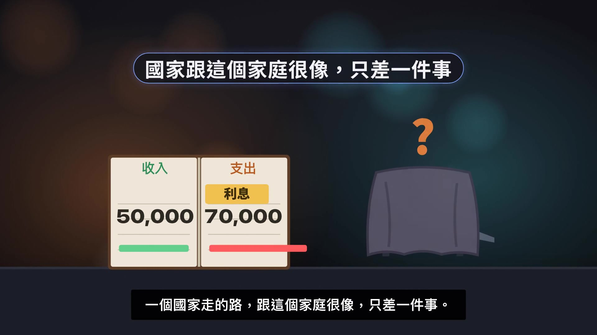

**逐字稿片段：** 我們分三步看 先看借錢 怎麼從好事變成負擔 再看負擔怎麼變成危機 最後用前面的答案 亮一亮 美國現在走到哪一步 對臺灣又代表什麼

**話題推測：** 闡述本集將依循的三個分析步驟

---

## 00:00:49

**逐字稿片段：** 先介紹他 Ray Dalio是 避險基金 橋水的創辦人 避險基金 就是替大客戶 操作投資的公司 他自己說 橋水是從一間 兩房的公寓起家的 他在2022年 交出經營權 2025年 已經把橋水的股份 全部賣掉 所以今天的 他是用研究者和作家的身份

**話題推測：** 更詳細介紹Ray Dalio的背景與經歷

---

## 00:01:09

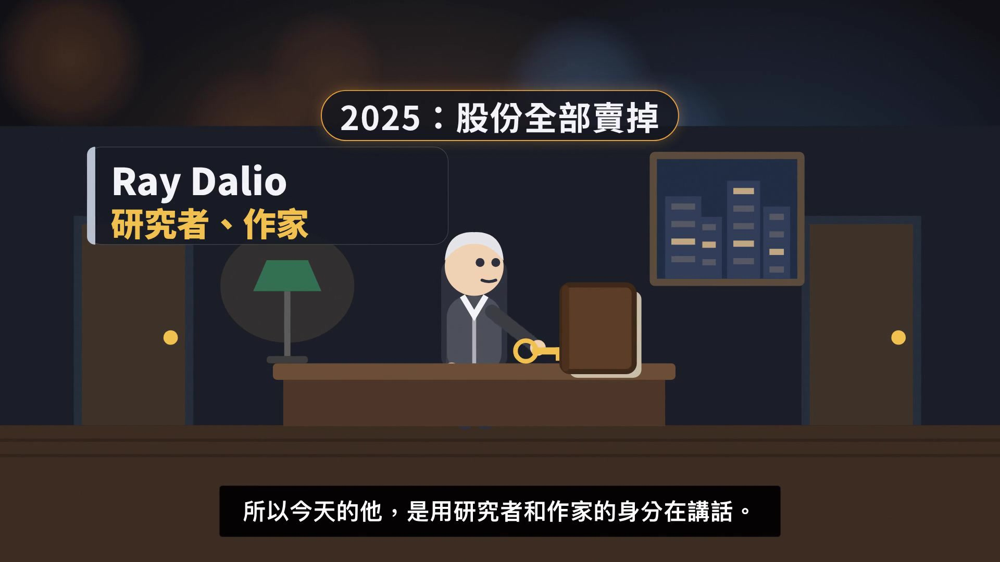

**逐字稿片段：** 在講話 他最近一本書 英文書名叫 How Countries Go Broke 講的是國家怎麼一步一步 走進財政困境

**話題推測：** 介紹Ray Dalio的最新著作

---

## 00:01:14

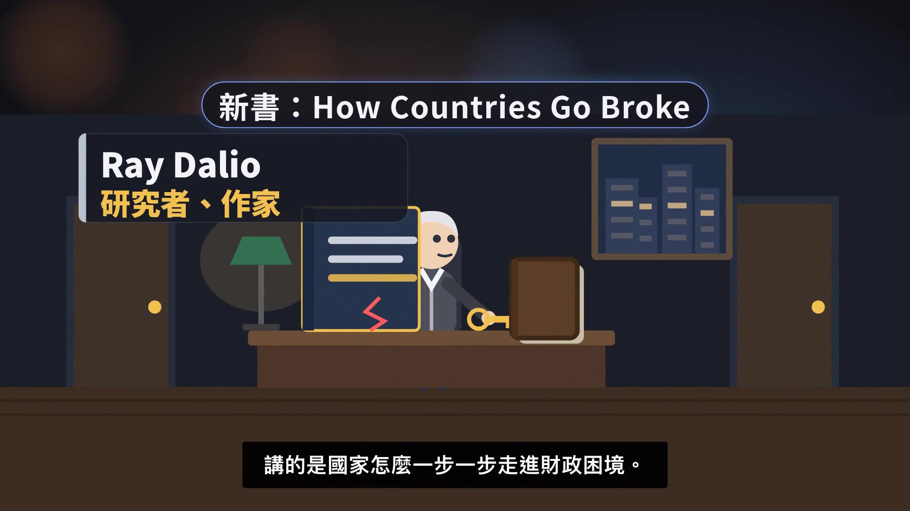

**逐字稿片段：** 這一集用的是他的兩場訪談 一場是今年10月 Bloomberg電視臺的專訪 主持人是Haslinda Amin 另一場是今年7月 英國的網絡節目 The Diary of a CEO 主持人是Steven Bartlett 兩場他講的是同一套想法 在Bloomberg那一場 主持人問了他一個 很直接的問題

**話題推測：** 說明本集內容採用的兩場訪談來源

---

## 00:01:31

**逐字稿片段：** 美國的債務危機 是不是近了 聽他怎麼說

**話題推測：** 提出Bloomberg訪談中關於美國債務危機的關鍵問題

---

## 00:01:51

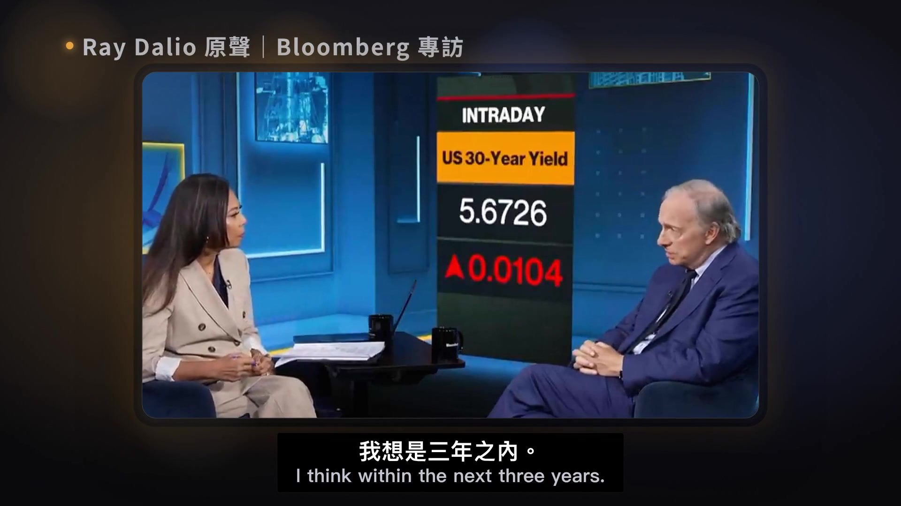

**逐字稿片段：** 三年之內 這是他的判斷 不是定論 他從2025年就說過類似的話 後面我們會看他過去說的準不準 也會聽聽不同意他的人怎麼講 先不急著相信 也不急著反駁 我們先把他腦中那臺機器弄懂

**話題推測：** 揭示Ray Dalio關於債務危機的預測時程

---

## 00:02:03

**逐字稿片段：** 先講名詞 債務 就是借來還沒還的錢 開場那個家庭每個月多花的兩萬 是跟誰借的 表面上是銀行 其實是跟未來的自己借 今天多花的錢 以後要從薪水裡還回去 大力有說國家的債 道理跟個人一樣 只差一件事 國家可以印錢 這件事很重要 我們先記著 後面會用到

**話題推測：** 定義「債務」一詞

---

## 00:02:22

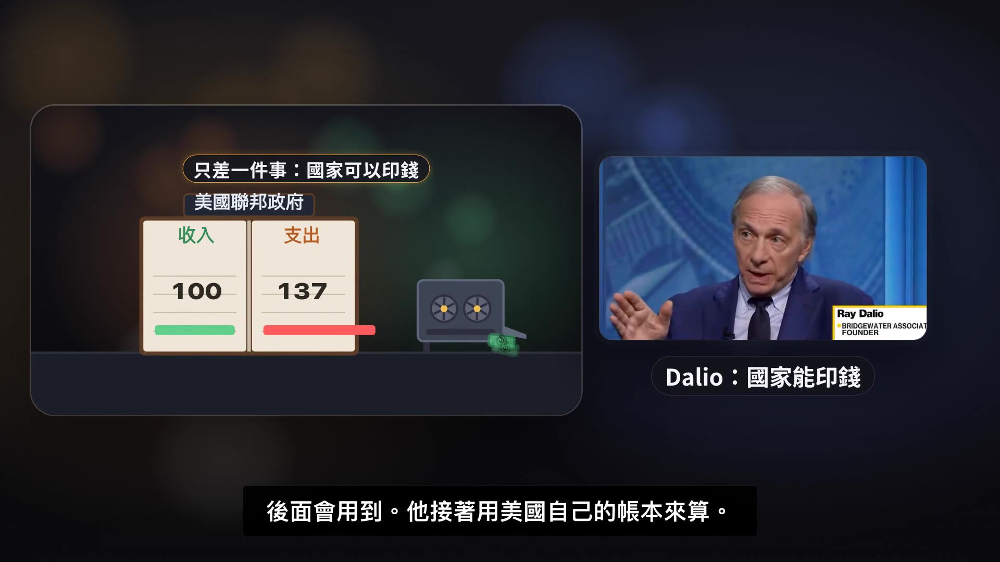

**逐字稿片段：** 他接著用美國自己的帳 本來算 聽他怎麼說 他說花7收5 大致是對的 可是比例算的大方了一點

**話題推測：** 開始分析美國的財政狀況

---

## 00:02:46

**逐字稿片段：** 美國財政部的賬是這樣 上一個會計年度 美國聯邦政府每收100塊 就花掉137塊 差的那一節只能借 借來的錢會產生利息 這裡再講一個名詞 叫債務利息支出 英文是debt service 就是每年為了借錢要付出去的錢 他說的debt service 還包括要還的本金 這裡我們只算利息 上一個會計年度 美國付的利息 已經比整個國防預算還多 每收100塊稅 大約有20塊拿去付利息 回到那個家庭 卡費的利息越來越重 孩子的補習費就被擠掉了 Darryl說的擠掉其他支出 就是這個意思 那利息為什麼會越付越多 一個原因是借的多 另一個原因是借錢的價格變貴了 借錢的價格

**話題推測：** 呈現美國財政部的實際收支數據

---

## 00:03:27

**逐字稿片段：** 有一個名字叫利率 Darryl在Bloomberg說的很直接 利率就是錢的價格 既然是價格 就跟市場上的東西一樣 一邊是可以借出去的錢 也就是大家存下來的錢 另一邊是想借錢的人 想借的人多 能借的錢少 價格就往上漲 漲到什麼時候 漲到有人借不起 自己退出為止 他用的詞叫配給 意思是讓價格 把排隊的人篩掉一部分 那誰會先被篩掉 不會是政府啊 他說政府的赤字沒有彈性

**話題推測：** 定義「利率」為錢的價格

---

## 00:03:56

**逐字稿片段：** 赤字 就是一年花的比 收的多出來的那一節 沒有彈性的意思是 利率再高 政府還是得借 經濟變差的時候 反而借的更多 所以被擠出去的 是排在政府後面的人 聽他怎麼說

**話題推測：** 定義「赤字」一詞

---

## 00:04:28

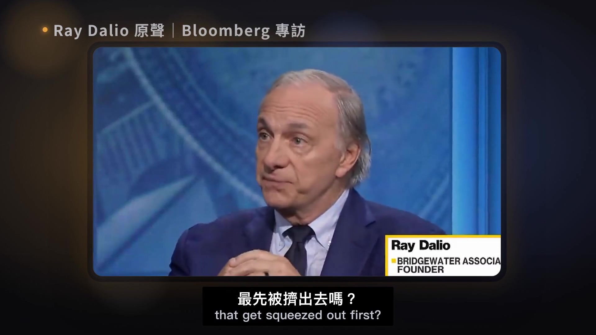

**逐字稿片段：** 他意思是貧富差距這麼大的時候 最先撐不住的是手頭最緊的人 像是要繳房貸、車貸的家庭 資料中心這種大工程 背後是錢很多的大公司 比較晚才會被擠到 所以他說 這個階段會變成 有錢人和沒錢人之間的衝突 這種擠 不是一次發生 是一輪一輪來的

**話題推測：** 說明貧富差距對利率上升的影響

---

## 00:04:47

**逐字稿片段：** 這一輪叫短期債務週期 也就是大家常說的景氣循環 先講一個角色

**話題推測：** 介紹「短期債務週期」概念（景氣循環）

---

## 00:04:52

**逐字稿片段：** 中央銀行 是管一個國家貨幣的銀行 它可以決定利率的高低 短期債務週期是這樣轉的 景氣衰退 失業的人變多 中央銀行就把利率降下來 放錢出去 錢變便宜 大家多借多花 景氣變好 接著過熱 物價一直漲 中央銀行再把利率往上拉 踩剎車 下一次衰退就來了 他說一輪平均大約六年 上下差三年 問題在於 每一輪結束的時候 債並沒有還完 沒還完的債會流到下一輪 下一輪又借 又留下一點 一層一層疊上去 可以疊上幾十年 這個更長的尺度

**話題推測：** 解釋中央銀行的職責

---

## 00:05:25

**逐字稿片段：** 叫長期債務週期 他有一個上限 代理有叫債務容量 意思是一個家庭或一個國家 最多被得動多少債 還沒到頂的時候 再借一點日子照樣過 跌到接近頂的時候 利息開始擠掉其他支出 就是我們剛剛在美國賬本上看到的事 這一段 他在The Diary of a CEO講得很深火 聽他怎麼說 這裡要分清楚一件事 大利歐還有一個更大的說法

**話題推測：** 介紹「長期債務週期」概念

---

## 00:06:07

**逐字稿片段：** 叫大週期 他說大約80年一輪 大週期除了債 還包括國內的政治衝突 和國際之間誰當老大 這一集只借用長期債務週期 大週期不展開 他也說 這些年份就像人的壽命 只是平均 每個國家長短不移 所以把它當作尺度就好 不要當成時刻表

**話題推測：** 提及更廣泛的「大週期」理論

---

## 00:06:26

**逐字稿片段：** 所以第一部分的答案是這樣 債務本身不壞 家庭買房 國家蓋路 都要借錢 壞的是借得比還得快 利息佔收入的比例一路往上 利率一漲 手頭最緊的人 最先被擠出去 可是負擔 還不等於危機 壓垮的那一下 是怎麼來的

**話題推測：** 總結第一部分關於借錢的觀點

---

## 00:06:42

**逐字稿片段：** Darryl 喜歡回到一百年前 他說 他研究了過去五百年的歷史 因為很多他這輩子遇到的事 以前都發生過 他最常拿來對照今天的

**話題推測：** 轉向歷史分析，以一百年前的美國為例

---

## 00:06:51

**逐字稿片段：** 是美國大蕭條之前的那十年 也就是上個世紀的二十年代 大蕭條 是美國在股市大跌之後 經歷了一段很長的經濟衰退 那十年在大跌之前 是什麼樣子 聽他怎麼說 the bust in the late 20s it was the first time you had electricity in houses so you had refrigeration and you had lights you had first time you had cars first time you had airplanes 他說的第一次 要修正一下 電和汽車 20世紀初就有了 20年代是他們開始普及 走進一般美國家庭 重點在後半局 大家都知道這些東西會改變世界 而且他們真的改變了世界 人人都想押注 想買這些公司的股票 錢不夠怎麼辦 當時有一種買法

**話題推測：** 聚焦美國大蕭條前的經濟狀況

---

## 00:07:37

**逐字稿片段：** 叫保證金交易 就是自己只出一部分的錢 剩下的跟證券公司借 根據美國中央銀行 自己整理的歷史資料 那時候很多人只拿一成的錢 剩下九成用借的 這裡會冒出一個問題 大家理由說 這是整件事最關鍵的一點 聽他怎麼說 but you can't spend wealth you have to sell wealth in order to get money to spend it

**話題推測：** 解釋「保證金交易」的概念

---

## 00:08:11

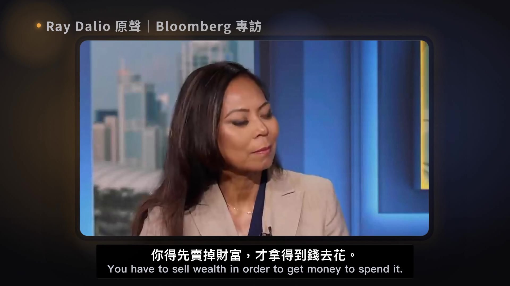

**逐字稿片段：** 先講名詞 財富是你帳上的東西 股票房子都算 錢是能拿去付帳的現金 你不能拿一張股票去付房租 要先把它賣掉才換得到錢 在The Diary of SEO裡 主持人用一個例子來確認他的意思 我們把它做成動畫

**話題推測：** 定義「財富」與「錢」的區別

---

## 00:08:26

**逐字稿片段：** 你手上有一張人工智慧 也就是AI公司的股票 大家很看好它只100元 你拿它去銀行當抵押品 抵押品就是借錢時押給銀行的東西 還不出錢 銀行就拿走它 銀行借你50元 用借來的錢放大投資 這叫槓桿 接著發生某件事 大家同時需要現金 同時賣股票 價格掉到25元 可是你還欠銀行50元 等於倒虧25元 你只好再賣 價格又再往下掉 主持人講完 阿里有回了一句 你說對了 那是什麼事 會讓大家一起需要現金 聽他怎麼說 to get money 最常見的就是第一部分講的那件事

**話題推測：** 以AI公司股票為例，動畫演示槓桿機制

---

## 00:09:16

**逐字稿片段：** 利率往上 借錢變貴 揹著債的人要拿出更多錢付利息 只好賣掉手上的財富 於是上漲時候的那套機制 整個反過來轉 漲的時候股票越漲 能壓得越多 能借得越多 再買更多 跌的時候股票越跌 抵押品縮水 銀行要你補錢 你只好再賣 賣的人多了 大家也少花錢 他舉的例子很簡單 你不去餐廳吃飯了 餐廳老闆的收入就變少 回到20年代 1929年8月 美國中央銀行在紐約的分行 把利率提高到6% 美國中央銀行自己的歷史文章說 這可能促成了後來的大跌 因果到今天還有爭論 接下來三年 道瓊工業指數 一個看美國大公司股價的指標 跌掉快九成 花了25年才爬回原來的高點 技術是真的 電燈 冰箱 汽車 後來真的改變了世界 可是價格不等於價值 一家人債太多 可以賣房子 可以少花錢 一個國家呢 同樣的機制 換成國家 會走到一個牆角 達里爾說 一個國家欠很多債 生產力又跟不上 貧富差距又大 政府手上的選擇會越來越少

**話題推測：** 解釋利率上升如何引發大量拋售

---

## 00:10:17

**逐字稿片段：** 他在節目裡拿英國當例子 這一集不評論英國的政治 只看他講的機制 他把政府的處境 說成幾個走不通的方向 聽他怎麼說 加稅 人會搬走 砍福利啊 受苦的人更多 剩下最後一條 繼續借 可是他說 借錢給你的人 看到這種情況 就不想再借了 他說這不是誰好誰壞 是機械式的過程 那最後會怎麼走出來 還記得開頭說的 國家跟家庭只差一件事 國家能印錢

**話題推測：** 以英國為例，探討政府在財政困境中的選擇

---

## 00:11:02

**逐字稿片段：** 印錢 就是中央銀行 常常創造新的貨幣 拿去買政府的債

**話題推測：** 重申國家「印錢」作為解決方案

---

## 00:11:07

**逐字稿片段：** 另一個名詞叫債務重整 就是跟借錢給你的人重新談條件 最常見的是把還款的期限拉長 這兩件事通常一起來 聽他怎麼說 他還補了一句

**話題推測：** 定義「債務重整」一詞

---

## 00:11:33

**逐字稿片段：** 這種時候政府常常會加上資本管制 也就是限制人把錢帶出國 印錢帶來的結果

**話題推測：** 解釋「資本管制」的實施

---

## 00:11:38

**逐字稿片段：** 有一個名詞叫貨幣貶值 意思是同一張鈔票 能買到的東西變少了 美國自己就做過

**話題推測：** 定義「貨幣貶值」一詞

---

## 00:11:43

**逐字稿片段：** 1934年1月 羅斯福總統把一盎司黃金的官方價格 從20塊多美元改成35美元 同樣一盎司黃金 要用更多美元才換得到 美元對黃金一下子少了大約四成

**話題推測：** 回顧1934年美國美元對黃金的貶值

---

## 00:11:55

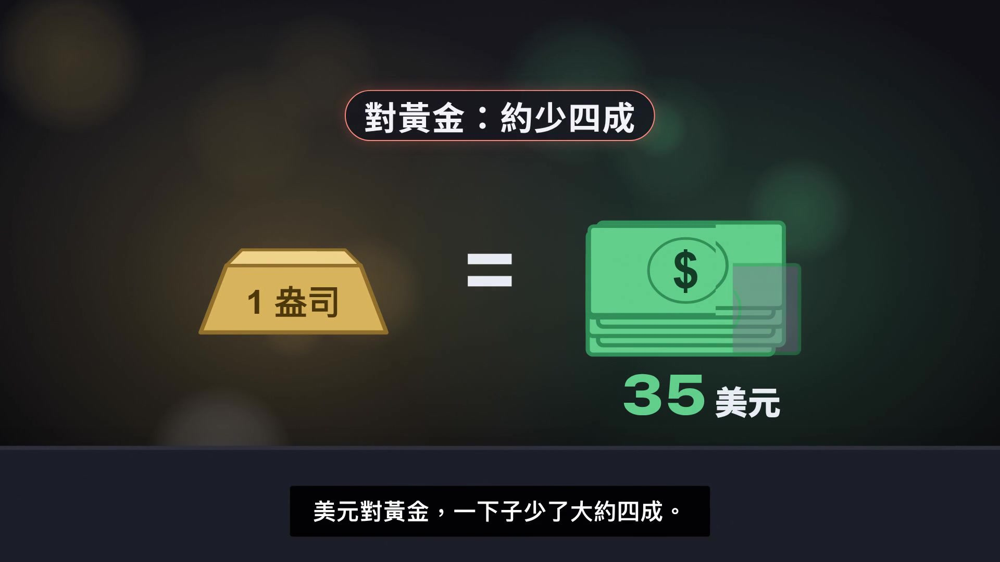

**逐字稿片段：** 1971年8月 尼克森總統宣佈 外國政府不能再拿美元換黃金 美元從此跟黃金脫鉤 重點在這裡 印錢讓債在賬面上還得起 債的數字沒有少 可是每一塊錢變薄了 這個代價由手上拿著這種貨幣 和這種債券的人來承擔

**話題推測：** 回顧1971年尼克森總統宣布美元與黃金脫鉤

---

## 00:12:11

**逐字稿片段：** 所以中間這一部分的答案是這樣 泡沫和國家的債務危機 是同一套機制 只是尺度不同 賬面上的財富很多 手上的現金不夠 等到大家同時需要現金 價格就往下掉 國家的版本 最後常常靠印錢 讓錢變薄來收尾

**話題推測：** 總結第二部分關於危機形成的機制

---

## 00:12:26

**逐字稿片段：** 那美國現在走到哪一步了 達里歐 說這些指標不是憑感覺 可以像做體檢一樣 一項一項量 我們就拿第一部分的三個指標 替美國做一次體檢 第一項 還債的負擔 是不是一路往上 答案是往上 剛剛看過 每收100塊稅 大約20塊付利息

**話題推測：** 進入第三部分，分析美國的現況

---

## 00:12:43

**逐字稿片段：** 美國國會預算辦公室 英文簡稱CBO 是替國會算賬的單位 它推估10年後 一年的利息還會再多一倍左右 再一項 利率是不是在漲

**話題推測：** 引述美國國會預算辦公室對利息支出的推估

---

## 00:12:53

**逐字稿片段：** 美國的中央銀行 在今年9月把利率提高了一碼 一碼是四分之一個百分點 30年期公債的利率 10月初漲到20多年來的高點 Bloomberg主持人開場說 他正在往6走 這是主持人的說法 實際最高大約5.7 後來回落了一點 沒有碰到6 最後一項 借錢給美國的人 還想再借嗎 大力友說 美國的債有很大一塊 是外國人買的 主要來自日本和中國 現在中國不想再多買 日本想拿回一部分錢

**話題推測：** 分析美國中央銀行近期的利率政策及公債利率走勢

---

## 00:13:19

**逐字稿片段：** 美國財政部的統計 外國人手上的美國公債 大約佔三成 比他說的少一點 日本和中國這一年 賬面上的持有都在減少 要注意 財政部自己也提醒 這份統計 看的是錢放在哪裡保管 很難精準看出每個國家真正的買賣

**話題推測：** 分析外國持有美國公債的狀況與趨勢

---

## 00:13:35

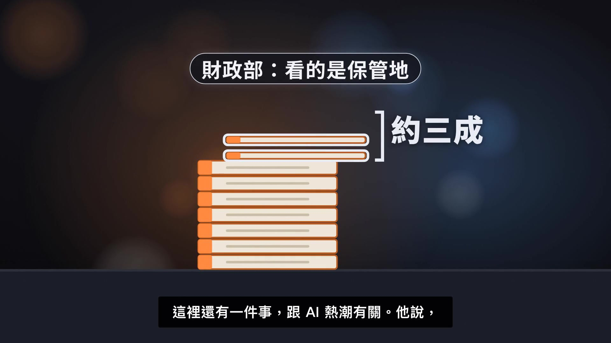

**逐字稿片段：** 這裡還有一件事 跟AI熱潮有關 他說現在股市的風險很集中 壓在少數跟AI有關的公司 而且大型雲端公司蓋資料中心 以前多半靠發股票籌錢 現在開始改成借錢 這讓利率和AI股價綁在一起 還記得那張100元的股票嗎 背後借的錢越多 利率一動 它就晃得越厲害 這裡只講機制 不點名任何一家公司 那三項體檢量完 回到開頭那句話 三年之內

**話題推測：** 探討AI熱潮下股市風險集中與借錢模式的改變

---

## 00:14:00

**逐字稿片段：** 先看這句話的來歷 2025年3月 他在Bloomberg的節目說 他猜是三年 上下差一年 今年8月 他在自己的文章裡寫 三年 上下差兩年 到了10月 又說三年之內 期限一再往後延 而且他的說法有前提 如果美國不改變現在的路線

**話題推測：** 追溯Ray Dalio「三年之內」預測的演變與前提

---

## 00:14:19

**逐字稿片段：** 再看他過去的記錄 2007年 他寄給客戶一份備忘錄 標題叫This is the big one 警告這次是大的 隔年就碰上金融海嘯 可是2020年1月 他在達沃斯的世界經濟論壇說 現金是垃圾 勸大家別抱著現金 兩個月後就碰上新冠疫情的股災 看一個人的預測 說中的和沒說中的 要放在一起看

**話題推測：** 回顧Ray Dalio過去的預測記錄

---

## 00:14:40

**逐字稿片段：** 也有經濟學家不同意 先看Olivia Blanchard 她當過國際貨幣基金組織的首席經濟學家 她在2019年說 只要政府借錢的利率 比經濟成長的速度低 債就可以一直滾下去 債不好 但不見得是災難 這是2019年的論點 今天的利率比當時高很多 這個條件已經緊了不少 再看國會預算辦公室 他的長期報告只說推估 不預測危機 他在2010年的報告裡寫 找不到一條再超過多少 就會出事的線 也沒辦法有把握的預測 美國會不會 什麼時候發生財政危機

**話題推測：** 介紹不同經濟學家對債務危機的觀點

---

## 00:15:11

**逐字稿片段：** 還有一派叫現代貨幣理論 代表人物是Stephanie Kelton 她認為自己發行貨幣的政府 沒有硬性的財務上限 真正要看的是 會不會推高物價 也有原本比較樂觀的人

**話題推測：** 介紹現代貨幣理論（MMT）的觀點

---

## 00:15:23

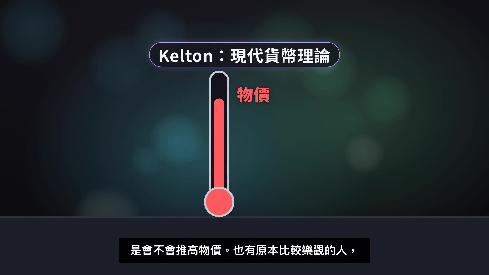

**逐字稿片段：** 像Paul Krugman 2025年也開始談 美國的外國資金 可能突然停下來 所以學界兩邊都有人 不是一面倒 比較準確的說法是 美國的指標 正在往他說的方向走 可是哪一天出事 沒有人算得準 他自己也這樣看 聽他怎麼說 他說 未來很不確定 連專業投資人 都很難抓準泡沫的時機 所以不要猜時機 最後

**話題推測：** 提及Paul Krugman對美國財政的轉變看法

---

## 00:15:56

**逐字稿片段：** 來看離我們最近的一段 布隆伯格這場訪談 還是在亞洲錄的 主持人問他 臺灣和韓國吸引了很多 AI的資本支出 也就是蓋工廠買設備的錢 會不會出現泡沫破裂 要注意啊 臺灣和韓國是主持人說的 但Dalio回答的時候 沒有說出這兩個地方的名字 他先說 這些地方的生產力表現非常好 可是他們已經超過自己的生產力 把賺來的錢拿到全世界去投資 接下來這段 聽他怎麼說 他說這是泡沫開始的典型例子 但不構成系統性的威脅 這是他的看法 我們不把它延伸成臺灣股市是泡沫 可是這段話 讓我們看到另一面 達里爾在訪談 一開頭說一個人的債 就是另一個人的資產 美國是借錢的一方 臺灣是借錢給別人的一方 美國財政部的統計

**話題推測：** 討論臺灣和韓國在AI資本支出下的潛在風險

---

## 00:16:57

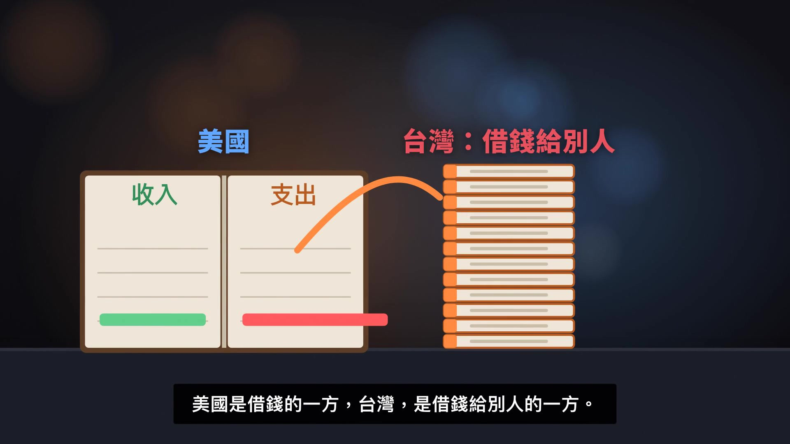

**逐字稿片段：** 臺灣這邊持有的美國公債 大約3000億美元 這是全臺灣的合計 不只是中央銀行

**話題推測：** 揭示臺灣持有的美國公債數據

---

## 00:17:02

**逐字稿片段：** 臺灣的人壽保險公司 也把大筆保費投在海外 先講名詞

**話題推測：** 討論臺灣人壽保險公司在海外投資與避險上的情況

---

## 00:17:07

**逐字稿片段：** 避險 就是先買一份保護 讓匯率變動的時候

**話題推測：** 定義「避險」一詞

---

## 00:17:10

**逐字稿片段：** 不會虧太多 金融監督管理委員會的資料 人壽保險公司要承擔 匯率變動的外幣部位 就有9兆多臺幣 其中避險的比例是歷史新低 那中間那一部分講的出口 跟我們有什麼關係 如果利率繼續往上 舊的債券會跌價 如果美元變薄 換回新臺幣的錢就變少 拿著這些債券和美元的人 都會承擔損失 這是機制 不是預測匯率

**話題推測：** 引用金管會數據說明壽險公司外幣部位與避險比例

---

## 00:17:32

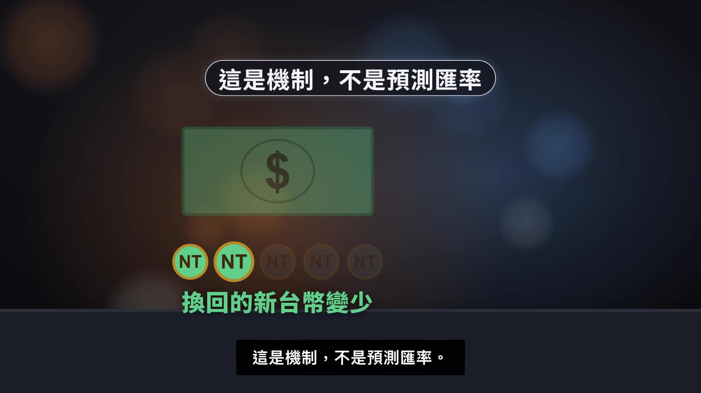

**逐字稿片段：** 所以最後這部分的答案是這樣 美國的三項體檢 都在往他說的方向走 可是時間點沒有人算得準 臺灣站在借錢給別人的那一邊 賬本的另一頭 也是我們 我們回到開場那個問題 一個國家 是怎麼從借錢 一步一步走到危機的 Darryl的回答是 國家跟家庭一樣 會被利息擠住 借得比還得快 利息越背越重 利率一漲 手頭最緊的人 先被擠出去 不一樣的是 國家能印錢 所以國家的危機 常常不是還不起 而是錢變薄 美國的幾項指標 正在往他說的方向走 可是三年之內 是他的判斷 不是定論 再提醒一次 這一集是知識整理 不構成任何投資建議

**話題推測：** 總結第三部分與影片的核心論點

---

## 00:18:12

**逐字稿片段：** 最後問你一個問題 如果一個國家 最後選擇印錢來還債 你覺得最後 是誰在付這筆賬 留言告訴我 喜歡的話 訂閱AI Notebook 開啟通知 我們下次見

**話題推測：** 向觀眾提出一個關於印錢還債的思考問題

---
