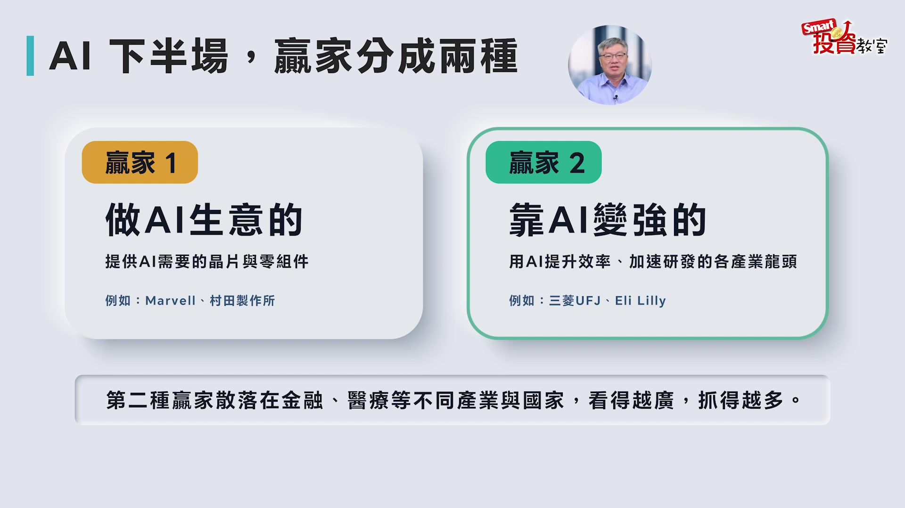
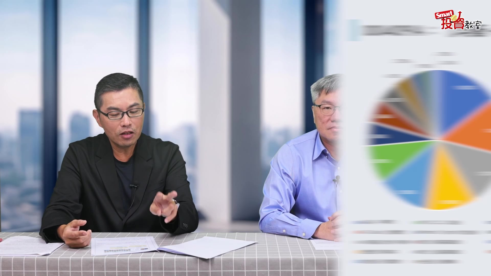
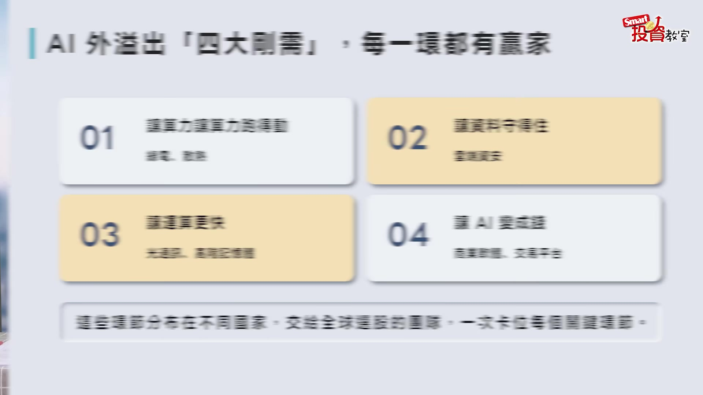
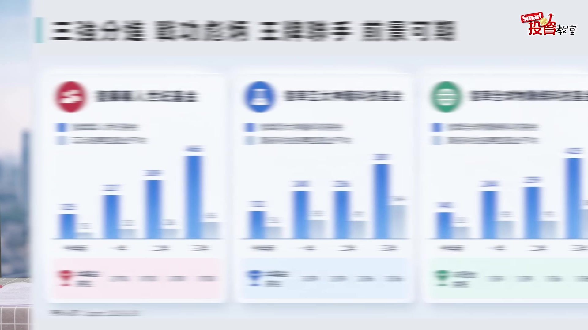

# smartmonthly-bw_-zADRXYAkaU — 關鍵畫面索引

- 來源逐字稿：[smartmonthly-bw_-zADRXYAkaU_FIN.srt](smartmonthly-bw_-zADRXYAkaU_FIN.srt)
- 影片：https://www.youtube.com/watch?v=-zADRXYAkaU
- 截圖數：10

## 00:00:20

**逐字稿片段：** 我們來看2023年AI元年, 那現在進入到了算是要即將進入第四年了, 那哪些AI的剛性需求已經浮現? 那接下來的投資又該怎麼佈局 所以我們今天請到我的好朋友 也是這個投資達人的

**話題推測：** 介紹AI元年及未來佈局方向

---

## 00:00:38

**逐字稿片段：** 超馬拔拉 周穎 周穎欣跟大家打個招呼 還有各位觀眾朋友大家好 我是超馬拔拉 那現在市場上有一個說法 說AI因為已經跑了這麼久了 所以我們要把它分成 上半場跟下半場 那上半場就軍備競賽 那你看美國這些科技巨頭 拼命投資AI做基礎建設 那到了2026年 那很多人就說 AI賽局現在進入到下半場了 所以現在下半場是怎麼樣把AI變現 那仲宇你怎麼看這個 AI上下半場的差異 上半場跟下半場 會不會大家誤以為 好像上半場結束了 其實應該沒有結束對不對 為什麼臺灣的股票 或者是臺灣的這些公司 在上半場表現得特別好 是因為等於是說 幫AI賺錢 因為AI在推動的過程中 所有的AI的上中下游 左右右遊前遊後遊 只要是跟賣產值有關的這些東西 一定都是跟臺灣的強項 這的確是臺產功勞 現在市場上開始進入到一個 就是我能不能夠用AI來賺錢 上半場是我要幫AI賺錢 下半場是AI你要幫我賺錢 所以你可以從這張圖表來看的話 在整個過程中 各位你不要把它當成 什麼上坡跟下坡 而是這個叫做 所謂的原始端跟終端 等於是中間的那一段 是叫做什麼 就是我們講說賣鏟子的 後面那個就是 有九個應用領域的應用端 我覺得這個才是 現在我們開始 要去關注的點 包括我們的民生必須品 從食衣住行娛樂 包括醫療的部分來講的話 當你這個AI的概念 套用進來之後 把現在這些東西的檔次 跟品質在做升級的過程中 它就能夠包裝成為一個 能夠AI幫我賺錢的工具 就會出來了 但這個部分 因為它才在剛剛萌芽的階段 很多東西 投資是買在故事實現之前 對我來講的話 這更是一個 我現在就必須要佈局的一個時間點了 下半場贏家大概就分成兩種 因為我們剛才講到上半場 上半場我覺得人類好可憐 我們要努力賺錢養AI 是啊 好 所以下半場贏家就分兩種 第一種就是我們剛才講的 繼續做AI生意的人就是繼續賺錢養AI 那他們就還是賣AI需要的晶片 因為以前是訓練嘛 第二種我們就說新的參與者 就是前面你們AI這個 預訓練幫弄的模型很強 我們就可以把AI加值到應用面上來 就幫我們後面的事情可以做得更好 所以就所謂的這個AI的 這個新的工業革命 所以我們用AI來提升效率 然後加速研發各種 包括在不同產業的龍頭

**話題推測：** 介紹來賓「超馬拔拉 周穎」

---

## 00:03:19

**逐字稿片段：** 你看像金融 現在銀行現在也是AI使用的很多 那醫療醫療也是 但是我們剛才講這種第二種贏家 它就分佈在不同的國家 就不像之前在 只有臺灣跟美國那麼集中 所以這種情況下 如果你只投資美股跟臺股 那真的是不夠的 賣產制 你一定會著眼在臺灣這個結構 但是不是隻有臺灣這是第一點 然後第二個 當靠AI賺錢的這個領域 已經擴大到不只是臺灣 請大家一定要有這樣子的一個思維

**話題推測：** 展示AI在金融、醫療等不同產業的應用

---

## 00:03:53

**逐字稿片段：** 好 到底什麼樣的工具 可以幫助我們接觸到這些 我們現在新的贏家 其實我們現在的投資人也很聰明 就是說那既然有 不管是說原來的上半場的優質的標的 還有下半場的 也就是具有潛力的標的 這麼多 如果你要去挑單一個股比較辛苦 大家開始會對於說的ETF會感興趣 那但ETF會去觸碰到AI這個族群 大致上分為兩大 一個叫被動式 一個叫主動式 兩個各有優缺點 不過以被動式的角度來講的話 它會有一些先天的條件 譬如說尤其是以臺灣的被動式來講的話 它有兩個特色 第一個 它即便是跟AI的這個產業無關的 它也必須買進去 因為它是以市值為導向的 我們不能說那些標的不好 但是問題是它可能跟所謂的 創造資產增值價格的效果 可能就沒有那麼的強 這是它的一個先天條件 第二個 臺灣的被動式是很習慣就是 某一檔比重特別大 是不是代表說其他的 不管叫做護國神山群 黃仁勳背板群 然後蘇媽的什麼概念股 或是回答概念股 那些的標的 你可能就涉略的會比較少 更不要是說所謂的 一些佈局的東西 你可能就比較沒辦法做佈局 然後第三個是 既然叫做市值型的考量 是不是代表說 某一個市值以下的潛力股 你也不能買了 就是中小型的 他也不太能買 市值型的或是被動型的 他條件不差 但是我個人 我會比較傾向於 是主動式的ETF 因為主動式ETF 第一個 它有主動選股的能力 第二個 它有主動調整持股的能力 第三個 它對於整個行情跟趨勢 跟產業的判斷來講的話 它比較不是那種 好像我一年只能換兩次股 我可以換 常常就換股 所以說在這種情況之下 趨勢跟行情 它不是消失 但是在轉變跟輪動的過程中 主動式的ETF來講 對我來講會比較喜歡 貝羅斯沒有不好 但是你想要創造 更積極的資產增值的效果 主動式ETF來講 應該是列為首要考量的 另外我們剛才又談到 因為下半場之後 整個的投資面就 視角就更大 非常廣 全球 那你就可能去全球 你也要各地去選 新銳的 有潛力的這種AI股 所以我們就聊一下 像最近9月剛掛牌 這個有一檔 就是以全球為標題 都可以去選 00409A主動赴華全球募資 那他的募集到這個掛牌的聲量跟成績 我覺得都還蠻不錯 你有研究過這檔 你覺得他的這個優勢會是什麼 我有研究 我有貢獻 真的 你也有買 對 募集過這會有貢獻 原來問到專家 應該是這麼說 其實峰哥很清楚 就是我們在投資的過程中 第一個就是 我還沒有講到他的一個 所謂的結構上面 我會講說資產的配置 除了立足臺灣 我們還會放眼全世界 這一檔的ETF 它本身就包含了 臺灣跟國外的優質的標的 我不覺得這也是一種 資產配置的一種方式的低點 那第二個

**話題推測：** 探討接觸新AI贏家的投資工具

---

## 00:06:54

**逐字稿片段：** 我建議各位也可以看一下這張表 這張表對各位來講非常的重要 第一個 左邊的那個圓餅圖 你會發現這個圓餅圖 它指的是什麼 就是00409A 它所預計跟它設入的 這個產業別裡面 對每一家主動式ETF都說 他們的產業別 都是往AI的方向前進 但是截至目前為止 能夠去把它的觸角 放在什麼 就是我們講AI的變現端跟應用端 有資安的部分 現在還有能源的部分 這些部分來講的話 那跟AI又沒關係 不是 那是AI要幫他賺錢 是在這個領域來講 有這個策略 所以說在產業別上來講的話 它的一個區分會比較完整一點點 這是第一點 然後第二個 既然叫做ETF 這個是我個人的一個想法 大家可以參考一下 我總認為ETF 叫做一籃子的股票 應該就不是把 把單一個股的比重拉得特別大 因為你要有一個風險分散的效果 所以說這邊既然有這麼多的優質的標的 但也不會因為是說我特別看好誰 所以我就把它買的特別大 這是第二個

**話題推測：** 展示00409A的產業別圓餅圖，強調變現與應用端佈局

---

## 00:07:56

**逐字稿片段：** 那第三個就看到右邊這個所謂的 一個叫做最近這十年的狀況 臺灣基本上大概都可以表現 大概前五名沒什麼問題 但是臺灣至少在最近這十年來講的話 從來好像從來沒有到過第一名過 就是年度的表現都沒到第一名過 所以說今天我大概算了一下 我們平均大概是2.8名 就是以這10年來講 就代表說我們大致上大概是第三名 那第一名跟第二名 以最近這10年來講 大部分就是美國跟韓國 所以我就想說 我們為什麼要討論到資產的配置 我們為什麼要做一個佈局的規劃 就是臺灣很好 但是如果說我可以順勢把 美國韓國或是日本 這些優質的標的也納進來的話 會不會讓我的資產的一個結構性 會更為完整 那409A它的佈局來講 除了把臺灣的優質的標的買進來之外 剛所提到的包括鏟子類別的 還有就是AI變現端的部分 散佈在世界各國的優質的標的 他放進來 這一點是非常吸引我的 我才會對他感興趣 稍微彙整一下 他的投資的佈局來講

**話題推測：** 顯示近十年各國股市表現排名圖表，強調台灣排名及全球佈局必要性

---

## 00:09:01

**逐字稿片段：** 大概針對有四個面向 一個是跑得動 守得住 算得快 賺得到 AI算力中心的天花板就是電力 我如何能夠有充沛的電源 還有就是在電力運用過程中的 散熱的效果 就是怎麼樣讓整個算力跑得動 這個部分你要不要佈局 一定要佈局 那跑得快 那個不用說了 那跑得快來講 就現在來講 不管是光鏡同出 或者是說他整個HBM的過程中 其實大家不管是製程的提升 或者是他的一個檔次的高階 目的都是為了 讓運算算得更快 什麼叫做資料守得住 其實各位來講 其實我相信大家有知道 現在美國正在期中選舉 在期中選舉的過程中 不管是共和黨跟民主黨 他們即便是共和黨 是全然的鼓勵AI的創新 他是不是也提到一點 AI的監理跟AI的治安 現在治安真的很重要 對 AI的治安已經不是 只有防詐騙這件事情 而是說在整個的資訊的保護上面來講的話 這個部分跟產值沒有關係 但是跟AI的應用端有絕對的關係 這個佈局一定會越來越 越蓬勃跟熱絡 最後一個就是能不能賺得到錢 我導入AI之後來講的話 讓我不管是營收的增加 毛利的提升 或是業績的一個增溫 怎麼樣能夠讓AI的四大剛需 我認為就是一個跑得動 守得住 算得快 還有賺得到 所謂的409A它的產業佈局裡面 它每一樣都有佈局 而且除了臺灣之外 所以我的結論就是 均衡加前瞻 臺灣加全球 基本上這些東西組合在一起 是409A的一個架構的核心特徵 不過我們就談到

**話題推測：** 列舉00409A投資佈局的四大面向：跑得動、守得住、算得快、賺得到

---

## 00:10:39

**逐字稿片段：** 年齡409A的經理人有三個 那坦白說 我在跟同事聊也蠻好奇 為什麼有三個 通常比較常看到 一個經理人管三檔ETF 還蠻少看到三個經理人 管一檔ETF 那為什麼需要這麼多 那個人一起炒盤 我會覺得這個 就是它需要有三個來講話 它有結構上面的絕對必要 因為我們剛剛有提到過就是 就是我們是立足臺灣放眼全世界 他所要涉獵的產業跟結構 還有一個輪動的速度越來越快 因為這三個經驗我們都聊過天 我很佩服的一點就是說 當他們在選擇標的的時候來講的話 因為有的是那個財經背景出身的 像佳麟是財經背景出身的 然後有個萬裡 帶過Intel 我就想說 哇 你那個哇的感覺就出來了這樣子 就是你還不知道哇什麼東西 先哇再說 哇 你帶過Intel這樣子 戴過英特爾才會出來 如果戴在輝達現在繼續在輝達 但是等於是說 今天他出來之後來講 他戴在輝達是造福輝達 他出來是造福投資人 然後再來就是說像俊瑞來講 他戴過臺積電 所以繼續戴臺積電 但是問題是這樣 他是為了造福大家 所以要趕快出來 可能已經財富自由出來做興趣的 所以說來講各位你們發現 一般來講大家在討論基金經理人 都認為他應該是財經背景的 專業的項目要很強 但是當現在的時代 已經不是一個叫做景氣循環了而已 它現在是你對於科技 尤其是AI的變化 跟它的一個整個輪動 你要掌握得非常迅速 那當這些這三個經理人 他本身都是從所謂的科技業界出來之後 你才會知道 原來我去請教他們的時候來講 我現在說雖然年紀都比我輕 但是我想 就是能夠反而從他們身上 可以學習很多的東西 但是第一點 但是這一點我們整個說 他們就是學有專精 經歷很豐富 在整個判斷上來講 應該有他們的獨到的眼光 但這個只提到 我們只能說說嘛 但是他們三個都有操作過 三檔的基金

**話題推測：** 介紹00409A的三位基金經理人

---

## 00:12:38

**逐字稿片段：** 很多人在看那個圖表的時候 他們會講是說 請問一下 佳麟的是哪一檔啊 然後萬裡是哪一檔 同性質就跟同性質比 譬如說他是物聯網的 就跟物聯網比 然後他是科技的 就跟科技比 所以說當他在比較的過程中來講的話 其實基本上 他們在同類型的基金的績效裡面 大致上都是屬於排在前三名的 所以他們個別的績效都很好 但是組合在一起的原因是因為 這一檔409基金 它必須著眼在臺灣 以及臺灣之外的各個國家 還有各個產業的一些訴求 所以它必須在這個地方 有更完整的基金經理的建構跟配置 我的結論就是 三強分鏡 戰功彪炳 王牌聯合 前景可期 確實是這樣 就是如果是一個前沿科技揮動的這個行情的話 通常你這個經理人真的不是隻有金融專業 光金融專業 金融專業是必須而已 還不夠 你就是真的還要有技術的能力 那如果你特別在那個領域裡面 有這個科技know-how跟技術的這個知識的話 其實你會超得更好 我們過去有看到就是這種有雙重變 可能有人還是這個金融跟科技雙主修 或是有在科技廠裡面待過 他對這個細節的掌握 跟這個前瞻的眼光都會更好 那這個確實是 尤其是像在這個時候 我覺得這個選對這個經理人 就真的還蠻重要

**話題推測：** 展示經理人過往基金績效比較圖表

---

## 00:14:08

**逐字稿片段：** 最後那豐哥來幫大家畫下重點 就是AI進入了下半倉 所以贏家不時在硬體 硬體當然還是會繼續有贏家 但是就不只在那 那同時也不只在臺灣 從這個電力 散熱 職安光通訊記憶體 接下來軟體交易平臺 都會真的我覺得是遍地開花 世大剛區是分散在全球的 而且各種的隱形冠軍 所以臺灣的投資人當然 你在臺股當主力當然很重要 可是我真的包括我自己也是 會拿出一部分資金來配置全球 這些很有特別的潛力的這些產業 這個會讓你的資產 不要只綁在單一的國家 或者是單一的產業鏈上 把你的舞臺跟眼光 都拉到世界性的這個舞臺上 那你就會有更寬廣的這個機會 有更一個可能更長期的 更好的一個發展 那今天我們的節目很感謝 仲寧跟我們分享了這麼多 今天節目就到這邊 Smart投資教室 我們下次見 拜拜

**話題推測：** 總結AI投資重點：贏家不只在硬體和台灣

---
