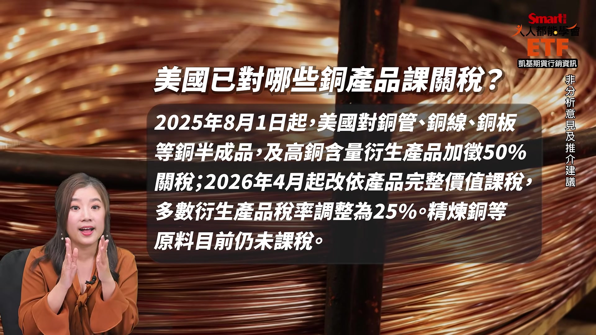
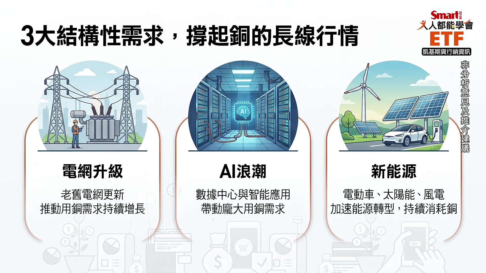
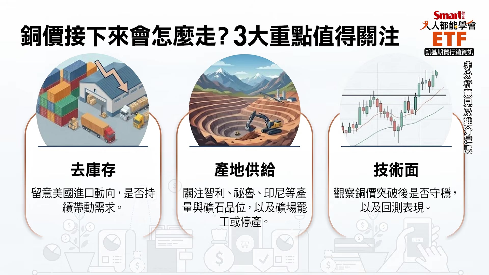
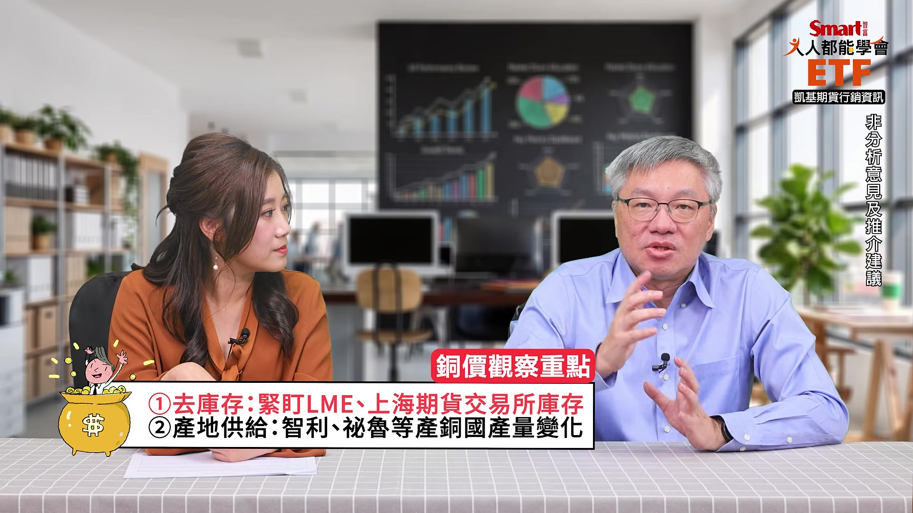
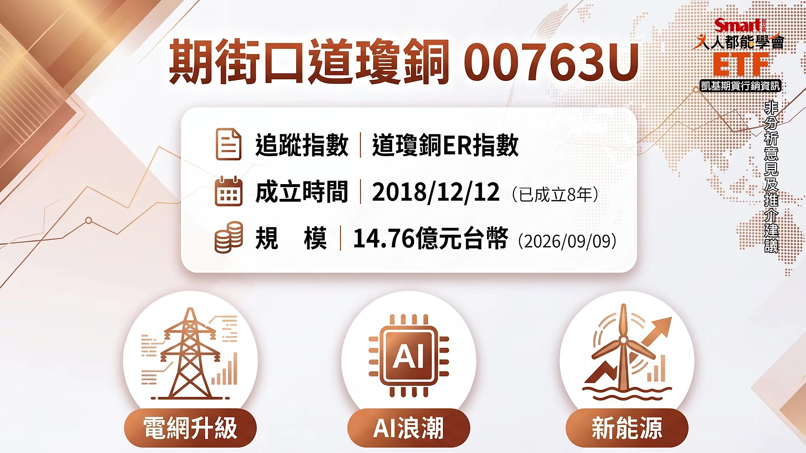
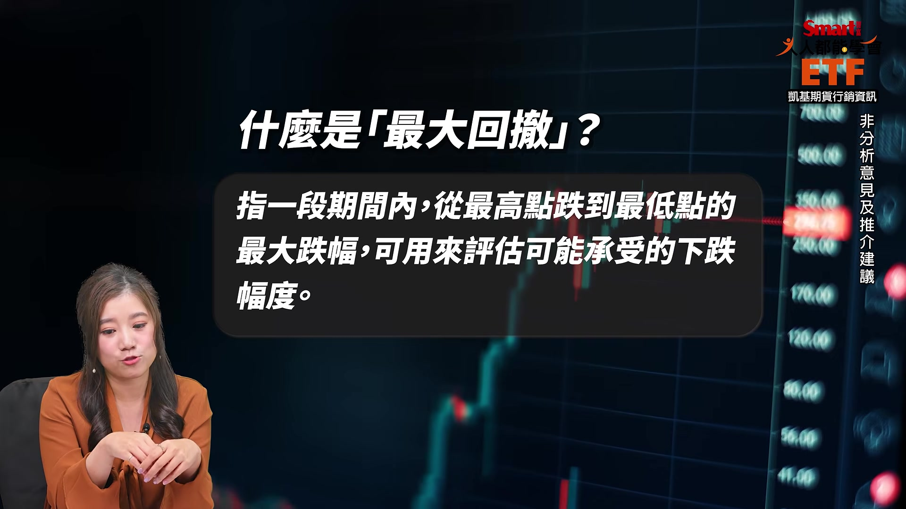

# smartmonthly-bw_B4LNkzUrsvM — 關鍵畫面索引

- 來源逐字稿：[smartmonthly-bw_B4LNkzUrsvM_GT.srt](smartmonthly-bw_B4LNkzUrsvM_GT.srt)
- 影片：https://www.youtube.com/watch?v=B4LNkzUrsvM
- 截圖數：12

## 00:00:11

**逐字稿片段：** 居然突破了每公噸14000美元 而且現在是持續處於高檔哦 那價格這麼高

**話題推測：** 提出具體數字：倫敦金屬交易所銅價突破每公噸14000美元，可能搭配銅價走勢圖。

---

## 00:00:18

**逐字稿片段：** 可是全球的銅庫存呢 不但沒有減少 居然還反而增加 這有點違背常識對不對 就是價格 為什麼價格在增加的時候呢 反而庫存還增加哦 所以接下來看它怎麼走 就是我們今天要幫大家解答的 不過我覺得我今天的穿著 非常符合我們今天的題目 是不是很「銅」 但我覺得這也是要來反應是 我近期真的還蠻喜歡它的 為什麼呢 我覺得投資朋友應該都會很有感覺是 6月多的時候 以股市來說是創新高 然後7月的時候就碰到去槓桿的股災 不是往下跌嗎 那以台股來說 我們一直到了9月中旬才終於 從這個低點 終於VVVVV上來 才終於到了9月中旬 才把之前6月的高點給突破掉 可是我不知道觀眾朋友有沒有發現 銅價 它在8月初 就重新過了那個6月的高了 欸這個是很強勢很強勢的東西哦 就是7月大家都一起大跌 然後它8月它就突破前高了 欸至少比股票市場 提前了一個半月左右 所以它真的是一個非常強勢的東西 我們常常都說去年大家都要看黃金 我覺得今年大家就是要看銅 那為什麼我特別有感呢 因為我有在那一波的車上 所以那時候8月初看到股票 都還躺在半山腰的時候 它就衝破的時候我就超嗨 然後我還有在我的就是即時動態上面 都還有在PO這個訊息 原來你就是那個買盤 而且真的是這樣 就是說你當然是很開心啊 但是呢我就要跟你說一下 我親戚真的就最近有點痛苦 因為他最近突然就想說 哎呀想要翻修一下 他們家的這個廚房 那就去問了這個師傅啊 然後先估一下價嘛 哎喲他嚇到 他本來想說我簡單弄一點東西 可能大概這個十幾二十萬可以打發掉 欸可是現在隨便搞一搞就 一個不小心就上百萬 然後他想說怎麼會漲這麼多 現在沒辦法 就是不但是人工貴然後材料貴 那特別當然是 尤其是有一些跟銅有關 銅就是工業之母 又是民生各方面都用到 所以就最近確實 有這個整個大家在搶購的味道啦 而且關鍵到底是什麼 我們今天要跟大家講就是 對關稅的預期心理 因為像剛剛峰哥你就講啊 說從庫存量來說 它其實是攀高 照理來說價格不應該這樣漲 那所以它漲的原因到底是什麼呢 剛剛峰哥特別有講到關稅這件事 我們來幫大家小小的財商科普一下 其實在美國從去年就開始 去年大概8月的時候就開始了 他們有特別針對像是銅管啊 銅線、銅板等等...這些銅的半成品 還有一些像是高級銅的含量的一些 衍生性的一些產品等等啦

**話題推測：** 提出新的話題：全球銅庫存不減反增，可能搭配銅價與庫存量對比圖。

---

## 00:03:07

**逐字稿片段：** 關稅加50% 我記得那時候他要加台灣30幾%的關稅 我們就雞飛狗跳 我們就說不行啊 他居然加銅加了50%的關稅 可是峰哥這個加關稅跟 又在怎麼樣傳導到銅的價格上 好 我們先講 你剛才這個講的呢 加50%已經很嚇人 但是那個叫做已經發生了 因為他去年就加了 我們只是已經被漲過一輪了 可是現在市場擔心的 不是去年被漲的那一輪 是美國接下來好像

**話題推測：** 說明美國已對銅半成品加徵50%關稅，可能顯示關稅稅率的圖卡。

---

## 00:03:37

**逐字稿片段：** 還要對精煉銅再開徵關稅 所以最近白宮的態度就有點變化 就說後續要怎麼再加這個關稅 如果按照原來市場預期是 美國對精煉銅這個加徵關稅呢 時間大概是2027年 本來是2027年才要課15% 2028年呢再拉高到30%哦 那真的如果白宮就這麼幹了 那這些關稅成本 就是明年跟後年會發生 而且還逐步拉高的這個 這個關稅呢 成本就會轉嫁到美國買家身上 那美國買家呢就會要我們 要不然就壓我們 要不然就是大家一起價格上漲 所以我覺得這其實也就是 價格傳導上 其實我覺得不要講太難 大家自己先想一下 如果告訴你 有一個東西它未來會漲價 那你現在要做什麼事情 現在當然是先買起來啊 所以趁著關稅還沒有正式 你說明後年15%～30% 還沒有正式上路之前 那現在大家要做的事情 就是趕快先囤貨 其實這個也是在我們在經濟學上會說 有時候就是一種假性需求 可是這個假性需求又不真的那麼假 是因為我們說前面說工業 這個銅是工業之母 所以它的長期需求真的很需要 所以又在這個可能被加稅的情況下 所以大家就提前大量的買 所以就大量的銅呢 提前趕快進口到美國 趁他還沒有漲關稅的時候 我們去年那個關稅之前也是大家 趁還關稅還沒有實施之前 大家瘋狂了這個搶船期 對對對趕快去 只要進到美國境內就先安全了 那另外一個就是火上加油這件事 要講一下 就是去年11月6號 這個美國地質調查局呢 就正式把銅呢 畫進了關鍵礦物的清單 說真的銅這種工業之母 大家都平常很用的東西 你放進什麼關鍵礦物 會不會有點太過分 不過沒辦法現在就這樣 這個清單呢是現在美國官方認證呢 攸關經濟跟國家安全 現在已經不是不只是民生物資 已經無限上綱了 所以呢這個 它也會影響到整個供應鏈的問題 就是安全的供應鏈的問題 所以銅現在就被點名了 它是不只是你的工業需求 家庭需求民生需求 它還是戰略需求 所以買家要更急 萬一以後把我縮得更緊怎麼辦 所以呢不只是關稅 還怕以後買不到 有錢買不到是更慘 所以趕快先搶再說 所以那個搶銅的風氣就因此升溫 那其實這個概念 也不只是我們說說而已 因為我們其實有數據支撐的 那我們來給大家看這張圖哦 我們這邊上面列的是三大銅交易所 包含像是倫敦上海 還有美國的紐約的商品交易所 這三個交易所 你就會看到黃色的這個柱狀體 它是指美國紐約商品交易所的銅的 庫存量 其實應該很明顯你可以看得出來 從2025到2026年 它那個庫存 那個喇叭是開口向上 是這樣子這樣子 直接是擴很大 但你同期你去看倫敦跟 上海交易所其實是還好 所以就可以看得出來那個銅 通通通通都被 剛剛在講的嘛搶貨 所以都被搶到了美國去 但同一時間你就會看到 全球整體來說 銅的庫存其實是變高的 庫存是變高的 所以這就又再次的 呼應了剛剛峰哥講的 這一次的漲價 其實並不是 就是供不應求 我們常常都會說供不應求價格才會上漲 其實不是因為它的庫存是高 就表示它的供給是多的 好所以如果不是供不應求的情況之下 所以這一波的漲價 就是我們剛剛在講的 因為大家怕美國又再課關稅 所以就開始搶銅 就把銅全部擁擠的拿到了美國去 那這種擁擠性的交易 也很好理解啦 你就把它想像成是 投資圈現在不是在講AI嗎 所以大家都投資一定要投AI投AI 就瘋狂的一起湧到AI去 這就是所謂很經典 典型的擁擠交易 好那現在我們就講完了 這個AI的擁擠交易 所以在原物料世界 你的銅呢 就是這個股票市場裡面的AI的擁擠交易 所以因為大家都急著卡位 所以價格就越推越高 不過我覺得 這種所謂擁擠交易 應該比較算是近期支撐銅的 一個比較短期的一個主要因素啦 你也不能說 我看銅價就只看這個短期搶貨潮 要不然它只要一不搶貨 或是一沒有上關稅 欸難道這個支撐就沒有了嗎 這只是短期上面的因素 那如果我們看長遠一點來看 中期長期來說 銅到底有什麼的話題 有什麼題材呢 其實過去我們都會一直在講說 在AI時代上面最受惠的貴金屬 真的就會是銅 或者你也可以稱它叫做 數位時代的新石油 因為你知道我們現在不是都做AI 都要有伺服器 那其實AI的資料中心 乃至於到伺服器甚至散熱系統 其實也都有銅 那另外還有包含像是 電網啊 就是美國那些舊的電網 要去做更新啊 電網傳電這個也通通都需要銅 所以除了剛剛的那個短期因素之外 中長線其實銅非常有非常大的 需求上面支撐 AI伺服器要銅、電網要銅 所以這都是對它來說是很大的那個需求 對 就確實如芷娟講的這樣 因為如果 其實原物料是這樣的 每隔一段時間都會有一兩種東西被炒 像以前炒過黃金 後來又炒過白銀嘛 對對金銅 然後後來炒過 炒過黃豆啊 什麼 可是如果背後沒有一個結構性的需求 在支撐的話 最終就會這些價格炒完之後就會崩盤 那這一次大家會看得比較樂觀一點說 雖然是大量的銅先進了美國 但背後比較大的結構性的力量 是在於我們先講 就是美國真的 這個這樣講其實有點奇妙 就是說其實美國基礎建設 現在還蠻落後的 因為過去50年的投資太少 所以他們現在大量進到美國之後呢 那美國因為蓋的 就是蓋的又慢 它進去之後消費 消化的慢的原因 是因為美國人工很缺 所以大家在在那邊排隊等人工 然後不是這些銅沒有 不需要被消化掉 而是它大家要排隊等著去 消化這些進來的原料 所以它後面的需求是一個長期的 就像你剛才講的 這個電網老舊啊 汰換擴建啊 輸電配電啊 這些真的都是用銅的大戶

**話題推測：** 討論市場擔憂美國將對精煉銅加徵關稅，可能顯示白宮對關稅態度的相關報導。

---

## 00:10:00

**逐字稿片段：** 再加上這個電動車我們也知道 電動車就是對 就是持續的對這個銅的需求呢 就是傳統油車的三倍以上 那還不用講說太陽能啊 或者是其他的這個各方面 AI資料中心這些 所以這些我覺得都是長期需求 我覺得它消耗的慢 是因為人力不足 就像台積電那邊蓋廠 就是找不到人的問題是一樣的 所以需求是有 就是說銅的結構性需求 是確實是很強勁的 那我們都說原物料 一定是要看供給跟需求嘛 需求有

**話題推測：** 提出電動車對銅需求的影響，可能搭配電動車與傳統車輛用銅量的比較圖。

---

## 00:10:33

**逐字稿片段：** 那供給端的狀況目前如何呢 好 現在我們來講說 那怎麼樣去盤點一下 這個供給狀況 因為現有的銅礦大概 跟已經有點稍微跟不上需求 所以你現在如果要增加供給 當然就開新的銅礦嘛 那這個這個不是一個小事情啊 不像你隨便拉一條生產線 你就開一個銅礦 到它能夠有效的量產 大概就要好幾年 那S&P Global的估算呢 全球銅的需求呢 在2025年大概是2800萬噸 那2040年的時候呢 就會到4200萬噸 哇 這真的是 對對 這真的是一個很大成長 那供給真的是很很難同步的跟上 我們現在講因為你想 連這個最高價值的 那個AI的資料中心 連這個很就是像這些晶片廠 都找不到人 如果你是一個勞工 你希望有機會先進科技公司 還是進礦場 對所以這個供給真的就就更難啦 所以可能整個 現在大概預估就是說 未來可能會出現1000萬噸的 這個缺口 所以需求持續的在擴增 那供給有可能會跟不上 所以這是這一波銅的故事 就是它是長期需求上的 有一個結構性的問題 所以這是最結構性的支撐就來了 就是你的供給 剛剛聽起來它1000萬噸的缺口 供給不足嘛 因為礦場沒有辦法一直開出來 那需求剛剛又講了又這麼的多 有AI、有伺服器、有電網 還有新能源 需求就是這麼的強 可是供給又沒有辦法馬上的開出來 那這樣子就會變成供不應求 那如果供不應求 等號我應該就是要畫上漲價 所以不知道 峰哥你你自己怎麼樣看 接下來銅的漲價 或是說銅價其實在我們錄影的現在 其實也漲到了一個一定的高度 還有空間嗎 我覺得是這樣 大家不要對價格 特別是原物料價格 不要有一個預設的很明確的的位置 但是要觀察那個趨勢 那你要怎麼知道趨勢會怎麼走 最重要就是去追蹤幾個 譬如說重點的指標啊 或觀察的一些重要的數據 那我給大家舉三個

**話題推測：** 轉向討論銅的供給狀況，可能搭配全球銅礦產地圖或供應鏈圖。

---

## 00:12:47

**逐字稿片段：** 第一個就是到底去庫存的狀況怎麼樣 我們在講還是要看庫存的這個 正常的消耗狀況怎樣 那目前全球的銅礦 雖然沒有真正的短缺 但是大量的銅持續流進美國 所以美國以外的地區呢 庫存是真的在下降 我們剛剛講全球來看好像 上升 對但是因為美國上升 其他在下降 但是並不是只有美國需要銅 大家也都需要 所以你觀察的邏輯就是 如果美國的進口的速度不降 那市場很快就會感受到不夠用 因為美國你又持續的拿貨 那其他地方是要用貨又拿不到 那就真的就會很麻煩 那另外呢如果美國真的 停止囤貨啦 我們這個是觀察 因為我們現在不確定 假設美國停止囤貨的話 那短線的這個緊張呢 就會稍微鬆動 那我覺得這就會好一點 不過目前看起來好像 美國也沒有什麼要停止囤貨的 這個跡象這是目前來看 所以在這個庫存這個部分 剛剛給大家看就三大交易所嘛 所以撇掉了美國紐約交易所的話 那接下來可能就是要緊盯的是 LME也就是倫敦交易所 還有上海期貨交易所 就看它這個銅的庫存到底是 就是往上走還是有往 有往下降之類的 其實過去傳統上 我們都會非常重視LME 就是倫敦這個交易所 因為它可是全球最重要的 這個原物料交易所 可是同樣的 這幾年來 我們越來越重視上海交易所 因為全球最大的用量 就在那裡 所以那個交易所有時候反應的是 更領先指標 那我覺得大家除了看總體的以外 一定也要去看這個最大消耗的 那個地方的這個數據的變化 所以這個一定要再 大家要持續留意

**話題推測：** 第一個觀察指標：去庫存狀況，特別是美國以外地區的庫存下降。

---

## 00:14:35

**逐字稿片段：** 那第二重點我們就要講到就是說 產地的供給狀況呢 到底如何因為我們講礦產嘛 那全球到底哪裡有最多銅礦 就智利 對 秘魯這些南美洲國家 他們就是最重要的這個產銅國 那這個 除了產銅國的產量的這個變化之外 那就是它礦石的這個

**話題推測：** 第二個觀察指標：產地的供給狀況，包含智利、秘魯等主要產銅國。

---

## 00:14:59

**逐字稿片段：** 品質啊 它的品位會不會下修 因為 就是你挖出來的含銅量 如果礦石的含銅量如果高 那你當然產出的這個效率就高 但如果挖出來的這個 含銅量是下降的這些礦石呢 那你就挖你的耗的工是一樣的 但是你的產出能夠精煉出來銅 就變少了 所以這個數字是比較專業一點 但如果你真的是在 關注這個銅的這個價格的人 那我覺得你還是也要關心到這個部分 可是如果聽到這裡 其實我我自己的感覺會是 我覺得供給要能夠快速開出來 原則上不太可能 就我們剛才講人工真的很難啦 那如果供給沒有辦法快速開出的話 那真的就是看需求 那所以如果今天有一天你繼續看到 以庫存來說 如果你看到倫敦下降 看到上海下降 就庫存下降就表示需求很強 需求很強 然後供給短時間之內如果又開不出來 這其實你光看到這兩個交易所 這個數字如果出來的話 你大概就能夠去推敲說 接下來可能在商品上面會有一些支撐 大家就可以開始去想像 好但我相信聽到這裡 可能也會有一些好朋友就說 好難啊 太難了吧 我又要去 看那個倫敦 我要看上海 你到底要我怎樣 最簡單來說 其實在操作大宗商品 用技術分析應該可以吧 對啊 因為其實線型 我們雖然說技術分析有一些落後性 但它畢竟還是 整體的反應 過去這段期間裡面 所有訊息的總合 所以如果你要領先資訊 你就要看產地的 這個存貨跟供給的需求狀況 如果你希望得到一個平均資訊 然後又不要太難 然後就在技術分析的線型裡面 也可以得到一些 不錯的訊息 那我們來看這個銅價月線圖 圖上有三條均線 分別是5個月、10個月跟20個月的均線 那簡單講就是過去5個月、10個月 跟20個月的平均成本的這個線 那你用不同天期來看 來作為趨勢方向的分析 你就可以看到呢 如果我們現在知道就是 跟股市一樣啦 就是如果是短線在上面 中線在中間 長線在下面 這叫多頭排列 跟股市的邏輯一樣 那只要持續這個趨勢呢 就表示價格的走勢是持續強盛的 因為它在走一個 強盛的多頭趨勢 那接下來就是看一下K棒 就是第一個你就看一下 它的這個上影線如果有變長 我們知道這個K棒如果上影線變長 就上面很多人賣嘛 就價格漲上去有人把它打下來 那這個是跟股價的這個觀察方法也是很像 對 那第二個就是看 K棒可不可以守在10月的均線之上 因為10月基本上就是一個比較中期的這個 數字的水準 那如果你能夠守在10月均線上呢 至少這個長多的結構呢 就還在維持 沒有變化 那如果是跌破呢 那就要留意 並不是每次跌破都代表趨勢立刻要反轉 因為我們也知道 技術分析最頭痛的就是 有很多的假突破跟假跌破 那這個就是你稍微要花一點 在變化的時候要稍微一點 花一點時間觀察一下 就是假設你認為它可能是一個假跌破 那你就要去對應一下其他的這個 其他的數據或是新聞的這個基本面 跟最近的狀況來去綜合的判斷一下 那這邊 最終就是要提醒大家 整個銅價就是市場供需 各國政策 然後經濟 整體經濟的多重因素決定的 指標作為你一個參考 但整體基本面呢 是一個大趨勢的支撐 那你一定要記得就是 還是我剛才前面講 就是技術分析是分析過去這段時間 一個綜合的強弱判斷 但未來呢是 取決於在經濟基本結構 是不是順著我們預期的方向發展 所以結合這兩個基本面跟技術面呢 綜合的判斷呢 可以幫你做更好的在前方趨勢的這個走向的一個綜合的判斷 好了我們聊了這麼多 在那邊銅.... 那對應來說 那投資人到底要怎麼樣參與 這一波的故事 或者這一波的行情 到底應該怎麼做 你不太可能 就是去買銅線堆在家裡 你也不知道要幹嘛吧 我跟各位講你你以為銅很輕嗎 銅很重 不然你去外面 如果有地上有那個銅線 你去搬搬看 那一點銅 你搬不起來 對 所以呢其實一般投資人 第一個你不可能去 去買銅線捆放在家嘛 你家你如果那個房價很貴 不要做這個傻事 所以呢當然最簡單 大家還是知道就是還是靠ETF啦 我覺得ETF真的可以解決 尤其這原物料這東西呢 你買期貨你又害怕 因為你自己要去看部位 然後又怕這個你的槓桿 或者說這個保證金存得夠不夠 所以這些東西對一般來講壓力就太大 所以ETF還是一個比較簡單的方式 其實我相信有定期收看我們節目的 其實大家應該都還是有一些背景知識 因為在我們的ETF市場當中 就有直接可以對應的這些 貴金屬的ETF可以投資 那如果以銅來說的話 其實包含街口投信它所發的這一檔

**話題推測：** 深入說明礦石品位對供給的影響，可能搭配礦石含銅量的說明圖。

---

## 00:20:12

**逐字稿片段：** 叫做00763U 好我這要念慢一點 因為大家現在可以立刻去搜尋一下 00763U 那它是期街口道瓊銅 期街口道瓊銅這一檔ETF 它其實就是一個原型期貨的ETF 那它追蹤的呢就是 道瓊銅ER指數 那它對應持有商品 就是在紐約的商品交易所當中的 高級銅期貨 所以呀其實 我個人是覺得 初階者 你先想要來感受一下銅的漲跌 那個律動感的話 初階者其實你就可以用 00763U來做 那如果是進階者 如果你就是用 就是操作了一下之後 發現你非常有心得之類的 你再銜接去做銅期貨 我覺得這樣的那個順序是蠻可行的 那就像我剛剛 我前面一開場的時候 不是在講說 我就是 八月做的時候非常有感的原因 就是因為我用ETF來做 你是用期貨嗎 沒有我用這個ETF在做 那我其實自己也有一個小小小小的心得 就是對應剛剛峰哥在講的技術分析 其實我我會覺得就是其實很簡單 比如說你要操作ETF的時候 你就去對應看看 最基本的支撐線真的就是季線 其實你真的認真去看它 每次打到季線之後 也沒幾次其實基本上都彈得回來 又或者是我自己還蠻常會做的事情是 我會去看這一檔ETF的 所謂的最大回撤值 簡單來說就是這一年當中 它最多會跌幾% 那如果以剛剛的ETF來說的話

**話題推測：** 介紹具體ETF標的：期街口道瓊銅（00763U），可能搭配該ETF的資訊卡或走勢圖。

---

## 00:21:47

**逐字稿片段：** 它這近一年最多大概是跌21%多 近三年最多大概是跌30% 所以其實我覺得你有這樣的概念之後 你就大概可以有那個想法了 如果今天你看到這檔ETF 它今天突然跌了15% 接近20%所以你真的大概心裡 可以有一個譜因為 近幾年它最低最慘大概就是這樣 所以這樣子來做波段 我個人覺得沒有這麼難 對 這確實是這樣啊 因為尤其特別是商品是 趨勢性很強的 一個交易的金融的工具啦 但還是要提醒大家一點

**話題推測：** 提供該ETF的歷史最大回撤值（近一年21%多，近三年30%），可能顯示ETF風險數據。

---

## 00:22:20

**逐字稿片段：** 這個00763U它是 我們在講的是期貨的ETF 它它這個ETF背後買的是期貨 就是經理人去幫你買期貨 那它存在著所謂的轉倉成本 因為我們知道期貨合約 會有這個合約到期日嘛 那快到期的時候呢 這ETF的基金經理人就要把 手上要接近到期的叫近月合約賣掉 然後去買遠月合約 才能繼續持有這個部位 可是這個時候會出現一個狀況 因為遠月的價格如果比近月高 那一賣一買就會產生耗損 那這就是所謂的轉倉成本喔 那如果這個轉倉成本呢 你長期的你持有時間比較長了 它就會一直成本就會累積喔 所以呢 你要了解就是 如果這個 銅價好像是 就在一個波段的過程中一直上 往上走喔 可是00763U它的走勢呢 因為中間還存在一些轉倉成本的關係 所以它並不會完全的跟這個 期貨價格的這個漲幅或是 或者是它的這個波動的狀態是一致的喔 就是他們是雖然是同一個 商品去購買 但增加了一些的轉倉成本在裡面 這個是你一定要先知道的 應該說方向性會一樣 可是它不會價格亦步亦趨 完全一樣不太會 而且真的還是要提醒大家是 原物料行情的波動向來很大 而且它那個波動 常常很有可能會因為某個政經局勢 而且這種真的是你完全不可控 完全不可控 然後突然來一個政經局勢

**話題推測：** 提醒期貨ETF存在轉倉成本，可能搭配圖示解釋轉倉耗損的機制。

---
