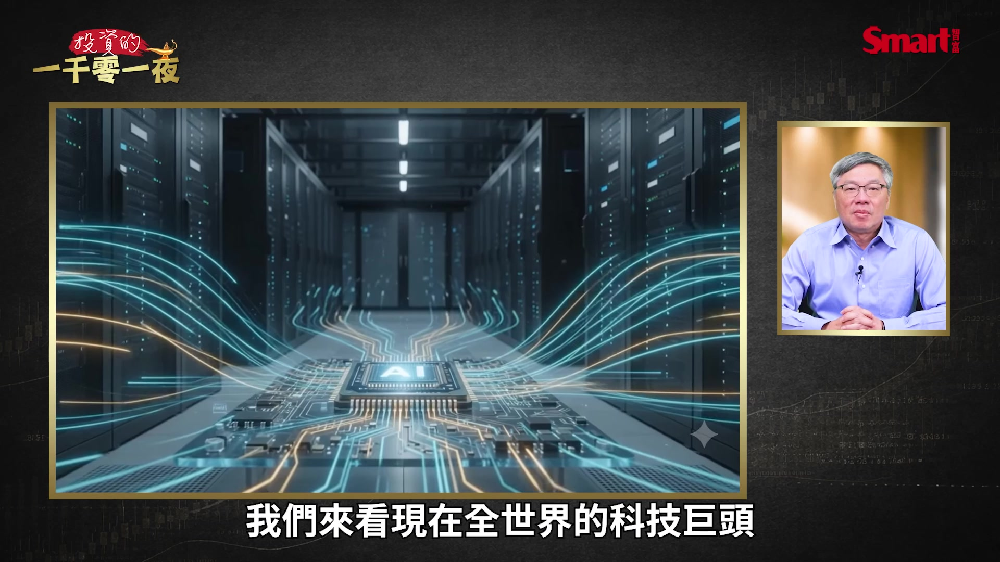
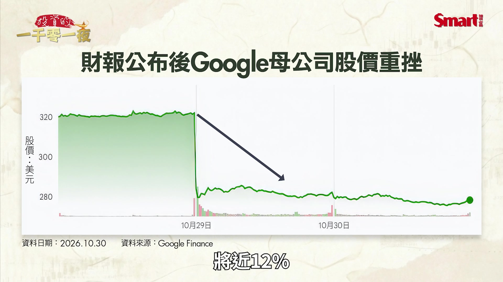
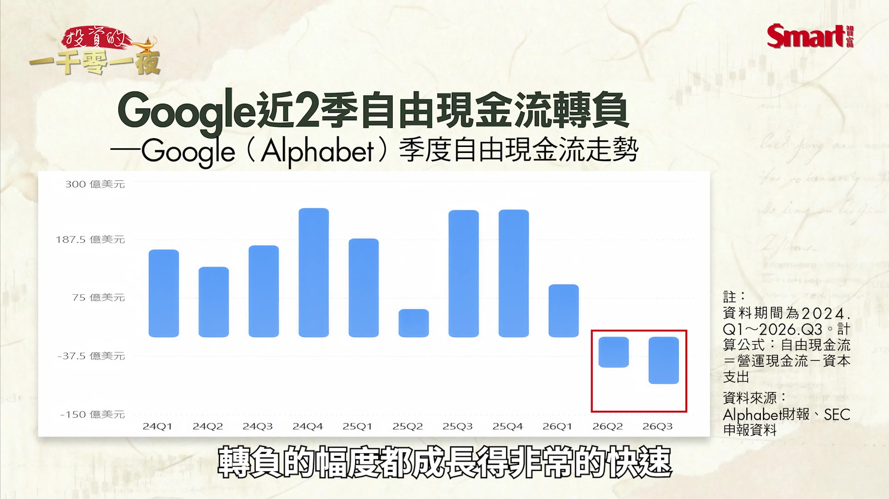
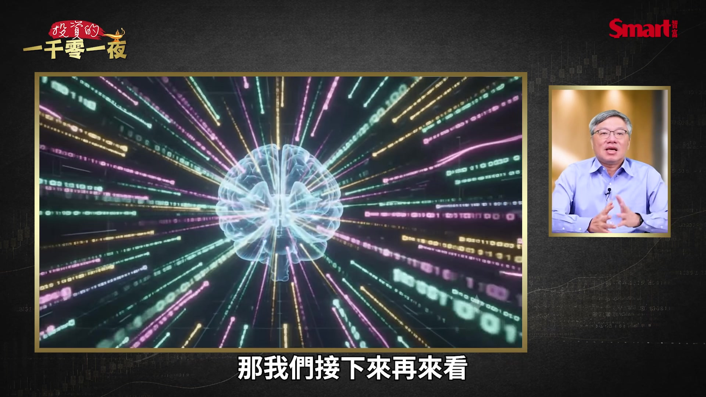
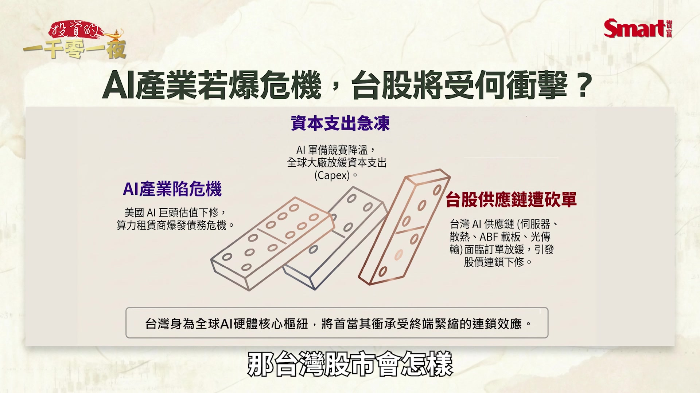
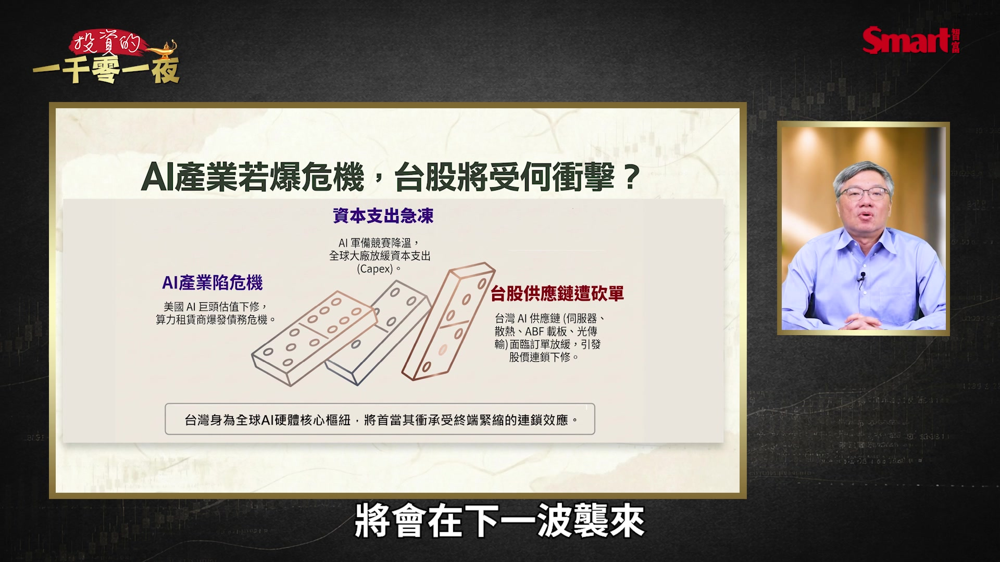
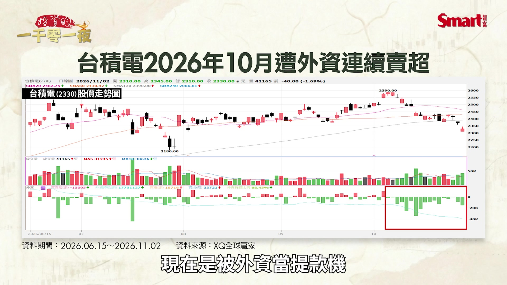
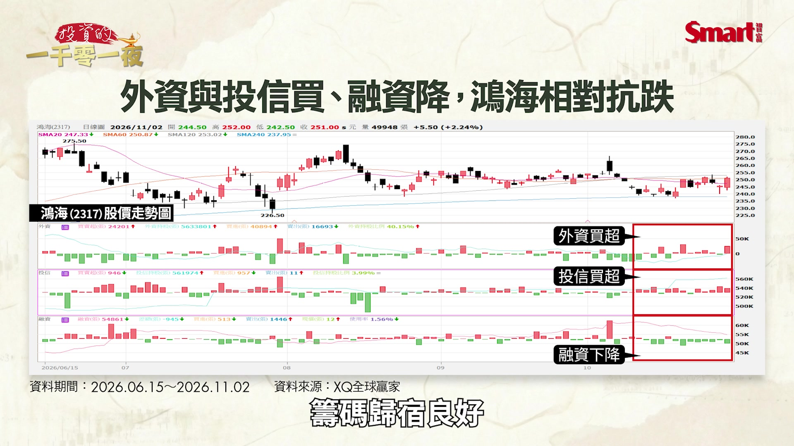

# smartmonthly-bw_D_fOr-qRSTU — 關鍵畫面索引

- 來源逐字稿：[smartmonthly-bw_D_fOr-qRSTU_FIN.srt](smartmonthly-bw_D_fOr-qRSTU_FIN.srt)
- 影片：https://www.youtube.com/watch?v=D_fOr-qRSTU
- 截圖數：15

## 00:00:22

**逐字稿片段：** AI大戰誰會先倒下 因為我們知道 現在AI最可怕的 不是有沒有泡沫的問題 而是有人可能會先撐不住 我們來看

**話題推測：** 影片標題：AI大戰誰會先倒下

---

## 00:00:33

**逐字稿片段：** 現在全世界的科技巨頭 都在瘋狂投入AI 這個大家應該都沒有疑問 這些科技豪門 微軟 Google 亞馬遜 Meta 每一個都比會賺錢 規模比大的 那他們當然是第一批梯隊

**話題推測：** 列出全世界的科技巨頭公司（微軟、Google、亞馬遜、Meta）

---

## 00:00:49

**逐字稿片段：** 那另外AI的新銳大模型公司 像OpenAI Entropy 就是做這Cloud的這家公司 那也都在這個全球史上規模最大的 科技軍備競賽中 大家是用盡了全力 不過誰會笑到最後 我現在還不能肯定 但有件事現在是已經確定了 就是最後不會是 多數人都一起賺錢 而是現在進入了殘酷的淘汰賽 因為現實已經浮上檯面了 如果AI真的賺錢 而且賺到大家都有錢賺的話 為什麼企業還需要去大量借錢呢 那也就是說 就是說瘋狂燒錢的競爭 來到現在這個階段 暗示著AI產業正面臨了三大危機 第一個 股價危機 也就是說 公司並沒有倒閉的危機 甚至財務狀況也還可以 可是股票卻可能先跌掉三五成 那第二個是財務危機 這就比較進入到實體面的問題 就是公司雖然有客戶有營收 未來看起來的需求也不錯 可是卻因為現在為了資金 未來的需求舉債過高 造成手上的現金不夠 就陷入了資金困境 第三個 那就最直接就是生存危機 也是最慘烈的一環 就是這些公司 直接就被市場淘汰了 那這三種危機 發生的時間不同 收到的衝擊對象也不太一樣 那我們今天就從這三個角度來拆解 這場AI大戰 究竟誰最有可能先倒下 那我們來第一個看 股價危機 這股價危機呢 是針對這些最有錢的科技巨頭 也就是最多人投資的 他可能會讓你慘賠 那我們要注意 今年那家公司的財報特色呢 是業績好但股價差 那如果業績不好的時候會怎麼辦 我之前一直好奇這件事 因為上半年我一直看到就是 業績非常好 財報都非常漂亮 成長率高到不得了 這個EPS也是成長非常驚人 可是怎麼財報一出來之後呢 通常隔天股價表現都是平平 甚至還有一點下跌 但最近終於出現了 像Alphabet 也就是Google的母公司 它最近公佈的財報 給出了這個 我上半年一直疑惑的解答 就如果美股盈餘不如預期的時候 會怎麼樣 那確實 Google這個最近的財報就是 就是EPS不如預期 而且他還說明年計劃燒錢會比今年更多 結果業績公佈之後 市場隔天直接是跳空大跌了 將近12%

**話題推測：** 介紹AI新銳大模型公司（OpenAI, Anthropic）

---

## 00:03:42

**逐字稿片段：** 那英特爾是另外一個更殘忍的例子 他是第四季的財策 只是財策而已 大幅的不如預期 隔天股價直接就下跌超過28% 那我覺得就是接下來類似的狀況 還會一直在發生 因為這是前面先預告的 已經告訴你了 市場反應的結果 那接下來發生的這個邏輯 就會繼續重複 因為當公司獲利好的時候 股價都很難漲了 如果公司公佈出來的獲利差 那股價可能就會出現 非常驚人的修正 那這也是之前很多人認為說 像微軟、Google、亞馬遜跟Meta 他們擁有龐大的現金流 就算在AI的投資上 有一點小失敗也不至於傷到他的根基 可是現在就有點不一樣了 是 公司不會倒 甚至也沒有真正的財務危機 但不代表 股票不會大跌 因為投資人對科技成長股最在意的不是有沒有賺錢 而是未來能賺多少 以及目前股價已經反映了多少 未來的 成長目標

**話題推測：** 以英特爾 (Intel) 的財測為例，說明股價大幅下跌

---

## 00:04:52

**逐字稿片段：** 假設一家公司今年每股賺10塊因為AI題材 市場願意給他40倍本益比 因為之前大家都覺得 AI是一個成長超級引擎 所以在這種狀況下 股價就會是400元 可是呢 兩年後市場發現 AI雖然帶來了收入 但並沒有創造原本期待的高利潤 所以投資人決定把本益比 從40倍下修到25倍 那這個情況下 就算美股盈餘完全沒有下降 股價也會從400元跌到250元 那這個跌幅會高達37.5% 這就是所謂的估值修正 那更可怕的是 如果在本益比下修的同時 企業的每股盈餘也開始下降 那就會受到的是一個雙重乘數的影響 所以股價受到衝擊就還會更大 那過去兩年呢 我們其實是經歷了獲利成長跟估值上修 雙上修的一個 乘數的效應 所以帶給投資人豐厚利潤 但如果事情往反向發展 那你就真的要很小心 2026年10月市場 其實已經開始出現類似的擔憂了 我們來看一下 10月份的費城半導體指數 整個月下跌了15.36% 你現在看到的是它10月的大跌 但它的轉弱並不是10月才開始 非半指數其實在6月下旬 創下歷史新高之後 到目前為止他都沒有辦法再創新高 反而是早早就跌破了半年線 如果你打開他的線型來看 你會發現他短期已經呈現一個 短期的空頭線型的排列 也就是短期均線壓在頭頂上 那實體面來看 AI的需求有變化嗎 至少到目前為止 AI的需求並沒有消失 不管是微軟、亞馬遜或Google 他們的雲端業務還是在快速的成長 不過市場真正從疑問到恐懼的 這個心態上的轉變是 市場現在真正發現了 收入增加的速度 確實明顯追不上資本支出增加的速度 所以你可以看到 Google的自由現金流轉幅 亞馬遜的自由現金流轉幅 而且這些負數不是多出一點點 而是出現緊噴般的擴大 我們來看一下這個Google的這個近期的 尤其是今年以來這個二三季度的 整個的自由線應流轉負的幅度都 成長的非常的快速

**話題推測：** 以虛構公司為例，解釋估值修正對股價的影響

---

## 00:07:31

**逐字稿片段：** 那反而是最近股價表現相對持穩的蘋果 他過去兩年來是一直被嘲笑對象 就是說蘋果你在AI競爭中掉隊了 那這裡就反映出一個值得深思的問題 如果一家科技的巨頭 每年AI相關支出增加了1000億美元 但新增的營業利益只有200億美元 在這個狀況下 短期內 這可能是一筆不划算的投資 所以我要放在長期來看 過去是認為 他應該是可以賺得回來 而且還能賺得更多 但現在市場的信心 真的就沒有這麼強了 現在市場反而在擔心 他真的能賺回來嗎 所以此時此刻 對投資人來說 企業如果長期投資鉅額資金 卻遲遲無法證明投資報酬率 市場就可能會重新評估它的合理股價 這也就意味著 AI股價危機不一定會發生在那些虧損的公司身上 反而會發生在過去漲幅最大 估值最高 投資人期待最樂觀的公司 因為市場現在最害怕的 不是壞公司繼續不好 而是那些原本認為完美的公司 突然變得沒有那麼完美了

**話題推測：** 對比股價表現相對持穩的蘋果

---

## 00:08:47

**逐字稿片段：** 接下來是第二個危機 也就是財務危機 賣GPU的人很賺錢 我們知道 輝達還是很賺錢 真正危險的是 借錢跟輝達買GPU的人 那這第二種危機呢 應該會比第一種更可怕 因為它不只是讓公司 單一公司倒閉 還可能衝擊銀行債券市場 跟整個的科技股供應鏈 就是AI的 面臨的 可能面臨的財務危機 過去幾年呢 市場最喜歡聽到一句話 就是AI算力供不應求 你只要有GPU 你只要有資料中心 就不怕你沒有需要算力的客戶 所以大量企業開始舉債 買輝達晶片 興建資料中心 租土地 取得電力 問題是現在這些設備 能夠持續替企業賺到足夠的錢嗎 那我們根據目的 2026年10月的分析 美國五大超大型的雲端業者 再加上Covid這家算力租賃公司呢 2027年的資本支出預估會將近 1兆美元 那穆迪就特別提出警告 我們知道 穆迪是做這個公司性平全球很重要的一家公司 他特別警告呢2027年到2029年將有一批貸款陸續到期 而財務能力比較弱的借款人呢 可能會面臨債融資困難 簡單就是 救債到期了 你要還回這個 還掉這個本金 然後再舉新債 但問題是你現在舉新債很困難 就連舊債可能都有可能無法償還 那這邊最值得觀察的就是 AI雲端的服務商Covid 其實我們在前兩週已經有介紹過Covid 我們今天再簡單說一下 他的商業模式就是大量部署GPU 把算力出租給AI企業 但是他的致命弱點就是 設備要先買 貸款要先借 利息要先付 未來收入目標卻不一定能百分之百實現 所以我們看到2026年11月 COVID的債券價格出現明顯的壓力 甚至有一些債券的殖利率 一度就上升到15%左右 這是屬於在垃圾債券這個評級裡面 還算是低評級的這個利率水平 所以這代表債券投資人 開始要求更高的風險補償 因為擔心你未來有難以償債的信用問題 所以真正的問題 現在不是在於未來有沒有這個算力需求 而是如果這些AI算力的租金下滑 或是租金沒有變 但是收到了租金 不夠支付他所要支付的利息跟本金 那就會出現大問題 我們用個簡單的假設來說明 假設有一家AI資料中心業者 他借了100億美元去建構這些相關的設備 但每年光利息要付8億美元 那原本預期設備每年可以創造20億美元的營業現金收入 假設兩年後AI算力供給增加 租金價格呢 不如預期甚至有點下跌 甚至因為設備的大量提供算力大量提供 導致設備的使用率也下降那這家公司可能會突然發現 收入這些現金不夠支應設備的折舊營運成本以及相關的利息 那甚至最近市場還有一個疑慮 就是這些GPU 他的折舊會不會 比我們原先預期想像中的還要快 由於這些舊的GPU的經濟價值 會不會下降的速度 比我們預期的更快 那如果在這個時候債務又到期 銀行又不願意繼續借錢 那這一類的公司就會陷入流動性的危機 這才是AI產業最值得警戒的地方 所以不是AI沒有人使用 而是AI使用量就算持續的成長 也不保證每一家提供算力的公司 都能賺錢 這個信用問題還可能會透過債務市場來擴大 甚至造成股牌效應 那這個是要特別留意的 那第三個生存危機 就是有些公司 可能直接就沒辦法生存 譬如一些小型的 AI應用公司或小型的模型公司 他可能會沒有明天 那第一個最大的生存危機呢 會最可能發生在一些缺乏差異化的小型AI公司 我們可以稱它叫做套殼式的AI應用公司 那為什麼叫做套殼式AI呢 就是說有一家新創公司 它本身其實沒有核心AI模型 那就是透過跟OpenAI或Google 或其他AI大模型公司呢 去買服務然後包裝出一套聊天機器人 然後寫作工具或圖片生成工具 再向消費者收取訂閱費 這種小型公司 大家最近兩年應該看到很多 網路上真的是 如雨後春筍般的冒出來 它也代表了在AI剛爆發的時候 這種模式非常吸引人 因為成立這樣的新創公司 非常容易開發成本低 推出產品的上架速度非常快 那消費者看起來也有樂意來付錢 可是現在情況就不一樣 假設你開發一套AI簡報工具 每個月要收費15美元 有後20美元 結果呢 明天或下個月 Google、微軟或是這個 Cloud直接把這個類似的功能整合到 整合到他的這個軟體或是他的大模型裡面 甚至不用另外再收費 而是用原來的收費方式 那這些小型的AI應用公司的競爭優勢就 瞬間消失了 那另外呢 如果AI的模型持續提升呢 原本需要應用軟體才能做呢 現在可能你只要在AI模型裡面 用一兩句指令 或者是以兩個新的功能 就解決了 又把這個AI應用公式的生存空間給磨砂了 所以當底層的這個大圓模型 越來越強大的時候 建構在這些模型上方 欠缺獨特價值的應用程式 就有可能越來越不值錢 或者是一時之間從很值錢變成不值錢 就可能因為一個重大的模型突破 那我們接下來再看

**話題推測：** 深入探討第二個危機：財務危機

---

## 00:15:00

**逐字稿片段：** 看模型公司這個領域 它本身也很競爭 因為你訓練先進模型 不只是需要演算法 還需要大量的GPU 電力 工程 人才 還有持續去訓練模型 更新模型的資金 可是模型能力提升 不代表企業能夠等比例提高收費 如果這個領先者 不管是OpenAI 或者是這個Andropi 這些公司呢 不斷的去降低它的價格 或者是提供更優質的服務 那這些小公司呢 就算技術不錯 也可能被迫要跟進這個相對高成本的服務 也就是說收入成長有限 但成本卻居高不下 那當後面的投資人不願意再投入新資金 給這些比較小的模型公司呢 這些公司就可能被收購 縮小業務 甚至會退出市場 所以呢 這些小型的模型公司呢 會面臨到的就是很直接的這個生存挑戰問題 但也有少數的這些小型公司 如果你切入的是比較特定的利基 譬如說是醫療法律金融這些 專業流程的公司 或是有一些比較特定法規限制 就是需要 某一類型的小型模型公司 他才能夠去做的 那他們可能還是會有一點生存公司 所以結論是 AI不一定會 最先淘汰技術最差的公司 而是會淘汰那些沒有定價能力的公司

**話題推測：** 轉向分析模型公司面臨的競爭與生存挑戰

---

## 00:16:30

**逐字稿片段：** 接下來我們來看對臺股的影響 前面我們談到AI產業可能出現三種危機 股價危機、財務危機跟生存危機 但是對臺灣投資人來說真正重要的問題是 如果美國AI公司的估值下修 資料中心爆發了債務危機 當這種大家不樂見的狀況發生了 那臺灣股市會怎樣

**話題推測：** 探討AI危機對臺股的影響

---

## 00:16:51

**逐字稿片段：** 因為臺灣是全球AI產業最重要的硬體供應基地 我可以這樣說沒有之一 那從臺積電的先進製程先進封裝 到鴻海廣達偽創微影這些AI伺服器 再到齊鴻雙鴻的散熱 還有臺達電的電源系統 甚至在ABF載板的這些公司 臺灣股市有太多的AI供應鏈公司 都跟AI的資本支出緊密結合 所以如果AI的軍備競賽開始降溫 那臺灣承受到的衝擊 將會在下一波襲來

**話題推測：** 列出台灣AI產業硬體供應鏈公司（台積電、鴻海、廣達、緯創、微影、散熱廠、台達電、ABF載板等）

---

## 00:17:28

**逐字稿片段：** 所以真正可怕的是 臺積電業績並沒有衰退 臺股的AI工業業績並沒有衰退 但股價卻先跌 這是我們真正擔憂的 因為其實我們可以看到 臺積電今年獲利持續成長沒問題 甚至連明年的獲利持續成長 都應該沒有問題 可是美國的科技股 現在因為AI投資報酬率不如預期 開始出現估值修正 外資就不會等到臺積電的營收衰退 才會開始賣股票 我們可以看 從10月以來的這一波 已經連續賣超了17個交易日 到11月2號為止 那臺積電已經是臺灣最好的公司 現在是被外資當提款機

**話題推測：** 分析台積電股價在外資賣超下的表現

---

## 00:18:16

**逐字稿片段：** 另外我們來看到臺達電 他是這一波最弱的大型全資股 他狀況就更慘了 因為他的業績的表現跟毛利率的表現 最近不如市場預期 所以他還在不斷的破底中 如果你的市場交易經驗夠豐富的話 你大概會清楚 就是一個在偏空的短期盤市中 指標性的弱勢股 他必須要先止跌 接下來才有機會見到大盤的翻轉 所以臺達電就是這樣的一種弱勢的指標股 因為它先跌 所以必須先止跌 不一定要上漲 可是至少它不能再繼續往下破底 但我們現在看到的就是臺達電還持續在破底 這是一個目前我們比較憂心的部分

**話題推測：** 分析台達電業績不如預期導致股價破底

---

## 00:19:04

**逐字稿片段：** 但是在微弱的多頭訊號中 還是有一絲的微光 就是大家最近期望不高的鴻海 最近反而很抗跌 我們看外資拼命賣臺積電 拼命賣聯發科 還有臺達電的時候 怎麼反而買超了鴻海 甚至投信買的還更積極 而且這個鴻海的融資水位是一路降 籌碼歸宿良好

**話題推測：** 分析鴻海的抗跌表現與外資買超現象

---

## 00:19:31

**逐字稿片段：** 那高盛在10月預估 2026年鴻海的EPS可以來到19.56元 如果用這個數字來計算 那現在的本益比大概只有約12.8倍 另外市場的分析師的共識 大概就是鴻海2027年的EPX 可以年增大約25% 來到23.12元 那用這個數字來算的話 本益比更是降到只有大概10.8倍 所以是相當低的本益比 難怪會最近非常抗跌 所以目前最大的問題 其實不是在於 產業有沒有明天的問題 而是在於估值問題

**話題推測：** 引用高盛對鴻海EPS的預估數據

---

## 00:20:11

**逐字稿片段：** 所以我們總結來看對臺股的影響 就算大量的小型AI公司倒閉 我覺得臺積電也不會受傷 但是如果是AI資料中心 發生了債務危機 這些高估值的AI供應鏈 確實會遭到比較大的衝擊 導致股價修正 那這個部分是我們要追蹤 甚至包括了ABF載板 散熱光傳輸 這些都有可能會因此面臨 訂單成長放緩 導致股價進一步的下修 所以還是要強調一件事 我還是很看好AI的趨勢 長期的發展 所以結論是 AI不死 但是過去那段期間 不論股價高低 你買什麼都賺的 那個好時期真的已經過了 現在這個階段 投資人你所買進的價格 就會決定 最後是誰賺錢 誰受傷 以上就是今天的分享 喜歡我們的節目 歡迎幫我們按贊訂閱分享 以及開啟小鈴鐺 然後謝謝大家 謝謝

**話題推測：** 總結AI危機對臺股的影響

---
