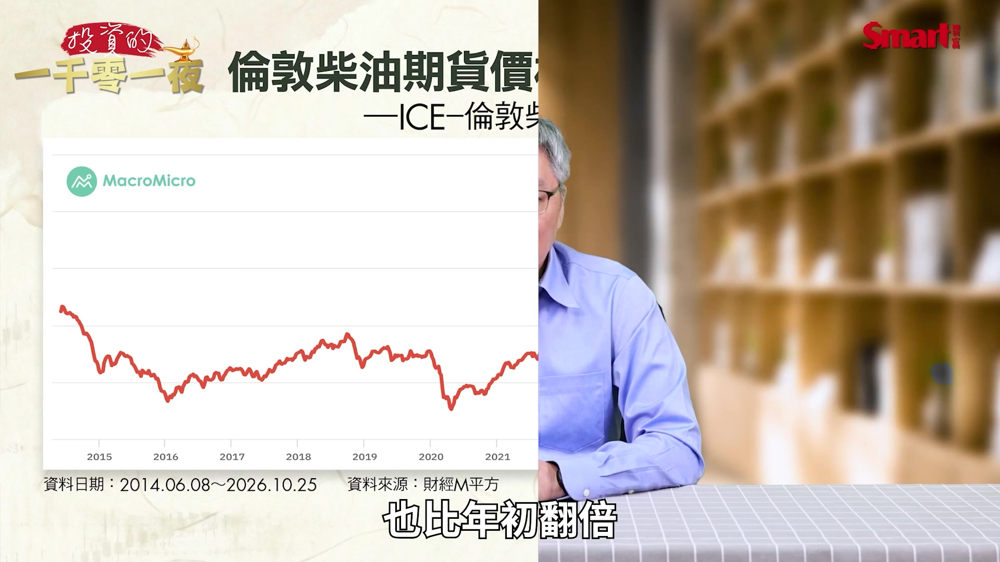
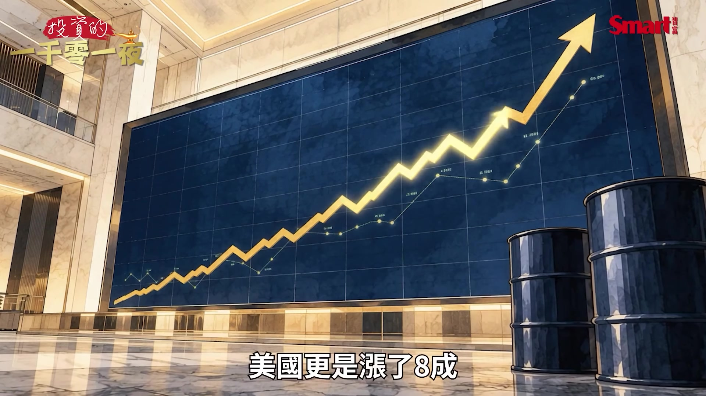

# smartmonthly-bw_alErGNq0cck — 關鍵畫面索引

- 來源逐字稿：[smartmonthly-bw_alErGNq0cck_GT.srt](smartmonthly-bw_alErGNq0cck_GT.srt)
- 影片：https://www.youtube.com/watch?v=alErGNq0cck
- 截圖數：12

## 00:00:49

**逐字稿片段：** 2026年的9月 那國際柴油的期貨價格 衝上了歷史新高 歐洲柴油的期貨價格 也比年初翻倍

**話題推測：** 介紹2026年9月國際柴油期貨價格衝上歷史新高，預期會顯示相關圖表。

---

## 00:01:00

**逐字稿片段：** 那跟民眾攸關的零售價 因為我們大家畢竟 除非你是投資人 不然只有零售價跟你比較相關 零售價的部分 歐洲的柴油漲了大概4成左右 美國更是漲了8成

**話題推測：** 轉向討論歐洲與美國柴油零售價的漲幅，預期會有數據比較圖。

---

## 00:01:15

**逐字稿片段：** 所以緊接著川普政府突然 大家應該前一陣子有看到新聞 就突然就緊急因為柴油的問題 就向烏克蘭施壓 要求烏克蘭你不能再攻擊 俄羅斯的煉油設施 原因是烏克蘭為了削弱 俄羅斯的戰爭能力 它就密集地用無人機去攻擊 俄羅斯的煉油廠 俄羅斯的柴油產量大幅下降 再加上之前中東戰爭造成 當地的能源出口的困難 就使得全球的柴油供應 陷入了緊張 而且激起了美國的物價壓力 不過你就會覺得 烏克蘭跟俄羅斯這是戰爭 那烏克蘭也很冤吧 這也不能做 那也不能做 但俄羅斯卻什麼都能做 但這沒辦法因為美國要選舉 所以物價一走高 共和黨現在的壓力很大

**話題推測：** 轉向討論川普政府因柴油問題對烏克蘭施壓的新聞事件。

---

## 00:02:07

**逐字稿片段：** 那另外一方面在法國 本來只是一場因為抗議教育的 預算不足的示威活動 後來怎麼演變成全面性的 因為物價跟生活成本壓力 引爆的大規模的抗議 那其中有一個重要因素就是 柴油價格飆升 那就衝擊了歐洲的 運輸 農業跟食品價格 那法國本來就存在 薪資 教育跟生活成本的問題 那現在這狀況下 就受到了更大的壓力

**話題推測：** 話題從美國轉向法國街頭抗議活動，探討與柴油價格的關聯。

---

## 00:02:35

**逐字稿片段：** 我們知道在10月24日當天 法國有超過40萬人走上街頭 向政府表達不滿 那部分地區甚至出現了縱火 洗劫商店跟警民衝突 大家應該在這個電視的節目上 看到了不少這樣衝突的畫面 真的是相當的驚恐

**話題推測：** 提及10月24日法國超過40萬人上街示威的具體數字，可能顯示新聞畫面或數據圖。

---

## 00:02:54

**逐字稿片段：** 那我們今天就來了解一下 為什麼一桶柴油可以同時影響 戰場上的坦克 法國街頭的抗議 還有全球新一波的通膨壓力 第一個我們現在知道 柴油為什麼比想像中還要重要 我們一般人我們來談能源危機 大家想到的就是國際原油價格 不過牽動全球實體運作的 往往是原油這個煉製品柴油 它影響力非常大 那我們先來看一下這張圖 原油的主要煉製品 有汽油 柴油跟重質的燃料油 那汽油主要是用在一般的乘用車 而柴油的用途卻廣泛得多 因為運送商品的貨車 載運貨櫃的大卡車 還有農田裡的曳引機 工地上的重型機械 甚至是大量的軍用車輛 這些都是依賴柴油來作為 它的能源 那更重要的是 柴油的需求具有 相當程度的價格僵固性 因為汽油漲價 消費者可以選擇減少開車 我就搭大眾捷運系統 所以就可以不用開車 不用加汽油 可是如果柴油漲價 物流公司它不能停止送貨 農民也不可能因為 油價上漲就放棄收割 所以一旦柴油價格上升的時候 增加的就不是加油的費用 而是整條生產運輸鏈的一個成本 例如如果是一家超市販賣的蔬菜 從農場耕作 收割 冷藏運送到配送中心 最後抵達賣場然後被你買走 這整個環節 都會運用到一部分的柴油 因此柴油漲價的影響 會逐步地傳導到 食品 工業產品跟 消費者的生活成本 這也為什麼柴油一短缺 可能比單純的汽油漲價 更容易引起全面性的通膨壓力 那接下來我們來看一下 那為什麼烏克蘭要集中攻擊 俄羅斯的煉油廠呢 因為2026年的時候 烏克蘭就把它的 戰術目標做了一個重要的調整 把俄羅斯的能源設施 列為它長程無人機的攻擊目標 那原因就很簡單 因為俄羅斯不只是需要 原油出口來創造財政收入 更需要把這些原油 加工成柴油 汽油 航空的燃油 來維持國內經濟以及它戰爭的需求 那根據國際能源總署 在9月17號公布的資料 俄羅斯原本擁有 每天650萬桶的煉油產能 是全球第三大的石油產品的生產國 可是因為烏克蘭無人機的持續攻擊 就讓俄羅斯的 煉油體系遭到了嚴重的打擊 那2026年的前8個月 平均每3天就有一座 俄羅斯的煉油廠遭到攻擊 那到了6月 俄羅斯的煉油廠的加工量 已經下降到每天380萬桶 比去年同期減少大概30% 那更值得注意的是 烏克蘭的戰術目標不再只是打擊 這些容易維修的設備 而是進一步打擊 它的裂解 加氫處理 這些重要的煉油裝置 那這些裝置有什麼重要性呢 就是一旦設備損壞之後 你可能需要6到8個月的復原 才能完成這些重大的修復工作 換句話說 一架成本非常便宜的無人機 可能迫使一座價值數十億美元的 煉油廠長期的停工 那這對俄羅斯來說 就不只是意味著 燃料供應會受到影響 也代表它的維修成本會增加 出口收入會減少 還有更多的防空資源 必須要來保護這些能源設施

**話題推測：** 影片進入總結與主要論點的再強調，可能會有新的單元標題。

---

## 00:06:36

**逐字稿片段：** 那柴油的短缺真的會讓俄羅斯 打不下去嗎 我們來看一下柴油的 在這個現代陸戰的重要性 因為它是重要的後勤資源 你知道大量的坦克裝甲車 軍用卡車 工程車輛 這些都用到柴油 那戰場後方的發電設備 補給運輸 也是跟這些燃料的供應密切相關 所以如果柴油供應不足 就算你前線擁有這些足夠的 坦克火砲還有這些機動車輛 也可能因為無法持續的 運送彈藥 食品跟裝備 就整個的戰鬥的效率 就會受到了影響 所以俄羅斯的油品出口 它本來是受到美國制裁 就是不想讓俄羅斯靠著油品出口 賺到更多的外匯 可是事實上到了2026年 俄羅斯竟然自己 採取了柴油出口管制 原因是它要把更多的 柴油留在它的國內

**話題推測：** 進入下一個主論點：柴油短缺對俄羅斯現代陸戰的重要性，預期會有單元標題。

---

## 00:07:31

**逐字稿片段：** 那奇妙的是川普政府居然就在 10月9號跟俄羅斯 達成了一項柴油出口協議 就是解除了對俄羅斯的部分的 出口的管制的限制 讓俄羅斯可以增加出口柴油 那甚至到了10月10號的時候 川普還公開要求撤換澤倫斯基 只是因為烏克蘭還持續的在攻擊 俄羅斯的煉油廠 那這邊矛盾之處 大家應該可以發現 就俄羅斯 本來就不打算出口大量柴油 因為它要留給自己用 但是它為了跟川普 進行戰略利益的交換 竟然就同意了增加出口部分的柴油 所以這就導致了最近 俄烏戰爭的天平迅速倒向俄羅斯 那為什麼俄羅斯 這段期間少賣柴油呢 全世界會一起受傷 前面我們大概提過 柴油供應的這個下降 那你想增加也不是立刻能夠增加 因為原油它經過煉油廠的加工 才能變成符合 車輛跟工業需求的柴油 所以如果全球的 原油儲量夠但是煉油設備不足 設備遭到破壞 或運輸路線中斷 這些柴油的供應 仍然可能出現缺口 那2026年 因為俄烏戰爭跟中東戰爭的影響 本來全球煉油產品的 供給量就大幅的萎縮

**話題推測：** 提及川普政府與俄羅斯達成柴油出口協議的具體日期與事件。

---

## 00:08:54

**逐字稿片段：** 那根據國際能源總署 在10月14號發布的報告 2026年9月 全球柴油跟輕油的出口量 已經比去年同期 每天減少大概70萬桶 歐洲跟美國的 柴油批發價格在9月 更是一度達到 每桶220美元的 歷史最高點 而且這一次跟過去油價危機 不同的地方在於柴油不只是 跟著原油上漲 還出現了明顯的 供應短缺溢價 也就是說即便未來 原油價格能回落 可是只要煉油產能 跟柴油的出口無法恢復 柴油價格可能就會持續維持在 高檔相當長的一段時間

**話題推測：** 引用國際能源總署報告，說明全球柴油出口量減少的具體數據，可能顯示數據圖表。

---

## 00:09:37

**逐字稿片段：** 那為什麼柴油的漲價會讓 法國再次出現暴動呢 我們要講一下歷史緣由 因為法國對油價特別敏感 就我們要講一下 2018年的黃背心運動 當時也是一個 很大的這個社會運動 因為當年法國政府 本來是計畫要調高燃油稅 希望推動能源轉型 結果引發大量的民眾反彈 那當時的抗議從一開始 單純的油價問題 逐漸就擴大成 對薪資 對稅制不公 對政府政策的不滿 最後演變成席捲全國的 黃背心運動 你是不是覺得跟最近法國 街頭抗議非常像 這次抗議的起點並不是因為 油價直接引爆的 因為9月底的時候 最開始的抗議是因為 法國學生因為教師短缺 學校的設施不佳 還有教育資源的問題發起抗議 後來就逐漸擴大成對住房 對薪資 對退休金 對生活成本全面不滿的抗議 那10月17號的時候 有一部分的抗議 就出現了嚴重暴力跟破壞 10月24號更擴大到 全國超過40萬人以上 參加示威抗議 而且這個狀況還在持續的 擴大當中 甚至外擴到部分 法國部分周邊國家 那柴油價格上漲在 這一場社會風暴中 扮演的就是民眾經濟負擔更重了 因為柴油的價格正常來說 應該要低於汽油 但現在在法國柴油比汽油更貴 我們來看一下這張表 在2025年10月就是一年前 95無鉛汽油在法國 是1.81歐元 1公升 柴油大概1.59歐元 1公升 這是正常的狀況 就是柴油比汽油便宜 但到了2026年的10月 整個不一樣了 汽油2.21歐元 1公升 柴油已經來到了 2.35歐元 1公升 我們來看一年漲幅 汽油漲了22.4% 大家已經壓力很大 但柴油漲了48% 幾乎是汽油漲幅的一倍以上 所以我們也就知道為什麼 這個柴油的漲價壓力 會對社會造成 這麼大的一種影響 所以它牽動了運輸 食品 能源價格同時上升 但大家都知道 物價上升快 薪資要同步增加沒那麼容易 所以整個家庭的 實質購買力就會下降 而且還有一個更緊急的事情 就是冬天要來了 那柴油跟取暖油的性質相近 這兩種油通常價格就會 具高度的相關性 這也為什麼大家現在 對冬天來之後 會感到壓力更大 特別是中低收入的家庭 對他們的衝擊會更為明顯 那柴油危機有可能進一步引爆成 法國財政問題嗎 我們現在來看 一個政府如果面對 燃油價格的上漲 通常有幾種選擇 譬如降低燃油稅或增加補貼 那可是法國的問題是 它本來就面臨了財政赤字 跟很高額的公共債務問題 所以如果能源價格 長期的維持高檔 那政府的財政赤字就會加速惡化 而如果你想要控制赤字 就只好砍其他的預算 這就形成兩難 而且若是碰到選舉年 砍預算就是形同是政治自殺 但如果你不砍預算赤字攀高 那債券市場就會對 法國公債要求更高的風險溢酬 讓法國政府未來借款的成本會 更加沉重 所以這是一個潛在的 風險傳導路徑 法國目前現在是還沒有 立即的債務危機 但市場上 已經開始有一些聲音在討論 歐債危機是不是有 重新回來的可能

**話題推測：** 進入下一個主論點：柴油漲價導致法國再次暴動的歷史緣由，預期會有單元標題。

---

## 00:13:27

**逐字稿片段：** 所以我們這邊要持續追蹤的是 法國跟德國公債的殖利率的 利差是不是會持續的擴大 最後我們來談到 對台灣跟台股的影響 我們來看一下中油的柴油 事實上台灣這方面 柴油從9月中旬到10月26號 大致都維持在29.9元 並沒有完全跟隨 近期國際油價的波動 那主要是因為台灣具有浮動油價 亞鄰最低價跟政策平穩 這些機制所以能夠減緩 國際油價對消費者直接衝擊 簡單說就是中油幫大家扛了 中油幫大家擋了這一波 不過進口物價 卻會隨著國際物價的波動 但它的影響會比較落後

**話題推測：** 指出需要追蹤法國與德國公債殖利率利差的擴大情況，可能顯示趨勢圖。

---

## 00:14:10

**逐字稿片段：** 那從股市來看 那主要受惠股應該是台塑化 因為它直接受惠的機會是比較大 它的柴油外銷比重高 占它整個柴油總銷量的 高達86%左右 所以如果煉製這個柴油的 價差擴大這有助於 它的後續的獲利 會受到衝擊的股票則是 航運股或航空股這類 因為國際燃油的價格走高 會使它們的這個運輸成本上揚 不過通常只要時間夠長 它們也可以靠著調高運費跟 燃油附加費來 作為轉嫁所以影響 整體來講長期的影響是有限的 所以整個來看台灣目前受到 柴油上漲影響比較輕微 所以大家就沒什麼感覺 很難想像川普居然會為了柴油 而想要逼澤倫斯基下台 可見柴油價格對美國的影響力 尤其是共和黨的票倉是在它的 中西部的農業區 正是我們前面所說 受柴油飆漲衝擊很大的區域 以上就是今天分享 喜歡我們節目歡迎幫我們 按讚訂閱分享及開啟小鈴鐺 謝謝大家

**話題推測：** 轉向討論台股中柴油價格上漲的受惠股與受衝擊股，可能顯示相關公司名稱或股價圖。

---
