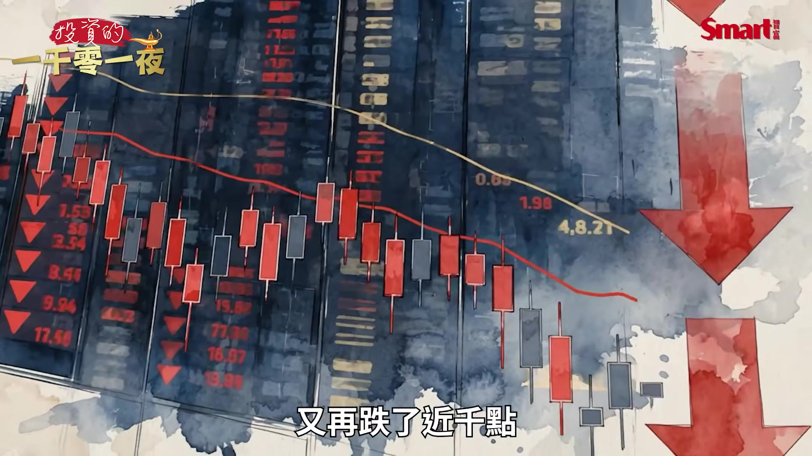
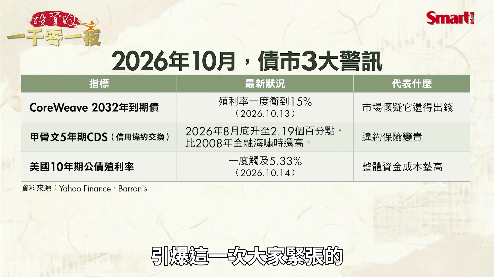
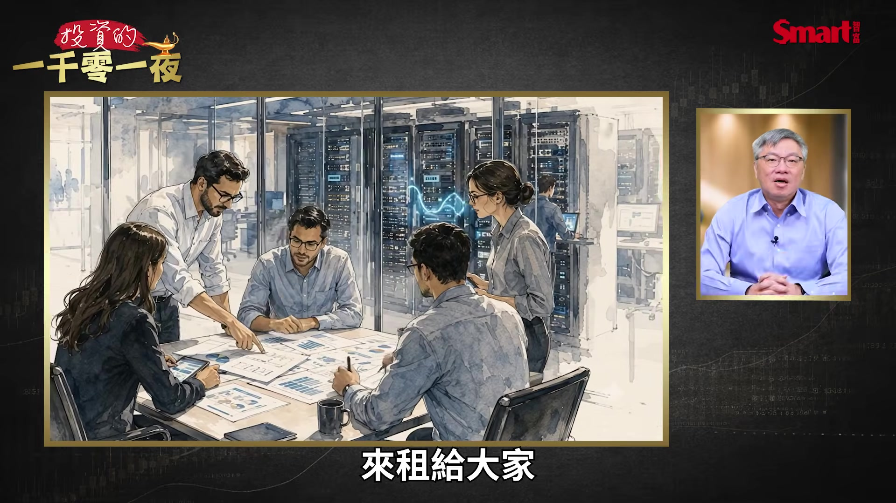
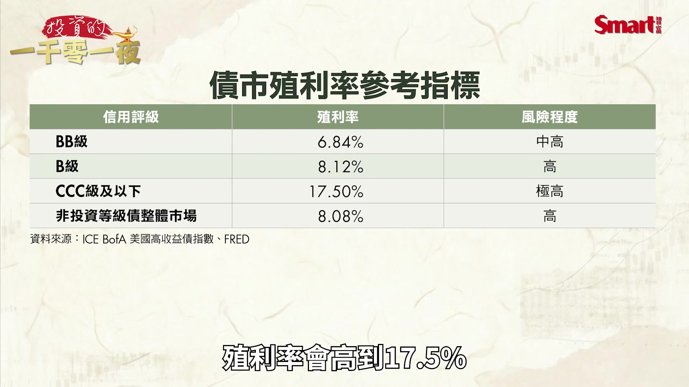
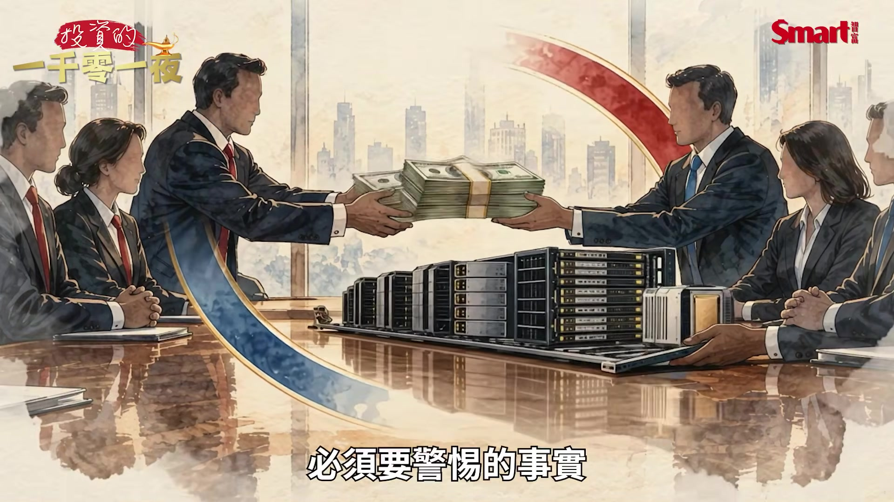
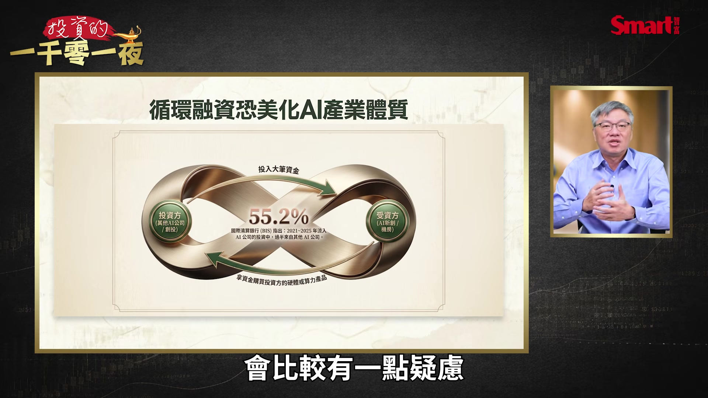
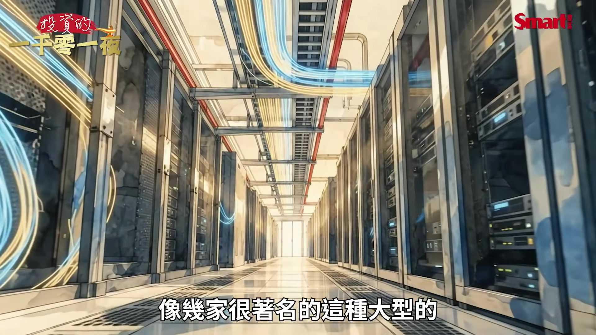
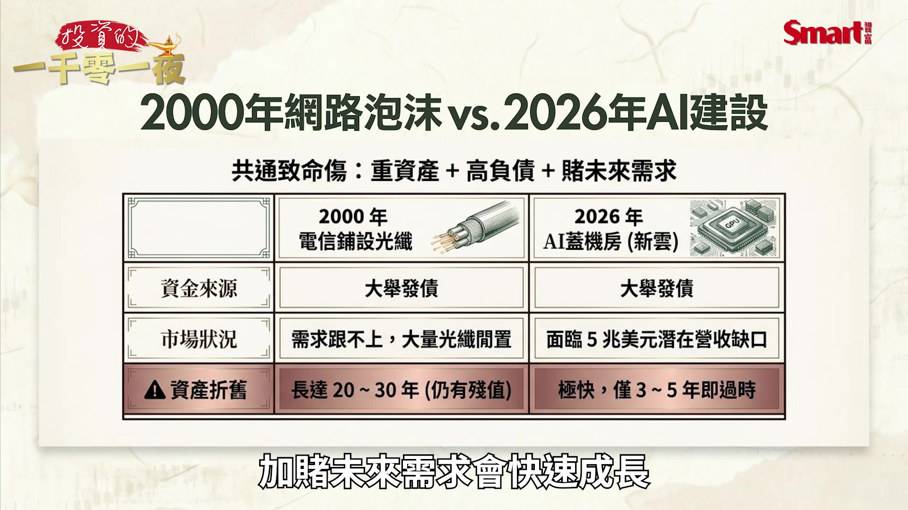
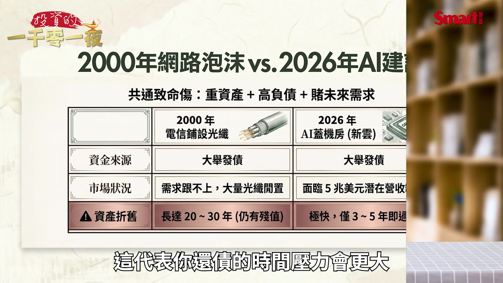
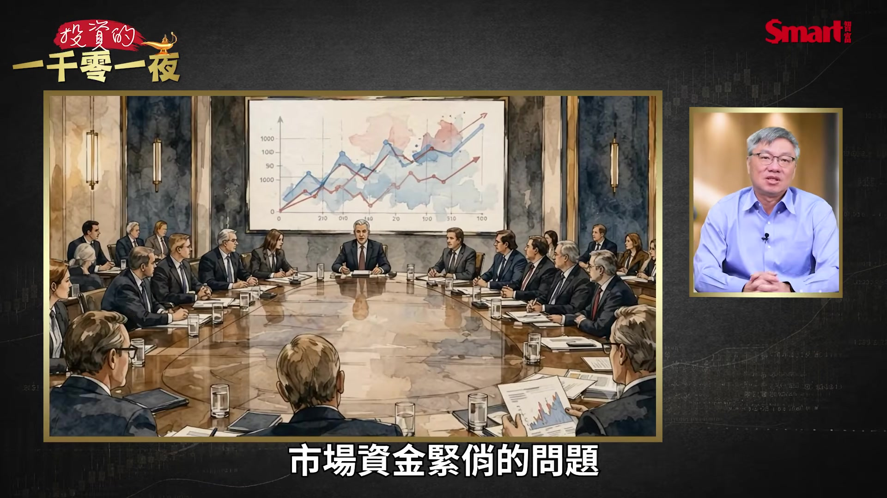

# smartmonthly-bw_bBb7muEJZwo — 關鍵畫面索引

- 來源逐字稿：[smartmonthly-bw_bBb7muEJZwo_GT.srt](smartmonthly-bw_bBb7muEJZwo_GT.srt)
- 影片：https://www.youtube.com/watch?v=bBb7muEJZwo
- 截圖數：26

## 00:00:31

**逐字稿片段：** 就先說一下最近的狀況 10月15號這天 台股重挫1655點 收在4萬6969點 那是史上的第6大跌點 那10月19號的盤中 又再跌了近千點

**話題推測：** 開始說明最近的市場狀況，可能顯示大盤指數圖或相關新聞畫面。

---

## 00:00:47

**逐字稿片段：** 這一天台積電就一度失守了 2400元

**話題推測：** 提及台積電股價失守特定價位，可能顯示台積電個股走勢圖。

---

## 00:00:50

**逐字稿片段：** 那美國費城半導體指數 則是連跌8天 那是2008年 金融海嘯以來的最長連跌紀錄 那最近連一向都很樂觀的 台積電董事長 我們之前大家都說 相信魏哲家就可以買新家了

**話題推測：** 轉向美國費城半導體指數的連跌紀錄，可能顯示費半指數走勢圖。

---

## 00:01:08

**逐字稿片段：** 不過董事長魏哲家 最近都說本來就知道 股票會降 果然降了 所以心情非常不好 所以聽到我都有點緊張了 因為本來是最樂觀的人 講話都變保守 那同樣另外一個是樂觀爆棚的

**話題推測：** 引用台積電董事長魏哲家的最新發言，可能顯示魏哲家的人像照片或語錄。

---

## 00:01:24

**逐字稿片段：** 輝達的黃仁勳 這一次講話也變得 溫和許多 他是安撫市場說 這一切終究會過去 看起來也沒有像 以前講的說那些都 那些都亂說的 反正這個榮景會向上 這次也沒有講得這麼的樂觀 不過這一次最讓市場害怕的 不是輝達財報 也不是說台積電的毛利率掉多少 因為掉個1、2個百分點 2、3個百分點 這個都是大家 因為台積電去美國擴廠 大家可以預期的事 那這次大家緊張什麼 是債券市場 那這一次的問題就債市先喊痛 就接下來引爆了整個股市的憂慮 因為平常大家就看股票比較多 因為這個債券真的 能夠看的也不多 不過老手都知道 出大事的時候 債市會比股市先反應 因為買債券的人 並不在意你未來多會成長 因為你EPS成長我也賺不到 所以他們最在乎就是只有一件事 借出去的錢能不能拿回來 當然最好就是 本金跟利息一起拿回來 最差的情況下 至少也要拿回本金 那這就是債市最在意的事 那我把債市最近的警訊 整理成這張表 我們來看一下 這個關鍵第一個就是 引爆這一次大家緊張的

**話題推測：** 提及輝達執行長黃仁勳的發言，可能顯示黃仁勳的人像照片或語錄。

---

## 00:02:45

**逐字稿片段：** 就CoreWeave這家公司 它2032年的到期債 殖利率居然一度衝高到15% 那市場懷疑它 你是不是真的還得起錢 另外一個大家更熟 甲骨文這家公司 頂過了網路泡沫的這個時期 那這一次也被大家質疑了 它5年期的CDS就是這個 信用違約交換 它在8月底的時候 就一度升高到了 2.19個百分點 這個數字是比2008年 金融海嘯的時候還高 那這個數字代表是什麼 它是一個違約的保險費的概念 也就是說當市場覺得 你違約風險變高的時候 你要付出的保險費就變得更貴了 那另外一個當然之前我們就提過 那另外一個當然之前我們就提過 美國10年期的公債殖利率 一直在往上竄升 最近一度就達到了5.33% 那整個市場的資金成本都墊高了

**話題推測：** 說明引起市場緊張的CoreWeave公司及其債券殖利率數據，可能在表格中高亮顯示或獨立呈現。

---

## 00:03:41

**逐字稿片段：** 那我們再回來講一下 CoreWeave這家公司 那這家是什麼呢 這一家就是所謂的新雲 它就是專門買輝達的GPU 然後蓋機房 再把算力租給大家的公司 因為之前我們大家一直都說 算力不夠 那有些公司可能 也買不起那麼多的GPU 那比較划算的方式 就是把算力用租的 那這家公司就是建好了算力 來租給大家

**話題推測：** 回到CoreWeave公司，可能顯示其公司簡介或業務模式圖。

---

## 00:04:07

**逐字稿片段：** 那它身上背了大概是 520億美元的債務 第2季的利息支出 高達了6.4億美元 比它當季的調整後營業利益還高 那我們白話來講就是說它賺到錢 居然還不夠付利息 所以這個股價在之前的這一週 就跌了將近25% 那我們再來看一下 我們前面提到 它的殖利率來到15% 這代表什麼 我們需要看的這個高跟低 要來看一下參考指標

**話題推測：** 揭露CoreWeave公司的債務和利息支出等具體財務數字。

---

## 00:04:35

**逐字稿片段：** 就是美國非投資等級債 就是我們以前所講的高收益債 或者是俗稱垃圾債 那2026年10月15號 美國非投資等級債的 整體市場的殖利率 大概是8.08% 不過信用評級比較差的債券 殖利率會高到17.5%

**話題推測：** 引入「美國非投資等級債」（高收益債/垃圾債）作為參考指標，可能顯示相關定義或市場分類圖表。

---

## 00:04:56

**逐字稿片段：** 我們這邊來看一下這個信用評級 BB級大概就是這個 我們說這個非投資等級債的 第一級 BB級 它的殖利率大概在6.84% 風險程度是中到高 那B級就再往下一級 它殖利率來到8.12% 風險程度就高了 那CCC級還有C級以下的 就兩個C或一個C的 這個風險就更高 那它的殖利率 就來到17.5% 是一個極高風險的狀態 我們看整體市場平均 非投資等級債的整體市場平均 就是8.08% 這算是高的水準 也就是說 CoreWeave這家 是明星等級的AI公司 還有黃仁勳的背書力挺 不過它的債券利率 居然已經來到了 我們剛才看到的就是很低的 信用評級的水準 那這種狀況也不是只有它

**話題推測：** 詳細說明不同信用評級（BB級、B級、CCC/C級）及其對應的殖利率和風險程度，應顯示信用評級對照表。

---

## 00:05:48

**逐字稿片段：** 另外還有一家 它是Meta來當它的靠山 就路易斯安那州的 Hyperion 這家資料中心它的債券也大跌 這就是代表 整個市場的懷疑 不是只有小公司而是整個 借錢蓋機房租算力的商業模式 是不是哪裡出了問題 所以我們來看一下 這個錢到底借了多少 這一波AI建設一開始是 科技巨頭口袋裡的現金拿出來 因為它們現金流很多 不過從去年的大概下半年開始 大概就有點變化 就變成是要靠大量的舉債 因為舉凡這個Amazon Google Meta 甲骨文到輝達 還有SpaceX這6家 2026年到7月中 就發行了約 2440億美元的債

**話題推測：** 提及另一家資料中心公司Hyperion及其債券大跌的狀況，可能顯示該公司名稱或相關新聞。

---

## 00:06:36

**逐字稿片段：** 那摩根士丹利就估計 今年全球AI相關的發債 最多有可能會來到 5700億美元 所以關鍵的問題是你借錢沒關係 問題是你借錢之後能夠產生 更好的收入嗎 這個收入能夠足以 去彌補這些借錢產生出來的 利息嗎 以及後面要還的本金

**話題推測：** 引用摩根士丹利對全球AI相關發債規模的預估數字，可能以文字或圖表呈現。

---

## 00:06:59

**逐字稿片段：** 那我們來看一下就是上週的這個 很著名的研調機構 Gartner它就算了一筆帳 AI資料中心的業主 到2030年累積需要大概約 8.5兆美元的營收 它才能夠收回它的這些投資 並且賺到合理的報酬 不過Gartner也預估 同期真正會流進來的AI營收 最多可能只有3.6兆美元 等於是跟 這個所需要的8.5兆美元 連一半都不到 所以中間差了 將近5兆的這個 美元的這個金額 那Gartner還做了一個 恐怖的預測 就是超過8成的 這些新雲的業者 到2030年將無法獨立營運 也就是說它們要嘛 就可能會倒閉要嘛就可能被併購 另外一個 也讓市場心驚的消息 就是英國金融時報的報導 就稍微前一陣子的事 就OpenAI 這家這個AI大模型 最著名的公司就告訴投資人 它9月底的年化營收 接近500億美元 這讓市場嚇了一大跳 因為原先市場一直流傳是 它的年化營收 應該是700億美元 怎麼突然變成了500億美元 那少了將近200億美元 到底發生了什麼事 當然這邊大家就有一些爭論 就說這是計算方法的不同 但總之絕對不是好消息 而是相對讓大家擔心的一個消息 因為OpenAI 是AI產業的源頭的活水 那這個產出這個活水的 這個口徑如果比原來的小 那下游一大堆要靠它來 付租金的機房就會開始緊張 因為最終你要有賺到這些錢 你才能付得出 這些算力的這個費用 所以這就再提醒大家 循環融資的問題 就我們過去兩三個月 以來也多次提醒過大家 就是AI產業的循環融資問題 已經不只是擔心而已 而是真正的快要變成一個 必須要警惕的事實

**話題推測：** 提及研調機構Gartner的計算結果，可能顯示Gartner的報告名稱或圖表。

---

## 00:09:06

**逐字稿片段：** 那國際清算銀行 10月初的研究就發現了 2021年到2025年 流入AI公司的投資 大概有55.2% 是來自其他的AI公司 那這個簡單的比喻就是這樣 A投資B B拿這筆錢去買A的產品 那A的營收帳面就變好看了 這其實不違法 是業界也會常有這樣的事 不過你的整個產業 因為更多這樣循環性的收入 所以感覺起來我們就會 對它的整個的財務的強健度 會比較有一點疑慮

**話題推測：** 引用國際清算銀行關於AI公司間循環投資比例的研究數據，可能顯示相關圖表。

---

## 00:09:42

**逐字稿片段：** 那我們就來看一下2000年 當時是發生什麼事 因為我們現在在擔心 算力是不是有過度舉債去 建構算力這個問題 我們就來談談2000年的 當年的那場網路泡沫 那時候我年輕我也親身經歷過 所以很多人是記得 當時是美國的那斯達克指數崩跌 不過真正讓當時的泡沫 變成災難的其實是電信業 因為當年電信業相信 這個網路公司很多 所以網路的流量需求 會非常大 會成長非常快速 所以為了因應這個快速成長的 這個網路流量它們就大舉借錢 去鋪光纖 那結果後來這個網路需求 沒有成長那麼快 再加上有一些網路公司 後來倒閉了 所以需求甚至比原先的預期 還要再打折更多 所以到2002年的前後 像幾家很著名的這種大型的

**話題推測：** 轉向回顧2000年網路泡沫的歷史事件，可能顯示「網路泡沫」標題或相關圖示。

---

## 00:10:40

**逐字稿片段：** 這個公司 像Global Crossing 像WorldCom 就相繼的破產 那光纖是鋪好了 但好幾年都沒有點亮它 那今天的新雲商業模式跟當年的 電信業有一點點像 所以都是重資產加高負債 加賭未來需求會快速成長

**話題推測：** 提及網路泡沫時期破產的公司，例如Global Crossing和WorldCom，可能顯示公司名稱。

---

## 00:10:59

**逐字稿片段：** 不過有一點是更不妙 就是當年的光纖 它是可以用20 30年 但是今天我們主要 產生算力的設備是GPU 3到5年後 它可能就會過時 這個技術可能就會過時 這個產品可能會過時 所以資產的折舊就更快 這代表你還債的時間壓力會更大

**話題推測：** 比較當年光纖與現今GPU設備折舊速度的差異，可能顯示比較圖表或資產壽命圖示。

---

## 00:11:20

**逐字稿片段：** 那我這邊要特別提醒大家 就是如果是用借來的錢 去衝刺股市 危險訊號 因為通常如果股市有一點 小泡泡其實不用太擔心 因為小泡泡是市場樂觀的訊號 不過泡沫就是從小泡泡 走到泡沫 通常就是當你開始用 大量借來的錢去衝刺的時候 就會把原來的樂觀小泡泡吹成是 風險的大泡沫 那現在AI投資 因為已經從自有資金 走到舉債階段 如果現在市場上 是屬於資金寬鬆的階段 也就是說全球央行 都保持整體的市場寬鬆 像這個過去十幾年來那樣 那還可以撐 因為借錢的來源比較容易 利率也低 但最怕的是如果市場資金緊俏 那怎麼辦 那事實上現在就真的發生了這個 市場資金緊俏的問題

**話題推測：** 發出使用借款衝刺股市的「危險訊號」提醒，可能顯示警示圖標或文字。

---

## 00:12:18

**逐字稿片段：** 因為美國9月的CPI 高於預期 那10年期公債殖利率 就一度上衝到5.33% 那實際上這些低信評的債券 它的利率就會升得更快 因為10年期債才5.33% 但我們前面已經講到這些 這些CCC級的債券 它們這個利率都是 10幾%以上 所以其實就是在 市場資金更緊的時候 如果你是有錢人 你願意借錢給這些風險 還債風險高的人的話 那你當然希望要補貼利率 所以你就會要求利率 就增加的更多 這就是現狀 所以市場資金其實是已經反映出 已經相對緊俏

**話題推測：** 提及美國9月CPI高於預期和10年期公債殖利率上衝至5.33%的數據，可能顯示相關圖表。

---

## 00:12:56

**逐字稿片段：** 所以當利率持續上升 債務持續堆高 這兩個加在一起 這個就是我們現在最 需要警惕的一個組合 不過科技巨頭的現金流 確實也還在 因為這些科技公司還是很賺錢 它們的問題只是在於 投資在未來花的錢更多 那另外一方面 我們可以去做相對的 這個比較就是投資等級債 目前也還沒有出現恐慌拋售 表示現在只要局限在 這些信用等級 比較差的比較有市場的警惕 那信用等級好的目前還是 相對的安全 另外我們也可以看到 台積電現在的訂單 也還沒有實際被砍 事實上可能還一直都在追加單子 所以我的看法是這樣 就是泡沫如果要出現 真正最後的階段通常是到 需求真的掉下來 就像當年網路泡沫的時候 是後來很多公司大量的倒閉之後 需求快速的掉下來 不過現在並還沒有 看到這樣的狀況 現在的狀態是這樣 如果比起前兩個月提醒大家 AI循環融資的問題 那現在是上升到警報階段 就是AI融資已經確實是 一個值得你要特別留意 而不是只是 暫時知道有這件事而已 那我們接下來追蹤兩件事 就根據我們最新的狀況 第一個CoreWeave的 債券殖利率 它現在是大概15%左右 如果繼續往上走 甚至往20%的方向 這樣走上去的話 就代表這些新雲的 這些業者的融資 將會愈來愈困難 所以當我們知道債券是這樣 企業原則上 並不希望把所有的債都還光 因為事實上它也 不一定有那個能力 所以通常就是 到期的舊債就會轉新債 所以如果它的信用評級 信用狀況變差 就會變成它舊債到期之後 它即便能還掉舊債 可是也沒有人願意 借它新的錢 又或者是借它新的錢的同時 要求的利率比原來高非常多 這就是這些新雲業者 它們接下來可能碰到的一個挑戰 那第二個指標公司當然就是 甲骨文的這個CDS 信用違約交換這個部分 我們剛才講 它就是作為市場認為 它是一種違約保險概念的保費 所以如果你債券 違約保險風險愈高 這個CDS的補貼這個 百分點的這個費用就會愈高 所以保費愈高代表市場愈擔心

**話題推測：** 總結利率上升與債務堆高的風險組合，可能顯示重點摘要圖表。

---

## 00:15:27

**逐字稿片段：** 接下來我們看一下對台股的影響 這一波主要對台股最大的影響是 匯市牽動股市

**話題推測：** 轉向討論此狀況對台股的影響，可能顯示「對台股的影響」標題畫面。

---

## 00:15:36

**逐字稿片段：** 我們來看最近其實台幣是暴貶的 就快速的 從在這個31元多 貶到32.5元 那原因當然就是 第一個就是AI科技股的 估值疑慮升高 那全球資金想要降低風險 我們從10月7號到16號 美國費城半導體指數 跌了八個交易日 累計下跌了15.7% 那台灣因為是高度集中在 半導體公司跟這個 AI供應鏈股票 所以就會面臨了外資的減碼壓力 所以我們來看一下 外資到底賣了多少

**話題推測：** 說明台幣暴貶的具體匯率數字，可能顯示台幣兌美元匯率走勢圖。

---

## 00:16:06

**逐字稿片段：** 央行公布 10月12號到16號 外資合計賣超台股 來到了194.02億美元 實際淨匯出是 179.61億美元 算一下 折合新台幣是5837億元 這金額非常高 所以如果外資賣出了台積電 這些股票再把取得的 新台幣換成美元匯走 就會形成龐大的美元需求 就是賣新台幣被賣 然後美元需求會被買 然後新台幣自然就貶值的壓力 那接著又會因為新台幣 有貶值的趨勢造成外資擔心 會不會之後是股匯雙殺 就是股市愈跌 匯率愈貶 那變成股市跟匯率的雙重損失 他就會進一步搶先賣台股 以免先被別人賣下去 這就會可能造成一個惡性循環 那這個是要留意的

**話題推測：** 揭露外資賣超台股和淨匯出的具體金額，可能顯示外資買賣超圖表。

---

## 00:17:02

**逐字稿片段：** 第三個美國因為這個 通膨的壓力變大 所以有可能進一步升息 那就會造成美元的匯率更強勢 因為現在美元 美元持續升息 而台幣利率最近卻不動 這個雙方兩個貨幣之間的 這個利差變大了 會造成台幣貶值壓力加大 那當然我們大家 就會問說台幣還會再貶嗎 那台股還會再跌嗎 我覺得短線需要注意三個指標 第一個觀察指標 就是匯率能否 守住在32.5元附近 因為台幣兌美元很奇妙 就是如果美元強勢的時候 在32.5元附近 算是台幣健康 但美元相對強勢 但如果繼續往 33元的方向走 那就代表持續貶值的壓力還在 那如果更往上就會 就會代表資金是 逃往美元去避險那就更危險了 那這是要注意的

**話題推測：** 說明美國通膨壓力導致可能升息，進而造成美元強勢，可能顯示美國通膨數據或利率政策圖。

---

## 00:17:57

**逐字稿片段：** 第二個是外資賣超台股是否縮小 外資上週四 賣超了3026億新台幣的 賣超金額 那這是一個歷史新高數字 其實當天看到我也覺得很驚人 那能不能收手 甚至轉為買超 那是最近股市能否止跌的關鍵 因為最近的外資量很大 而內資反而量縮 也就是這幾個月來內資的狀況 並不像今年上半年 今年上半年是外資一直賣一直賣 但是內資一直買一直買 而且內資的買盤 還大過外資的賣盤 所以股市就一直漲 那最近看起來只要是外資 狠狠的殺內資都扛不住 所以現在又回到外資主導盤勢的 這個階段 所以我們還是要非常重視 外資的動向

**話題推測：** 第二個觀察指標是外資賣超台股的狀況，並提到歷史新高賣超金額，可能顯示外資買賣超圖表。

---

## 00:18:44

**逐字稿片段：** 那最後當然影響外資關鍵的指標 就是費城半導體指數能否止跌 費半這一波 比較不好的就是它沒有創新高 而台股卻是創了新高 所以就刺激台股的原動力 本身沒有繼續創新高 所以讓台股創新高的路 就走得很蹣跚 就走得扭扭捏捏的 雖然創了新高但是走得不夠強勢 所以如果費半繼續弱的話 那台股有可能要再往下回探 這個是要留意的 在一個大景氣上升的趨勢中 市場會因為過程中發生資金緊俏 利率上升 而造成股市的比較大幅度的 或是比較長時間的一個回檔 甚至可能演變成一個小型的熊市 這是在現階段 大家應該先有的心理準備 不過 因為台股的指數是逼近5萬點 我們就設想一下 因為指數水準很高 所以如果修正個15% 那大概就會有 7500點的幅度 如果來到20% 就是1萬點的幅度 所以從點數來看都是很驚人 但是如果以實際 譬如說15%到20% 在一個大多頭上漲的 這個幾倍的情況下 在這種修正的15%到20% 算是一個比較良性的修正 那我自己也認為整個的AI牛市 並沒有到結束的階段 應該還有一段路要走 只是中間因為高利率 市場資金緊張

**話題推測：** 最後一個關鍵指標是費城半導體指數能否止跌，可能顯示費半指數走勢圖。

---
