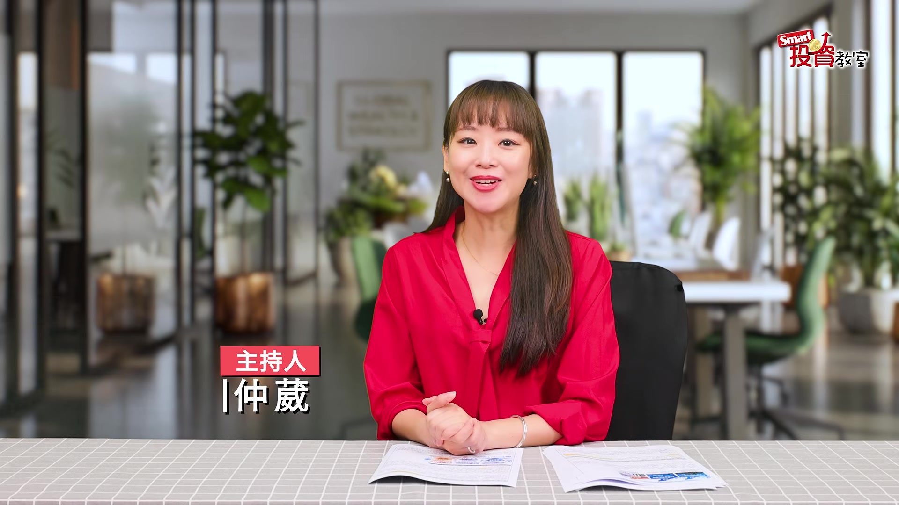
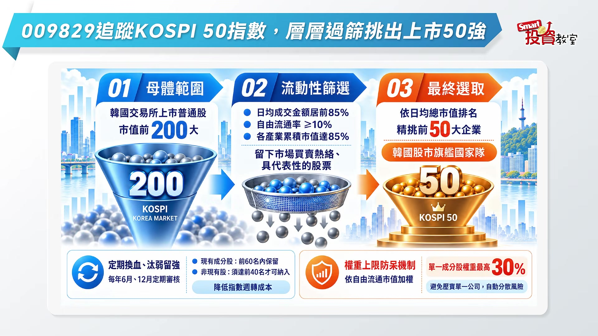
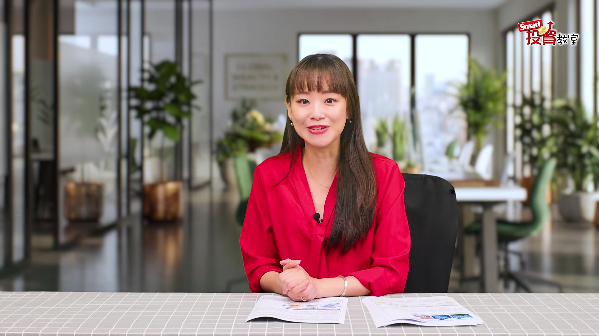
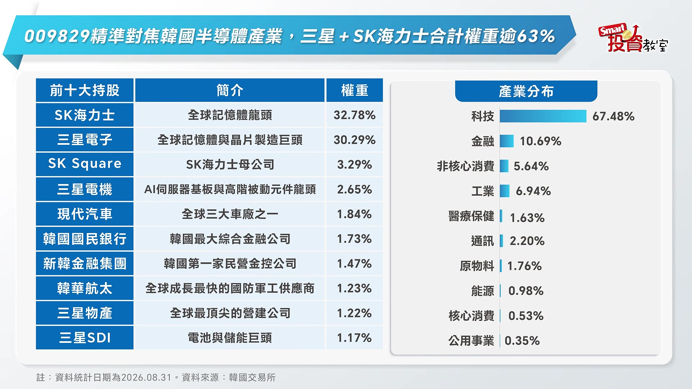
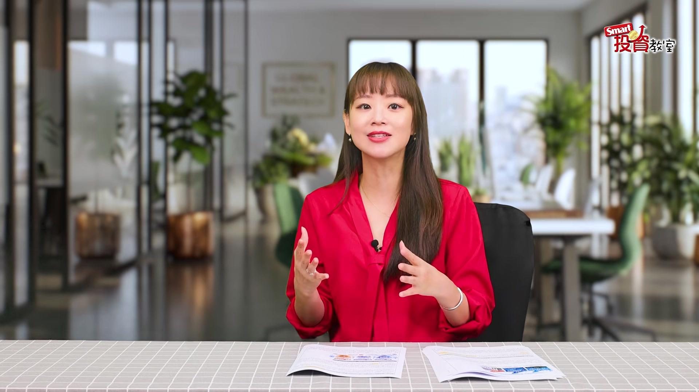

# smartmonthly-bw_c1KVBQaRVCQ — 關鍵畫面索引

- 來源逐字稿：[smartmonthly-bw_c1KVBQaRVCQ_FIN.srt](smartmonthly-bw_c1KVBQaRVCQ_FIN.srt)
- 影片：https://www.youtube.com/watch?v=c1KVBQaRVCQ
- 截圖數：6

## 00:00:06

**逐字稿片段：** 韓國COSPI指數從6月下旬的近萬點,跌到現在的6、7千點。 底部已經成形,正在醞釀反彈。 相信不少人心裡癢癢的,想要趁機在底部的時候進場。 不過在臺灣要怎麼樣抄底韓股呢? 今天這一集要來介紹國內唯一一檔專攻韓國股市的ETF, 大華韓國COSPI50代號是009829 很多投資人為了方便記憶 就稱它為韓版的0050 他投資哪一些個股呢 趕快來開箱 009829是一檔被動式ETF 他追蹤的是COSPI50指數

**話題推測：** 顯示韓國KOSPI指數走勢圖及具體點位。

---

## 00:00:47

**逐字稿片段：** 這個指數的選股規則非常的嚴謹 你可以想象成一層一層的過篩 第一關先從韓國交易所上市 市值最大的前200大企業裡面開始挑 第二關在用成交量 還有流通比重這些流動性的條件 把體質不夠好的刷掉 確保留下來的都是市場買賣熱絡 真正有代表性的股票 最後一關依照市值高低排名 挑選出最頂尖的50大企業 等於是韓國股市的旗艦國家隊 此外它每年6月跟12月 會定期的換血 太弱流強 還設了一道防呆機制 也就是換股的時候呢 單一個股的權重 最高不會超過30% 避免押寶在同一家公司身上 幫投資人自動分散了風險 那麼COSPI50指數 現在到底包含了哪些成分股呢

**話題推測：** 說明KOSPI50指數的選股規則。

---

## 00:01:46

**逐字稿片段：** 我們攤開它的前十大持股來看 答案再清楚不過了 排名第一的是SK海力士 權重32.78% 第二是三星電子30.29% 光是這兩大記憶體龍頭 合計權重就超過了63% 等於你買進了009829 就有將近三分之二的資金 是直接壓在全球AI記憶體的 韓國半導體核心上面 形同是一面精準對焦 韓國科技景氣的聚焦鏡

**話題推測：** 顯示KOSPI50指數前十大成分股及其權重。

---

## 00:02:20

**逐字稿片段：** 再看產業分佈也很有意思 科技一口氣就佔了67.48% 接下來才是金融的10.69% 體質相當純 吃的就是這一波AI最主流的紅利 這裡要跟大家特別提一件事情 三星電子跟SK海力士這兩大龍頭 正在進行股東回報競賽 把股東回報率的目標 從過去的上限50% 一直改成未來至少不低於50% 而且還接連的短除大規模的庫藏股回購計劃 把賺到的獲利實實在在回饋給股東 009829因為重壓了這兩檔個股 所以也跟著長到了甜頭

**話題推測：** 顯示KOSPI50指數的產業分佈圖。

---

## 00:03:05

**逐字稿片段：** 補充一下這個009829它的經理費是0.3% 定位是屬於市值成長型 所以投資人除了可以關注企業獲利成長 帶來的資本利得機會之外 也可能會依照實際的收益 還有相關規定來進行收益分配 但是它不是固定配息為主要訴求 想要掌握韓國大型企業成長機會的投資人 可以進一步來了解009829 當然必須要說高報酬的另外一面是高風險 韓股因為散戶的比重很高 而且它的漲跌幅限制是30% 臺股是10% 所以它的波動本來就是比較大一點的 而且009829因為成分高度集中在半導體 還有科技巨頭 所以等於把身家都壓在同一條賽道上面 一旦全球的科技景氣反轉 或者是美國科技巨頭砍了資本支出 再加上國際地緣政治這些變數 它受到的衝擊 可能會比一般分散型的基金來得更直接更劇烈 那除此之外 投資海外市場還是得多扛一個匯率波動的風險 7月以來韓環對美元還有兌換新臺幣 都是呈現強勁的升值走勢 那這個呢是投資人比較需要注意的地方 那麼面對了韓股這麼誘人的成長題材 但是也有風險 投資人該怎麼做呢 最穩健的操作策略就是多元的配置 把韓股當成是自己投資組合的一部分 在進場之前呢 先誠實衡量自己的風險承受度 能夠承受波動的投資人 可以直接進場 尋求穩健的投資人 則是建議採取定期定額的方式 把波動的風險降到最低 而無論你怎麼做 投資函股不能忘的一個初衷 就是長期參與 AI硬體供應鏈的成長動能 Smart投資教室 祝大家投資都賺錢 我們下次再見

**話題推測：** 補充說明009829的經理費及定位。

---

## 00:05:13

**逐字稿片段：** 並且音響月公開說明書

**話題推測：** 顯示免責聲明或公開說明書提示。

---
