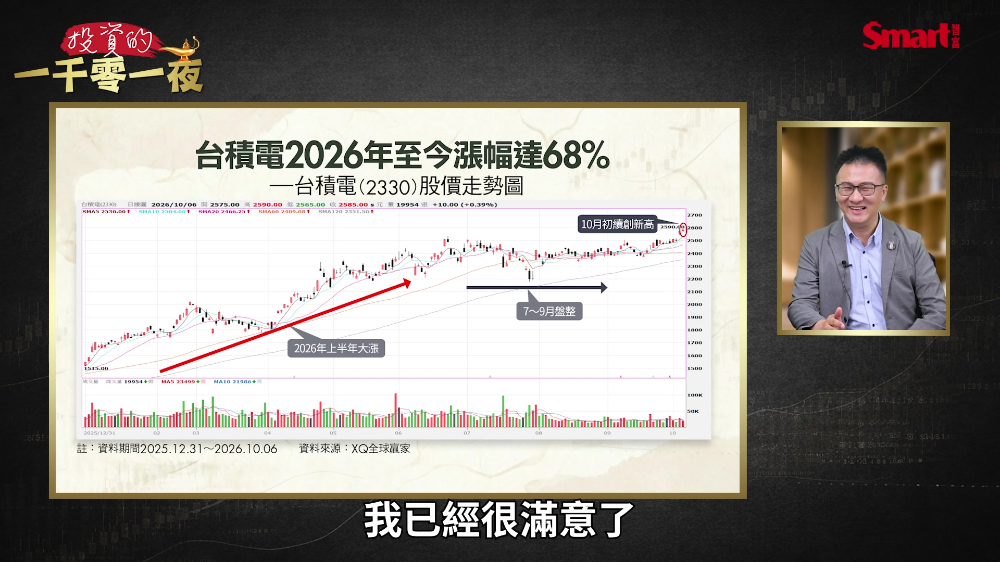
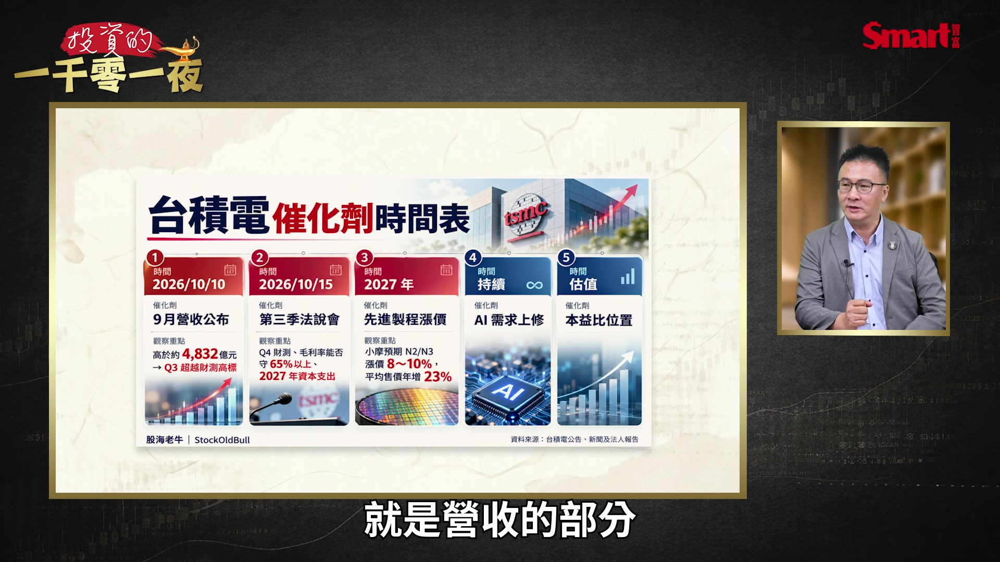
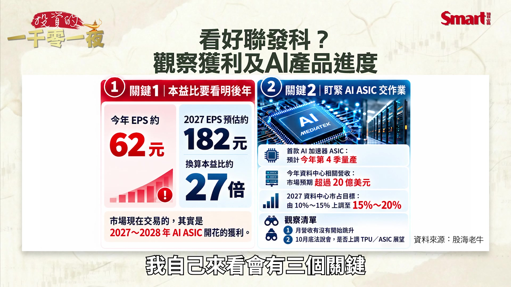
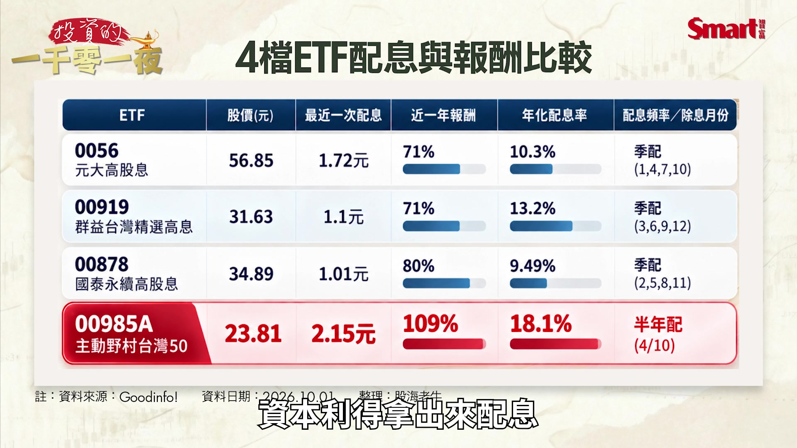

# smartmonthly-bw_o4KXRKrwlUs — 關鍵畫面索引

- 來源逐字稿：[smartmonthly-bw_o4KXRKrwlUs_GT.srt](smartmonthly-bw_o4KXRKrwlUs_GT.srt)
- 影片：https://www.youtube.com/watch?v=o4KXRKrwlUs
- 截圖數：17

## 00:00:04

**逐字稿片段：** 你看台積電今年 已經漲了6成多了 這個真的是算飆股了吧 大家不要對 台積電這麼苛求 好不好

**話題推測：** 台積電今年已上漲6成多，可能搭配台積電股價表現圖。

---

## 00:00:17

**逐字稿片段：** 大家好 歡迎再次收看 投資的一千零一夜 我是峰哥 最近 市場往上衝了

**話題推測：** 節目開場與主持人介紹畫面。

---

## 00:00:24

**逐字稿片段：** 真的是在5萬點 這個邊緣 甚至期貨 都有點超過5萬點 所以大家很開心

**話題推測：** 市場指數達到5萬點邊緣，可能顯示大盤指數圖。

---

## 00:00:29

**逐字稿片段：** 那我們今天請 股海老牛 來跟大家分享一下 先跟大家打個招呼 大家好 峰哥好 我是老牛 老牛當然很有名的 一個就是台積電 那另外一個就ETF 我們這兩個 今天都會聊到 我們先聊一下 台積電 好不容易真的橫盤 自從之前的這個創新高之後 一直橫盤 橫盤了 3 4個月 終於這次 一口氣突破 那你覺得 這次是來真的 會繼續的上去 還是說 只是安慰大家一下 一口氣又漲完了 我覺得 峰哥我們 大家不要對 峰哥我們 大家不要對 台積電這麼苛求 好不好 不要 我們就是要苛求 我們就是要靠 台積電翻身 你看台積電今年 已經漲了6成多了 對啦 對也是啦 今年漲了6成多 這個真的是算飆股了吧 它高檔整理一下子 那又怎麼樣對不對 但你是我們台灣 最好的公司 你應該可以更好 這投資人 期待真的太高了 你看 其實台積電它創高之後 又拉回 七八月在那邊整理的時候 整理一段時間 大家在那邊看 等說台積電有沒有更低 結果又衝衝衝 9月這個10月 又陸陸續續又創新高 其實大家 真的不要太苛求台積電 我覺得這個成績其實 我已經很滿意了

**話題推測：** 介紹來賓股海老牛，可能出現來賓介紹畫面。

---

## 00:01:55

**逐字稿片段：** 比起鴻海 大家是比較滿意 不要這樣 現在鴻海大家 連外資現在是上看400元 但這邊老牛 也先跟大家分享一下 你這樣一講完 下面可能又有一堆人出來罵 不信不信 我們知道 基本上 法人說的目標價 我們先打個8折 就是 它現在250幾元 260元 那我們看一下 如果今年 能夠突破300元 我就覺得真的鴻海 重新回到300元 之前300元那一輪之後 下來傷了好多人的心 還好還好 比國巨還好的多 那我們這樣子講好了 其實台積電我自己來看 今年漲了6成多 那其實沒有什麼好講的 可是大家希望能夠換新家嘛 對不對 所以 當然大家 對台積電一定都 多多少少有期待

**話題推測：** 話題轉向鴻海，可能切換到鴻海股價圖或相關新聞畫面。

---

## 00:02:47

**逐字稿片段：** 那我對台積電來講 我認為它有幾個催化劑 而且是有幾個關鍵 是投資人可以注意的

**話題推測：** 回到台積電，討論其潛在催化劑，可能顯示列點式簡報。

---

## 00:02:54

**逐字稿片段：** 包括第一個就是 現在要公布的這個 叫做9月營收 那其實我們知道台積電 8月的營收 已經破5000億元了嘛 對不對 那它在這個第2季法說會的時候 也有跟大家講說 它有一個財測 營收財測一個目標 那我自己覺得 台積電就像一個 已經考完試了 考完期中考了 它知道自己可以拿95分 那到底能不能變100分 其實有一個關鍵 那在法說會的時候 它的營收 基本上只要9月的營收 只要能夠超過4832億元 它就已經到它的營收高標了 這個時候我認為它已經可以 穩穩的拿到95分了 但如果它9月營收 開出來是超過5000億元的話 那當然就是一個100分的 一個成績單 那這是一個催化劑 就是營收的部分

**話題推測：** 台積電第一個催化劑：9月營收，可能顯示營收數據圖表。

---

## 00:03:46

**逐字稿片段：** 接下來10月中 營收出來之後開始要法說會 那法說會 我知道很多投資人都被嚇到 因為上一次的法說會 開完之後隔天股價下跌 其實台積電多半 法說會之後都是上漲 大概只有上一次是下跌 跟輝達一樣 輝達也是這樣子嘛 所以大家也 法說會我們看的不是股價 我們看的是法說會 到底跟我們講了些什麼 你看法說會完 其實股價後續還是創新高 只是說短線會有一些震盪 所以在法說會 其實我覺得關鍵 關注幾件事情

**話題推測：** 台積電第二個催化劑：法說會，可能顯示法說會相關資訊或日曆。

---

## 00:04:22

**逐字稿片段：** 包括Q4的財測 因為我們知道說 它現在營收都在季增 而且都是季增雙位數 那所以第一個 看第4季的營收 能不能季增雙位數 再來為什麼上一次 台積電開完法說會之後 股價會下跌 主要是因為它的毛利率往下掉 所以能不能第4季維持在65% 甚至維持在更高的一個區間的話 我認為這也是其中一個關鍵

**話題推測：** 法說會關注焦點：Q4財測及毛利率，可能顯示預估財報數字。

---

## 00:04:49

**逐字稿片段：** 那第3個關鍵 就叫做資本支出 那因為我們知道說 台積電資本支出 就代表說它未來的成長性嘛 怎麼辦 聽說又要去德州 投資很大 你要看是誰要求它的嘛 那當然就是馬斯克這個 這個近期傳出來的消息說 馬斯克他自己 要做一個TeraFab嘛 可是他當然希望藉由台積電 因為我們知道說 晶圓廠哪有這麼簡單 你沒有經驗 就而且你要做規模這麼大 當然要先請教我們的老大哥 叫做台積電嘛 那當然現在馬斯克沒有 正面的去回應 可是我覺得基本上合作的機率 應該是滿高的 合作的機率滿高的就很像說 你如果不找它 到底還要找誰 這個我也是覺得很奇怪 那第一個我們講營收 再來法說會之後

**話題推測：** 台積電第三個催化劑：資本支出，可能顯示資本支出趨勢圖。

---

## 00:05:43

**逐字稿片段：** 第三個 2027年的時候 我們要注意一下 先進製程有沒有機會調漲價格 目前是傳出說這個 N2 N3 2奈米 3奈米 明年有機會是漲價 8%到10%左右 也就會帶動明年的整體 它的售價是年增大約23% 那售價增加 營收組合又再調整的話 這些高階晶片又再 出貨量又再增加的話 你可以預期明年的營收 一樣都再繼續的成長 那當然現在 法人應該預期說明年的 營收至少也要再成長3成左右 輝達要成長7成 這個真的是 大家這幾年真的AI這個題材 還是真的還是要抱緊緊的 那再來當然我們知道說 AI的需求在持續上修的話 對台積電這些都 是一個正向的一個幫助 那反過來說 現在大家就要預期說 那現在台積電到底會不會很貴 那每次投資人問我這個問題 我都跟他們講說 請你用簡單的數學來做計算 用本益比 跟EPS的方式來做計算 基本上法人是預估 今年台積電可以賺到 100到105元 然後明年是上看140元 後年是來到180元 那我習慣的方式 就用20倍24倍 20倍是合理價 24倍是昂貴價 你用這樣子的方式來做計算的話 甚至你可以算出來台積電 什麼時候會到5000元 什麼時候會到5000元 快了 那重點是到那個時候 你能不能抱得緊緊的 那這一題數學題我們就留給 數學題我們就留給 EPS跟預估的這個 這個本益比來算來做計算 那電視機前面的或者是 電腦前面的投資人 可以用紙筆稍微做計算 應該就能夠算得出來了 我覺得沒問題 假設 假設這個因為黃仁勳都說 輝達要成長70% 假設輝達真的成長了 下個年度真的成長了70% 台積電漲了30%真的不為過 因為畢竟輝達漲得那麼多 幫它做晶片的總要跟著上漲 所以我覺得這個 邏輯彼此是合理的 就是整個AI鏈的邏輯 邏輯只要大家目前都朝著 目前這個正向的邏輯走的話 我覺得台積電其實真的不算貴 你說這麼一個高成長性的公司 然後老牛都已經 用20倍本益比給它看了 真的還要能要求怎麼樣 20倍算是低估的 對都已經就是很 很保守去看它了真的 因為以前我們在看這個 這個高成長股的這種本益比 隨便都是40 50倍 美國可能還到70 80倍 所以現在這個就是大概 AI漲到大家有點心虛啦 所以反而本益比都往下修了 接下來就請教一下聯發科 聯發科股本相對就小一點 雖然在台灣 也是一個大市值的公司 但是擺在全世界來看 還沒有像台積電那樣一個巨獸 那它當然也因為 這個ASIC應用 TPU啊 所以它後市現在滿被看好了 你怎麼看 其實我們在這一波 7月 8月下跌的時候 我們都跟投資人分享說 我現在個股我只敢撿 台股的三本柱 就台積電 聯發科 然後跟台達電 那也剛好這個時候撿到 結果聯發科在9月的時候 你看傳出的消息實在有夠多的 月初的時候傳出 黃仁勳要入股投資嘛 對不對 買它的債券 然後再來中秋連假過完之後 就有鬼故事發生了說 聯發科這個它有接 Google TPU的訂單 掉單了 結果當天股價下跌7% 那你看喔 如果是7%來計算的話 那等於是股價跌了這個350元 350元 那你這樣投資人 一天如果你是1張的話 你看這樣少了就多少錢 當然多多少少會緊張一下下 不過長線來看 你看這個聯發科股價 都還是滿正向的 所以我基本上認為是 沒有什麼太大問題了 但是就像這個峰哥跟我們講的 其實本益比比較高 因為現在包括這個美債的殖利率 也比較高了嘛 所以科技股的波動都會相對來的 比較大一點 所以聯發科的話 我自己來看會有三個關鍵

**話題推測：** 台積電第四個催化劑：先進製程調漲價格，可能顯示製程技術或價格趨勢圖。

---

## 00:10:26

**逐字稿片段：** 第一個的話我們可以看到 它今年 一個EPS預估是62元 那明年是預估來到182元 那為什麼有這麼大幅度的跳升 待會再跟大家說明 不過 你可以換算來看的話 如果明年的EPS 能夠來到182元的話 換算現在5000元的一個價格 其實本益比才27倍 那本來我們就知道IC設計 它的本益比是相對來得比較高的 在市場上來說 這個族群的本益比 是相對來得比較高的 所以你要給這麼高的EPS 當然後面有什麼原因

**話題推測：** 聯發科第一個關鍵：EPS預估，可能顯示EPS預測圖表。

---

## 00:11:04

**逐字稿片段：** 我們就來看第2個 要請投資人要特別關注 聯發科AI ASIC 到底有沒有準時的去交作業 第一個我們可以留意到就是說 現在它在今年的第4季 會來這個ASIC的 資料中心的一個 晶片的訂單會開始做量產 也就是說你看 今年如果第4季開始 順利量產的話 那明年就有4季 等於是這個錢要乘以4 這個錢要乘以4 所以你就可以注意到說 那今年的 ASIC資料中心的營收 能夠超過20億美元的話 那這20億美元到明年 乘以4 那甚至法人也是預估 這個ASIC的這個訂單 資料中心的營收 目標由10%到15% 上調至15%到20％ 這個其實在 法說會都已經跟投資人講過了 那當然 接下來我們就要盯了它的營收 在10月 11月 12月 是不是有真的逐步的在成長 或者是這一季是不是真的有在 上升當中 另外也請大家要留意 10月底的時候 聯發科的法說會要跟大家講了 哪些東西啊 那當然講完了本益比 跟這個基本面的一個狀況的時候 那投資人一定又要問 到底可不可以買 對不對 那我的答案當然是 閉著眼睛買 都是三本柱了 還怕什麼 閉著眼睛買 那當然我這樣子講一定會被罵 所以我在節目上面會跟大家講 要分批的做買進 那現在在5000元 就是一個心理的關卡 那它如果有下跌的時候 這個時候先買第一批 然後另外等這個下跌的時候 在5000元以下 在那邊整理的時候 這個時候來買第二批 那第三個等到法說會這些營收啊 法說會都符合 投資人的預期的時候 再去買第三批 這是老牛認為比較穩健的 一個做法 我覺得現在我感覺啦 就是只要漲太多 這個鬼故事產業鏈就會出來 像台達電前面漲很多的時候 鬼故事產業鏈就出來了 就被打了滿慘的 你看台達電光這樣修正就4成 也是很可怕 因為剛好有時候 就是產業上會有一點 資訊的空窗期 比如說ASIC 聯發科大家都知道 它ASIC的展望 產品的展望很好 但是就很容易就 可能一旦就說 可能你的晶片設計 怎麼樣啊又怎麼樣啊 比如說效能不如預期啊 或什麼 這些都是我們現在 良率不好 對啊隨便講講的 就是說如果這個事實上 就看它的收入 如果真的很正向的如它所規畫 一路漲上去 就表示那些都只是 不知哪裡來的鬼故事 對所以其實大家 我覺得不用太緊張這個 但是反之如果營收 沒有辦法像它講的 那樣上去的時候 你就要注意 背後是不是有什麼結構性的因素 所以這邊我們也來提醒一下 就是聯發科它還是有一些風險的 因為畢竟我們知道說在之前 聯發科它其實大部分的 營收的來源都是手機的部分 但其實在上一次的 法說會就已經告訴大家了 這個AI部分的營收 已經超過了手機的部分 那當然如果又有什麼法人 又出來放消息說這個 手機不如預期啊 但是我們也知道 現在聯發科的營收 已經不再是手機做主導了 所以這個還是會有一些風險啦 那當然股價也就是因為 會這樣子上下波動 那就我拿到的資料應該會預期 今年手機的營收 或者是我們講手機的需求 應該是下跌 15%到16%左右 所以這個是可以預期的 但是它就是其中一個利空的因素 手機需求衰退是全市場 幾乎都知道的事 所以如果你現在還被 手機晶片的收入下降給嚇到 那你自己要檢討 因為大家主流焦點都不在這裡 那接下來 請教一下 因為今年很特別 本來去年高股息表現不好 大家人人罵 今年高股息 突然整個翻身漲上來 然後配息大家又超敢配 所以就變成 重新又變成熱鬧滾滾的 高股息的ETF行情 特別我們說00878今年的 00878今年的績效非常的強 那你怎麼看這一波 這個00878 或者高股息的這些行情 我回想到我在社群上面 跟大家分享這些個股啊 或者是ETF 甚至高股息ETF的資訊 但我在一年前分享 高股息ETF的資訊 應該被罵翻了吧 被罵翻了 全部都在跟我說 左手換右手啊 那個吃老本啊什麼的 可是你再回來看的時候 你會發現到說00878 今年的漲幅就來到7成 所以這個表現 真的是非常好的 尤其是你光看9月的這一波 00878含息的表現 是5.18% 居然超過台積電的漲幅 所以相對來說就是跟這個大盤 它的指數是3.93%嘛 所以其實有1.25個百分點的差距 那這1.25個百分點的差距 其實我覺得高股息ETF 今年我認為有一個 一句話可以來形容 也就是電子股漲完 換金融股 金融股漲完又換電子股再接力 就很像今年的這樣子一個走勢 所以你可以看到 我幫大家把這個 00878的前十大成分股 拆解出來 但大家可以預期因為 其實在6月 7月 出現明顯修正的時候金融股 表現都相對的比較好 包括我們講的中信金啊 國泰金還有台新新光金 它其實都陸陸續續的在創新高 那接著 你可以看到9月的時候 就有人接力了 聯發科我們剛剛講的 醒過來了 你看它在9月的時候 可以繳出這個 25.35%的一個成績單 是非常好的一個表現 那次佳的就是我們叫做聯電 這個二哥嘛 它表現也不錯 來到19.77% 雖然說你看有一些被拖累 是華碩跟廣達 但是我們不要苛求它們太多 因為華碩跟廣達在8月的時候 都有雙位數的一個漲幅 所以我覺得剛好00878 它剛好就是在這一波輪動 來說的話 讓它的一個表現是很不錯的 另外我們如果換算了 一年前老牛在被罵的時候 如果你不小心剛好聽到老牛講 然後把100萬元丟進去 00878裡面 你就會發現到說 抱到現在這個報酬已經 從100萬元變成 將近180萬元 那其中10萬元 就是這個從配息來的 今年是這樣 就是因為聯電嘛 就是二線的這個晶圓 晶片股或晶圓代工股 然後老AI就是廣達這些 另外就是金融股 今年是這3個類股是表現很好 其實我們過去的這個 台股歷史大概都這樣 主流成長股 先衝 接下來是金融股就接棒 然後金融股休息的時候 主流成長股再衝 然後衝完之後 金融股再接棒 大致上都是這個模式 所以其實如果你在台股市場夠久 你大概也就習慣了 只是說通常主流類股 有時候會換人 但是金融股 大概幾乎都沒有換人過 反正它們都會接一棒 大概邏輯就是這樣 因為我們在市場上面很容易聽到 一句話叫做金融股是最後一棒 但是我還是要在節目上面 跟大家講金融股是最後一棒 棒棒棒棒棒 一直棒上去 真的是表現非常好 因為你要這樣想 這個大隊接力 有可能只有4棒 也有可能有10棒 所以如果是這樣接 有時候會接很多 對所以我剛剛才說嘛 我從電子股接到金融股 然後金融股現在又比較 疲弱的時候 資金又跑到電子股 這一棒一棒剛好都接得非常好

**話題推測：** 聯發科第二個關鍵：AI ASIC準時交貨，可能顯示產品或計畫時程表。

---

## 00:19:18

**逐字稿片段：** 接下來我們來再請教 因為不是只有 高股息也不是只有00878 表現很好 今年其實好幾檔 這個高股息包括 老牌的0056也表現很好 還有最近這個00919 也很衝 你整個幫大家來看一下 現在這些高股息ETF 你覺得它的現在投資價值怎麼樣 高股息ETF 其實我跟投資人都講過 因為高股息ETF 我的原本的目的是要拿來配息 領現金流 那今年剛好前面有提到 就是剛好接棒都接得不錯 而且它們的配置上面 電子股啊 老AI啊這些 其實表現都非常的不錯 所以把整個 這個報酬率都拉上去了 但是我們必須得說 相較於大盤來說 我們有提到剛剛00878今年 近一年的漲幅大概是8成左右 那0056跟00919 大概也都 繳出7成左右的一個成績單 可是相較於大盤在近一年來說 大盤（市值型ETF）已經漲了98%左右 所以整體來講的確 高股息ETF 它的表現的確還是沒有 市值型的ETF要來得好 所以就要看投資人 你自己的需求會是怎麼樣

**話題推測：** 擴展討論其他高股息ETF（0056, 00919），可能顯示這些ETF的比較圖。

---

## 00:20:32

**逐字稿片段：** 那我這邊把4檔 ETF拿出來 做配息的比較 其實我們這邊可以看到 那過去我們都會認為說 主動式ETF 應該是拿來賺價差的 可是剛剛有提到今年 台股漲得非常的多 所以很多主動式ETF 或者是科技型的ETF都把 資本利得拿出來配息

**話題推測：** 比較四檔ETF的配息狀況，可能顯示配息率比較圖表。

---

## 00:20:57

**逐字稿片段：** 那這邊我們拿一檔 做舉例叫做00985A 主動野村台灣50 它的選股方式是比較偏市值型的 這個ETF的選法 但是它有加了一個主動的方式 你可以看得到 它今年的 今年報酬是來到109% 相較於我們剛剛講的 這個市值型的ETF 大概只有這個98%左右 其實領先了大概11個百分點 表現是非常好的 另外你可以注意到 它年化配息率是來到18% 那這也就代表說它其實拿了 很多資本利得出來配給投資人 那當然對老牛的一個看法 我認為如果你是想要 穩定的現金流的投資人 你就拿這種高股息的ETF 來做你現金流的一個配置 那如果你是比較年輕 想要衝一點的人的話 你可以買這種主動式的ETF 它的配息表現也不錯 另外也能夠在多頭的時候 幫你做出一些比較強的表現 我覺得確實今年來講 因為我覺得 以前的高股息ETF 早期比較偏向 就真的是從股息來的比較多 然後有後來第二代 就是因為 這個申購太多 就是收益平準金裡面配進去多 那我覺得現在是 等於說新的模式就是 真的從價差的利益 拿出來配的也很多 所以你今年可以看到 一個特色就是 通常主動式ETF 跟這個市值型ETF 有時候配的沒有不會比這個 高股息還差 所以然後也證明一件事就是 大家還是很喜歡拿到錢 不管這個錢的來源是什麼 但我覺得還是 老牛剛才講很重要就是說 它的市場的長期的趨勢 還是要尊重啊 比如說長期來看 市值型的報酬會比高股息高一些 但是高股息你有一些 配置上或現金流的需要 那你在你的這個投資組合裡面 擺對一個位置 擺對一個適合的這個比例 那其實對你自己的 整個投資的全面性考量跟需求 就很有大的幫助 那當然你是年輕一點的人 我們剛才說你要衝一點 不管是 什麼all in市值型的啊 或all in主動式ETF 或all in正二 其實就是真的是 看你自己手邊的這個資產風險 還有這個整體的配置狀況是如何 那老牛最後有沒有要跟 投資人談一下 接下來就第4季了 怎麼樣配置一下的調整或是想法

**話題推測：** 以00985A主動野村台灣50為例，可能顯示該ETF的績效和配息數據。

---

## 00:23:29

**逐字稿片段：** 所以在第4季的話 我其實做了一個數據來統計 其實在第4季的表現的話 你可以注意到 其實我們知道說 因為台股 在6月 7月 8月 都是做一個除息 除權息的一個動作 所以在歷年的統計下來 其實第3季它上漲的機率 是來得比較低 那我們已經經過了這個 7月 8月 9月 的確經歷到一波的修正 但是 第4季來說 從過去的紀錄來看 平均上漲的機率是來到67% 其實上漲的機率是非常高的 所以如果希望能夠幫自己賺到 年終獎金甚至加薪的話 第4季我認為要好好的把握一下 今天非常謝謝老牛 跟我們提供了 包括台積電聯發科的看法 還有分析一下 現在高股息ETF的 這個市場趨勢 那今天非常謝謝老牛的分享 也非常謝謝大家的收看 喜歡我們節目 歡迎幫我們 按讚 訂閱 分享 以及開啟小鈴鐺 謝謝大家 謝謝

**話題推測：** 討論第四季市場展望，可能顯示歷史數據的統計圖表。

---
