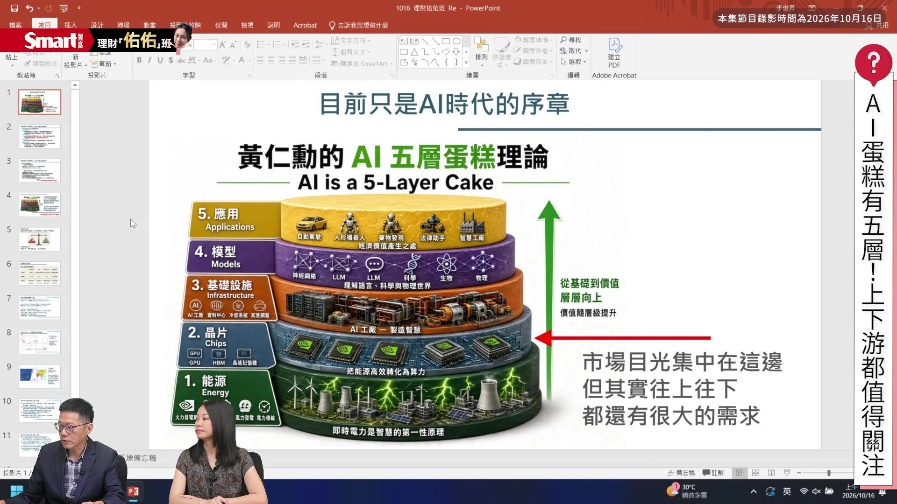
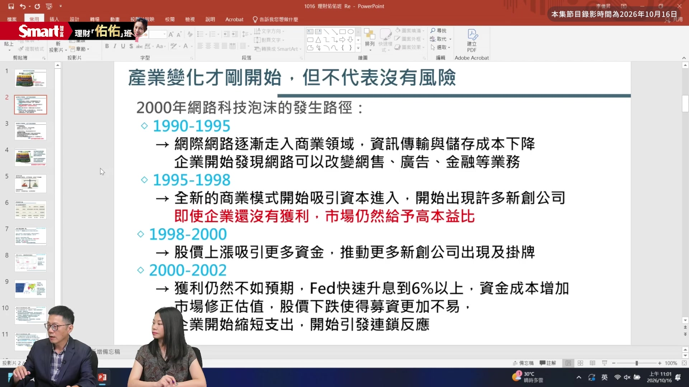
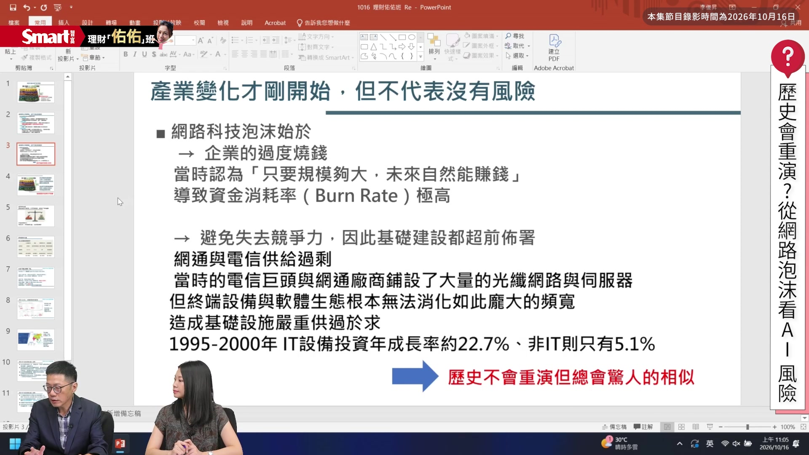
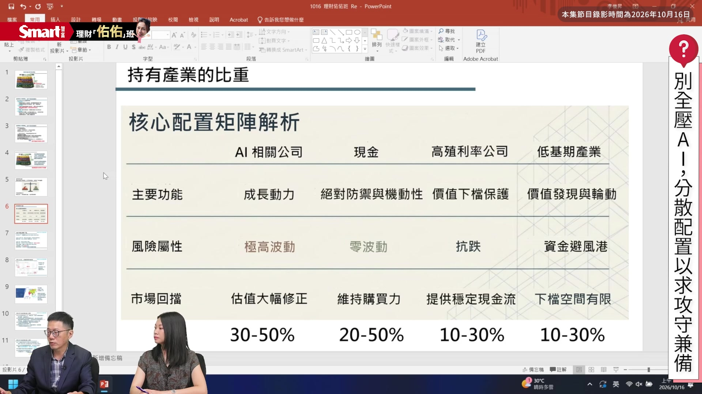
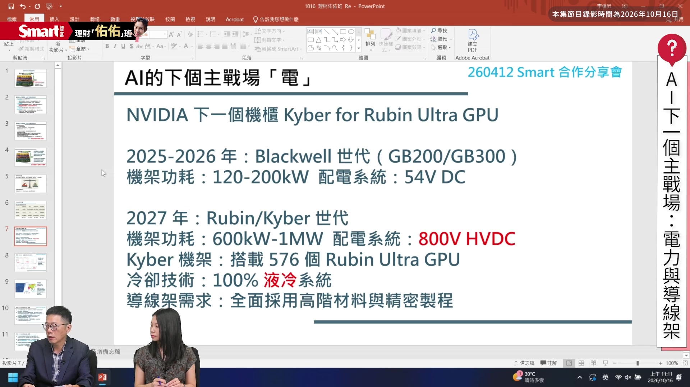
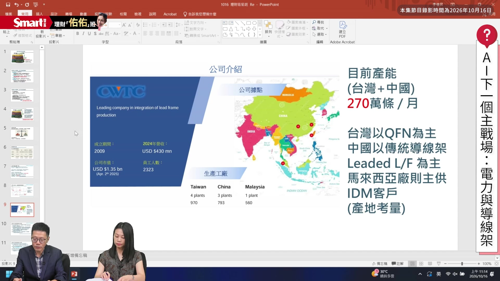
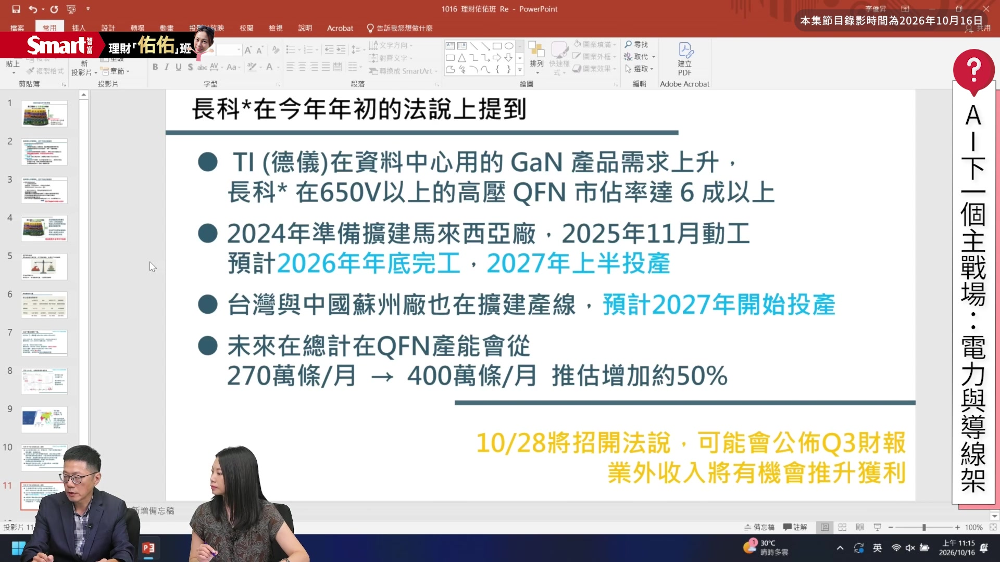
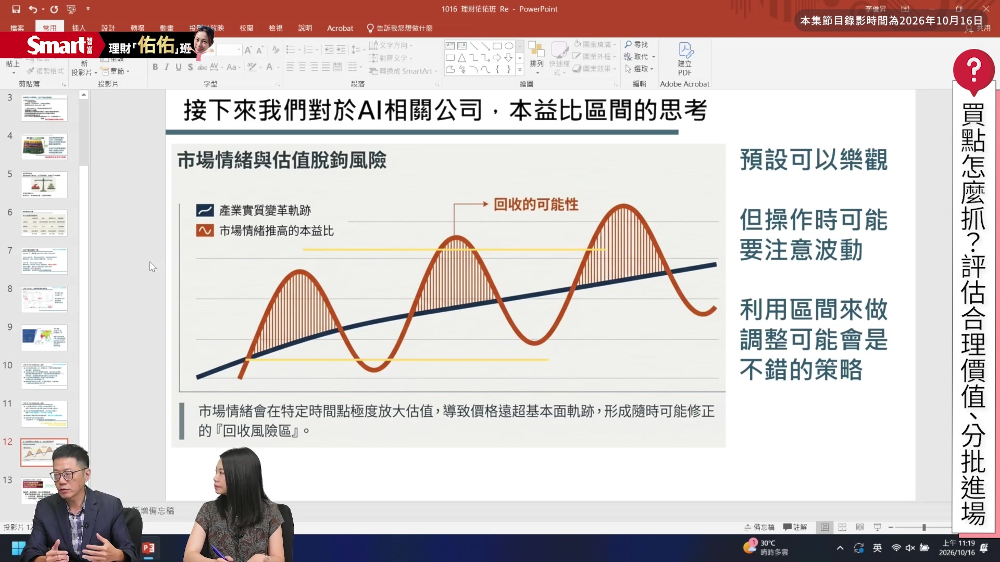
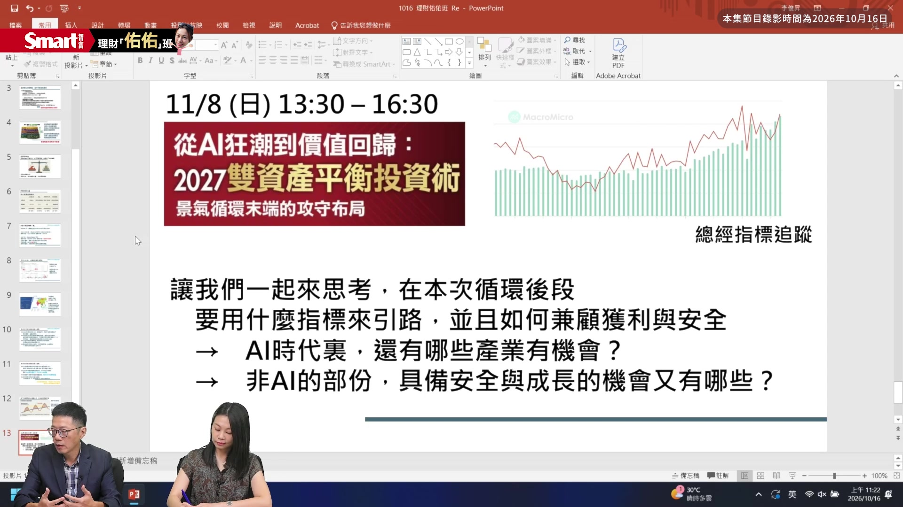

# smartmonthly-bw_pPS-4V2AeHM — 關鍵畫面索引

- 來源逐字稿：[smartmonthly-bw_pPS-4V2AeHM_GT.srt](smartmonthly-bw_pPS-4V2AeHM_GT.srt)
- 影片：https://www.youtube.com/watch?v=pPS-4V2AeHM
- 截圖數：15

## 00:00:14

**逐字稿片段：** 台股8萬點的 這個樂觀聲音 但是呢 其實我們看到 就是過去幾年 AI已經熱了好幾年了 到底2027年 AI還有多少的 成長空間呢 投資人又要怎麼佈局 才能夠掌握 接下來的成長機會呢 而且AI投資只能看 熱門的科技股嗎 有沒有你沒有注意到的 價值股呢 今天呢 我們邀請到投資達人 修正式價值投資的版主 陳啟祥老師 來跟我們分享 老師好 主持人好 大家好 AI行情呢 從2022年 就是ChatGPT 橫空出世以來 其實已經熱到現在 已經三四年了嘛 那老師我想要 跟你請教一下 因為現在投資人 其實會很擔心說 我現在進場 會不會太晚了 其實我自己覺得 有點晚了 因為它已經發酵 好幾年了 但是沒關係 因為後面 老師會分享一些 你可能 比較沒有注意到的 冷門產業 好 那我想要問老師是 2027年你怎麼看 就是接下來的AI行情 到底還有沒有 成長空間呢 那如果現在進場的話 投資人要注意哪些風險 是 那我覺得 其實我們可以從

**話題推測：** 預期台股大盤走勢圖或新聞畫面，提及台股8萬點樂觀聲音

---

## 00:01:21

**逐字稿片段：** 兩個部分來看 第一個是機會的部分 當然還有風險的部分 我們沒有辦法 去預測風險 什麼時候會來 但是我們可以隨時 記得說 有這樣的風險存在 那我覺得 第一個機會的部分 我們覺得 今年年初 黃仁勳在他的演講 那個NVIDIA的 法說會上

**話題推測：** 預期討論提綱或兩部分分析圖示，切換至機會與風險的分析

---

## 00:01:41

**逐字稿片段：** 有講到這個 AI五層蛋糕理論 那當然我覺得 這張圖 應該大家都很熟 因為這張圖其實那時候 媒體有很多報導 可是我覺得時間一久 大家就會稍微忘記 有這件事情 但我覺得 這張圖大家可以 把它放在 你電腦的桌面 或什麼地方都可以 你提醒自己說 這一張圖 其實就是未來這幾年 我們會看到的一些路徑 那它這個 五層蛋糕理論呢 其實蠻簡單的 第一個就是 他認為 整個AI的需求會改變 這幾個 產業的一些變化 從能源 從晶片 從基礎設施到模型 到最後的應用端 那我們現在市場目光 大部分都放在 晶片這個部分 因為台灣就是 製作晶片的 這個重要的產地嘛 那其實 我們可以 在這個時間點 可以開始 往上 甚至往下 能源端這邊 其實我們 都可以去思考說 還有沒有哪一些機會 我個人是認為 基礎設施這邊 開始慢慢有看到 一些跡象出來 像今年很多IPC公司 它其實表現是還不錯的 那這些IPC公司他們 會牽扯到 所謂的邊緣運算 會牽扯到 所謂的智慧製造 那這些公司業績 開始慢慢 有一些拉升的時候 其實就代表說 我們即將有機會 從晶片這一端 開始要往下去推 然後我覺得 這個都是我們 在接下來這幾年 會看到 那以這個理論來看的話 其實我們後面 還有一些空間 可以去走 那當然我們 也知道說 現在這個位置 絕對不會是 AI發展的 一個結束的地方 還沒有到天花板 是 所以我覺得這張圖 大家可以多去 沒事就去看看它 去想一下說 還有什麼東西 或說你看到 新的新聞的時候 你再回來對這張圖說 它是屬於 這張圖的哪一個部分 這是機會的部分 好

**話題推測：** 預期NVIDIA AI五層蛋糕理論圖表，提及黃仁勳演講內容

---

## 00:03:33

**逐字稿片段：** 那風險的部分 我覺得其實 我們可以去想想 2000年 網路科技泡沫化的 這個發展的路徑 當然歷史不會 100%一樣嘛 但是 我覺得這個發展上來講 其實有一些東西 會有一些相似 那我覺得投資人可以去 看一下過往的這個 以前的 情況是 在什麼地方出現了 這個失敗的 起頭啦 那我大概簡單的把這個 網路科技泡沫的 這個路徑 大概把它講一下 大概從1990年 到1995年的時候 這個網路科技開始 進入商業領域 它之前本來都是 用在軍事上面 就是屬於 國家級在用的 那現在開始 有進入商業領域了 那整個資訊跟傳輸的 成本都下來 那企業在這個時候 開始覺得 網際網路 可能會改變他們 整個銷售端 跟他們的廣告的 這些模式 甚至連金融業務 都會有很大的改變 那當然這時候 其實網路都還在 一個很初步的 發展 如果說大家 就跟我一樣 是五六年級生的 朋友 你可能從這個時代開始 你就有去試過那個撥接 28K modem的那個時代 當然它還是很慢 但是它已經 是一個起頭了 所以這個時候開始 網路科技開始被 這個世界接受 並且開始成為 一個發展的重點 那在95年 到98年的時候呢 這個全新的商業模式 比如入口網站 開始成立 大家看到說這些東西 開始去吸引 這些資本去進入 因為它已經有 開始去創造 一個新的商機出來了 所以資金開始 會去進駐 那這個階段你會看到 很多企業它還沒有 開始獲利 那市場會給 很大的高本益比 因為他們認為說 這個商業模式 一旦形成之後 未來的獲利 跟現在的價格比 它會有很大的一個 成長的空間 所以市場願意給它 很高的一個估值 所以這時候你可以看到 包括股市啊 包括一些 相關的這些投資 都往這邊開始去集中 那整個在這個階段最熱的時候 是在1998到2000年的時候 這時候股價開始 大幅的飆升 那股價漲 就更多公司 開始想要去掛牌 IPO公司也很多 那也就吸引 更多的資金進來 所以變成整個 市場的氣氛 就非常的熱 那這時候已經差不多 來到最高點 最後泡沫怎麼結束的 在2000年左右的時候 整體企業發展的 獲利沒有 大家想的那麼快 另外一個重點是 當時的Fed 它快速 把它的利率升到6%以上 那這種沉重的這個 資金成本 一口氣就會讓 這些新創公司 的營運 出現了一個 比較大的 一個挑戰 所以市場開始就因為 升息開始去修正估值 那修正估值之後 股價開始下跌 我覺得這個就是人性嘛 漲的時候大家 都覺得很好很好 跌的時候大家 才開始去想說 是不是有點危險 那就有一點 那種連鎖反應 那一家開始撤的時候 大家都 跟著開始撤 那企業開始發現 那我現在找錢 沒那麼簡單了 那我現在就是 我要縮減我的資本支出 那這邊就開始引發後面 一整個的連鎖反應 所以我覺得其實 這個狀況 當然以我們現在這一波來講 現在AI有些公司 已經開始賺錢了 但是 或許現在來看你會覺得 它的估值 沒有到當年的 dot-com泡沫這麼誇張 那因為我覺得 我們現在還在 一個初步的階段 後面會有更多AI公司 跟更多應用 新的應用的公司會出來 那推升這個網路科技 泡沫化 其實不只是一個 AI公司的這個幻想 那其實 在實際上的時候

**話題推測：** 預期切換至風險討論或網路科技泡沫化歷史圖表，分析2000年網路科技泡沫化

---

## 00:07:24

**逐字稿片段：** 這些網通公司 跟電信公司 他們 也賣了很多 很大量的設備 那這些公司 他們在硬體設備 跟基礎建設這邊 他們賺了非常多的錢 所以其實這些 新進來的資金 最後也是推升整個 網路科技泡沫化 一個重要的因素 所以當我前面講到 當企業開始 減少資本支出的時候 就是這些終端設備端 提供公司 他們的挑戰就會開始 所以我覺得 這一波網路科技的結束 大概就是 在整個資本支出開始 縮減 那我覺得這個是我們 接下來可以觀察的 一個重點 就是什麼時候 AI的資本支出 開始縮減 那現在來看好像還不是 所以我覺得我們可以 把這個東西 把它放在心裡面 就知道我們 要看的是 這個東西 其實老師剛剛講的 就是我們可以看到 過去歷史的經驗 當然跟現在 有雷同的地方 也有不同的地方 比如說 現在資本支出 還是持續的 大家看 對 那很多的就是CSP廠 都還是預估是成長的 那再來是 如果相同的地方 比如說我看到 第一個警訊是 升息這件事情 但有很多像的 跟不像的地方嘛 但我們不能否認的是 因為隨著市場點位 慢慢升高 對於投資人來說 就算幅度一樣 可是波動 其實還是變大的 所以我們可以看到風險 還是慢慢的在增加 但投資人你一定還是會 不想要錯過 因為接下來AI 剛老師也有分享了 接下來 其實還是有一些 空間存在 那老師我們要怎麼做 就是在這個階段 我們可以 一樣抱到就是這個AI 後續的成長的這一段

**話題推測：** 預期網通與電信公司營收或硬體設備銷售圖表，提及網通與電信公司在泡沫前賺取大量設備營收

---

## 00:09:02

**逐字稿片段：** 但是又可以 做到攻守兼備呢 是 我覺得 就像我開場講的 就是黃仁勳 這個五層蛋糕理論 是我們可以 去留意的部分 那從這邊會 可以去找到 蠻多的一個題材 那以做法來講 我覺得是 你可能可以開始 去思考說 可能之前你覺得 你全壓AI 賺得很快 很過癮 那現在來講 其實開始 你會觀察到有一些 前一波沒有漲到的這些 比如說消費性的東西啦 或是說甚至是民生 相關的這些公司 它的業績 如果有跟著上來的時候 市場還是會 回頭去發現到這些公司 然後AI的部分 當它的資金給予它的 本益比 已經來到了是明年 甚至後年的這個獲利的 估值的時候 其實 我們也是要 去擔心說是不是 衝得太快 所以我覺得 在資產平衡的部分 其實我們可以用 整個持股的比例啦 還有你對於產業的比重 跟 加減碼的策略去 平衡掉你的風險 那怎麼做呢 我這邊有一個 小小的心得 我覺得 大家可以參考一下 那以前我們 可能會把AI公司 放到比如說80% 甚至是100% 全部都是相關的公司

**話題推測：** 預期投資策略圖表或概念說明，討論如何在AI投資中攻守兼備

---

## 00:10:18

**逐字稿片段：** 那現在來講 我覺得我們可以 去把這個比例 把它降下來 因為它的 波動性非常大嘛 那只要市場一回檔 比如說這幾天的回檔 它的修正 就會非常的劇烈 所以我覺得其實 你可以看你自己的 風險承受度 大概放30到50% 我覺得是蠻合適的 然後留個現金 大概在20% 那我這邊寫50%是說 如果你的 風險承受度比較低 比如說你的年紀比較大 已經是退休年齡了 或是說 你自己相對的資產 沒有到這麼多 那可能 代表說你的 風險承受度沒有那麼高 那其實是要拉高 你的現金部位 那我覺得 有一部分可以去放 高殖利率公司 有些高殖利率公司 其實這幾年 它表現還是蠻穩定的 那市場其實最喜歡在 年末到 明年Q1這個時間 去講高殖利率公司 因為這時候 整年的獲利 大概慢慢會出來 那就可以去抓出來 明年可能會配息配多少 那我覺得其實這個會是 Q4到明年Q1 可能市場會開始去提的 這個話題 所以我覺得 高殖利率公司 也是可以去 放一些在這邊 因為相對這些公司 它的波動就不會太大 然後最後一個是 低基期的產業 就像我剛剛有提到的 有一些民生消費公司 有一些產業 之前大家 沒有那麼去關注 但是當它的業績 有成長到一個程度的時候 其實市場最後 還是會去反映 它的這些 獲利的這些空間 所以我覺得 如果你把你的 投資 組成把它做一個 稍微分散的話 相對的 對於波動的承受度 就會拉得比較高 我覺得 而且你的心理壓力 也比較不會那麼大 我覺得這是可以參考的 是 其實就像老師分享 我們沒有辦法就是 預估風險 到底什麼時候會來 但是我們可以 藉由就是做好 就是資產的配置 然後去控制風險來臨時 你的壓力 跟你的 就是獲利的一個狀況 但老師我們還是要講完 因為雖然我們 做整個資產配置 但裡面還是有 一塊AI投資的部分 因為就是不想要 錯過接下來 可能還有的 一些上漲空間 但很多人現在想說

**話題推測：** 預期資產配置建議比例圖表，建議降低AI持股比例

---

## 00:12:27

**逐字稿片段：** 投資AI 到底要投資什麼 還是台積電嗎 老師有沒有一些比較 大家可能比較忽略掉的 一些產業的商機 可以跟大家分享 是 我覺得其實 AI的 投資的 方向很多 但台積電幾乎是 你一定不會錯的標的 那我覺得 你可以放一些在 台積電上面 那如果你希望 能夠增加一點 你的績效或是說 去找到一些更多的機會 的時候 其實我覺得 就像回到剛才有講的 那個五層蛋糕的理論 你可以從這邊去想 還有沒有 哪一些產業會去受惠 那我這邊舉一個例子 就是 今年4月我跟Smart這邊 有合作一個分享會 那當時我有 放這張投影片 那我覺得

**話題推測：** 預期AI相關產業分析或個股推薦，討論AI投資除了台積電還有哪些產業商機

---

## 00:13:08

**逐字稿片段：** AI的下一個主戰場 會在電 那這些就是一樣 在那個五層蛋糕理論的 最下面的那一層 不是 它是 晶片往上面的那一層 對 基礎建設的那一層 那這邊我覺得為什麼 我們會去看 這一個部分呢 其實 AI的變革 它有些東西是 過去沒有辦法想像到的 那當現在產業 進到這邊的時候 它會一口氣 把所有的供應鏈的 相關公司 全部都翻一遍 那我覺得 為什麼會來講電 就是因為 當這些伺服器的這些 電源配置 當它功耗 越來越大的時候 傳統的那些 比如說Power Supply 它可能就不夠用 它需要更大的電流 需要更大的 一個電力系統來支援 那如果要換到 更大的時候 它整個配電系統會加大 所以大家有在講說 接下來配電我們會進入 所謂的800V這個時代 用高電壓下去 因為電壓加大的時候 你的整個能源的效率 會更好 但是這個加大不是說 我今天說加就加 你後面配套措施 沒有做好 電壓一下去 全部都燒光光嘛 對 所以這邊 會造成非常多 產業的一些變化 所以我覺得 這個部分是 我今年自己看AI 蠻重要的 一個主要的方向 那當然包括電源 下去配的時候 包括整個液冷系統 也會跟著下去 做一些改變 然後我從這邊 我去注意到 導線架這個產業 因為導線架 這個產業其實 過去來講它就是一個 蠻不起眼的東西 大家覺得那就是 鐵片折一折而已嘛 那沒有什麼技術 所以其實 蠻多公司都覺得 這個東西沒有什麼 我們來看下一張投影片 這是台灣有一家公司 是導線架的龍頭廠 叫長科 那這家公司我自己 覺得蠻有意思的是 它在台股裡面 它拆過兩次 那這個拆股就會造成說 它的那個股數會增加 然後那個股價 票面價值會變小 它拆過一次一拆十 又拆過一次一拆二 所以整個 已經拆了差不多25分之一了 所以如果 你現在把長科的股價 把它算回去的話 它其實是 一支超過2000塊的公司 那所以這代表這家公司 長年來的發展 獲利是 一直在往上的 所以不能單純只看 股價 好 那這家公司 為什麼我會去注意呢 就是我剛剛有提到說 導線架這個產業 以前是大家覺得 很不起眼的產業 可是到了現在 這個狀況的時候 當你的電壓 要拉高的時候 你後面晶片上面 導線架它就是 晶片跟主機板 接觸的 傳電的 那個鐵片嘛 所以它的規格 就不是以前那個狀況 那這邊有趣的是 這個產業 因為以前大家都覺得 不起眼 所以很多公司 都已經慢慢 退出這個產業 所以現在 整個世界有在做 這個產業的公司 能夠大量去生產的

**話題推測：** 預期電力基礎設施相關圖表或概念說明，指出AI的下一個主戰場在電

---

## 00:16:11

**逐字稿片段：** 大概也只剩下 大概就是五六家這樣子 所以長科它長久以來 都一直在導線架 這邊做發展 所以它 變成這個機會對他來說 他就有 很大的一個擴張的機會 因為 當你這邊晶片公司 想要找到 有研發能力去開發 它需要的 這些規格的導線架的時候 你會發現 其實你沒有什麼合作夥伴 可以選 就是這些公司 那長科自己也看到這些 機會 所以他從去年開始 就開始把他的產能 開始要去擴大 他現在的產能 大概中國跟台灣 這邊合起來 大概是一個月 270萬條左右 那開始又往 配合他的一些 IDM的客戶 往馬來西亞那邊 去做擴廠 那這些東西其實在今年 大概慢慢都會 擴完廠 那所以這個 強烈的需求之後呢 就會造成說 這家公司 它接下來的獲利 跟它的毛利率都會上升 那我自己是算說 他今年擴廠完之後 他的導線架的產能會從 一個月270萬條 會成長到

**話題推測：** 預期導線架產業競爭格局圖，指出全球導線架主要生產商僅剩五六家

---

## 00:17:19

**逐字稿片段：** 一個月400萬條左右 那我們單純就 產量的增加來講 它其實 就有一個50%的 增長空間 那這個部分其實還有 包括價格 因為這些高規格的 導線架的價格 它不會像以前一樣賣 那個價位 所以 當它的 價格上升 然後產能也上升的時候 對於這家公司獲利 就會往上去做推升 所以當時我 在4月多的時候我 拿這家公司當作例子 就是我覺得這家公司 有蠻不錯的發展 那現在半年過去了 這家公司其實也有 蠻大幅度的一個上漲了 那有些人會問我說 那像這樣子長科還有沒有機會 還是說它已經漲完了 我自己是覺得 它還有一些機會 大家還是可以去看一下 只是變成是 一樣嘛我們漲多的公司 它的波動 就會比較大 那我覺得 接下來一個重要的 一個催化劑就是 它10月28號會開 第三季財報的法說 那我自己 因為它先前有公佈一個 業外獲利 就是它有賣股票 那這個獲利算回去的話 其實會對它 整個Q3的獲利 會有一些推升 所以我覺得這個應該是 對於市場 評估來講是會有 比較正向的一個部分 是我覺得是可以參考的 是 老師 那我想進一步請教你 因為像你研究 比如說像長科好了 因為你在研究的時候 跟現在我們大家 分享的時候 就是它股價 其實有一段成長了 但很重要的一件事情是 投資人要學習的不是說 我聽到什麼就去買什麼 而是要去評估說 價格跟價值之間是不是 符合 或是它 現在的價格其實還 沒有追上它的價值 所以現在 是可以進場的之類的

**話題推測：** 預期長科未來產能預測圖表，預計長科導線架產能將成長至每月400萬條

---

## 00:19:00

**逐字稿片段：** 就是到底要怎麼去評估 這件事情 是 我這邊有一個圖 我覺得大家可以 來看一下 那整個 其實我標題雖然寫說 AI相關公司 它本益比區間 的思考 那其實基本上 你可以把它套用到 所有的 股票上面來看 黑色這條線 是這家公司的獲利 如果它是一家成長的公司 那它的獲利就會像黑色這條線一樣 慢慢是一路往上 那橘色這個 就是一個市場給它的 股價的走勢 所以有時候你會看到 它的股價走勢會超過 它基本面很多 但是馬上又會 因為大盤 總是會有回檔嘛 那回檔的時候 可能這些就會修回來 所以當你又看到的時候 當股價又跌到 你認為它的這個 價格趨勢之下的時候 即使它比前一波的低點 來得高 但是它還是值得 你去做一個觀察 因為基本上它的獲利 一直往上走的時候 它可能很難再回到 前一波的那個位置 去給你買了 所以我覺得 這是一個心態的修正 我們知道說這家公司 獲利開始一直往上 去拉高 然後價格的波動 上上下下 所以當我們看到它低於 我們認為的這個 價值的時候 就是我們的一個機會 所以基本上 市場會去修正這些 衝太快的這個部分 所以我覺得 這是一個可以參考的 一個model啦 就是用一個區間 那當然 我們現在來看 會覺得說 比較容易去推算說它 跌到什麼位置 但是 在當下你可能很難想說 它是不是已經 跌過頭了 所以我覺得

**話題推測：** 預期投資價值評估方法說明圖，討論如何評估價格與價值是否符合

---

## 00:20:44

**逐字稿片段：** 這個分批買入 也是一個很不錯的策略 假設你覺得 你想要持有這家公司 你可能會要持有到15% 或者是20% 那我就是4%的資金 4% 4% 4% 四次到五次 分批去買 那你可能也不要說 我一定要抓到最低點 或是說我賣的時候 一定要賣到最高點 我覺得那個都是很難的 所以其實 這是一個心態的調整 所以兩大原則 一個是我們要先有它 合理的價值的估算 然後第二個是 或許可以用分批進場來 抵銷 就是降低一些些風險 這樣子 但老師我想問 因為有時候 即便我們判斷出 或是我們自己 評估出一個合理的價值 可是市場有時候 就像老師說 因為市場 會上上下下嘛 那萬一我們進場之後 市場的下是下下下 就是不符合 你的預期的話

**話題推測：** 預期分批買入策略說明圖，建議採用分批買入策略以降低風險

---

## 00:21:30

**逐字稿片段：** 你又會怎麼樣規劃 這個進出場的策略 如果不符合預期的時候 我第一個會去 回頭檢查我 當初估算的 獲利 現在來看它合不合理 比如說我認為 這家公司它可能接下來 假設我在上半年 想說它下半年 它的獲利應該要多少 最後它可能 市場會跌這麼深就 可能它開出來的財報 不合理 跟你的估算 有一些落差 那你就要去看說 它為什麼 跟你估算的東西不一樣 那有時候 我就去看這個財報 它的某些費用 拉高很多 然後可能公司就有說法 我們因為買了什麼東西 或者是說 因為要推銷什麼東西 所以我的 某項營業費用 拉高了 那這只是短期的 好 那我們就可以接受 那如果它沒有辦法 提出比較合理的解釋 就單純說 我的營收上去了 但是可能我的成本 也拉得很高 所以獲利 相對於我們先前的 估算是打折的 那這時候就代表 我們可能之前 就想錯了 那這個你就 必須要停損出場 所以我覺得 投資基本上就是 一步一步去修正 你走了一步 去修正你前面的觀點 然後你發現你是對的 那就繼續往前走 然後你發現你是對的 市場開始不認同的時候 那對你來講 那就會是一個機會 老師那也就是說 如果今天 你估的都沒有問題 你也判斷就是 就算有點波動也是 暫時的 然後市場就是 公司的獲利會一直 可能如你 判斷就是會往上走 但假設今天市場 比如說真的回檔比較大 但因為是價值投資 基本上反而是 趁這個時間點 進去分批佈局買 這樣子對不對 好的 嗯好 老師那接下來 因為今天我們其實 從前面聊下來嘛 講一下 AI行情的展望 然後資產配置 一路老師就跟我們分享 他對於電力的看法 然後也分享了 個股還有價值的判斷 不過其實你真的 要實際運用 在一起的時候 還是有很多細節 要注意的 所以呢這次呢 我要幫老師分享一堂課 就是老師呢 即將在11月8號 就是有一場 從AI狂潮到價值回歸 2027雙資產的 平衡投資術 這個課程 那老師可以跟我們分享 這堂課大概會聊 什麼樣的內容嗎 是 我剛剛有提到 就是4月份的分享會嘛 那其實當時 4月份那一場 我就是講了比較多 這種產業的變動 那接下來這一場呢 其實我覺得 我會把它的重點 會放在一個平衡的 這個觀點上面 我們一樣會講 跟AI相關的一些產業的 新的趨勢 那我們也會 去跟大家來聊說 那還有哪一些 非AI產業 是我們值得下去看的 因為我覺得其實 你開始慢慢要 把你的資產 做一個比較均衡的 一個配置 因為我覺得 這是一個 降低波動的方式 然後在這裡面我會分享 我自己一些追蹤的 一些方向啦 還有一個我自己覺得蠻

**話題推測：** 預期投資進出場策略流程圖，討論如何規劃進出場策略應對市場不如預期

---

## 00:24:32

**逐字稿片段：** 不錯的一個 總經參考的指標 我覺得這個指標 對於整個 台灣的這個趨勢來講 它其實提供了 蠻大的一個參考性 所以我覺得 我們在這邊會 不管是AI 這個新的產業有什麼 更吸引人的東西 或者是說非AI的部分 我們去找一些 市場沒有那麼關注到 但是 未來會有 蠻有價值的一些 以及機會的一些公司 價值投資 好的 那佑佑會 把老師課程的資訊呢 放在資訊欄 那大家有興趣的話 就可以幫我們 點選參考囉 那我們就謝謝老師 今天跟我們的分享 我們下次見 拜拜 拜拜

**話題推測：** 預期總經指標圖表或說明，提及課程將分享總經參考指標

---
