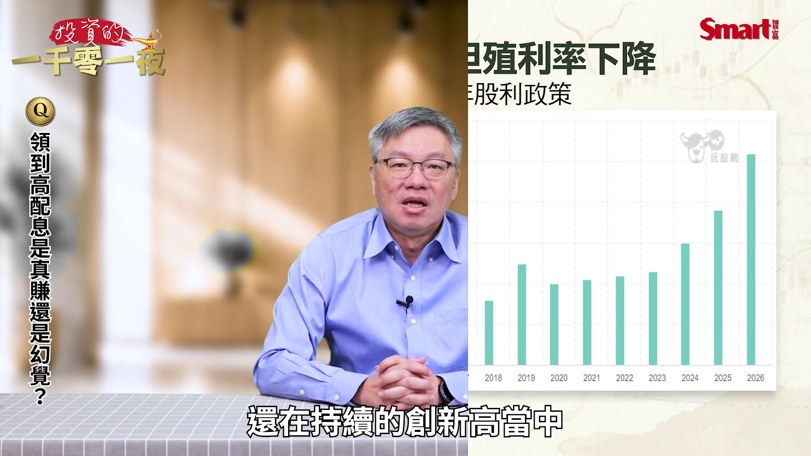
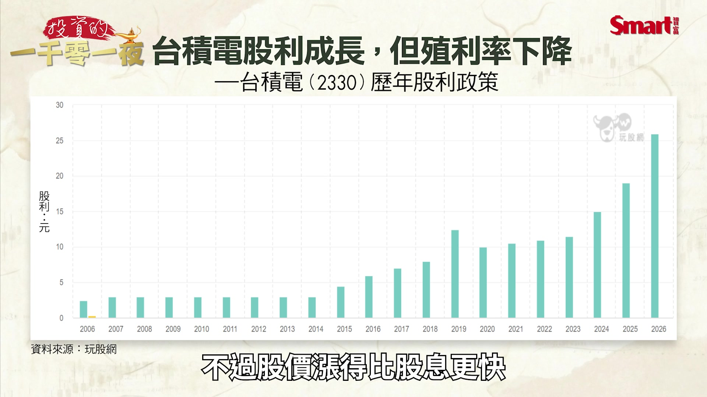
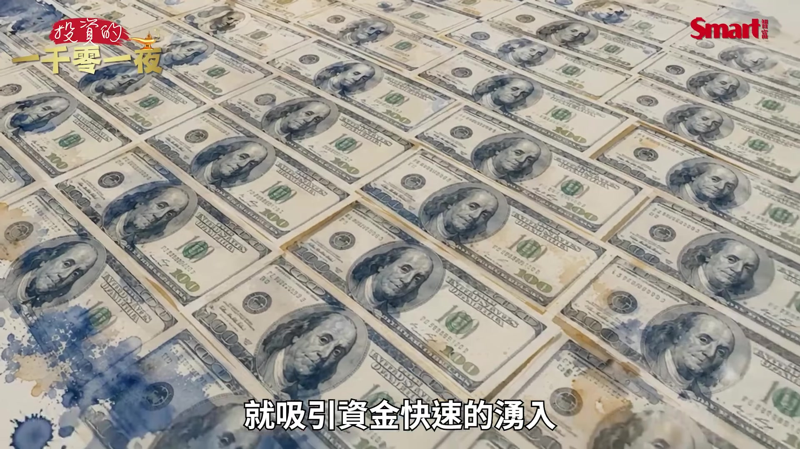
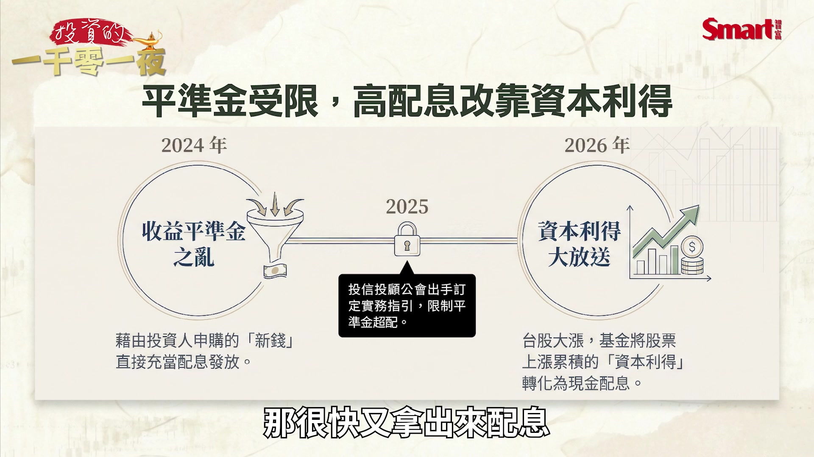
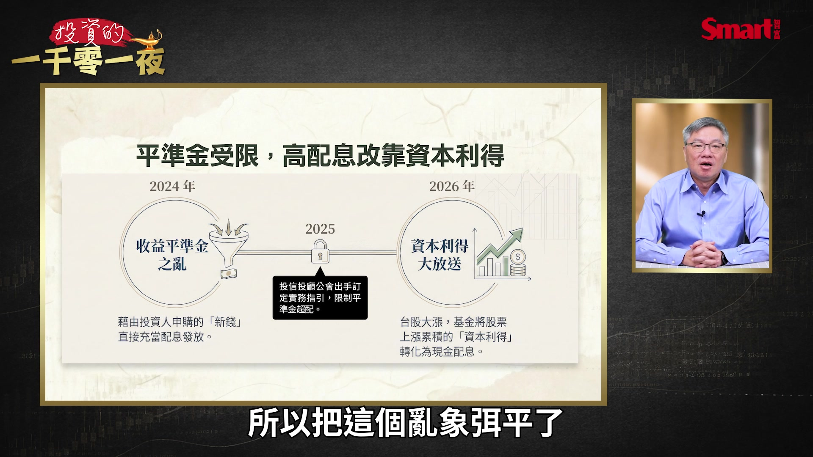
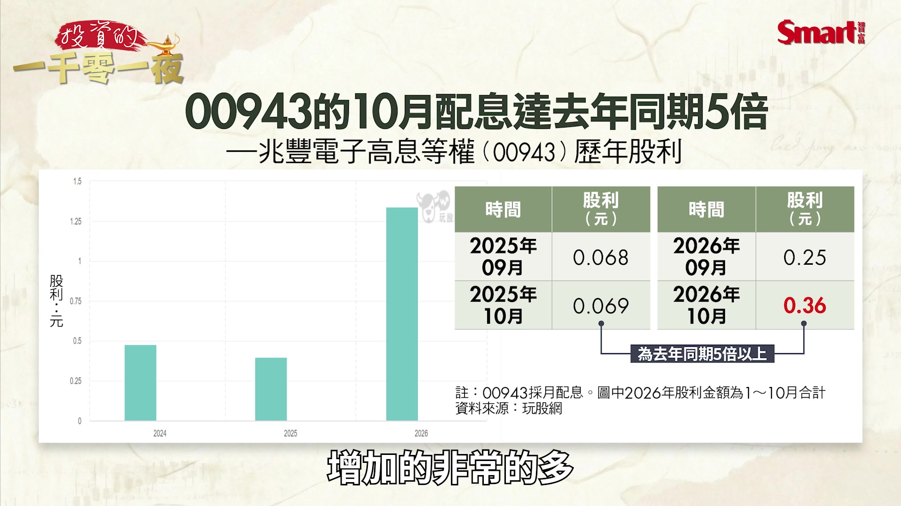
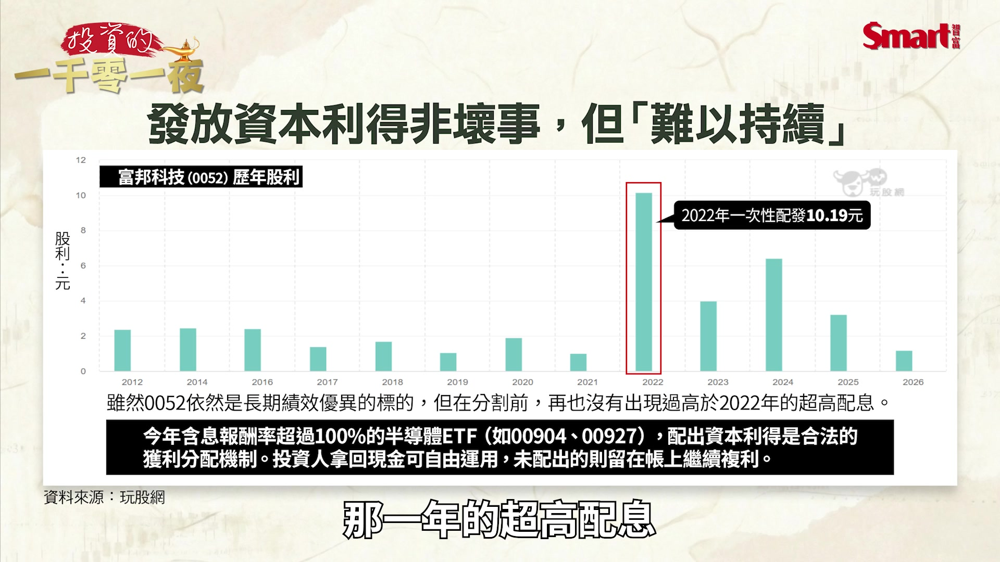
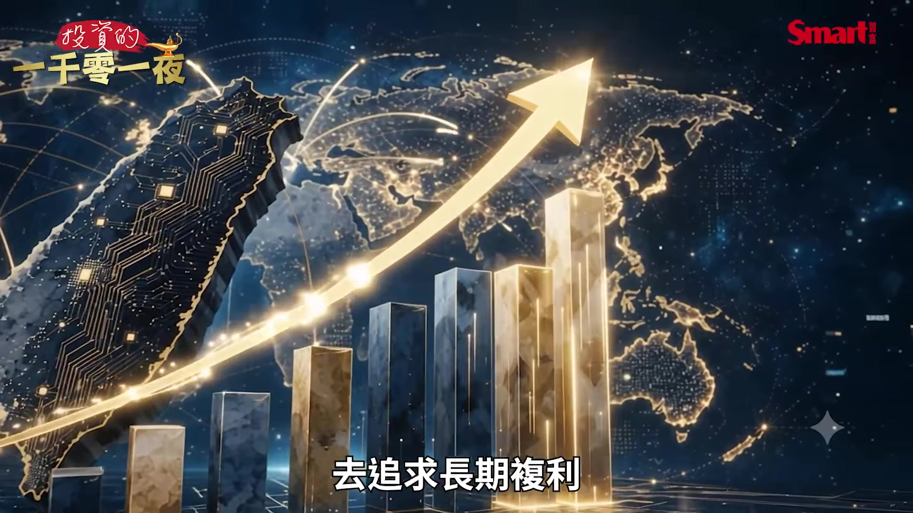
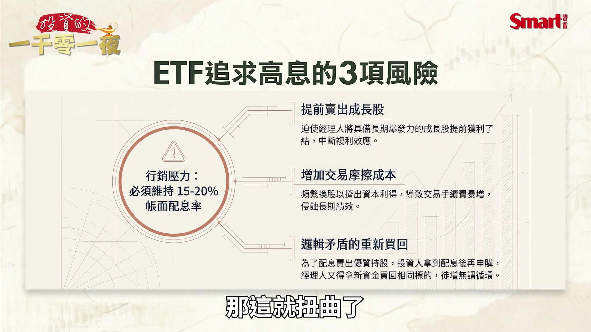

# smartmonthly-bw_tm-6SqqP5fk — 關鍵畫面索引

- 來源逐字稿：[smartmonthly-bw_tm-6SqqP5fk_GT.srt](smartmonthly-bw_tm-6SqqP5fk_GT.srt)
- 影片：https://www.youtube.com/watch?v=tm-6SqqP5fk
- 截圖數：18

## 00:00:00

**逐字稿片段：** 10月份已配 或即將配息的ETF 有4檔年化配息率 竟然突破了20% 那老牌的高股息ETF 居然都還擠不進這個榜內 大家好 歡迎再次收看 投資的一千零一夜 我是峰哥 最近配息很熱 年化配息拚15%以上的 ETF比比皆是

**話題推測：** 影片標題或開場摘要：10月ETF配息率突破20%

---

## 00:00:26

**逐字稿片段：** 高股息ETF亂象 又回來了嗎 不少ETF投資人最近領錢 應該都領得很開心 因為ETF的配息大戰 又再來了 那10月份已配 或即將配息的ETF 有4檔 年化配息率竟然突破了20% 而且還有6檔是超過16% 那老牌的高股息ETF 比如0056 根據最近一季的配息 換算成年化之後只有12.1% 那另外一檔老牌的00878呢 只有13.1% 居然都還擠不進這個榜內 那我們來看一下這前10名 第1名是00943 高達20.55% 00904 20.26% 00996A 20.17% 00927 20.06% 00934 19.99% 00962 19.93% 00912 19.88% 00947 19.77% 00992A 18.07% 00406A 16.71% 真的非常的驚人 因為大盤殖利率 其實已經從長期的平均值 在4%左右 這是台股大盤的殖利率 過去都被認為全球股市裡面 是一個很高的殖利率 但因為最近 已經滑落到2%以下 甚至都跌破了1.6%了 那這主要的原因 不是因為股息金額減少了 而是因為台股真的漲太多了 我們就以台積電為例 最近4季的股息分別是 5元 6元 6元 7元 還在持續的創新高當中

**話題推測：** 新話題：高股息ETF亂象是否再現？

---

## 00:02:08

**逐字稿片段：** 那從年度來看這張圖更是如此 你可以看到 這個整個台積電的股息 就是一路往上升的趨勢 不過股價漲得比股息更快

**話題推測：** 展示台積電年度股息趨勢圖

---

## 00:02:19

**逐字稿片段：** 所以如果你用股息殖利率的公式來看 就是股息去除以股價 那反而這個股息殖利率 是持續走低的

**話題推測：** 說明股息殖利率計算公式及走勢

---

## 00:02:27

**逐字稿片段：** 可是ETF年化配息率這麼高 怎麼跟這個股票的股息殖利率 剛好是反向的 那這到底有沒有問題 投資人究竟賺到的是股息 價差 還是根本就是領回自己的錢而已 那在探究這一次的高配息之前 我們就來先看看 2024年的那一波 高股息ETF熱潮 因為當時市場也 引起了非常多的討論 那當時的狀況是這樣 因為2024年那一年 高股息ETF績效非常好 所以配息也很高 就吸引資金快速的湧入

**話題推測：** 提出疑問：ETF高配息率為何與個股殖利率反向？

---

## 00:03:03

**逐字稿片段：** 因為新申購的錢非常多 那造成這個ETF 帳上的收益平準金很高 那當時配息的規定是比較寬鬆的 因為當時也沒有想到說 這會有什麼特別的問題 所以當時的配息規定比較寬鬆 所以就造成 不少投資人申購的新錢 就流入了這個收益平準金中 那很快又拿出來配息

**話題推測：** 解釋「收益平準金」在高配息中的作用

---

## 00:03:31

**逐字稿片段：** 後來投信投顧公會為了扭正這種 過度配息的亂象 在2025年出手訂了 ETF採用收益平準金 作為收益分配來源的實務指引 那原則上就是配息率 不能高於指數本身的參考配息率 而且還加高了這個 你要動用平準金的這個使用規範 所以這一刀砍下去 一些用平準金來撐高配息的 這個空間就減少很多 所以把這個亂象弭平了

**話題推測：** 提及2025年投信投顧公會訂定收益平準金實務指引

---

## 00:04:02

**逐字稿片段：** 不過到了2026年 高配息又是怎麼來的 因為這次的配息又是大放送 而且比之前2024年 那波配息還要高 那主要原因就是台股大漲 這是好事 所以部分的ETF其實是滿多的 就開始把股票上漲 累積的資本利得 轉化為配息 在我們剛才前面介紹的 這10檔高配息名單中 就透露了三個值得注意的現象

**話題推測：** 轉向分析2026年高配息現象的成因

---

## 00:04:31

**逐字稿片段：** 第一高配息現在不是傳統 高股息ETF的專利 譬如說我們看名單當中的 00904 00927 它們是半導體ETF 那00943是電子股ETF 那這些商品的投資策略 不一定是以高股息為核心 但它們今年的配息率都非常的高 第二個主動式ETF 加入了這一波的高配息競賽 其實我在節目中也多次提到 其實我本身不喜歡 主動式ETF配息太多 因為我自己本身買主動式ETF 是希望它們能夠滾動複利 然後能夠賺取更多的超額報酬 但是今年以來這個主動式ETF 看起來也把它們的 很多的資本利得 給配出來 像00992A 00996A 甚至00406A 那它們都出現在這一波的 高年化配息率的名單當中 那第三個是年化15%以上 才能成為市場的話題 現在這個想要被擠進高配息名單 這個標準真的很高 沒有15%還進不去 我們剛才講0056 跟00878都還進不去 因為過去的投資人 可能覺得年化配息率 在7%到8%已經很棒了 但今年你要出現年化20% 大家才會認真討論你一下 不過這邊有一個 容易被你忽略的關鍵點 就是如果年化配息20% 是真的代表一年真的 能夠領到20%嗎 那可不一定 我們就用第1名的 00943為例 它是月配息 那2026年的全年配息特別高 我們以同樣是9月跟10月 這2個月為例 在2025年9月的時候 它每股是配0.068元 2025年10月配的是 0.069元 都差不多 可是來到了2026年 2026年的9月 它配了0.25元 到了2026年的10月 配的是0.36元 所以如果你用2026年的 10月的配息來看 居然是去年同期的5倍以上 這很驚人 可是如果你真的去看它的 長期的每一年的 這個股息配發來看 你會發現 2026年明顯比前面 增加的非常的多

**話題推測：** 現象一：高配息不再是傳統高股息ETF專利，舉例00904/00927/00943

---

## 00:06:52

**逐字稿片段：** 那我們就來看一下背後的道理

**話題推測：** 探討高配息現象背後的數學計算道理

---

## 00:06:54

**逐字稿片段：** 在配息競賽的數學計算當中 如果某檔ETF的股價是20元 而單季配息是1元 那我們的計算方式就是 1除以20再乘以4等於20% 就代表這檔ETF的 年化配息率是20% 這只是數學計算 這代表是說如果你未來每一季 都配出1元 就4季裡面 全年每一季都配出1元 那你全年而且股價又不變動 所以全年才會達到20% 但這不代表這檔ETF或基金 已經賺到20% 也不代表未來4季 你每一季都能維持相同的配息 並且 就算你真的某一年真的達到了 年化20% 就是你第1季的時候 算出一個年化20% 而後面它3季的配息 都維持第1季的水準 那股價也維持都差不多的水準 那就讓它那一年 真的達到了年化20%的配息率 可是並不代表 隔年可以持續這樣配下去 當然我不敢說這樣的狀況 維持1到2年做不到 有可能做到 因為過去的例子是有可能 1到2年都能夠維持在 高配息的狀態 但你要真的長期的持續下去 我只能說難度非常高 特別是如果ETF 是靠股市大漲來配發 它已經實現的資本利得 那這些資本利得 是過去一段長時間累積下來的 你如果配得快 消耗的也快 就表示這個已實現資本利得 被你配掉了那減少了 所以未來能夠配的就變少了 所以一旦如果市場反轉 這個股價漲幅沒有那麼多 這個資本利得沒有那麼多 所以這個配息能力就可能會下降

**話題推測：** 演示年化配息率的數學計算方式

---

## 00:08:44

**逐字稿片段：** 年化配息率 是數學計算上出來的沒有錯 但它容易造成一個誤導現象 就是我們容易去把 單次配息或單次配息率 放大成全年的數字 不過我們還是很容易去 經常在各個媒體上 都看到這個數字 因為它是一個比較方便 而且簡單的比較工具 就讓我們大概可以了解一下 這次配息水準的高低 但你萬萬不要把它當成 這是未來一年的必定報酬

**話題推測：** 探討年化配息率容易造成的誤導現象

---

## 00:09:16

**逐字稿片段：** 接下來我們要問的是 難道靠資本利得來高配息 不好嗎 也不盡然 事實上資本利得作為配息主角 並非首見 只是今年特別熱門 我這邊以大家很喜歡 而且長期績效很好的 0052為例 就是台灣被動式的ETF裡面 台積電持有最高的那檔 它在2022年 曾經一次性的大配息 每股配10.19元 很驚人吧 每股配10.19元 那它是因為之前的資本利得 累積得很高然後配得不多 所以它配了這一次以後 並不妨礙它仍然是 長期報酬的優質標的 只是我們也可以看到這張圖 在後續的幾年 就是它在2025年底的 股票分割之前的那幾年 再也沒有配出高過2022年 那一年的超高配息

**話題推測：** 反問：透過資本利得進行高配息是否不好？

---

## 00:10:12

**逐字稿片段：** 所以像00904 00927這些 半導體相關的ETF 它們在10月初統計的時候 今年以來的含息報酬率 都超過了100% 這個報酬真的非常驚人 所以它們這個時候 配出比較多的資本利得 也不是壞事 因為ETF賺到這些資本利得 依法規或契約的可分配規定 那投信決定配出 或不分配給投資人 這都可以本來就是合理的機制 那配到的人你拿到這些現金 你也可以去思考別的用途 那如果沒有配出 這些資本利得的ETF 投資人自己也可以決定 賣股來實現獲利 或者是繼續就放在股市裡 去追求長期複利

**話題推測：** 提及00904/00927等半導體ETF的含息報酬率

---

## 00:10:55

**逐字稿片段：** 所以投資人你不會因為配息 而多賺或少賺 因為不管是股息收益 或是資本損益 這本來就已經反映在 你ETF的淨值裡了 配息給你是投信 定期幫投資人做了 實現獲利的決策

**話題推測：** 解釋配息不會讓投資人多賺或少賺的根本原則

---

## 00:11:12

**逐字稿片段：** 我們舉例如果配息20% 是把資產換成了現金 假設投資人 花100萬元買進一個ETF 一年後這檔ETF的淨值 上漲了20% 就資產變成了120萬元 接下來 如果ETF把這20萬元的獲利 全部配出 配給你 我們來看一下這張表 原始投資100萬元 投資獲利或者是它的股息收入 是20萬元 我講股息收入是企業 配到這個ETF裡面的 這ETF配息 配出了20萬元 那配息後的這個ETF的資產 就剩下100萬元 合計的資產還是120萬元 那投資人確實跟原始投資相比 你是賺了20萬元 但差別在於是它是放在 這個ETF資產裡 還是配到你手上 所以如果另外一檔ETF 同樣上漲是20% 它選擇的是不配息 就資產就我剛才講的 還是120萬元 差別就是這樣 如果你是定期需要現金 然後你又評估自己不是擅長 自己做買賣決策的人 因為如果你覺得 你要得到相等這個20萬元的 這個現金你要賣出多少股份啊 你覺得自己要去計算 然後你又不是很擅長 那麼透過ETF它定期去配息 給你的方式 實務上就是它定期在幫你 做獲利了結的決策 那你喜歡這種方式 或不喜歡這種方式都可以 但是它實務上就是這樣運作給你 那我覺得在實際的用途上 很多人會需要 所以它造成高配息 一直很受歡迎的原因 就很多人就是你可能因為忙 或者很可能因為 投資的知識沒有那麼充分 所以你覺得有人幫你做決策很好 所以高配息真正的風險 並不是配太多而是為了配息 而犧牲了投資績效 才是它的風險所在 這是我覺得特別要提醒你 而且深入探討的部分 我們這邊舉一個情境就是說 如果ETF所持有的股票是 持續上漲的 那這時候經理人 可能會面臨兩個抉擇 一個是繼續持有股票 讓獲利持續的累積 另外一個是賣出部分的股票 實現資本利得 到這裡都沒有問題 因為經理人如果是 尤其特別是主動式的ETF 他決定繼續持有股票 讓獲利繼續滾動 或賣出股票認為這個是一個高點 擇時賣出股票實現資本利得 把這些利潤分配給這些受益人 這些都沒有問題 但是我們來講的是有問題的是 如果這檔ETF 它是為了市場期待的高配息 就是你看大家都配這麼高 你怎麼能不配高一點 那為了這個市場競爭行銷的壓力 它就改變了原本的 合理的投資決策 就是它可能本來覺得 應該繼續持有 但是因為要配給你 就先賣掉那些股票來 提前的實現獲利 所以它就會產生3個風險 第1個就是提前賣出了成長股 就是成長股成長到一半 你就賣掉了就中斷了它的成長 就是這些本來長期成長的股票 為了因為你要提前實現獲利 要去配息給你而被賣出 那這就扭曲了

**話題推測：** 以配息20%為例，說明資產轉換為現金的過程

---

## 00:14:34

**逐字稿片段：** 另外一個是你要為了要 配息給你會增加交易成本 這個部分是一定會發生的 就是當你的配息的次數愈多 你的交易的次數就愈多 這時候你的 交易費用就會提高 這有可能會影響 你ETF的長期的績效 要看你為了這件事 產生的頻繁交易有多大 影響的大小可能不一 那第3個配息之後 又重新買回股票 那這個是最扭曲的部分 所以一個情境是 如果它賣了這個股票 只是為了配息給你 那你因為收到很多息很開心 所以你們又新申購更多的錢給它 所以他又拿了這些錢 又再去買進相同的標的 所以這個行為其實就變得很顛倒 因為其實不如 你原來就不配息不就可以了嗎 或是不要過度配息就可以了 所以這樣的操作 就不見得是必要的

**話題推測：** 風險二：增加交易成本影響長期績效

---

## 00:15:32

**逐字稿片段：** 那回過頭來 那投資人應該注意的就是 你要最重要要注意的是 總報酬率是多少 而不是配息率是多少 我們這邊來用兩個例子來比一下 就ETF A跟ETF B 假設年初投入都是100萬元 一個A是全年配息20萬元 B是全年配息5萬元 A年底持有的部位市值 是85萬元 B是110萬元 那到年底總資產 A是105萬元 B是115萬元 我們來看它的總報酬計算下來 A是5% B是15% 可是A的全年配息是20萬元 B的全年配息是5萬元 所以你看差別就出來了 就是你領到比較多配息的 實際總報酬率反而沒有比較高 反而還比較低了10個百分點 這就是為什麼 高配息不等於高報酬 高配息率也不等於高投資價值 所以對投資人來講 你至少應該同時觀察 配息來源跟長期的含息總報酬 再強調一次長期的含息總報酬 另外補充一點在2026年 新增了一類主動式ETF 它是利用賣出買權的權利金 收入來配息 譬如00401A 跟00406A 它們的高配息 主要靠的是權利金的收入 不是來自成分股的股息 也不是來自資本利得

**話題推測：** 提醒投資人應關注總報酬率而非配息率

---
