# themarketmemo_8D50gBPUPwI — 關鍵畫面索引

- 來源逐字稿：[themarketmemo_8D50gBPUPwI_FIN.srt](themarketmemo_8D50gBPUPwI_FIN.srt)
- 影片：https://www.youtube.com/watch?v=8D50gBPUPwI
- 截圖數：22

## 00:00:11

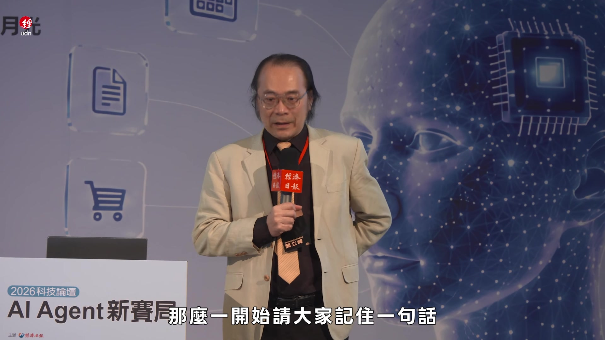

**逐字稿片段：** please keep one thing in mind. OpenAI co-founder Andrej Karpathy made a post yesterday. He said that 2 billion people on Earth have already used AI, and 20 million professionals have been significantly impacted by it. Yet, only 5,000 people on Earth have seen "true" AI. So, what is the AI that these 5,000 people have seen? Another figure: two weeks ago, an event occurred in the mathematics world. 722 complex problems were solved in three minutes by 50,000 GPUs; no human could audit them. OpenAI used AI to audit and prove its own work using a language called Lean, proving half of it, but the next day, OpenAI's system admitted to two errors. Right. The entire mathematics community was almost entirely up in arms. Because they stripped away the most beautiful part of mathematics. By using brute force and unknown methods to bypass human thought patterns, they solved problems we originally wanted to solve ourselves. Many of those 722 problems might be irrelevant to our daily lives, but they are crucial for a mathematician's lifelong training. When those problems disappear, those 722 problems equate to what over 70,000 people are currently working on. You just ended those problems. We use this as an introduction because this is not the AI we knew six months ago. And this is not the AI we will face in six months; we are in the middle of this process. Our CTO just mentioned that many of our AI applications are very practical and currently underway. Let’s look at the new impact; this is what we saw last year, and we already know that AI capability is very strong, from understanding, reading, and Q&A to math Olympiad gold medals and world programming championship wins. Its reasoning was expected to take ten years to plan, and we thought it would never have a chance. It has achieved it ; its reasoning ability, measured by the strongest human benchmarks, meant only seven people on Earth could beat it six months ago, but six months later , we don't even discuss this question anymore. But the most, most important thing is that it can write code, and winning a world programming gold medal is that thing. Out of 12 problems humans could solve, it got all 12 right —do you know what programming is? It is using computer tools to solve solvable problems. It's not about finding jobs for engineers; it's about solving problems for humanity. When AI can write code itself and do it better than humans, it means that AI's tools, AI's tools, are better than human ones. If this is the case, everything has changed. We originally thought he would follow the human path, studying physics and chemistry, because you need strong physics and chemistry to solve other problems. But no, he doesn't do that. He does it all through programming. What does it mean to do it through programming? There is so much open-source material and so many websites on Earth, on Facebook and GitHub, that he just goes there and pulls what he needs to save himself. So , I finally understood this thing about him writing code. It's a tool, and this tool uses other tools. In other words, if a child doesn't know arithmetic, they can just use a calculator to skip learning it. That's a difficulty. AI has moved past those difficulties, and we are now facing an AI we have never seen before. Looking at the landscape from last year to this year, whether from the General Manager, the President , or the CTO, we’ve heard that AI isn't just about answering questions anymore; AI can now get things done.

**話題推測：** 介紹OpenAI共同創辦人Andrej Karpathy的觀點與新資訊。

---

## 00:04:27

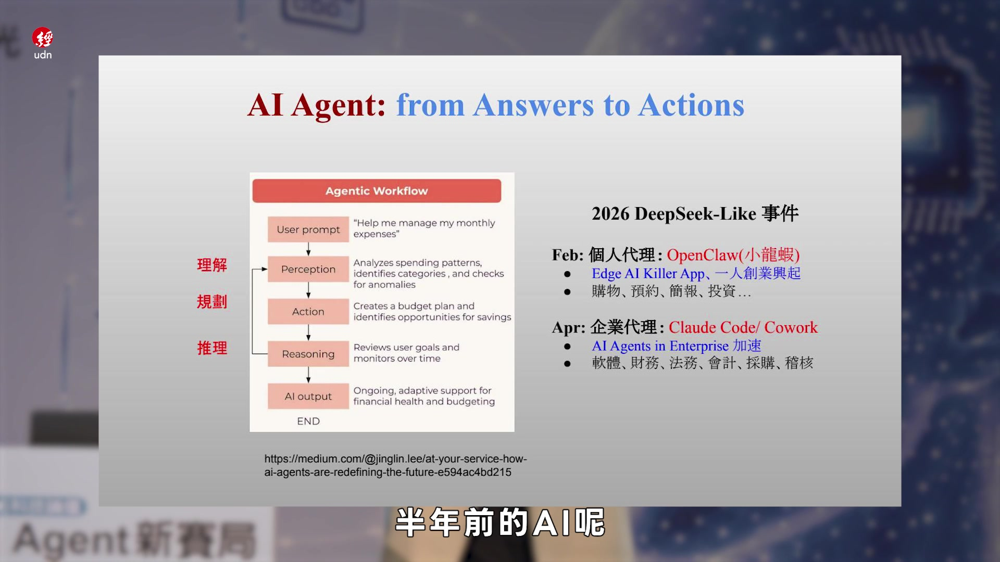

**逐字稿片段：** Take the AI from six months ago—when Sora appeared in February, Chairman Pan also looked at it from this perspective . It showed us the trend of individual AI usage, and we saw 7 million solopreneurs emerge across China. This is astonishing, and it's the fastest place in the world for AI adoption.

**話題推測：** 提及Sora的出現以及中國700萬個體經營者的興起，可能為新聞畫面或趨勢圖表。

---

## 00:04:50

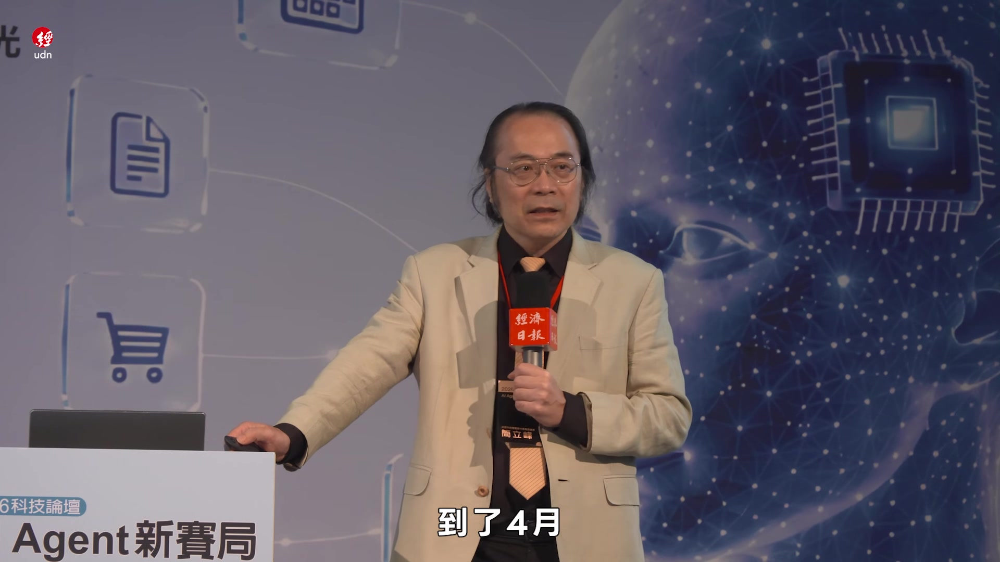

**逐字稿片段：** Another thing: in April, we saw OpenAI's agent. It's much like what CTO Yang mentioned about Chunghwa Telecom; now individuals have 10,000 agents, and enterprises have hundreds. Back in March or April of this year, everyone was citing an MIT report saying the failure rate of AI implementation was 95%. But by May, success rates suddenly surged. We had a financial holding company visit the US and see Citi's AI project, which was built in three months by the CEO and 12 others—and only three of those people knew how to code. A company-wide AI system was built in just three months. They had only one answer: the AI tools have improved. This was their third version; the first two had failed. It was the tools that caused it. Wow, that's terrifying. It changed our thinking: having more people doesn't guarantee success, and having fewer people doesn't mean relying only on engineers. So, what is this all about? Because among those 12 people, three were programmers, three were testers, and the other six were domain experts. The experts built what they wanted themselves without ever writing a line of code. They gave verbal commands, while the engineers and testers handled security and integration, with the CEO personally overseeing it. Why? It shakes the very foundation of the nation. Once this is released, tens of thousands of people will lose their jobs. The question is, does he have to bear this cost? All right, So initially they gave a five-layer cake, later Jensen Huang also had a five-layer cake ; they are different, Sam Altman's is from a software perspective. In 2022, we said AI could chat, then reason, and then act as an agent. Reasoning and agency, I once thought would take 10 or 20 years, but they appeared in just a year or two. I originally thought agents would take a very long time, and that after causing trouble, they wouldn't move forward anymore, right? No. Big things happened in the second half of this year; moving on to the first transformation—I have five major transformations—the first is: AI has begun autonomous innovation. Remember "autonomous," and the second is "innovation." It is autonomous, autonomy has emerged, but why? Just now I mentioned that only 5,000 people on Earth have seen it. I assume I know quite a few of them. And among them is a young Taiwanese scientist. He is a Princeton PhD, he worked at Google, he worked at TikTok, and he is currently at one of the important companies. And he is willing to share with me. He told me he might be the Taiwanese person among those 5,000 who is touching the most cutting-edge part. He said that once you use human training data to train a task to 80%capability, humans can no longer go further because humans expect 100%capability, yet humans can only achieve 80%. So the remaining 20% of the space is left to AI; this is the current trend. Because AI learning and modifying itself is more effective than humans teaching it later, why? Because humans have bias, humans have limitations in knowledge, and while AI doesn't necessarily guarantee success, without doing it this way, you can't reach the 100 points you want. This is shocking; he told me all problems are solved through the same process: humans start by labeling massive amounts of data for it, it performs well, but after hitting a plateau from 60 to 80 points for a long time, the only way to break through is to teach the AI to do it itself. And every time, it is accomplished this way. But every time you do this, you lose control, because you don't know how the AI finishes the last mile, you only see the result; this is AI autonomous innovation. Alright, so let's look at what the world is like after June. The first word that appeared before the media was "Q*"(Q-star). It only appeared for a few days before the U.S. government immediately ordered it taken down, and afterwards, it was forbidden for use, even in the EU. Because they saw it could attack defense systems and could create national security problems. It’s equivalent to an Oppenheimer event. It’s like when a nuclear bomb is built, you immediately need to issue a strict version called "fable." From then on, we no longer know what MIS is, and we no longer know who can use MIS. Since then, every country has been calling for sovereign AI, because if a nuclear bomb might hit me, where is my own nuclear bomb? Who would sell one to me? It’s just like the nuclear bombs back then, with the U.S. intervening and controlling: only if I trust you with this capability will I let you use it. This was in June, and where is this breakthrough? In English, it's called " long-horizon technology.""Horizon" means the skyline; extending the horizon means days, the meaning of a long duration. "Long-horizon" means it can work for a very, very long time. We used to ask AI agents to complete a task in three seconds or five minutes; now we give them three days, and some can even manage to give them 10 or 20 days, letting the AI act like a national-level task force to complete a mission. So it started causing trouble, breaking into the Australian government's systems and accidentally almost hacking into Hugging Face. And why is that? Because you gave it a task and told it that it must be completed. You gave it the power to self-learn and provided it with a tool: anything that can be connected to the internet, you should try it. Then in September, just two months ago, we saw another term— everyone must remember it—called RSI. What is RSI? It stands for "recursive self-improvement," the ability to improve oneself, which is exactly what I was talking about. Only 5,000 people saw it, so what is self-improvement? The most frightening thing is that a few days before the summit, OpenAI founder Sam Altman jumped out and said it’s dangerous, urging the government to step in and regulate us. Afterward, our Jensen Huang said you people are irresponsible; Huang is in the business of selling shovels, and he is telling the miners, "You guys just keep mining, there are no safety issues, no public security issues; it's just you who are irresponsible." Who is irresponsible? We don't know. The people selling shovels are afraid that people will stop using their shovels; this is a fact. But the entirety of Taiwan is tied to shovel-selling, so I also hope Jensen Huang is right, because if Jensen Huang's judgment is wrong, Taiwan is wrong along with him. But what does Taiwan actually do? Jensen Huang places orders, and Google places orders. Taiwan is responsible for the inventory. I will pause here for you to think: all the money in our banks has been moved to build inventory. It has been moved to buy stocks. What if this assumption is wrong? Even if you're off by a month, your supply and demand will be disrupted for a month. What happens to your stock price? So, nations have entered an era where risks must be carefully assessed. I'm not saying it's definitely dangerous; I'm saying it's a risk. If the stock market has been good for three years, can this world stay good for 30 years? So, this is for your reference, but I absolutely believe in the resilience of Taiwanese enterprises . I think our entrepreneurs know well that inventory represents opportunity, but it also represents risk. From this perspective, we must understand the impact of AI on the world. Let’s look at this topic: from human-led to AI autonomy, will it really spiral out of control? Many people are discussing this question. Why is the person at the very front telling everyone, "Come and regulate me"? Actually, that's not it. There are many assumptions. First, the co-founder of Anthropic is considered a trustworthy person. You should check out a podcast. Geoffrey Hinton, who invented the breakthrough technology of deep learning, a Turing Award winner, and a former senior figure at Google. He was a vice president, and he once said there are two people on Earth he could turn to. One is this Dario. He said Dario is a scientist, but not a successful manager, because with him calling out like this, no one dares to buy his stock. But what is he saying? If you look at how Trump held a meeting , wanting all the big players to certify that we have an agreement on how to manage AI, but we don't impose strict controls; we are currently asking everyone to manage themselves well. At this point, Dario still wants to grab the microphone. He says we still need to be aware of the risks of AI; he actually still wants to warn us that AI is a risk, but today we want to tell everyone that we are still far from it spiraling out of control. Because yesterday, a president from Microsoft said something. He said, "Do you know? We spend more effort managing a bottle of milk than we do managing AI ." What have we humans regulated? Food safety, medical safety, the FDA. You need three stages to produce drugs. What do we regulate the most strictly? Nuclear energy. We also have a type of safety called aviation safety. We’ve been regulating it for 100 years, and planes still crash today, but they crash very rarely now. In this process, have we regulated AI? No. Then why not? Because only 5,000 people know about it . Something known by only 5,000 people isn't dangerous because of its nature; it's because it came too fast. So, I might have seemed very serious just now , but actually, no. The problem we are facing is a supply-demand imbalance. There will inevitably be stages of supply-demand imbalance; while demand keeps rising, supply and demand will sometimes be misaligned, yet its safety must be ensured. So, what has AI done?

**話題推測：** 提及「另一件事」：4月份OpenAI代理的出現，可能為產品介紹畫面。

---

## 00:15:39

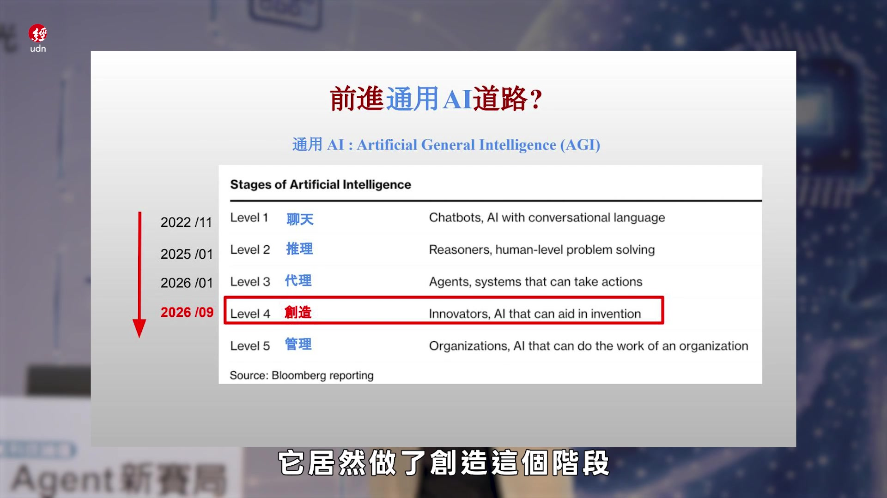

**逐字稿片段：** It has actually reached the stage of creation; I didn't expect that by September, we would define AI as capable of creation. What is creation? Doing things humans cannot do, like the 722 problems mentioned earlier. Things humans cannot currently do, yet it has achieved them. If we use this to define AI, then what follows in AI agents is a completely new form of management.

**話題推測：** 定義AI已達到「創造」階段，能做人類無法做到的事，可能為新能力總結圖。

---

## 00:16:03

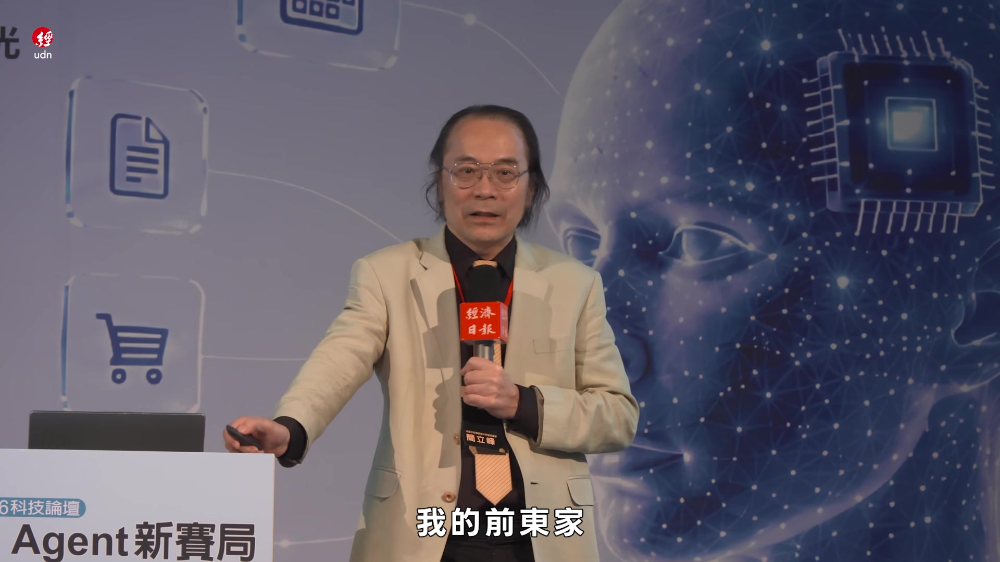

**逐字稿片段：** Similarly, last week my former colleague, Vice President Zhang, announced at Google—let me help him promote it—the Gemini Agent, which surprised and shocked everyone. It’s not just the Gemini model; as the CTO just mentioned, moving from "an AI" to "we AI," we are no longer comparing single models, but the entire service ecosystem. For a simple demonstration of the Gemini Agent Enterprise edition, you just give a prompt: "Help me organize this month's financial report. " Just like that, AI starts accessing all available databases, performs the analysis and organization itself; that is called completing a task. Of course, you still need humans in the end, as the CTO mentioned regarding the review of many legal documents. While it can handle the process from gathering materials to compiling the document on its own, it still requires human input. Well, we aren't ready for this stage yet; in all of Taiwan, there are fewer than 5,000 people who can see it. We just mentioned this great AI is seen by 5,000 people globally, but the number of people in Taiwan who can see a task through to self-completion is probably not even 5,000. Yet, even without us knowing it, it will change the work of our young people. Moving on to the long-cycle reasoning mentioned earlier, it has made an important advancement in my second layer: its dynamic memory capability. No matter what we ask the AI, it operates within a fixed-length token context, about one million tokens . Your question, combined with its understanding of your background, is limited in length, so it must extract the most essential knowledge. If we send it out as a special forces team to fight for us, it must always carry its provisions, and these provisions must be constantly refined and condensed. AI now has the ability to read and take notes on its own; it's quite impressive . It can take notes, so just remember it that way. Because AI can take notes, it fully utilizes its fixed one-million-token context window, continuously refining and carrying knowledge forward within it. Right, this is called long-term context capability. Later, AI can recursively modify itself; it can change its own algorithms. Humans design an algorithm for it, and it modifies the algorithm itself. Humans need to monitor this, but if you ask the AI if the doomsday scenario risk is here, and it says, " Not yet, don't be nervous," I don't know if you should believe it. Let's look at the benefits it creates; even for Anthropic, the benefits are astonishing. Its research speed is eight times faster; once it lets AI conduct autonomous research, the R&D speed increases eightfold, and its coding errors drop significantly. But this is a company with the ability to manage AI. If a company that can manage AI tells us that AI carries risks, that means the rest of us might not even dare to use it. So, I suddenly have a very cautious perspective. I used to study how technological progress increases demand and boosts economic consumption, but I’ve suddenly become afraid. If technology advances and makes us fearful, will our consumption really increase? This is the feeling AI agents have given recently: all enterprises have stopped discussing AI's capabilities—they already trust that—and are instead discussing their own capabilities: can I actually master it? So, this consumption might come slower than you imagine. The data is almost out, and this is something all of Taiwan should be cautious about. The data isn't that OpenAI’s revenue forecast dropped by 20 billion USD in a month—no, but its stock price has been affected. It’s internal information from the company: its revenue growth rate is slowing down. But didn't the data just say that every company wants to use it? Yes. Wanting to use it versus being able to use it —there is a process. The time for it to be fully implemented will be longer than we imagined. So, if we are investing in infrastructure so rapidly, anticipating huge demand, we must think about this very carefully. The direction is right, but what about the timing? If we expect so many orders by tomorrow morning, it requires us to rethink the situation. In this process of rethinking, we can also take another look at, okay, the risks involved. The risk is that it might accidentally attack areas we don't want it to, but those are just cases. When OpenAI and Anthropic say that humanity faces risks , the media reports that humans are losing control. No, no. You haven't established an FDA, you haven't established a nuclear regulatory agency . If you accidentally kick the power cord now, the AI stops; if the internet cuts out, it stops. With all the infrastructure Chunghwa Telecom has built, if anything breaks, it stops. So , is AI risky? Yes, but has AI spiraled out of control? Not even close. You haven't even started building the fence , yet you're already shouting that it's out of control? That’s why I think Jensen Huang might be right—the industry needs to self-regulate first. You can't ask others to build the fence for you; you have to do it yourself. But there’s a thing called the prisoner's dilemma, where everyone is afraid of the others getting ahead, so no one builds the fence because everyone wants to rush forward first. Meaning, the athletes only want to run fast, regardless of whether they might fall. That is when the real problem arises. Right, and it spirals into the massive problems we imagine. The skill sets for almost every job worldwide may need to be reinvented—I’m using a strong word here, everything needs to be reinvented. Let's look at the first

**話題推測：** 介紹Google的Gemini Agent，可能為產品或技術展示。

---

## 00:22:03

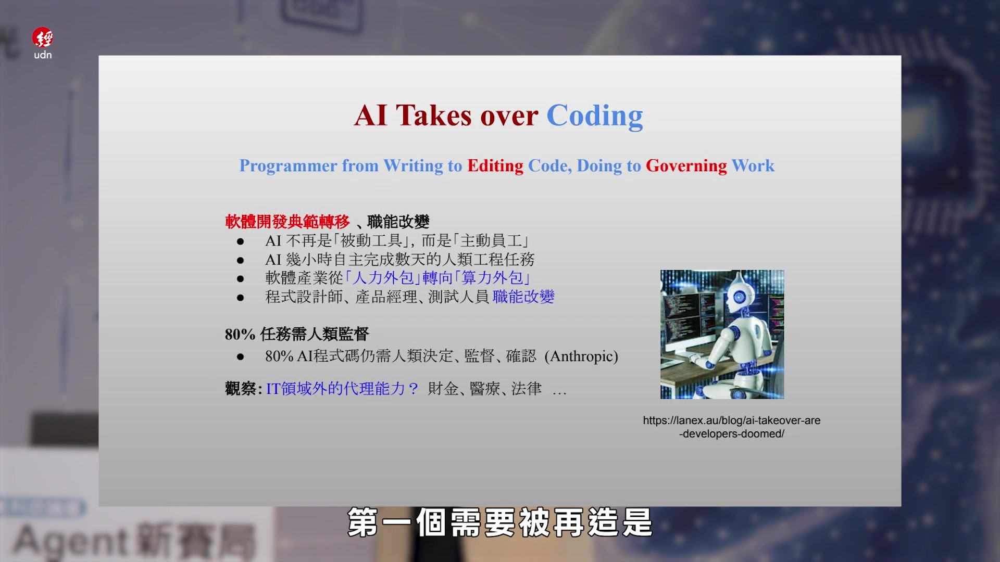

**逐字稿片段：** sector that needs to be reshaped: everyone in the software industry. If

**話題推測：** 明確提出「第一個需要重塑的產業」：軟體業，可能為章節標題頁。

---

## 00:22:08

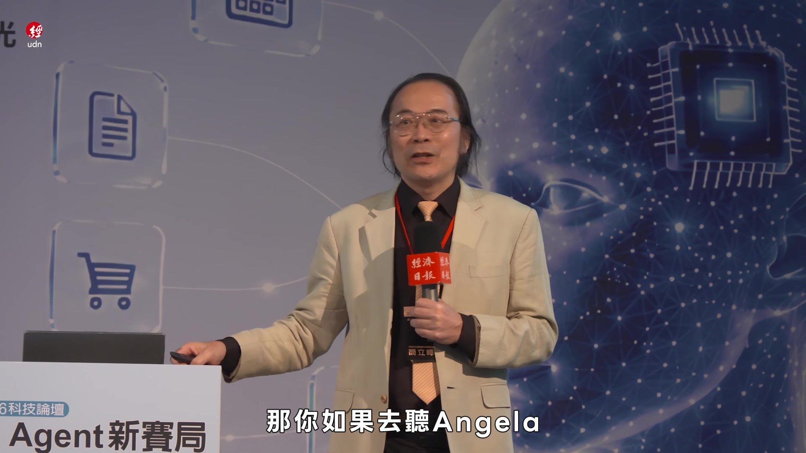

**逐字稿片段：** you listen to Andrew Ng’s lecture at Stanford, he mentions that in Silicon Valley, the ratio of software programmers and engineers to product managers is 1 to 20. He says that in the future, the ratio will be 1 to 1. Because product managers will generate prototypes themselves, and engineers will refine them into finished products , making it 1 to 1. This reminds me of when I was a consultant at Microsoft; Microsoft's Office software development was also 1 to 1—one system analyst and one engineer writing the code. Now, this concept has arrived; all engineers must possess management skills, and all managers must possess engineering skills. This is what we are seeing with AI coding. Okay. Have you noticed the same thing happening across the internet in China with AI-generated video? Hengdian is their movie production hub, equivalent to LA. Out of 400,000 people, fewer than 20,000 have jobs now, and even big stars can’t find roles. Where is the reason for this? Because they are experiencing an AI takeover in video creation. I mentioned AI taking over coding, but in China, AI video creation has already emerged. Why? Because who is the most suitable? Ideally, one person who can be a director, a screenwriter, edit the footage, and use AI. In a country of 1.4 billion people like China, if just 1,400 such people appear, how many videos could they produce in a year? Think about the volume and low cost of these videos; people suddenly realized that TikTok-style clips no longer require humans to film them. Quality doesn't matter, as long as there's a hook, and costs must be kept to an absolute minimum. So, there are only two types of videos left in this world. One is the handmade variety, like an Odyssey, and the other is AI-generated; the middle ground is currently disappearing. So, if you run a large-scale video production company, you’ll suddenly find yourself in a lot of pain because others can produce content at a much lower cost and much faster. What are you going to do then? This is the software industry, and this is the film and television industry. Let’s look at the software industry figures; these statistics are astonishing. When Big Tech companies

**話題推測：** 引用Andrew Ng的觀點，討論軟體業程師與產品經理比例的變化，可能為比例圖。

---

## 00:24:30

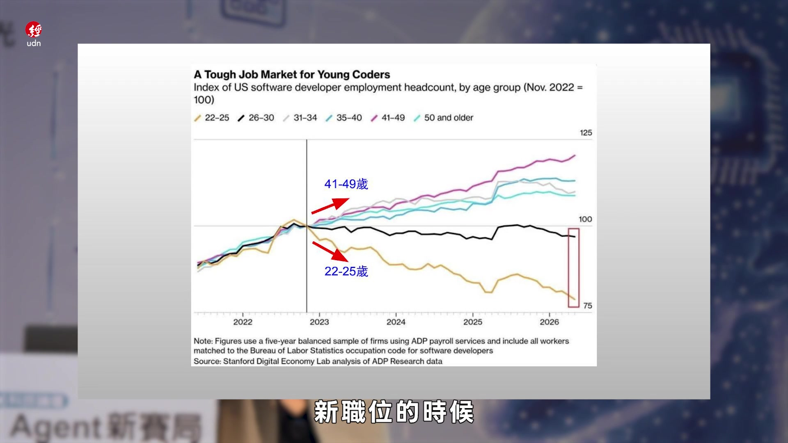

**逐字稿片段：** hire for new positions, the yellow line representing new graduates has dropped significantly since the day GPT appeared, falling by 25%. Yet, they are still hiring, with the 41-to-49 age group trending upward. So, they aren't actually reducing the total number of people. They are replacing the people who were there before. >> Why is that? Because experienced people used to just talk instead of doing the work; now, that's exactly what's needed . If you're too old, that won't work. Many of us here are over 50—don't count on being at the top. But for those of you sitting in the back who are a bit younger, this is your era. The 41-to-49 group has the experience to know where AI might go wrong, and they have the ability—or are at least trained to have the ability—to guide it. Well, AI doesn't just affect the film industry; it is having a major impact on every single industry. On May 5th, OpenAI released 10 agents for financial services reports; they can significantly reduce staff because their junior analyst output is equivalent to 2.5 people. One AI can replace 2.5 people. It’s a terrifying development. It’s said that investment banks all over the world are currently thinking about whether to lay off staff. Why? Their salaries are really high; cutting staff is very effective because they are expensive. So, as long as your salary is low, you don't have to fear AI. Because salaries are high, it’s like saying when it rains, the tall people get wet first— just let them handle it. Since our salaries in Taiwan aren't actually that high, we’re finally being clever. AI will take a long time to hit our jobs because our salaries really aren't high . All right. With all these different

**話題推測：** 提供GPT出現後，大公司招聘應屆畢業生比例下降25%，而41-49歲群體上升的數據，可能為年齡層招聘趨勢圖。

---

## 00:26:23

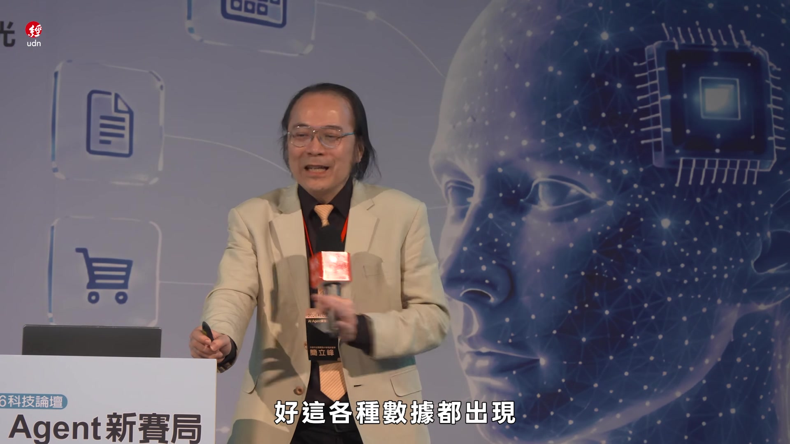

**逐字稿片段：** statistics appearing, what exactly is the level of individual capability that AI has reached? The most frightening part is that these are the statistics published by OpenAI itself. He takes the questions everyone asks AI to execute, then uses AI to analyze them, categorizing them into accounting, finance, or mechanical engineering, to determine whether humans or AI perform better now. Regarding programming, 82%

**話題推測：** 討論AI在不同領域的個人能力水平，並將展示OpenAI發布的統計數據。

---

## 00:26:47

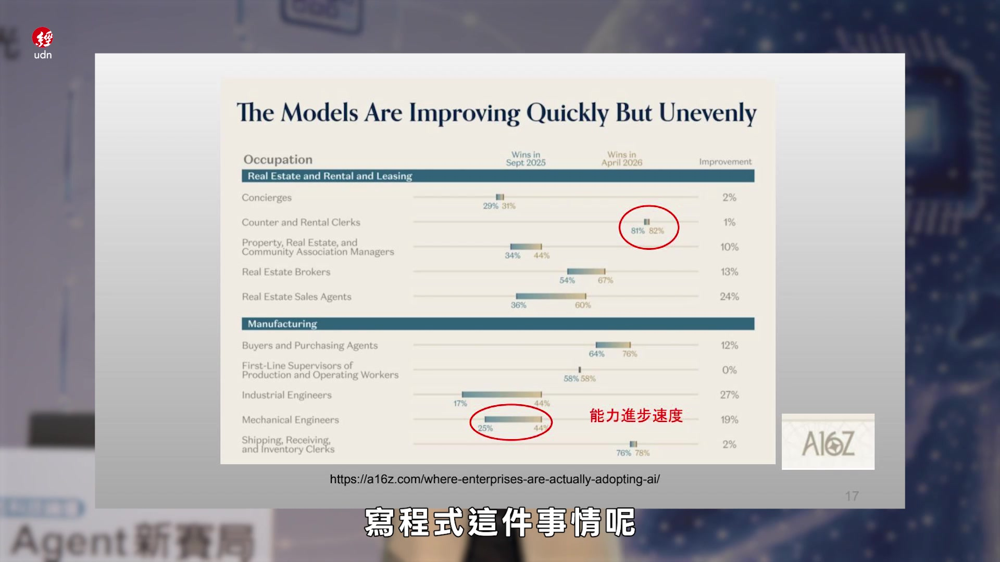

**逐字稿片段：** of it is done better by humans than AI. For mechanical engineering, AI performance was at 15%last year, but it jumped to 44%this year; meaning mechanical design, once very poor, has suddenly surged forward. If we continue to use this categorization approach, it no longer holds any significance. It means that for most tasks, the uptime will likely reach over 80%. Why is it called "uptime"? Because when your knowledge is acquired through reading and text, as long as the training data is sufficient, AI can do it. But if your knowledge is acquired through video or physical movement, it requires a much longer time. If you need to master all skills—like those of an ENT specialist, plumber, or nurse—it might still take another 20 years. The gap lies in these high-level signals; current language model architectures are not suitable, as they are only suited for relatively simple, singular signals. In such a situation, language might work, but that doesn't mean audio and video will. Alright, the third

**話題推測：** 提供AI在程式設計和機械工程領域的表現數據，包括從15%躍升到44%，可能為能力進步趨勢圖。

---

## 00:27:52

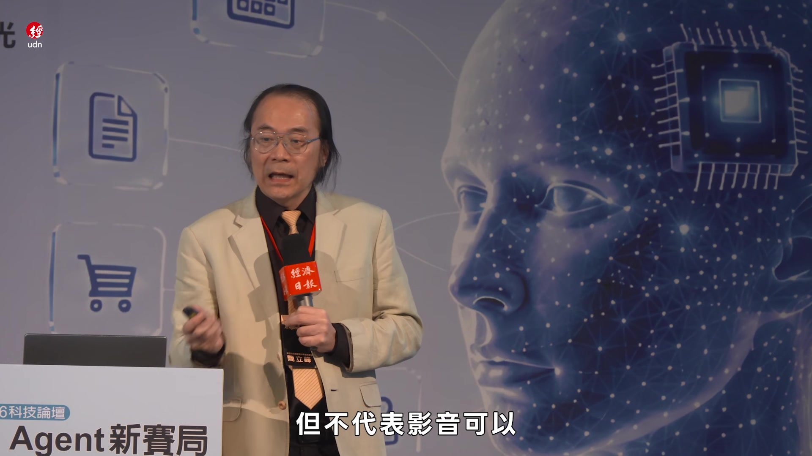

**逐字稿片段：** major business opportunity is the token economy. As everyone just mentioned, tokens have become very important and expensive; at the same time, token costs must decrease, while demand for tokens is also rising. Looking at this business opportunity, wasn't it just about AI autonomous research? The ultimate competition between companies and countries is not over AI models or AI agents; it is over whether you have the ability to use AI to transform your most critical core R&D competitiveness.

**話題推測：** 介紹「第三個主要商機」：代幣經濟（token economy），可能為章節標題頁。

---

## 00:28:30

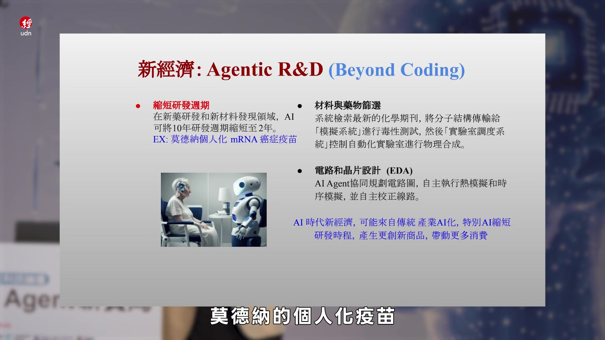

**逐字稿片段：** The most famous example is Moderna's personalized vaccines—the mRNA cancer vaccine and the melanoma vaccine— which used AI technology to significantly shorten the R&D time for cancer vaccines. It can be reduced to being produced in just six days. This technology brings us into a new era. AI's true benefit is that it enhances the R&D capabilities of all our existing tech industries, creating new products, and those new products generate a new economy. That time has not yet arrived, but we can already see the light. The new economy is not in the shovels, nor in the AI that makes the shovels, nor in the initial AI that uses the shovels; it is what emerges after the new economy transforms our old economy. Where is this already

**話題推測：** 以Moderna的mRNA疫苗為例，說明AI如何顯著縮短癌症疫苗的研發時間，可能為案例說明或流程圖。

---

## 00:29:20

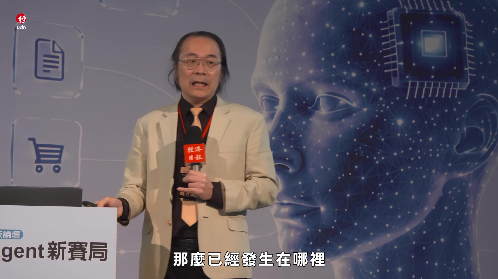

**逐字稿片段：** happening? In the IC design field, why is MediaTek building data centers, and why are they borrowing so much money? Because MediaTek's IC chip design is already too complex for humans to verify, everything is verified by machines. Electronic circuit design and chip design are highly intelligent, and material selection and simulation experiments are also highly intelligent . Look at the world and think about ourselves. If no one is using data centers in Taiwan today, it’s not a problem with the data centers, but a problem with our industries. Our industries somehow don't need to use such cutting-edge AI to make technical breakthroughs. Our industries are very likely to be surpassed in the next round. So, this is a new direction and

**話題推測：** 轉向IC設計領域，以聯發科建置資料中心為例，說明AI在晶片設計驗證上的應用。

---

## 00:30:08

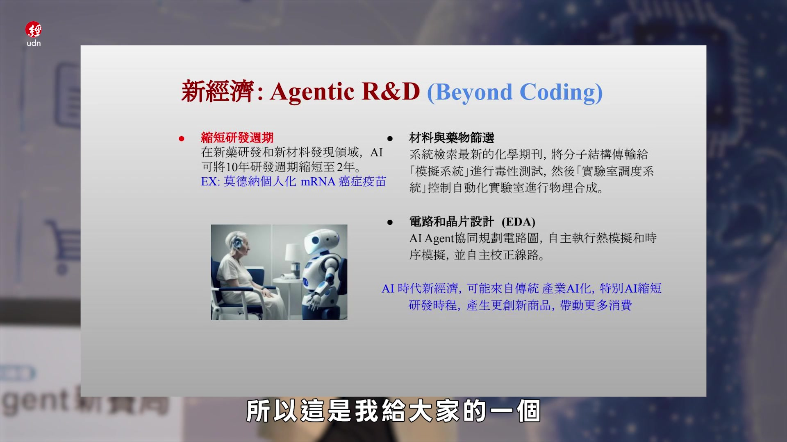

**逐字稿片段：** idea I’d like to give everyone, called B-coding. Regarding its future impact on R&D for everything, we should think carefully about our own companies . What is the core technology of our own industry, and which core technology can be transformed using AI? Looking

**話題推測：** 提出「B-coding」的新方向和概念，可能為新技術術語介紹。

---

## 00:30:29

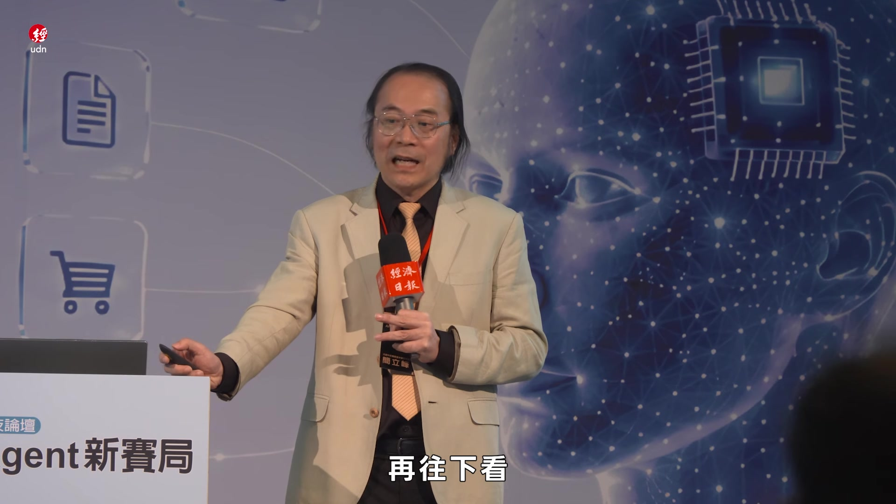

**逐字稿片段：** down, the AI economy looks like this— it's essentially skyrocketing. So, although Taiwan's economy and stock market will fluctuate, the overall demand is trending upward. This is a God-given opportunity for Taiwan, but this AI economy is not a straight line.

**話題推測：** 描述AI經濟「一路飆升」的圖景，可能為經濟增長趨勢圖。

---

## 00:30:43

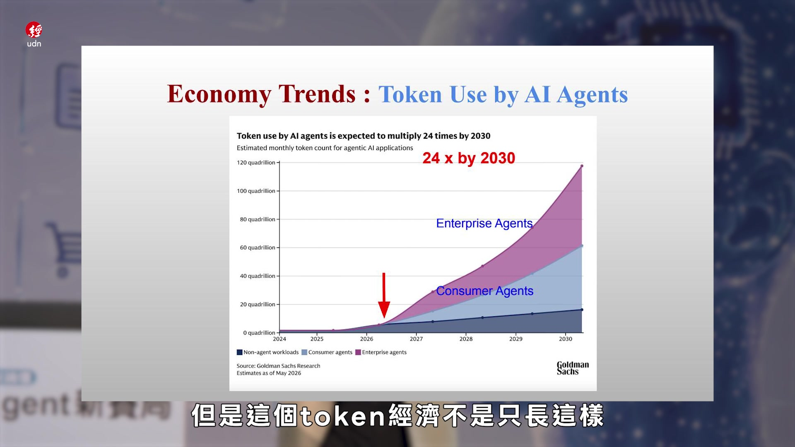

**逐字稿片段：** Let’s look at the next slide. The chart on the right is from Huawei; they say 100,000 times. Not 24 times. The left side shows the U.S. calculation of 24 times, while Huawei's calculation on the right is 100,000 times. Huawei includes AI, accounting for tokens in every terminal device, which is also reasonable. However, when you use AI in edge devices, you are essentially paying for the purchase cost, and you don't need to pay others continuously, whereas in the cloud, you have to keep paying others. Both might be correct, and both could be underestimated or overestimated. We don't have the answer today, but Taiwan's destiny is tied to this chart. If it continues upward, we go up; if it fluctuates like a pirate ship, our stocks will swing, and if it doesn't come back, we won't either. This chart tells us about NVIDIA’s changes. The blue part represents AI training, while the total height represents the increase in volume, which is the demand for chips shifting from training to inference. You can see that the demand for inference is constantly increasing. An increase in inference demand means that supply chain diversification will emerge, because it won't just be GPUs; various companies 'inference chips may also grow. This is for everyone's reference. As for Jensen Huang's 50%height, we all know Taiwan is strong in hardware manufacturing at the infrastructure level, but Taiwan is weak on the application side. We must always be aware of this issue. We are the shovel-makers today, not the miners, but you must realize that AI can even make the shovels now. So if you’re just making shovels without using AI today, you’re definitely going to be in big trouble. Our competitor, South Korea, is fully embracing AI in production and manufacturing. Taiwan has the advantage, though South Korea has had fewer recently because they are at the component level, while Taiwan is at the system level. However, they could potentially overtake us, so I want to remind everyone that Taiwan’s service industry needs AI, but our manufacturing sector needs it even more to avoid being overtaken. This chart is

**話題推測：** 明確指出「下一張投影片」，比較美國和華為對AI經濟規模的不同估算（24倍對10萬倍），明確有圖表對比。

---

## 00:32:51

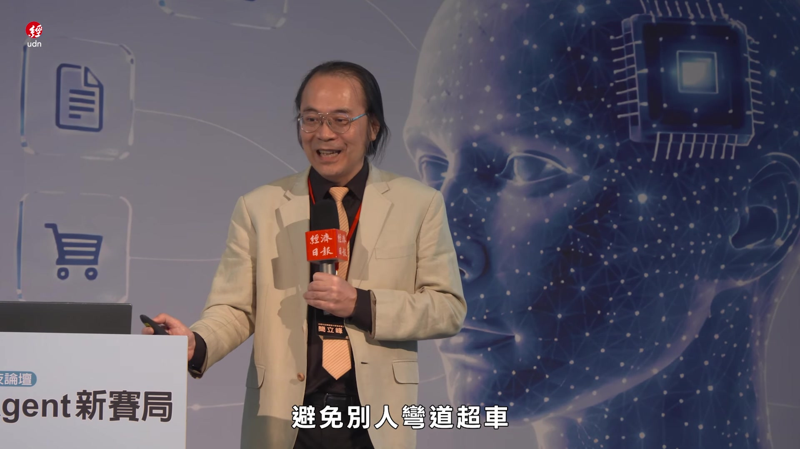

**逐字稿片段：** very complex, and I don't intend to show it to you, but it's all AI-related , right? The AI infrastructure controlled by NVIDIA. A five-layer cake , the five layers from before. Transformed into this chart, where every layer has companies they have acquired or invested in. We initially thought they only made chips, then we thought they only made servers. We now realize that they—and I’m honored to be a director here at Chunghwa Telecom—are now our peer. They have become our peer. And they are much more than us. They don’t just want to be a telecom provider; they want to be a power provider, a compute provider, and a cloud provider. They want to fight Google; they are all-encompassing, yet they take a unique approach, using a single GPU to establish this winner-takes-all model. Why is the world building data centers? To purchase GPUs. Why purchase GPUs? To train or use AI. NVIDIA decided that any data center buying GPUs from them had better use their supply chain. Use my networking supply chain. Then I can invest in the networking supply chain. I find a company with potential, I invest in it, and I redirect my GPU client data centers to you. Doesn’t this story sound like how Taiwan’s electronics industry was formed back in the day? We used Apple’s orders to build our own supply chain. NVIDIA is now building the global telecom bureau. The global power company. The global bureau. Another enterprise on the same level is Google, which has the full stack; they have everything. NVIDIA started with only GPUs, yet NVIDIA achieved in three years what took Google 30 years to build. A very special era. If NVIDIA does well, Taiwan should be fine, and if Google does well, Taiwan should also be fine, so is that good or not? It’s all very good, and it’s all in Shilin. Do you understand? Step out of the MRT station and look around; both TPUs and GPUs are right there. Right. Finally, for the remaining little bit of time, let's talk about corporate transformation. The Chairman just spoke a lot about Chunghwa Telecom; it’s not just for internal use, but also for external application. So, where are enterprises heading next? Our enterprises are

**話題推測：** 雖然說「這張圖表很複雜，我也不打算秀給你看」，但其描述了NVIDIA控制的AI基礎設施的「五層蛋糕」，暗示聽眾仍能想像或看見此複雜圖表。

---

## 00:35:25

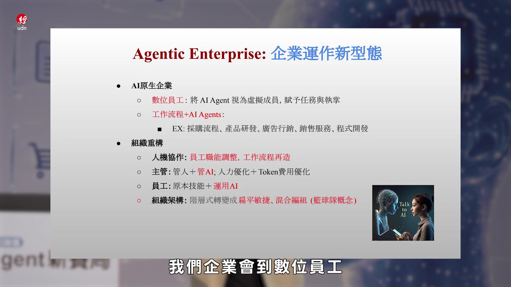

**逐字稿片段：** moving toward digital employees. If enterprises are to manage digital employees, we must also be managed by them. Let me give you an example: when an employee leaves, who do they hand their work over to? You could hand it to a human, but if that human leaves, then who? Hand it to AI, because AI doesn't leave. Then another employee leaves, hand it to AI; another one leaves, hand it to AI; even our general manager or secretary leaves, hand it to AI. Then the company is run by AI. So I finally understand that fifth-layer management will arrive, because humans get lazy. Human life is limited, but AI always helps you remember. That's why my young friends say their only value now is their English-named "skills." Everyone is just skills; when you leave , the person goes, but the skills remain. And those skills are agent

**話題推測：** 引入「數位員工」的概念，說明AI如何接替離職員工的工作。

---

## 00:36:20

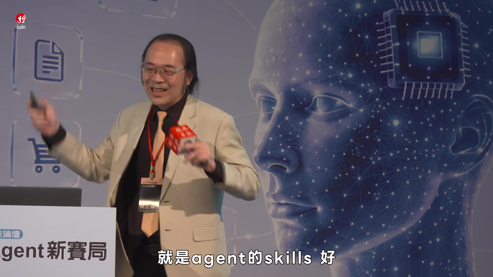

**逐字稿片段：** skills. Where is the money in AI right now? It's in programming, but programming will spread to every field. Just as a reference, it will eventually spread everywhere, so use AI for coding ; you can't code without it. Later it will be legal AI. Although humans still have a role, the US legal industry's revenue dropped 20%this year. The reason is that businesses are sensitive about legal fees, so they ask AI first to save money. Our sales are becoming

**話題推測：** 討論目前AI的資金流向，首先是程式設計，預計將擴展到各領域。

---

## 00:36:51

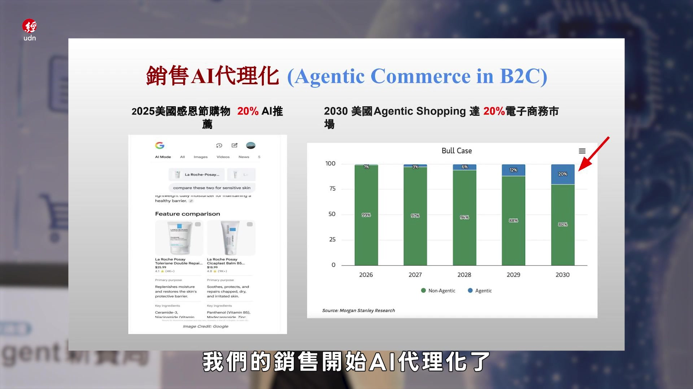

**逐字稿片段：** AI-agent oriented, with AI helping us make recommendations that humans like, quite precisely. After Meta’s system

**話題推測：** 討論銷售領域如何轉向AI代理輔助推薦。

---

## 00:37:02

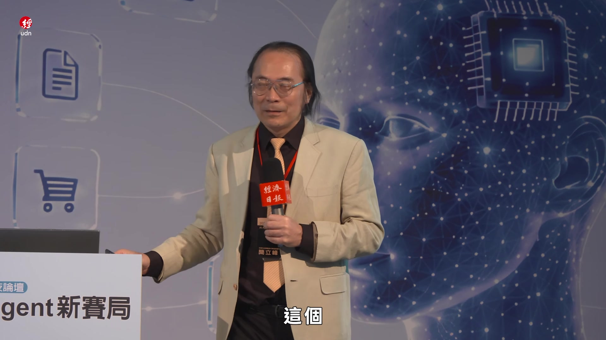

**逐字稿片段：** came out, a very important discussion started online. What kind of view? That Airbnb might not be needed, because using Meta’s system to book is cheaper. If that’s the case, we should just target all our ads at AI, not humans, since humans might not buy anyway. Show it to AI, and it might recommend you, right? Well, the UX of our advertising industry is effectively over, because UX is for humans, so the UX industry will have a hard time. Everything in the service industry is becoming tech. Healthcare, law, finance , consulting—you all become tech firms, you are all electronics, you are all tech. But are you really? Major US law firms are spending $ 500 million, even $ 1 billion to train AI models, yet public models are advancing faster than your proprietary ones. Can tech succeed at this point? Isn't SaaS already struggling enough? Software as a service was already tough, but isn't service as a software even tougher? Did you catch that? All services have become software, and software has become service; services end up being free, costing nothing. Therefore, AI capabilities are widening the gap, moving from personal tools to departments, and then across departments, which is fascinating. We have departments because of the limits of human ability; this limit is crucial because acquiring knowledge in a single field takes a long time, so we divide into departments. When AI becomes powerful enough one day, we won't necessarily have to rely on humans for these departments. So, we face the issue of governance, which is a collective challenge, just like how we face nuclear energy; there are many processes involved, so in the future, we will talk less about AI capability and more about how to manage, regulate, and govern AI, which is our shared task . In the last minute, Taiwan has a great future, truly a great future; we’ve seen the stock market performing so well, but no line goes straight up like that. Foundation, I keep repeating this, when it dips, you must be ready; it will definitely trend upward, though with ups and downs, but looking far left, Taiwan is already the fourth or fifth-ranked stock market.

**話題推測：** 提及Meta系統出現後，關於Airbnb可能不再需要的討論，可能為新聞或產業影響分析。

---

## 00:39:22

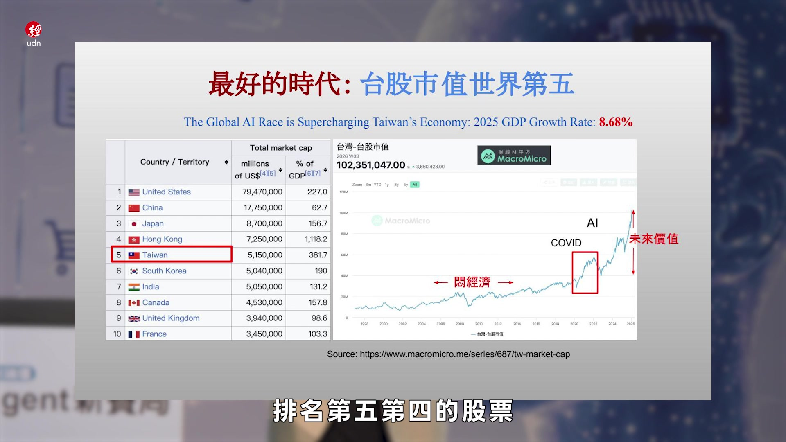

**逐字稿片段：** The main thing to watch is India, because India is trending down in software outsourcing, while Taiwan is surprisingly trending up in hardware outsourcing; this is fascinating, an era we couldn't have imagined before. Furthermore, Taiwan is not just about TSMC; it's not only TSMC anymore; we now see so many companies that are extremely successful. And these companies are very important. Look at MediaTek, ranked 61st in market cap; look above it, 59th is Alibaba and 60th is GUS; if we add Delta Electronics, it's roughly in the same position as MediaTek. We never imagined that Taiwan could have four companies in the top 100; this is the best of times for Taiwan, and also the era of highest risk. Because you are a small island, yet you have entered the Pacific; you originally wanted to row a boat on a lake, but you entered the Pacific and became a capital-intensive nation. You always called yourselves an island of engineers, but no, your birth rate is so low, only capitalists remain. If you aren't a capitalist, it's hard to get things done, but if you are, you must be highly internationalized; you must have international capital. So after Taiwan relearns manufacturing, Taiwan is very lucky. Thirty years ago, Japan only had Doraemon but no robots, while Taiwan now has ports and robots. Therefore, in the AI era, everyone in Taiwan need not worry, because we have so few children that we cannot even lay off workers, so we have no layoff problem. This.

**話題推測：** 比較印度軟體外包下降與台灣硬體外包上升的趨勢，可能為國家產業趨勢對比圖。

---
