# themarketmemo_IOtTfjQg0TE — 關鍵畫面索引

- 來源逐字稿：[themarketmemo_IOtTfjQg0TE_GT.srt](themarketmemo_IOtTfjQg0TE_GT.srt)
- 影片：https://www.youtube.com/watch?v=IOtTfjQg0TE
- 截圖數：16

## 00:00:13

**逐字稿片段：** 上個禮拜五 台達電的股價還跌停板 所以直接請教明翰 如果買很久 成本比較低的人 當然也許持續長期持有 但是有網友在發問 他其實是相對高點進場的 攤平已經攤到手軟 現在都已經手發抖了 所以是不是請明翰給他一些建議 我們先講一個 大家都套用的觀念 就是一個問題

**話題推測：** 提及台達電股價跌停板，可能顯示個股走勢圖。

---

## 00:00:39

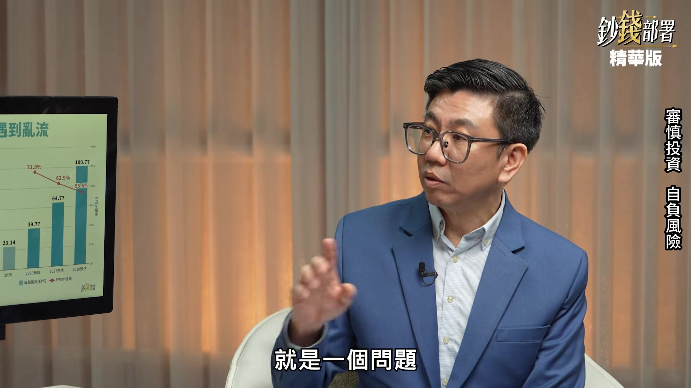

**逐字稿片段：** 忘掉自己的成本 為什麼要忘掉成本 這個問題就是說 你不能這樣講 因為你的成本低 沒有錯 我們當時最早來講 台達電那時候 其實連千元都不到 所以確實我早投資我成本低 所以人家講 那個是因為你成本低 我要告訴你 股市不會考慮你的成本 不會因為你買的貴 不然讓你先跑 因為你便宜 所以完全沒有 大家在反應就是它的基本面 所以你第一個問題 完全不要考慮自己的成本 至於該不該抱 是要看它的一個長期趨勢 並不是你的成本在哪裡

**話題推測：** 提出「忘掉自己的成本」的投資觀念。

---

## 00:01:12

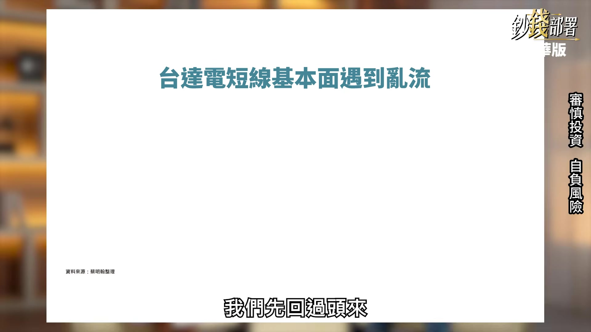

**逐字稿片段：** 我們先回過頭來 在講這段時間 到底發生什麼事 我個人覺得確實基本面 短線遇到亂流

**話題推測：** 轉向討論台達電近期基本面遇到的問題。

---

## 00:01:19

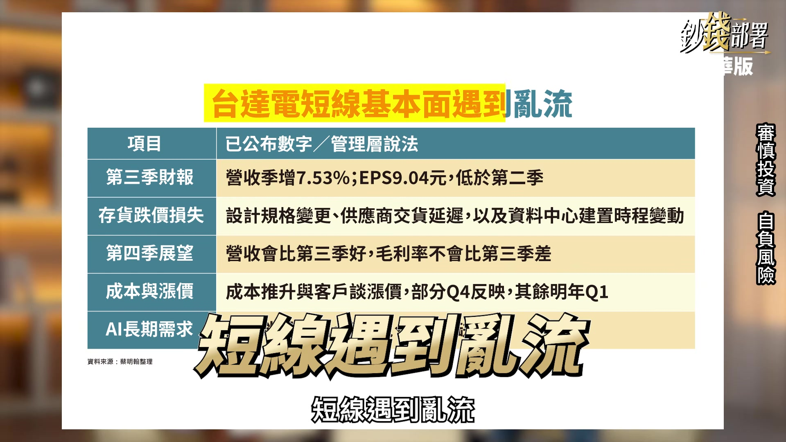

**逐字稿片段：** 就是說第三季的一個獲利 其實是低於第二季 這有點大家有點非常意外 因為它的營收還在持續走高 重點就是它有這個存貨的 這個跌價損失 就是因為設計規格轉變 加上供應商它交遲 有出現延後 或者是曾經有缺料或者缺工 很多的因素所導致 第三季的狀況比較差 但第四季的說法應該說 結論給大家一個概念就是 有好轉 但是也沒有到 V型反彈那個概念 既然基本面目前短線上面 還有一點挑戰性 所以它的股價 可能還要沉寂好一陣子 目前的看起來是這樣 但是我們先跟大家講 重點在

**話題推測：** 提及第三季獲利低於第二季，可能顯示季報對比圖。

---

## 00:02:01

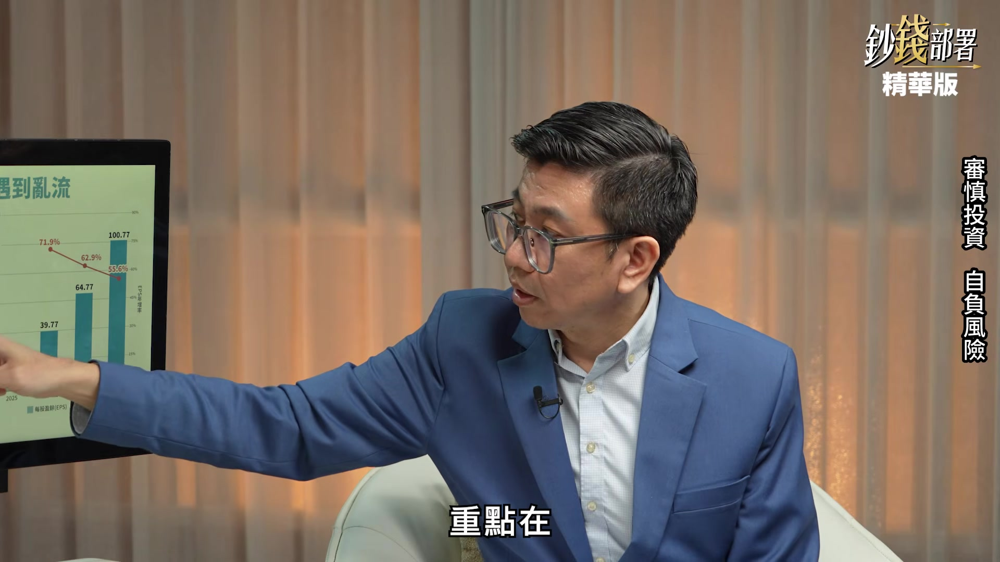

**逐字稿片段：** 明年之後 就會明顯的改善 現在應該說 我剛剛提到最慘的是第三季 第四季會慢慢好轉 真正再回到正常軌道 應該就是明年 先有這個概念 大致上就可以理解

**話題推測：** 討論明年之後公司基本面將會改善的展望。

---

## 00:02:15

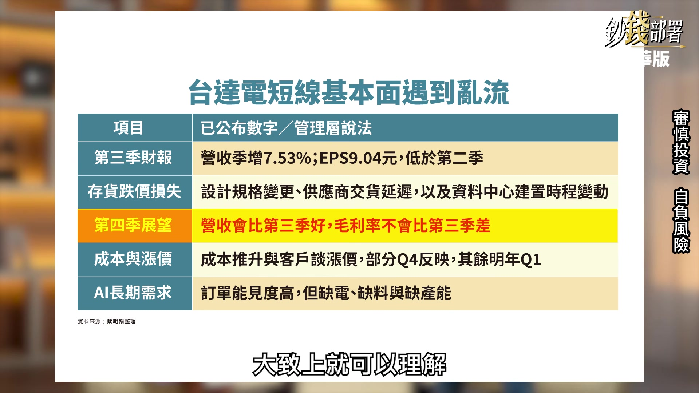

**逐字稿片段：** 其中這個外資就有出具報告 它就提到說 這個整個比較重要的關鍵點 它提到還不是這些問題 它一直在講到說

**話題推測：** 引入外資報告內容。

---

## 00:02:26

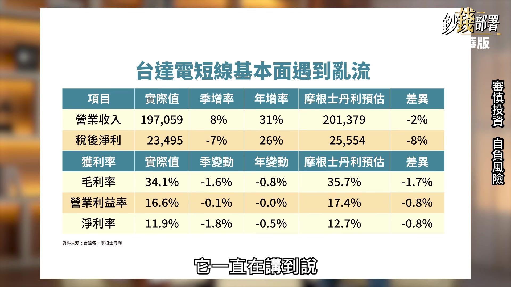

**逐字稿片段：** 它的三率都呈現下滑 這是很嚴重的現象 然後 它這個摩根士坦利的一個推估 它認為三率下滑 而且比它預期要低 所以它的意思是說 這是一個很大的警訊 可是其中有一個重點 這個右邊也是摩根士坦利 對於它的EPS的預估 今年來講 成長7成 明年還有6成 後年還有5成 雖然看起來好像年增率有掉 當然是有基期關係 但是一直都能夠 年增率50%以上 其實憑良心講

**話題推測：** 提及台達電「三率」下滑的現象。

---

## 00:02:57

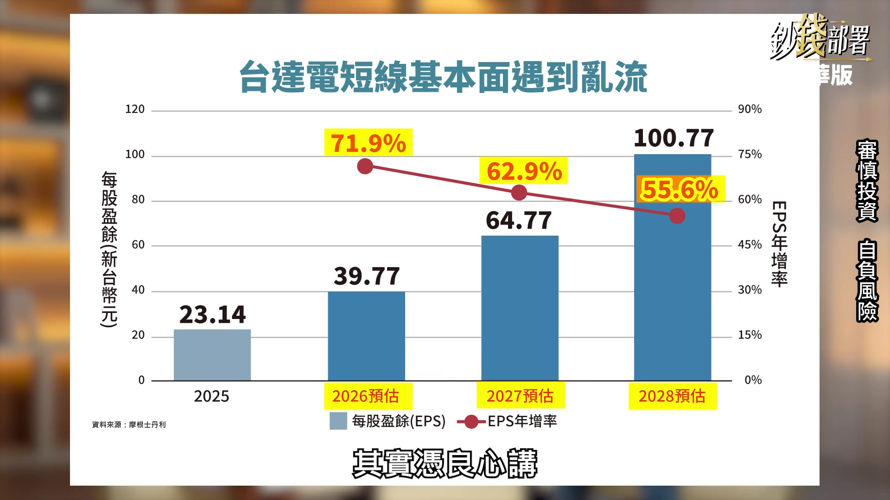

**逐字稿片段：** 甚至都還比台積電更高 所以最後它就是 這季的表現不如預期 但長線的看法不變 然後對於它的評等目標價 也還是沒有改變 所以我個人覺得 就是我剛剛講 基本面短線 確實遇到亂流 但是後續的部分 我要跟大家講 其實這個問題 第二季其實就已經出現 我這只是要給大家看一個概念

**話題推測：** 將台達電年增率與台積電進行比較。

---

## 00:03:22

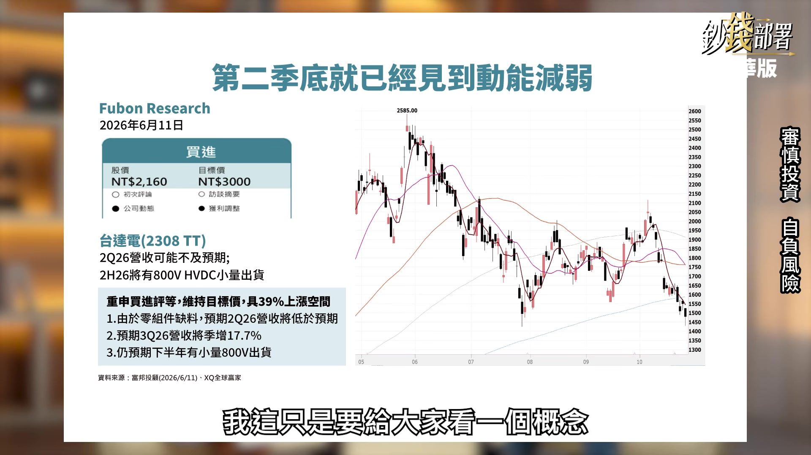

**逐字稿片段：** 就是說當時在6月的時候 我就有看到法人的報告 提到說零組件缺料 第二季開始 動能可能就會開始不如預期 其實這些事情我本來就知道 我只是要跟大家講 看到這個股價走勢圖 其實當時這個報告出來的時候 股價大概在接近2千塊 我也知道 我也在車上 然後人家講 你為什麼不跑 我個人的概念我會覺得 第一這個很多事情是提早反應的 為什麼最後能跌成這樣 因為當時法人的報告是提到 第二季應該是衝擊點 第三季就會慢慢好轉 結果時間延後了 就是它比法人預估的 還要有一些逆風 兩點 第一點這個逆風的時間點 有稍微跑到第三季 第二逆風的狀況 比當時想像的 要稍微大一點點 所以會導致股價當時 我覺得2千塊 我知道會跌 可我覺得 我憑良心講 我也不知道會跌那麼大 但是對我而言 我覺得也無所謂 因為第一我成本確實比較低 這是一點 第二我下來 我就是 覺得是一個很好的機會 我現在覺得 2,500塊都可以達得到 明後年的獲利都能創高 為什麼2,500塊會過不去 這是我自己過不了自己的門檻 所以我會加碼 這是我的個人概念 另外一個比較重要的重點

**話題推測：** 回顧六月法人報告曾提及的缺料問題。

---

## 00:04:40

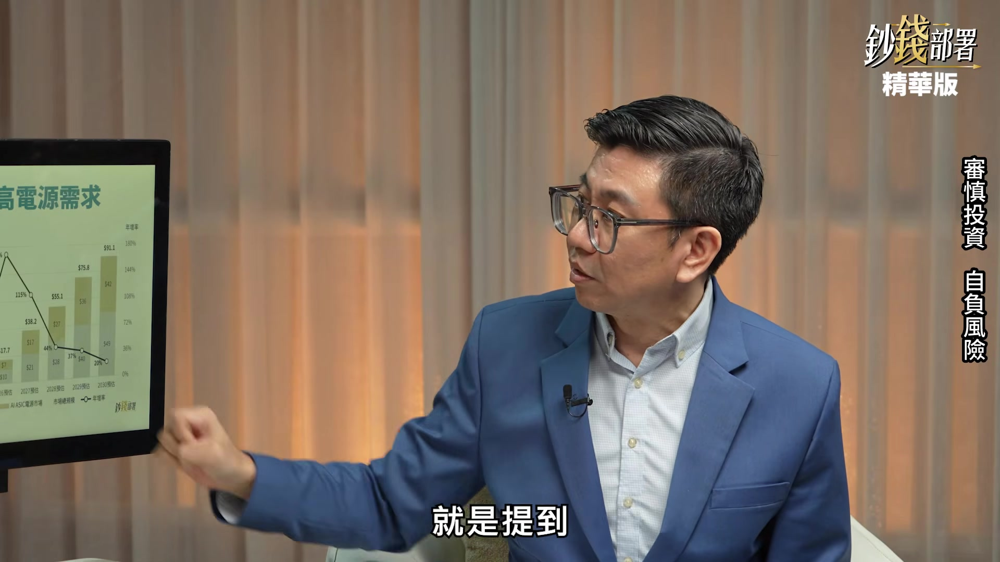

**逐字稿片段：** 就是提到 長期的趨勢 還是沒有太大的改變 因為你可以看到

**話題推測：** 強調台達電長期趨勢未改變。

---

## 00:04:44

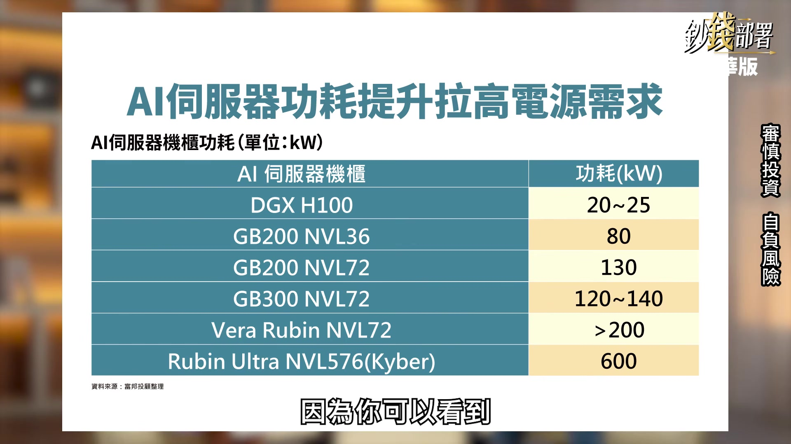

**逐字稿片段：** 長期AI伺服器的功耗 目前在GB200 GB300 再來要進入這個Vera Rubin 或者是Ultra的部分 可以看到功耗不斷的提升 所以外資也預估 它看到的這個

**話題推測：** 介紹AI伺服器功耗及未來趨勢，可能顯示技術規格圖。

---

## 00:04:57

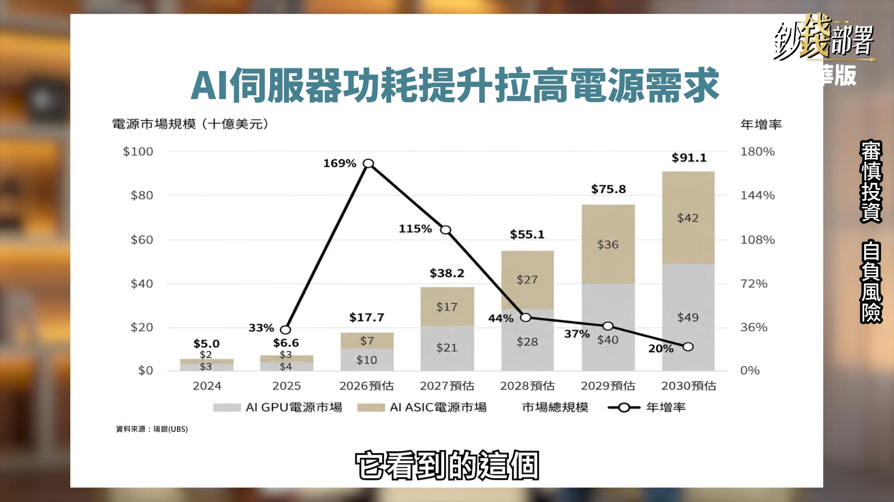

**逐字稿片段：** 下面的灰色是GPU的電源市場 等於是左邊那邊 還有一個ASIC的部分 這個電源市場也在快速的成長 所以2026年 2027年 整個AI伺服器的電源的 相關的設備的需求 都年增超過1倍以上 所以結論就是 長期趨勢是沒有改變的 所以短線遇到這個亂流震盪 真的不用太緊張 回過頭來 我剛剛前段就給大家看的 就是6月其實就知道 它第二季、第三季不太對勁 後續會導致一個現象

**話題推測：** 提及GPU及ASIC電源市場的成長。

---

## 00:05:32

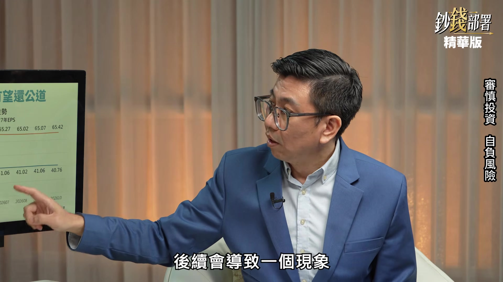

**逐字稿片段：** 我們看到這兩條線是什麼 就是台達電EPS預估 這是法人預估的平均值 就是今年跟明年 對 這個藍色是今年EPS 橘色是明年的EPS

**話題推測：** 指向圖表上的「兩條線」進行解釋，預期為EPS預估圖。

---

## 00:05:44

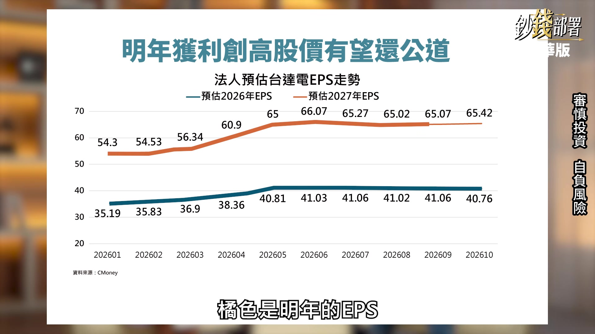

**逐字稿片段：** 從今年2026年的1月、2月、3月 可以看一下變化 你可以看到今年的EPS 年初的時候是35塊 然後每個月不斷往上 所以一直到哪 一直到5月之前 它的獲利預估值是不斷往上 所以帶動它股價一直很強勢 下半年之後整個就停擺了 股價也停擺為什麼 你可以看到它的獲利預估值 就是呈現 甚至是微幅下降 對 比較重要的關鍵點是在這裡 這次的法說會 最後出來法說會結束之後 現在是40.7元 你可以看到法說會之前是41元 所以結論就是確實不如預期 但是還有一個特別現象 這個是明年的EPS預估 你可以看到在這次法說會 雖然第三季不如預期 可是對於明年的EPS 結果到10月是65.4 可是前一個月是65 所以應該說 法說會雖然不如預期 但是明年展望還是樂觀 所以法人回來做什麼事 就是下修今年的EPS預估 但是反而還上修 明年的EPS預估 這是第一個重點 第二就是你看到 這個是今年的40塊 明年是65塊 這中間還有6成的成長率 雖然它的缺點 就是因為它這個平行 所以會導致股價動能 會相對比較弱 可是到年底了 今年40塊可能會覺得說 跌到1,300塊也覺得還算合理 你明年用65塊 突然又覺得 本益比突然怎麼下降那麼多

**話題推測：** 具體分析EPS預估圖的月度變化與數值。

---

## 00:07:07

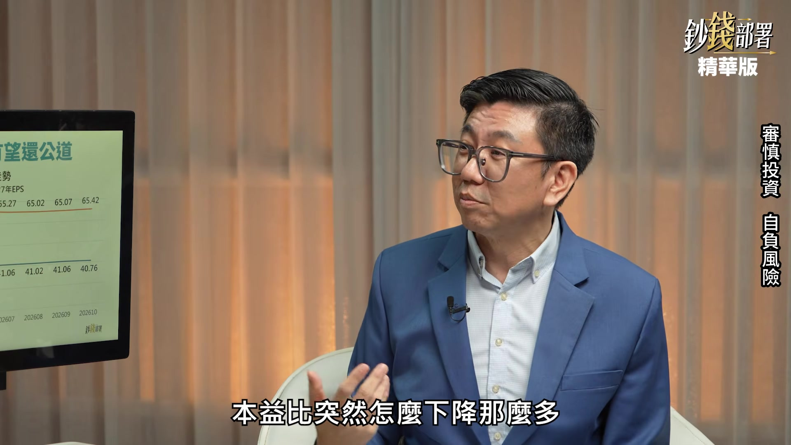

**逐字稿片段：** 對 只剩20倍 對 會不會覺得又突然變 所以我覺得到年底之後 開始慢慢的轉強 我覺得都是非常合理的範圍 最後再跟大家講 一個重點 前面聽不懂也都算了 你只要記得幾個 幾大重點就好 大家會回過頭來會說 可是你講的論點 會不會公司的說法不準 法人也估錯 簡單來講 就是它2,500塊已經是高點 現在1,300塊還不是低點 未來會持續往下跌 有沒有可能性 有 三種可能你來聽聽看 你覺得哪一個是有可能性的 第一個就是它掉單了 就是它被人家搶單 可是有個問題 最近營收下來 而且它是最大的這個供應商 當它如果掉單 代表會有一個人突然 營收暴增 對 營收暴增獲利暴增 但最近也沒有 代表現在不是掉單 第一個問題排除

**話題推測：** 提及台達電本益比下降至20倍。

---

## 00:07:59

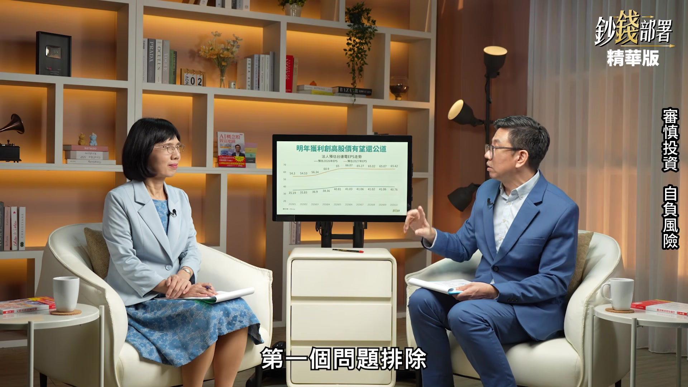

**逐字稿片段：** 第二就是 這個產業已經不行了 剛好我們前面才講過 就是現在的功率不斷往上 所以這個趨勢是不會錯的 第三點 就是AI的榮景已經結束了 如果我這樣的話 腰斬的絕對不會只有它 對 AI榮景結束的話 我想台股大概也腰斬了 對 所以我覺得對 如果它榮景結束它腰斬 台股也打算腰斬 所以我覺得 剛剛這三種情境 不存在的情況下 其實最大的壓力 就是它下半年 已經沒有亮眼的成績單

**話題推測：** 第二種情境：產業是否已經不行。

---
