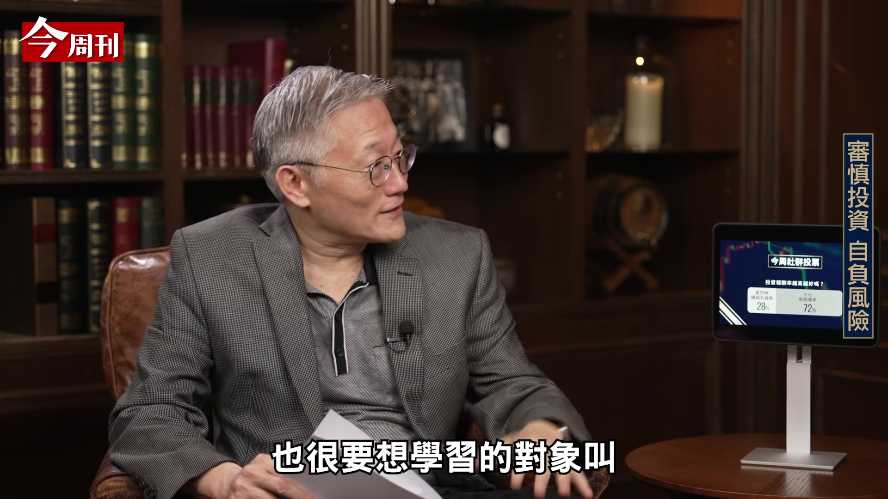
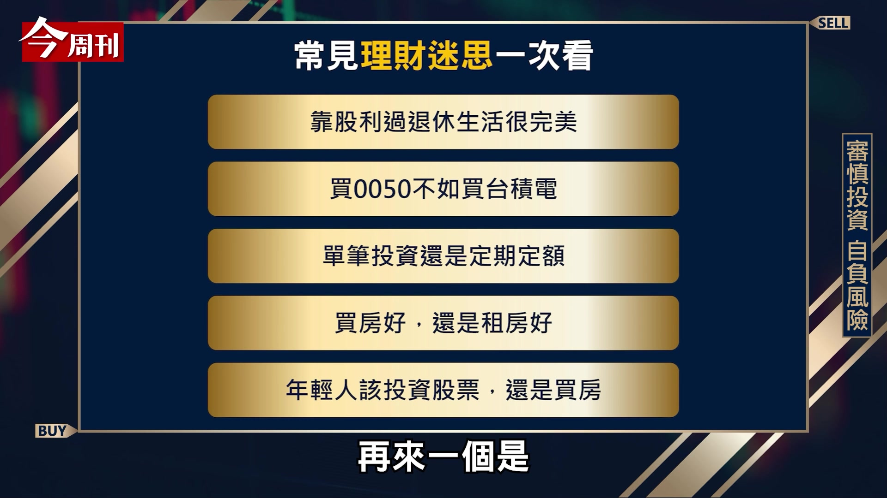
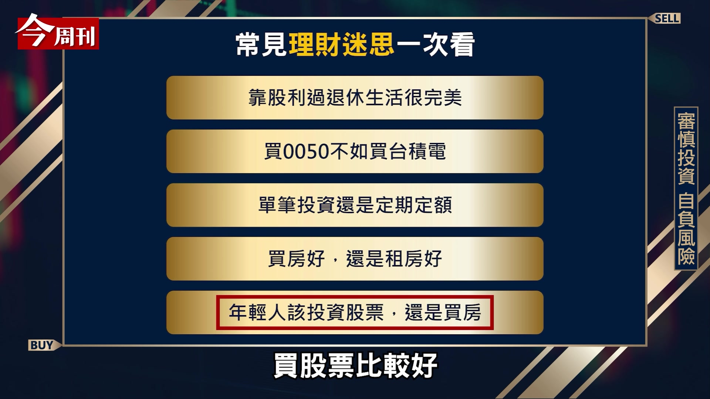

# themarketmemo_c4QUXoO_Oz4 — 關鍵畫面索引

- 來源逐字稿：[themarketmemo_c4QUXoO_Oz4_GT.srt](themarketmemo_c4QUXoO_Oz4_GT.srt)
- 影片：https://www.youtube.com/watch?v=c4QUXoO_Oz4
- 截圖數：11

## 00:00:53

**逐字稿片段：** 巴菲特 他是真的是全世界可能少見的 最會投資的人當中之一了 可是我們一般人不太理解 巴菲特他的工作 其實就是投資 所以巴菲特他只是 把他的工作做好而已 你跟我二個人 我自以為我是投資專家 因為我教投資學 我研究投資學 可是我們二個在股市開盤的時候 我們二個都在工作 你做的工作是在主持 對不對 在做新聞性的節目 我做的工作是在教書 是在做研究 甚至我在指導學生 可是巴菲特 在我們二個工作的時候 他在幹嘛呢 看盤 喝可樂 他在專心的投資 然後他旁邊一大堆的專家 跟他說現在市場怎麼樣 還有因為巴菲特 他認識很多的人 資源非常的多 所以他資訊管道非常的強 所以他又有很好的設備 又有很棒的研究員 他資訊又好 那我們二個只是晚上吃完飯 有空的時候讀一下書 然後看一看 然後我們就希望 我們可以打敗巴菲特 這樣是不可能的 那是違反天道的 我那麼辛苦坐在那邊 投資 學習 我花那麼多錢 請人家幫我做研究 就搞了個半天 志郁白天做新聞節目 晚上就是稍微學一下 就打敗我了 我覺得這是我們最大的迷思 就是說我們一般人不太瞭解說 其實 投資它是一個專業 不是只是選個股票 找個好的時點 因為我們沒有那個能力的 如果我們有那個能力的話 巴菲特 他一點價值都沒有了 對不對 所以我說我們一定要理解 天道酬勤的道理 就是說 我們人做事情要符合天道 那當然在某些情況之下 我們也常常會被人家誤導 就是說 有時候我們的確會在媒體上面 或在親朋好友當中看到 哎呦 這個人怎麼買買股票 進進出出賺好多的錢 你知道嗎 我有個同事 我們每次參加比如說學校的活動 假設有抽獎的話 我只要看到他 我就走了 為什麼 因為他每次都抽到 這麼厲害 那我就抽不到 他就是有那種所謂偏財運的 所以其實我們這世界上的確是有 非常非常少數的人 他們特別的運氣好 因為他們運氣好 所以他們並不是因為靠 他有像巴菲特的本領 能夠選到好的股票去投資 能夠賺錢 他只是運氣好 那這種人不能多 為什麼 一多了以後就違反天道了 因為大家都是運氣好 那巴菲特我剛剛講 那他一定是腦筋有問題 他才會那麼努力的去做他的工作

**話題推測：** 提及巴菲特，可能展示巴菲特照片或他的投資理念。

---

## 00:03:35

**逐字稿片段：** 那校長 那像我們一般人 然後我又不是運氣特別好 那我還有我自己本職的工作 那我到底要用什麼樣的方式理財 會是一個比較符合天道 或是符合我們自己的 這個水準的一個方式呢 其實就是 我剛剛講天道酬勤 其實巴菲特他之所以 能夠賺那麼多的錢 其實是因為他 把他的工作做得很好

**話題推測：** 提出普通人如何理財的疑問，轉向實際建議。

---

## 00:03:57

**逐字稿片段：** 那麼張忠謀先生 那他也是因為 他把他的工作做得很好 我看您蠻成功的 你應該也蠻有錢的 其實也是你 把你的工作給做好 你瞭解我的意思 其實我們賺錢的方法很簡單 就是把我們做的事情 專長的事情做好就可以了 可是這並不是說我們不要理財 為什麼 因為如果說你都不理財的話 其實也蠻可惜的 為什麼呢 因為其實我們投資 在股票市場的報酬率 它長期來講 它的確會比把錢都放在定存 來得好很多 那接下來我們就要請這個 校長今天來幫我們破除一下 這個理財的迷思了 有很多這個A或B 這個是1或2 這樣讓你選

**話題推測：** 提及張忠謀，可能展示他的照片。

---

## 00:04:39

**逐字稿片段：** 很多人都覺得我靠股利 就可以退休 現在很多人買那種配息型的商品 就覺得我到時候 就拿著那個股息 然後我就退休 遊山玩水環遊世界 這樣是很完美的選擇嗎 不行 這是一個大迷思 為什麼 因為我們退休就是退休了 所以假設你退休的時候 你握有的是個股票 其實你有二個風險 一個風險是這個公司 萬一將來不好 本來會配息 它就不配息 你連生活都沒了 第二個風險就是說 通常公司它不好的時候 它不但不配息 它連股票都就下來了 還有如果你是 擁有的是個股的話 搞不好這公司就倒掉了 所以我們在講 退休理財規劃的時候 絕對不可以講說退休的時候 我是用存股來退休 不是的 標準的退休理財規劃講的是說 我在退休的時候 我有一筆錢存在那裡 那筆錢它放在存款裡面的話 它足夠讓我這一生 在我預期我會走的時候 按照我的生活水準 可以讓我有足夠的花費 它必須是錢 它不能夠是一個股票或個股 因為它風險太大了 可是我並不是說 老了完全不能投資 不是這個意思 我的意思是在講說 如果說你要投資OK 可是你要先做個理財規劃 像您的母親 如果她很清楚知道說 她生活費這麼多 她也把一些 她想要留下來的錢留了 比如她想要去旅遊 她想要修房子什麼 她都留下來了

**話題推測：** 討論第一個理財迷思：靠股利退休，可能顯示迷思標題。

---

## 00:06:05

**逐字稿片段：** 她算了說 那她需要三千萬 可是你母親剛好有四千萬 OK 她把這三千萬 放在存款裡面 她拿這一千萬 去買買股票 我覺得OK的 儘管我不認為 那是最好的消遣 可是我覺得那個是她是OK的 可是我們現在擔心的就是說 我們一般人沒有理財規劃的概念 總是認為說 我退休我就是要有存股 我就是要有股票 那我可以過好的退休日子 那就危險了 為什麼因為我剛講了 有可能你的股票 會變成壁紙 或者它根本就沒有配息 而且等到我們快要退休 或者是真的已經退休之後 你的年紀可能已經讓你等不起了 對不對 你就沒有那個等待的一個本錢 這是大迷思 所以這絕對不能 靠股利過你的退休生活

**話題推測：** 舉例說明退休金規劃的具體數字，可能顯示案例數字或圖表。

---

## 00:06:49

**逐字稿片段：** 好 再來一個 哇 很多人會問我說買0050 我不如直接買台積電 因為0050裡面它也是 很多都是台積電 而且台積電說不定 它更有成長性 對吧 所以0050跟台積電

**話題推測：** 進入下一個理財迷思的討論。

---

## 00:07:01

**逐字稿片段：** 這個你違反了八喜投資法則 第三個法則 這個違反了 八喜投資法則 第三個法則 說要你分散風險 那0050跟台積電比 0050是一個分散風險的投資 台積電是單一的 台積電大家都知道是 我們所謂台灣的護國神山 它是非常好的公司 但是我們沒有人可以預期 台積電10年以後 它仍舊像今天這麼好 對不對 20年以後 它沒有人可以預期的 所以我們本來就不應該 去賭一個公司 它永遠都會好 我們應該去賭的是 我們整個的經濟 它長期是會發展的 所以分散風險的目的是 賭我們整個市場 不能講賭 我們是講說 跟著市場的成長去走 因為經濟成長是正的 是常理 可是在這個經濟體裡面 有很多的公司會倒掉 對不對 那你不能說它今天好 它永遠都會好 這不合理 所以就是你還是0050 即便它裡面很多都是台積電 你還是應該買0050 對 還是一個市值型的ETF 而且萬一哪天台灣的半導體業 沒有那麼賺錢了 你的0050裡面還有別的產業 它可以幫你賺錢 道理就在這 再來一個是

**話題推測：** 提及「八喜投資法則」，可能顯示法則名稱或內容。

---

## 00:08:11

**逐字稿片段：** 單筆投資還是定期定額 通常我們當然 希望你定期定額 為什麼 因為定期定額的話 那個你沒有去擇時 可是有一點很重要 就是定期定額的金額 不要太低 因為按照台灣 現在的手續費結構的話 券商你每次做這個投資 它起碼要收你一元 那一元的話 那一元除以除以這個2000元 萬分之五

**話題推測：** 討論第三個理財迷思：單筆投資還是定期定額，可能顯示兩者比較圖示。

---

## 00:08:34

**逐字稿片段：** 那千萬不要投低於2000元 比較好 我們希望你大概 每次定期定額在2000元以上 雖然說你一元 沒有什麼了不起 但是長久它也是一個 報酬率的概念 久了它其實也是會 吃掉你的一些這個獲利

**話題推測：** 提及定期定額的最低投資金額（2000元），可能顯示相關數字或計算圖表。

---

## 00:08:48

**逐字稿片段：** 好 那再來是買房好 還是租房好 哇 這個是可以拿來 當這個辯論的題目 買房好還是租房好 買房子的話 它的好處就是你有一個房子 這個房子將來可以增值 而且假設你有你的工作的話 因為我買房子 通常是需要去借錢的 那這個借錢 通常我們認為是可以的 因為你有房子做抵押 那大不了房子就給了銀行 可是因為你有去借錢 所以它有點槓桿的作用 所以如果房價漲的時候 事實上你的增值 會對你是蠻有利的 還有心理上不錯 為什麼我們回家有個地方住 不會說你回家 房東打個電話給你說 對不起 欸你明天搬走喔 那這個通常是 我認為對於年輕人來講 我覺得說如果你要住的話 我們一般人會建議你 買個房子比較好 可是租房子有租房的好處 租房子的好處就是 我不需要一下拿那麼多錢出來 所以我有應用這個錢的彈性 對不對 那我租房子也很自由 我不想要住在這個區 我就搬到另外一個區 那我換工作什麼的 它有這個彈性 那它各有好處 但是如果由我自己 來做價值判斷的話 我認為買是比較好 因為你的安定感 是很重要的 所以心理層面上 也是要顧及一下 每個人可能不太一樣的心態 這個參考一下 那另外一個是 年輕人到底應該要投資股票 還是要買房子呢 除了自住房以外 那當然答案就是 買股票比較好

**話題推測：** 進入下一個理財迷思的討論：買房還是租房，可能顯示兩者比較圖示。

---

## 00:10:14

**逐字稿片段：** 因為我們的研究都告訴我們 股票你配息再投資 它的複利效果的長期的報酬率 那是會高於買房子的 還有你買房子 它是一個 流動性低的一個資產 你要賣的時候 也不是馬上可以賣掉 對不對 那還有就是 假設你要租金 你要去管理它 你要花很多的時間 那我們是覺得一般的人 有時間的話 應該把他的本業給做好

**話題推測：** 提及研究顯示股票長期報酬率高於買房，可能顯示數據比較圖表。

---
