# themarketmemo_rgS5mC9lyCw — 關鍵畫面索引

- 來源逐字稿：[themarketmemo_rgS5mC9lyCw_GT.srt](themarketmemo_rgS5mC9lyCw_GT.srt)
- 影片：https://www.youtube.com/watch?v=rgS5mC9lyCw
- 截圖數：54

## 00:00:01

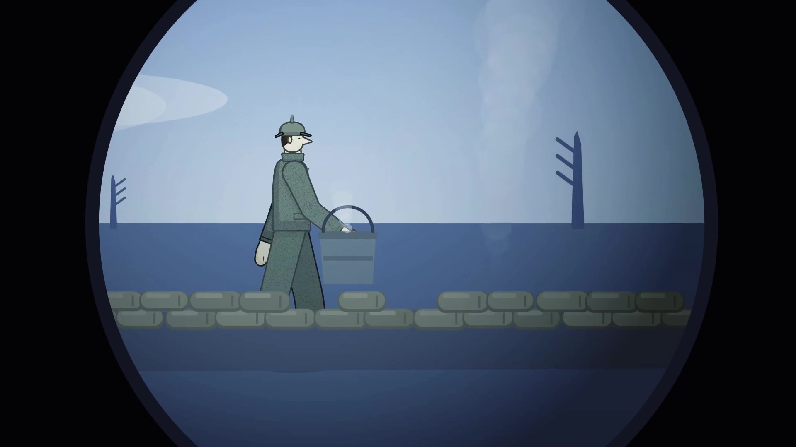

**逐字稿片段：** 1915年夏天 一戰西線的戰壕裡發生了 一件讓人難以置信的事 英軍和德軍隔著一片無人地帶對峙 雙方都接到了同樣的命令 儘可能殺傷對方 可在一些陣地 雙方士兵們卻悄悄達成了一條規矩 你不打我 我也不打你 到了吃飯時間 雙方默契地停止射擊 有人在無人地帶巡邏 碰上對面計程車兵 彼此假裝沒看見 轉身走開 有些地方 雙方甚至約定好了 對方領給養的時候 絕不開槍 這不是停戰協定 也沒有人握手宣誓 只是一種心照不宣的默契 有一回 一枚德軍炮彈意外偏進了英軍戰壕 英國士兵剛趴在掩體裡準備反擊 對面的胸牆上突然探出一個德國兵 他冒著當場被擊斃的風險 對著這邊大喊 實在抱歉 這不是我們幹的 是後方的炮兵亂打的 希望沒人受傷 你沒聽錯 在一場死傷上千萬的戰爭裡 敵人隔著戰壕主動向對手道歉 這份默契維持了好幾個月 直到雙方的將軍發現了異常 他們只用了一招 就徹底撕碎了這份平靜 這個辦法是什麼 我先賣個關子 後面再揭曉

**話題推測：** 開啟一段關於第一次世界大戰戰壕裡的合作故事。

---

## 00:01:25

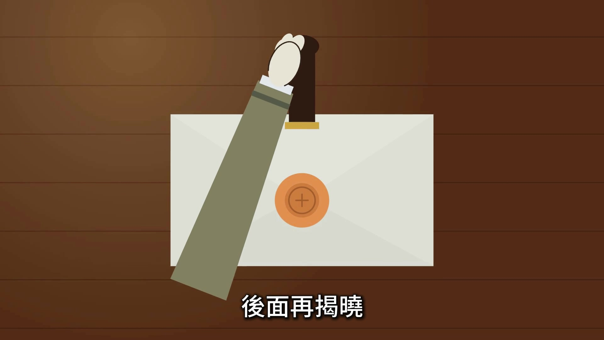

**逐字稿片段：** 說到這兒問題來了 為什麼拼個你死我活的敵人 反而會主動合作 反過來想想你身邊 比如辦公室裡那個 總搶你功勞的同事 咱們就叫他老陳 你又該怎麼對付他 被人傷害了 受了委屈 到底該當場反擊 還是一笑而過

**話題推測：** 提出問題：為何敵人會合作？以及如何應對類似 '老陳' 的人。

---

## 00:01:46

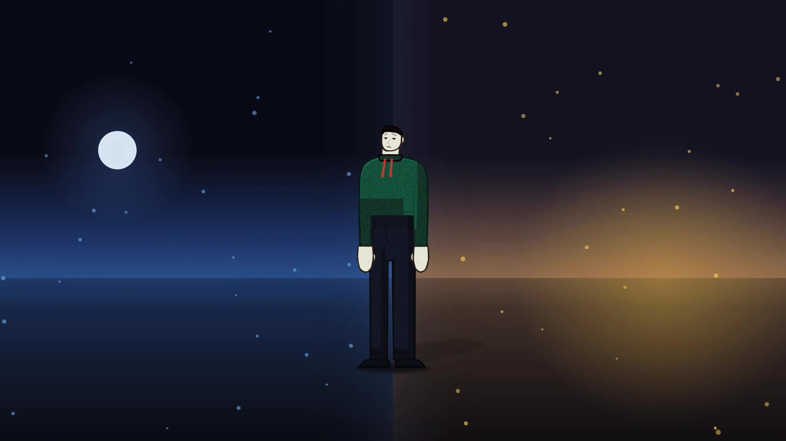

**逐字稿片段：** 歡迎來到天天讀書會

**話題推測：** 節目開場白，介紹『天天讀書會』。

---

## 00:01:49

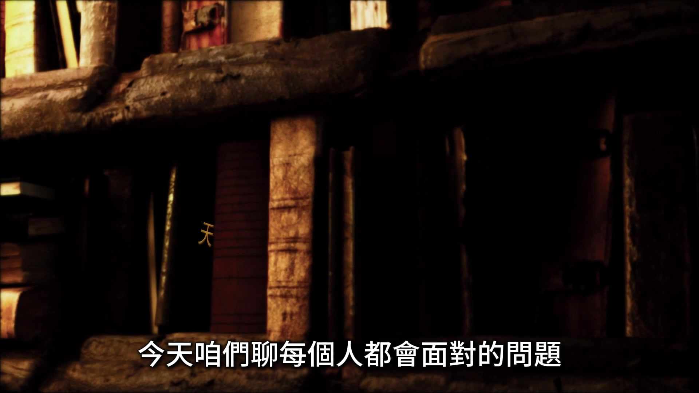

**逐字稿片段：** 今天咱們聊每個人都會面對的問題 生活裡的囚徒困境 被人傷害了 該怎麼回應

**話題推測：** 介紹本期主題：生活中的囚徒困境。

---

## 00:01:57

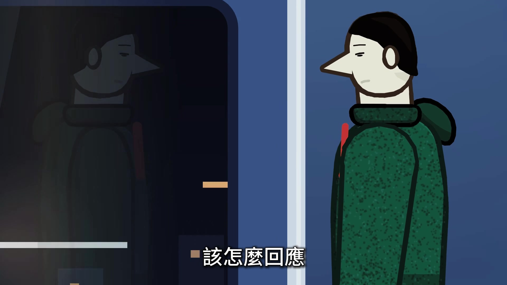

**逐字稿片段：** 關於這個問題 兩千五百年前 老子和孔子就吵過 答案完全相反 這場爭論吵了兩千多年 沒人能分出高下

**話題推測：** 引出兩千五百年前老子和孔子關於此問題的爭論。

---

## 00:02:08

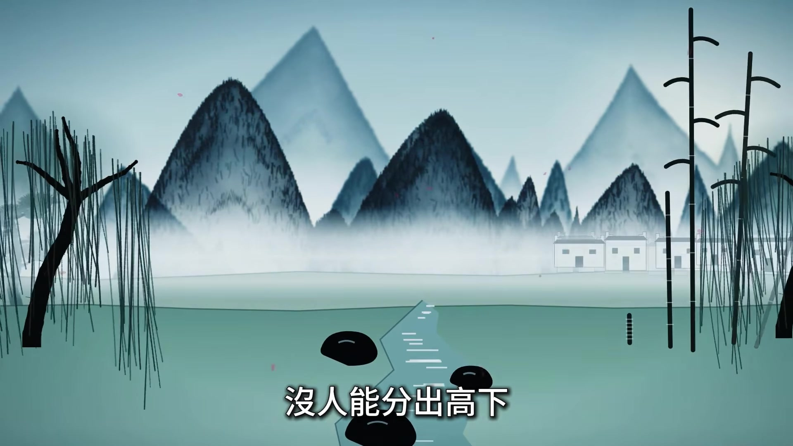

**逐字稿片段：** 直到1980年 美國密歇根大學的政治學家 阿克塞爾羅德做了一場實驗 他邀請了經濟學數學 心理學等領域的高手 把各自認為最優的 策略寫成電腦程式 放在一起循環對戰 比賽結果震驚了所有人

**話題推測：** 介紹1980年美國密歇根大學政治學家阿克塞爾羅德的實驗。

---

## 00:02:27

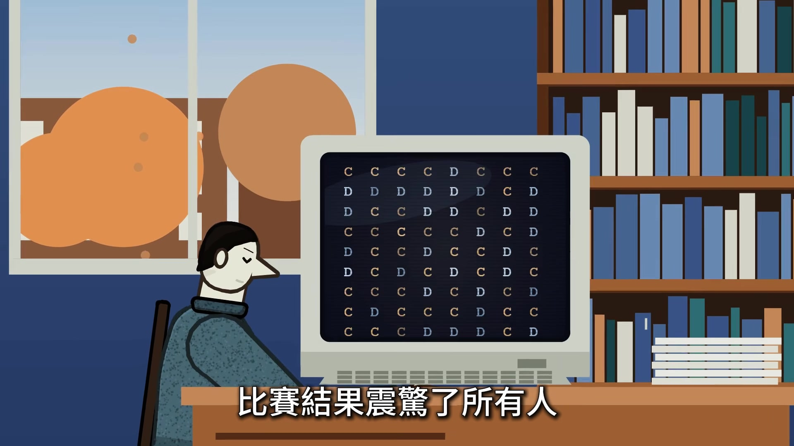

**逐字稿片段：** 後來他把研究寫成了合作的進化 直到今天都是博弈論的巔峰之作

**話題推測：** 提及阿克塞爾羅德的著作《合作的進化》。

---

## 00:02:35

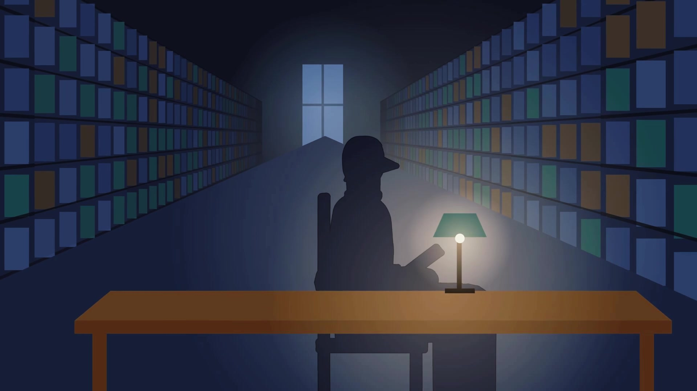

**逐字稿片段：** 今天的內容分成四部分 先搞懂為什麼好人看起來總吃虧 再講那場顛覆所有專家認知的比賽 接著用比賽結果給老子和 孔子的千年爭論下個定論 最後給你四個具體方法 明天上班碰到老陳就能用

**話題推測：** 影片內容大綱，分為四個部分。

---

## 00:02:53

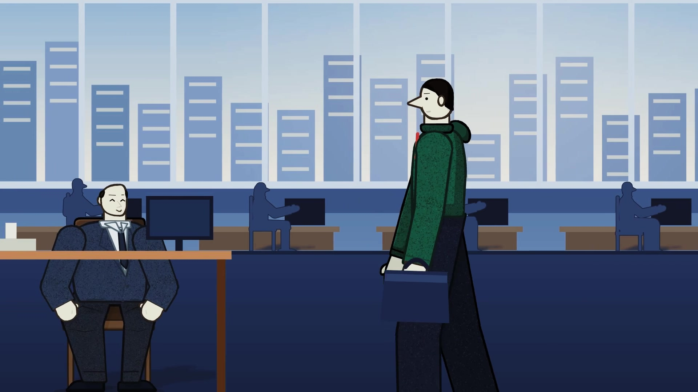

**逐字稿片段：** 咱們先從最實在的問題說起 對付老陳這種愛佔便宜的人 到底什麼辦法最管用 我猜很多人第一反應就是 做人不能太老實 老實人總吃虧

**話題推測：** 回到實際問題：如何應對像『老陳』這樣愛佔便宜的人。

---

## 00:03:06

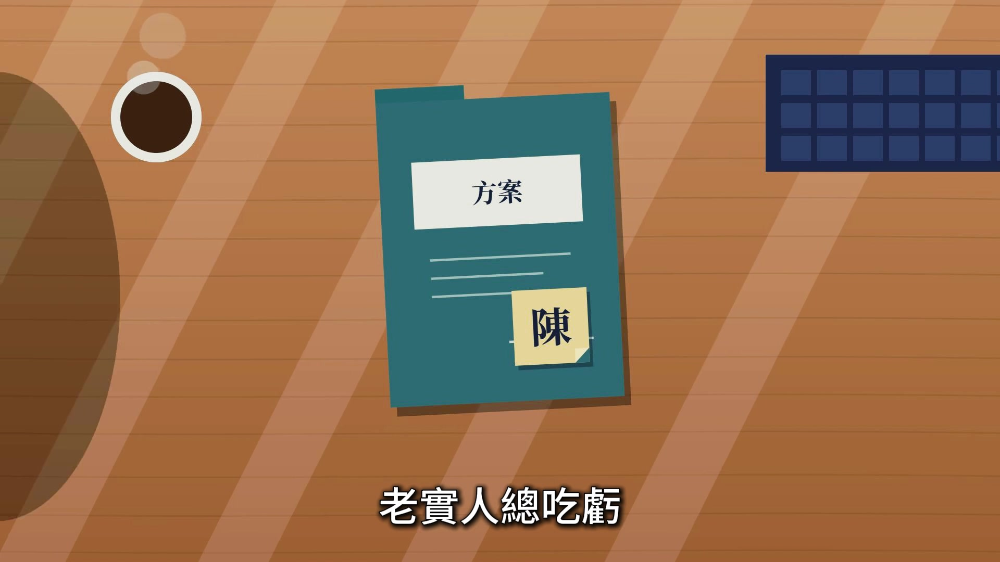

**逐字稿片段：** 這句話對嗎 它到底是人生經驗 還是社會博弈論的鐵律 老實人真的吃虧嗎 老實人吃虧到底是我們 摸爬滾打攢出來的偏見 還是板上釘釘的博弈結論 先給你說句實在的 在某一種場景下 這句話不只是有道理 簡直就是無解的鐵律

**話題推測：** 提出問題：『老實人總吃虧』這句話是否為真理。

---

## 00:03:30

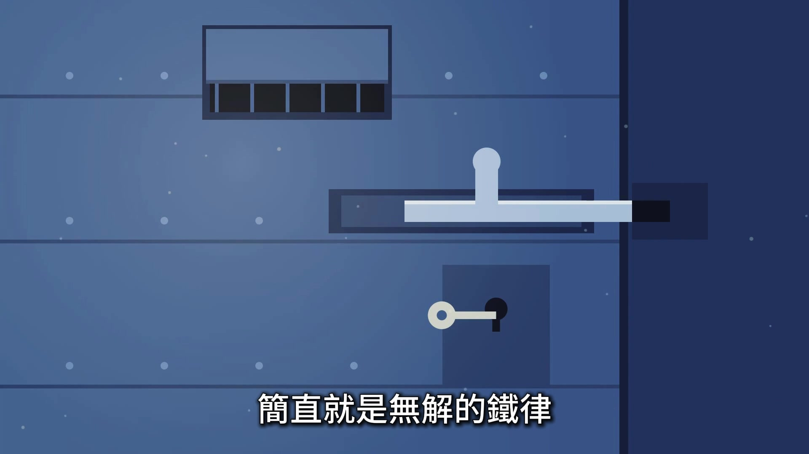

**逐字稿片段：** 1950年美國蘭德公司的兩位 科學家設計了一個實驗 後來數學家塔克為了方便講解 給它編了個故事 這就是大名鼎鼎的囚徒困境

**話題推測：** 介紹1950年蘭德公司設計，後由塔克編寫故事的『囚徒困境』。

---

## 00:03:43

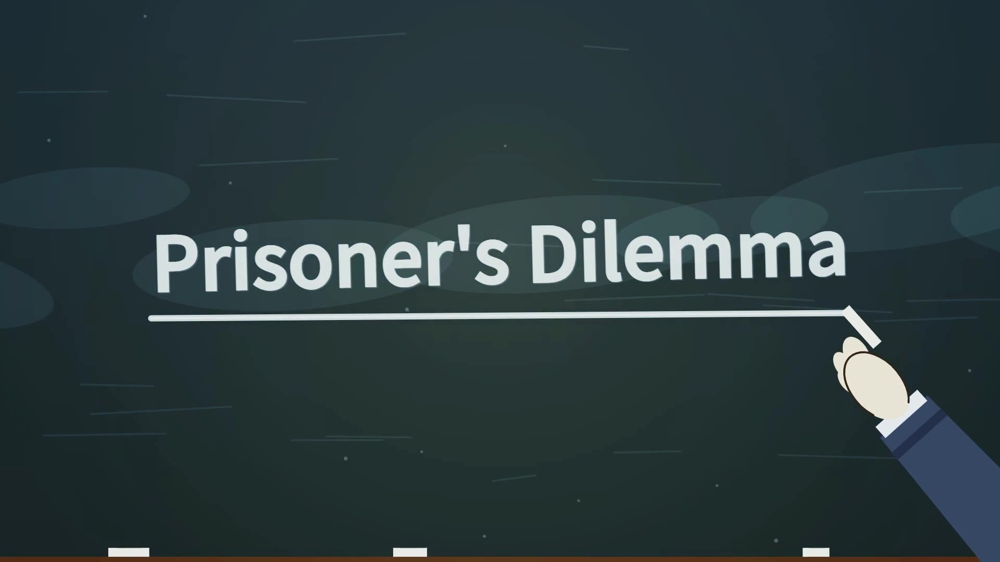

**逐字稿片段：** 兩個同夥作案被抓 分別關在不同的審訊室 沒法串供 警察給了倆人一樣的條件 倆人都不招 證據不足 各判1年 你招他不招 你當場釋放 他判10年 倆人都招 各判5年 現在換你坐在審訊室裡 你怎麼選 對方不招 你招了直接回家 肯定比坐1年牢划算 對方招了 你也招了 只判5年 總比自己扛下10年強 所以不管對方選什麼 招供對你來說都是更優解 而另一個房間的人算 的是一模一樣的賬 於是兩個聰明人都 做了最理性的選擇 最後一起判了5年 但明明倆人都閉嘴 只要各坐1年牢就行 這就是困境 每個人都算得明明白白 合在一起卻走向了最壞的結果 你可能覺得這只是 個紙上的思想實驗 現實裡沒人這麼傻

**話題推測：** 開始詳細解釋囚徒困境的具體規則和選擇。

---

## 00:04:46

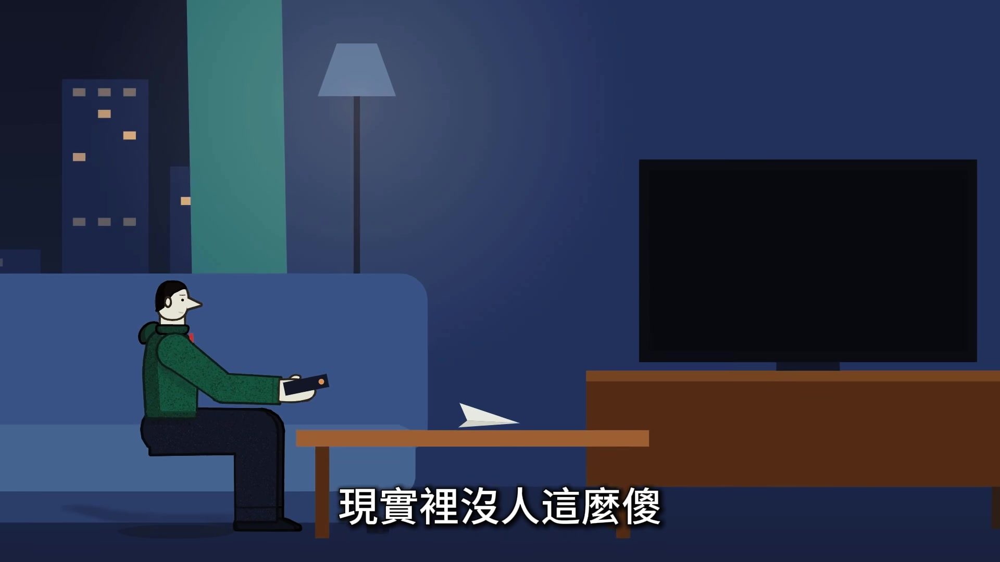

**逐字稿片段：** 那我給你講個真事 英國有檔綜藝叫金球 最後一輪就是真人版囚徒困境 兩個選手面對面 每人手裡兩個球 一個寫分 一個寫偷 都選分獎金平分 一個選分 一個選偷 選偷的人拿走全部都選偷 倆人一分錢都拿不到 2008年有一期獎金是十萬多英鎊 揭曉前女選手反覆跟 對面的男選手保證 我肯定選分你信我 男選手真的信了 結果公佈 男的選了分 女的選了偷 十萬英鎊全被她拿走了 她是天生的壞人嗎不一定 她只是做了數學上最正確的選擇

**話題推測：** 舉例英國綜藝節目《金球》中的真人版囚徒困境。

---

## 00:05:33

**逐字稿片段：** 三百多年前 哲學家霍布斯在利維坦裡就說過 沒有規則約束的自然狀態裡 是一切人反對一切人的戰爭 沒人管的時候 自私就是最理性的選擇

**話題推測：** 引述哲學家霍布斯在《利維坦》中關於自然狀態的論述。

---

## 00:05:46

**逐字稿片段：** 這種困境咱們天天都遇得到 只是換了個名字 比如內卷 所有家長都知道 要是大家都少報補習班 孩子都能輕鬆點 可誰先停下 誰的孩子就落後 最後所有人都硬著頭皮報班 所有孩子一起熬到半夜 每個人都很理性 結果所有人都更累 說回老陳 他第一次在會上把你 的方案說成自己的 你忍了你想著抬頭不見低頭見 沒必要撕破臉 可按囚徒困境的邏輯 你這一忍 等於明明白白告訴他 搶你的功勞沒有任何代價 在只玩一次的遊戲裡 好人不是輸給了壞人 是輸給了數學 如果故事到這兒就結束 那老實人吃虧就是板上釘釘的真理 今天的話題也可以到此為止了

**話題推測：** 將囚徒困境應用到現代社會的『內卷』現象。

---

## 00:06:40

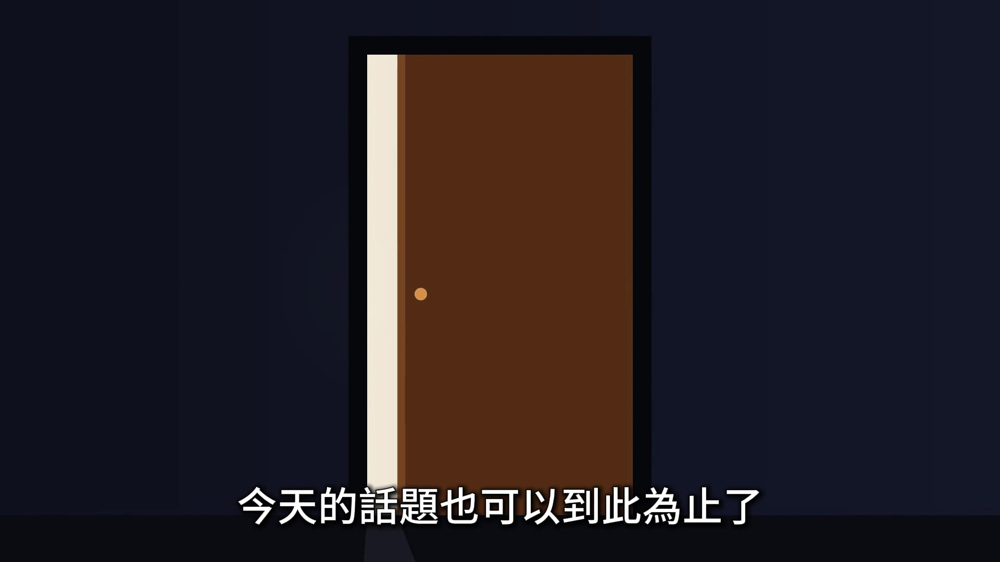

**逐字稿片段：** 可你仔細想想 我們的人生真的只有一局嗎 同一局玩兩百次誰會贏 如果和同一個人 不是隻打一次交道 而是要連續過招兩百次 你還會選擇背叛嗎

**話題推測：** 提出新問題：人生不是只有一局，重複博弈的結果會如何？

---

## 00:06:57

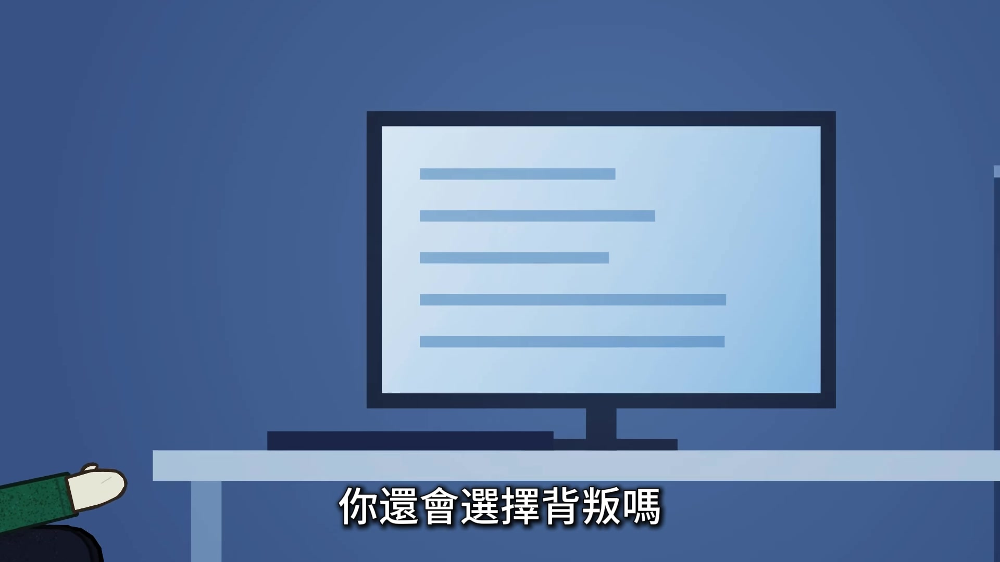

**逐字稿片段：** 這就是阿克塞爾羅德 那場實驗要回答的問題 1980年他向各界學者發出邀請 遊戲規則還是囚徒困境 但每兩個程式要連續對戰兩百回合 每回合都記分 背叛的好處沒變 但不一樣的是 對方會記住你上一輪的選擇 最後他收到了14個策略程式 自己又加了一個隨機出招的湊數 這些程式花樣百出 有的先裝好人 合作幾輪突然偷襲 發現對方好欺負 就一路壓榨 有的故意亂出牌 讓對手摸不著規律 還有的複雜到要統計 對方所有歷史動作 算出最優下一步 你能想到的狡猾算計 心機裡面幾乎都有 每個程式都要和所有對手各打一場 最後算總積分

**話題推測：** 介紹阿克塞爾羅德重複囚徒困境實驗的具體規則。

---

## 00:07:50

**逐字稿片段：** 結果出來了 拿下冠軍的是所有程式 裡最短最簡單的那一個 提交它的是心理學家拉波波特 一輩子都在研究戰爭與和平

**話題推測：** 揭曉實驗結果，冠軍是心理學家拉波波特的『一報還一報』策略。

---

## 00:08:04

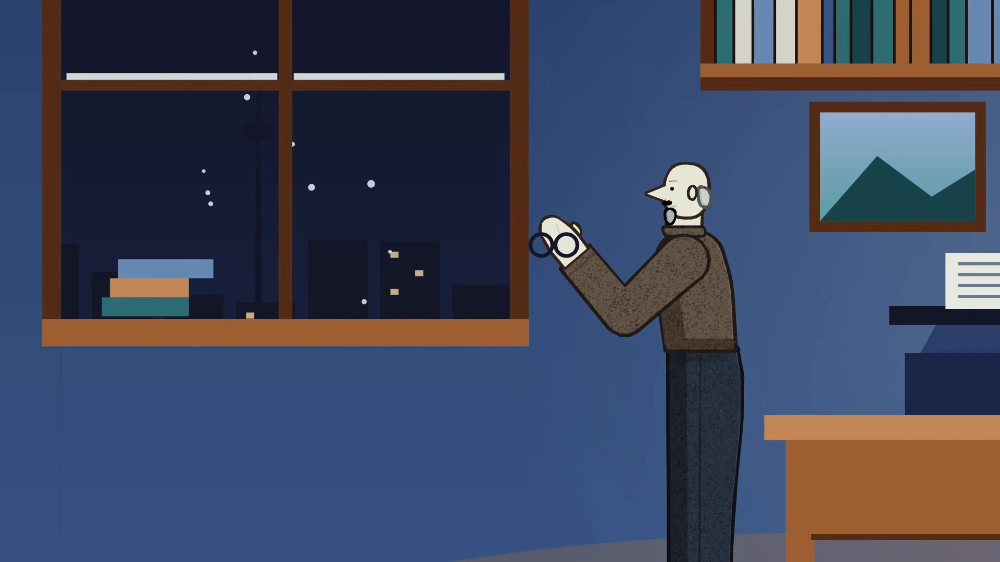

**逐字稿片段：** 他的程式只有兩條規則 第一步主動選擇合作 從第二步開始 對方上一輪怎麼對我 我這一輪就怎麼對他 這個策略叫一報還一報

**話題推測：** 解釋『一報還一報』策略的兩條簡單規則。

---

## 00:08:18

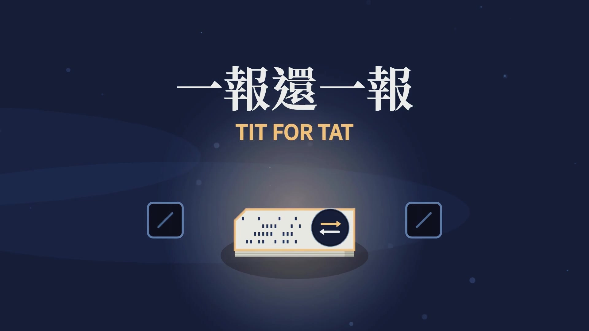

**逐字稿片段：** 阿克塞爾羅德不太確信這個結果 於是他又辦了第二屆比賽 他還提前公開了第一屆的結果 讓所有人都知道一報 還一報是上屆冠軍 這一次他收到了六十多個程式 很多都是專門針對它設計 專門來打敗它的 結果它又贏了

**話題推測：** 提及阿克塞爾羅德舉辦第二屆比賽，『一報還一報』再次獲勝。

---

## 00:08:40

**逐字稿片段：** 但整場比賽裡 最值得你記住的是這件反常識的事 一報還一報 從來沒贏過任何一場單挑 你想想規則就懂了 它從不主動背叛 對方合作它就合作 對方背叛它就反擊 所以面對任何對手 它最好的結果是打平 最差也只是略輸一點 單拎任何一場出來 它都不是贏家 可把所有對局的分數加在一起 總分第一的偏偏是它 那些狡猾的程式呢 它們在幾場對局裡賺得盆滿缽滿 佔盡了便宜 可碰到同樣狡猾的對手 就互相背叛 互相報復 分數一路跳水 贏了幾場區域性 輸掉了整場比賽 你身邊肯定也有這種人 單位裡從不搶風頭 開會很少爭到最後 每次吵架看起來都沒贏 可十年二十年過去 朋友最多的是他 長期合作最多的是他 走得最遠的也是他 一局都沒贏過 卻贏了整場比賽

**話題推測：** 強調『一報還一報』從未贏過任何一場單挑的反常識事實。

---

## 00:09:49

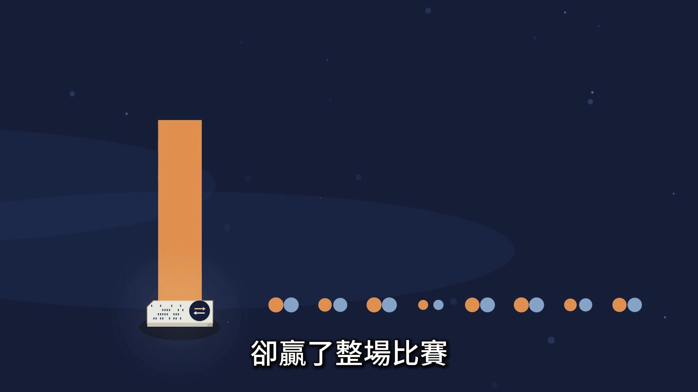

**逐字稿片段：** 這就奇怪了 之前我們剛算明白 單次博弈裡 背叛是最理性的選擇 為什麼遊戲次數一多 最簡單最單純的策略反而成了贏家

**話題推測：** 提出新問題：為什麼重複博弈中，最單純的策略反而會贏？

---

## 00:10:03

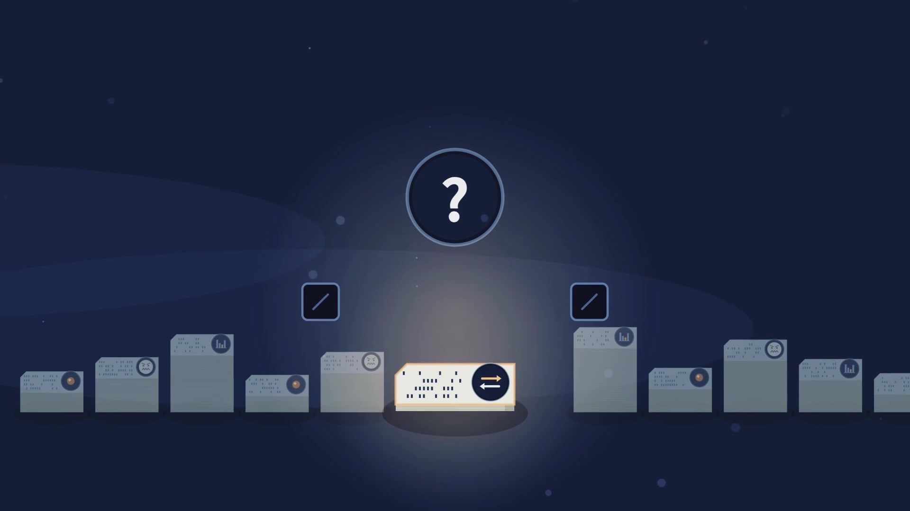

**逐字稿片段：** 它為什麼能贏 同樣的人 同樣的利益誘惑 為什麼單次博弈裡互相背叛 重複博弈裡就能達成合作 阿克塞爾羅德的答案只有一句話 因為他們還會再見面

**話題推測：** 開始解釋『一報還一報』獲勝的原因。

---

## 00:10:19

**逐字稿片段：** 他給這個規律起了 個很有味道的名字 叫未來的影子 你今天背叛我 明天我就會反擊 你今天佔的小便宜 會在接下來的所有 回合裡連本帶利還回來 只要未來的影子足夠長 合作就不是心軟 而是最划算的選擇 所以你看 在長期關係裡 善良從來不只是道德選擇 它首先是一筆明明白白的賬

**話題推測：** 引入阿克塞爾羅德的『未來的影子』概念。

---

## 00:10:47

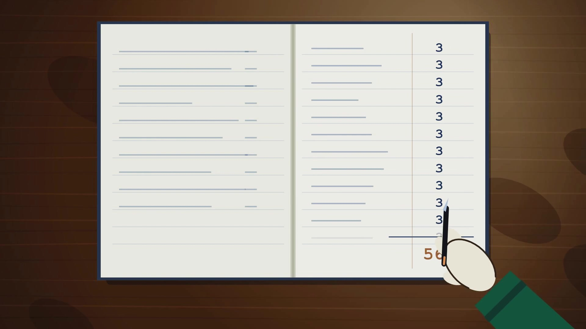

**逐字稿片段：** 說到這兒我們可以揭曉開頭 戰壕故事的前一半了 英德士兵為什麼會在飯點停火 不是心軟 也不是突然對敵人產生了感情 而是同一支部隊要在同 一段戰壕對峙好幾個月 今天你炸了我的早飯 明天我就炸你的晚飯 他們無意中掉進了一場 漫長的重複囚徒困境 而在這場遊戲裡 合作才是能吃好飯的最優解

**話題推測：** 回溯開頭的戰壕故事，用『未來的影子』解釋英德士兵的合作。

---

## 00:11:17

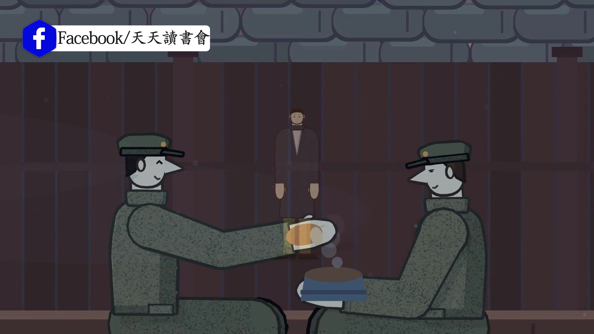

**逐字稿片段：** 這件事藏著一個 很多人沒看透的真相 一個人是善是惡 往往不只看人品 更看他處在什麼樣的遊戲規則裡 同一個人 在單次博弈裡會斤斤計較 在長期關係裡就會講信用

**話題推測：** 提出核心觀點：一個人的善惡不僅看人品，更看遊戲規則。

---

## 00:11:34

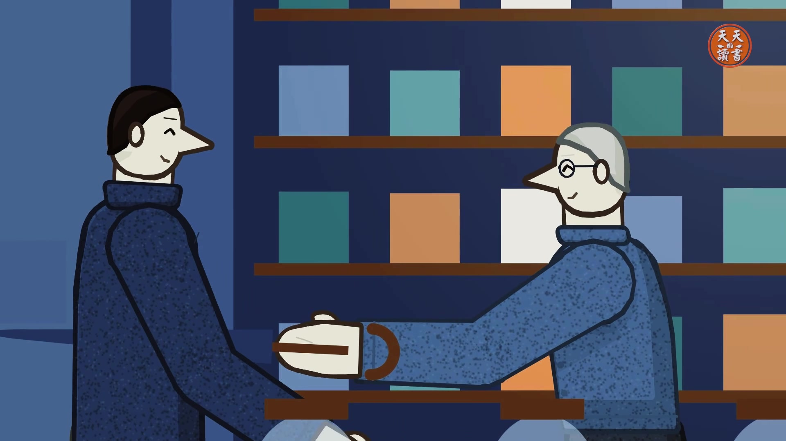

**逐字稿片段：** 說到這兒我們繼續分析老陳的事 後來你才知道 老陳第一次搶你功勞的那個月 已經拿到了下家的offer 只是沒說出來 他不是突然變壞了 而是他和你們之間已經沒有未來了 博弈論裡管這叫最後一局效應 一旦知道這是最後一次打交道 人很容易換一副面孔 心理學研究也證實 人願意為一段關係付出多少 很大程度上取決於他 覺得這段關係還能走多久 人和人之間的善意 從來不只是品德問題 更是結構問題

**話題推測：** 繼續分析『老陳』案例，引入『最後一局效應』。

---

## 00:12:14

**逐字稿片段：** 可反過來說 如果合作靠的是未來的影子 那誰能控制影子的長短 誰就能決定一群人是互相合作 還是彼此廝殺

**話題推測：** 引申出問題：誰能控制『未來的影子』長短，誰就控制合作或廝殺。

---

## 00:12:26

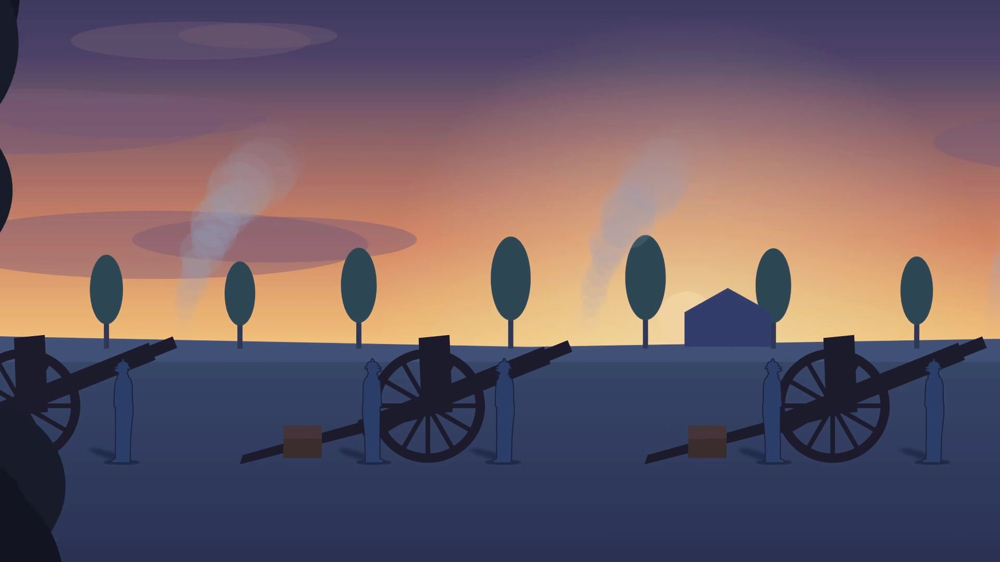

**逐字稿片段：** 這就是開頭故事的後半段 也是今天最扎心的一層真相 將軍們發現前線消極怠戰後 做了兩件事 第一下令頻繁發動夜間突襲 開槍可以故意打偏 突襲不行 有沒有真衝上去 有沒有抓俘虜 有沒有傷亡 後方一查就清楚 裝不了樣子 第二頻繁調換部隊 讓戰壕對面永遠是陌生的面孔 未來的影子就這麼被一刀剪斷了 幾個月攢下的默契迅速崩塌 戰壕重新變成了屠宰場 你發現沒有 將軍們沒教任何一個士兵去恨敵人 他們只是改了遊戲規則 這就是權力最隱蔽的用法

**話題推測：** 揭露戰壕故事後半段：將軍們如何通過改變規則打破合作默契。

---

## 00:13:14

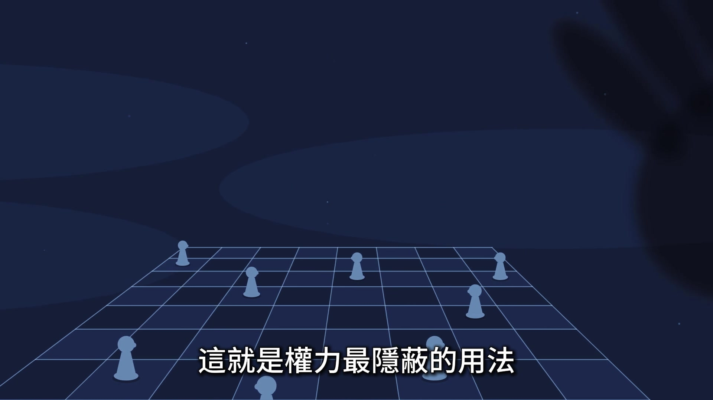

**逐字稿片段：** 一個人的善惡 很大程度上是被規則設計出來的 放到今天也一樣 頻繁輪崗末位淘汰只看 季度業績合同一年一簽 這些制度未必出於惡意 但它們都在做同一件事 縮短未來的影子 在這種規則裡 人與人更容易互相提防 搶功甩鍋 也更容易像老陳那樣 在最後一局撕破臉 所以下次看到一群本來好好的人 開始互相算計 先別急著罵人性 你可以先問一句 是誰拿走了他們的明天 想讓一群人內鬥 不用教他們變壞 只要拿走他們的未來就行 可只是明白合作重要還不夠 班還要上 老陳也還沒走 被人一次又一次傷害 到底該接著忍 還是該還手

**話題推測：** 將將軍們改變規則的行為，連結到現代企業管理制度的影響。

---

## 00:14:08

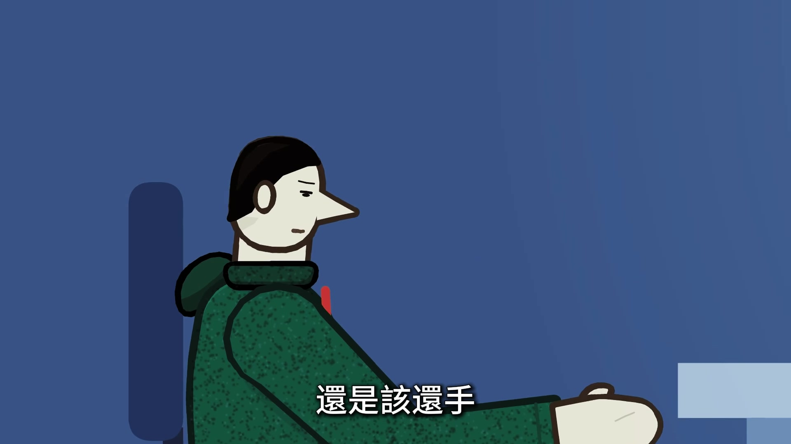

**逐字稿片段：** 這個問題 兩千五百年前就有兩個人吵得不可開交 以德報怨 還是以直報怨 被人傷害了 該用善意感化 還是該讓他付出代價 老子和孔子到底誰說得對

**話題推測：** 重新回到老子和孔子關於『以德報怨』與『以直報怨』的千年爭論。

---

## 00:14:26

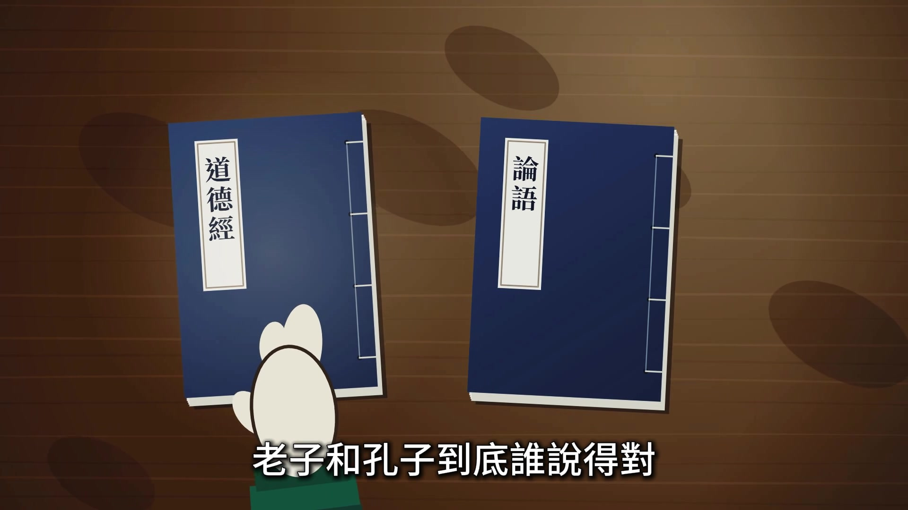

**逐字稿片段：** 咱們先把這場千年爭論講清楚 老子在道德經裡留下四個字 報怨以德 不管別人怎麼對你 你都用善意回應 像水一樣包容萬物 這是極高的境界

**話題推測：** 詳細闡述老子『報怨以德』的觀點。

---

## 00:14:41

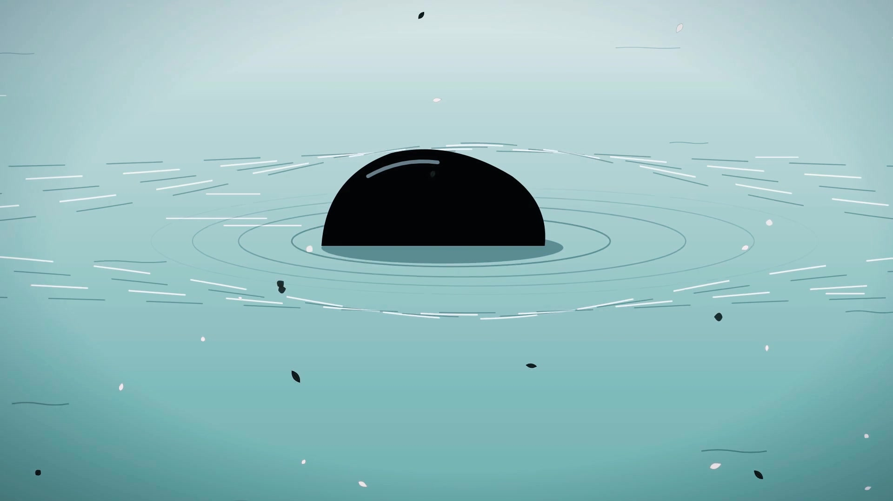

**逐字稿片段：** 孔子不認同 論語裡記載 有人問他 以德報怨怎麼樣 孔子沒直接回答 反而反問 何以報德 你用恩德回報傷害你的人 那又該用什麼回報對你好的人 最後他給出了八個字 以直報怨 以德報德

**話題推測：** 詳細闡述孔子『以直報怨，以德報德』的觀點。

---

## 00:15:00

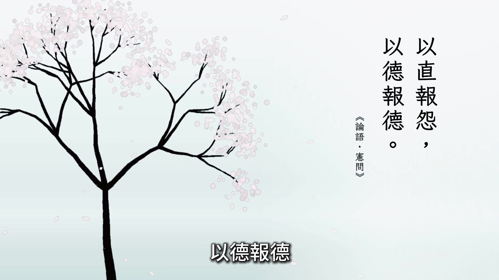

**逐字稿片段：** 西方也有一模一樣的爭論 甚至出自同一本經典 舊約說以眼還眼 以牙還牙 新約裡耶穌卻說 有人打你的右臉 連左臉也轉過來由他打 這兩種說法都有人信奉了一輩子 都能講出一堆道理 可兩千多年來 沒人能做一場實驗 實打實比出到底哪種更好

**話題推測：** 引入西方文化中類似的爭論，例如《舊約》和《新約》。

---

## 00:15:24

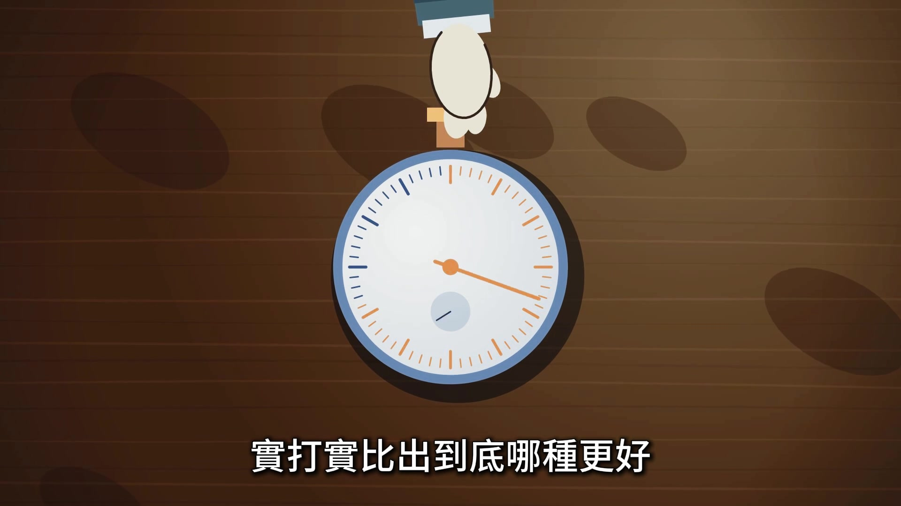

**逐字稿片段：** 直到阿克塞爾羅德的這場比賽 在阿克塞爾羅德 組織的第一屆比賽裡 有個特別剛的程式 只要你背叛我一次 我就永遠跟你死磕到底 絕不原諒 聽著很解氣 可成績慘不忍睹 哪怕只是一次誤傷 它也會和對方互相報復到底 兩敗俱傷 分數越打越低 阿克塞爾羅德後來還做過推演 如果放一個永遠合作 的老好人程式進去 不管對方怎麼欺負都不還手 它會被那些狡猾的 程式吃得一乾二淨 連渣都不剩

**話題推測：** 將阿克塞爾羅德實驗的結果，用於判斷老孔爭論的輸贏。

---

## 00:16:02

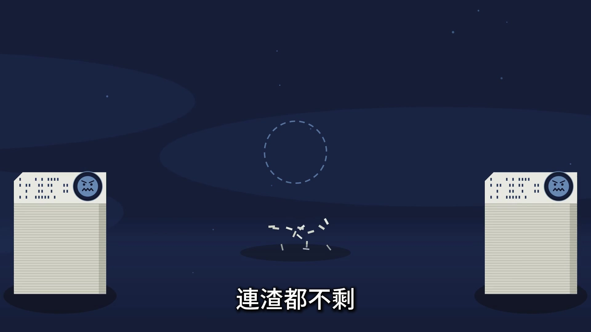

**逐字稿片段：** 那一報還一報呢 阿克塞爾羅德總結了 它獲勝的四個特點 第一從不主動背叛 第二對方一背叛 立刻反擊 第三對方一回頭 立刻原諒 第四規則簡單明瞭 對手打幾輪就摸透了

**話題推測：** 總結『一報還一報』獲勝的四個特點。

---

## 00:16:22

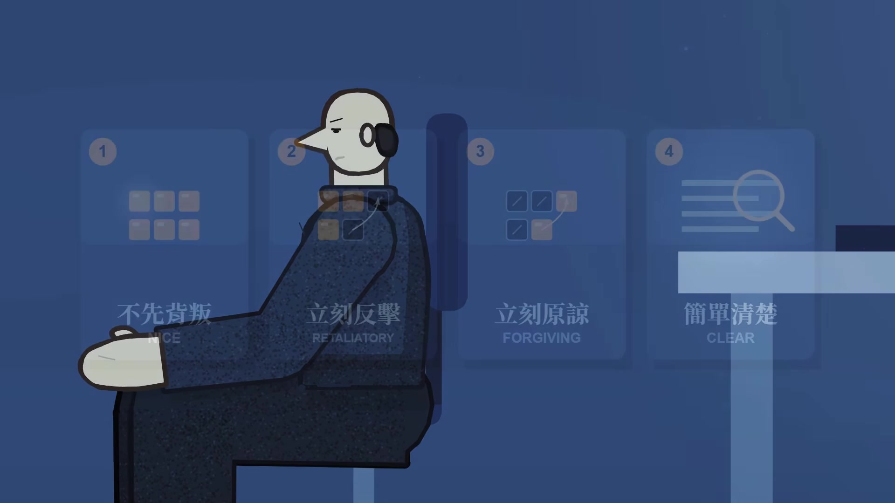

**逐字稿片段：** 你把這四條和孔子 的八個字放在一起 以直報怨 以德報德 根本就是同一個道理的兩種說法 一臺1980年的電腦 給這場兩千五百年的爭論判出了結果 固然儒家思想有很多弊端 但關於這一點 孔子似乎說對了 這裡得特別說清楚 以直報怨的直 很多人把它理解成報復 其實不對 直是正直是對等 你怎麼對我 我就怎麼回應 不多一分 也不少一分 反擊不是為了傷害對方 而是讓他明白 背叛是有代價的 恰恰是這份代價 守住了善良的底線

**話題推測：** 明確將『一報還一報』的邏輯與孔子的『以直報怨，以德報德』連結。

---

## 00:17:07

**逐字稿片段：** 再說回老陳 他第一次搶你功勞你忍了 第二次你想著算了又忍了 到第三次 全部門都覺得方案本來就是他的 連你主管都這麼認為 你的忍讓沒換來半分愧疚 只教會了他一件事 對你怎麼欺負都沒事 這就是以德報怨在 現實裡最常見的結局 不是感化了對方 是慣壞了對方 沒有牙齒的善良 就是在邀請別人來傷害你 講到這兒好像結論很明確了 孔子贏了 老子輸了 可事情要是這麼簡單

**話題推測：** 再次回到『老陳』案例，說明『以德報怨』在現實中的負面結局。

---

## 00:17:48

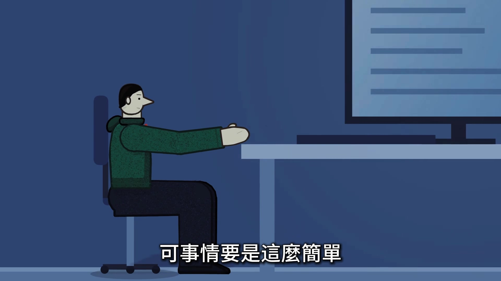

**逐字稿片段：** 今天的話題就該結束了 後來的科學家發現 光有孔子的規則還不夠為什麼 現實裡最強的策略是什麼 如果對方不是故意害你 只是一場誤會 你卻立刻反擊了 接下來會發生什麼 電腦比賽裡 每一步都清清楚楚 合作就是合作 背叛就是背叛 沒有模糊地帶 可現實世界不是這樣的 生活裡有誤會有偏差 有一句話說錯了語氣 有一封郵件被理解反了意思

**話題推測：** 提出新問題：在充滿誤會的現實世界中，孔子的規則是否足夠？

---

## 00:18:23

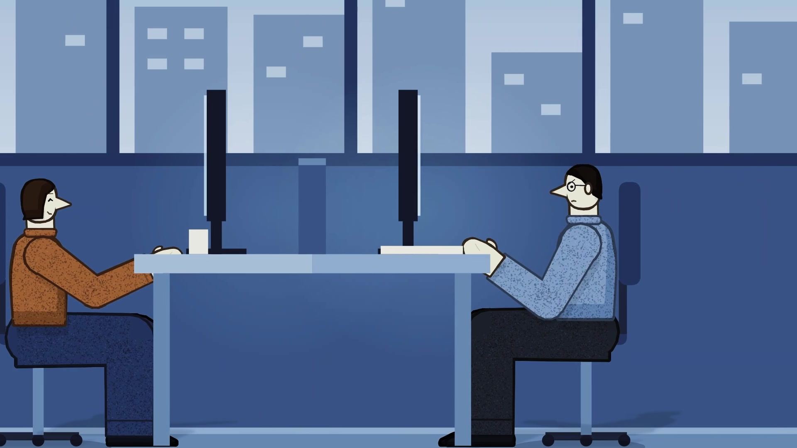

**逐字稿片段：** 後來的研究者在模擬裡 加入了一個變數叫噪音 偶爾一方明明選了合作 傳到對方那邊卻變成了背叛 結果出現了一個很戲劇性的畫面 兩個一報還一報的 程式本來相處得好好的 只要出現一次誤會 A以為B背叛了 他就立刻反擊 B看到A反擊 也立刻還手 A再反擊 兩個本來都想合作的人 從此陷進了冤冤相報的死循環 再也停不下來 這就是孔子規則的盲點 在沒有誤會的理想世界裡 以直報怨無懈可擊 可在充滿誤會的現實裡 嚴格的對等報復會把一次 小誤會熬成一輩子的仇 說到這兒我們再回戰壕裡 想想那聲道歉 那枚偏航的炮彈 按遊戲規則就是一次背叛 按一報還一報 英軍該立刻炸回去 德軍再反擊 幾個月的默契 一個下午就灰飛煙滅 可那個德國士兵爬上了胸牆 他明知隨時會被打死 還是站在那兒喊對不起 不是我們幹的 是後方的炮兵 就這一句話 把一場報復循環掐死在了起點 一句真誠的道歉 有時候比一千發炮彈更有力量

**話題推測：** 介紹後來研究者在模擬中加入『噪音』變數，以模擬現實中的誤會。

---

## 00:19:47

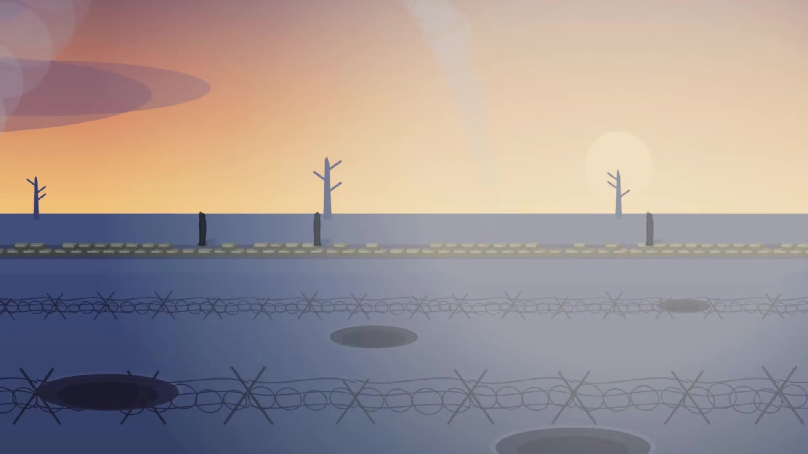

**逐字稿片段：** 90年代初 數學家諾瓦克和 西格蒙德用模擬驗證了這件事 他們發現在有噪音的現實世界裡 表現更好的是寬容版一報還一報 對方背叛了 大多數時候照樣反擊 但偶爾他會選擇不追究 再給對方一次機會 就多了這一點點寬容 誤會就沒機會長成仇恨

**話題推測：** 介紹90年代諾瓦克和西格蒙德的研究，提出『寬容版一報還一報』。

---

## 00:20:12

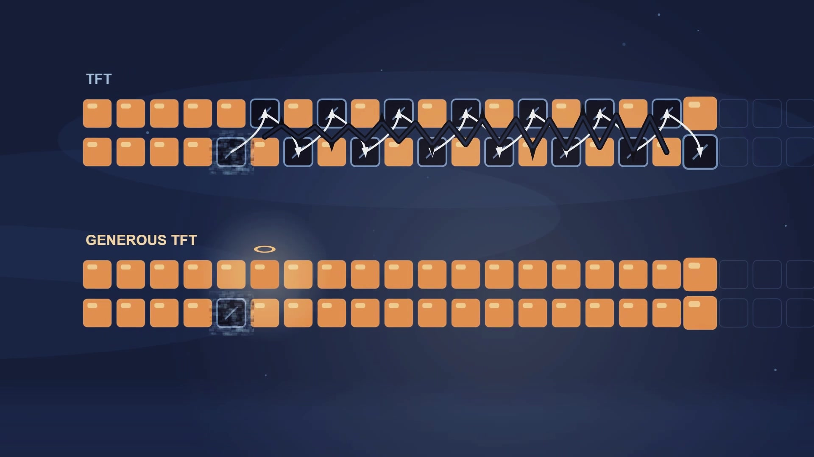

**逐字稿片段：** 說到這兒你會發現一件很有意思的事 剛才被比下去的老子又贏回來了 純粹的以德報怨 會被壞人欺負到底 純粹的以直報怨 會在誤會里兩敗俱傷 真正的贏家 是二者的結合 孔子的底線加一點 老子的胸懷 這個道理放到生活裡一點都不抽象 你肯定見過這樣的親戚或朋友 為了一句氣話 一筆算不清的小錢 你覺得他故意針對 他覺得你先翻了臉 你來我往都覺得自己只是對等回應 結果十幾年不來往 其實當初只要有一個人多退一步 多問一句 你是這個意思嗎 可能什麼事都沒有 規則保護你不被欺負 寬容保護你不被誤會拖垮

**話題推測：** 點出老子智慧的再次回歸，指出真正的贏家是兩者結合。

---

## 00:21:05

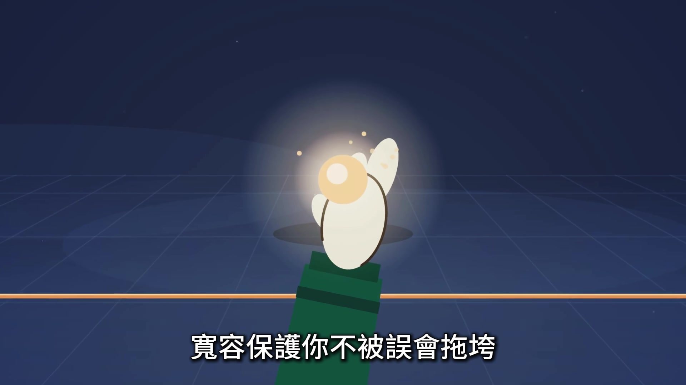

**逐字稿片段：** 但這還不是這場比賽最深的秘密 回到前面那個反常識的結論 一報還一報從來沒 贏過任何一場單挑 現在你可以重新理解這句話了 它不是不夠強所以贏不了 是它根本就沒想贏 它從不想打敗誰 每一局只做一件事 讓這場合作儘可能延續下去 它在意的從來不是這 一局我比你多賺多少 而是這一局之後 我們還能不能繼續走下去 那些狡猾的程式每一局都想贏 最後在互相背叛裡耗光了所有分數 而這個從不求贏的程式 最終拿走了總冠軍

**話題推測：** 揭示比賽最深層的秘密：『一報還一報』從未想贏單局，只求延續合作。

---

## 00:21:49

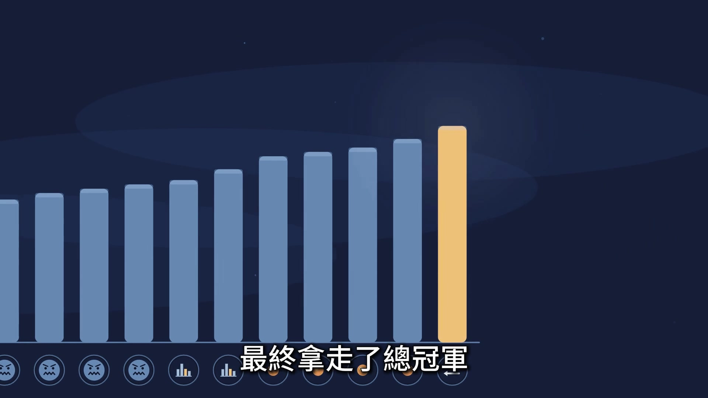

**逐字稿片段：** 兩千五百年前 老子在道德經裡寫過一句話 夫唯不爭 故天下莫能與之爭 正因為不跟任何人爭 所以天下沒人能爭得過他 我們把這句話和比賽結果對照 你會發現什麼 一臺電腦算出來的最優解 暗合的竟然是兩千年前老子的智慧

**話題推測：** 引述老子『夫唯不爭，故天下莫能與之爭』，與實驗結果呼應。

---

## 00:22:13

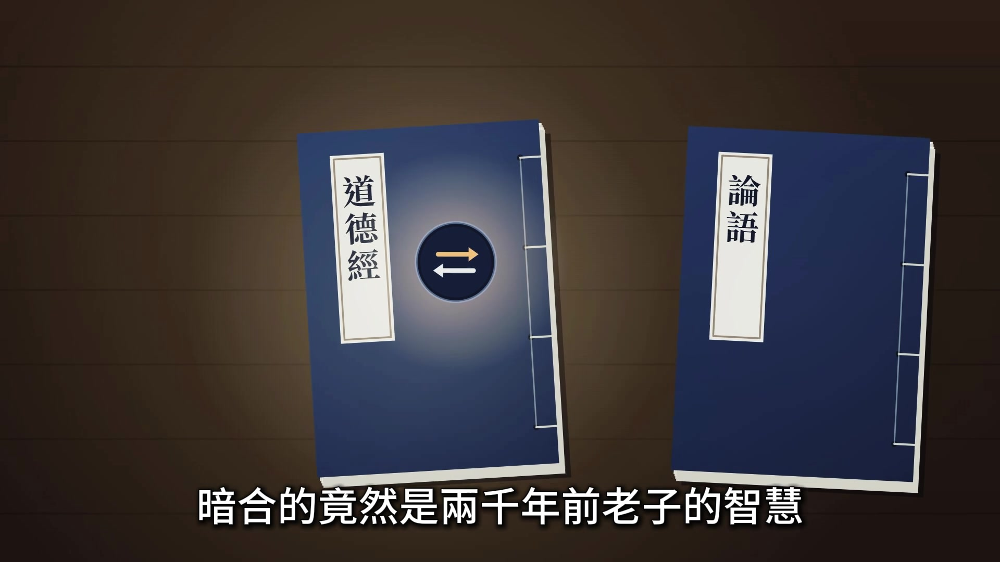

**逐字稿片段：** 所以這場千年爭論 最終的答案是孔子贏了處世的規則 老子贏了人生的境界 規則告訴你 被欺負了要還手 境界告訴你 你真正要贏的從來不是眼前這一局 這就是今天最想和你分享的

**話題推測：** 總結千年爭論：孔子贏規則，老子贏境界。

---

## 00:22:33

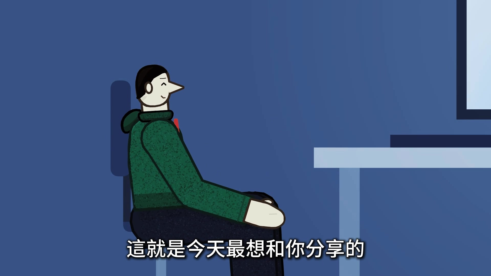

**逐字稿片段：** 我們大多數人一輩子在 人際關係裡糾結的都是 這件事我有沒有吃虧 這個問題會讓你贏很多小局 贏一場爭吵 爭一回面子 討一筆小賬 可真正的高手問的是另一個問題 這件事之後 這段關係還能不能繼續 這個問題會讓你輸掉一些區域性 但會贏下整個人生 你想想和老同學和 合夥人和愛人的那些爭吵 有多少次你贏了道理 卻輸了關係 會算眼前賬的人贏一局 會算長遠賬的人贏一生

**話題推測：** 區分『贏小局』與『贏人生』的思考方式。

---

## 00:23:13

**逐字稿片段：** 道理都說透了 可明天早上走進辦公室 老陳還坐在那兒 具體到底該怎麼做

**話題推測：** 過渡到具體實踐層面，如何應對『老陳』。

---

## 00:23:21

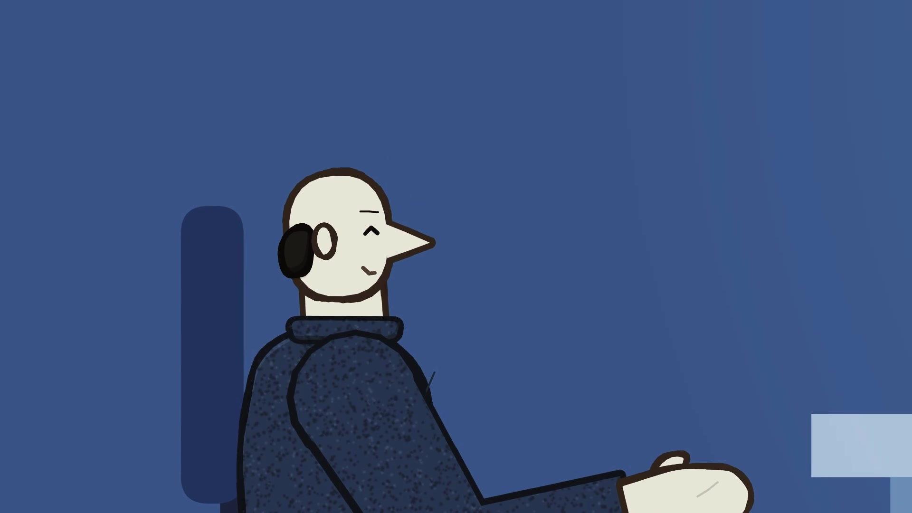

**逐字稿片段：** 應對老陳的四個步驟 落到實處 明天碰到老陳這種人 具體該怎麼操作 我們把一報還一報 獲勝的四個核心邏輯 翻譯成了四步行動指南 順序別亂 照著做就行

**話題推測：** 介紹應對『老陳』的四個具體步驟。

---

## 00:23:37

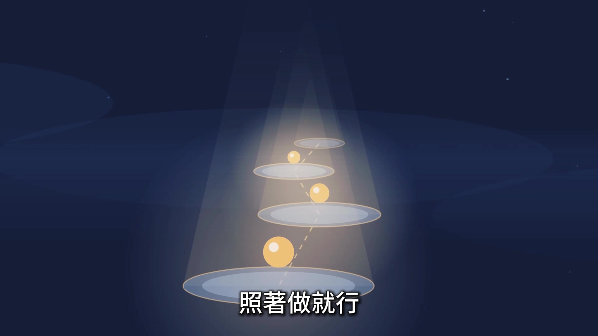

**逐字稿片段：** 第一步先看清是什麼局 再決定要不要先釋放善意 先做個好人是有前提的 你們還會再見面 你肯定有體會 景區門口的飯店往往見一個宰一個 可小區樓下開了十幾年的麵館 老闆總愛多給你加一勺湯 兩個老闆人品未必差多少 差的是一個知道你不會再來 一個知道你明天還會光顧 所以面對路邊推銷陌生 來電來路不明的投資 先護好自己 面對要長期相處的人 主動伸出手 決定怎麼對一個人之前 先問自己一句 我和他還會再打交道嗎 善良要給對的場景 而不是給所有人

**話題推測：** 第一步：先判斷是什麼局，再決定是否釋放善意。

---

## 00:24:26

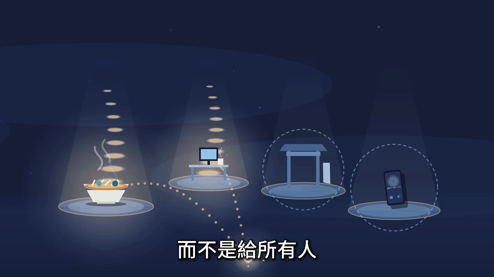

**逐字稿片段：** 第二步被傷害了要當場回應 但只回應對等的程度 印度有個寓言 村口有條毒蛇 總咬傷路人 一位聖者路過 勸它不要再傷人 蛇答應了 沒多久村裡的孩子發現蛇不咬人了 就天天拿石頭砸 拿棍子打 把蛇打得遍體鱗傷 聖者再路過的時候 蛇委屈地說 我聽了你的話 怎麼落得這個下場 聖者說我讓你不要咬人 可沒讓你連警告都不會啊 以直報怨的直 就是這聲警告 讓對方知道你有底線 但你不會主動傷人 放到老陳身上就是 下次他再把你的方案說成自己的 不用拍桌子 也不用背後告狀 當場平靜地補一句 這部分是我負責的 我來補充下細節 不翻舊賬 不誇大不記仇 只把這一次的邊界劃清楚 你可以不主動傷人 但一定要有保護自己的鋒芒

**話題推測：** 第二步：被傷害要當場回應，但只回應對等程度。

---

## 00:25:32

**逐字稿片段：** 第三步翻篇或者給機會 春秋時楚莊王宴請群臣 喝到天黑 殿裡點著蠟燭 忽然一陣風颳來 蠟燭全滅了 黑暗裡有人趁機拉扯莊王的寵妃 寵妃一把扯斷了那人的帽帶 跟莊王說快點燈 看誰帽帶斷了 就是誰幹的 楚莊王想了想 反而下令 今天喝個盡興 所有人都把帽帶扯斷 斷了再點燈 燈亮了滿殿一百多人 帽帶全是斷的 誰也查不出來 幾年後楚晉交戰 有位將軍每次都衝在最前面 拼死退敵 戰後莊王問他為什麼這麼拼命他說 當年宴會上被扯斷帽帶的人就是我 是非說不清的時候 多給一次機會 就是掐斷了報復的死循環 放到老陳身上 你當場劃清邊界後 他收斂了 甚至開會主動說 這部分是某某做的 這時候就立刻翻篇 別翻舊賬 別陰陽怪氣 你原諒得越乾脆 他回頭的成本就越低 也就越願意好好相處 多給一次機會 不是心軟 是給關係留餘地

**話題推測：** 第三步：選擇翻篇或給予對方機會。

---

## 00:26:50

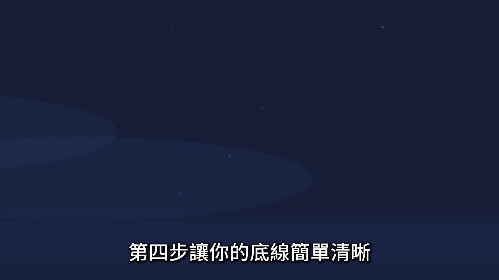

**逐字稿片段：** 第四步讓你的底線簡單清晰 左傳裡記載過一件事 晉文公攻打原城 出發時只帶了三天的糧食 跟全軍約定三天打不下來就撤軍 三天到了城沒破 這時探子回報 城裡已經撐不住了 再等一兩天肯定投降 將領們都勸晉文公再等等 晉文公說 信國之寶也 民之所庇也 信用是立國的根本 得了一座城卻丟了信用 拿什麼保護百姓 還是下令撤軍 軍隊剛撤了三十里 原城的人聽說了這件事 主動開城投降了 一報還一報 能贏一半靠的是好懂 你合作我就合作 你背叛我就反擊 說到就一定做到 讓人摸不透的人 最容易被反覆試探 讓人看得懂的人 連對手都願意信任 所以和老陳相處 你只要一條規矩 並且說到做到 我的工作成果我自己彙報 對家人對下屬對合夥人都一樣 規則不用多 但每一條都要算數 別人看得懂的底線才是真的底線 做到這四步 就能保證再也沒人傷害你嗎並不能 那我們做這一切到底是為了什麼

**話題推測：** 第四步：讓你的底線簡單且清晰。

---

## 00:28:18

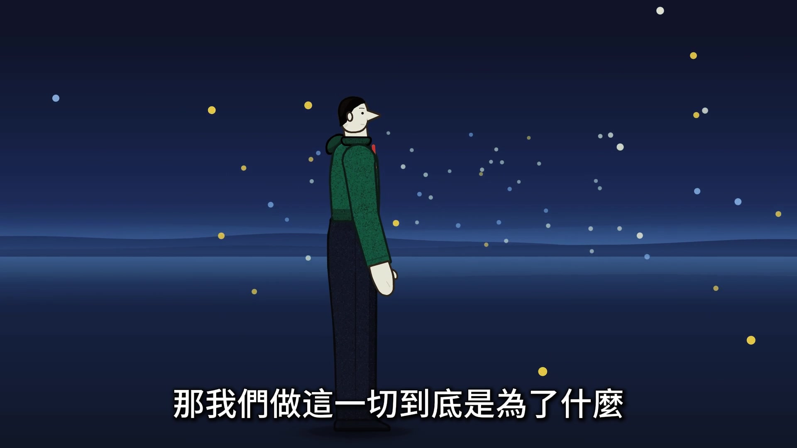

**逐字稿片段：** 我們的目標是什麼 我得先坦誠地 告訴你這套策略的邊界 它所有的效力都建立在一個前提上 你們還會再打交道 對一錘子買賣的騙子 對完全不講規則的人 這套方法沒用 知道什麼時候該轉身離開 本身也是策略的一部分 至於老陳 他最後還是離職了 但在他走之前的那幾個月 再也沒搶過你的功勞 不是他突然變好了 是你讓他看懂了你的規則 別人怎麼對你 有一半是你教出來的

**話題推測：** 闡述策略的邊界和最終目標。

---

## 00:28:55

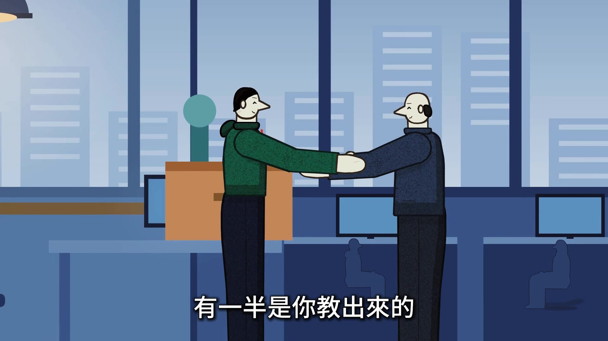

**逐字稿片段：** 今天的所有內容總結成一句話就是 單次博弈算計贏 長期相處規則贏 先釋放善意 但要有鋒芒 會果斷反擊 但也會原諒 拿不準的時候多給一次機會 並且讓你的規則所有人都看得懂 最後我們再說說那條戰壕 那些飯點放下槍計程車兵 不是聖人 也不是懦夫 他們只是清楚一件事 明天早上 對面那張臉還在 我們的人生其實 就像那條長長的戰壕 同事家人老友合夥人 幾乎每一張臉 明天早上都會再出現 提交那個最短程式的拉波波特 一輩子都在研究 如何讓人類遠離戰爭 他寫下的從來不是 一個打敗對手的策略 而是一個讓人們 不必互相傷害的方法 一次性的局算計贏 一輩子的局規則贏 你不需要贏下每一局 你只需要讓每一段 關係都能好好走下去 別人怎麼對你 有一半是你教的 感謝觀看天天讀書會 我們下期見

**話題推測：** 總結所有內容：單次博弈算計贏，長期相處規則贏。

---
