# themarketmemo_w3baNc7NVeU — 關鍵畫面索引

- 來源逐字稿：[themarketmemo_w3baNc7NVeU_GT.srt](themarketmemo_w3baNc7NVeU_GT.srt)
- 影片：https://www.youtube.com/watch?v=w3baNc7NVeU
- 截圖數：18

## 00:00:16

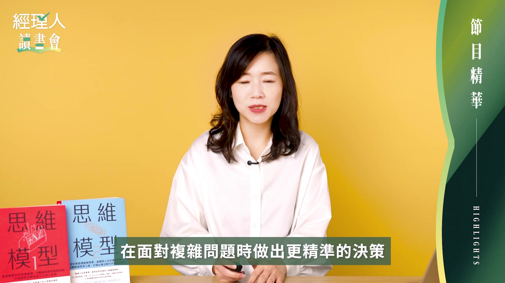

**逐字稿片段：** 本集將帶大家一起探索能力圈 第一原理 二階思考與演化等核心模型 打造屬於你的思考工具箱 嗨 各位《經理人讀書會》的觀眾朋友們 大家好 我是經理人的玉琦 《經理人讀書會》這個節目 會跟大家分享我們最近讀到的新書和好書

**話題推測：** 本集將探索的核心思維模型清單。

---

## 00:00:38

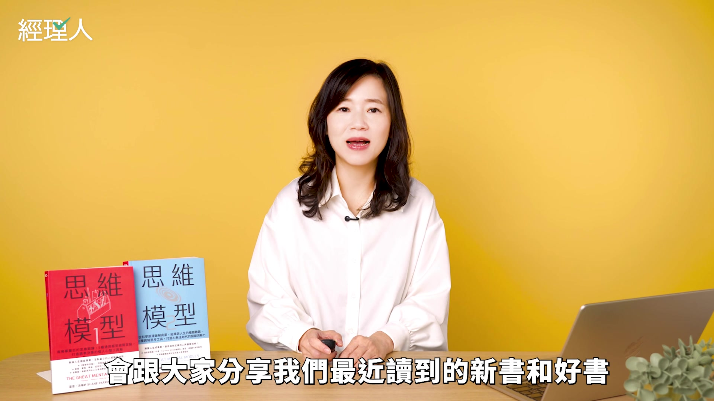

**逐字稿片段：** 今天要介紹的這本書是思維模型 到目前為止出到第 2 集了

**話題推測：** 介紹今天討論的書籍《思維模型》。

---

## 00:00:43

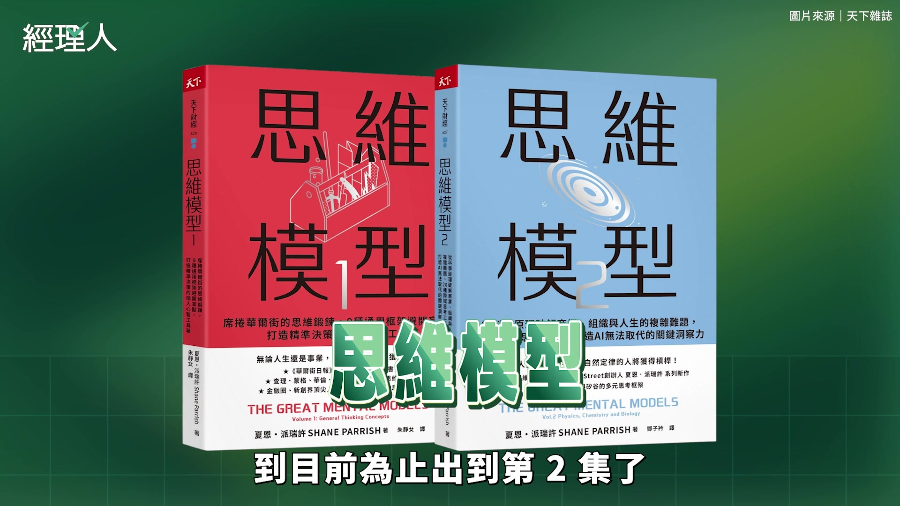

**逐字稿片段：** 作者是夏恩．派瑞許 他是一個知識型網站法南街的創作者 然後他也是私募股權公司的創辦人 他創立這個網站的初衷 其實就是要分享經得起時間考驗的智慧 也就是各式各樣的思維模型 什麼叫做思維模型

**話題推測：** 介紹書籍作者夏恩．派瑞許的背景。

---

## 00:01:01

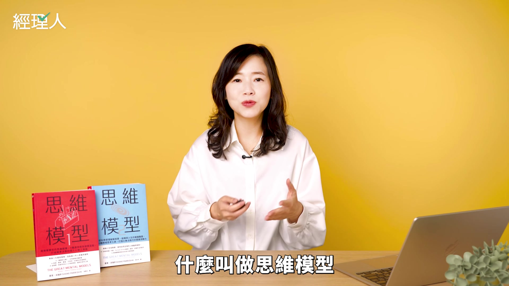

**逐字稿片段：** 多元思維模型是股神巴菲特的事業夥伴 查理·蒙格所推崇的思考方式 他認為呢 思考問題需要有來自不同學科的知識架構 這些模型可以幫助我們去思考 判斷跟解決問題 所以呢 其實思維模型這本書就是作者去蒐集他認為 他認為可以放進 可以當作是你的工具箱的概念 我自己呢 也非常喜歡思維模型工具箱的概念 其實很多思維模型你都聽過 甚至於已經尋常到成為我們平時講話的時候 就會自然而然使用的比喻跟語彙 比如說 我們常常講到某個產業的生態系怎麼樣 或是商業模型的演化如何 但是生態系跟演化聽起來很普通哦 可是它其實是來自生物學的概念 也就是說 如果你對它原初的概念 它在生物學當中的 這樣子的思維有更深入的瞭解 當你使用它來分析產業的變動 或是某一家公司的成長時 就會對它可能的變化 環境跟它會有什麼交互的作用 會有更細緻的理解 找到更多可以對應的地方 其實啊 每一種思維模型 它都像是一種觀看世界的方式 提供不同的視角 當你從某一個思維模型出發的時候 你會看見事情的某些面向 那如果你這時候換另外一個模型 就會看到不同的面相 也就是說 如果你擁有好幾個模型 就可以幫助你看得更完整 更周全 那今天呢 我們要講的有五件事情哦 第一件事情是 增加思維模型很容易嗎 第二是 了解能力圈的邊界 第三呢 是馬斯克最愛的第一原理 第四是 思考行動的下一層後果 二階思考 最後呢 是不適應就淘汰的演化

**話題推測：** 提及查理·蒙格推崇多元思維模型。

---

## 00:02:57

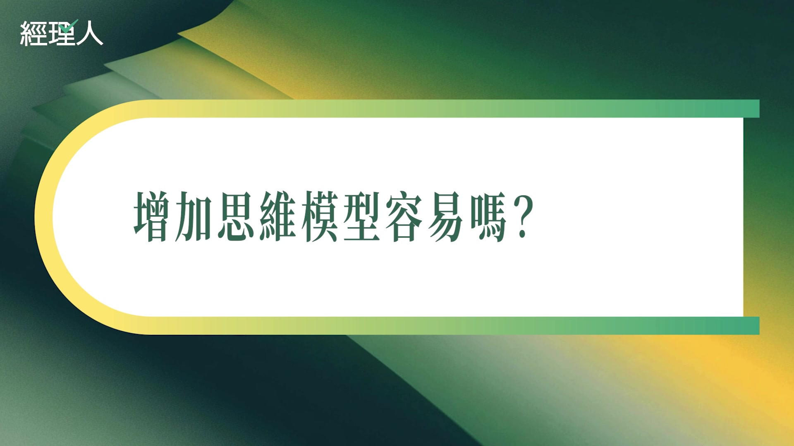

**逐字稿片段：** 增加思維模型真的很容易嗎 其實我們自己在求學階段 你在工作 出社會 你都已經讀過 你可能也知道各式各樣的不同的思維模型 但是呢 真正可以讓你說 已經放入我的工具箱裡面的思維模型 可能沒有那麼多 一個原因是 我們每個人都有盲點 就是我們從小到大可能認為 我現在去理解的方式 就已經是正確的方式 甚至於是唯一的方式

**話題推測：** 開始第一個主題：增加思維模型是否容易？

---

## 00:03:25

**逐字稿片段：** 就很像是 當一個人在知道地球是圓的之前 也會理所當然的去認為 地球當然是平的啊 那在這個時候要去接受 世界上還有其他的觀點 其實沒有想像中容易 另外一個妨礙我們更新思維模型的原因 是我們常常去低估了基礎概念的重要性 高估了複雜的概念 因為我們 其實這一生當中都在致力於去獲得更精準 更專門的知識 所以可能會認為那些大家都知道的事情 比較沒有價值 可是呢 簡單的概念之所以很簡單 就是因為它的通用性高 而且經得起時間的考驗 所以才會是各學科 各領域當中最基本的原則 而且啊 要能夠發揮思維模型的關鍵在於多樣性 就是你一定要有複數個思維模型 每個人呢 通常都有一個自己比較專門領域的知識 這固然也很重要 可是我們也需要去接觸其他的學科 具備跨領域的思維 不然你可能就會過度利用自己手上的模型 這就很像查理·蒙格說的 當你手上有一把錘子的話 你看什麼事情都像是釘子 比如說工程師 可能就會習慣用程式的角度去思考 心理學家 就習慣從人的動機跟心理層面去思考 商業人士呢 就很有可能只會去考慮做事情的成本跟報酬 那每一種不同的模型 通常都有它自己的適用性跟侷限性 所以我們必須要時常去審視 或者是去更新模型 透過擁有不同的模型 慢慢的消除自己的盲點 好 那接下來呢 我們就會介紹幾個書中提到 然後我自己也非常喜歡 覺得非常實用的模型

**話題推測：** 以「地球是圓的」比喻盲點與接受新觀點的困難。

---

## 00:05:20

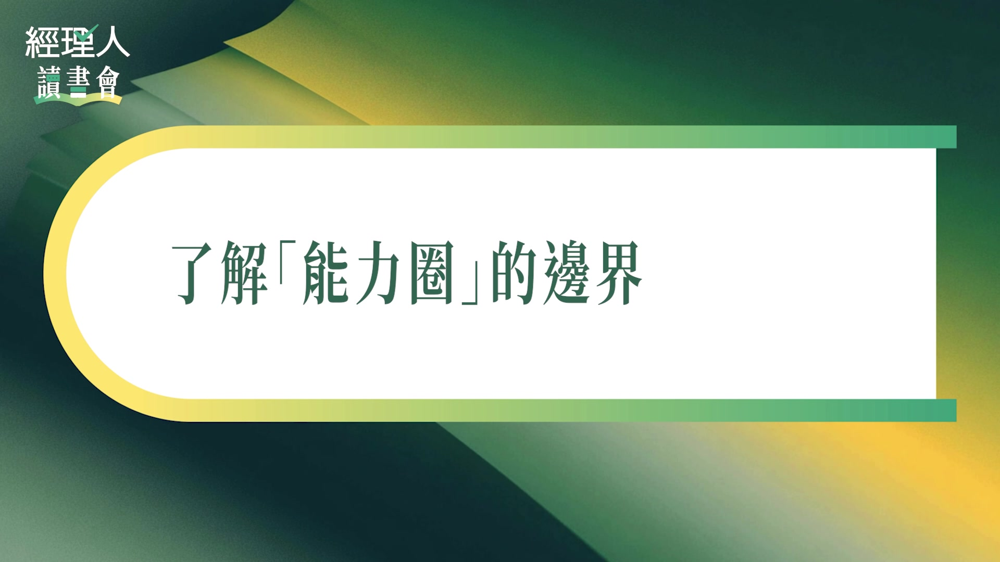

**逐字稿片段：** 那我們第一個要講的模型呢 是能力圈 如果你有聽過的話 你可能覺得 欸 能力圈不是一句話就講完了嗎 就是你的能力範圍嘛 那也就是 你擁有豐富知識的這個領域 就叫做能力圈 那我們想要透過 第一個就是能力圈的這個思維模型 跟大家說明 或者是示範 一個很簡單的概念 它怎麼樣可以應用在不同的地方

**話題推測：** 介紹第一個實用思維模型：能力圈。

---

## 00:05:43

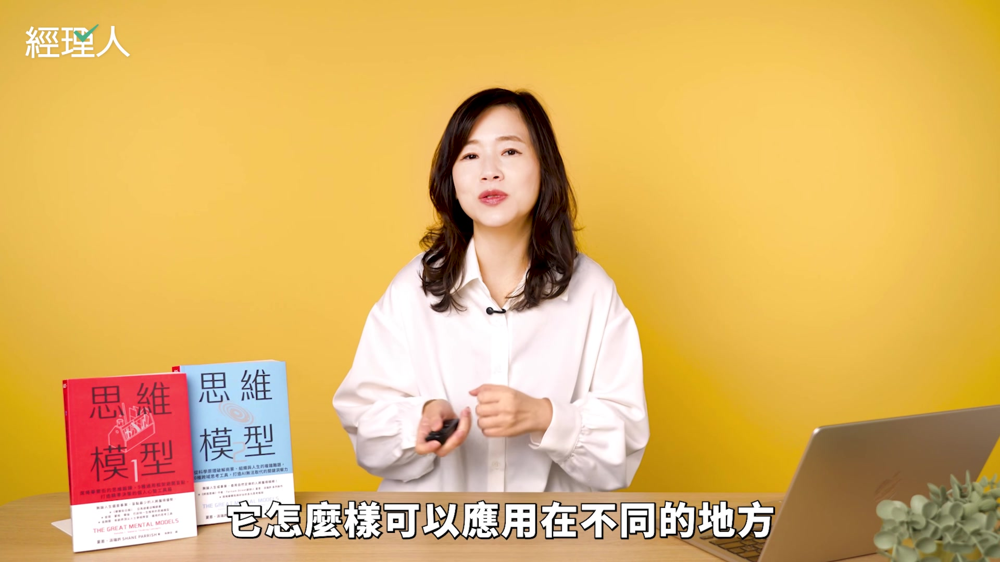

**逐字稿片段：** 書裡面講了一個故事哦 那請你現在也跟我一起想像一下 就有一個在這個社區小鎮上 有一位老人家 他可以說是社區的耆老 他一輩子都在這個小鎮上生活 所以對這個小鎮上的每一個人 他都非常非常的熟悉 他知道每個人的秘密 他知道誰欠誰錢 他知道誰跟誰處得來 誰跟誰是互相討厭的 那現在呢 有一個外地人來到這個小鎮上 他來這裡住了幾天 在幾天之內 他就覺得 欸 這個小鎮我蠻熟悉的欸 我去生活的時候沒碰到什麼大問題 而且大部分的店我都認識 也去過了 這就是一個普通的小鎮 那這個外地人 他是不是會覺得 他跟耆老了解這個小鎮的程度差不多了嘛 這個長老腦中的知識網絡 跟外地人腦中的知識網絡 這個當中的差別 就是我們所謂能力圈的之內跟之外 所以你想想看 即便這外地人他覺得 其實我好像已經蠻熟悉這個小鎮了 但是長老是有可能隨意的 只要問一個問題 就考倒外地人 可是外地人卻沒有辦法 只要長老在自己的能力圈之內 他永遠都是比較瞭解狀況的那個人 那我們現在瞭解了能力圈的起初概念了 對大多數人來說 攀登聖母峰 並不在我們的能力圈之內 而且呢 不管你再怎麼樣上網查 只要是你能夠在網路查得到 可以快速瞭解的知識 也就代表那是 所有門外漢都可以快速瞭解的知識 所以呢 當你要攀登聖母峰的時候 所有聖母峰的登山者 都必須要仰賴這個地區的原住民 也就是雪巴人的專業知識 這就是能力圈之內跟之外的差別 這告訴你 在做某個判斷的時候 你必須要清楚的知道 我自己到底是在能力圈的之內 還是在能力圈的之外 在你的能力圈之內 你可以確切的知道 欸 我到現在還缺乏什麼樣的資訊 我要做出某個決策 還需要知道哪些事情 你也能夠從不同的層次去理解問題 在能力圈之內呢 你會有很多的選項 因為你非常熟悉狀況 那你對於這個領域熟悉的程度 可以讓你調用各式各樣的資源 這樣的能力圈呢 絕對不可能在一夕之間就養成 也不是什麼上了幾門課啊 還是努力幾個月啊 就可以瞭解的程度 可是呢 你要了解的是 你要維持能力圈 就是永遠不能夠認為 能力圈是理所當然的 因為能力圈它並不是一個靜態的領域 知識會不斷的更新 你的邊界也會不斷更新 你需要保持好奇心 也要持續的學習 你還需要時常求助於外部的回饋 許多專業人士啊 他即便是在他的能力圈之內 還是要必須引入外部的觀點 才能夠持續擴展跟強化他的能力圈 就很像是 世界頂尖 世界頂級的運動選手 他還是會去請教練的 為什麼 因為每個人都有自己看不見的盲點 每個人都有自己的偏見 你想要成長 你想要維持跟強化能力圈 不能只靠自己 好 那另外一方面是 假如你現在就是一個外地人 好 你知道自己在能力圈之外 你要怎麼樣做事情 第一是 你必須要掌握 門外漢可以掌握的基礎知識 並不是說我什麼都不知道也沒關係哦 而且呢 你要清楚的知道 我就是一個外地人 我不要認為我是一個專家 就要去攀登聖母峰 你要知道是你現在所知道的事情 都是很容易就取得 所以不要因為這樣 就對自己有不切實際的自信 第二是 你還要知道在這個範圍內 誰是長老 你要花點時間做功課 至少你的功課要做到 如果長老就在我身邊 我需要問哪些問題 我需要知道哪些資訊 可以讓我學會怎麼釣魚 不是只跟人家要魚吃 第三 就是廣泛的去認識世界上的基本思維模型 這能夠幫助你 就算去到了一個陌生領域 也能夠有一個有限程度的瞭解 因為你可以透過 欸 用不同的思維 模型來很快速的掌握現在的狀況

**話題推測：** 開始講述社區耆老與外地人對小鎮了解程度的故事。

---

## 00:10:01

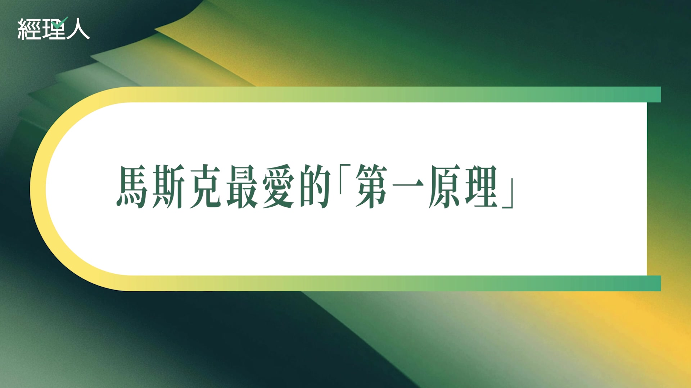

**逐字稿片段：** 那能力圈講完之後呢 我們接下來要講的是第一原理思考 First Principle Thinking 它是一種對複雜情況進行逆向工程的方法 簡單來說呢 它的概念就是要把事情一層一層的拆下來 拆解到最源頭的假設 跟它理論基礎 好 我們這邊可以舉個例子

**話題推測：** 介紹第二個思維模型：第一原理思考（First Principle Thinking）。

---

## 00:10:19

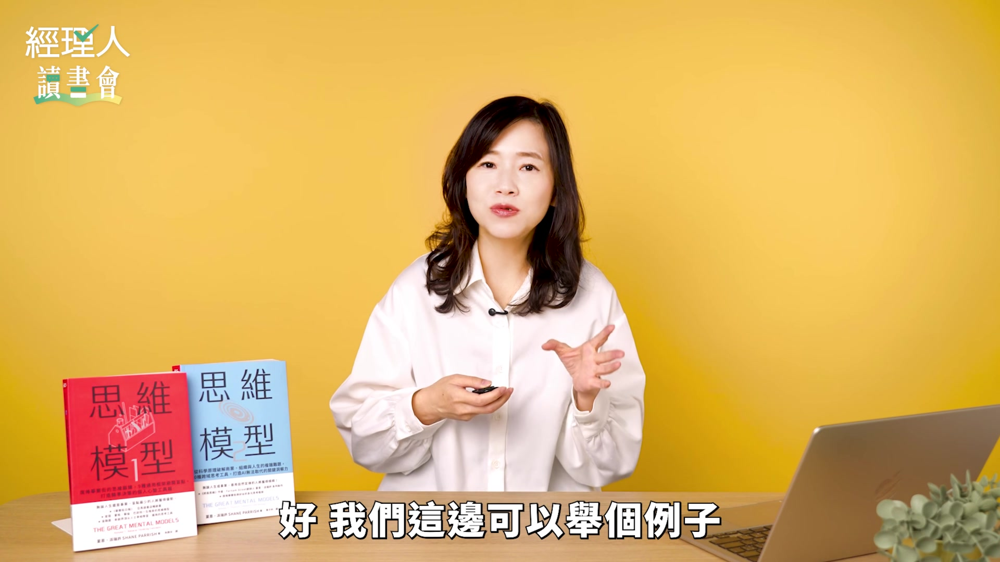

**逐字稿片段：** 比如說 你現在看到了一棟 樂高蓋出來的房子 然後呢 你想要修改一下這個房子 那你可能就會說 好吧 那我就先把這個屋頂調整一下 或是我把樹移到不同的地方 或者是 我把院子改的 門改的不同地方 稍微移動一下配件 好 這是一種修改的方式 可是當你往下拆解 你發現這棟房子的每一個地方 每一個東西 都是由一塊一塊獨立的樂高積木組成的 所以你有可能運用 你現在手上的這些樂高積木 創造出跟房子完全不一樣的東西 大多數的我們的改善都停留在上一層 就是對於你已經看到已經存在的東西 對它的現狀做稍微的修改 這就是第一層的修改 可是如果呢你想要使用第一原理 你就是要把這棟房子拆回到樂高的狀態 那你還可以把它想得更根本 你想想看 要是我把這些塑膠積木再丟回去 溶解成回去塑膠的狀態呢 那你可以把樂高積木做出一個完全新的東西 這就是第一原理的威力哦 所有的東西都可能可以拆解到更下一個層次 但大部分的時候 其實你只要能夠使用這個原理 往下拆個一兩層 就可以打開很多的可能性 那如果當我們希望來應用這個思考模型 我們希望從比較根本的方式來看問題 有幾個方法哦 第一個呢是蘇格拉底提問法 它是一個有紀律的提問過程 可以幫助你檢視你的基本假設 好這個提問法是 第一 首先先說明你的想法 也就是去解釋你想法的起源 哎我為什麼會這樣想啊 我實際上到底是怎麼想 去詳細的說明你的想法 那往下是第二個層次 你怎麼知道你的想法 你的假設是真的 如果我把這個假設顛倒過來的話 會變成什麼樣子呢 第三是幫你的假設去尋找證據 你要用哪些證據去支持你現在的假設的論點 這些證據的來源又在哪裡 第四是考慮其他的觀點 如果是別人來看的話 他也會跟我用一樣的假設嗎 別人會怎麼思考這件事情 我怎麼知道我現在這個樣子的想法是正確的 第五呢是檢視後果和影響 好如果我錯了 那會怎麼辦 如果我錯了 會導致什麼樣的後果 第六呢是質疑原始的問題 我到底經過了這一輪思考之後 我到底是不是正確的 我從剛才的推理過程中得到了什麼樣的結論 好這是其中一種方法 另外一種方法呢也是提問法 叫做五個為什麼 你想想看哦小孩他就很愛問為什麼嘛 那就表示其實小孩子呢是很本能的 就會從第一原理來思考 因為他很想要知道世界的本質是什麼 然後你的為什麼這個目標就是一直往下去問 到底為什麼呢 那這個為什麼的問法並不是去察覺說 哎我的感覺是什麼 而是要去檢驗這個概念 這個概念到底是一個你的知識 還是只是你的感覺 如果你對一件事情提出了一連串的為什麼 最後得到了一個科學上可以被否證的事實 那你就找到了一個第一原理 可被否證的意思是 如果這件事情它有辦法被證明它是錯的 那它就是事實 如果一件事情是沒有辦法去證明它 是不是錯的 那也表示就不可能去證明它是對 那這就是一個不是第一原理的一件事情 但是如果你經過五個問題 最後得到的答案是因為我就是這樣覺得 或者是因為事情就是這樣 那你就知道 你的這個想法可能只是社會的文化 社會上的迷思 社會上的共識 你的感覺 那這就不是第一原理 那我們去追究 我們去探究事物最終最原初的這個第一原理 有什麼樣的好處哦 這邊可以跟大家分享一個醫學上的例子 在這個醫學上 自從細菌被發生以來 科學家呢都認為因為胃有胃酸 細菌呢不能在胃裡頭生存 所以過去呢胃是一個無菌的環境 胃裡沒有細菌 這件事情被當作是胃的第一原理 然而事實證明呢 胃這個無菌的環境它其實不是第一原理 它只是一個假設而已 就是病理學家或者醫學呢 假設胃是無菌的 所以一直到有一個病理學家 他從病人的胃部切片中發現了細菌 他就質疑了這個第一假設 哎好像胃不是無菌環境哦 我們過去一直把它假設成一個無菌環境 它其實就是一個假設而已 所以後來呢他就跟另外一個病理學家合作 發現其實哎很多胃裡面都找到了細菌 好這就讓他們去想 那假如胃是無菌環境不是第一原理的話 那我們在討論胃的問題的時候 什麼才是第一原理呢 後來在他們的研究之下呢 他們就發現胃潰瘍的主要原因呢 就是來自幽門螺旋桿菌 因為這個發現跟他們後續的發現 這一組呢 他們在2005年的時候獲得了諾貝爾獎 現在胃潰瘍 就能夠靠抗生素就可以獲得治療了 那這個特斯拉的執行長Elon Musk 他也是第一原理的信奉者 所以我們這邊可以講一個馬斯克的故事哦 那時候一開始特斯拉 它要採購鋁輪圈的時候 一個鋁輪圈要500美元 馬斯克就覺得 哎這太奇怪了吧 鋁的價錢一磅大概 2 美元 這個輪圈呢 25 磅重而已 所以表示成本是 50 美元 就算我給你加工的費用 把它翻倍變成 100 美元 這也不應該是 500 美元啊 這就是從第一原理 他直接從鋁的本質去想 輪框的價錢應該是多少 可是一般人可能不會這樣想 如果你是一個要去買鋁輪框的人的話 你不太會抗拒眼前的狀況 所以你可能就會去想 我們比較了好幾個廠商的輪圈 每個人的輪圈都在300到600美元之間 所以500美元不算太貴 這就是一個 是不是從第一原理去思考的一個例子哦 那第一原理呢其實它就是要你問到 一直問下去一直問下去 問到領域中最基本的事實 問到 我們到底能夠確定什麼事情一定是真的 這個事情 再把這些事實套用在我們現在的環境中 從最基礎的事實重新去建構環境 其實要使用第一原理是有蠻困難的 因為我們有時候去 我們不想要去改變我們看到已經存在的事情 好可是呢如果我們開始去思考 事情不一定是你現在看到的這個樣子 也可能是另外一個樣子的時候 就是找出第一原理的過程

**話題推測：** 以樂高積木組成的房子為例，解釋拆解到最源頭的概念。

---

## 00:17:30

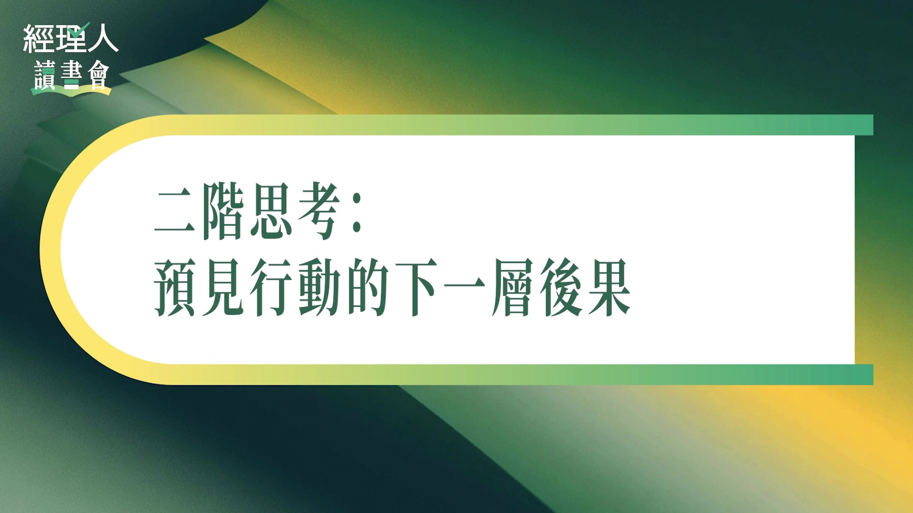

**逐字稿片段：** 好那接下來呢我們要講的是二階思考 二階思考是幾乎每個人你都可以看到 你做一件事情的立即結果是什麼 立即得到的後果就叫做一階思考 First-order thinking 那二階思考 Second-order thinking 的意思是 更進一步更全面的去思考 你現在的行為的直接後果之後 還有可能有什麼樣後續的影響 所以你可能會去面對二階或是三階的效應 我們其實日常生活中有很多一階思考 跟二階思考的例子

**話題推測：** 介紹第三個思維模型：二階思考（Second-order thinking）。

---

## 00:18:06

**逐字稿片段：** 我現在跟大家講一個英國殖民時期的印度 當時呢 英國政府擔心印度的德里有很多眼鏡蛇 都是劇毒的眼鏡蛇 所以他們為了減少眼鏡蛇的數量 政府就實施了一個獎勵政策 鼓勵大家呢 拿捕獵來的眼鏡蛇就可以得到獎金 那一階思考很單純嘛 因為呢我就推出了一個獎勵計劃 印度人就會去捕殺眼鏡蛇 眼鏡蛇的數量就會減少 好這就是一階思考 那二階思考呢 有了這樣的計劃之後 為了拿到更多錢 印度人呢就去繁殖眼鏡蛇 再把這些蛇殺掉去交給政府 所以最後導致眼鏡蛇變得更為氾濫 因為大家反而去養了眼鏡蛇 我們可以再舉一個缺乏二階思考例子哦 就是其實畜牧業長期以來呢 為了讓肉更安全啊 為了更容易的養出更大隻的動物 所以一直在餵動物吃抗生素 可是後來才發現 因為一直吃抗生素的關係 畜牧業也因為這樣養出了 自己沒有辦法對抗的細菌 所以從這個例子就可以知道 一階效應就是 當動物吃同樣的飼料 有打抗生素的動物 體重可以增加的比較多 農民也可以獲得更高的利潤 好那麼二階效應呢就是 持續暴露在抗生素的環境當中 存活下來的細菌會產生抗藥性 特別是如果普遍使用抗生素 來增加牲畜體型的時候 會讓大量的具有抗藥性的細菌 進入我們的食物鏈當中 所以啊 巴菲特就曾經用一個比喻來形容二階效應 他說這就很像是在遊行的隊伍當中 然後你在裡面你覺得 我好像看不太清楚 所以你就墊了腳 這就是一階效應 因為你變高了你就看得清楚 好那二階效應是什麼 因為你擋到其他人了嘛 所以最後每個人都跟著踮起腳尖 可是大家能看見的視野就沒有特別改變嘛 因為所有人都踮腳 變成所有人都必須一直踮著腳 才能看得見原本他看得見的東西 要學會二階思考之後 他想要教我們的事情是 當你想了解真實世界的運作方式 它一定不是做了A就會得到B 因為得到B的這個結果 還會產生後續的其他影響 二階效應可以幫助你去思考 長期的影響跟眼前的效果有哪裡不一樣

**話題推測：** 講述英國殖民時期印度「眼鏡蛇效應」的故事。

---

## 00:20:45

**逐字稿片段：** 那我們 接下來要講的是這個生物學上演化的概念哦

**話題推測：** 介紹第四個思維模型：生物學上的演化概念。

---

## 00:20:49

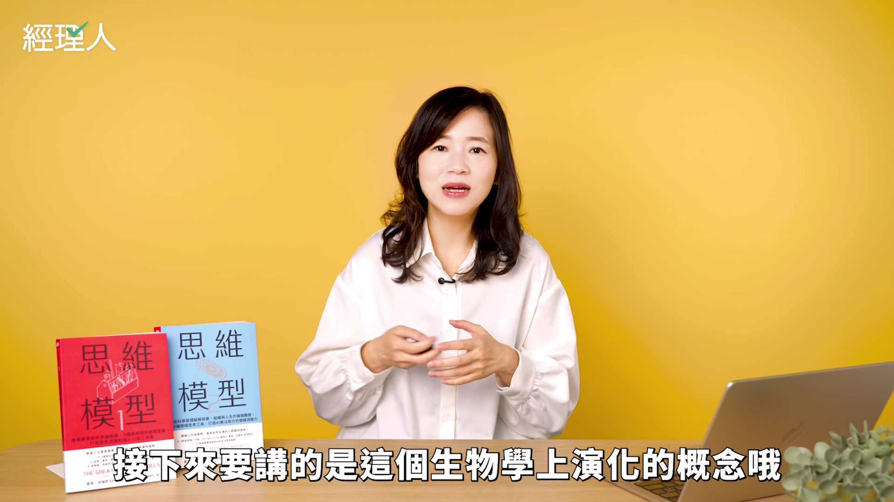

**逐字稿片段：** 演化最早呢是查爾斯達爾文 他在觀察大自然 塑造萬事萬物上面的這個角色 然後他在 物種起源的這本他的著作當中提出了天擇論 這可能是大家國中的時候就學過的概念 天擇的概念就是說 如果有一個生物它的某一項特徵 在某一種環境中越有利 具備那一項特徵的生物就越有可能繁衍後代

**話題推測：** 提及查爾斯·達爾文在《物種起源》中提出的天擇論。

---

## 00:21:15

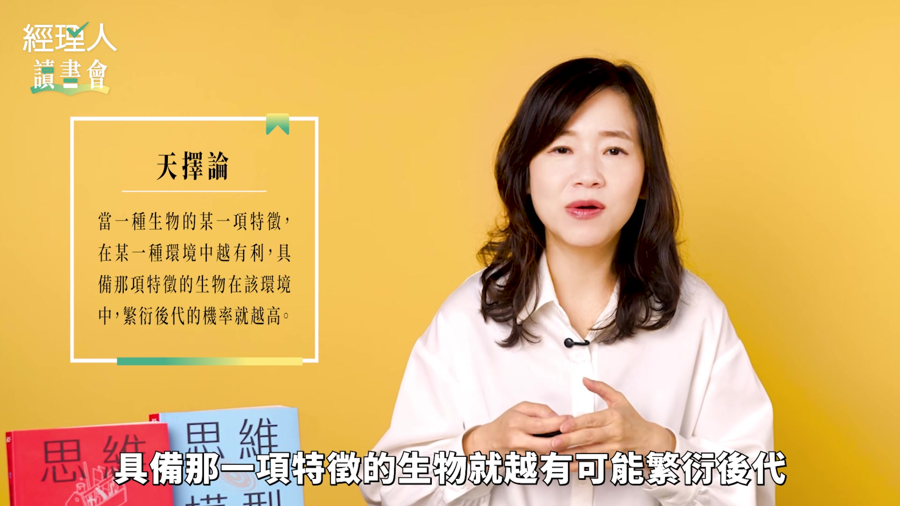

**逐字稿片段：** 比如說跑得快的斑馬比較不容易被獅子吃掉 所以跑得快的斑馬比較有機會存活下來 並繁衍後代 那跑得慢的就會被淘汰 久而久之呢 整個斑馬的族群就會變快 好我們也可以反向思考 如果有一個生物特徵它其實是沒有用途的 具備這樣特徵的生物它就有可能被淘汰 不過呢在這種天擇的情況下 適應的最好最精準的生物 也可能在環境劇烈變動的時候變得很掙扎 就是為了生存而掙扎

**話題推測：** 以跑得快的斑馬為例，說明天擇的概念。

---

## 00:21:48

**逐字稿片段：** 因為一種通才的物種 叫做Generalist Suspicious 它比專才的物種Specialist 這個它的韌性要比較多 那什麼是通才物種 通才物種就是像是老鼠啊蟑螂啊 牠就是能夠適應各種氣候跟環境 牠們沒有很挑剔 食物的來源的這樣子的物種叫做通才物種 但是專才型的動物呢 它就很精準很特定的適合某一個地區 它可能有特定的飲食 它可能就沒有這麼高的韌性 它在適合它的環境中表現的很優異 但是如果環境改變了 它不一定會有一樣的表現 所以如果有一天你從競爭對手那裡挖來一個 對方公司的明星員工 可是你卻覺得哎他為什麼會沒有一樣的表現 你可能就要考慮 那個明星員工他的表現可能跟他當初 所在的環境有很大的關係 好 那我們要怎麼樣 用演化的概念去理解其他的事物？ 因為演化不只是在生物上哦 你也可以想在社會習俗啊 在社會規範啊 在語言上它也有演化 比如說語言它也會承受環境的壓力 像是權力的轉移呀 外來語的進入啊 這個都會對一個語言造成壓力 所以如果一個語言它想要適應下來 它就要能夠吸收其他語言的詞彙 然後這個語言自己還要保持突變 來因應這些變化 持續保持這個語言的實用性 這個語言才能夠存活下來 那我們再講一個生物適應的例子哦 有一種蛾啊 這種蛾很有名 叫樺尺蛾 這種蛾呢大部分的時候體色是很淡的 也就是一種淡色的蛾 但也會有突變的情況下突變出深色的蛾 在正常環境下呢 深色的蛾很顯眼 很快就會被吃掉 但是在工業革命期間 因為有很多煤煙 深色的蛾呢不容易被看見 淺色的蛾呢變成掠食者的目標 所以在工業革命的期間呢 深色的蛾在這個情況下變得更有生存優勢 後來呢當煤煙變少之後 淺色的蛾的數量就又開始回升了 所以呢生物的基因突變啊是可以帶來優勢 但是我們並不知道 在新的環境下什麼樣的特徵會有生存優勢 所以你要知道是一個東西要生存下來 其實需要有的是很多種各式各樣的突變 不斷在各式各樣的環境中接受考驗 那我們接下來要講是 在演化生物學當中 有一個經常來做比喻的 叫做紅皇后效應 Red Queen Effect 它要講的是一個物種啊 當中適應力最低的個體 往往會最先死亡 因為紅皇后效應是認為 生物是不能停止適應環境的 因為你周遭的個體沒有人會停下來 只要你停滯不前 你的競爭地位就會下滑 紅皇后效應呢 一開始是美國的生物學家范海倫 他在1973年的時候 第一次把紅皇后效應這個比喻 應用在演化生物學 因為他認為啊 沒有任何物種能夠永遠免於滅絕 所有的物種呢 都是持續不斷的對環境壓力做出反應 所以他才會引用了這個 愛麗絲夢遊仙境裡面的紅皇后來命名 因為紅皇后跟愛麗絲說 你一定要拼命的跑 才能夠維持自己在同一個地方 所以在生物學中其實這句話意思就是 並不是有一天 獵豹覺得羚羊跑得越來越快了 所以我也一定要越跑越快 其實就是因為獵物的速度變快了 導致只有跑得最快的獵豹能夠抓到羚羊 那久而久之呢 獵豹的這個物種整體的速度就會上升 可是呢相對而言 獵物的本身就開始承受 掠食者的速度變快的這樣的生存壓力 所以獵物的速度也必須跟著越來越快 這就很像是我們講商業競爭當中的軍備競賽 就是一邊變好了另外一邊就會感受到壓力嘛 所以就表示在人群裡我們把它應用在人身上 即使只有一點點的人他想要前進 他想要再快一點 這一點點前進的人 他就可以佔有更多的資源跟優勢 所以如果有更多的人試圖跑得更快 就會對其他人造成一種必須跟上腳步的壓力 所以紅皇后效應呢 它常常被用來分析商業策略 它的意思就是因為不管是一個物種 或是一家企業 都不可能去適應到一個穩定的階段 然後覺得說 宣佈到目前為止這家公司已經打好地基 所以這家公司現在呢可以靠著吃老本過日子 你也不用再去競爭了 這就很像即便你 長久以來都是運動用品品牌的第一大品牌 你也很可能會在意想不到的競爭當中落後 我們往往將現在當下的強大 視為不願意妥協的優勢 可是其實最終如果你從演化的觀點來看 生存下來的並不是強大的人 而是具備適應性的人

**話題推測：** 區分通才物種（Generalist Suspicious）與專才物種（Specialist）。

---

## 00:26:56

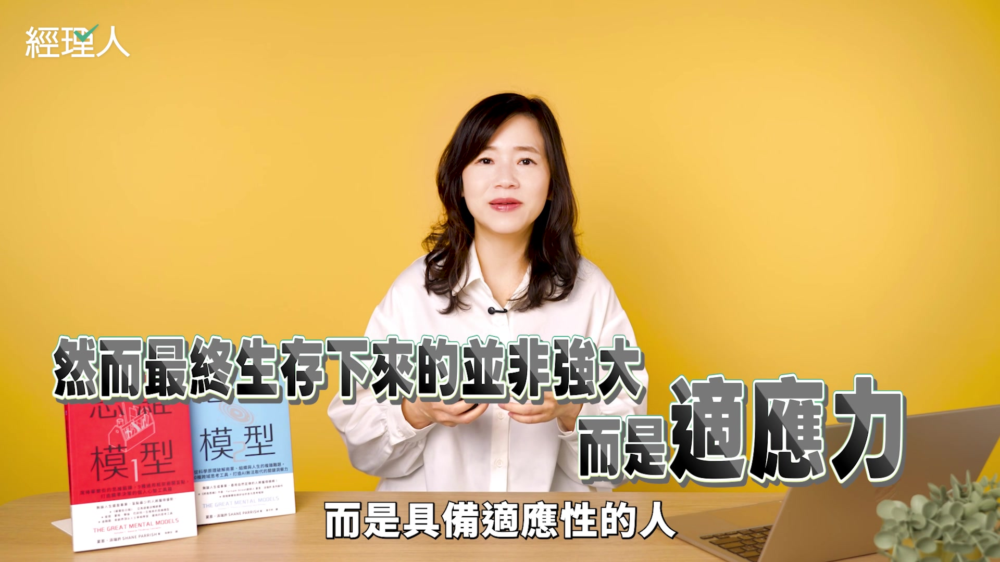

**逐字稿片段：** 演化生物學裡面還有一個概念叫做擴展適應 它指的是一個生物特徵 現在的用途可能不是它 原來的用途

**話題推測：** 介紹演化生物學中的「擴展適應」（Exaptation）概念。

---

## 00:27:06

**逐字稿片段：** 比如說現在大多數鳥類是用羽毛來飛行 羽毛可以幫助飛行 但是當初最初 羽毛出現在恐龍身上是為了保溫 跟吸引配偶 後來呢才在現代的鳥類身上 觀察到羽毛這種結構也有助於飛行 放在這個商業環境裡面呢有很多這樣的例子 我們這邊舉個例子是培樂多黏土哦 你現在想到培樂多 一定會想到小孩子在玩樂的畫面對不對 可是其實培樂多的最初呢 在煤炭還是家庭主要燃料的時期 培樂多有大概有20年的時間 都是一種壁紙的清潔劑 因為當時燃煤會讓牆壁燻滿煙灰 然後大家都會用培樂多來去除這些煙灰 可是後來呢 暖氣系統開始採用電力跟天然氣之後呢 就不用再燃煤了 牆壁就不太需要清潔了嘛 好那你就想那如果你是培樂多的發明人 你是不是會覺得 培樂多已經變成一個要被淘汰 沒有未來的產品 因為我不用再去清潔牆壁的煙灰啦 而幸好呢 這個培樂多這家公司裡的這個 他有一個 家人呢是在當國小老師 這個國小老師就說啊 哦其實呢 我在我的班上 一直把培樂多當成一種勞作的材料 因為培樂多的這個材質是好玩的 而且無毒的 所以他就跟他建議說 哎 你要不要試試看 把培樂多當成兒童玩具來賣呢？ 果然一賣就大獲好評

**話題推測：** 以鳥類羽毛最初用途為保溫，後來用於飛行為例。

---
