# wealth1974_31ZHu4vVukA — 關鍵畫面索引

- 來源逐字稿：[wealth1974_31ZHu4vVukA_GT.srt](wealth1974_31ZHu4vVukA_GT.srt)
- 影片：https://www.youtube.com/watch?v=31ZHu4vVukA
- 截圖數：29

## 00:00:25

**逐字稿片段：** 好 那最近台灣的部分 就是因為選舉快到了 所以政治滿熱的 那相對的股市 就比較稍微冷淡一點 股價波動也滿大的 大家就會比較去關注 回去看一些基本面的事情 然後呢 我們可以看到

**話題推測：** 開始討論台灣股市與政治現況

---

## 00:00:39

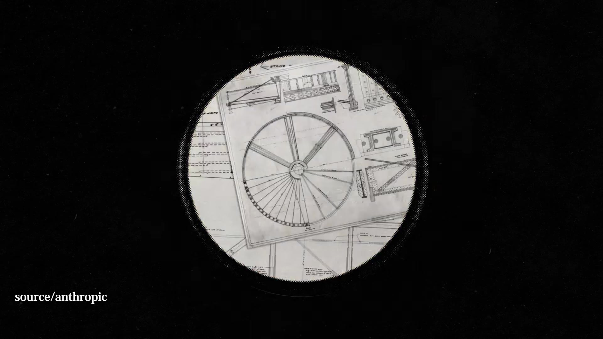

**逐字稿片段：** 美國時間 10 月 16 日 Anthropic 它提交了 IPO 的申請 那這件事從大概今年年中 中間的中 年中的時候就大家一直很關注這件事 終於提交 IPO 了 它在 5 月的時候 它有新一輪的融資 那時候的估值

**話題推測：** 介紹Anthropic提交IPO申請，可能展示新聞畫面或公司資訊

---

## 00:00:57

**逐字稿片段：** 大概就是 9650 億美元 市場目前普遍預估 它上市後估值規模 可能會在 1.5 兆美元到 2 兆美元 非常可怕的一個數字 大家也看到 它 2026 年上半年的營收 大概落在 162.9 億美元 是一個非常非常好的成績 因為它比前一年同期 成長了 1300% 就是 13 倍 不過呢 大家也有發現 它有 807 億元的虧損 那這個虧損呢 主要是因為資本支出 基礎設施的建置 AI 都需要龐大算力 那它在這部分的支出滿多的

**話題推測：** 提及Anthropic新一輪融資估值，可能顯示財務數字圖表

---

## 00:01:36

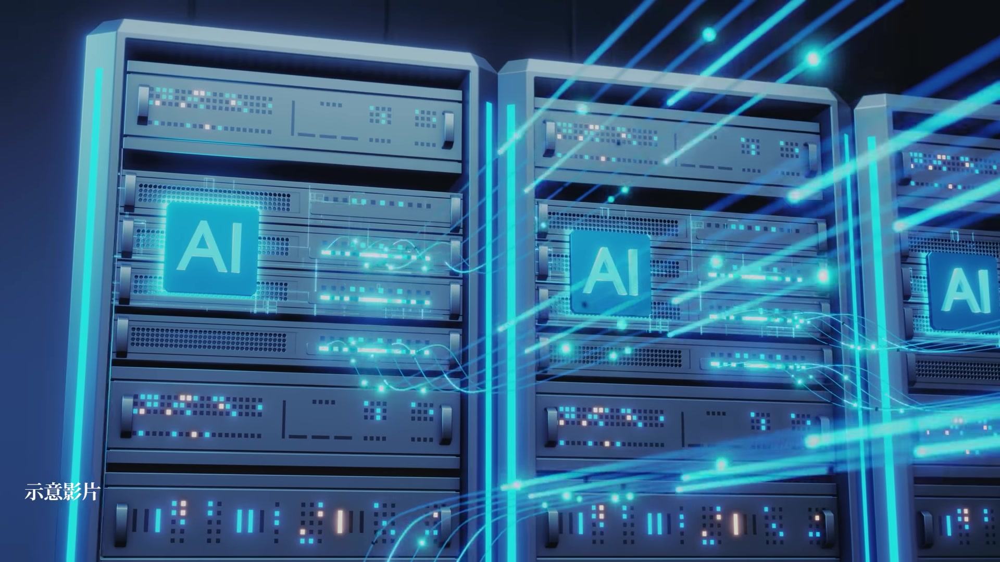

**逐字稿片段：** 它的主要競爭對手 當然就是 OpenAI 跟 Google

**話題推測：** 討論Anthropic的競爭對手，可能顯示競爭公司列表或Logo

---

## 00:01:40

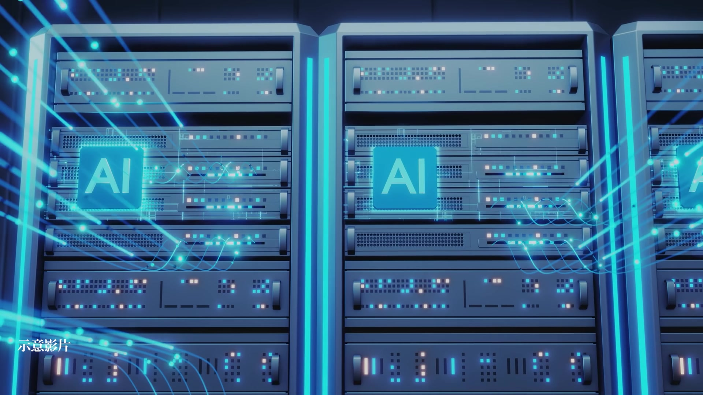

**逐字稿片段：** 接下來就來看一下 Google 好了 就是 Alphabet 在美國時間週三公布的財報 第三季的營收成長也不錯 有 25%

**話題推測：** 轉而討論Google (Alphabet) 公布的財報，可能顯示Google財報摘要或股價走勢

---

## 00:01:49

**逐字稿片段：** 大概在 1276 億美元 不過呢 市場上普遍 對這個數字比較覺得不如預期 財報裡面也有透露 就是因為它的資本支出也滿多的 有超過 510 億美元 更讓市場擔憂的是 它的自由現金流

**話題推測：** 提及Google第三季營收成長率與金額，可能顯示財報數字圖表

---

## 00:02:07

**逐字稿片段：** 已經連續兩個季度是負的 可以看到就是 它不斷的投入資本支出 我們也會持續的替大家來追蹤

**話題推測：** 提及Google自由現金流為負，可能顯示現金流趨勢圖

---

## 00:02:15

**逐字稿片段：** 好 那我們就直接進入今天的主題 談到 AI 資料中心 一直在擴建 一直在擴廠 我們台灣的半導體也有去海外擴廠 有一家公司 其實我在看這篇報導之前 我完全不知道這家公司 它們這家公司的董事長很有趣 他可能一年有三分之二的時間 都在海外 我們開頭的標題 也有唸到就是 它有可能在美國一年的市場 台灣要做 20 年 可不可以先簡單介紹一下 安葆這家公司到底是做什麼的 謝謝匡匡的介紹 然後主要 也想跟大家聊聊安葆這家公司 因為它其實算是一個很利基的這個 AI 的受惠者 那它其實安葆這家公司 簡單來說

**話題推測：** 正式進入影片主軸，討論AI資料中心相關商機

---

## 00:02:57

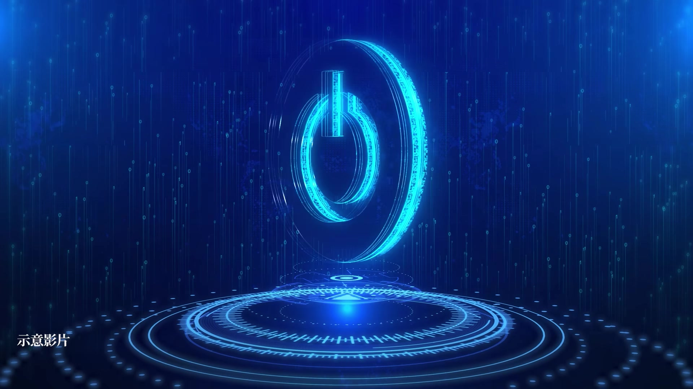

**逐字稿片段：** 它就是做科技大廠的這個備援電力 因為備援電力 而出名的一家公司 那它其實是 1994 年 由這個董事長陳志復創立的 那陳志復他其實算是 相關本科系畢業的

**話題推測：** 介紹安葆主要業務為科技大廠備援電力，可能顯示相關系統示意圖

---

## 00:03:11

**逐字稿片段：** 他是成大機械系畢業的 然後又是這個 清大動力的機械碩士 那他早期這家公司呢 它其實是從做這個發電機買賣 就簡單一開始是做貿易商 那後來因為發電機之後 就接觸到整個能源電力 後來就轉型為

**話題推測：** 提及創辦人陳志復的學歷背景，可能顯示個人簡歷

---

## 00:03:26

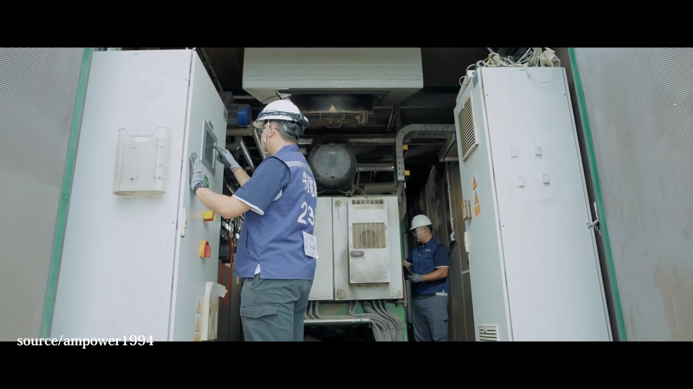

**逐字稿片段：** 這個能源的統包服務商 我們這次約陳董 他其實剛剛一開始有提到說 他其實現在一年 有三分之二的時間都在海外跑 常常沒有約到 下一次可能要隔個一個月後 或是 2-3 個禮拜之後 因為他可能就在美國 或是在歐洲這樣子 那所以我們就知道說 它是跟著哪個半導體大廠 去海外設廠 那它目前呢 現在就是在手的訂單呢

**話題推測：** 說明安葆從發電機買賣轉型為能源統包服務商，可能顯示業務轉型圖

---

## 00:03:50

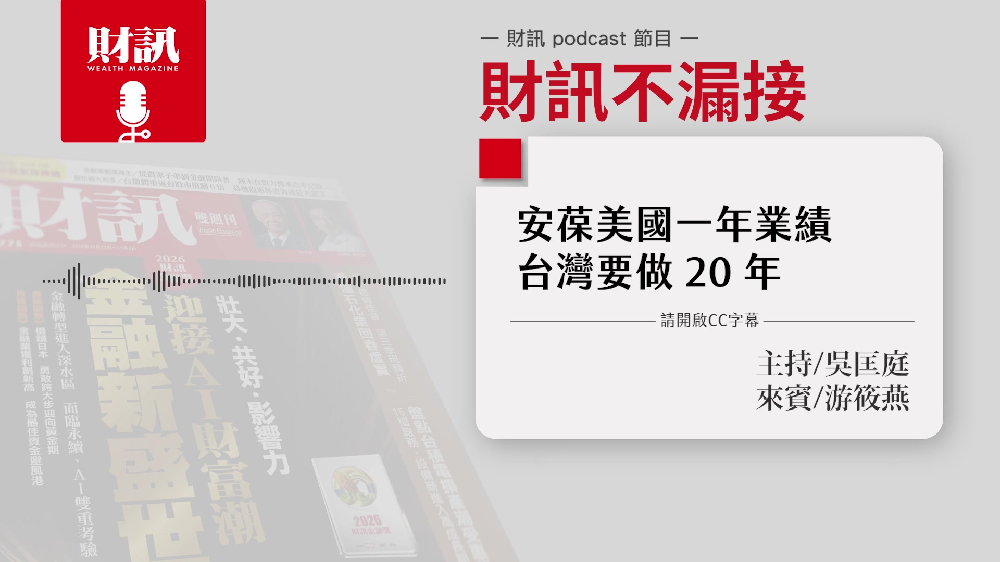

**逐字稿片段：** 大概有 200 億元左右 國內占了 55% 那海外就是以美國跟德國為主 那它的訂單能見度呢 到了 2028 年 甚至到 2030 年 其實就是說 半導體科技大廠它們要建廠 電力就是一個很重要的 它不能因為臨時的停電 或是發生什麼地震 然後讓這個晶圓廠 沒辦法好好的運作 所以大家都會花比較多錢 然後去買這個電力的保險 這也就是它生意的商機這樣子 妳剛剛說它一開始 從發電機起家 那我就很好奇 它為什麼可以成長到這麼厲害 可以跟著半導體去海外擴廠 甚至它在海外跟國內占比 快要 1 比 1 它其實就是 921 大地震的時候 就是竹科大停電 它就是在 10 天以內 就是協助這個晶圓的代工大廠 恢復 90% 的產能 然後大家也都開始漸漸發現說 備用電力是個很重要的事情 發電機不應該只是 躺在一個地下室的設備 它應該可以整合 周遭一些電力設備 然後讓停電這件事情 就是一停電之後 然後馬上就有備援電力的出現 然後讓整個繼續運作 它這個業績我覺得也滿特別 就是你可以看出說 它其實現在主要的客戶都是誰 2024 年底的時候 這個晶圓代工大廠的營收占比是 68% 然後到 2025 年的時候 就到了 75% 那預計在今年 就是 2026 年 它這個在它的占比 就是突破 8 成 所以就知道說 它其實主要的大客戶 就是那一家大公司 對 就只有那一家嗎 還有很多家 還有很多家 但是就是 主要都是晶圓代工廠 對對對 那它的客戶其實還有 就是美光 南亞科 廣達 國泰金 中信金 證交所 還有醫學中心 就是你只要想到 就是需要大電力的 然後需要 不可以沒有電的這些 其實滿多都是它客戶 因為它跟著這個晶圓代工大廠 已經 20 幾年了 那口碑也慢慢建立 就是除了它們以外 然後其他相關產業也會找上它 那它其實也滿厲害 就是他有跟我講一個數字 我覺得也滿驚人 就是說它在全台灣 維護的這個備用電力 它如果同步啟動的時候

**話題推測：** 提及安葆目前在手訂單金額，可能顯示訂單數據圖表

---

## 00:05:54

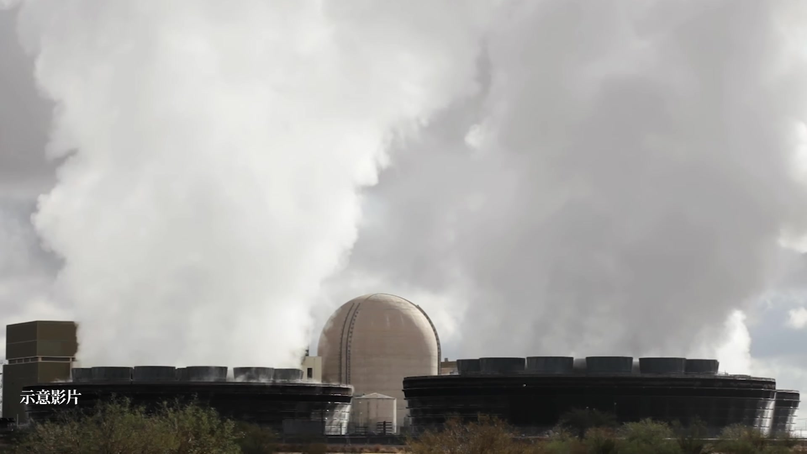

**逐字稿片段：** 相當於 1.5 座核三廠 對 你就知道說 哇 電力的隱形冠軍 聽起來非常厲害 那我自己切身經驗的感受就是 如果沒有備援電力的話 突然停電 然後你又在使用電腦 那電腦突然沒電 那你就會很痛苦 更何況是晶圓代工大廠 它們那個只要一停電 然後沒有備援電力 那真的損失真的是非常非常慘重 就用數十億元計算的 它的客戶還有證交所 我覺得證交所要有電這件事情 也非常重要 那它除了在半導體以外 它在其他領域上面 有沒有什麼布局呢 就我有去側訪其他的同業 那我就問到一位

**話題推測：** 提及安葆維護的備用電力相當於1.5座核三廠發電量，可能顯示能源圖表或比較圖

---

## 00:06:32

**逐字稿片段：** 就是光宇應材的總經理 他就跟我說 安葆除了做這個備援電力 它也一直在想說要怎麼創新 然後讓系統升級 所以他說它幫光宇應材 建置全台灣

**話題推測：** 提及受訪者光宇應材總經理，可能顯示其照片或公司Logo

---

## 00:06:42

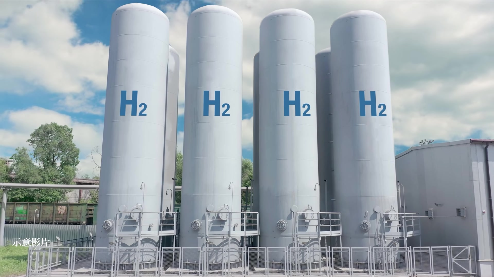

**逐字稿片段：** 第一座的氫氣內燃機發電系統 就說只要跟電有關的 然後像我們知道氫 氫能源是一個比較新的議題 它也很願意嘗試 就是做這樣的系統整合 我就說那你還覺得 跟它合作上面 有什麼比較特別的事情 然後那個光宇應材的總經理 就跟我說 他說像這個內燃發電機 它其實主要的設備是來自德國 那安葆就負責這系統整合 德國原廠零件 它其實就有一次就是壞掉了 然後德國那邊跟他回覆說 你要等一個月 但是你在做生意你不可能 你不可能要等一個月 那這整個就停擺了 陳董就親自幫他去德國 然後去調貨 然後去幫他就是爭取 他的一些人情

**話題推測：** 介紹安葆協助光宇應材建置台灣首座氫氣內燃機發電系統，可能顯示系統示意圖

---

## 00:07:21

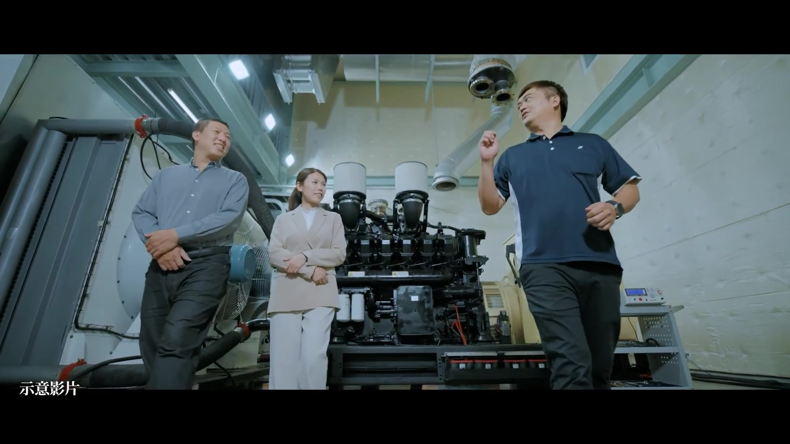

**逐字稿片段：** 所以它在一週以內 就運抵台灣來 然後這是讓他印象非常深刻 就是說安葆不只就是 整合系統以外 它可以做這個客戶服務 然後也是很迅速的 就是幫客戶解決一些問題 這件事情也可以證明說 為什麼這家半導體科技大廠 跟它就是很緊密的合作 然後也離不開它這樣子 因為它就是懂設備 然後也懂客戶的痛點在哪裡 然後還可以幫客戶解決問題 那我們一開始就有說 就是美國的市場 它可能一年台灣要做 20 年 那所以美國市場具體來講 到底是什麼樣的訂單 讓它有這麼看好的前景呢 對 就是要形容說 其實美國市場有無限大 此時此刻來講 然後因為它在美國的市場情形 是很看好的 那它其實也轉型 做這個機電工程統包商 就說我今天不只做備援電力 跟主要電力 然後我也可以包下整個機電工程 所以它去拿下了

**話題推測：** 講述安葆董事長親自協調德國零件，將等待時間從一個月縮短至一週，展現服務能力

---

## 00:08:14

**逐字稿片段：** 這個亞利桑那州 跟德州的總承包商 跟電氣機械的承包資格 然後它也接洽了美國的雲端大廠 還有 AI 資料中心的一些案場 所以我們就大概預估出 它的潛在規模

**話題推測：** 提及安葆在美國亞利桑那州和德州取得總承包商與電氣機械承包資格，可能顯示美國地圖或資格證明

---

## 00:08:27

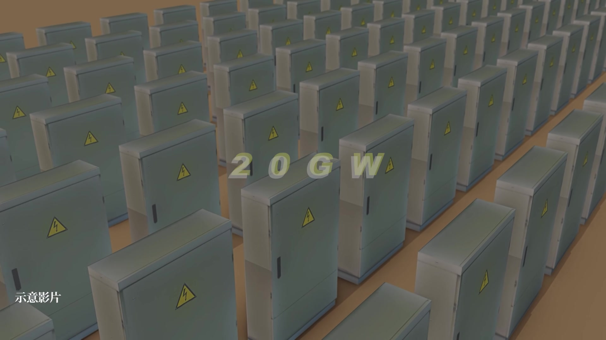

**逐字稿片段：** 就是有 20 GW 這個是滿大一個商機 因為我們知道 台灣全島的尖峰發電量

**話題推測：** 提及安葆在美國市場的潛在規模達20 GW，可能顯示電力規模圖表

---

## 00:08:33

**逐字稿片段：** 大概是 36 GW 就已經是台灣的一半了 然後再來是說在法人圈 覺得它很有潛力的看法 是因為他們覺得 安葆它已經可以從備用電力 轉成 24 小時在運轉的主要電力 像之前有傳出說就是 大家知道說星際之門這個案子 就是 OpenAI 跟軟銀 還有甲骨文 要在四年內 投入 5000 億美元去建置 大規模的人工智慧資料中心 跟算力的基礎設施 大家都在傳言說 安葆有可能可以接下這件事情 就是說因為星際之門 它是算力中心 24 小時的算力中心 它遇到電的問題更多 然後需要維運的這個部分更多 法人就在預估說 它可能一年可以鎖住 3-4 億美元的營收 用 32 元台幣去換算 就是 96 億元到 128 億元台幣 128 億元 就是它過去的營收的兩倍以上 所以市場上也對它很看好 然後我們就問陳董說 是不是有這件事情 他只是說 他有去美國 然後有在接觸這件事情 只是沒有定案 公司公告為準 最近它也在美國

**話題推測：** 比較安葆潛在規模與台灣尖峰發電量 (36 GW)，可能顯示台灣電力地圖或比較圖

---

## 00:09:38

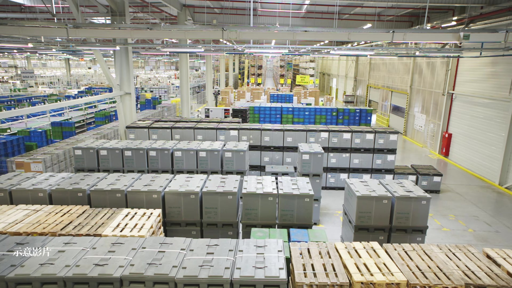

**逐字稿片段：** 就是租下了大型的倉庫 所以你就可以知道說 他一定是有他的動作跟想法 但是其實陳董 算是一個滿保守穩健的人 但是我們也跟讀者溝通說 目前市場上會看好它 原因主要是這一個 瞭解 這樣聽起來 不管是國內或國外 它的訂單都滿多的 它到底要怎麼消化這些訂單呢 所以它也很積極的在擴廠 因為剛才有講 現在也是很缺工 所以他也在想說

**話題推測：** 提及安葆在美國租下大型倉庫，顯示其積極佈局當地市場

---

## 00:10:04

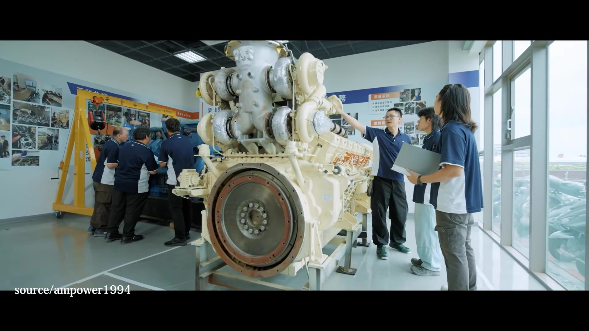

**逐字稿片段：** 要如何的預製化跟模組化 譬如說在台灣的工廠 可以組裝再外銷 降低海外現場施工依賴 那台灣的工廠現在也都滿載 所以它就必須還要再建新廠 所以它的台南二廠是在今年

**話題推測：** 提及安葆透過預製化與模組化來消化訂單及應對缺工問題，可能顯示製程圖

---

## 00:10:19

**逐字稿片段：** 就是 2026 年 9 月的時候剛動土 在 2027 年第三季 預計就可以完工 除了台南二廠以外 還有一個屏東保稅工廠 它是在 2027 年的第一季 預計那時候動工 那它主要會生產 外銷的配電盤跟儲能的電池櫃 就是說自製率提高以後 也可以把這個獲利 然後一起提升這樣子 那我後來再去問一下業界說 對這個陳志復陳董的看法是什麼 然後他們就說 聊天的時候陳董都會一直在講說 我們要怎麼組建台灣隊 然後一起打世界盃 就他都心心念念說 台灣的要怎麼一起 就比如說像 施耐德電機的郭念慈董事長 他就講說滿欣賞陳董這一點 他也覺得陳董在整個

**話題推測：** 提及安葆台南二廠於2026年9月動土，可能顯示廠區模擬圖或動土儀式照片

---

## 00:10:59

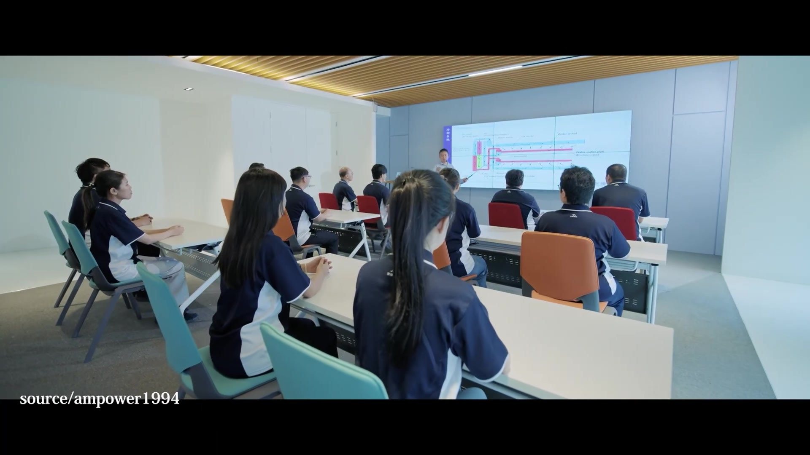

**逐字稿片段：** 培養人才這方面 就是不遺餘力 我們也知道說 現在其實人工人才都非常缺乏 那陳董他當然也看到這一點 所以他也希望說可以把公司做好 然後多吸引一些年輕的員工 來加入他們的團隊 滿值得鼓勵的 對這間公司長期來看 也都是滿好的 那如果我們回到投資面來看的話 這家公司它有沒有什麼挑戰 或者是我們應該關注它 幾個利基點 它的優勢在呢 我每次問公司的那個機會與挑戰 現在很多公司都會跟我說

**話題推測：** 提及陳志復董事長在人才培養方面的不遺餘力

---

## 00:11:32

**逐字稿片段：** 現在最大的挑戰就是找不到人 當然安葆也是這個狀況 它的機會呢 就剛剛有提到說 美國市場機會很大 然後我又再跑去問了法人 然後就市場對它們的潛力 看法是什麼 就除了剛剛講的那個星際之門 那個是只是說 可能會發生的這個前景以外 它目前正在發生的事情 就是有不斷的在自我研發 不斷電的負載轉移系統

**話題推測：** 討論安葆面臨的挑戰，主要為人才缺乏

---

## 00:11:54

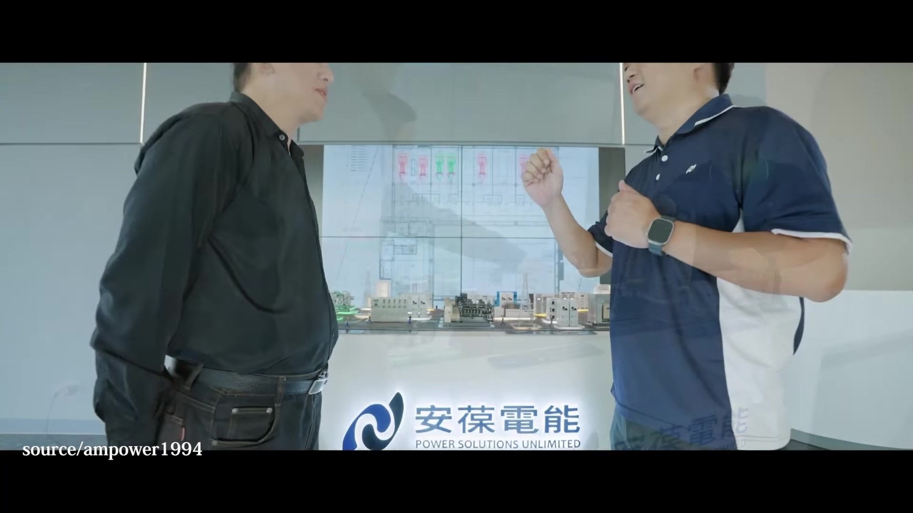

**逐字稿片段：** 就是它可以毫秒級的無縫切換 就停電你還是沒有感覺 馬上備援電力都上場了 然後它也包下了這個

**話題推測：** 提及安葆研發毫秒級無縫切換的不斷電負載轉移系統，可能顯示技術示意圖

---

## 00:12:02

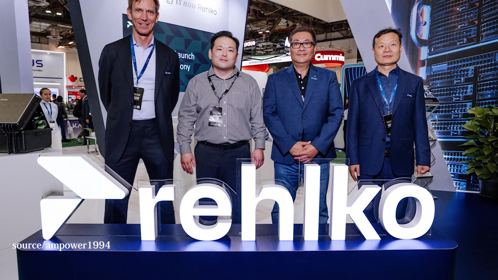

**逐字稿片段：** 美國的一家叫做科勒能源 這家公司它的亞洲 幾乎所有的產能跟訂單 都被安葆包下來 這家公司其實是這個 電力系統製造商 它是美國的一家百年的公司 安葆就是除了代理 這家公司的這些發電機 還有這些設備 它也去整合它的系統 然後一起把它賣到 半導體晶圓大廠 跟一些 AI 資料中心 所以它跟這家公司合作很緊密 然後這家公司 在全球算是領導廠商 所以大家要買這家公司的發電機 就必須要由安葆來賣出來 然後透過安葆的這個 電力的系統整合 而且整個發電機的交期

**話題推測：** 提及安葆包下美國科勒能源亞洲幾乎所有產能與訂單，可能顯示合作關係圖

---

## 00:12:35

**逐字稿片段：** 已經到 2030 年 安葆在這個方面

**話題推測：** 提及發電機交期已排到2030年，可能顯示訂單排程圖

---

## 00:12:38

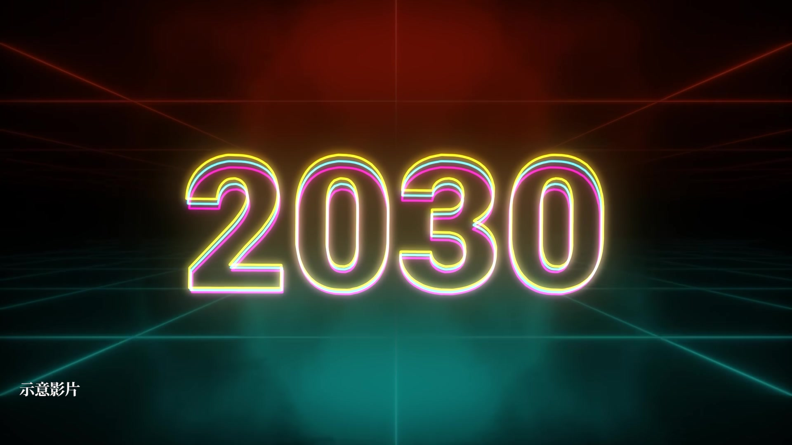

**逐字稿片段：** 它具有這個定價權 然後再來是說 安葆最近的毛利率

**話題推測：** 說明安葆在發電機供應上具有定價權，顯示其市場地位

---

## 00:12:42

**逐字稿片段：** 也慢慢的在提升 因為早期有一些低毛利的專案 就是陸續結案 它從去年陸續向半導體客戶 調升報價 然後再來是 剛剛有提到說 它陸續拿到海外的一些證照的話 可以接下海外的 EPC 的統包 然後機電工程的統包的話 統包的付款條件通常比較好 然後比較可以跟客戶要到錢 然後毛利也比較高 所以這些都會是 未來整個安葆的成長的前景 瞭解 那完成這次的報導 筱燕自己有沒有什麼心得或想法 或是想要補充的 是 我覺得最近都有為讀者 挖掘到一些滿不錯的公司 你過去也覺得它可能是傳統產業 像是安葆 電力公司 會覺得好像滿傳統的 不這麼高科技 事實上高科技都很依賴它們 像是我之前有採訪過一家公司 叫做宏偉電機 它就是做也是 半導體晶圓大廠的貨梯 全亞洲也算是數一數二的公司 我覺得說隨著半導體科技大廠 要去海外設廠 你就會陸陸續續發現到說 原來有這麼多隱形冠軍的公司 都在我們周邊 然後跟著一起成長 我覺得雖然說 大家關注都在 AI 事實上還有很多傳統產業 都是跟著 AI 一起起飛 我覺得說我們會持續的幫讀者 挖掘一些好公司 然後來跟讀者分享 好 但最後還是要小小提醒一下 投資都是有風險的 尤其最近股市波動比較大 大家還是要審慎的判斷 好 感謝筱燕的分享 聽完今天的節目 你認為 AI 資料中心帶動的

**話題推測：** 提及安葆毛利率逐漸提升的趨勢，可能顯示毛利率圖表

---
